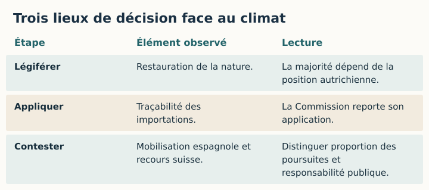

# CCINP — Espagnol LVA 2026 · Corrigé guidé

*Corrigé rédigé par IA, non officiel. Signalez toute erreur.*

**Rédaction** · GPT-6.2 Astra Ultra · vitesse non renseignée

## Lire la consigne

Le fascicule accorde trois heures pour une synthèse en espagnol de 400 mots, titre inclus, avec une tolérance de 10 %. Les 4 documents ont le même poids. L’introduction doit identifier simplement la source et la date de chacun. La numérotation des documents peut ensuite servir de repère.

## Croiser les documents

Les quatre éditoriaux appartiennent au même journal ; les dates distinguent les voix dans l’introduction. L’extrait de juin porte sur un texte adopté à une majorité étroite. Celui d’octobre évoque notamment une obligation de traçabilité reportée. Le vote autrichien concerne le premier, le délai d’un an la seconde.

Pour passer à la mobilisation citoyenne, comparer ce que l’éditorial de janvier demande aux juges espagnols avec ce que le tribunal de Strasbourg constate dans le recours suisse. L’affaire porte sur les articles 8 et 6 de la Convention. Le texte insiste sur la valeur du précédent et sur l’absence de sanction. Cette distinction donne à la dernière partie un objet plus précis qu’une opposition générale entre partisans et adversaires de la transition.

## La política climática europea entre las urnas, la protesta y los tribunales

Cuatro textos de El País, del 18 de | junio, el 16 de enero, el 7 de octubre y el 11 de abril de 2024, examinan las dificultades para | convertir los compromisos ecológicos en decisiones efectivas. ¿De qué recursos disponen las instituciones y la ciudadanía cuando el coste político | de actuar parece más inmediato que el de aplazar una medida?

La aprobación de la norma europea sobre restauración natural | muestra tanto la capacidad de acordar objetivos como la fragilidad del respaldo obtenido. Para 2030 se pretende recuperar al menos | una quinta parte de los hábitats autóctonos deteriorados. El cambio de voto austríaco permitió superar por poco el umbral de | población exigido para la mayoría cualificada, a costa de tensiones en la coalición nacional. Aunque una agricultura sostenible se beneficia | de acuíferos y suelos sanos, algunos productores temen tener que asumir una parte excesiva del esfuerzo. La derecha radical ha | aprovechado esa inquietud y parte del centroderecha europeo teme perder electores.

Esa presión se aprecia asimismo después de la votación. | La Comisión aplazó un año la exigencia de acreditar que determinados productos importados no procedieran de terrenos recientemente deforestados. Las | concesiones anteriores relativas a pesticidas o emisiones de vehículos apuntan en la misma dirección. Según los editoriales, hacer justa la | transición exige atender al reparto de los costes; retrasarla también perjudica a la población actual y a las generaciones futuras. | La responsabilidad de sostener los compromisos alcanza a los socios de la presidenta de la Comisión.

La sociedad civil dispone | de vías muy distintas para reclamar ese cumplimiento. Las acciones de Futuro Vegetal dieron visibilidad a la emergencia, aunque interferir | con los desplazamientos o afectar al patrimonio puede alejar al público. Reconocer límites a la desobediencia tampoco autoriza una respuesta | penal desproporcionada: el editorial de enero cuestiona que se equipare al activismo con una organización criminal. En cambio, unas jubiladas | suizas acudieron a Estrasburgo tras agotar los recursos internos. Allí lograron que se reconocieran tanto la protección insuficiente de su | vida privada y familiar como las deficiencias de la respuesta judicial nacional. El fallo no impone una sanción económica, pero | ofrece a otros demandantes un precedente sobre la responsabilidad estatal. Ante el retroceso político, el debate europeo abarca así dos | exigencias distintas: proteger la participación democrática y someter la actuación de los gobiernos a obligaciones jurídicas.

*396 mots, titre inclus. Une barre marque chaque vingtième mot.*

[Sujet officiel](https://www.concours-commun-inp.fr/_resource/annales%20%C3%A9crits/2026/Ep%20communes/2026_LVA6AU.pdf#page=2) · [Rapport du jury, espagnol](https://www.concours-commun-inp.fr/_resource/annales%20%C3%A9crits/2026/Ep%20communes/LV_ECRIT_2026_05.10.pdf#page=19)
