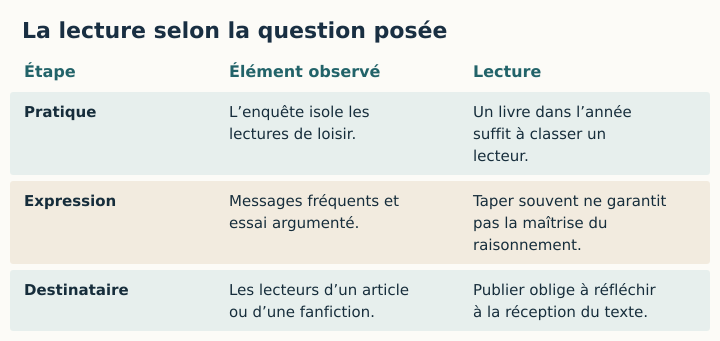

# CCINP — Italien LVA 2026 · Corrigé brut

*Corrigé rédigé par IA, non officiel. Signalez toute erreur.*

**Rédaction** · GPT-6.2 Astra Ultra · vitesse non renseignée

## Le pagine e gli schermi dei giovani lettori italiani

Divercity del 7 settembre 2023, Scrivere è vivere del 4 ottobre | 2024, news48 del 4 ottobre 2021, Glicine del 2 luglio 2023 e Benbow del 4 novembre 2023 esaminano pratiche che | gli adulti talvolta faticano a riconoscere. Che cosa leggono e scrivono oggi i ragazzi, e come possono imparare a capire, | discutere e produrre testi destinati a lettori reali?

L'accusa di disaffezione al libro va confrontata con le abitudini dell'intera popolazione. | Secondo i dati Istat riportati da Glicine, nel 2022 soltanto il 39 per cento degli italiani dai sei anni in | su aveva letto almeno un libro per motivi estranei allo studio o al lavoro, contro il 47 per cento del | 2010. La quantità di titoli pubblicati, circa settantasettemila in un anno, non basta a creare lettori. Proprio gli undicenni e | i quattordicenni appartengono, insieme ai coetanei delle età intermedie, a una delle fasce che leggono di più. Bigli invita perciò | gli adulti a interrogarsi sul modello che offrono e a far conoscere ai ragazzi anche opere contemporanee adatte ai loro | interessi.

Il supporto modifica inoltre ciò che si osserva. I messaggi scambiati sul telefono sono pur sempre scritti e si | può ascoltare un libro senza sfogliarlo. Tuttavia, come nota Perotti, comunicare spesso non garantisce la capacità di costruire un ragionamento. | Alla richiesta di controlli scolastici periodici sulla lingua risponde distinguendo gli errori effettivi dalle trasformazioni dell'uso. La questione riguarda anche | l'informazione: per Corbo raccogliere continuamente notizie in rete non equivale a saperne verificare la provenienza o stabilire quali siano importanti. |

La scuola e gli spazi digitali possono offrire occasioni per mettere alla prova queste capacità. Intervistare una fonte, selezionare i | fatti e scrivere per un sito obbliga a prevedere le domande del pubblico e permette di partecipare al dibattito. Con | un fine diverso, il corso presentato da Benbow propone di far vivere storie nuove dentro un universo narrativo già condiviso: | su Wattpad chi scrive incontra lettori che reagiscono e può capire che cosa renda un racconto accessibile. In entrambe le | attività, avere un destinatario dà un motivo concreto per rivedere ciò che si è scritto. La proposta di Bigli di | riservare ogni giorno tempo alla lettura trova così un complemento nelle occasioni di scrittura: la familiarità con i dispositivi può | diventare esercizio di attenzione, purché qualcuno aiuti a scegliere le opere, vagliare le notizie e dare forma alle idee.

*399 mots, titre inclus. Une barre marque chaque vingtième mot.*

[Sujet officiel](https://www.concours-commun-inp.fr/_resource/annales%20%C3%A9crits/2026/Ep%20communes/2026_LVA6AU.pdf#page=6) · [Rapport du jury, italien](https://www.concours-commun-inp.fr/_resource/annales%20%C3%A9crits/2026/Ep%20communes/LV_ECRIT_2026_05.10.pdf#page=23)
