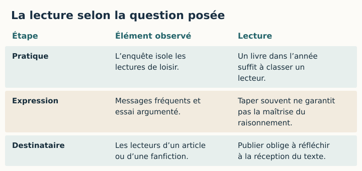

# CCINP — Italien LVA 2026 · Corrigé guidé

*Corrigé rédigé par IA, non officiel. Signalez toute erreur.*

**Rédaction** · GPT-6.2 Astra Ultra · vitesse non renseignée

**Révision (tour 1)** · GPT-6.2 Astra Ultra · vitesse non renseignée

## Lire la consigne

Le fascicule accorde trois heures pour une synthèse en italien de 400 mots, titre inclus, avec une tolérance de 10 %. Les 5 documents ont le même poids. L’introduction doit identifier simplement la source et la date de chacun. Le rapport commun demande aussi le numéro de chaque document dans l’introduction. Chaque source et chaque date de cette introduction comptent chacune pour un mot.

## Croiser les documents

Les cinq sources ne mesurent pas la même chose. L’Istat compte une lecture de loisir au moins dans l’année, chez les personnes de six ans et plus. Ce critère n’englobe pas tous les messages, articles ou contenus lus en ligne ; l’observation de nombreux usages numériques ne réfute donc pas le chiffre de 39 %. Le rapport relève la tension entre la faible proportion de lecteurs et l’abondance des livres publiés.

Pour croiser les documents 3 et 5, identifier leur destinataire. L’enquête journalistique choisit et vérifie des sources pour des lecteurs qui veulent s’informer ; la fanfiction fait varier un univers connu devant un public qui peut réagir. On peut ensuite relier les deux activités au problème d’argumentation posé par Perotti, en gardant leur différence de but.

La couverture du livre de Bigli, p. 7, accompagne l’entretien sur l’éducation à la lecture. À la p. 9, les figurines disposées autour d’une machine à écrire font écho à la réutilisation de personnages dans la fanfiction. Le texte présente Wattpad comme lieu de publication.

Le titre compte 9 mots. Les paragraphes en comptent respectivement 54, 117, 82 et 145, pour un total de 407. Les repères sont placés après chaque groupe de vingt, titre compris. L’indication du total, puis FIN, suivent la composition.

## Le pagine e gli schermi dei giovani lettori italiani

Divercity (Doc.1, 07/09/2023) e Glicine (Doc.4, 02/07/2023) discutono chi legga in | Italia. Scrivere è vivere (Doc.2, 04/10/2024) esamina la scrittura giovanile, news48 (Doc.3, 04/10/2021) il giornalismo a scuola e Benbow. Scrittura e narrazione (Doc.5, 04/11/2023) la | fanfiction. Che cosa leggono e scrivono oggi i ragazzi, e come possono imparare a capire, discutere e produrre testi destinati | a lettori reali?

L'accusa di disaffezione al libro va confrontata con le abitudini dell'intera popolazione. Secondo i dati Istat riportati | da Glicine, nel 2022 soltanto il 39 per cento degli italiani dai sei anni in su aveva letto almeno un | libro per motivi estranei allo studio o al lavoro, contro il 47 per cento del 2010. La quantità di titoli | pubblicati, settantasettemila nel 2022, circa duecentodieci al giorno, non basta a creare lettori. La fascia dagli undici ai quattordici anni | è fra quelle che leggono di più, e le donne restano fra le lettrici più assidue. Bigli invita perciò gli | adulti a interrogarsi sul modello che offrono e a far conoscere ai ragazzi anche opere contemporanee adatte ai loro interessi. |

Il supporto modifica inoltre ciò che si osserva. I messaggi scambiati sul telefono sono pur sempre scritti e si può | ascoltare un libro senza sfogliarlo. Tuttavia, come nota Perotti, comunicare spesso non garantisce la capacità di costruire un ragionamento. Alla | richiesta di seicento studiosi di verificare periodicamente le competenze linguistiche risponde distinguendo gli errori effettivi dalle trasformazioni dell'uso. La questione | riguarda anche l'informazione: per Corbo raccogliere continuamente notizie in rete non equivale a saperne verificare la provenienza o stabilire quali | siano importanti.

La scuola e gli spazi digitali possono offrire occasioni per mettere alla prova queste capacità. Intervistare una fonte, | selezionare i fatti e scrivere per un sito obbliga a prevedere le domande del pubblico e permette di partecipare al | dibattito. Con un fine diverso, il corso presentato da Benbow propone di far vivere storie nuove dentro un universo narrativo | già condiviso: su Wattpad chi scrive incontra lettori che reagiscono e può capire che cosa renda un racconto accessibile. In | entrambe le attività, avere un destinatario dà un motivo concreto per rivedere ciò che si è scritto. La proposta di | Bigli di concordare una pausa quotidiana di lettura in cambio del tempo al cellulare trova così un complemento nelle occasioni | di scrittura: la familiarità con i dispositivi può diventare esercizio di attenzione, purché qualcuno aiuti a scegliere le opere, vagliare | le notizie e dare forma alle idee.

*407 parole, titolo compreso.*

FIN

[Sujet officiel](https://www.concours-commun-inp.fr/_resource/annales%20%C3%A9crits/2026/Ep%20communes/2026_LVA6AU.pdf#page=6) · [Rapport du jury, italien](https://www.concours-commun-inp.fr/_resource/annales%20%C3%A9crits/2026/Ep%20communes/LV_ECRIT_2026_05.10.pdf#page=23)
