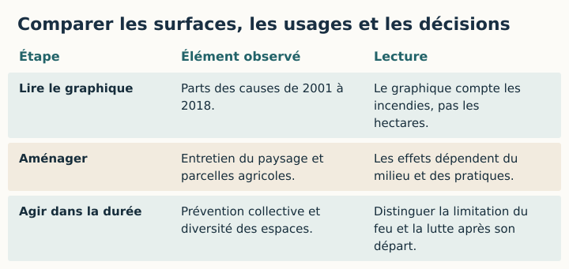

# CCINP — Portugais LVA 2026 · Corrigé brut

*Corrigé rédigé par IA, non officiel. Signalez toute erreur.*

**Rédaction** · GPT-6.2 Astra Ultra · vitesse non renseignée

## Incêndios em Portugal e no Brasil entre o custo dos danos e o trabalho de prevenção

A Socicana, consultada em | 14 de agosto de 2025, o ECO de 17 de setembro de 2024, o portal Florestas, consultado em 14 de | agosto de 2025, a Embrapa de 10 de janeiro de 2025 e o mesmo portal em 18 de setembro de | 2019 examinam os incêndios a diferentes escalas. Como relacionar a origem dos fogos com as perdas que provocam e com | as formas de reduzir a vulnerabilidade dos territórios?

O gráfico português distribui o número de ocorrências entre 2001 e 2018 | segundo quatro categorias. Os reacendimentos tinham grande peso no início da série; nos anos finais, a negligência ocupa uma parcela | muito maior, ao passo que as causas naturais representam uma fração pequena. Contar ocorrências não permite medir a superfície ardida. | Contudo, a importância das condutas humanas ajuda a compreender por que razão, no Brasil, a Socicana e o município de | Guariba envolveram cerca de trezentos alunos em atividades de prevenção. Esperam que os estudantes transmitam às famílias e aos colegas | o que aprenderam.

Os prejuízos ultrapassam o local onde o fogo começa. A Embrapa descreve perdas de animais, instalações, matéria | orgânica e biodiversidade, além dos efeitos da fumaça sobre moradores e transportes. Em Portugal, os dados apresentados pelo ECO mostram | que o emprego no comércio e no turismo perde dinamismo, embora algumas atividades, como os seguros, possam ganhar trabalho. Uma | projeção para 2030 estima perdas anuais de milhões de euros associadas à diminuição das chegadas de turistas. O efeito acumulado | sobre uma região não se deduz, portanto, do resultado isolado de um setor.

As respostas também variam conforme o uso | da terra. Em Portugal, o portal Florestas relaciona a menor incidência de incêndios destrutivos mais diretamente com a gestão agrícola | do que com a simples presença de habitantes. Onde o rendimento do trabalho é reduzido, o apoio público pode remunerar | a contribuição da agricultura para a proteção da paisagem. No Brasil, a Embrapa salienta que os resíduos vegetais que protegem | o solo também podem aumentar a exposição ao fogo; o pastoreio controlado permite diminuir esse risco e alimentar os animais. | A instituição defende investimentos contínuos, gestão local e acompanhamento transparente. Assim, os conhecimentos difundidos pela escola ganham alcance quando encontram | agricultores com meios para cuidar das terras e políticas capazes de manter esse trabalho de um ano para o outro. |

*400 mots, titre inclus. Une barre marque chaque vingtième mot.*

[Sujet officiel](https://www.concours-commun-inp.fr/_resource/annales%20%C3%A9crits/2026/Ep%20communes/2026_LVA6AU.pdf#page=10) · [Rapport du jury, portugais](https://www.concours-commun-inp.fr/_resource/annales%20%C3%A9crits/2026/Ep%20communes/LV_ECRIT_2026_05.10.pdf#page=26)
