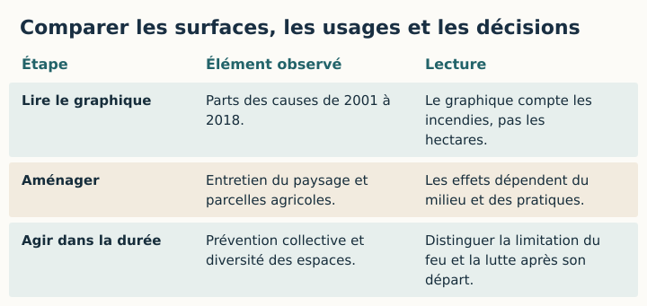

# CCINP — Portugais LVA 2026 · Corrigé guidé

*Corrigé rédigé par IA, non officiel. Signalez toute erreur.*

**Rédaction** · GPT-6.2 Astra Ultra · vitesse non renseignée

**Révision (tour 1)** · GPT-6.2 Astra Ultra · vitesse non renseignée

## Lire la consigne

Le fascicule accorde trois heures pour une synthèse en portugais de 400 mots, titre inclus, avec une tolérance de 10 %. Les 5 documents ont le même poids. L’introduction doit identifier simplement la source et la date de chacun. Le rapport commun demande aussi le numéro de chaque document dans l’introduction. Chaque source et chaque date de cette introduction comptent chacune pour un mot.

## Croiser les documents

La cinquième pièce est un graphique empilé. Lire l’épaisseur de chaque bande entre 2001 et 2018, et non la hauteur de sa bordure supérieure. L’ordonnée est la part du nombre total des incendies ; ni les surfaces brûlées ni les montants en euros ne figurent dans le graphique. Les reprises dominent une partie du début de période ; la négligence occupe une bande nettement plus large en fin de période.

L’article du portail ECO compare les effets selon les secteurs et distingue les observations sur l’emploi d’une projection concernant les touristes en 2030. Pour relier les deux pays, partir ensuite du rôle de l’agriculture, tout en gardant les échelles : parcelles entretenues au Portugal, bénéfices et risques des résidus de cultures annuelles au Brésil. L’action menée avec les écoles de Guariba donne un exemple de prévention collective.

Pour 2030, ECO distingue les pertes de recettes associées aux arrivées de touristes résidents et étrangers. Les valeurs sont exprimées en millions d’euros par an. Le document 5 permet une comparaison de fréquences sur une période antérieure. La date de consultation est la seule date fournie pour les documents 1 et 3. La copie adopte le portugais européen.

Le titre compte 16 mots. Les paragraphes en comptent respectivement 69, 102, 104 et 127, pour un total de 418. Les repères sont placés après chaque groupe de vingt, titre compris. L’indication du total, puis FIN, suivent la composition.

## Incêndios em Portugal e no Brasil entre o custo dos danos e o trabalho de prevenção

O portal da Socicana | (Doc.1, consultado em 14/08/2025) aborda a prevenção na escola e o ECO (Doc.2, 17/09/2024) os custos dos incêndios. O Florestas.pt | examina a gestão agrícola (Doc.3, consultado em 14/08/2025) e as causas dos fogos (Doc.5, 18/09/2019), enquanto a Embrapa (Doc.4, 10/01/2025) | analisa os riscos no campo. Como relacionar a origem dos fogos com as perdas que provocam e as formas de | reduzir a vulnerabilidade dos territórios?

O gráfico português (Doc.5) distribui o número de ocorrências entre 2001 e 2018 segundo quatro | categorias, que incluem também os fogos intencionais. Os reacendimentos tinham grande peso no início da série. Nos anos finais, a | negligência ocupa uma parcela muito maior, ao passo que as causas naturais representam uma fração pequena. Contar ocorrências não permite | medir a superfície ardida. Contudo, a importância das condutas humanas ajuda a compreender por que razão, no Brasil, a Socicana | e o município de Guariba envolveram cerca de trezentos alunos em atividades de prevenção. Esperam que os estudantes transmitam às | famílias e aos colegas o que aprenderam.

Os prejuízos ultrapassam o local onde o fogo começa. A Embrapa descreve perdas | de animais, instalações, matéria orgânica e biodiversidade, além dos efeitos do fumo sobre moradores e transportes. Em Portugal, os dados | apresentados pelo ECO mostram que o emprego no comércio e no turismo perde dinamismo, embora algumas atividades, como os seguros, | possam ganhar trabalho. Uma projeção para 2030 estima perdas anuais associadas à redução das chegadas de turistas: entre 17 e | 24,2 milhões de euros no turismo interno e entre 18,3 e 38,1 milhões no internacional. O efeito acumulado sobre uma | região não se deduz, portanto, do resultado isolado de um setor.

As respostas também variam conforme o uso da terra. | Em Portugal, o portal Florestas relaciona a menor incidência de incêndios destrutivos mais diretamente com a gestão agrícola do que | com a simples presença de habitantes. Onde o rendimento do trabalho é reduzido, o apoio público pode remunerar a contribuição | da agricultura para a proteção da paisagem. No Brasil, a Embrapa salienta que os resíduos vegetais que protegem o solo | também podem aumentar a exposição ao fogo. O pastoreio controlado permite diminuir esse risco e alimentar os animais. A instituição | defende investimentos contínuos, gestão local e acompanhamento transparente. Assim, os conhecimentos difundidos pela escola ganham alcance quando encontram agricultores com | meios para cuidar das terras e políticas capazes de manter esse trabalho de um ano para o outro.

*418 palavras, incluindo o título.*

FIN

[Sujet officiel](https://www.concours-commun-inp.fr/_resource/annales%20%C3%A9crits/2026/Ep%20communes/2026_LVA6AU.pdf#page=10) · [Rapport du jury, portugais](https://www.concours-commun-inp.fr/_resource/annales%20%C3%A9crits/2026/Ep%20communes/LV_ECRIT_2026_05.10.pdf#page=26)
