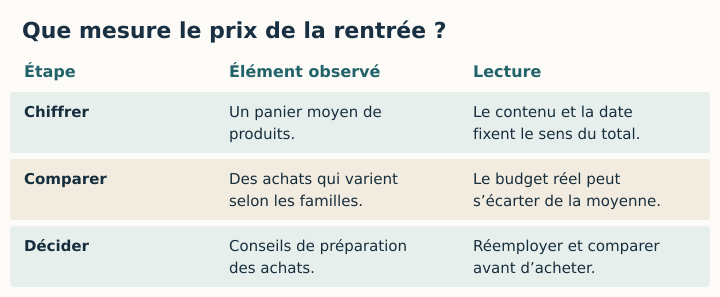

# CCINP — Russe LVA 2026 · Corrigé brut

*Corrigé rédigé par IA, non officiel. Signalez toute erreur.*

**Rédaction** · GPT-6.2 Astra Ultra · vitesse non renseignée

**Révision (tour 1)** · GPT-6.2 Astra Ultra · vitesse non renseignée

## Цена первого сентября и способы облегчить расходы семьи

Газета «Аргументы и факты» сопоставляет расходы на школьные товары в инфографике (док.1, 30.07.2025) и | статье (док.2, 30.07.2025). Она же рассматривает предложение ограничить цены (док.3, 14.08.2024), а «АиФ-Москва» приводит советы родителям (док.4, 15.08.2024). Почему подорожание | школьных товаров по-разному отражается на расходах семей и что могут предпринять сами покупатели и государство?

Согласно расчётам, представленным в первых | двух документах, за год сборы первоклассника подорожали в среднем на семь процентов. На инфографике видно, что за общей цифрой скрывается | разная динамика расходов. Для девочек перечисленные одежда, обувь и рюкзак стоят 6850 рублей, для мальчиков соответствующий комплект стоит 7050 рублей. | При этом первый комплект подорожал на восемь процентов, а второй на шесть. Отдельно показаны канцелярские принадлежности на сумму 985 рублей. | Таким образом, если одежда уже куплена, семье понадобится совсем другая сумма, чем при покупке всего списка заново.

Эти подсчёты относятся | к доступным предложениям с большими скидками. По оценке газеты, семье понадобится не менее восьми тысяч рублей, тогда как при средних | ценах расходы могут оказаться вдвое или даже вчетверо выше. Значение имеют и вкусы ребёнка, и требования конкретной школы: занятия в | бассейне, например, влекут дополнительные расходы. Отсюда интерес родителей к сравнению предложений. Как отмечается в статье 2025 года, крупные магазины могут | предлагать выгодные цены на тетради, а некоторые ручки дешевле на торговых интернет-площадках. Универсального места для покупки всего набора нет.

И | в инфографике, и в рекомендациях Волковой предлагается распределять покупки во времени, пользоваться скидками и рассматривать подержанные вещи. Можно объединяться с | другими родителями, сравнивать условия разных продавцов, покупать принадлежности наборами и учитывать возврат части стоимости при оплате картой. Волкова предлагает начать | подготовку до окончания предыдущего учебного года. По её оценке, в отдельных случаях подготовка за полгода позволяет сократить расходы наполовину. Такая | возможность, однако, зависит от того, сколько денег семья может выделить заранее. Отдельно эксперт напоминает о льготах для малоимущих и многодетных. |

На уровне государственной политики обсуждалось предложение ограничить цены на школьные товары с первого августа до первого ноября. В публикации 2024 | года Панин сомневается в действенности общего потолка: продавцы в рыночной экономике будут добиваться компенсаций или налоговых послаблений. Он отдаёт предпочтение | адресной помощи, которая уже оказывается некоторым семьям. Сопоставление этих предложений показывает, почему средняя цена набора важна для общественного обсуждения, но | сама по себе недостаточна для выбора меры помощи: значение имеют условия конкретной покупки, требования школы и ресурсы родителей.

*Количество слов с учётом заголовка — 378.*

FIN

[Sujet officiel](https://www.concours-commun-inp.fr/_resource/annales%20%C3%A9crits/2026/Ep%20communes/2026_LVA6AU.pdf#page=14) · [Rapport du jury, russe](https://www.concours-commun-inp.fr/_resource/annales%20%C3%A9crits/2026/Ep%20communes/LV_ECRIT_2026_05.10.pdf#page=28)
