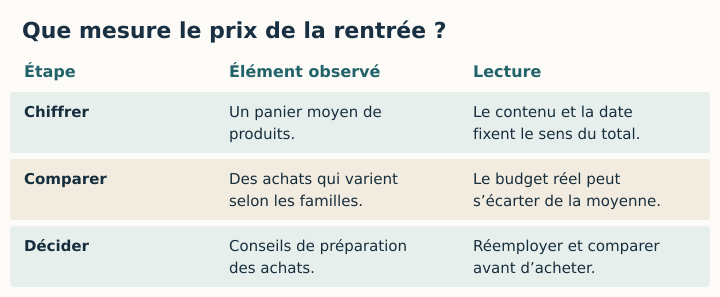

# CCINP — Russe LVA 2026 · Corrigé guidé

*Corrigé rédigé par IA, non officiel. Signalez toute erreur.*

**Rédaction** · GPT-6.2 Astra Ultra · vitesse non renseignée

## Lire la consigne

Le fascicule accorde trois heures pour une synthèse en russe de 400 mots, titre inclus, avec une tolérance de 10 %. Les 4 documents ont le même poids. L’introduction doit identifier simplement la source et la date de chacun. La numérotation des documents peut ensuite servir de repère.

## Croiser les documents

Lire les trois totaux de l’infographie. Les 6 850 et 7 050 roubles concernent les listes sous les deux personnages ; le panier de papeterie à 985 roubles s’y ajoute. La baisse ou la hausse du coût ne se mesure pas en comparant les deux personnages : 8 % et 6 % sont leurs augmentations respectives sur un an.

Les deux documents du 30 juillet 2025 précisent le niveau des prix avec remises. Les deux articles de 2024 distinguent la politique proposée et le conseil financier aux particuliers. Le plafonnement du 1er août au 1er novembre reste une proposition ; Panine préfère l’aide ciblée. La réponse de Volkova conserve son propre statut de conseil, sans garantie générale d’économie.

## Цена первого сентября и способы облегчить расходы семьи

Две публикации газеты «Аргументы и факты» от 30 июля 2025 года, материал | той же газеты от 14 августа 2024 года и сообщение «АиФ-Москва» от 15 августа 2024 года обсуждают подготовку к школе. | Почему заметное подорожание школьных товаров по-разному отражается на расходах семей и что могут предпринять сами покупатели и государство?

Согласно расчётам, | представленным в первых двух документах, за год сборы первоклассника подорожали в среднем на семь процентов. На инфографике видно, что за | одинаковым итоговым показателем скрыты разные покупки. Для девочек перечисленные одежда, обувь и рюкзак стоят 6850 рублей, для мальчиков соответствующий комплект | стоит 7050 рублей. При этом первый комплект подорожал на восемь процентов, а второй на шесть. Отдельно показаны канцелярские принадлежности на | сумму 985 рублей. Таким образом, если одежда уже куплена, семье понадобится совсем другая сумма, чем при покупке всего списка заново. |

Эти подсчёты относятся к доступным предложениям с большими скидками. Газета оценивает минимальные затраты примерно в восемь тысяч рублей, тогда как | при средних ценах расходы могут оказаться вдвое или даже вчетверо выше. Значение имеют и вкусы ребёнка, и требования конкретной школы: | занятия в бассейне, например, влекут дополнительные расходы. Отсюда интерес родителей к сравнению предложений. Как отмечается в статье 2025 года, крупные | магазины могут предлагать выгодные цены на тетради, а некоторые ручки дешевле на торговых интернет-площадках. Универсального места для покупки всего набора | нет.

И в инфографике, и в рекомендациях Волковой предлагается распределять покупки во времени, пользоваться скидками и рассматривать подержанные вещи. Можно | объединяться с другими родителями, сравнивать условия разных продавцов, покупать принадлежности наборами и учитывать возврат части стоимости при оплате картой. Волкова | предлагает начать подготовку до окончания предыдущего учебного года. Такая возможность, однако, зависит от того, сколько денег семья может выделить заранее; | отдельно эксперт напоминает о льготах для малоимущих и многодетных.

На уровне государственной политики обсуждалось предложение ограничить цены на школьные товары | с августа до ноября. В публикации 2024 года Панин сомневается в действенности общего потолка: продавцы в рыночной экономике будут добиваться | компенсаций или налоговых послаблений. Он отдаёт предпочтение адресной помощи, которая уже оказывается некоторым семьям. Сопоставление этих предложений показывает, почему средняя | цена набора важна для общественного обсуждения, но сама по себе недостаточна для выбора меры помощи: значение имеют условия конкретной покупки, | требования школы и ресурсы родителей.

*365 mots, titre inclus. Une barre marque chaque vingtième mot.*

[Sujet officiel](https://www.concours-commun-inp.fr/_resource/annales%20%C3%A9crits/2026/Ep%20communes/2026_LVA6AU.pdf#page=14) · [Rapport du jury, russe](https://www.concours-commun-inp.fr/_resource/annales%20%C3%A9crits/2026/Ep%20communes/LV_ECRIT_2026_05.10.pdf#page=28)
