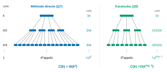
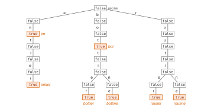
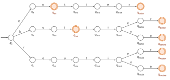
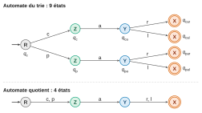

# CCINP MP — Informatique 2026 · Corrigé brut

*Corrigé rédigé par IA, non officiel. Signalez toute erreur.*

Épreuve spécifique MP (MP7IN, mutualisée avec e3a-Polytech), 4 heures, calculatrices interdites. Trois problèmes indépendants : Python imposé au problème 1, OCaml imposé au problème 2 à partir de Q15. Tous les codes ci-dessous ont été exécutés sur des exemples (Python 3, OCaml 4.14).

**Remarque sur l'énoncé.** Dans les décompositions de $u$ et de $v$, la seconde somme va jusqu'à l'indice $k$. Or une liste de taille $k$ a pour indices $0, \dots, k-1$.

La seconde somme doit donc s'arrêter à $k-1$ (le chiffre $u_k$ n'existe pas, ou vaut $0$). Cela ne change rien à la suite :

$$\begin{aligned}
f_u &= \sum_{i=0}^{k/2-1} u_{i+k/2}\, b^i, \\
u &= d_u + b^{k/2} f_u.
\end{aligned}$$

---

## Problème 1 — Multiplication de grands entiers

### Q1

Si un entier est codé sur un nombre fixé $m$ de bits ($m$ entre 32 et 64), seuls $2^m$ motifs sont disponibles : l'ensemble des entiers manipulables est **fini**. Par exemple :

- en non signé, ce sont les entiers de $0$ à $2^m - 1$ ;
- en complément à deux, ceux de $-2^{m-1}$ à $2^{m-1}-1$.

Un calcul dont le résultat sort de cet intervalle provoque un **dépassement de capacité**. Le résultat obtenu est en général le résultat exact modulo $2^m$, donc faux, souvent sans signalement.

**Ce n'est pas le cas en Python** : le type `int` est un entier multiprécision, dont le nombre de chiffres s'adapte à la valeur ; la seule limite est la mémoire disponible. En contrepartie, le coût des opérations arithmétiques croît avec la taille des entiers.

### Q2

On applique le schéma de Horner en partant du bit de poids fort (fin de liste) :

```python
def bit_to_int(bit_lst):
    val = 0
    for i in range(len(bit_lst) - 1, -1, -1):
        val = 2 * val + bit_lst[i]
    return val
```

Invariant : après traitement de l'indice $i$, `val` $= \sum_{j \ge i} n_j 2^{j-i}$ ; en fin de boucle ($i = 0$), `val` $= \sum_j n_j 2^j$. On fait une itération par bit, chacune avec un nombre constant d'opérations arithmétiques : **complexité linéaire** en la taille de la liste (en comptant, comme d'usage, les opérations arithmétiques à coût constant). Exemple : `bit_to_int([0, 1, 0, 1, 0, 1])` vaut $42$, et la liste vide donne $0$.

On n'écrit pas `sum(bit_lst[i] * 2**i ...)` : l'opérateur `**` n'est pas à coût constant. Calculer $2^i$ par exponentiation rapide demande de l'ordre de $\log_2 i$ multiplications, d'où un total en $O(\ell \log \ell)$ pour une liste de longueur $\ell$, et non linéaire. Horner, ou une variable `puissance` doublée à chaque tour, évite ce surcoût.

### Q3

On reproduit l'addition posée, en base 2 :

- on parcourt les deux listes simultanément depuis l'indice $0$ (poids faibles), avec une retenue $r$ initialisée à $0$ ;
- au rang $i$, on calcule $s = u_i + v_i + r \in \{0, 1, 2, 3\}$ ; le chiffre de rang $i$ du résultat est $s \bmod 2$, la nouvelle retenue est $s \,//\, 2 \in \{0, 1\}$ ;
- si les listes sont de longueurs différentes, on complète la plus courte par des $0$ en fin de liste (sans changer sa valeur) ;
- à la fin, si la retenue vaut $1$, on ajoute un chiffre $1$ en fin de liste : la somme de deux entiers de $k$ bits peut nécessiter $k+1$ bits.

Chaque rang est traité en temps constant : l'algorithme est linéaire en la longueur des listes.

### Q4

```python
def sum_bits(b_lst_1, b_lst_2):
    n = len(b_lst_1)          # les deux listes ont même longueur
    res = []
    retenue = 0
    for i in range(n):
        s = b_lst_1[i] + b_lst_2[i] + retenue
        res.append(s % 2)
        retenue = s // 2
    if retenue == 1:
        res.append(1)
    return res
```

Invariant : après le tour $i$, $\sum_{j \le i}(u_j + v_j) 2^j = \sum_{j \le i} \texttt{res}[j]\, 2^j + \texttt{retenue} \cdot 2^{i+1}$. En sortie, l'ajout éventuel du chiffre de rang $n$ donne exactement $u + v$. Exemple : `sum_bits([1], [1])` vaut `[0, 1]`, soit $2$. Coût linéaire, arguments non modifiés.

### Q5

Compléter sans changer la valeur, c'est ajouter des zéros **de poids fort**, donc **en fin de liste** :

```python
def complement(lst_bits, size):
    assert size >= len(lst_bits)
    return lst_bits + [0] * (size - len(lst_bits))
```

Les chiffres ajoutés sont nuls, la somme $\sum n_i 2^i$ est inchangée. L'opérateur `+` construit une nouvelle liste : l'argument n'est pas modifié. L'inégalité large est nécessaire (elle sert avec égalité à Q11). Coût $O(\texttt{size})$.

### Q6

Si $n = \sum_{i=0}^{k} n_i 2^i$, alors $n = n_0 + 2 \sum_{i=1}^{k} n_i 2^{i-1}$ avec $n_0 \in \{0,1\}$ ; par unicité de la division euclidienne, $n_0 = n \bmod 2$ et $n \,//\, 2 = \sum_{i=1}^{k} n_i 2^{i-1}$, dont les chiffres sont $n_1, \dots, n_k$. On extrait donc les chiffres du poids faible vers le poids fort, ce qui est l'ordre de la liste :

```python
def int_to_bit(n):
    if n == 0:
        return [0]
    lst = []
    while n > 0:
        lst.append(n % 2)
        n = n // 2
    return lst
```

La boucle termine car $n$ décroît strictement dans $\mathbb{N}$ ; elle fait $\lfloor \log_2 n \rfloor + 1$ tours. Exemple : `int_to_bit(42)` vaut `[0, 1, 0, 1, 0, 1]`.

### Q7

Les étapes a, c et d coûtent au plus $\lambda k$ ; l'étape b fait **4 appels récursifs** sur des listes de taille $k/2$. D'où, pour $k \ge 2$ puissance de 2 :

$$\begin{aligned}
C(k) &= 4\,C(k/2) + \lambda k, \\
C(1) &= c_0.
\end{aligned}$$

La constante $\lambda$ traduit le fait qu'on ne connaît le coût des étapes a, c et d qu'à une constante multiplicative près.

Posons $k = 2^p$ et $D_p = C(2^p)/4^p$. En divisant l'équation par $4^p$, on obtient $D_p = D_{p-1} + \lambda\, 2^{-p}$, d'où par télescopage

$$\begin{aligned}
D_p &= c_0 + \lambda \sum_{j=1}^{p} 2^{-j} \\
&= c_0 + \lambda\,(1 - 2^{-p}).
\end{aligned}$$

Donc

$$\begin{aligned}
C(2^p) &= 4^p\,\bigl(c_0 + \lambda(1 - 2^{-p})\bigr) \\
&= (c_0 + \lambda)\,k^2 - \lambda k,
\end{aligned}$$

et

$$\boxed{C(k) = \Theta(k^2)}$$

Pour $k$ quelconque, avec $2^p \le k < 2^{p+1}$ et $C$ croissante, $C(2^p) \le C(k) \le C(2^{p+1})$, ce qui conserve l'ordre $k^2$. Cette méthode ne gagne rien sur la multiplication posée, elle aussi quadratique.

### Q8

Dans l'égalité (2) n'apparaissent que **trois produits distincts** :

$$\begin{aligned}
P_1 &= d_u \times d_v, \\
P_2 &= f_u \times f_v, \\
P_3 &= (f_u - d_u) \times (f_v - d_v),
\end{aligned}$$

$P_1$ et $P_2$ étant utilisés deux fois chacun mais calculés une seule fois. On vérifie d'ailleurs $P_2 + P_1 - P_3 = f_u d_v + d_u f_v$.

Les facteurs ont tous au plus $k/2$ chiffres (en valeur absolue, $|f_u - d_u| < b^{k/2}$). Les autres opérations (découpage, deux soustractions, additions, décalages) sont linéaires. **Il faut donc 3 multiplications récursives**, et

$$\boxed{C(k) = 3\,C(k/2) + \lambda k}$$

La résolution n'est pas demandée : l'énoncé admet le résultat $O(k^{\log_2 3})$.



### Q9

Si $n = \sum_{j=0}^{k} n_j b^j$, alors

$$b^i n = \sum_{j=0}^{k} n_j b^{j+i}.$$

Le chiffre de rang $j$ passe au rang $j + i$ et les rangs $0, \dots, i-1$ deviennent nuls. **Multiplier par $b^i$ revient à décaler les chiffres de $i$ rangs vers les poids forts**, c'est-à-dire, avec la convention de l'énoncé (poids faibles en tête), à **insérer $i$ zéros en début de liste**. Aucune multiplication n'est effectuée.

### Q10

```python
def shift(lst_bits, i):
    return [0] * i + lst_bits
```

L'opérateur `+` crée une nouvelle liste sans modifier ses opérandes. Le chiffre de rang $j$ du résultat vaut $0$ si $j < i$ et $n_{j-i}$ sinon : la valeur est $2^i n$.

Coût $O(i + \ell)$, où $\ell$ est la longueur de la liste.

### Q11

L'énoncé ne prévoit pas que la différence $f_u - d_u$ puisse être négative, ce qui arrive. On suppose donc d'abord, comme l'impose la formule (2), que `sub_bit_lst` réalise la soustraction sur des entiers relatifs et que son résultat n'est pas plus long que le plus long de ses arguments. Une variante sur les seuls entiers naturels suit.

```python
def karatsuba(lst1, lst2):
    n = max(len(lst1), len(lst2))
    lst1 = complement(lst1, n)
    lst2 = complement(lst2, n)
    if n == 0:
        # A : listes vides, le produit vaut 0
        return []
    if n == 1:
        # B : produit de deux bits
        return [lst1[0] * lst2[0]]
    else:
        h = n//2
        d1 = lst1[0:h]
        f1 = lst1[h:]
        d2 = lst2[0:h]
        f2 = lst2[h:]
        # C : trois produits récursifs, puis recollement selon (2)
        p1 = karatsuba(d1, d2)
        p2 = karatsuba(f1, f2)
        p3 = karatsuba(sub_bit_lst(f1, d1), sub_bit_lst(f2, d2))
        m = sub_bit_lst(sum_bit_lst(p2, p1), p3)      # = f1*d2 + d1*f2 >= 0
        return sum_bit_lst(sum_bit_lst(p1, shift(m, h)), shift(p2, 2 * h))
```

Justification. Avec $h = n//2$, $u = d_1 + b^h f_1$ et $v = d_2 + b^h f_2$ (même si $n$ est impair), donc par (2) écrite avec l'exposant $h$ :

$$u \times v = P_1 + b^{h}\,(P_2 + P_1 - P_3) + b^{2h}\,P_2,$$

ce que renvoie la partie C.

- Les cas de base renvoient des **listes** : `[]` représente $0$, et `[x]` le produit de deux bits.
- Le `return` de la partie A est indispensable : sans lui, le cas $n = 0$ tomberait dans le `else` avec $h = 0$, et l'appel `karatsuba(f1, f2)` reboucherait indéfiniment.
- Le décalage du terme de tête est $2h$ et non $n$ : les deux diffèrent si $n$ est impair.
- Terminaison : pour $n \ge 2$, on a $1 \le h \le n - 1$. Les trois appels portent sur des listes de longueur au plus $n - h < n$.

Variante n'employant que des entiers naturels (sous-fonctions définies dans la partie C ou au préalable) : on calcule $|f_1 - d_1|$ et $|f_2 - d_2|$ après comparaison, et l'on retranche ou ajoute le produit selon les signes.

```python
def inferieur(a, b):
    # a < b pour deux listes de bits (comparaison depuis le poids fort)
    n = max(len(a), len(b))
    a = complement(a, n)
    b = complement(b, n)
    for i in range(n - 1, -1, -1):
        if a[i] != b[i]:
            return a[i] < b[i]
    return False

def karatsuba(lst1, lst2):
    n = max(len(lst1), len(lst2))
    lst1 = complement(lst1, n)
    lst2 = complement(lst2, n)
    if n == 0:
        return []
    if n == 1:
        return [lst1[0] * lst2[0]]
    else:
        h = n//2
        d1 = lst1[0:h]
        f1 = lst1[h:]
        d2 = lst2[0:h]
        f2 = lst2[h:]
        # C, version entiers naturels
        p1 = karatsuba(d1, d2)
        p2 = karatsuba(f1, f2)
        neg1 = inferieur(f1, d1)            # f1 - d1 < 0 ?
        neg2 = inferieur(f2, d2)
        if neg1:
            a1 = sub_bit_lst(d1, f1)
        else:
            a1 = sub_bit_lst(f1, d1)
        if neg2:
            a2 = sub_bit_lst(d2, f2)
        else:
            a2 = sub_bit_lst(f2, d2)
        p3 = karatsuba(a1, a2)              # valeur absolue de P3
        if neg1 == neg2:                    # P3 >= 0
            m = sub_bit_lst(sum_bit_lst(p2, p1), p3)
        else:                               # P3 <= 0
            m = sum_bit_lst(sum_bit_lst(p2, p1), p3)
        return sum_bit_lst(sum_bit_lst(p1, shift(m, h)), shift(p2, 2 * h))
```

Le nombre d'appels récursifs reste 3 et la comparaison est linéaire : la complexité est inchangée. Cette version a été testée sur 3 000 couples aléatoires d'entiers d'au plus 40 bits et sur $123\,456\,789 \times 987\,654\,321 = 121\,932\,631\,112\,635\,269$.

---

## Problème 2 — Ensembles de mots implémentés par tries

### Q12

Deux implémentations au programme de la structure de dictionnaire :

- **les arbres binaires de recherche** (éventuellement équilibrés), les clés étant ordonnées ; recherche, ajout et suppression en $O(h)$ où $h$ est la hauteur ;
- **les tables de hachage**, où une fonction de hachage envoie la clé sur une case d'un tableau ; coût moyen $O(1)$ par opération sous de bonnes hypothèses de hachage, linéaire dans le pire cas.

### Q13

On prend les mots comme **clés** du dictionnaire, la valeur associée étant sans importance (par exemple `true` ou `()`). Un mot appartient à l'ensemble si et seulement si il est une clé du dictionnaire : le test d'appartenance est une recherche de clé. Avec une table de hachage, il coûte en moyenne le calcul du haché, $O(|m|)$ ; avec un arbre binaire de recherche équilibré sur l'ordre lexicographique, $O(|m| \log n)$ pour $n$ mots.

### Q14

Le trie de {en, entier, bot, bottier, bottine, routier, routine} (la lettre étiquette l'arête qui mène au nœud ; les enfants vides ne sont pas représentés) :



Il compte 25 nœuds, dont 7 marqués `true` (un par mot), et a pour hauteur 7.

### Q15

```ocaml
let string_to_list s =
  let n = String.length s in
  (* caracteres_depuis i renvoie la liste des caractères de s
     d'indices i, i+1, ..., n-1 *)
  let rec caracteres_depuis i =
    if i >= n then []
    else s.[i] :: caracteres_depuis (i + 1)
  in
  caracteres_depuis 0
```

Rôle de la fonction auxiliaire : `caracteres_depuis i` renvoie la liste des caractères de `s` à partir de l'indice $i$. Par récurrence descendante sur $i$, elle vaut `[s.[i]; ...; s.[n-1]]` : c'est vrai pour $i = n$, et si c'est vrai pour $i+1$, c'est vrai pour $i$.

Complexité : `String.length` est appelée une fois, en $O(1)$. Il y a $n + 1$ appels à `caracteres_depuis`, chacun en $O(1)$ (comparaison, accès `s.[i]`, construction `::` en tête). **Le coût est $O(n)$**, où $n$ est la longueur de la chaîne. Aucune concaténation `@`, dont le coût est linéaire en la longueur de son premier argument, n'est utilisée.

`string_to_list "lettre"` vaut `['l'; 'e'; 't'; 't'; 'r'; 'e']`.

### Q16

Le type n'a pas de constructeur vide : le plus petit trie est une racine sans enfant, marquée `false`. Marquée `true`, elle représenterait l'ensemble réduit au mot vide, et non l'ensemble vide.

```ocaml
let empty_trie () = Node (false, [])
```

C'est bien une fonction de type `unit -> trie`, comme demandé, et non une constante de type `trie`.

### Q17

```ocaml
let rec max_list lst =
  match lst with
  | [] -> failwith "max_list : liste vide"
  | [x] -> x
  | x :: reste ->
      let m = max_list reste in
      if x > m then x else m
```

Par récurrence sur la longueur $\ell \ge 1$ : pour $\ell = 1$ on renvoie l'unique élément ; sinon $m$ est le maximum de `reste` et le maximum de la liste est $\max(x, m)$. Un seul appel récursif par élément (grâce au `let`) : coût linéaire. La fonction est directement récursive : aucun accumulateur n'est à initialiser, et rien n'est supposé sur le signe des éléments.

### Q18

```ocaml
let rec list_map f lst =
  match lst with
  | [] -> []
  | x :: reste -> f x :: list_map f reste
```

Par récurrence immédiate, `list_map f [x1; ...; xn]` vaut `[f x1; ...; f xn]`, dans le même ordre ; le type inféré est `('a -> 'b) -> 'a list -> 'b list`.

### Q19

Convention : la hauteur est le nombre d'arêtes du plus long chemin de la racine à une feuille ; un nœud seul est de hauteur 0.

```ocaml
let rec height t =
  match t with
  | Node (_, []) -> 0
  | Node (_, enfants) ->
      1 + max_list (list_map (fun (_, fils) -> height fils) enfants)
```

Si le nœud a des enfants $t_1, \dots, t_p$ ($p \ge 1$), la hauteur vaut $1 + \max_j \mathrm{hauteur}(t_j)$, et la liste passée à `max_list` est non vide. Les enfants sont des couples (lettre, sous-trie) : la fonction passée à `list_map` ignore la lettre. Sur le trie de Q14, `height` vaut 7.

### Q20

```ocaml
let rec somme_liste lst =
  match lst with
  | [] -> 0
  | x :: reste -> x + somme_liste reste

let rec size t =
  match t with
  | Node (_, enfants) ->
      1 + somme_liste (list_map (fun (_, fils) -> size fils) enfants)
```

Par induction structurelle : `list_map` calcule la liste des tailles des sous-tries (en ignorant la lettre de chaque couple), `somme_liste` les additionne et `size` ajoute la racine. Une feuille donne `1 + somme_liste []`, soit 1. Chaque nœud est visité une fois : coût linéaire en le nombre de nœuds. Sur le trie de Q14, `size` vaut 25.

### Q21

Montrons par induction que, pour $t = \texttt{Node}(b, [(c_1, t_1); \dots; (c_p, t_p)])$,

$$f(t) = [b] + \sum_{j=1}^{p} f(t_j),$$

où $[b]$ vaut $1$ si $b$ est `true` et $0$ sinon.

Pour $p = 0$, les deux premiers cas donnent $1$ si $b$ est vrai et $0$ sinon. Pour $p \ge 1$, le troisième cas donne

$$f(t) = f(t_1) + f(\texttt{Node}(b, [(c_2, t_2); \dots; (c_p, t_p)])).$$

Une récurrence sur $p$ (à $b$ fixé) donne la formule : le booléen $b$ n'est examiné qu'une fois, quand la liste est épuisée. Le nœud fictif `Node (b, tail)` sert seulement à parcourir la liste des enfants.

Ainsi $f(t)$ est **le nombre de nœuds marqués `true`**, qu'ils soient feuilles ou nœuds internes (comme celui de « le » dans la figure 1). Comme chaque nœud est atteint par un unique chemin depuis la racine, ces nœuds sont en bijection avec les mots du trie :

**$f$ calcule le nombre de mots contenus dans le trie** (4 pour la figure 1, 3 pour la figure 2, 7 pour le trie de Q14).

### Q22

```ocaml
let rec is_in_trie mot t =
  match mot, t with
  | [], Node (b, _) -> b
  | c :: reste, Node (_, enfants) -> is_in_children c reste enfants
and is_in_children c reste enfants =
  match enfants with
  | [] -> false
  | (l, fils) :: suite ->
      if l = c then is_in_trie reste fils
      else is_in_children c reste suite
```

Mot vide : il est dans le trie si et seulement si la racine porte `true`. Mot $c \cdot w$ : il y est si et seulement si la racine a un enfant étiqueté $c$ dont le sous-trie contient $w$ ; s'il n'y a pas d'enfant $c$, c'est un enfant vide et la réponse est `false`. Coût $O(|m| \cdot |\Sigma|)$.

### Q23

```ocaml
let rec add_to_trie mot t =
  match mot, t with
  | [], Node (_, enfants) -> Node (true, enfants)
  | c :: reste, Node (b, enfants) -> Node (b, add_children c reste enfants)
and add_children c reste enfants =
  match enfants with
  | [] -> [(c, add_to_trie reste (empty_trie ()))]
  | (l, fils) :: suite ->
      if l = c then (l, add_to_trie reste fils) :: suite
      else (l, fils) :: add_children c reste suite
```

Algorithme. Un trie n'est pas modifiable en place : on renvoie un nouveau trie, en reconstruisant les nœuds le long du chemin étiqueté par le mot et en partageant tous les autres sous-tries.

Mot vide : on marque la racine en **conservant ses enfants** (on ne perd aucun mot dont le mot ajouté est préfixe). Mot $c \cdot w$ : on ajoute $w$ dans le sous-trie d'étiquette $c$ s'il existe, sinon on crée une branche à partir du trie vide ; les autres enfants et le booléen sont conservés. L'ensemble des mots du résultat est l'ensemble initial augmenté du mot. Testé : en insérant les sept mots de Q14 dans `empty_trie ()`, on obtient un trie de taille 25, de hauteur 7, où `f` vaut 7 ; les sept mots sont reconnus, et `e`, `ent`, `bo`, `rout` ne le sont pas.

### Q24

Un trie partage les **préfixes** communs mais **pas les suffixes**. Sur l'exemple de Q14, les sous-arbres issus de `botti` et de `routi` sont identiques (ils codent les suffixes {er, ne}) et sont stockés deux fois ; la branche finale `e → r` apparaît trois fois (sous `enti`, `botti`, `routi`). La taille du trie est de l'ordre du nombre total de lettres des mots, diminué des seuls préfixes communs : pour un lexique riche en terminaisons communes (pluriels, conjugaisons), **la structure contient de nombreux sous-arbres identiques, redondants**, ce qui gaspille de la mémoire (le temps de recherche, lui, reste en $O(|m|)$).

### Q25

À un trie, on associe l'automate fini $(\Sigma, Q, I, F, \delta)$ :

- **alphabet** $\Sigma$ : l'ensemble des lettres (celles qui étiquettent les arêtes) ;
- **états** $Q$ : les nœuds du trie ;
- **état initial** : la racine (unique) ;
- **états finaux** $F$ : les nœuds portant `true` ;
- **transitions** : les triplets $(q, c, q')$ où $q'$ est l'enfant de $q$ étiqueté $c$, soit $\delta(q, c) = q'$ ; pas de transition (blocage) si cet enfant est vide.

L'automate est déterministe, en général incomplet, et acyclique. Lire un mot depuis la racine suit l'unique chemin qu'il étiquette ; il est accepté si et seulement si le nœud atteint porte `true` : le langage reconnu est l'ensemble des mots du trie.

### Q26

On note $q_w$ l'état atteint en lisant $w$ depuis l'état initial $q_\varepsilon$. L'automate a **25 états et 24 transitions** (une par arête du trie). Chaque transition est orientée vers l'enfant ; les états finaux sont doublement cerclés et la flèche entrante marque l'état initial :



États finaux : $q_{en}, q_{entier}, q_{bot}, q_{bottier}, q_{bottine}, q_{routier}, q_{routine}$. Le dessin est celui du trie de Q14, avec des flèches orientées vers les enfants ; aucun état n'est fusionné à ce stade.

### Q27

**Sans transition sortante** : $q_{bottier}$ et $q_{routier}$. Ils sont tous deux finaux, et toute lettre est un blocage pour les deux. Donc $q_{bottier}\, E\, q_{routier}$ (de même pour tout couple pris parmi $q_{entier}, q_{bottier}, q_{bottine}, q_{routier}, q_{routine}$).

**Avec transition sortante** : $q_{bottie}$ et $q_{routie}$. Ils sont tous deux non finaux ; pour la lettre `r`, $\delta(q_{bottie}, r) = q_{bottier}$ et $\delta(q_{routie}, r) = q_{routier}$, en relation d'après ce qui précède ; toute autre lettre bloque pour les deux. Donc $q_{bottie}\, E\, q_{routie}$.

### Q28

**Démarche.** $E$ est une relation d'équivalence (réflexivité, symétrie et transitivité se vérifient par récurrence sur la hauteur des états, l'automate étant acyclique). On fusionne chaque classe en un seul état (**automate quotient**) :

- états : les classes $[q]$ ; état initial : $[q_\varepsilon]$ ;
- $[q]$ est final si $q$ l'est : c'est bien défini car deux états en relation ont même finalité ;
- $\delta'([q], c) = [\delta(q, c)]$ si $\delta(q, c)$ existe : bien défini car si $q\,E\,q'$, la lettre $c$ bloque pour les deux ou $\delta(q, c)\, E\, \delta(q', c)$.

Deux états en relation reconnaissant le même langage (résultat admis), la fusion ne change pas le langage reconnu. Calcul effectif, de bas en haut : on traite les états par hauteur croissante (longueur du plus long chemin qui en part). À chaque état on associe sa **signature** : sa finalité et l'ensemble des couples $(c, [\delta(q, c)])$ pour les lettres non bloquantes, les classes des successeurs étant déjà connues. Deux états sont en relation si et seulement si ils ont même signature ; on regroupe les états par signature. Le résultat n'est plus un arbre : les suffixes communs sont partagés.

**Illustration sur {car, par, cal, pal}.** L'automate du trie a 9 états : $q_\varepsilon, q_c, q_{ca}, q_{car}, q_{cal}, q_p, q_{pa}, q_{par}, q_{pal}$.

| Hauteur | États | Signature | Classe |
|---|---|---|---|
| 0 | $q_{car}, q_{cal}, q_{par}, q_{pal}$ | final, aucune transition | $X$ |
| 1 | $q_{ca}, q_{pa}$ | non final, r → $X$, l → $X$ | $Y$ |
| 2 | $q_c, q_p$ | non final, a → $Y$ | $Z$ |
| 3 | $q_\varepsilon$ | non final, c → $Z$, p → $Z$ | $R$ |

L'automate simplifié a **4 états au lieu de 9** :



Il reconnaît $\{c, p\} \cdot \{a\} \cdot \{r, l\} = \{car, cal, par, pal\}$.

Appliquée au trie de Q14, la même démarche fusionne successivement :

- les cinq états finaux sans successeur ;
- $q_{entie}, q_{bottie}, q_{routie}$ ;
- $q_{bottin}$ et $q_{routin}$ ;
- $q_{botti}$ et $q_{routi}$ ;
- $q_{bott}$ et $q_{rout}$.

On passe de 25 à 16 états.

---

## Problème 3 — Logique implicationnelle

Notations. Les valeurs de vérité sont notées V et F ; $\top$ et $\bot$ désignent des formules.

- Une valuation $v$ s'étend aux formules par les tables de vérité, avec $v(\top) = V$ et $v(\bot) = F$.
- $A \equiv B$ signifie $v(A) = v(B)$ pour toute valuation $v$.
- $\Gamma \models F$ (conséquence sémantique) signifie que toute valuation satisfaisant toutes les formules de $\Gamma$ satisfait $F$.

La valeur d'une formule construite par un connecteur ne dépend que des valeurs de ses sous-formules. On peut donc remplacer une sous-formule par une formule équivalente (**lemme de remplacement**).

### Q29

| $v(A)$ | $v(B)$ | $A \to B$ | $\neg A$ | $\neg A \vee B$ |
|---|---|---|---|---|
| V | V | V | F | V |
| V | F | F | F | F |
| F | V | V | V | V |
| F | F | V | V | V |

Pour toute valuation, $(v(A), v(B))$ est l'une des quatre lignes, et les deux dernières colonnes coïncident : $\boxed{A \to B \equiv \neg A \vee B}$.

### Q30

| $v(A)$ | $\bot$ | $A \to \bot$ | $\neg A$ |
|---|---|---|---|
| V | F | F | F |
| F | F | V | V |

**Oui** : $\boxed{\neg A \equiv A \to \bot}$. On le retrouve aussi par Q29 : $A \to \bot \equiv \neg A \vee \bot$, qui a la valeur de $\neg A$.

### Q31

| $v(A)$ | $v(B)$ | $A \to B$ | $(A \to B) \to A$ | $\varphi$ |
|---|---|---|---|---|
| V | V | V | V | V |
| V | F | F | V | V |
| F | V | V | F | V |
| F | F | V | F | V |

La dernière colonne ne contient que V : $\varphi$ est vraie sous toute valuation, c'est-à-dire que **$\varphi$ est une tautologie** (loi de Peirce).

### Q32

Équivalences préalables (vérifiées par table de vérité) :

| $v(A)$ | $v(B)$ | $A \vee B$ | $\neg A \to B$ | $A \wedge B$ | $\neg(A \to \neg B)$ |
|---|---|---|---|---|---|
| V | V | V | V | V | V |
| V | F | V | V | F | F |
| F | V | V | V | F | F |
| F | F | F | F | F | F |

donc $A \vee B \equiv \neg A \to B$ et $A \wedge B \equiv \neg(A \to \neg B)$.

**Propriété démontrée.** Pour $F \in S_P$, on note $\mathcal{P}(F)$ la propriété : « il existe une formule $F'$, équivalente à $F$, dont les seuls connecteurs sont $\neg$ et $\to$ ».

Montrons $\mathcal{P}(F)$ pour toute $F \in S_P$, par induction structurelle sur $F$ (et non par récurrence sur sa taille).

**Cas de base.** Si $F$ est $\top$, $\bot$ ou une variable propositionnelle $p$, la formule $F' = F$ ne contient aucun connecteur : $\mathcal{P}(F)$ est vraie.

**Cas inductifs.** Soient $A$ et $B$ deux formules vérifiant $\mathcal{P}$ (hypothèse d'induction).

On fixe donc $A' \equiv A$ et $B' \equiv B$, deux formules n'utilisant que $\neg$ et $\to$.

- $F = \neg A$. Par le lemme de remplacement appliqué à $A \equiv A'$, on a $F \equiv \neg A'$, formule qui n'utilise que $\neg$ et $\to$.
- $F = A \to B$. Par remplacement de $A$ et $B$, on a $F \equiv A' \to B'$.
- $F = A \vee B$. Par remplacement, puis par l'équivalence préalable appliquée à $A'$ et $B'$ :

$$\begin{aligned}
F &\equiv A' \vee B' \\
&\equiv \neg A' \to B'.
\end{aligned}$$

- $F = A \wedge B$. De même :

$$\begin{aligned}
F &\equiv A' \wedge B' \\
&\equiv \neg(A' \to \neg B').
\end{aligned}$$

Dans chacun des quatre cas, la formule obtenue n'utilise que $\neg$ et $\to$, puisque $A'$ et $B'$ n'utilisent qu'eux : $\mathcal{P}(F)$ est vraie.

**Conclusion.** Par induction structurelle, $\mathcal{P}(F)$ est vraie pour toute formule de $S_P$. **Le système $\{\neg, \to\}$ est complet.**

### Q33

Soit $F \in S_P$. Par Q32, $F \equiv F'$ où $F'$ n'utilise que $\neg$ et $\to$.

Par induction structurelle sur $F'$, construisons une formule de $S_I$ équivalente :

- $\top$, $\bot$, variable : déjà dans $S_I$ ;
- $A \to B$ : avec $A''$ et $B''$ données par l'hypothèse d'induction, $A \to B \equiv A'' \to B''$, qui est dans $S_I$ ;
- $\neg A$ : par remplacement puis par Q30,

$$\begin{aligned}
\neg A &\equiv \neg A'' \\
&\equiv A'' \to \bot,
\end{aligned}$$

et $A'' \to \bot$ est dans $S_I$.

Par transitivité de $\equiv$, $F$ est équivalente à une formule $F''$ de $S_I$.

**Toute formule de $S_P$ est équivalente à une formule de $S_I$.** La présence de $\bot$ dans $S_I$ est essentielle pour exprimer la négation.

### Q34

**1.** $A \vdash (A \to B) \to B$. On note $\Gamma_1 = A, A \to B$.

$$\dfrac{\dfrac{\dfrac{}{\Gamma_1 \vdash A \to B}\,\text{ax} \qquad \dfrac{}{\Gamma_1 \vdash A}\,\text{ax}}{\Gamma_1 \vdash B}\,\text{elim-}\to}{A \vdash (A \to B) \to B}\,\text{intro-}\to$$

**2.** $A \to B, B \to C \vdash A \to C$. On note $\Gamma_2 = A \to B, B \to C, A$.

$$\dfrac{\dfrac{\dfrac{}{\Gamma_2 \vdash B \to C}\,\text{ax} \qquad \dfrac{\dfrac{}{\Gamma_2 \vdash A \to B}\,\text{ax} \qquad \dfrac{}{\Gamma_2 \vdash A}\,\text{ax}}{\Gamma_2 \vdash B}\,\text{elim-}\to}{\Gamma_2 \vdash C}\,\text{elim-}\to}{A \to B, B \to C \vdash A \to C}\,\text{intro-}\to$$

**3.** $(A \to B) \to C, A \to C \vdash C$. On note $\Gamma_3 = (A \to B) \to C, A \to C$ et $\Delta = \Gamma_3, C \to B$.

Dans $\Delta$, on obtient $A \to B$ comme au point 2, à partir de $A \to C$ et de $C \to B$ (arbre $\pi$, utilisé plus bas) :

$$\pi = \dfrac{\dfrac{\dfrac{}{\Delta, A \vdash C \to B}\,\text{ax} \qquad \dfrac{\dfrac{}{\Delta, A \vdash A \to C}\,\text{ax} \qquad \dfrac{}{\Delta, A \vdash A}\,\text{ax}}{\Delta, A \vdash C}\,\text{elim-}\to}{\Delta, A \vdash B}\,\text{elim-}\to}{\Delta \vdash A \to B}\,\text{intro-}\to$$

puis, avec l'instance de Peirce $((C \to B) \to C) \to C$ :

$$\dfrac{\dfrac{}{\Gamma_3 \vdash ((C \to B) \to C) \to C}\,\text{Peirce} \qquad \dfrac{\dfrac{\dfrac{}{\Delta \vdash (A \to B) \to C}\,\text{ax} \qquad \overset{\pi}{\Delta \vdash A \to B}}{\Delta \vdash C}\,\text{elim-}\to}{\Gamma_3 \vdash (C \to B) \to C}\,\text{intro-}\to}{\Gamma_3 \vdash C}\,\text{elim-}\to$$

### Q35

Une règle de prémisses $\Gamma_1 \vdash F_1, \dots, \Gamma_k \vdash F_k$ et de conclusion $\Gamma \vdash F$ est **correcte** si : dès que $\Gamma_i \models F_i$ pour tout $i$, on a $\Gamma \models F$. Pour une règle sans prémisse, cela signifie $\Gamma \models F$.

- **ax** : toute valuation satisfaisant $\Gamma \cup \{A\}$ satisfait $A$, donc $\Gamma, A \models A$.
- **Peirce** : la formule est une tautologie (Q31, valable pour des formules $A$ et $B$ quelconques). Elle est donc satisfaite par toute valuation, en particulier par celles qui satisfont $\Gamma$.
- **elim-$\to$** : supposons $\Gamma \models A \to B$ et $\Gamma \models A$. Soit $v$ une valuation satisfaisant $\Gamma$.
  Elle vérifie $v(A \to B) = V$ et $v(A) = V$, donc $v(B) = V$ par la table de $\to$.
- **intro-$\to$** : supposons $\Gamma, A \models B$ et soit $v$ satisfaisant $\Gamma$.
  - Si $v(A) = F$, alors $v(A \to B) = V$.
  - Si $v(A) = V$, alors $v$ satisfait $\Gamma \cup \{A\}$, donc $v(B) = V$ et $v(A \to B) = V$.

  Ainsi $\Gamma \models A \to B$.

**Les quatre règles de $D_I$ sont correctes.**

### Q36

On a $\boxed{\Gamma \models F}$ : $F$ est conséquence sémantique de $\Gamma$.

Preuve par induction sur l'arbre de preuve. Si la dernière règle est sans prémisse, sa correction donne directement $\Gamma \models F$. Sinon, l'hypothèse d'induction s'applique aux sous-arbres : chaque prémisse $\Gamma_i \vdash F_i$ vérifie $\Gamma_i \models F_i$. La correction de la dernière règle donne alors $\Gamma \models F$.

### Q37

L'arbre prétend prouver $\Gamma \vdash A \to C$, avec $\Gamma = \{A \to B, C \to B\}$, en n'utilisant que les règles ax, elim-$\to$ et intro-$\to$, toutes correctes (Q35). Raisonnons par l'absurde : s'il était une preuve, Q36 donnerait $\Gamma \models A \to C$.

Considérons la valuation définie par $v(A) = V$, $v(B) = V$ et $v(C) = F$.

- Elle satisfait $A \to B$ (conséquent vrai) et $C \to B$ (antécédent faux) : elle satisfait $\Gamma$.
- Elle donne $v(A \to C) = F$.

Donc $\Gamma \not\models A \to C$, ce qui contredit Q36 : **l'arbre est incorrect**.

L'argument sémantique suffit. On peut ensuite localiser la faute : l'étape qui déduit $\Gamma, A \vdash C$ de $\Gamma, A \vdash B$ et $\Gamma, A \vdash C \to B$ n'est pas une instance de elim-$\to$.

Cette règle tire $B$ de $C \to B$ et de $C$, pas l'inverse.

### Q38

On note $\Gamma = (A \to B) \to A, \neg A$.

$$\dfrac{\dfrac{}{\Gamma \vdash (A \to B) \to A}\,\text{ax} \qquad \dfrac{\dfrac{\dfrac{\dfrac{}{\Gamma, A \vdash A}\,\text{ax} \qquad \dfrac{}{\Gamma, A \vdash \neg A}\,\text{ax}}{\Gamma, A \vdash \bot}\,\text{elim-}\neg}{\Gamma, A \vdash B}\,\text{elim-}\bot}{\Gamma \vdash A \to B}\,\text{intro-}\to}{\Gamma \vdash A}\,\text{elim-}\to$$

### Q39

La loi de Peirce est une règle sans prémisse : il faut prouver $\Gamma \vdash ((A \to B) \to A) \to A$ dans $D_P$ pour tout contexte $\Gamma$. Posons $\Gamma' = \Gamma, (A \to B) \to A$.

L'arbre $\pi_{38}$ de Q38 n'utilise ax que sur $(A \to B) \to A$, $\neg A$ et $A$. Comme la règle ax admet un contexte quelconque, il prouve aussi $\Gamma', \neg A \vdash A$. Alors :

$$\dfrac{\dfrac{\dfrac{\overset{\pi_{38}}{\Gamma', \neg A \vdash A} \qquad \dfrac{}{\Gamma', \neg A \vdash \neg A}\,\text{ax}}{\Gamma', \neg A \vdash \bot}\,\text{elim-}\neg}{\Gamma' \vdash A}\,\text{ra}}{\Gamma \vdash ((A \to B) \to A) \to A}\,\text{intro-}\to$$

Toutes les règles employées sont dans $D_P$ : **la loi de Peirce est dérivable dans $D_P$**.

### Q40

On suppose une preuve de la prémisse $\Gamma, \neg A \vdash \bot$ et l'on construit, dans $D$, une preuve de $\Gamma \vdash A$. Posons $\Gamma' = \Gamma, A \to \bot$.

*Étape 1* : $\Gamma \vdash \neg\neg A$ par intro-$\neg$ appliquée à la prémisse, puis $\Gamma' \vdash \neg\neg A$ par affaiblissement.

*Étape 2* : $\Gamma' \vdash \neg A$ :

$$\dfrac{\dfrac{\dfrac{}{\Gamma', A \vdash A \to \bot}\,\text{ax} \qquad \dfrac{}{\Gamma', A \vdash A}\,\text{ax}}{\Gamma', A \vdash \bot}\,\text{elim-}\to}{\Gamma' \vdash \neg A}\,\text{intro-}\neg$$

*Étape 3* : elim-$\neg$ (appliquée à la formule $\neg A$) puis elim-$\bot$ :

$$\dfrac{\dfrac{\Gamma' \vdash \neg A \qquad \Gamma' \vdash \neg\neg A}{\Gamma' \vdash \bot}\,\text{elim-}\neg}{\Gamma' \vdash A}\,\text{elim-}\bot$$

*Étape 4* : intro-$\to$ et l'instance de Peirce $((A \to \bot) \to A) \to A$ :

$$\dfrac{\dfrac{}{\Gamma \vdash ((A \to \bot) \to A) \to A}\,\text{Peirce} \qquad \dfrac{\Gamma' \vdash A}{\Gamma \vdash (A \to \bot) \to A}\,\text{intro-}\to}{\Gamma \vdash A}\,\text{elim-}\to$$

Seules des règles de $D$ ont été utilisées, jamais ra :

- ax, aff et Peirce ;
- intro-$\neg$, elim-$\neg$ et elim-$\bot$ ;
- intro-$\to$ et elim-$\to$.

Le passage de $A \to \bot$ à $\neg A$ se fait par des règles (étape 2), et non par l'équivalence sémantique de Q30. **Le raisonnement par l'absurde est dérivable dans $D$.**

### Q41

**$D$ et $D_P$ prouvent exactement les mêmes séquents.** En effet, ils ont les mêmes règles hormis ra (dans $D_P$) et Peirce (dans $D$).

- Dans un arbre de preuve de $D$, on remplace chaque feuille Peirce par la dérivation de Q39 : on obtient une preuve dans $D_P$.
- Dans un arbre de preuve de $D_P$, on remplace chaque application de ra par le fragment de Q40, greffé sur la preuve (déjà traduite) de sa prémisse : on obtient une preuve dans $D$, par induction sur l'arbre de preuve.

Ainsi $D$ est une autre présentation de la déduction naturelle classique : la loi de Peirce peut remplacer le raisonnement par l'absurde. En particulier, $D$ est correct (toutes ses règles le sont), donc tout séquent $\Gamma \vdash F$ prouvable dans $D$ vérifie $\Gamma \models F$.

**FIN**
