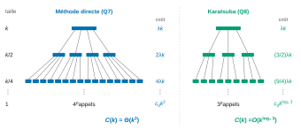
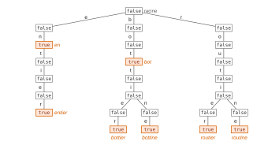
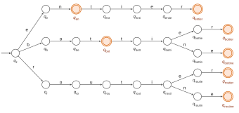
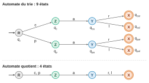

# CCINP MP — Informatique 2026 · Corrigé guidé

*Corrigé rédigé par IA, non officiel. Signalez toute erreur.*

## Présentation du sujet

**Cadre.** Épreuve spécifique de la filière MP (MP7IN, mutualisée avec e3a-Polytech), d'une durée de 4 heures, calculatrices interdites. Le sujet comporte **trois problèmes indépendants** et 41 questions. Le langage est imposé : **Python** pour tout le problème 1, **OCaml** dans le problème 2 à partir de Q15. Le problème 3 ne demande pas de code.

**Découpage.**

| Problème | Thème | Questions | Notions mobilisées |
|---|---|---|---|
| 1 | Multiplication de grands entiers : listes de bits, addition, algorithme de Karatsuba | Q1–Q11 | représentation des entiers, dépassement de capacité, invariants de boucle, diviser pour régner, équations de complexité |
| 2 | Ensembles de mots implémentés par tries, puis lus comme automates et simplifiés | Q12–Q28 | dictionnaires, types récursifs OCaml, récursion sur les arbres d'arité quelconque, automates déterministes, équivalence d'états |
| 3 | Logique implicationnelle : tables de vérité, systèmes complets de connecteurs, déduction naturelle, loi de Peirce | Q29–Q41 | sémantique, induction structurelle, arbres de preuve, correction, règles dérivables |

**Ce que fait chaque problème.** Le problème 1 part de la représentation d'un entier par la liste de ses bits, poids faibles en tête. Il programme les opérations élémentaires (conversion, addition, complétion, décalage) avant d'analyser deux algorithmes « diviser pour régner » de multiplication, le naïf en $\Theta(k^2)$ puis celui de Karatsuba en $O(k^{\log_2 3})$. Le problème 2 construit un trie en OCaml, l'interprète comme un automate fini déterministe et en fusionne les états équivalents pour partager les suffixes communs. Le problème 3 établit que $\{\to\}$, avec $\bot$, suffit à tout exprimer, prouve des séquents dans un système réduit à l'implication et à la loi de Peirce, puis montre que la loi de Peirce et le raisonnement par l'absurde sont interchangeables.

**Difficulté et longueur.** Le sujet est long mais progressif : dans chaque problème, la difficulté croît. Selon le rapport 2026, il a « permis de bien classer les candidates et candidats avec une moyenne de 10,03 et un écart-type de 3,77 » (p. 2). Les excellentes copies en ont traité une part très importante, et seules de rares copies l'ont traité en entier.

**Questions discriminantes d'après le rapport 2026.**

| Questions | Ce que relève le jury |
|---|---|
| Q2 | Plus de la moitié des copies n'obtient pas la complexité linéaire (p. 3) |
| Q7, Q8 | Peu traitées ; la complexité « a posé des problèmes importants » (p. 3-4) |
| Q11 | Cas de base qui ne renvoient pas des listes, confusion entre $h$ et $n$ (p. 4) |
| Q12, Q13 | Questions de cours étonnamment mal réussies (p. 4-5) |
| Q21, Q25, Q28 | Questions de rédaction, beaucoup moins réussies (p. 4) |
| Q23 | Peu traitée ; le trie est manipulé comme s'il était mutable (p. 6) |
| Q32 | Presque aucune preuve par induction correcte (p. 7) |
| Q35 à Q37 | Correction et conséquence sémantique inconnues de la plupart (p. 3, p. 7) |
| Q38 à Q41 | Très peu traitées, faute de temps (p. 7) |

Le problème 3 a été « très clivant » (p. 3) : les tables de vérité et les arbres de preuve sont bien faits, les raisonnements beaucoup moins.

**Questions à ne pas laisser passer.** Q1 à Q6, Q9, Q10, Q12, Q13, Q14 à Q20, Q22, Q24 à Q26, Q29 à Q31. Ce sont des applications directes du cours, chacune en quelques lignes. Q35 et Q36 sont aussi des questions de cours, mais à condition de connaître la définition de la conséquence sémantique.

**Gestion du temps.** Les trois problèmes sont indépendants et de poids comparable : comptez environ 1 h 15 chacun et gardez un quart d'heure de relecture. Le jury recommande de « privilégier la qualité à la quantité » (p. 2), et rappelle que certaines questions en posent plusieurs. Dans le problème 3, rédigez les arbres de preuve au brouillon avant de les recopier : un arbre raturé est illisible.

> [!JURY]
> Le rapport 2026 insiste sur la lisibilité : questions numérotées, code indenté, identifiants signifiants (« une fonction qui somme les éléments d'une liste s'appelle bien plus volontiers somme_liste que aux par exemple », p. 3), et idées non triviales d'un code expliquées en français. Le barème prend explicitement en compte la présentation, le soin et l'orthographe.

---

## Problème 1 — Multiplication de grands entiers

Les entiers sont des listes de bits, le bit de rang $i$ (coefficient de $2^i$) étant à l'indice $i$. On programme d'abord les opérations de base, puis on compare deux stratégies récursives de multiplication. Outils : boucles et invariants, division euclidienne, récurrences de complexité.

**Remarque sur l'énoncé.** Les sommes $\sum_{i=k/2}^{k}$ de l'énoncé devraient s'arrêter à $k-1$, puisqu'une liste de taille $k$ a pour indices $0, \dots, k-1$. On lit donc $f_u = \sum_{i=0}^{k/2-1} u_{i+k/2}\,b^i$, et rien ne change dans la suite.

L'énoncé omet aussi le cas où les soustractions de la formule (2) donnent un entier négatif : le rapport 2026 le reconnaît (p. 4), voir Q11.

### Question 1

> [!INDICATION]
> Combien d'entiers différents peut-on écrire avec $m$ bits ? Que se passe-t-il quand un calcul en produit un plus grand ?

> [!INDICATION]
> Pour Python, pensez au type `int` : sa taille en mémoire est-elle fixée ?

#### Solution

Avec $m$ bits, on dispose de $2^m$ motifs : l'ensemble des entiers manipulables est **fini**. Par exemple :

- en non signé, il s'agit des entiers de $0$ à $2^m - 1$ ;
- en complément à deux, de $-2^{m-1}$ à $2^{m-1} - 1$, soit de $-2^{63}$ à $2^{63}-1$ pour $m = 64$.

Un résultat hors de cet intervalle provoque un **dépassement de capacité** : on obtient en général le résultat exact modulo $2^m$, donc faux, et souvent sans aucun signalement.

**Python ne connaît pas cette limite** : ses entiers `int` sont multiprécision, leur nombre de chiffres s'adapte à la valeur et seule la mémoire les borne. En contrepartie, une opération arithmétique a un coût qui croît avec la taille des opérandes.

> [!PIEGE]
> Répondre seulement « on ne peut pas dépasser $2^{64}$ » ne suffit pas. Ce qu'on attend, c'est la conséquence : le calcul devient faux, le plus souvent en silence.

> [!JURY]
> Le rapport 2026 note que le cas général est connu, mais que le cas de Python l'est beaucoup moins. Les bornes n'étaient pas demandées (celles proposées n'étaient pas toujours correctes), et il ne faut pas confondre avec les flottants : parler de précision est hors sujet pour des entiers (p. 3).

### Question 2

> [!INDICATION]
> Calculer $2^i$ à chaque tour est inutile. Comment évaluer un polynôme en un point avec une multiplication et une addition par coefficient ?

> [!INDICATION]
> Le schéma de Horner commence par le coefficient de plus haut degré : dans quel sens faut-il parcourir la liste ?

#### Solution

```python
def bit_to_int(bit_lst):
    val = 0
    for i in range(len(bit_lst) - 1, -1, -1):
        val = 2 * val + bit_lst[i]
    return val
```

Invariant : après le traitement de l'indice $i$, `val` $= \sum_{j \ge i} n_j\, 2^{j-i}$. À la fin de la boucle ($i = 0$), `val` $= \sum_j n_j 2^j$. Chaque tour fait un nombre constant d'opérations arithmétiques, comptées à coût constant comme d'usage : la complexité est **linéaire** en la taille de la liste. On vérifie que `bit_to_int([0, 1, 0, 1, 0, 1])` vaut $42$ et que la liste vide donne $0$.

> [!METHODE]
> Horner : $\sum_{i=0}^{k} a_i x^i = a_0 + x(a_1 + x(a_2 + \dots))$. Une multiplication et une addition par coefficient, en partant du plus haut degré.

> [!PIEGE]
> `sum(bit_lst[i] * 2**i for i in ...)` n'est pas linéaire : l'opérateur `**` coûte de l'ordre de $\log_2 i$ multiplications par exponentiation rapide, d'où $O(\ell \log \ell)$ pour une liste de longueur $\ell$. Le rapport 2026 le relève : « La complexité de l'opérateur ** n'est pas connue » (p. 4). Si l'on parcourt la liste dans l'ordre, on maintient une variable `puissance` doublée à chaque tour.

> [!JURY]
> Question de cours discriminante : « plus de la moitié des copies échoue à garantir une complexité linéaire pour convertir une suite de bits en l'entier correspondant » (rapport 2026, p. 3).

### Question 3

> [!INDICATION]
> Reproduisez l'addition posée à l'école, en base 2.

> [!INDICATION]
> Précisez trois points : le sens du parcours, le calcul du chiffre et de la retenue à chaque rang, et ce qu'on fait de la retenue finale.

#### Solution

- On parcourt les deux listes simultanément depuis l'indice $0$ (poids faibles), avec une retenue $r$ initialisée à $0$.
- Au rang $i$, on forme $s = u_i + v_i + r \in \{0, 1, 2, 3\}$. Le chiffre de rang $i$ du résultat est $s \bmod 2$, la nouvelle retenue est $s \,//\, 2 \in \{0,1\}$.
- Si les listes ont des longueurs différentes, on complète la plus courte par des $0$ en fin de liste.
- Si la retenue vaut $1$ à la fin, on ajoute un chiffre $1$ en fin de liste : la somme de deux nombres de $k$ bits peut en demander $k+1$.

Chaque rang se traite en temps constant : l'algorithme est **linéaire**.

> [!PIEGE]
> L'oubli classique est la retenue finale : sans elle, $1 + 1$ donnerait $0$.

> [!JURY]
> Le rapport 2026 explique les réponses mal calibrées par une lecture trop rapide : on n'avait pas lu Q4, qui demande le code (p. 4). Ici, on attend les grandes lignes en français, pas un programme.

### Question 4

> [!INDICATION]
> Traduisez Q3 ligne à ligne : une boucle sur les indices, une variable de retenue, `%` et `//`.

#### Solution

```python
def sum_bits(b_lst_1, b_lst_2):
    n = len(b_lst_1)          # les deux listes ont même longueur
    res = []
    retenue = 0
    for i in range(n):
        s = b_lst_1[i] + b_lst_2[i] + retenue
        res.append(s % 2)
        retenue = s // 2
    if retenue == 1:
        res.append(1)
    return res
```

Invariant : après le tour $i$, $\sum_{j \le i} (u_j + v_j)\,2^j = \sum_{j \le i} \texttt{res}[j]\,2^j + \texttt{retenue}\cdot 2^{i+1}$. En sortie, l'ajout du chiffre de rang $n$ donne exactement $u + v$ ; par exemple, `sum_bits([1], [1])` vaut `[0, 1]`. Une nouvelle liste est construite, les arguments ne sont pas modifiés et le coût est linéaire.

> [!JURY]
> D'après le rapport 2026, le principe est connu, mais l'implémentation est « souvent trop compliquée et manque des subtilités, comme la gestion de la dernière retenue » (p. 4). Un code court, une phrase de justification (un invariant suffit) et un exemple traité à la main valent mieux qu'un code alambiqué.

### Question 5

> [!INDICATION]
> Les poids faibles sont en tête de liste. Où ajouter des zéros sans changer la valeur ?

> [!INDICATION]
> « Interrompre l'exécution si la condition n'est pas vérifiée » : Python a une instruction faite pour cela.

#### Solution

```python
def complement(lst_bits, size):
    assert size >= len(lst_bits)
    return lst_bits + [0] * (size - len(lst_bits))
```

Les zéros sont ajoutés aux rangs de poids fort : la somme $\sum n_i 2^i$ ne change pas. L'opérateur `+` construit une nouvelle liste, l'argument est donc préservé. L'inégalité est large, car Q11 appelle `complement` avec `size` égal à la longueur de l'une des listes. Coût $O(\texttt{size})$.

> [!PIEGE]
> `[0] * k + lst_bits` multiplie la valeur par $2^k$ : c'est le décalage de Q10, pas un complément.

> [!PIEGE]
> `copie = lst_bits` suivi de `copie.append(0)` modifie l'argument : les deux noms désignent la même liste. Le rapport 2026 le souligne, l'affectation à une nouvelle variable ne fait pas une copie d'une liste ; il relève aussi que l'usage de `assert` est mal connu (p. 4).

### Question 6

> [!INDICATION]
> Que valent $n \bmod 2$ et $n \,//\, 2$ en fonction des chiffres $n_0, n_1, \dots$ ?

> [!INDICATION]
> La division entière par 2 « décale » la décomposition. On répète jusqu'à obtenir $0$, en rangeant chaque chiffre au fur et à mesure.

#### Solution

On a $n = n_0 + 2\sum_{i\ge1} n_i 2^{i-1}$ avec $n_0 \in \{0,1\}$. Par unicité de la division euclidienne, $n_0 = n \bmod 2$ et $n \,//\, 2 = \sum_{i \ge 1} n_i 2^{i-1}$, entier dont les chiffres sont $n_1, n_2, \dots$ On obtient donc les chiffres du poids faible au poids fort, c'est-à-dire dans l'ordre de la liste :

```python
def int_to_bit(n):
    if n == 0:
        return [0]
    lst = []
    while n > 0:
        lst.append(n % 2)
        n = n // 2
    return lst
```

La boucle termine parce que $n$ décroît strictement dans $\mathbb{N}$ ; elle fait $\lfloor \log_2 n \rfloor + 1$ tours. Exemple : `int_to_bit(42)` vaut `[0, 1, 0, 1, 0, 1]`.

> [!PIEGE]
> Sans le cas particulier, `int_to_bit(0)` renvoie `[]`. Ce n'est pas faux (la somme vide vaut 0), mais il faut l'avoir décidé et le dire.

> [!PIEGE]
> `lst = lst + [n % 2]` recopie la liste à chaque tour, d'où un coût quadratique en le nombre de chiffres ; `lst = [n % 2] + lst` inverse en plus l'ordre des bits. Le rapport 2026 signale ces deux défauts : « l'usage de l'opérateur + pour étendre une liste rend parfois la complexité bien plus importante que nécessaire » (p. 4).

### Question 7

> [!INDICATION]
> Combien d'appels récursifs, sur quelle taille, et quel coût pour le reste du travail ?

> [!INDICATION]
> Pour $k = 2^p$, divisez l'équation par $4^p$ : la suite obtenue se télescope.

> [!INDICATION]
> La somme qui apparaît est géométrique de raison $1/2$ : elle reste bornée.

#### Solution

Les étapes a, c et d coûtent au plus $\lambda k$, et l'étape b fait 4 appels sur des listes de taille $k/2$ :

$$\begin{aligned}
C(k) &= 4\,C(k/2) + \lambda k, \\
C(1) &= c_0.
\end{aligned}$$

Avec $k = 2^p$ et $D_p = C(2^p)/4^p$, on obtient $D_p = D_{p-1} + \lambda 2^{-p}$, donc

$$\begin{aligned}
D_p &= c_0 + \lambda\sum_{j=1}^{p} 2^{-j} \\
&= c_0 + \lambda(1 - 2^{-p}),
\end{aligned}$$

et $C(2^p) = (c_0 + \lambda)\,k^2 - \lambda k$. Ainsi

$$\boxed{C(k) = \Theta(k^2)}$$

Pour $k$ quelconque, on encadre $2^p \le k < 2^{p+1}$ et la croissance de $C$ conserve l'ordre de grandeur. Cette méthode ne fait pas mieux que la multiplication posée.

> [!METHODE]
> Pour $C(k) = a\,C(k/2) + \lambda k$, on pose $D_p = C(2^p)/a^p$ et l'on somme : la somme géométrique obtenue décide du résultat. Ici, avec $a = 4 > 2$, le coût des appels récursifs l'emporte sur le recollement. Il vaut mieux savoir mener ce calcul à la main que d'invoquer un théorème général.

> [!PIEGE]
> Majorer $\sum 2^{-j}$ par $p$ conduit au résultat trop grossier $O(k^2 \log k)$.

> [!JURY]
> Le rapport 2026 reproche à certaines copies d'oublier « qu'on manipule les complexités à une constante multiplicative près, soit via une constante abstraite, soit via un O() » (p. 4) : d'où le $\lambda k$. Il attend aussi une conclusion simple, réduite au terme dominant.

### Question 8

> [!INDICATION]
> Repérez les produits qui figurent plusieurs fois dans (2) : faut-il les recalculer ?

> [!INDICATION]
> Développez $(f_u - d_u)(f_v - d_v)$ pour comprendre pourquoi la formule est juste, puis reprenez l'équation de Q7 avec le nouveau nombre d'appels.

#### Solution

Dans (2) n'apparaissent que **trois produits distincts** :

$$\begin{aligned}
P_1 &= d_u d_v, \\
P_2 &= f_u f_v, \\
P_3 &= (f_u - d_u)(f_v - d_v),
\end{aligned}$$

et $P_2 + P_1 - P_3 = f_u d_v + d_u f_v$. Les produits $P_1$ et $P_2$ servent deux fois mais ne sont calculés qu'une fois. Leurs facteurs ont au plus $k/2$ chiffres ($|f_u - d_u| < b^{k/2}$). Le reste (découpage, soustractions, additions, décalages) est linéaire. Il faut donc **3 multiplications récursives**, et

$$\boxed{C(k) = 3\,C(k/2) + \lambda k}$$

La résolution n'est pas demandée : l'énoncé admet le résultat $O(k^{\log_2 3})$. Pour s'en convaincre, le télescopage de Q7 avec $D_p = C(2^p)/3^p$ donne $O(3^p)$.



> [!METHODE]
> Pour accélérer un « diviser pour régner », on cherche à réduire le nombre d'appels récursifs, quitte à faire plus d'additions : c'est le nombre de feuilles de l'arbre d'appels ($4^p$ contre $3^p$) qui domine.

> [!JURY]
> Le rapport 2026 note que, sur cette question peu traitée, « une résolution de l'équation a été tentée alors que celle-ci n'était pas demandée » (p. 4). Répondez à ce qui est demandé : le nombre de produits, puis l'équation.

### Question 9

> [!INDICATION]
> Écrivez $b^i \sum_j n_j b^j$ et regardez ce que devient l'indice de chaque chiffre.

#### Solution

On a $b^i n = \sum_j n_j b^{j+i}$.

Le chiffre de rang $j$ passe au rang $j+i$, et les rangs $0$ à $i-1$ deviennent nuls.

**Multiplier par $b^i$, c'est décaler les chiffres de $i$ rangs vers les poids forts**, donc ici **ajouter $i$ zéros en début de liste**, puisque les poids faibles sont en tête. Aucune multiplication n'est effectuée.

> [!PIEGE]
> L'image du « décalage à gauche » suppose l'écriture usuelle, poids forts en tête. Ici l'ordre est inversé : suivez les indices plutôt que l'habitude.

### Question 10

> [!INDICATION]
> Une concaténation de listes avec `+` ne modifie pas ses opérandes.

#### Solution

```python
def shift(lst_bits, i):
    return [0] * i + lst_bits
```

Le chiffre de rang $j$ du résultat vaut $0$ si $j < i$ et $n_{j-i}$ sinon, ce qui donne la valeur $2^i n$. L'argument n'est pas modifié et le coût est $O(i + \ell)$.

> [!PIEGE]
> Insérer des zéros avec `lst_bits.insert(0, 0)` modifie l'argument, ce que l'énoncé interdit, et coûte $O(i\,\ell)$.

### Question 11

> [!INDICATION]
> A et B sont les cas de base : quel est le produit de deux listes vides ? de deux bits ? N'oubliez pas de renvoyer une liste.

> [!INDICATION]
> Pour C : trois appels récursifs, puis le recollement selon (2). Si $n$ est impair, quel exposant faut-il prendre dans $u = d_1 + b^{?} f_1$ ?

> [!INDICATION]
> $f_1 - d_1$ peut être négatif. Soit on suppose que `sub_bit_lst` traite les relatifs, soit on gère le signe à part.

#### Solution

L'énoncé ne prévoit pas que $f_1 - d_1$ puisse être négatif. On suppose d'abord, comme l'impose (2), que `sub_bit_lst` calcule une différence d'entiers relatifs, et que son résultat n'est pas plus long que le plus long de ses arguments.

```python
def karatsuba(lst1, lst2):
    n = max(len(lst1), len(lst2))
    lst1 = complement(lst1, n)
    lst2 = complement(lst2, n)
    if n == 0:
        # A : listes vides, le produit vaut 0
        return []
    if n == 1:
        # B : produit de deux bits
        return [lst1[0] * lst2[0]]
    else:
        h = n//2
        d1 = lst1[0:h]
        f1 = lst1[h:]
        d2 = lst2[0:h]
        f2 = lst2[h:]
        # C : trois produits récursifs, puis recollement selon (2)
        p1 = karatsuba(d1, d2)
        p2 = karatsuba(f1, f2)
        p3 = karatsuba(sub_bit_lst(f1, d1), sub_bit_lst(f2, d2))
        m = sub_bit_lst(sum_bit_lst(p2, p1), p3)      # = f1*d2 + d1*f2 >= 0
        return sum_bit_lst(sum_bit_lst(p1, shift(m, h)), shift(p2, 2 * h))
```

Avec $h = n//2$, on a $u = d_1 + b^h f_1$ et $v = d_2 + b^h f_2$, même si $n$ est impair. La formule (2) écrite avec l'exposant $h$ donne

$$u \times v = P_1 + b^{h}(P_2 + P_1 - P_3) + b^{2h} P_2,$$

ce que renvoie la partie C. Les cas de base renvoient des listes : `[]` pour $0$, `[x]` pour le produit de deux bits. Pour $n \ge 2$, on a $1 \le h \le n-1$ : les appels portent sur des listes strictement plus courtes et la fonction termine.

Variante n'utilisant que des entiers naturels : on compare $f_1$ et $d_1$, on calcule la valeur absolue de la différence, puis on ajoute ou retranche $|P_3|$ selon les signes.

```python
def inferieur(a, b):
    # a < b pour deux listes de bits (comparaison depuis le poids fort)
    n = max(len(a), len(b))
    a = complement(a, n)
    b = complement(b, n)
    for i in range(n - 1, -1, -1):
        if a[i] != b[i]:
            return a[i] < b[i]
    return False

def karatsuba(lst1, lst2):
    n = max(len(lst1), len(lst2))
    lst1 = complement(lst1, n)
    lst2 = complement(lst2, n)
    if n == 0:
        return []
    if n == 1:
        return [lst1[0] * lst2[0]]
    else:
        h = n//2
        d1 = lst1[0:h]
        f1 = lst1[h:]
        d2 = lst2[0:h]
        f2 = lst2[h:]
        p1 = karatsuba(d1, d2)
        p2 = karatsuba(f1, f2)
        neg1 = inferieur(f1, d1)
        neg2 = inferieur(f2, d2)
        if neg1:
            a1 = sub_bit_lst(d1, f1)
        else:
            a1 = sub_bit_lst(f1, d1)
        if neg2:
            a2 = sub_bit_lst(d2, f2)
        else:
            a2 = sub_bit_lst(f2, d2)
        p3 = karatsuba(a1, a2)              # valeur absolue de P3
        if neg1 == neg2:                    # P3 >= 0
            m = sub_bit_lst(sum_bit_lst(p2, p1), p3)
        else:                               # P3 <= 0
            m = sum_bit_lst(sum_bit_lst(p2, p1), p3)
        return sum_bit_lst(sum_bit_lst(p1, shift(m, h)), shift(p2, 2 * h))
```

Cette variante fait toujours trois appels récursifs, et la comparaison ajoutée est linéaire, donc la complexité ne change pas. Elle a été testée sur des milliers de couples aléatoires ainsi que sur $123\,456\,789 \times 987\,654\,321 = 121\,932\,631\,112\,635\,269$.

> [!PIEGE]
> Les deux `if` ne sont pas chaînés : sans `return` dans la partie A, le cas $n = 0$ tombe dans le `else` avec $h = 0$, et l'appel `karatsuba(f1, f2)` se rappelle indéfiniment sur les mêmes listes vides. Autre piège : décaler le terme de tête de $n$ au lieu de $2h$, ce qui est faux quand $n$ est impair.

> [!METHODE]
> Pour vérifier un code récursif, examinez trois points : chaque cas de base renvoie une valeur du bon type, la taille décroît strictement à chaque appel, et le recollement correspond exactement à la formule mathématique.

> [!JURY]
> Le rapport 2026 place les cas de base en tête des difficultés : « Il était ici indispensable d'y renvoyer des listes et ça n'a pas toujours été le cas » (p. 4). Le cas A, pourtant identifié, a souvent été oublié ; $h$ et $n$ ont été confondus ; les variables intermédiaires portaient des noms peu significatifs. Quant aux différences négatives, « L'énoncé avait omis le cas où les soustractions intermédiaires pouvaient donner lieu à la représentation d'entiers négatifs, non prévus par l'énoncé » : le traiter n'était pas attendu, mais a fait bonne impression (p. 4).

---

## Problème 2 — Ensembles de mots implémentés par tries

On représente un ensemble de mots par un arbre préfixe, puis on programme les opérations usuelles en OCaml. On lit ensuite le trie comme un automate et l'on fusionne les états équivalents. Outils : types récursifs, filtrage, récursion mutuelle, automates déterministes.

### Question 12

> [!INDICATION]
> Pensez aux deux grandes familles d'implémentation : l'une repose sur un ordre entre les clés, l'autre sur un calcul d'indice.

#### Solution

- **Arbre binaire de recherche** (éventuellement équilibré) : les clés sont ordonnées, et les opérations coûtent $O(h)$ où $h$ est la hauteur.
- **Table de hachage** : une fonction de hachage envoie la clé dans une case d'un tableau. Le coût moyen est $O(1)$ par opération sous de bonnes hypothèses de hachage, le pire cas linéaire.

> [!JURY]
> Question de cours étonnamment mal réussie selon le rapport 2026 : la seconde structure citée était souvent vague ou hors de propos (piles, files). « Les correcteurs s'attendaient à ce que les arbres binaires de recherche soient cités, mais la mention d'une liste de couples clé-valeur rapportait également les points. » (p. 4)

### Question 13

> [!INDICATION]
> Pour un ensemble, seule la présence d'une clé compte : que mettre en valeur associée ?

#### Solution

On utilise les mots comme **clés**, avec une valeur sans importance (`true`, `()`). Tester l'appartenance revient à tester la présence de la clé. Avec une table de hachage, cela coûte en moyenne le calcul du haché, en $O(|m|)$ ; avec un arbre binaire de recherche équilibré, $O(|m| \log n)$ comparaisons de caractères pour $n$ mots.

> [!METHODE]
> Un ensemble est un dictionnaire dont on ignore les valeurs. Cette remarque vaut pour toutes les implémentations.

> [!JURY]
> « La réponse attendue était d'utiliser un dictionnaire dont les clés sont les mots de l'ensemble et la valeur associée est non signifiante. » (rapport 2026, p. 5) Le jury a aussi accepté, quand elle faisait sens, la lecture selon laquelle on cherche à quels ensembles d'une collection appartient un mot donné, mais certaines copies n'utilisaient tout simplement pas de dictionnaire.

### Question 14

> [!INDICATION]
> Insérez les mots un par un : chaque mot suit le chemin déjà existant aussi loin que possible, puis crée une branche.

> [!INDICATION]
> Repérez les mots qui sont préfixes d'autres mots (en, bot) : leur nœud est à la fois marqué et intérieur.

#### Solution

La lettre étiquette l'arête qui mène au nœud ; les enfants vides ne sont pas représentés.



On compte 25 nœuds, dont 7 marqués `true`, pour une hauteur de 7.

> [!PIEGE]
> Le nœud de « bot » porte `true` **et** a un enfant. Ne marquez pas seulement les feuilles.

> [!PIEGE]
> Ne fusionnez pas les branches qui se terminent pareil (« ier », « ine ») : le rapport 2026 signale qu'« Une minorité significative produit toutefois une structure qui n'est même pas un arbre » (p. 5). Le partage des suffixes, c'est l'objet de Q24 à Q28.

### Question 15

> [!INDICATION]
> Une fonction auxiliaire, appelée sur l'indice `i`, peut renvoyer la liste des caractères à partir de cet indice. Donnez-lui un nom qui dise ce qu'elle fait.

> [!INDICATION]
> Pour garder un coût linéaire, construisez la liste par `::` en tête, jamais avec `@`.

#### Solution

```ocaml
let string_to_list s =
  let n = String.length s in
  (* caracteres_depuis i renvoie la liste des caractères de s
     d'indices i, i+1, ..., n-1 *)
  let rec caracteres_depuis i =
    if i >= n then []
    else s.[i] :: caracteres_depuis (i + 1)
  in
  caracteres_depuis 0
```

Rôle de la fonction auxiliaire : `caracteres_depuis i` renvoie la liste des caractères à partir de l'indice $i$. Par récurrence descendante sur $i$, elle vaut `[s.[i]; ...; s.[n-1]]`.

Pour la complexité : `String.length` est appelée une seule fois, en $O(1)$. La fonction auxiliaire est appelée $n+1$ fois, chaque appel ne faisant qu'une comparaison, un accès `s.[i]` et un `::` en tête, en $O(1)$. Le total est **$O(n)$**.

> [!PIEGE]
> Les écritures `caracteres_depuis (i+1) @ [s.[i]]` et `String.sub` à chaque appel sont quadratiques : `@` coûte la longueur de son premier argument. La première inverse en plus l'ordre si on la combine mal. Autre confusion relevée par le rapport 2026 : `::` ajoute un élément en tête d'une liste, `@` concatène deux listes, et ni l'un ni l'autre ne modifie une liste existante (p. 5).

> [!JURY]
> Le rapport 2026 note que les copies écrites en style impératif (« de l'ordre de la moitié ») ont « régulièrement échoué à obtenir la complexité linéaire demandée en utilisant @ sans maîtriser la complexité de cet opérateur », et que d'autres ont oublié de justifier la complexité, pourtant demandée (p. 5).

### Question 16

> [!INDICATION]
> Le type n'a pas de constructeur « arbre vide ». Quel est le plus petit trie possible, et quel booléen doit-il porter ?

#### Solution

```ocaml
let empty_trie () = Node (false, [])
```

On obtient une racine seule. Elle porte `false`, sinon le trie contiendrait le mot vide.

> [!PIEGE]
> `let empty_trie = Node (false, [])` n'a pas le type `unit -> trie` demandé. Et `Node (true, [])` représente l'ensemble réduit au mot vide, pas l'ensemble vide.

> [!JURY]
> La question demandait une fonction d'argument `unit`, pas une constante : « Environ un tiers des candidates et candidats a buté sur cette subtilité. » (rapport 2026, p. 5)

### Question 17

> [!INDICATION]
> Le cas de base est la liste à un élément. Le cas `[]` sert seulement à rendre le filtrage exhaustif.

> [!INDICATION]
> Nommez le résultat de l'appel récursif avec un `let` pour ne le calculer qu'une fois.

#### Solution

```ocaml
let rec max_list lst =
  match lst with
  | [] -> failwith "max_list : liste vide"
  | [x] -> x
  | x :: reste ->
      let m = max_list reste in
      if x > m then x else m
```

Par récurrence sur la longueur $\ell \ge 1$ : si $\ell = 1$, on renvoie l'unique élément ; sinon, le maximum est $\max(x, m)$ où $m$ est le maximum de `reste`. Le coût est linéaire.

> [!PIEGE]
> `if x > max_list reste then x else max_list reste` fait deux appels récursifs par niveau, d'où un coût exponentiel.

> [!PIEGE]
> Avec un accumulateur, l'initialiser à `0` est faux : rien ne dit que les éléments sont positifs. Le rapport 2026 précise que « la valeur min_int a été quelques fois lue et acceptée, mais pas zéro » (p. 5).

> [!JURY]
> Le rapport 2026 déconseille, pour Q17 et Q18, la fonction auxiliaire à accumulateur, qui « alourdit le code et complexifie sa conception », et rappelle que « la récursivité terminale n'est pas au programme » (p. 5). Une fonction directement récursive, comme ci-dessus, est attendue.

### Question 18

> [!INDICATION]
> Récursion structurelle sur la liste. Placez l'image de la tête devant le résultat de l'appel récursif.

#### Solution

```ocaml
let rec list_map f lst =
  match lst with
  | [] -> []
  | x :: reste -> f x :: list_map f reste
```

Par récurrence immédiate, on obtient `[f x1; ...; f xn]` dans le même ordre, et le type inféré est `('a -> 'b) -> 'a list -> 'b list`.

### Question 19

> [!INDICATION]
> Annoncez votre convention : un nœud seul a pour hauteur 0 si l'on compte les arêtes.

> [!INDICATION]
> Pour un nœud qui a des enfants, construisez avec `list_map` la liste des hauteurs des sous-arbres, puis prenez-en le maximum.

#### Solution

```ocaml
let rec height t =
  match t with
  | Node (_, []) -> 0
  | Node (_, enfants) ->
      1 + max_list (list_map (fun (_, fils) -> height fils) enfants)
```

La hauteur d'un nœud ayant des enfants $t_1, \dots, t_p$ vaut $1 + \max_j \mathrm{hauteur}(t_j)$. La liste passée à `max_list` n'est pas vide, puisque le premier motif a traité le cas sans enfant. Le trie de Q14 a pour hauteur 7.

> [!PIEGE]
> Le motif `Node (_, [])` doit précéder le cas général, faute de quoi `max_list` serait appelée sur une liste vide.

> [!PIEGE]
> Les enfants sont des couples (lettre, sous-trie). `list_map height enfants` est mal typé : il faut ignorer la lettre, d'où `fun (_, fils) -> height fils`. C'est l'erreur principale relevée par le rapport 2026 pour Q19 et Q20 (p. 5).

### Question 20

> [!INDICATION]
> Taille = 1 (la racine) + somme des tailles des sous-arbres. Il faut parcourir une liste de couples.

> [!INDICATION]
> Même schéma qu'en Q19 : `list_map` donne la liste des tailles des sous-tries. Il ne manque qu'une fonction qui somme une liste d'entiers.

#### Solution

```ocaml
let rec somme_liste lst =
  match lst with
  | [] -> 0
  | x :: reste -> x + somme_liste reste

let rec size t =
  match t with
  | Node (_, enfants) ->
      1 + somme_liste (list_map (fun (_, fils) -> size fils) enfants)
```

Par induction structurelle, `list_map` calcule la liste des tailles des sous-tries (la lettre de chaque couple est ignorée), `somme_liste` les additionne et `size` ajoute la racine. Chaque nœud est visité une fois, donc le coût est linéaire. Sur le trie de Q14, on trouve 25.

Variante sans `list_map`, par deux fonctions mutuellement récursives :

```ocaml
let rec size t =
  match t with
  | Node (_, enfants) -> 1 + size_list enfants
and size_list enfants =
  match enfants with
  | [] -> 0
  | (_, fils) :: reste -> size fils + size_list reste
```

> [!METHODE]
> Pour les arbres d'arité quelconque, deux schémas : appliquer la fonction aux enfants avec `list_map` puis agréger (maximum, somme), ou écrire le couple « traiter un nœud » et « traiter une liste d'enfants » en récursion mutuelle. Le second sert aussi à Q22 et Q23.

### Question 21

> [!INDICATION]
> Commencez par les deux premiers cas : que compte la fonction sur un nœud sans enfant ?

> [!INDICATION]
> Dans le troisième cas, le booléen `b` est reconduit dans `Node (b, tail)`. Combien de fois est-il réellement examiné ?

> [!INDICATION]
> Établissez une relation de récurrence entre $f(t)$ et les $f(t_j)$ des sous-arbres, puis interprétez-la.

#### Solution

Pour $t = \texttt{Node}(b, [(c_1, t_1); \dots; (c_p, t_p)])$, montrons que

$$f(t) = [b] + \sum_{j=1}^{p} f(t_j),$$

où $[b]$ vaut 1 si $b$ est `true` et 0 sinon.

Si $p = 0$, les deux premiers cas renvoient 1 ou 0 selon $b$. Si $p \ge 1$, le troisième cas donne

$$f(t) = f(t_1) + f(\texttt{Node}(b, [(c_2, t_2); \dots; (c_p, t_p)])),$$

et une récurrence sur $p$ conclut. Le booléen n'est examiné qu'une fois, quand la liste d'enfants est épuisée. Par induction, $f(t)$ est donc le nombre de nœuds marqués `true`. Chaque nœud correspond à un unique mot (l'étiquette du chemin qui y mène), donc

**$f$ calcule le nombre de mots du trie** : 4 pour la figure 1, 3 pour la figure 2, 7 pour le trie de Q14.

> [!PIEGE]
> « $f$ compte les feuilles marquées `true` » est faux : le nœud du mot « le », dans la figure 1, est marqué sans être une feuille, et il est compté. C'est l'erreur relevée par le rapport 2026 : les candidats « estiment souvent à tort qu'on ne compte que les true aux feuilles » (p. 5).

> [!JURY]
> Le rapport 2026 range Q21 parmi les questions « nécessitant un effort de rédaction » (p. 4) : il faut nommer la grandeur et la justifier par un raisonnement (ici une relation de récurrence), pas seulement par un exemple.

### Question 22

> [!INDICATION]
> On consomme le mot lettre par lettre. Quand il est épuisé, que dit le booléen du nœud atteint ?

> [!INDICATION]
> Pour trouver l'enfant étiqueté par une lettre, parcourez la liste des enfants avec une seconde fonction.

#### Solution

```ocaml
let rec is_in_trie mot t =
  match mot, t with
  | [], Node (b, _) -> b
  | c :: reste, Node (_, enfants) -> is_in_children c reste enfants
and is_in_children c reste enfants =
  match enfants with
  | [] -> false
  | (l, fils) :: suite ->
      if l = c then is_in_trie reste fils
      else is_in_children c reste suite
```

Le mot vide appartient au trie si et seulement si la racine porte `true`. Le mot $c\cdot w$ y appartient si et seulement s'il existe un enfant étiqueté $c$ dont le sous-trie contient $w$. Le coût est $O(|m|\cdot|\Sigma|)$.

Le rapport 2026 attendait que l'on s'inspire du code de Q21, et notamment de « l'astuce de construction d'un nœud fictif pour gérer les appels récursifs » (p. 5), d'autres solutions restant acceptées. On obtient alors une seule fonction :

```ocaml
let rec is_in_trie mot t =
  match mot, t with
  | [], Node (b, _) -> b
  | _ :: _, Node (_, []) -> false
  | c :: reste, Node (b, (l, fils) :: suite) ->
      if l = c then is_in_trie reste fils
      else is_in_trie mot (Node (b, suite))
```

Le deuxième cas traite l'enfant manquant ; dans le troisième, si la première lettre ne convient pas, on cherche dans les enfants restants du même nœud.

> [!PIEGE]
> Renvoyer `true` dès que le chemin existe : « let » n'est pas dans le trie de la figure 1, bien que son chemin existe.

### Question 23

> [!INDICATION]
> Même descente qu'en Q22, mais on reconstruit les nœuds au retour, puisque la structure est immuable.

> [!INDICATION]
> Si aucun enfant ne porte la lettre, on crée la branche en ajoutant la fin du mot au trie vide. Ne perdez ni les autres enfants ni le booléen courant.

#### Solution

```ocaml
let rec add_to_trie mot t =
  match mot, t with
  | [], Node (_, enfants) -> Node (true, enfants)
  | c :: reste, Node (b, enfants) -> Node (b, add_children c reste enfants)
and add_children c reste enfants =
  match enfants with
  | [] -> [(c, add_to_trie reste (empty_trie ()))]
  | (l, fils) :: suite ->
      if l = c then (l, add_to_trie reste fils) :: suite
      else (l, fils) :: add_children c reste suite
```

Si le mot est vide, on marque le nœud en conservant ses enfants. Sinon, on ajoute la suite du mot dans le bon sous-trie, ou dans une branche neuve s'il n'existe pas ; les autres enfants et le booléen sont conservés. Le résultat contient les mots initiaux et le mot ajouté. En insérant les sept mots de Q14 dans `empty_trie ()`, on retrouve 25 nœuds, une hauteur de 7 et 7 mots.

> [!PIEGE]
> Renvoyer `Node (true, [])` pour le mot vide détruirait tous les mots plus longs : ajouter « bot » effacerait « bottier » et « bottine ».

> [!PIEGE]
> Le trie est immuable : appeler `add_to_trie reste fils` sans remettre le résultat dans un nouveau nœud ne change rien au trie renvoyé. Le rapport 2026 constate que les candidats se comportent souvent « comme si les tries étaient des structures mutables » (p. 6).

> [!JURY]
> « Cette fonction appelait l'explication de son algorithme » (rapport 2026, p. 6) : quand elle était présente, elle a permis de valoriser des programmes imparfaits. Écrivez deux ou trois phrases avant le code.

### Question 24

> [!INDICATION]
> Qu'est-ce qu'un trie partage entre les mots ? Qu'est-ce qu'il ne partage jamais ?

> [!INDICATION]
> Comparez, sur le dessin de Q14, les sous-arbres issus de « botti » et de « routi ».

#### Solution

Un trie partage les **préfixes** communs, mais pas les **suffixes**. Sur l'exemple de Q14, les sous-arbres issus de « botti » et de « routi » sont identiques (suffixes {er, ne}) et stockés deux fois ; la fin « e → r » apparaît trois fois. Dans un vrai lexique, riche en terminaisons communes (pluriels, conjugaisons), on stocke ainsi **de nombreux sous-arbres identiques, redondants**. C'est un gaspillage de mémoire, alors que le temps de recherche reste en $O(|m|)$.

> [!JURY]
> Question souvent abordée et bien traitée selon le rapport 2026 ; le phénomène attendu est nommé ainsi : « la redondance des suffixes » (p. 6).

### Question 25

> [!INDICATION]
> Faites correspondre à chaque composant de l'automate un élément du trie : nœud, racine, booléen, arête étiquetée.

#### Solution

- **Alphabet** $\Sigma$ : les lettres.
- **États** : les nœuds du trie.
- **État initial** : la racine, et elle seule.
- **États finaux** : les nœuds marqués `true`.
- **Transitions** : $\delta(q, c) = q'$ si $q'$ est l'enfant de $q$ étiqueté $c$. Il n'y a pas de transition (blocage) si cet enfant est vide.

L'automate obtenu est déterministe, en général incomplet, et acyclique. Lire un mot depuis la racine suit l'unique chemin qu'il étiquette ; le mot est accepté si et seulement si le nœud atteint porte `true`. Le langage reconnu est donc exactement l'ensemble des mots du trie.

> [!PIEGE]
> Les états sont les **nœuds** du trie, pas ses booléens, ni les deux valeurs `true` et `false` (ce qui ne ferait que deux états). Les transitions relient deux états par une lettre : ce ne sont pas les lettres elles-mêmes.

> [!JURY]
> Le rapport 2026 juge que le passage du trie à l'automate a été compris dans les grandes lignes, « mais la précision de la rédaction laisse à désirer. Les transitions de l'automate demandé ne sont pas des lettres. » (p. 6) Citez les cinq composants, chacun défini précisément.

### Question 26

> [!INDICATION]
> Reprenez le dessin de Q14 : orientez les arêtes, ajoutez la flèche d'entrée et doublez les états finaux.

#### Solution

On note $q_w$ l'état atteint en lisant $w$. L'automate a 25 états et 24 transitions. Les états finaux sont doublement cerclés et la flèche entrante marque l'état initial.



Les états finaux sont $q_{en}, q_{entier}, q_{bot}, q_{bottier}, q_{bottine}, q_{routier}, q_{routine}$.

> [!PIEGE]
> $q_{en}$ et $q_{bot}$ sont finaux tout en ayant des transitions sortantes.

> [!PIEGE]
> D'après le rapport 2026, deux erreurs ont coûté des points : fusionner des états dès cette question, et dessiner l'automate du trie de la figure 1 au lieu de celui de Q14 (p. 6). Le jury s'étonne aussi des copies qui changent de convention pour l'état initial et les états finaux.

### Question 27

> [!INDICATION]
> Sans transition sortante, la seconde condition est automatiquement vérifiée : il reste à comparer la finalité.

> [!INDICATION]
> Pour un couple avec transitions, vérifiez lettre par lettre en vous appuyant sur le premier couple trouvé.

#### Solution

**Sans transition sortante** : $q_{bottier}$ et $q_{routier}$ sont tous deux finaux, et toute lettre bloque pour les deux. Donc $q_{bottier}\,E\,q_{routier}$.

**Avec transition sortante** : $q_{bottie}$ et $q_{routie}$ sont non finaux. La lettre `r` mène à $q_{bottier}$ et à $q_{routier}$, qui sont en relation ; toute autre lettre bloque pour les deux. Donc $q_{bottie}\,E\,q_{routie}$.

> [!PIEGE]
> $q_{botti}$ et $q_{bottin}$ ne sont pas en relation : la lettre `n` bloque pour l'un et pas pour l'autre.

> [!PIEGE]
> Une transition sortante d'un état $q$ est une transition qui part de $q$. Les états sans transition sortante sont donc les feuilles du trie. Le rapport 2026 note que « Quelques candidates et candidats semblent ne pas comprendre ce qu'est une transition sortante. » (p. 6)

### Question 28

> [!INDICATION]
> Deux états en relation reconnaissent le même langage. Que se passe-t-il si on les fusionne ?

> [!INDICATION]
> Vérifiez que l'automate fusionné est bien défini : finalité et transitions ne doivent pas dépendre du représentant choisi.

> [!INDICATION]
> Dans un automate acyclique, on peut calculer les classes en remontant depuis les états sans successeur.

#### Solution

**Démarche.** $E$ est une relation d'équivalence : on le vérifie par récurrence sur la hauteur des états, l'automate étant acyclique. On construit l'**automate quotient** :

- ses états sont les classes $[q]$, et l'état initial est $[q_\varepsilon]$ ;
- $[q]$ est final si $q$ l'est, ce qui est bien défini (même finalité dans une classe) ;
- $\delta'([q], c) = [\delta(q, c)]$, ce qui est bien défini : si $q\,E\,q'$, la lettre $c$ bloque pour les deux, ou bien $\delta(q,c)\,E\,\delta(q',c)$.

Comme deux états en relation reconnaissent le même langage, la fusion ne change pas le langage reconnu. Pour le calcul, on traite les états par hauteur croissante (longueur du plus long chemin qui en part). À chaque état, on associe sa **signature** : sa finalité et les couples $(c, [\delta(q,c)])$ des lettres non bloquantes. Deux états sont en relation si et seulement s'ils ont même signature.

**Illustration sur {car, par, cal, pal}** (9 états) :

| Hauteur | États | Signature | Classe |
|---|---|---|---|
| 0 | $q_{car}, q_{cal}, q_{par}, q_{pal}$ | final, aucune transition | $X$ |
| 1 | $q_{ca}, q_{pa}$ | non final, r → $X$, l → $X$ | $Y$ |
| 2 | $q_c, q_p$ | non final, a → $Y$ | $Z$ |
| 3 | $q_\varepsilon$ | non final, c → $Z$, p → $Z$ | $R$ |



On passe de **9 à 4 états**, et le langage reste $\{c,p\}\{a\}\{r,l\}$.

Sur le trie de Q14, on fusionne successivement :

- les cinq états finaux sans successeur ;
- $q_{entie}, q_{bottie}, q_{routie}$ ;
- $q_{bottin}$ et $q_{routin}$ ;
- $q_{botti}$ et $q_{routi}$ ;
- $q_{bott}$ et $q_{rout}$.

On passe de 25 à 16 états.

> [!METHODE]
> Pour fusionner des états, il faut toujours vérifier que le quotient est bien défini : la finalité et les transitions doivent passer au quotient. Ce sont exactement les deux clauses de la définition de $E$.

> [!JURY]
> Question très peu traitée. Le rapport 2026 est net : « Ne traiter que l'exemple était insuffisant, de même que se contenter d'une idée vague de fusion d'états : une description raisonnablement algorithmique du procédé était attendue. » (p. 6) Donnez la démarche (quotient, ordre de traitement, signatures), puis l'exemple chiffré.

---

## Problème 3 — Logique implicationnelle

On compare syntaxe et sémantique. On montre d'abord que l'implication et $\bot$ suffisent à tout exprimer, puis on prouve des séquents dans un système réduit à l'implication et à la loi de Peirce. On étudie enfin la correction des règles et les liens entre la loi de Peirce et le raisonnement par l'absurde. Outils : tables de vérité, induction structurelle, arbres de preuve.

Notations : $A \equiv B$ signifie $v(A) = v(B)$ pour toute valuation $v$.

La notation $\Gamma \models F$ ($F$ est conséquence sémantique de $\Gamma$) signifie que toute valuation satisfaisant $\Gamma$ satisfait $F$. Les valeurs de vérité sont notées V et F. Comme la valeur d'une formule ne dépend que des valeurs de ses sous-formules, on peut remplacer une sous-formule par une formule équivalente.

### Question 29

> [!INDICATION]
> Quatre lignes, pour les quatre combinaisons des valeurs de $A$ et $B$.

#### Solution

| $v(A)$ | $v(B)$ | $A \to B$ | $\neg A$ | $\neg A \vee B$ |
|---|---|---|---|---|
| V | V | V | F | V |
| V | F | F | F | F |
| F | V | V | V | V |
| F | F | V | V | V |

Les deux dernières colonnes coïncident pour toute valuation : $\boxed{A \to B \equiv \neg A \vee B}$.

> [!PIEGE]
> $A$ et $B$ sont des formules et non des variables. On raisonne sur leurs valeurs $v(A)$ et $v(B)$, qui parcourent bien les quatre cas.

> [!PIEGE]
> N'écrivez pas $\top$ et $\bot$ dans la table pour « vrai » et « faux » : ce sont des formules, pas des valeurs de vérité. Le rapport 2026 y voit l'un des symptômes d'une mauvaise distinction entre syntaxe et sémantique, « défaut récurrent dans tout cet exercice » (p. 6).

### Question 30

> [!INDICATION]
> $\bot$ est faux sous toute valuation. Quand une implication est-elle fausse ?

#### Solution

| $v(A)$ | $A \to \bot$ | $\neg A$ |
|---|---|---|
| V | F | F |
| F | V | V |

**Oui**, les deux formules sont équivalentes : $\boxed{\neg A \equiv A \to \bot}$.

On peut aussi faire le lien avec Q29, ce que peu de copies ont fait selon le rapport 2026 (p. 6) : $A \to \bot \equiv \neg A \vee \bot$, qui a la valeur de $\neg A$.

> [!METHODE]
> La négation se définit à partir de $\to$ et de $\bot$. Cette remarque servira à Q33 ; en Q40, en revanche, elle ne dispense pas de passer de l'une à l'autre par des règles.

### Question 31

> [!INDICATION]
> Calculez les sous-formules de l'intérieur vers l'extérieur : $A \to B$, puis $(A \to B) \to A$, puis $\varphi$.

#### Solution

| $v(A)$ | $v(B)$ | $A \to B$ | $(A \to B) \to A$ | $\varphi$ |
|---|---|---|---|---|
| V | V | V | V | V |
| V | F | F | V | V |
| F | V | V | F | V |
| F | F | V | F | V |

Si $A$ est vraie, $\varphi$ a un conséquent vrai ; si $A$ est fausse, $(A\to B)\to A$ est fausse et $\varphi$ a un antécédent faux. **$\varphi$ est une tautologie** : c'est la loi de Peirce.

> [!PIEGE]
> Dire seulement que la formule est « toujours vraie » ne suffit pas, et la seconde partie de la question ne doit pas être oubliée. Le rapport 2026 : certains « se sont contentés d'indiquer que la formule est toujours vraie ce qui ne suffisait pas à obtenir les points » (p. 6). Le mot attendu est tautologie (et non « totologie », relevé par le jury).

> [!JURY]
> Détailler la table, c'est faire figurer les colonnes intermédiaires. Q29 à Q31 ont été réussies par quasiment toutes les copies qui les ont traitées (rapport 2026, p. 6) : ce sont des points à prendre.

### Question 32

> [!INDICATION]
> Il suffit d'exprimer $\vee$ et $\wedge$ à l'aide de $\neg$ et $\to$ : Q29 suggère une piste pour $\vee$.

> [!INDICATION]
> Pour $\wedge$, pensez à $\neg(A \to \neg B)$, et vérifiez-le par une table.

> [!INDICATION]
> L'induction porte sur la propriété « il existe une formule équivalente qui n'utilise que $\neg$ et $\to$ ». Traitez tous les constructeurs, en remplaçant d'abord les sous-formules.

#### Solution

Les tables donnent :

| $v(A)$ | $v(B)$ | $A \vee B$ | $\neg A \to B$ | $A \wedge B$ | $\neg(A \to \neg B)$ |
|---|---|---|---|---|---|
| V | V | V | V | V | V |
| V | F | V | V | F | F |
| F | V | V | V | F | F |
| F | F | F | F | F | F |

donc $A \vee B \equiv \neg A \to B$ et $A \wedge B \equiv \neg(A \to \neg B)$.

**Propriété démontrée.** Pour $F \in S_P$, on note $\mathcal{P}(F)$ la propriété : « il existe une formule $F'$, équivalente à $F$, dont les seuls connecteurs sont $\neg$ et $\to$ ».

Montrons $\mathcal{P}(F)$ pour toute $F \in S_P$, par induction structurelle sur $F$.

**Cas de base.** Si $F$ est $\top$, $\bot$ ou une variable propositionnelle, $F' = F$ ne contient aucun connecteur.

**Cas inductifs.** Soient $A$ et $B$ deux formules vérifiant $\mathcal{P}$ (hypothèse d'induction).

On fixe donc $A' \equiv A$ et $B' \equiv B$, deux formules n'utilisant que $\neg$ et $\to$.

Par le lemme de remplacement :

- pour $F = \neg A$, on a $F \equiv \neg A'$ ;
- pour $F = A \to B$, on a $F \equiv A' \to B'$ ;
- pour $F = A \vee B$, l'équivalence préalable appliquée à $A'$ et $B'$ donne

$$\begin{aligned}
F &\equiv A' \vee B' \\
&\equiv \neg A' \to B' ;
\end{aligned}$$

- pour $F = A \wedge B$, de même,

$$\begin{aligned}
F &\equiv A' \wedge B' \\
&\equiv \neg(A' \to \neg B').
\end{aligned}$$

Dans les quatre cas, la formule obtenue n'utilise que $\neg$ et $\to$, puisque $A'$ et $B'$ n'utilisent qu'eux.

**Conclusion.** Par induction structurelle, $\mathcal{P}(F)$ est vraie pour toute formule de $S_P$ : **$\{\neg, \to\}$ est un système complet.**

> [!PIEGE]
> Appliquer l'équivalence directement à $A \vee B$, sans avoir d'abord remplacé $A$ et $B$ par $A'$ et $B'$, laisserait des disjonctions et des conjonctions à l'intérieur des sous-formules.

> [!PIEGE]
> Erreurs fréquentes relevées par le rapport 2026 (p. 7) : oublier un cas de base (souvent les variables propositionnelles) ou un cas inductif ; mettre les formules de hauteur 1 dans les cas de base ; ne pas dire à quoi s'applique l'hypothèse d'induction ; ne pas annoncer ce qu'on prouve ; confondre induction sur les formules et récurrence sur leur taille.

> [!JURY]
> Question la plus discriminante du problème 3 : « Presque aucun candidat ne sait rédiger une preuve par induction correcte. » Et le jury est strict sur la forme : « Donner les arguments centraux sans se plier au format de preuve imposé par l'énoncé n'accordait pas de point. » (rapport 2026, p. 7) Annoncez la propriété, traitez chaque cas, nommez l'hypothèse d'induction, concluez.

### Question 33

> [!INDICATION]
> Composez Q32 et Q30. Il reste à éliminer les $\neg$, à toutes les profondeurs.

#### Solution

Par Q32, $F \equiv F'$, où $F'$ n'utilise que $\neg$ et $\to$. On procède ensuite par induction sur $F'$ :

- $\top$, $\bot$ et les variables sont déjà dans $S_I$ ;
- $A \to B \equiv A'' \to B''$, où $A''$ et $B''$ sont données par l'hypothèse d'induction ;
- enfin, par remplacement puis par Q30,

$$\begin{aligned}
\neg A &\equiv \neg A'' \\
&\equiv A'' \to \bot.
\end{aligned}$$

La formule obtenue appartient à $S_I$. Par transitivité, **toute formule de $S_P$ est équivalente à une formule de $S_I$**.

> [!JURY]
> Cette question, qui demande moins de formalisme que Q32, a été mieux réussie (rapport 2026, p. 7). Une induction courte mais complète suffit.

> [!PIEGE]
> On ne peut pas se passer de $\bot$. Sans lui, toute formule construite avec $\to$ et des variables serait vraie quand toutes les variables sont vraies, donc $\neg p$ ne serait pas exprimable.

### Question 34

> [!INDICATION]
> Lisez les arbres de bas en haut : pour prouver $X \to Y$, appliquez intro-$\to$ ; pour obtenir une formule qui n'est pas dans le contexte, cherchez une implication qui y conduit et appliquez elim-$\to$.

> [!INDICATION]
> Pour le point 3, la loi de Peirce est un axiome dont on ne peut se servir qu'en prouvant son antécédent $(C \to B) \to C$.

> [!INDICATION]
> Une fois $C \to B$ ajouté au contexte, $A \to C$ et $C \to B$ donnent $A \to B$, comme au point 2.

#### Solution

**1.** Avec $\Gamma_1 = A, A \to B$ :

$$\dfrac{\dfrac{\dfrac{}{\Gamma_1 \vdash A \to B}\,\text{ax} \qquad \dfrac{}{\Gamma_1 \vdash A}\,\text{ax}}{\Gamma_1 \vdash B}\,\text{elim-}\to}{A \vdash (A \to B) \to B}\,\text{intro-}\to$$

**2.** Avec $\Gamma_2 = A \to B, B \to C, A$ :

$$\dfrac{\dfrac{\dfrac{}{\Gamma_2 \vdash B \to C}\,\text{ax} \qquad \dfrac{\dfrac{}{\Gamma_2 \vdash A \to B}\,\text{ax} \qquad \dfrac{}{\Gamma_2 \vdash A}\,\text{ax}}{\Gamma_2 \vdash B}\,\text{elim-}\to}{\Gamma_2 \vdash C}\,\text{elim-}\to}{A \to B, B \to C \vdash A \to C}\,\text{intro-}\to$$

**3.** Avec $\Gamma_3 = (A \to B) \to C, A \to C$ et $\Delta = \Gamma_3, C \to B$ :

$$\pi = \dfrac{\dfrac{\dfrac{}{\Delta, A \vdash C \to B}\,\text{ax} \qquad \dfrac{\dfrac{}{\Delta, A \vdash A \to C}\,\text{ax} \qquad \dfrac{}{\Delta, A \vdash A}\,\text{ax}}{\Delta, A \vdash C}\,\text{elim-}\to}{\Delta, A \vdash B}\,\text{elim-}\to}{\Delta \vdash A \to B}\,\text{intro-}\to$$

$$\dfrac{\dfrac{}{\Gamma_3 \vdash ((C \to B) \to C) \to C}\,\text{Peirce} \qquad \dfrac{\dfrac{\dfrac{}{\Delta \vdash (A \to B) \to C}\,\text{ax} \qquad \overset{\pi}{\Delta \vdash A \to B}}{\Delta \vdash C}\,\text{elim-}\to}{\Gamma_3 \vdash (C \to B) \to C}\,\text{intro-}\to}{\Gamma_3 \vdash C}\,\text{elim-}\to$$

> [!METHODE]
> Pour se servir d'un axiome de la forme $X \to Y$, on le place comme prémisse gauche d'un elim-$\to$ et l'on prouve $X$ à côté.

> [!JURY]
> « Certaines copies ne mentionnent pas le nom des règles utilisées dans les arbres de preuve, ce qui a été pénalisé. » (rapport 2026, p. 7) Le jury rappelle aussi qu'un arbre trop large peut être découpé en morceaux, en écrivant « prouvé ci-dessous » au bout d'une branche : c'est ce que fait ici le sous-arbre $\pi$. Le point 3 a posé problème à beaucoup de candidats.

### Question 35

> [!INDICATION]
> Une règle correcte transforme des prémisses sémantiquement valides en une conclusion sémantiquement valide. Écrivez-le avec $\models$.

> [!INDICATION]
> Les règles sans prémisse (ax, Peirce) ne sont pas à oublier. Pour intro-$\to$, distinguez selon la valeur de $A$.

#### Solution

Une règle de prémisses $\Gamma_i \vdash F_i$ et de conclusion $\Gamma \vdash F$ est **correcte** si, dès que $\Gamma_i \models F_i$ pour tout $i$, on a $\Gamma \models F$.

- **ax** : une valuation qui satisfait $\Gamma \cup \{A\}$ satisfait $A$.
- **Peirce** : la formule est une tautologie (Q31), donc elle est satisfaite par toute valuation.
- **elim-$\to$** : si $v$ satisfait $\Gamma$, alors $v(A \to B) = v(A) = V$, donc $v(B) = V$.
- **intro-$\to$** : supposons $\Gamma, A \models B$ et soit $v$ satisfaisant $\Gamma$.
  - Si $v(A) = F$, alors $v(A \to B) = V$.
  - Si $v(A) = V$, $v$ satisfait $\Gamma \cup \{A\}$, donc $v(B) = V$ et $v(A \to B) = V$.

**Les quatre règles de $D_I$ sont correctes.**

> [!PIEGE]
> La correction ne signifie pas « la conclusion est vraie ». C'est une implication : si les prémisses sont valides, alors la conclusion l'est.

> [!JURY]
> D'après le rapport 2026, la notion de règle correcte est inconnue de la plupart des candidats, faute de connaître la conséquence sémantique (p. 7). Sans la définition de $\Gamma \models F$ et sa notation, la question ne peut pas être rédigée.

### Question 36

> [!INDICATION]
> On cherche une relation sémantique entre $\Gamma$ et $F$. La justification se fait par induction sur l'arbre de preuve.

#### Solution

On a $\boxed{\Gamma \models F}$. Par induction sur l'arbre de preuve : si la dernière règle n'a pas de prémisse, sa correction donne directement $\Gamma \models F$. Sinon, l'hypothèse d'induction donne $\Gamma_i \models F_i$ pour chaque prémisse, et la correction de la dernière règle donne $\Gamma \models F$.

> [!PIEGE]
> Ne pas énoncer la réciproque (complétude) : ce n'est pas ce que l'on demande.

> [!PIEGE]
> La relation attendue est $\Gamma \models F$. Le rapport 2026 relève à la place « $\Gamma \to F$ », ou « $\Gamma \to F$ est une tautologie » (p. 7). Or $\Gamma$ est un ensemble de formules, pas une formule ; et l'implication est un connecteur, pas une relation entre un ensemble et une formule.

### Question 37

> [!INDICATION]
> Un argument sémantique consiste à trouver une valuation qui satisfait $\Gamma$ et pas la conclusion.

> [!INDICATION]
> Rendez $A$ vraie et $C$ fausse, puis choisissez $B$ pour satisfaire les deux hypothèses.

#### Solution

Les règles invoquées dans l'arbre (ax, elim-$\to$, intro-$\to$) sont correctes (Q35). Raisonnons par l'absurde : si l'arbre était une preuve, Q36 donnerait $\Gamma \models A \to C$.

Prenons $v(A) = V$, $v(B) = V$ et $v(C) = F$.

- On a $v(A \to B) = V$ et $v(C \to B) = V$ (antécédent faux) : $v$ satisfait $\Gamma$.
- Mais $v(A \to C) = F$.

Donc $\Gamma \not\models A \to C$, ce qui contredit Q36 : **l'arbre est incorrect.**

En complément seulement, on peut localiser la faute : l'étape qui tire $C$ de $B$ et de $C \to B$. La règle elim-$\to$ va dans l'autre sens ; ce raisonnement fautif s'appelle l'affirmation du conséquent.

> [!METHODE]
> Pour montrer qu'un séquent n'est pas prouvable dans un système correct, on exhibe une valuation qui satisfait les hypothèses et falsifie la conclusion.

> [!JURY]
> Signaler seulement la règle mal utilisée « dénote une mauvaise compréhension de la question. Celle-ci imposait en effet de répondre via un argument sémantique » (rapport 2026, p. 7) : une valuation qui satisfait $\Gamma$ sans satisfaire $A \to C$, puis la correction établie à la question précédente.

### Question 38

> [!INDICATION]
> Pour obtenir $A$, il suffit de déclencher l'hypothèse $(A \to B) \to A$ : il faut donc $A \to B$.

> [!INDICATION]
> Pour prouver $A \to B$, on ajoute $A$ au contexte. Ce contexte contient alors $A$ et $\neg A$ : que permet une contradiction ?

#### Solution

Avec $\Gamma = (A \to B) \to A, \neg A$ :

$$\dfrac{\dfrac{}{\Gamma \vdash (A \to B) \to A}\,\text{ax} \qquad \dfrac{\dfrac{\dfrac{\dfrac{}{\Gamma, A \vdash A}\,\text{ax} \qquad \dfrac{}{\Gamma, A \vdash \neg A}\,\text{ax}}{\Gamma, A \vdash \bot}\,\text{elim-}\neg}{\Gamma, A \vdash B}\,\text{elim-}\bot}{\Gamma \vdash A \to B}\,\text{intro-}\to}{\Gamma \vdash A}\,\text{elim-}\to$$

> [!PIEGE]
> elim-$\bot$ (une contradiction prouve tout) n'est pas le raisonnement par l'absurde. Cette preuve n'utilise pas ra.

> [!JURY]
> Q38 à Q40 ont été très peu traitées, sans doute faute de temps selon le rapport 2026, et « Des arbres de preuve partiels ont été valorisés. » (p. 7) Même incomplet, un arbre aux règles nommées rapporte.

### Question 39

> [!INDICATION]
> Dériver une règle sans prémisse, c'est la prouver pour un contexte $\Gamma$ quelconque. Commencez par intro-$\to$.

> [!INDICATION]
> Pour prouver $A$ dans le contexte $\Gamma, (A \to B) \to A$, raisonnez par l'absurde : vous retrouvez le séquent de Q38.

#### Solution

Posons $\Gamma' = \Gamma, (A \to B) \to A$. L'arbre $\pi_{38}$ de Q38 reste valable dans le contexte élargi $\Gamma', \neg A$, car la règle ax admet un contexte quelconque :

$$\dfrac{\dfrac{\dfrac{\overset{\pi_{38}}{\Gamma', \neg A \vdash A} \qquad \dfrac{}{\Gamma', \neg A \vdash \neg A}\,\text{ax}}{\Gamma', \neg A \vdash \bot}\,\text{elim-}\neg}{\Gamma' \vdash A}\,\text{ra}}{\Gamma \vdash ((A \to B) \to A) \to A}\,\text{intro-}\to$$

Toutes les règles appartiennent à $D_P$ : **la loi de Peirce est dérivable dans $D_P$**.

> [!PIEGE]
> Ne prouver le résultat que pour le contexte vide ne suffit pas : la règle Peirce s'applique avec un $\Gamma$ quelconque.

### Question 40

> [!INDICATION]
> On suppose une preuve de $\Gamma, \neg A \vdash \bot$. L'instance de Peirce indiquée ramène le but à $\Gamma \vdash (A \to \bot) \to A$.

> [!INDICATION]
> Dans le contexte $\Gamma' = \Gamma, A \to \bot$, on peut prouver $\neg A$ par intro-$\neg$.

> [!INDICATION]
> La prémisse donne $\neg\neg A$ par intro-$\neg$. Avec $\neg A$, on obtient $\bot$, puis n'importe quelle formule.

#### Solution

Posons $\Gamma' = \Gamma, A \to \bot$.

*Étape 1.* intro-$\neg$ appliquée à la prémisse donne $\Gamma \vdash \neg\neg A$, puis l'affaiblissement donne $\Gamma' \vdash \neg\neg A$.

*Étape 2.*

$$\dfrac{\dfrac{\dfrac{}{\Gamma', A \vdash A \to \bot}\,\text{ax} \qquad \dfrac{}{\Gamma', A \vdash A}\,\text{ax}}{\Gamma', A \vdash \bot}\,\text{elim-}\to}{\Gamma' \vdash \neg A}\,\text{intro-}\neg$$

*Étape 3.*

$$\dfrac{\dfrac{\Gamma' \vdash \neg A \qquad \Gamma' \vdash \neg\neg A}{\Gamma' \vdash \bot}\,\text{elim-}\neg}{\Gamma' \vdash A}\,\text{elim-}\bot$$

*Étape 4.*

$$\dfrac{\dfrac{}{\Gamma \vdash ((A \to \bot) \to A) \to A}\,\text{Peirce} \qquad \dfrac{\Gamma' \vdash A}{\Gamma \vdash (A \to \bot) \to A}\,\text{intro-}\to}{\Gamma \vdash A}\,\text{elim-}\to$$

La preuve n'utilise jamais ra : **le raisonnement par l'absurde est dérivable dans $D$**.

> [!PIEGE]
> $A \to \bot$ et $\neg A$ sont équivalentes (Q30) mais syntaxiquement distinctes : dans une preuve, on passe de l'une à l'autre par des règles (ici intro-$\neg$ à l'étape 2), pas par l'équivalence sémantique.

> [!JURY]
> Le rapport 2026 le souligne : « il n'est pas légitime d'utiliser l'équivalence sémantique établie en Q30 pour faciliter la construction de l'arbre de preuve de la Q40, puisqu'un tel arbre est un objet syntaxique » (p. 7).

> [!METHODE]
> Pour dériver une règle, on suppose les arbres de ses prémisses et l'on construit sa conclusion autour d'eux, sans jamais les reprouver.

### Question 41

> [!INDICATION]
> Q39 et Q40 montrent chacune qu'une règle d'un système est dérivable dans l'autre. Qu'en déduit-on pour les séquents prouvables ?

> [!INDICATION]
> Pour passer d'une preuve de l'un à une preuve de l'autre, remplacez chaque usage de la règle manquante par sa dérivation.

#### Solution

**$D$ et $D_P$ prouvent exactement les mêmes séquents.** Les deux systèmes partagent toutes leurs règles sauf ra (dans $D_P$) et Peirce (dans $D$).

- Dans une preuve de $D$, on remplace chaque feuille Peirce par la dérivation de Q39.
- Dans une preuve de $D_P$, on remplace chaque application de ra par le fragment de Q40, greffé sur la preuve de sa prémisse (induction sur l'arbre).

$D$ est donc une autre présentation de la déduction naturelle classique, où la loi de Peirce tient le rôle du raisonnement par l'absurde. $D$ est en particulier correct.

> [!JURY]
> Question presque jamais traitée, alors que « La question était abordable en admettant l'existence des arbres de preuve demandés aux questions précédentes. » (rapport 2026, p. 7) Une équivalence de systèmes demande les deux sens, et il faut dire comment on passe de la dérivabilité d'une règle à l'égalité des séquents prouvables.

---

## Bilan

**Méthodes à retenir.**

- Représentation des entiers : le dépassement de capacité pour les entiers machine, les entiers multiprécision en Python. Avec une liste poids faibles en tête, compléter revient à ajouter des zéros en fin de liste, multiplier par $b^i$ à en ajouter en tête.
- Justifier un code itératif par un invariant (Horner, addition avec retenue), un code récursif par une récurrence : cas de base, décroissance de la taille, recollement.
- Résoudre $C(k) = a\,C(k/2) + \lambda k$ à la main, par division par $a^p$ et télescopage : $a = 4$ donne $\Theta(k^2)$, $a = 3$ donne $O(k^{\log_2 3})$.
- En OCaml, sur un arbre d'arité quelconque, écrire une récursion mutuelle entre le nœud et la liste de ses enfants. On reconstruit au retour pour une structure immuable.
- Automates : un trie est un automate déterministe acyclique. On fusionne les états de même signature (finalité et transitions vers des classes), en vérifiant que le quotient est bien défini.
- Logique : complétude d'un système de connecteurs par induction structurelle ; correction des règles puis du système (induction sur l'arbre) ; réfutation d'un arbre par une valuation ; dérivation d'une règle à partir des arbres supposés de ses prémisses.

**Ce que retient le rapport 2026.** Les questions de cours rapportent, à condition d'être traitées avec précision : opérateurs Python `%`, `//`, `**` et `+` sur les listes, copie de listes, structures de dictionnaire. En OCaml, le style récursif sur des structures immuables simplifie le code et sa complexité. En logique, la distinction entre syntaxe (formules, arbres de preuve) et sémantique (valuations, $\models$) commande tout le problème 3 : Q32 et Q35 à Q37 sont les questions qui ont le plus séparé les copies.

**Prérequis à revoir.** Complément à deux ; division euclidienne et unicité ; schéma de Horner ; dictionnaires (ABR, tables de hachage) ; filtrage OCaml et récursion mutuelle ; automates déterministes et blocage ; tables de vérité ; conséquence sémantique et correction d'un système de preuve ; rédaction d'une preuve par induction structurelle ; règles de la déduction naturelle (en particulier elim-$\neg$, elim-$\bot$, ra).

**Questions classiques transposables.** L'addition de listes de chiffres avec retenue se retrouve dans les entiers en base quelconque et les polynômes. Karatsuba et son équation de complexité se transposent au produit de polynômes. Le trie (insertion, recherche, comptage des mots) prépare la minimisation d'automates. La loi de Peirce, le tiers exclu et le raisonnement par l'absurde sont trois façons de rendre une logique classique.
