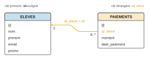
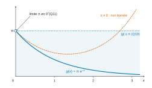
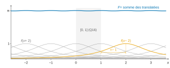

# CCINP MP — Mathématiques 1 2026 · Corrigé brut

*Corrigé rédigé par IA, non officiel. Signalez toute erreur.*

Épreuve MP1M1, durée 4 heures, calculatrices interdites. Deux exercices et un problème, 22 questions.

---

## Exercice I

Les deux tables sont liées par la clé étrangère `PAIEMENTS.id_eleve`, qui référence la clé primaire `ELEVES.id` : un élève a zéro, un ou plusieurs paiements, un paiement concerne un seul élève.



### Q1

Sélection sur `promo` (opérateur de différence `<>`), projection sur `email`, suppression des doublons par `DISTINCT` :

```sql
SELECT DISTINCT email
FROM ELEVES
WHERE promo <> 2025;
```

### Q2

On joint les deux tables sur `E.id = P.id_eleve`, on regroupe par élève (clé primaire `id`, pour ne pas fusionner deux homonymes) et on somme les montants par `SUM … GROUP BY`. La jointure externe à gauche conserve les élèves sans paiement :

```sql
SELECT E.nom, E.prenom, SUM(P.montant) AS total
FROM ELEVES AS E
LEFT JOIN PAIEMENTS AS P ON E.id = P.id_eleve
GROUP BY E.id, E.nom, E.prenom
ORDER BY E.nom, E.prenom;
```

Un élève sans paiement apparaît avec un total `NULL` (aucun montant à sommer), à lire comme 0. Si l'on se limite aux élèves ayant effectué au moins un paiement, la même requête avec la jointure interne `JOIN PAIEMENTS AS P ON E.id = P.id_eleve` convient.

### Q3

Deux lignes sont des doublons si elles coïncident sur `nom`, `prenom`, `email`, `promo` et diffèrent par `id`. Autojointure :

```sql
SELECT DISTINCT E1.id, E1.email
FROM ELEVES AS E1
JOIN ELEVES AS E2
  ON E1.nom = E2.nom AND E1.prenom = E2.prenom
 AND E1.email = E2.email AND E1.promo = E2.promo
WHERE E1.id <> E2.id;
```

La condition `E1.id <> E2.id` empêche une ligne de s'apparier avec elle-même ; `DISTINCT` évite qu'une ligne présente en trois exemplaires ou plus soit affichée plusieurs fois. Variante équivalente par agrégation :

```sql
SELECT E.id, E.email
FROM ELEVES AS E
JOIN (SELECT nom, prenom, email, promo
      FROM ELEVES
      GROUP BY nom, prenom, email, promo
      HAVING COUNT(*) >= 2) AS D
  ON E.nom = D.nom AND E.prenom = D.prenom
 AND E.email = D.email AND E.promo = D.promo;
```

### Q4

Un élève sans paiement n'a **aucune ligne** dans `PAIEMENTS` ; ce n'est pas un paiement de montant nul, donc un test `montant = 0` ne répond pas à la question. Différence ensembliste entre les identifiants d'élèves et les identifiants apparaissant dans `PAIEMENTS` :

```sql
SELECT id FROM ELEVES
EXCEPT
SELECT id_eleve FROM PAIEMENTS;
```

Variante par requête imbriquée, équivalente tant que la colonne `id_eleve` ne contient pas `NULL` (sinon `NOT IN` ne renvoie aucune ligne) : `SELECT id FROM ELEVES WHERE id NOT IN (SELECT id_eleve FROM PAIEMENTS);`.

---

## Exercice II

### Q5

$X$ étant à valeurs dans $\mathbb{N}$, la famille $\big((X=n)\big)_{n\in\mathbb{N}}$ est un système complet d'événements. La série à termes positifs $\sum P(X=n)$ converge donc, de somme $1$.

Soit $t\in[-1,1]$. Pour tout $n\in\mathbb{N}$, comme $|t|\le1$ :

$$\begin{aligned}
|P(X=n)t^n|&=P(X=n)|t|^n\\
&\le P(X=n).
\end{aligned}$$

Par comparaison de séries à termes positifs, $\sum P(X=n)t^n$ converge absolument, donc converge.

**$G_X$ est bien définie sur $[-1,1]$** (et même, la majoration étant indépendante de $t$, la série converge normalement sur ce segment).

### Q6

Si $X\hookrightarrow\mathcal{P}(\lambda)$, alors $P(X=n)=\mathrm{e}^{-\lambda}\frac{\lambda^n}{n!}$ pour $n\in\mathbb{N}$. La série exponentielle ayant un rayon de convergence infini, pour tout $t\in\mathbb{R}$ :

$$\begin{aligned}
G_X(t)&=\sum_{n=0}^{+\infty}\mathrm{e}^{-\lambda}\frac{(\lambda t)^n}{n!}\\
&=\mathrm{e}^{-\lambda}\mathrm{e}^{\lambda t}.
\end{aligned}$$

$$\boxed{G_X(t)=\mathrm{e}^{\lambda(t-1)}}$$

### Q7

Posons $a_n=P(X=n)$ et $b_n=P(Y=n)$. Soit $t\in\,]-1,1[$. D'après Q5, les séries $\sum a_nt^n$ et $\sum b_nt^n$ convergent absolument. Par le théorème du produit de Cauchy, leur produit de Cauchy converge absolument et

$$G_X(t)G_Y(t)=\sum_{n=0}^{+\infty}c_nt^n,$$

où l'on a posé

$$c_n=\sum_{k=0}^{n}a_kb_{n-k}.$$

Soit $n\in\mathbb{N}$.

Comme $X$ et $Y$ sont à valeurs dans $\mathbb{N}$, l'événement $(X+Y=n)$ est la réunion disjointe finie des événements $(X=k)\cap(Y=n-k)$, pour $0\le k\le n$.

Par additivité, puis par **indépendance de $X$ et $Y$** :

$$\begin{aligned}
P(X+Y=n)&=\sum_{k=0}^{n}P\big((X=k)\cap(Y=n-k)\big)\\
&=\sum_{k=0}^{n}P(X=k)P(Y=n-k)\\
&=c_n.
\end{aligned}$$

$X+Y$ étant à valeurs dans $\mathbb{N}$, on a $\sum_{n\ge0} c_nt^n=G_{X+Y}(t)$. Donc

$$\boxed{\forall t\in\,]-1,1[,\quad G_{X+Y}(t)=G_X(t)\,G_Y(t).}$$

### Q8

$Z=X+Y$ est à valeurs dans $\mathbb{N}$. D'après Q7 (qui utilise l'indépendance) et Q6, pour $t\in\,]-1,1[$ :

$$\begin{aligned}
G_Z(t)&=\mathrm{e}^{\lambda(t-1)}\mathrm{e}^{\mu(t-1)}\\
&=\mathrm{e}^{(\lambda+\mu)(t-1)}\\
&=\sum_{n=0}^{+\infty}\mathrm{e}^{-(\lambda+\mu)}\frac{(\lambda+\mu)^n}{n!}t^n.
\end{aligned}$$

Les séries entières $\sum P(Z=n)t^n$ et $\sum \mathrm{e}^{-(\lambda+\mu)}\frac{(\lambda+\mu)^n}{n!}t^n$ ont la même somme sur $]-1,1[$. Par unicité des coefficients d'un développement en série entière (la fonction génératrice caractérise la loi), pour tout $n\in\mathbb{N}$ :

$$P(Z=n)=\mathrm{e}^{-(\lambda+\mu)}\frac{(\lambda+\mu)^n}{n!}.$$

$$\boxed{Z=X+Y\hookrightarrow\mathcal{P}(\lambda+\mu).}$$

---

## Problème — Partie I - Calcul d'une intégrale

On note $\varphi(x,t)=\dfrac{x}{x^2+t^2}$ et $h(x,t)=\varphi(x,t)\mathrm{e}^{it}$ pour $x>0$, $t\in\mathbb{R}$.

### Q9

Soit $x>0$. La fonction $t\mapsto h(x,t)$ est continue sur $\mathbb{R}$, car le dénominateur est minoré par $x^2>0$. De plus

$$|h(x,t)|=\frac{x}{x^2+t^2}\underset{|t|\to+\infty}{\sim}\frac{x}{t^2},$$

fonction intégrable au voisinage de $\pm\infty$ (Riemann, exposant $2>1$). Par comparaison de fonctions positives, $t\mapsto h(x,t)$ est intégrable sur $\mathbb{R}$ : **$g$ est bien définie sur $]0,+\infty[$**.

### Q10

Soit $x>0$. L'application $u\mapsto xu$ est une bijection de $\mathbb{R}$ sur $\mathbb{R}$, de classe $\mathcal{C}^1$ et strictement croissante ; l'intégrale converge (Q9).

Le changement de variable $t=xu$, $\mathrm{d}t=x\,\mathrm{d}u$, donne

$$g(x)=\int_{-\infty}^{+\infty}\frac{x\cdot x}{x^2+x^2u^2}\mathrm{e}^{ixu}\,\mathrm{d}u,$$

d'où

$$\boxed{g(x)=\int_{-\infty}^{+\infty}\frac{\mathrm{e}^{ixu}}{1+u^2}\,\mathrm{d}u.}$$

Par inégalité triangulaire, et puisque $|\mathrm{e}^{ixu}|=1$ :

$$\begin{aligned}
|g(x)|&\le\int_{-\infty}^{+\infty}\frac{\mathrm{d}u}{1+u^2}\\
&=\Big[\arctan u\Big]_{-\infty}^{+\infty}\\
&=\pi.
\end{aligned}$$

La borne ne dépend pas de $x$ : **$g$ est bornée sur $]0,+\infty[$, avec $|g|\le\pi$.**

### Q11

Soit $(x_p)$ une suite de réels strictement positifs de limite $0$. On pose $f_p(u)=\dfrac{\mathrm{e}^{ix_pu}}{1+u^2}$.

- Chaque $f_p$ est continue sur $\mathbb{R}$.
- Pour tout $u$, $f_p(u)\to\dfrac{1}{1+u^2}$ (continuité de l'exponentielle), limite continue.
- Domination : $|f_p(u)|=\dfrac{1}{1+u^2}$, indépendante de $p$, intégrable sur $\mathbb{R}$.

Par le théorème de convergence dominée, $g(x_p)=\int_{\mathbb{R}}f_p$ tend vers $\int_{\mathbb{R}}\frac{\mathrm{d}u}{1+u^2}=\pi$. Ceci valant pour toute suite, par caractérisation séquentielle de la limite :

$$\boxed{\lim_{x\to0^+}g(x)=\pi.}$$

### Q12

On travaille sur la forme initiale : dériver la forme de Q10 en $x$ ferait apparaître $iu\,\mathrm{e}^{ixu}/(1+u^2)$, non intégrable. Pour $t$ fixé, $x\mapsto h(x,t)$ est de classe $\mathcal{C}^2$ sur $]0,+\infty[$, avec

$$\frac{\partial h}{\partial x}(x,t)=\frac{t^2-x^2}{(x^2+t^2)^2}\mathrm{e}^{it}$$

et

$$\frac{\partial^2 h}{\partial x^2}(x,t)=\frac{2x(x^2-3t^2)}{(x^2+t^2)^3}\mathrm{e}^{it}.$$

- Pour tout $x>0$, $t\mapsto h(x,t)$ est continue et intégrable (Q9). La fonction $t\mapsto\partial_xh(x,t)$ est continue et intégrable car $\left|\partial_xh(x,t)\right|\le\dfrac{x^2+t^2}{(x^2+t^2)^2}=\dfrac{1}{x^2+t^2}$.
- $t\mapsto\partial_x^2h(x,t)$ est continue. Domination sur tout segment $[a,b]\subset\,]0,+\infty[$ : pour $x\in[a,b]$, on a $|2x(x^2-3t^2)|\le 6x(x^2+t^2)$, donc

$$\begin{aligned}
\left|\frac{\partial^2 h}{\partial x^2}(x,t)\right|&\le\frac{6x}{(x^2+t^2)^2}\\
&\le\frac{6b}{(a^2+t^2)^2},
\end{aligned}$$

fonction de $t$ seule, continue, intégrable sur $\mathbb{R}$ (équivalente à $6b/t^4$ en $\pm\infty$).

Une domination sur tout $]0,+\infty[$ est impossible (en $t=0$, le majorant $6/x^3$ explose en $0^+$) ; elle n'est pas nécessaire, la régularité étant une propriété locale.

Par le théorème de régularité $\mathcal{C}^2$ des intégrales à paramètre (domination sur tout segment), **$g$ est de classe $\mathcal{C}^2$ sur $]0,+\infty[$**, et

$$\forall x>0,\quad g''(x)=\int_{-\infty}^{+\infty}\frac{\partial^2\varphi}{\partial x^2}(x,t)\,\mathrm{e}^{it}\,\mathrm{d}t.$$

### Q13

Avec $D=x^2+t^2$ :

$$\begin{aligned}
\frac{\partial^2}{\partial x^2}\Big(\frac{x}{D}\Big)&=\frac{\partial}{\partial x}\Big(\frac{t^2-x^2}{D^2}\Big)\\
&=\frac{-2xD-4x(t^2-x^2)}{D^3}\\
&=\frac{2x^3-6xt^2}{D^3},
\end{aligned}$$

$$\begin{aligned}
\frac{\partial^2}{\partial t^2}\Big(\frac{x}{D}\Big)&=\frac{\partial}{\partial t}\Big(\frac{-2xt}{D^2}\Big)\\
&=\frac{-2xD+8xt^2}{D^3}\\
&=\frac{6xt^2-2x^3}{D^3}.
\end{aligned}$$

$$\boxed{\frac{\partial^2}{\partial x^2}\Big(\frac{x}{x^2+t^2}\Big)+\frac{\partial^2}{\partial t^2}\Big(\frac{x}{x^2+t^2}\Big)=0.}$$

Fixons $x>0$ et posons $\psi(t)=\varphi(x,t)$, de classe $\mathcal{C}^\infty$ sur $\mathbb{R}$. D'après Q12 et cette identité :

$$g''(x)=-\int_{\mathbb{R}}\psi''(t)\mathrm{e}^{it}\,\mathrm{d}t.$$

Les fonctions $\psi$, $\psi'(t)=\frac{-2xt}{D^2}$ et $\psi''$ sont continues et intégrables sur $\mathbb{R}$.

Elles sont en effet équivalentes respectivement à $x/t^2$, $-2x/t^3$ et $6x/t^4$ en $\pm\infty$.

Pour $A>0$, deux intégrations par parties sur $[-A,A]$ donnent

$$\int_{-A}^{A}\psi''(t)\mathrm{e}^{it}\,\mathrm{d}t=\Big[\psi'(t)\mathrm{e}^{it}\Big]_{-A}^{A}-i\Big[\psi(t)\mathrm{e}^{it}\Big]_{-A}^{A}+i^2\int_{-A}^{A}\psi(t)\mathrm{e}^{it}\,\mathrm{d}t.$$

Quand $A\to+\infty$, $\psi(\pm A)\to0$ et $\psi'(\pm A)\to0$, et les intégrales convergent. On obtient $\int_{\mathbb{R}}\psi''(t)\mathrm{e}^{it}\,\mathrm{d}t=-g(x)$, donc $g''(x)=g(x)$ :

$$\boxed{g\text{ est solution de }y''-y=0\text{ sur }]0,+\infty[.}$$

### Q14

L'équation linéaire homogène à coefficients constants $y''-y=0$ a pour équation caractéristique $r^2-1=0$, de racines $\pm1$.

Sur l'intervalle $]0,+\infty[$, il existe donc $(\alpha,\beta)\in\mathbb{C}^2$ tel que $g(x)=\alpha\mathrm{e}^{x}+\beta\mathrm{e}^{-x}$ pour tout $x>0$.

- Si $\alpha\neq0$, $|g(x)|\ge|\alpha|\mathrm{e}^{x}-|\beta|\to+\infty$, ce qui contredit $|g|\le\pi$ (Q10). Donc $\alpha=0$.
- $g(x)=\beta\mathrm{e}^{-x}\to\beta$ quand $x\to0^+$, donc $\beta=\pi$ (Q11).



$$\boxed{\forall x>0,\quad g(x)=\pi\,\mathrm{e}^{-x}.}$$

## Partie II - Formule sommatoire de Poisson

### Q15

Soit $x\in\mathbb{R}$ fixé. Les termes $f(x\pm n)$ sont positifs et, quand l'indice $n\to+\infty$ :

$$f(x\pm n)\sim\frac{1}{n^2}.$$

Par comparaison à la série de Riemann $\sum 1/n^2$, les séries $\sum_{n\ge0}f(x+n)$ et $\sum_{n\ge1}f(x-n)$ convergent : **$F$ est définie sur $\mathbb{R}$**.

Périodicité : par décalage d'indice dans des séries convergentes,

$$\begin{aligned}
\sum_{n=0}^{+\infty}f(x+1+n)&=\sum_{m=1}^{+\infty}f(x+m)\\
&=\sum_{m=0}^{+\infty}f(x+m)-f(x),
\end{aligned}$$

$$\begin{aligned}
\sum_{n=1}^{+\infty}f(x+1-n)&=\sum_{m=0}^{+\infty}f(x-m)\\
&=f(x)+\sum_{m=1}^{+\infty}f(x-m).
\end{aligned}$$

En additionnant, $F(x+1)=F(x)$ : **$F$ est 1-périodique**.

### Q16

Posons $u_n(x)=f(x+n)$ ($n\ge0$) et $v_n(x)=f(x-n)$ ($n\ge1$), continues sur $[0,1]$.

Pour $x\in[0,1]$ et $n\ge1$ :

- $x+n\ge n$, donc $0\le u_n(x)\le\dfrac{1}{1+n^2}$ ;
- $|x-n|\ge n-1$, donc $0\le v_n(x)\le\dfrac{1}{1+(n-1)^2}$.

Ces majorants sont indépendants de $x$ et termes généraux de séries convergentes.

Les séries $\sum u_n$ et $\sum v_n$ convergent donc normalement, donc uniformément, sur $[0,1]$ (le seul fait que $\|u_n\|_\infty\to0$ ne suffirait pas). Leurs termes étant continus, **$F$ est continue sur $[0,1]$**.



Soit $k\in\mathbb{Z}$. Pour $x\in[k,k+1]$, $F(x)=F(x-k)$ (Q15).

L'application $x\mapsto F(x-k)$ est continue sur $[k,k+1]$, comme composée de $x\mapsto x-k$ (à valeurs dans $[0,1]$) et de $F_{|[0,1]}$.

Ainsi $F$ est continue sur chaque $[k,k+1]$, et la continuité en un point non entier en découle.

En un entier $k$, la continuité sur $[k-1,k]$ et sur $[k,k+1]$ donne les continuités à gauche et à droite. **$F$ est continue sur $\mathbb{R}$.**

### Q17

$F$ est continue et 1-périodique, donc $c_k(F)$ est défini. Soit $k\in\mathbb{Z}$.

Comme $|\mathrm{e}^{-2i\pi kt}|=1$, les majorations de Q16 montrent que les séries $\sum f(t+n)\mathrm{e}^{-2i\pi kt}$ et $\sum f(t-n)\mathrm{e}^{-2i\pi kt}$ de fonctions continues convergent uniformément sur le segment $[0,1]$. Par le théorème d'intégration terme à terme sur un segment :

$$\begin{aligned}
c_k(F)={}&\sum_{n=0}^{+\infty}\int_0^1f(t+n)\mathrm{e}^{-2i\pi kt}\,\mathrm{d}t\\
&+\sum_{n=1}^{+\infty}\int_0^1f(t-n)\mathrm{e}^{-2i\pi kt}\,\mathrm{d}t.
\end{aligned}$$

Par la translation $s=t+n$, et puisque $\mathrm{e}^{2i\pi kn}=1$ ($kn\in\mathbb{Z}$) :

$$\int_0^1f(t+n)\mathrm{e}^{-2i\pi kt}\,\mathrm{d}t=\int_n^{n+1}f(s)\mathrm{e}^{-2i\pi ks}\,\mathrm{d}s.$$

De même, par $s=t-n$ et $\mathrm{e}^{-2i\pi kn}=1$ :

$$\int_0^1f(t-n)\mathrm{e}^{-2i\pi kt}\,\mathrm{d}t=\int_{-n}^{-n+1}f(s)\mathrm{e}^{-2i\pi ks}\,\mathrm{d}s.$$

La fonction $s\mapsto f(s)\mathrm{e}^{-2i\pi ks}$, de module $f(s)$, est intégrable sur $\mathbb{R}$.

Par Chasles, les sommes partielles valent $\int_0^{N+1}$ et $\int_{-N}^{0}$, qui tendent vers $\int_0^{+\infty}$ et $\int_{-\infty}^{0}$. D'où

$$\boxed{\forall k\in\mathbb{Z},\quad c_k(F)=\int_{-\infty}^{+\infty}f(t)\,\mathrm{e}^{-2i\pi kt}\,\mathrm{d}t.}$$

### Q18

Soient $k,n\in\mathbb{Z}$ et $m=n+k\in\mathbb{Z}$. Si $m=0$, l'intégrande vaut $1$ et l'intégrale vaut $1$.

Si $m\neq0$, comme $\mathrm{e}^{-2i\pi m}=1$ ($m$ entier) :

$$\begin{aligned}
\int_0^1\mathrm{e}^{-2i\pi mt}\,\mathrm{d}t&=\left[\frac{\mathrm{e}^{-2i\pi mt}}{-2i\pi m}\right]_0^1\\
&=\frac{\mathrm{e}^{-2i\pi m}-1}{-2i\pi m}\\
&=0.
\end{aligned}$$

$$\boxed{\int_0^1\mathrm{e}^{-2i\pi(n+k)t}\,\mathrm{d}t=\begin{cases}1&\text{si }n+k=0,\\0&\text{sinon.}\end{cases}}$$

## Partie III - Applications

### Q19

D'après Q17 avec $k=0$ :

$$c_0(F)=\int_{-\infty}^{+\infty}\frac{\mathrm{d}t}{1+t^2}=\pi.$$

Soit $k\in\mathbb{N}^*$. D'après Q17, $c_k(F)=\displaystyle\int_{-\infty}^{+\infty}\frac{\mathrm{e}^{-2i\pi kt}}{1+t^2}\,\mathrm{d}t$. Le changement de variable $u=-t$ (bijection $\mathcal{C}^1$ strictement décroissante de $\mathbb{R}$ sur $\mathbb{R}$, intégrale absolument convergente) donne

$$c_k(F)=\int_{-\infty}^{+\infty}\frac{\mathrm{e}^{2i\pi ku}}{1+u^2}\,\mathrm{d}u.$$

C'est $g(2\pi k)$ d'après Q10 appliquée en $x=2\pi k>0$. Par Q14 :

$$\boxed{\begin{aligned}
c_0(F)&=\pi,\\
\forall k\in\mathbb{N}^*,\quad c_k(F)&=\pi\,\mathrm{e}^{-2\pi k}.
\end{aligned}}$$

Avec le résultat admis $c_{-k}(F)=c_k(F)$, on a $c_k(F)=\pi\mathrm{e}^{-2\pi|k|}$ pour tout $k\in\mathbb{Z}$.

### Q20

Posons $q=\mathrm{e}^{-2\pi}\in\,]0,1[$. Pour $n\in\mathbb{N}$ et $x\in\mathbb{R}$, d'après Q19 :

$$|c_n(F)\mathrm{e}^{2i\pi nx}|=\pi q^n,$$

et de même $|c_{-n}(F)\mathrm{e}^{-2i\pi nx}|=\pi q^n$. Ces majorants sont indépendants de $x$ et termes d'une série géométrique convergente. Les deux séries de fonctions continues convergent normalement, donc uniformément, sur $\mathbb{R}$ : **$G$ est définie et continue sur $\mathbb{R}$**.

Chaque terme est 1-périodique car $\mathrm{e}^{\pm2i\pi n(x+1)}=\mathrm{e}^{\pm2i\pi nx}$. Les sommes partielles $S_N$ de $G$ vérifient donc $S_N(x+1)=S_N(x)$ et, par passage à la limite, **$G(x+1)=G(x)$** pour tout $x\in\mathbb{R}$.

### Q21

$F$ (Q15, Q16) et $G$ (Q20) sont continues sur $\mathbb{R}$ et 1-périodiques. Par le résultat admis, il suffit de montrer $c_k(G)=c_k(F)$ pour tout $k\in\mathbb{Z}$.

Soit $k\in\mathbb{Z}$. Multipliées par $\mathrm{e}^{-2i\pi kt}$ (de module 1), les deux séries définissant $G$ convergent encore uniformément sur $[0,1]$ ; on intègre terme à terme :

$$\begin{aligned}
c_k(G)={}&\sum_{n=0}^{+\infty}c_n(F)\int_0^1\mathrm{e}^{-2i\pi(-n+k)t}\,\mathrm{d}t\\
&+\sum_{n=1}^{+\infty}c_{-n}(F)\int_0^1\mathrm{e}^{-2i\pi(n+k)t}\,\mathrm{d}t.
\end{aligned}$$

D'après Q18, la première intégrale vaut $1$ si $n=k$ et $0$ sinon ; la seconde vaut $1$ si $n=-k$ et $0$ sinon.

- Si $k\ge0$ : seul le terme $n=k$ de la première série subsiste ; dans la seconde, $n=-k\le0$ est exclu. Donc $c_k(G)=c_k(F)$.
- Si $k<0$ : dans la première série, $n=k<0$ est exclu ; dans la seconde, seul $n=-k\ge1$ subsiste et apporte $c_{-n}(F)=c_k(F)$. Donc $c_k(G)=c_k(F)$.

Ainsi $c_k(G)=c_k(F)$ pour tout $k\in\mathbb{Z}$, et

$$\boxed{F=G.}$$

### Q22

Soit $x\in\mathbb{R}$ et $z=q\,\mathrm{e}^{2i\pi x}$, avec $|z|=q<1$. D'après Q19 et Q21, en sommant deux séries géométriques convergentes :

$$\begin{aligned}
F(x)&=G(x)\\
&=\pi\sum_{n=0}^{+\infty}z^n+\pi\sum_{n=1}^{+\infty}\overline{z}^{\,n}\\
&=\pi\left(\frac{1}{1-z}+\frac{\overline{z}}{1-\overline{z}}\right).
\end{aligned}$$

En réduisant au même dénominateur $|1-z|^2=(1-z)(1-\overline{z})$ :

$$\begin{aligned}
\frac{1}{1-z}+\frac{\overline{z}}{1-\overline{z}}&=\frac{1-\overline{z}+\overline{z}-|z|^2}{|1-z|^2}\\
&=\frac{1-q^2}{1-2q\cos(2\pi x)+q^2}.
\end{aligned}$$

D'où, avec $q=\mathrm{e}^{-2\pi}$, puis en multipliant numérateur et dénominateur par $\mathrm{e}^{2\pi}/2$ :

$$\boxed{\begin{aligned}
\forall x\in\mathbb{R},\quad F(x)&=\frac{\pi\left(1-\mathrm{e}^{-4\pi}\right)}{1-2\mathrm{e}^{-2\pi}\cos(2\pi x)+\mathrm{e}^{-4\pi}}\\
&=\frac{\pi\,\mathrm{sh}(2\pi)}{\mathrm{ch}(2\pi)-\cos(2\pi x)}.
\end{aligned}}$$

Contrôle : en $x=0$, $F(0)=\pi\dfrac{1+q}{1-q}=\pi\dfrac{\mathrm{ch}\,\pi}{\mathrm{sh}\,\pi}$, soit $\displaystyle\sum_{n\in\mathbb{Z}}\frac{1}{1+n^2}=\frac{\pi}{\mathrm{th}\,\pi}$, valeur classique.

**FIN**
