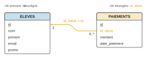
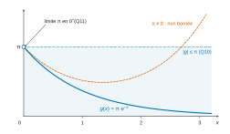
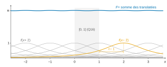

# CCINP MP — Mathématiques 1 2026 · Corrigé guidé

*Corrigé rédigé par IA, non officiel. Signalez toute erreur.*

## Présentation du sujet

**Cadre.** Épreuve MP1M1, 4 heures, calculatrices interdites. Le sujet comprend deux exercices indépendants et un problème, soit 22 questions. Selon le rapport 2026, la moyenne est de 9,92 et l'écart type de 4,01 en filière MP.

**Exercice I (Q1–Q4) : bases de données.** Quatre requêtes SQL sur deux tables, `ELEVES` et `PAIEMENTS`, reliées par la clé étrangère `id_eleve`. On y mobilise la sélection, la projection avec `DISTINCT`, la jointure, l'agrégation `SUM … GROUP BY`, l'autojointure et la différence ensembliste `EXCEPT` (programme d'informatique commune). Le rapport 2026 le rappelle : « Il reste toujours (comme les années précédentes) des candidats faisant l'impasse sur le programme d'informatique commune, ce qui devient vite pénalisant. » (p. 1)



**Exercice II (Q5–Q8) : fonctions génératrices.** Définition de $G_X$ sur $[-1,1]$, fonction génératrice d'une loi de Poisson, formule $G_{X+Y}=G_XG_Y$ démontrée par produit de Cauchy, puis stabilité de la loi de Poisson par somme indépendante. Tout est au cœur du programme de probabilités de MP.

**Problème (Q9–Q22) : un cas de la formule sommatoire de Poisson.**

- *Partie I (Q9–Q14)* : calcul de $g(x)=\int_{\mathbb{R}}\frac{x}{x^2+t^2}\mathrm{e}^{it}\,\mathrm{d}t$ par la méthode de l'équation différentielle. On y voit intégrabilité, changement de variable, convergence dominée, régularité $\mathcal{C}^2$ d'une intégrale à paramètre, intégrations par parties et résolution de $y''-y=0$.
- *Partie II (Q15–Q18)* : la périodisée $F(x)=\sum_{n\in\mathbb{Z}}f(x+n)$ de $f(t)=\frac{1}{1+t^2}$. Convergence, périodicité, continuité par convergence normale sur un segment, coefficients de Fourier par intégration terme à terme, orthogonalité des exponentielles.
- *Partie III (Q19–Q22)* : calcul explicite des $c_k(F)$ grâce à la partie I, identification de $F$ à une série trigonométrique $G$ grâce à un résultat d'unicité admis, et formule close de $F$.

**Difficulté et longueur.** Sujet de longueur raisonnable pour 4 heures, très guidé, sans piège calculatoire majeur. La difficulté est dans la **rigueur des justifications** : choix de la bonne forme de $g$ selon l'usage, domination locale, interversions série–intégrale, discussion d'indices.

**Questions discriminantes selon le rapport 2026** (p. 2–3) :

| Question | Constat du jury |
|---|---|
| Q3 | Question difficile, souvent passée |
| Q12 | Très peu réussie : la domination doit se faire sur tout segment |
| Q13 | Peu de candidats trouvent que la somme des dérivées secondes vaut 0 |
| Q14 | Équation $y''-y=0$ pourtant classique, souvent non résolue |
| Q16 | Confusion entre $\|f_n\|_\infty\to0$ et convergence uniforme de la série |
| Q18 | Primitive classique mal réussie |
| Q21–Q22 | Abordées peu souvent |

**Questions à ne pas laisser passer.** Q1, Q4, Q5, Q6, Q8, Q9, Q10, Q14, Q15, Q18 et Q19 (pour $c_0$) sont courtes et standard. Le jury souligne que Q14 se traite même si Q12–Q13 résistent, en admettant l'équation différentielle. La partie III se traite en admettant les résultats des parties I et II.

**Gestion du temps.** Environ 30 minutes pour l'exercice I, 35 minutes pour l'exercice II, 1 h 15 pour la partie I, 50 minutes pour la partie II et 50 minutes pour la partie III, en gardant un peu de temps de relecture.

---

## Exercice I — Bases de données

Quatre requêtes de difficulté croissante. On pense à la clé primaire pour identifier un élève, et aux doublons que créent les projections et les jointures.

### Question 1

> [!INDICATION]
> Une condition sur une ligne s'écrit dans le `WHERE` ; une projection peut faire apparaître des répétitions.

> [!INDICATION]
> Un mot-clé du `SELECT` supprime les lignes répétées du résultat.

#### Solution

```sql
SELECT DISTINCT email
FROM ELEVES
WHERE promo <> 2025;
```

La sélection garde les élèves d'une autre promotion que 2025, la projection ne conserve que l'email, `DISTINCT` élimine les doublons (homonymes partageant une adresse, lignes dupliquées de la table).

> [!PIEGE]
> `promo` est un entier : on écrit `2025` sans guillemets. Oublier `DISTINCT` ne répond pas à « sans doublons », et la différence s'écrit `<>`.

> [!JURY]
> Le rapport 2026 relève les deux erreurs : « Beaucoup oublis de mettre DISTINCT ou ne connaissent pas le symbole de négation <>. » (p. 2)

### Question 2

> [!INDICATION]
> « Montant total pour chaque élève » : c'est une fonction d'agrégation calculée par groupe.

> [!INDICATION]
> Par quoi regrouper pour ne pas confondre deux élèves homonymes ? Et quelle jointure garde un élève qui n'a aucune ligne dans `PAIEMENTS` ?

#### Solution

```sql
SELECT E.nom, E.prenom, SUM(P.montant) AS total
FROM ELEVES AS E
LEFT JOIN PAIEMENTS AS P ON E.id = P.id_eleve
GROUP BY E.id, E.nom, E.prenom
ORDER BY E.nom, E.prenom;
```

- On joint les deux tables sur `E.id = P.id_eleve` : le nom est dans `ELEVES`, les montants dans `PAIEMENTS`.
- On regroupe par `E.id`, la clé primaire : deux homonymes sont deux élèves distincts. On ajoute `nom` et `prenom` au `GROUP BY`, puisqu'ils sont affichés sans être agrégés (ils sont de toute façon constants dans chaque groupe).
- La jointure externe à gauche conserve chaque élève, même sans paiement ; son total vaut alors `NULL` (aucun montant à sommer), à lire comme 0.
- Le tri `ORDER BY nom, prenom` se place en fin de requête.

Si l'on comprend « chaque élève ayant payé », la jointure interne `JOIN PAIEMENTS AS P ON E.id = P.id_eleve` donne une réponse correcte pour cette lecture ; il est bon de signaler en une phrase quelle lecture on retient.

> [!PIEGE]
> Regrouper par `nom, prenom` seulement fusionnerait les paiements de deux homonymes. Et une jointure interne fait disparaître silencieusement les élèves sans paiement.

> [!JURY]
> Le rapport 2026 constate : « Beaucoup d'oublis également sur les syntaxes. » Il ajoute : « L'agrégation avec un GROUP BY n'est pas connue de tous et plus basiquement encore, la jointure n'est pas maitrisée. » (p. 2)

### Question 3

> [!INDICATION]
> Il faut comparer chaque ligne de `ELEVES` à une autre ligne de la même table.

> [!INDICATION]
> Une autojointure (deux alias de `ELEVES`) avec égalité sur les quatre attributs autres que `id`. Quelle condition empêche une ligne de s'apparier avec elle-même ?

#### Solution

```sql
SELECT DISTINCT E1.id, E1.email
FROM ELEVES AS E1
JOIN ELEVES AS E2
  ON E1.nom = E2.nom AND E1.prenom = E2.prenom
 AND E1.email = E2.email AND E1.promo = E2.promo
WHERE E1.id <> E2.id;
```

- Sans `E1.id <> E2.id`, chaque ligne s'apparierait avec elle-même et toute la table serait renvoyée. (Cette condition peut aussi être placée dans le `ON`.)
- `DISTINCT` est nécessaire : une ligne présente en trois exemplaires s'apparie avec les deux autres et apparaîtrait deux fois.

Variante qui traduit littéralement « au moins deux lignes » :

```sql
SELECT E.id, E.email
FROM ELEVES AS E
JOIN (SELECT nom, prenom, email, promo
      FROM ELEVES
      GROUP BY nom, prenom, email, promo
      HAVING COUNT(*) >= 2) AS D
  ON E.nom = D.nom AND E.prenom = D.prenom
 AND E.email = D.email AND E.promo = D.promo;
```

> [!PIEGE]
> Un `GROUP BY nom, prenom, email, promo HAVING COUNT(*) >= 2` seul ne permet pas d'afficher `id`, qui n'est pas constant dans un groupe : il faut revenir à la table par une jointure. Comparer seulement les emails répond à une autre question.

> [!JURY]
> Pour le rapport 2026, c'est une « Question difficile qui a souvent été passée. » (p. 2) Une autojointure correcte y fait donc la différence.

### Question 4

> [!INDICATION]
> « Aucun paiement » est une non-existence : une jointure interne ne produit que des lignes appariées.

> [!INDICATION]
> Pensez aux opérateurs ensemblistes sur deux requêtes renvoyant des identifiants.

#### Solution

```sql
SELECT id FROM ELEVES
EXCEPT
SELECT id_eleve FROM PAIEMENTS;
```

On retire de l'ensemble des identifiants d'élèves ceux qui apparaissent dans `PAIEMENTS`. Les deux requêtes renvoient une colonne d'entiers, ce qui rend la différence licite.

Une requête imbriquée convient aussi, tant que `id_eleve` ne contient pas `NULL` : `SELECT id FROM ELEVES WHERE id NOT IN (SELECT id_eleve FROM PAIEMENTS);`. Si la sous-requête renvoie un `NULL`, `NOT IN` n'est jamais vrai et le résultat est vide.

> [!PIEGE]
> Un élève sans paiement n'a **aucune ligne** dans `PAIEMENTS` : ce n'est pas un paiement de montant nul. Le rapport 2026 constate que de nombreux candidats « pensent à tort que « montant = 0 » correspond à ne pas avoir de paiement » (p. 2).

> [!METHODE]
> Pour « les X qui n'ont aucun Y », penser d'abord à `EXCEPT` ou à `NOT IN`, ou à une jointure externe à gauche suivie d'un test `IS NULL`.

---

## Exercice II — Fonctions génératrices

On démontre, par les fonctions génératrices, que la somme de deux variables de Poisson indépendantes suit une loi de Poisson. Outils : séries entières, produit de Cauchy, unicité du développement en série entière.

### Question 5

> [!INDICATION]
> Que vaut $\sum_n P(X=n)$ ? Comparez le module du terme général à une quantité indépendante de $t$.

#### Solution

$X$ étant à valeurs dans $\mathbb{N}$, la famille $\big((X=n)\big)_{n\in\mathbb{N}}$ est un système complet d'événements. La série $\sum P(X=n)$ converge donc, de somme $1$.

Soit $t\in[-1,1]$. Pour tout $n$, comme $|t|\le1$ :

$$\begin{aligned}
|P(X=n)t^n|&=P(X=n)|t|^n\\
&\le P(X=n).
\end{aligned}$$

Par comparaison de séries à termes positifs, $\sum P(X=n)t^n$ converge absolument, donc converge : **$G_X$ est bien définie sur $[-1,1]$**. La majoration étant indépendante de $t$, la convergence est même normale sur $[-1,1]$.

> [!PIEGE]
> Dire « série entière de rayon au moins 1 » ne suffit pas pour les bornes $t=\pm1$ : un rayon égal à 1 ne dit rien sur le bord. C'est le cas par exemple pour $P(X=n)=\frac{6}{\pi^2n^2}$ ($n\ge1$). Seule la domination par $P(X=n)$ couvre le segment fermé.

> [!JURY]
> Selon le rapport 2026, beaucoup invoquent une série entière, à juste titre, mais perdent du temps à étudier les valeurs aux bords, « alors qu'il suffisait ici de majorer t par 1 » (p. 2). La réponse tient en trois lignes.

### Question 6

> [!INDICATION]
> Reportez la loi dans la définition et reconnaissez une série classique.

#### Solution

Si $X\hookrightarrow\mathcal{P}(\lambda)$, alors $P(X=n)=\mathrm{e}^{-\lambda}\frac{\lambda^n}{n!}$. La série exponentielle ayant un rayon infini, pour tout $t\in\mathbb{R}$ :

$$\begin{aligned}
G_X(t)&=\mathrm{e}^{-\lambda}\sum_{n=0}^{+\infty}\frac{(\lambda t)^n}{n!}\\
&=\mathrm{e}^{-\lambda}\mathrm{e}^{\lambda t}.
\end{aligned}$$

$$\boxed{G_X(t)=\mathrm{e}^{\lambda(t-1)}}$$

Contrôles rapides : $G_X(1)=1$ et $G_X'(1)=\lambda=\mathrm{E}(X)$.

> [!METHODE]
> Les fonctions génératrices des lois de Bernoulli, binomiale, géométrique et de Poisson doivent se retrouver en quelques lignes : elles sont explicitement exigibles. Le rapport 2026 juge la question « Très bien réussie sauf pour ceux qui ne connaissent pas la définition d'une loi de Poisson. » (p. 2)

### Question 7

> [!INDICATION]
> Le produit de Cauchy de deux séries absolument convergentes est une série convergente dont on connaît le terme général.

> [!INDICATION]
> Décomposez l'événement $(X+Y=n)$ selon la valeur de $X$, puis utilisez l'indépendance.

#### Solution

Posons $a_n=P(X=n)$, $b_n=P(Y=n)$, et soit $t\in\,]-1,1[$. Les séries $\sum a_nt^n$ et $\sum b_nt^n$ convergent absolument (Q5). Par le théorème du produit de Cauchy,

$$G_X(t)G_Y(t)=\sum_{n=0}^{+\infty}c_nt^n,$$

où l'on a posé

$$c_n=\sum_{k=0}^{n}a_kb_{n-k}.$$

Soit $n\in\mathbb{N}$. Comme $X,Y$ sont à valeurs dans $\mathbb{N}$, $(X+Y=n)$ est la réunion disjointe finie des $(X=k)\cap(Y=n-k)$, $0\le k\le n$.

Par additivité, puis par **indépendance de $X$ et $Y$** :

$$\begin{aligned}
P(X+Y=n)&=\sum_{k=0}^{n}P(X=k,\,Y=n-k)\\
&=\sum_{k=0}^{n}P(X=k)P(Y=n-k)\\
&=c_n.
\end{aligned}$$

Comme $X+Y$ est à valeurs dans $\mathbb{N}$ :

$$\boxed{\forall t\in\,]-1,1[,\quad G_{X+Y}(t)=G_X(t)G_Y(t).}$$

> [!JURY]
> L'énoncé impose la méthode (produit de Cauchy) : la preuve par $\mathrm{E}(t^{X+Y})=\mathrm{E}(t^X)\mathrm{E}(t^Y)$ est juste mais ne répond pas à la consigne. Le rapport 2026 juge la question « Plutôt bien traitée sauf quelques oublis de justifications (notamment l'indépendance). » (p. 2) Il faut donc écrire à quelle ligne sert l'indépendance.

### Question 8

> [!INDICATION]
> Utilisez Q6 et Q7, puis demandez-vous ce qui permet de passer d'une égalité de fonctions génératrices à une égalité de lois.

#### Solution

$Z=X+Y$ est à valeurs dans $\mathbb{N}$ et, pour $t\in\,]-1,1[$, d'après Q7 et Q6 :

$$\begin{aligned}
G_Z(t)&=\mathrm{e}^{\lambda(t-1)}\mathrm{e}^{\mu(t-1)}\\
&=\mathrm{e}^{(\lambda+\mu)(t-1)}\\
&=\sum_{n=0}^{+\infty}\mathrm{e}^{-(\lambda+\mu)}\frac{(\lambda+\mu)^n}{n!}t^n.
\end{aligned}$$

Deux séries entières de même somme sur $]-1,1[$ ont les mêmes coefficients (unicité du développement en série entière ; c'est le fait que $G_Z$ caractérise la loi de $Z$). Donc, pour tout $n$ :

$$P(Z=n)=\mathrm{e}^{-(\lambda+\mu)}\frac{(\lambda+\mu)^n}{n!}.$$

$$\boxed{Z\hookrightarrow\mathcal{P}(\lambda+\mu).}$$

Vérification directe par la formule du binôme :

$$\sum_{k=0}^{n}\mathrm{e}^{-\lambda}\frac{\lambda^k}{k!}\mathrm{e}^{-\mu}\frac{\mu^{n-k}}{(n-k)!}=\frac{\mathrm{e}^{-(\lambda+\mu)}}{n!}(\lambda+\mu)^n.$$

> [!PIEGE]
> Écrire $G_Z(t)=\mathrm{e}^{(\lambda+\mu)(t-1)}$ et conclure sans invoquer la caractérisation de la loi par la fonction génératrice laisse l'argument incomplet.

> [!JURY]
> Le rapport 2026 trouve la question « Plutôt bien traitée (même si certains redémontrent le résultat sans utiliser les questions précédentes). » (p. 2) Le calcul par le binôme ci-dessus est un contrôle, pas la réponse attendue.

---

## Problème — Partie I - Calcul d'une intégrale

On montre que $g(x)=\pi\mathrm{e}^{-x}$ sans primitive : $g$ est bornée, tend vers $\pi$ en $0^+$ et vérifie $y''=y$.

Deux écritures de $g$ servent tour à tour : la forme après changement de variable pour borner et passer à la limite, la forme initiale pour dériver. On note $\varphi(x,t)=\frac{x}{x^2+t^2}$ et $h(x,t)=\varphi(x,t)\mathrm{e}^{it}$.

### Question 9

> [!INDICATION]
> Intégrande complexe : on étudie l'intégrabilité de son module.

> [!INDICATION]
> Que vaut $|\mathrm{e}^{it}|$ pour $t$ réel ? Comparez ensuite à une fonction de Riemann en $\pm\infty$.

#### Solution

Soit $x>0$. La fonction $t\mapsto h(x,t)$ est continue sur $\mathbb{R}$ car $x^2+t^2\ge x^2>0$. De plus, en $\pm\infty$ :

$$|h(x,t)|=\frac{x}{x^2+t^2}\sim\frac{x}{t^2},$$

intégrable par comparaison à une intégrale de Riemann d'exposant $2>1$. La fonction est donc intégrable sur $\mathbb{R}$ et **$g$ est bien définie sur $]0,+\infty[$**.

> [!PIEGE]
> Le rapport 2026 signale des majorations par $\frac{1}{t^2}$, qui n'est pas intégrable au voisinage de $0$ (p. 2). Le dénominateur $x^2+t^2$ ne s'annule pas : c'est grâce à $x>0$ que l'intégrande est continue en $t=0$. Le jury ajoute que d'autres « majorent uniformément (sans x) ce qui n'est pas utile ici » : $x$ est fixé dans cette question.

### Question 10

> [!INDICATION]
> Un changement de variable linéaire doit faire disparaître $x$ du dénominateur.

> [!INDICATION]
> Posez $t=xu$ ; pour la borne, l'inégalité triangulaire suffit, à condition que le majorant ne dépende pas de $x$.

#### Solution

Pour $x>0$, $u\mapsto xu$ est une bijection $\mathcal{C}^1$ strictement croissante de $\mathbb{R}$ sur $\mathbb{R}$, et l'intégrale converge (Q9).

Avec $t=xu$, $\mathrm{d}t=x\,\mathrm{d}u$ :

$$\begin{aligned}
g(x)&=\int_{-\infty}^{+\infty}\frac{x^2}{x^2(1+u^2)}\mathrm{e}^{ixu}\,\mathrm{d}u\\
&=\int_{-\infty}^{+\infty}\frac{\mathrm{e}^{ixu}}{1+u^2}\,\mathrm{d}u.
\end{aligned}$$

Par inégalité triangulaire :

$$|g(x)|\le\int_{\mathbb{R}}\frac{\mathrm{d}u}{1+u^2}=\pi.$$

**$g$ est bornée par $\pi$ sur $]0,+\infty[$.**

> [!PIEGE]
> « Bornée » porte sur la fonction $g$ de la variable $x$ : il faut un majorant de $|g(x)|$ indépendant de $x$. L'intégrabilité de $u\mapsto\frac{\mathrm{e}^{ixu}}{1+u^2}$ est une autre propriété. Le rapport 2026 relève « Plusieurs confusions de vocabulaire en mélangeant intégrable et bornée. » (p. 2)

### Question 11

> [!INDICATION]
> Interversion limite–intégrale : quel théorème, et sur quelle forme de $g$ ?

> [!INDICATION]
> Le théorème de convergence dominée porte sur des suites de fonctions : passez par une suite $x_p\to0^+$.

#### Solution

Soit $(x_p)$ une suite de $]0,+\infty[$ de limite nulle, et $f_p(u)=\frac{\mathrm{e}^{ix_pu}}{1+u^2}$.

- Les $f_p$ sont continues et convergent simplement vers $u\mapsto\frac{1}{1+u^2}$, continue.
- $|f_p(u)|=\frac{1}{1+u^2}$, fonction intégrable indépendante de $p$.

Par convergence dominée, $g(x_p)\to\int_{\mathbb{R}}\frac{\mathrm{d}u}{1+u^2}=\pi$. Par caractérisation séquentielle de la limite :

$$\boxed{\lim_{x\to0^+}g(x)=\pi.}$$

> [!METHODE]
> Pour une limite d'intégrale à paramètre réel, on applique la convergence dominée à une suite quelconque tendant vers le point, puis la caractérisation séquentielle. Choisir l'écriture où la domination est évidente.

> [!JURY]
> Question « Plutôt bien traitée pour ceux qui connaissent leur théorème. » (rapport 2026, p. 2) On nomme le théorème et on vérifie ses hypothèses une à une, comme ci-dessus.

### Question 12

> [!INDICATION]
> Théorème de classe $\mathcal{C}^2$ des intégrales à paramètre. Sur quelle forme de $g$ les dérivées en $x$ restent-elles intégrables en la variable d'intégration ?

> [!INDICATION]
> Dérivez $\frac{x}{x^2+t^2}$ deux fois en $x$, puis dominez la dérivée seconde pour $x$ dans un segment $[a,b]$ avec $a>0$.

#### Solution

La forme de Q10 ne convient pas : sa dérivée en $x$ fait apparaître $\frac{iu\,\mathrm{e}^{ixu}}{1+u^2}$, de module équivalent à $1/|u|$, non intégrable. On travaille donc sur $h$.

Pour $t$ fixé, $x\mapsto h(x,t)$ est $\mathcal{C}^2$ sur $]0,+\infty[$, avec

$$\frac{\partial h}{\partial x}=\frac{t^2-x^2}{(x^2+t^2)^2}\mathrm{e}^{it}$$

et

$$\frac{\partial^2h}{\partial x^2}=\frac{2x(x^2-3t^2)}{(x^2+t^2)^3}\mathrm{e}^{it}.$$

- $t\mapsto h(x,t)$ est intégrable (Q9) ; $t\mapsto\partial_xh(x,t)$ est continue et intégrable, car $|\partial_xh|\le\frac{1}{x^2+t^2}$.
- Pour $x\in[a,b]\subset\,]0,+\infty[$, l'inégalité $|2x(x^2-3t^2)|\le6x(x^2+t^2)$ donne

$$\begin{aligned}
\left|\frac{\partial^2h}{\partial x^2}(x,t)\right|&\le\frac{6x}{(x^2+t^2)^2}\\
&\le\frac{6b}{(a^2+t^2)^2},
\end{aligned}$$

fonction de $t$ seule, intégrable sur $\mathbb{R}$.

Le théorème de régularité (avec domination sur tout segment) montre que **$g$ est $\mathcal{C}^2$ sur $]0,+\infty[$**, avec

$$g''(x)=\int_{\mathbb{R}}\frac{\partial^2\varphi}{\partial x^2}(x,t)\mathrm{e}^{it}\,\mathrm{d}t.$$

> [!PIEGE]
> La domination ne peut pas être globale sur $]0,+\infty[$ : en $t=0$ le majorant vaut $6/x^3$, qui explose en $0^+$. On domine sur les segments, ce qui suffit puisque la régularité est une propriété locale.

> [!JURY]
> Le rapport 2026 en fait la question la plus discriminante de la partie I : « Question très peu réussie. Il fallait se placer sur tout segment pour appliquer la domination. » (p. 2)

> [!METHODE]
> Une même intégrale peut avoir plusieurs écritures : on choisit celle qui rend chaque hypothèse (domination, intégrabilité des dérivées) facile à vérifier, quitte à changer d'écriture d'une question à l'autre.

### Question 13

> [!INDICATION]
> Le calcul est direct ; posez $D=x^2+t^2$ pour l'alléger.

> [!INDICATION]
> L'identité permet de remplacer la dérivée seconde en $x$ par une dérivée seconde en $t$ sous l'intégrale. Que donnent deux intégrations par parties face à $\mathrm{e}^{it}$ ?

> [!INDICATION]
> Intégrez par parties sur $[-A,A]$, puis faites tendre $A$ vers $+\infty$.

#### Solution

Avec $D=x^2+t^2$ :

$$\begin{aligned}
\frac{\partial^2}{\partial x^2}\Big(\frac{x}{D}\Big)&=\frac{-2xD-4x(t^2-x^2)}{D^3}\\
&=\frac{2x^3-6xt^2}{D^3},
\end{aligned}$$

$$\begin{aligned}
\frac{\partial^2}{\partial t^2}\Big(\frac{x}{D}\Big)&=\frac{-2xD+8xt^2}{D^3}\\
&=\frac{6xt^2-2x^3}{D^3},
\end{aligned}$$

donc

$$\boxed{\frac{\partial^2}{\partial x^2}\Big(\frac{x}{x^2+t^2}\Big)+\frac{\partial^2}{\partial t^2}\Big(\frac{x}{x^2+t^2}\Big)=0.}$$

Fixons $x>0$ et $\psi(t)=\varphi(x,t)$. Par Q12 et l'identité :

$$g''(x)=-\int_{\mathbb{R}}\psi''(t)\mathrm{e}^{it}\,\mathrm{d}t.$$

Les fonctions $\psi$, $\psi'=\frac{-2xt}{D^2}$ et $\psi''$ sont continues et intégrables.

Elles sont en effet équivalentes à $x/t^2$, $-2x/t^3$ et $6x/t^4$ en $\pm\infty$.

Pour $A>0$, deux intégrations par parties donnent

$$\int_{-A}^{A}\psi''\mathrm{e}^{it}\,\mathrm{d}t=\Big[\psi'\mathrm{e}^{it}\Big]_{-A}^{A}-i\Big[\psi\mathrm{e}^{it}\Big]_{-A}^{A}-\int_{-A}^{A}\psi\,\mathrm{e}^{it}\,\mathrm{d}t,$$

car la seconde intégration par parties introduit $(-i)^2=-1$. Les crochets tendent vers $0$ car $\psi(\pm A)\to0$ et $\psi'(\pm A)\to0$.

À la limite, $\int_{\mathbb{R}}\psi''\mathrm{e}^{it}=-g(x)$, d'où $g''(x)=g(x)$ : **$g$ est solution de $y''-y=0$ sur $]0,+\infty[$**.

> [!JURY]
> « Étonnamment le calcul de dérivée partielle a posé beaucoup de problème et peu de candidats ont trouvé la bonne réponse qui était 0. » (rapport 2026, p. 2) Dériver $\frac{x}{x^2+t^2}$ deux fois sans erreur est un calcul de base ; poser $D=x^2+t^2$ limite les fautes.

> [!METHODE]
> La fonction $(x,t)\mapsto\frac{x}{x^2+t^2}$ est harmonique (c'est la partie réelle de $\frac{1}{x-it}$). L'identité $\partial_x^2\varphi=-\partial_t^2\varphi$ transfère la dérivation du paramètre vers la variable d'intégration, où l'intégration par parties la fait porter sur $\mathrm{e}^{it}$.

> [!PIEGE]
> Faire une intégration par parties directement sur $\mathbb{R}$ sans contrôler les crochets, ou se tromper sur le signe de $(-i)^2$ : on obtiendrait $y''+y=0$, incompatible avec la suite.

### Question 14

> [!INDICATION]
> Résolvez l'équation linéaire à coefficients constants ; il reste deux constantes, et deux questions précédentes donnent deux informations.

> [!INDICATION]
> Une constante est éliminée par le comportement en $+\infty$, l'autre est fixée en $0^+$.

#### Solution

L'équation caractéristique $r^2-1=0$ a pour racines $\pm1$. Sur l'intervalle $]0,+\infty[$, il existe donc $(\alpha,\beta)\in\mathbb{C}^2$ tel que $g(x)=\alpha\mathrm{e}^{x}+\beta\mathrm{e}^{-x}$.

- Si $\alpha\neq0$, $|g(x)|\ge|\alpha|\mathrm{e}^{x}-|\beta|\to+\infty$, contredisant $|g|\le\pi$ (Q10). Donc $\alpha=0$.
- $g(x)=\beta\mathrm{e}^{-x}\to\beta$ en $0^+$, donc $\beta=\pi$ (Q11).



$$\boxed{\forall x>0,\quad g(x)=\pi\mathrm{e}^{-x}.}$$

En séparant parties réelle et imaginaire (le sinus donne une intégrande impaire), on obtient aussi $\int_{\mathbb{R}}\frac{x\cos t}{x^2+t^2}\,\mathrm{d}t=\pi\mathrm{e}^{-x}$.

> [!PIEGE]
> Les constantes sont a priori complexes, puisque $g$ est définie par une intégrale complexe. Le raisonnement n'en dépend pas, mais il ne faut pas supposer $\alpha,\beta$ réels sans le dire.

> [!JURY]
> Le rapport 2026 s'étonne que plusieurs candidats n'aient pas su résoudre une équation « sous une forme très classique » et rappelle que, « même sans avoir réussie les questions précédentes, il était possible de répondre à celle-ci » (p. 2). Il suffit d'admettre Q10, Q11 et Q13.

---

## Partie II - Formule sommatoire de Poisson

On étudie la périodisée $F$ de $f:t\mapsto\frac{1}{1+t^2}$ et l'on montre que ses coefficients de Fourier sont les valeurs de $\int_{\mathbb{R}}f(t)\mathrm{e}^{-2i\pi kt}\,\mathrm{d}t$. Outils : séries de fonctions, convergence normale sur un segment, intégration terme à terme.

### Question 15

> [!INDICATION]
> Pour $x$ fixé, cherchez un équivalent de $f(x\pm n)$ quand $n\to+\infty$.

> [!INDICATION]
> Pour la périodicité, changez d'indice dans chacune des deux séries et regardez quel terme passe de l'une à l'autre.

#### Solution

Pour $x$ fixé, $f(x\pm n)\ge0$ et $f(x\pm n)\sim\frac{1}{n^2}$ quand $n\to+\infty$.

Par comparaison à la série de Riemann $\sum\frac{1}{n^2}$, les deux séries convergent : **$F$ est définie sur $\mathbb{R}$**.

Les séries étant convergentes, on peut décaler les indices :

$$\begin{aligned}
\sum_{n=0}^{+\infty}f(x+1+n)&=\sum_{m=1}^{+\infty}f(x+m)\\
&=\sum_{m=0}^{+\infty}f(x+m)-f(x),
\end{aligned}$$

$$\begin{aligned}
\sum_{n=1}^{+\infty}f(x+1-n)&=\sum_{m=0}^{+\infty}f(x-m)\\
&=f(x)+\sum_{m=1}^{+\infty}f(x-m).
\end{aligned}$$

En sommant, $F(x+1)=F(x)$ : **$F$ est 1-périodique**.

> [!PIEGE]
> Écrire « $F(x+1)=F(x)$ par translation de l'indice » sans détailler : tout le contenu est le transfert du terme $f(x)$ d'une série à l'autre. Le rapport 2026 note aussi que « Quelques copies mélangent les variables entre n et x. » (p. 2) : l'équivalent porte sur l'indice $n$, à $x$ fixé.

### Question 16

> [!INDICATION]
> Sur $[0,1]$, majorez $f(x+n)$ et $f(x-n)$ par des constantes indépendantes de $x$.

> [!INDICATION]
> Pour $f(x-n)$, minorez $|x-n|$ sur $[0,1]$ avec soin. Pour passer à $\mathbb{R}$, utilisez Q15 sur chaque $[k,k+1]$.

#### Solution

Pour $x\in[0,1]$ et $n\ge1$ :

- $x+n\ge n$, donc $0\le f(x+n)\le\frac{1}{1+n^2}$ ;
- $|x-n|\ge n-1$, donc $0\le f(x-n)\le\frac{1}{1+(n-1)^2}$.

Ces majorants sont sommables : les deux séries de fonctions continues convergent normalement, donc uniformément, sur $[0,1]$. **$F$ est continue sur $[0,1]$.**



Pour $k\in\mathbb{Z}$ et $x\in[k,k+1]$, $F(x)=F(x-k)$ (périodicité), et $x\mapsto F(x-k)$ est continue sur $[k,k+1]$ par composition.

$F$ est donc continue sur chaque $[k,k+1]$.

En un entier $k$, les continuités sur $[k-1,k]$ et $[k,k+1]$ donnent la continuité à gauche et à droite. **$F$ est continue sur $\mathbb{R}$.**

> [!PIEGE]
> Majorer $f(x-n)$ par $\frac{1}{1+n^2}$ est faux en $x=1$. Et la convergence n'est pas normale sur $\mathbb{R}$ : $\sup_{\mathbb{R}}f(\cdot+n)=1$ pour tout $n$. D'où le passage par un segment, puis la périodicité.

> [!PIEGE]
> Le rapport 2026 cite comme erreur classique le raisonnement selon lequel $\|f_n\|_\infty\to0$ entraînerait la convergence uniforme de la série (p. 2). C'est faux : il faut la sommabilité des normes (convergence normale), ou un contrôle du reste.

### Question 17

> [!INDICATION]
> Remplacez $F$ par sa série dans $c_k(F)$ et justifiez l'interversion série–intégrale sur $[0,1]$.

> [!INDICATION]
> Dans chaque intégrale, translatez la variable ; que vaut $\mathrm{e}^{2i\pi kn}$ ? Recollez ensuite les intervalles $[n,n+1]$.

#### Solution

Soit $k\in\mathbb{Z}$. $F$ est continue et 1-périodique, donc $c_k(F)$ existe. Les termes $f(t\pm n)\mathrm{e}^{-2i\pi kt}$ ont les mêmes majorants qu'en Q16 : convergence uniforme sur le segment $[0,1]$, donc intégration terme à terme :

$$\begin{aligned}
c_k(F)={}&\sum_{n=0}^{+\infty}\int_0^1f(t+n)\mathrm{e}^{-2i\pi kt}\,\mathrm{d}t\\
&+\sum_{n=1}^{+\infty}\int_0^1f(t-n)\mathrm{e}^{-2i\pi kt}\,\mathrm{d}t.
\end{aligned}$$

Avec $s=t\pm n$ et $\mathrm{e}^{\pm2i\pi kn}=1$, ces intégrales valent $\int_n^{n+1}f(s)\mathrm{e}^{-2i\pi ks}\,\mathrm{d}s$ et $\int_{-n}^{-n+1}f(s)\mathrm{e}^{-2i\pi ks}\,\mathrm{d}s$.

La fonction $s\mapsto f(s)\mathrm{e}^{-2i\pi ks}$ est intégrable sur $\mathbb{R}$ (module $f$).

Par Chasles, les sommes partielles valent $\int_0^{N+1}$ et $\int_{-N}^0$, de limites $\int_0^{+\infty}$ et $\int_{-\infty}^0$. Donc

$$\boxed{\forall k\in\mathbb{Z},\quad c_k(F)=\int_{-\infty}^{+\infty}f(t)\,\mathrm{e}^{-2i\pi kt}\,\mathrm{d}t.}$$

> [!METHODE]
> C'est le cœur de la formule de Poisson : les coefficients de Fourier de la périodisée sont les valeurs aux entiers de la transformée de Fourier de $f$. Retenir la technique : interversion sur une période, translation, recollement par Chasles.

> [!JURY]
> Le rapport 2026 note que « Certains n'ont pas vu l'interversion à effectuer. » (p. 3) On l'annonce explicitement, avec son hypothèse (convergence uniforme sur le segment $[0,1]$). Il faut aussi justifier $\mathrm{e}^{2i\pi kn}=1$ par le fait que $k$ et $n$ sont entiers, et la convergence de l'intégrale sur $\mathbb{R}$ avant de la découper.

### Question 18

> [!INDICATION]
> Posez $m=n+k$ et distinguez deux cas avant d'écrire une primitive.

#### Solution

Si $n+k=0$, l'intégrande vaut $1$ et l'intégrale vaut $1$.

Si $m=n+k\neq0$, comme $\mathrm{e}^{-2i\pi m}=1$ ($m$ entier) :

$$\begin{aligned}
\int_0^1\mathrm{e}^{-2i\pi mt}\,\mathrm{d}t&=\left[\frac{\mathrm{e}^{-2i\pi mt}}{-2i\pi m}\right]_0^1\\
&=\frac{\mathrm{e}^{-2i\pi m}-1}{-2i\pi m}\\
&=0.
\end{aligned}$$

$$\boxed{\int_0^1\mathrm{e}^{-2i\pi(n+k)t}\,\mathrm{d}t=\begin{cases}1&\text{si }n+k=0,\\0&\text{sinon.}\end{cases}}$$

> [!PIEGE]
> Écrire la primitive $\frac{\mathrm{e}^{-2i\pi mt}}{-2i\pi m}$ sans avoir écarté $m=0$, ou ne pas simplifier $\mathrm{e}^{-2i\pi m}$.

> [!JURY]
> « Primitive extrêmement classique qui n'a pas été bien réussie. » (rapport 2026, p. 3) Le jury ajoute que plusieurs candidats ne savent pas simplifier $\mathrm{e}^{2i\pi k}$, « qui vaut pourtant 1 pour $k$ entier ».

---

## Partie III - Applications

On calcule les $c_k(F)$ grâce à la partie I, on construit la série trigonométrique $G$ ayant ces coefficients, on identifie $F=G$ par le résultat d'unicité admis, puis on somme une série géométrique.

### Question 19

> [!INDICATION]
> Q17 ramène $c_k(F)$ à une intégrale sur $\mathbb{R}$ ; pour $k=0$ elle est immédiate.

> [!INDICATION]
> Pour $k>0$, comparez avec l'écriture de $g$ obtenue en Q10 : quel $x$ choisir, et comment changer le signe de l'exposant ?

#### Solution

Par Q17 :

$$c_0(F)=\int_{\mathbb{R}}\frac{\mathrm{d}t}{1+t^2}=\pi.$$

Soit $k\in\mathbb{N}^*$. Par Q17 puis le changement de variable $u=-t$ (bijection $\mathcal{C}^1$ strictement décroissante, licite sur une intégrale absolument convergente) :

$$\begin{aligned}
c_k(F)&=\int_{-\infty}^{+\infty}\frac{\mathrm{e}^{-2i\pi kt}}{1+t^2}\,\mathrm{d}t\\
&=\int_{-\infty}^{+\infty}\frac{\mathrm{e}^{2i\pi ku}}{1+u^2}\,\mathrm{d}u\\
&=g(2\pi k),
\end{aligned}$$

d'après Q10 avec $x=2\pi k>0$. Par Q14 :

$$\boxed{\begin{aligned}
c_0(F)&=\pi,\\
\forall k\in\mathbb{N}^*,\quad c_k(F)&=\pi\mathrm{e}^{-2\pi k}.
\end{aligned}}$$

Avec le résultat admis, $c_k(F)=\pi\mathrm{e}^{-2\pi|k|}$ pour tout $k\in\mathbb{Z}$.

Variante : l'intégrande en sinus est impaire, donc $c_k(F)=\int_{\mathbb{R}}\frac{\cos(2\pi kt)}{1+t^2}\,\mathrm{d}t$, qui est la partie réelle de $g(2\pi k)$.

> [!PIEGE]
> La partie I donne $g$ seulement pour $x>0$ : il faut se ramener à $\mathrm{e}^{+ixu}$ avec $x=2\pi k>0$, et ne pas évaluer $g$ en $-2\pi k$.

### Question 20

> [!INDICATION]
> Majorez le module de chaque terme par une quantité indépendante de $x$.

> [!INDICATION]
> Pour la périodicité, raisonnez sur les sommes partielles puis passez à la limite.

#### Solution

Posons $q=\mathrm{e}^{-2\pi}\in\,]0,1[$. Par Q19, pour tout $x\in\mathbb{R}$ :

$$|c_n(F)\mathrm{e}^{2i\pi nx}|=\pi q^n,$$

et de même $|c_{-n}(F)\mathrm{e}^{-2i\pi nx}|=\pi q^n$, majorant indépendant de $x$ et sommable. Les deux séries de fonctions continues convergent normalement sur $\mathbb{R}$ : **$G$ est définie et continue sur $\mathbb{R}$**.

Chaque terme est 1-périodique ($\mathrm{e}^{\pm2i\pi n}=1$), donc chaque somme partielle $S_N$ aussi. En passant à la limite dans $S_N(x+1)=S_N(x)$, on obtient **$G(x+1)=G(x)$**.

> [!METHODE]
> Contraste avec Q16 : des coefficients à décroissance géométrique devant des exponentielles de module 1 donnent la convergence normale sur $\mathbb{R}$ entier.

### Question 21

> [!INDICATION]
> Le résultat admis ramène tout à l'égalité des coefficients de Fourier ; vérifiez d'abord ses hypothèses pour $F$ et $G$.

> [!INDICATION]
> Calculez $c_k(G)$ en intégrant terme à terme et en appliquant Q18 ; discutez selon le signe de $k$.

#### Solution

$F$ (Q15, Q16) et $G$ (Q20) sont continues et 1-périodiques : il suffit d'établir $c_k(G)=c_k(F)$ pour tout $k\in\mathbb{Z}$.

Soit $k\in\mathbb{Z}$. La convergence normale de Q20 subsiste après multiplication par $\mathrm{e}^{-2i\pi kt}$ ; on intègre terme à terme sur $[0,1]$ :

$$\begin{aligned}
c_k(G)={}&\sum_{n=0}^{+\infty}c_n(F)\int_0^1\mathrm{e}^{-2i\pi(-n+k)t}\,\mathrm{d}t\\
&+\sum_{n=1}^{+\infty}c_{-n}(F)\int_0^1\mathrm{e}^{-2i\pi(n+k)t}\,\mathrm{d}t.
\end{aligned}$$

Par Q18, la première intégrale vaut $1$ si $n=k$, $0$ sinon ; la seconde vaut $1$ si $n=-k$, $0$ sinon.

- $k\ge0$ : seul le terme $n=k$ de la première série subsiste ; la seconde exigerait $n=-k\le0$, exclu. $c_k(G)=c_k(F)$.
- $k<0$ : la première exigerait $n=k<0$, exclu ; dans la seconde, seul $n=-k\ge1$ subsiste, de coefficient $c_{-n}(F)=c_k(F)$. $c_k(G)=c_k(F)$.

Par le résultat admis :

$$\boxed{F=G.}$$

> [!JURY]
> Question « abordée peu souvent » selon le rapport 2026 (p. 3), comme Q22 : elle rapporte à qui garde du temps pour la fin. Le jury demande en conclusion de « Citer TOUS les théorèmes utilisés et rappeler sur le moment toutes les hypothèses utiles, même si elles figurent quelques lignes plus haut ou à la question précédente » (p. 3). Ici, on cite les questions qui établissent la continuité et la périodicité de $F$ et $G$ avant d'invoquer le résultat admis.

### Question 22

> [!INDICATION]
> $G$ est la somme de deux séries géométriques complexes.

> [!INDICATION]
> Posez $z=\mathrm{e}^{-2\pi}\mathrm{e}^{2i\pi x}$ et réduisez au même dénominateur $|1-z|^2$.

#### Solution

Soit $x\in\mathbb{R}$, $q=\mathrm{e}^{-2\pi}$ et $z=q\mathrm{e}^{2i\pi x}$, de module $q<1$. Par Q19 et Q21 :

$$\begin{aligned}
F(x)&=\pi\sum_{n=0}^{+\infty}z^n+\pi\sum_{n=1}^{+\infty}\overline{z}^{\,n}\\
&=\pi\left(\frac{1}{1-z}+\frac{\overline{z}}{1-\overline{z}}\right)\\
&=\pi\,\frac{1-|z|^2}{|1-z|^2}.
\end{aligned}$$

Comme $|1-z|^2=1-2q\cos(2\pi x)+q^2$ :

$$\boxed{\begin{aligned}
\forall x\in\mathbb{R},\quad F(x)&=\frac{\pi\left(1-\mathrm{e}^{-4\pi}\right)}{1-2\mathrm{e}^{-2\pi}\cos(2\pi x)+\mathrm{e}^{-4\pi}}\\
&=\frac{\pi\,\mathrm{sh}(2\pi)}{\mathrm{ch}(2\pi)-\cos(2\pi x)}.
\end{aligned}}$$

Contrôles :

- $F$ est réelle, strictement positive et 1-périodique, comme attendu.
- En $x=0$ : $F(0)=\pi\frac{1+q}{1-q}=\frac{\pi\,\mathrm{ch}\,\pi}{\mathrm{sh}\,\pi}$, d'où $\sum_{n\in\mathbb{Z}}\frac{1}{1+n^2}=\frac{\pi}{\mathrm{th}\,\pi}$.
- Comme $q\approx1{,}9\cdot10^{-3}$, $F(x)=\pi\big(1+2q\cos(2\pi x)+O(q^2)\big)$ : $F$ est presque constante, égale à sa valeur moyenne $c_0(F)=\pi$ à quelques millièmes près.

> [!METHODE]
> Pour sommer $\sum_{n\in\mathbb{Z}}r^{|n|}\mathrm{e}^{2i\pi nx}$, on écrit deux séries géométriques conjuguées : on obtient le noyau de Poisson $\frac{1-r^2}{1-2r\cos(2\pi x)+r^2}$, résultat classique à reconnaître.

---

## Bilan

**Méthodes à retenir.**

- SQL : regrouper par la clé primaire ; `DISTINCT` après une projection ou une autojointure ; `EXCEPT` ou `NOT IN` pour une non-existence ; jointure externe à gauche pour garder les lignes sans correspondant.
- Fonctions génératrices : domination $|P(X=n)t^n|\le P(X=n)$ ; produit de Cauchy et décomposition de $(X+Y=n)$ ; unicité des coefficients pour identifier une loi.
- Intégrales à paramètre : convergence dominée via une suite pour une limite ; théorème $\mathcal{C}^k$ avec domination sur les segments ; choisir l'écriture de l'intégrale adaptée à chaque hypothèse.
- Méthode de l'équation différentielle : obtenir une EDO vérifiée par l'intégrale, puis fixer les constantes par des informations qualitatives (bornitude, limite).
- Séries de fonctions : convergence normale sur un segment, transport par périodicité ; intégration terme à terme sur un segment.
- Fourier : orthogonalité $\int_0^1\mathrm{e}^{2i\pi(n-k)t}\,\mathrm{d}t=\delta_{n,k}$ ; unicité par les coefficients.

**Ce que retient le rapport 2026.** Le sujet « a permis de bien classer les candidats » (p. 1). Les points qui ont coûté le plus cher sont la domination sur les segments (Q12), le calcul des dérivées partielles (Q13), la confusion entre norme du terme général qui tend vers 0 et convergence uniforme (Q16), la primitive de Q18 et l'interversion de Q17. En SQL, `DISTINCT`, `<>`, `GROUP BY` et la jointure sont trop souvent mal maîtrisés, et l'absence de paiement est confondue avec un montant nul. Le jury insiste sur la citation de tous les théorèmes utilisés et le rappel de leurs hypothèses.

**Prérequis à revoir.** Énoncés précis des théorèmes de convergence dominée et de régularité des intégrales à paramètre ; changement de variable dans une intégrale généralisée (cas croissant et décroissant) ; produit de Cauchy ; fonctions génératrices des lois usuelles ; syntaxe SQL des jointures et des agrégats.

**Questions classiques transposables.** Le calcul de $\int_{\mathbb{R}}\frac{\cos(xt)}{1+t^2}\,\mathrm{d}t=\pi\mathrm{e}^{-|x|}$ par une équation différentielle, la stabilité des lois de Poisson par somme indépendante, et la somme $\sum_{n\in\mathbb{Z}}\frac{1}{1+n^2}=\frac{\pi}{\mathrm{th}\,\pi}$ reviennent régulièrement. Plus généralement, la formule sommatoire de Poisson $\sum_n f(x+n)=\sum_k\hat f(k)\mathrm{e}^{2i\pi kx}$ est un classique des sujets d'analyse.
