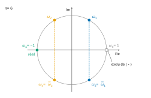
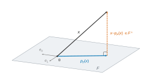

# CCINP MP — Mathématiques 2 2026 · Corrigé brut

*Corrigé rédigé par IA, non officiel. Signalez toute erreur.*

Épreuve MP3M2, durée 4 heures, calculatrices interdites. Deux exercices et un problème indépendants, 20 questions.

---

## Exercice 1

Ici $a,b\in\mathbb R$ avec $a\neq 0$, et $I=I_3$. La matrice $J\in\mathcal M_3(\mathbb R)$ a tous ses coefficients égaux à $1$, et $A=aJ+bI$.

### Q1

Les trois colonnes de $J$ sont égales à $u={}^t(1,1,1)\neq0$. Donc $\operatorname{Im}J=\operatorname{Vect}(u)$ et $\boxed{\operatorname{rg}J=1}$.

Pour tous $i,j$, on a $(J^2)_{ij}=\sum_{k=1}^3 1\cdot1=3$, donc $J^2=3J$.

Le polynôme $X(X-3)$ annule donc $J$. Il est scindé sur $\mathbb R$ à racines simples : $J$ est diagonalisable dans $\mathcal M_3(\mathbb R)$, et $\operatorname{Sp}(J)\subset\{0,3\}$.

- $\ker J=\{x\in\mathbb R^3,\ x_1+x_2+x_3=0\}$ est de dimension $3-\operatorname{rg}J=2$ (théorème du rang). Donc $0$ est valeur propre et $\dim E_0(J)=2$.
- $Ju=3u$ avec $u\neq0$ : $3$ est valeur propre. Comme $J$ est diagonalisable, $\dim E_0+\dim E_3=3$, d'où $E_3(J)=\operatorname{Vect}(u)$.

$$\boxed{J \text{ est diagonalisable, semblable à } \operatorname{diag}(3,0,0)}$$

### Q2

D'après Q1, il existe $Q\in GL_3(\mathbb R)$ telle que $Q^{-1}JQ=D=\operatorname{diag}(3,0,0)$. Alors
$$Q^{-1}AQ=aQ^{-1}JQ+bI=aD+bI.$$
$$\boxed{A \text{ est semblable à } \operatorname{diag}(3a+b,\ b,\ b)}$$
On a $E_{3a+b}(A)=\operatorname{Vect}({}^t(1,1,1))$ et $E_b(A)=\{x_1+x_2+x_3=0\}$. Comme $a\neq0$, $b\neq 3a+b$.

### Q3

D'après Q2, $A$ est diagonalisable. Par le théorème de caractérisation des matrices diagonalisables, son polynôme minimal $\pi_A$ est donc scindé à racines simples.

Ses racines sont exactement les valeurs propres de $A$ (toute valeur propre est racine de tout polynôme annulateur, et $\pi_A$ divise $\chi_A$). Ce sont $b$ et $3a+b$, distinctes car $a\neq0$.

Comme $\pi_A$ est unitaire :
$$\boxed{\pi_A=(X-b)(X-3a-b)}$$

### Q4

On pose $\lambda=3a+b$, de sorte que $\lambda-b=3a\neq0$.

**a)** Soit $n\in\mathbb N$. Comme $\deg\pi_A=2$, la division euclidienne s'écrit $X^n=\pi_A Q_n+R_n$, avec $R_n=\alpha_nX+\beta_n$.

En évaluant en les racines $b$ et $\lambda$ de $\pi_A$ :
$$\begin{aligned}
b^n&=\alpha_nb+\beta_n,\\
\lambda^n&=\alpha_n\lambda+\beta_n.
\end{aligned}$$
Par différence, puis en reportant :
$$\begin{aligned}
\alpha_n&=\frac{\lambda^n-b^n}{\lambda-b}=\frac{\lambda^n-b^n}{3a},\\
\beta_n&=b^n-\alpha_nb=\frac{\lambda b^n-b\lambda^n}{3a}.
\end{aligned}$$
Comme $\pi_A(A)=0$, on a $A^n=\pi_A(A)Q_n(A)+R_n(A)=R_n(A)$ :
$$\boxed{\forall n\in\mathbb N,\ A^n=\frac{\lambda^n-b^n}{3a}\,A+\frac{\lambda b^n-b\lambda^n}{3a}\,I,\ \text{avec } \lambda=3a+b}$$
Contrôle : $n=0$ donne $I$, $n=1$ donne $A$.

**b)** Par récurrence, $J^k=3^{k-1}J$ pour tout $k\ge1$. C'est vrai pour $k=1$, et si $J^k=3^{k-1}J$, alors $J^{k+1}=3^{k-1}J^2=3^kJ$.
$$\boxed{\forall k\ge1,\quad J^k=3^{k-1}J}$$
Les matrices $aJ$ et $bI$ commutent, donc la formule du binôme s'applique. La formule de $J^k$ ne vaut que pour $k\ge1$ : on isole le terme $k=0$, pour lequel $J^0=I$.
$$\begin{aligned}
A^n&=\sum_{k=0}^n\binom nk a^kb^{n-k}J^k\\
&=b^nI+\frac13\Big(\sum_{k=1}^n\binom nk(3a)^kb^{n-k}\Big)J\\
&=b^nI+\frac{(3a+b)^n-b^n}{3}\,J.
\end{aligned}$$
$$\boxed{\forall n\in\mathbb N,\quad A^n=b^n\,I+\frac{(3a+b)^n-b^n}{3}\,J}$$
Cohérence avec a), en remplaçant $A$ par $aJ+bI$ :
$$\begin{aligned}
\alpha_nA+\beta_nI&=\alpha_na\,J+(\alpha_nb+\beta_n)I\\
&=\frac{\lambda^n-b^n}{3}J+b^nI.
\end{aligned}$$

---

## Exercice 2

Ici $n\in\mathbb N^*$ et $P=a_0+a_1X+\dots+a_{n-1}X^{n-1}\in\mathbb R[X]$. Pour $k\in[\![0,n-1]\!]$, $\omega_k=\mathrm e^{2ik\pi/n}$. On veut montrer $(*)$ : $P(\omega_1)\cdots P(\omega_{n-1})\in\mathbb R$.

### Q5

$j\neq1$ et $j^3=1$, donc $1+j+j^2=\dfrac{j^3-1}{j-1}$ :
$$\boxed{1+j+j^2=0}$$
On prend $n=3$ et $P=1+2X+3X^2$ : degré $2$, coefficients réels, non nuls et deux à deux distincts. Ici $\omega_1=j$ et $\omega_2=j^2$.

Avec $j^2=-1-j$ et $j^4=j$ :
$$\begin{aligned}
P(j)&=1+2j+3j^2\\
&=-2-j,\\
P(j^2)&=1+2j^2+3j^4\\
&=1+3j+2j^2\\
&=-1+j.
\end{aligned}$$
Donc :
$$\begin{aligned}
P(j)P(j^2)&=(-2-j)(-1+j)\\
&=2-j-j^2\\
&=3.
\end{aligned}$$
$$\boxed{P(\omega_1)P(\omega_2)=3\in\mathbb R}$$
Cela vérifie $(*)$. On note d'ailleurs que $j^2=\overline j$, et que le produit vaut $|P(j)|^2$.

### Q6

$J$ est définie par $J_{i,i+1}=1$ pour $1\le i\le n-1$ et $J_{n,1}=1$, les autres coefficients étant nuls. On note $\chi_J=\det(XI_n-J)$.

Si $n=1$, $J=(1)$ et $\chi_J=X-1$.

Si $n\ge2$, soit $M=XI_n-J$. Sa première colonne n'a que deux coefficients non nuls : $M_{1,1}=X$ et $M_{n,1}=-1$. En développant selon cette colonne :
$$\chi_J=X\,\Delta_{1,1}+(-1)\cdot(-1)^{n+1}\,\Delta_{n,1},$$
où $\Delta_{i,1}$ est le mineur obtenu en supprimant la ligne $i$ et la colonne $1$.

- $\Delta_{1,1}$ : la sous-matrice est triangulaire supérieure, de diagonale $X$ (et de sur-diagonale $-1$). Donc $\Delta_{1,1}=X^{n-1}$.
- $\Delta_{n,1}$ : on garde les lignes $1$ à $n-1$ et les colonnes $2$ à $n$.
  La sous-matrice est triangulaire inférieure, de diagonale $-1$ (les $-1$ de $M$ en position $(i,i+1)$) et de sous-diagonale $X$. Donc $\Delta_{n,1}=(-1)^{n-1}$.

D'où :
$$\begin{aligned}
\chi_J&=X^n+(-1)^{n+2}(-1)^{n-1}\\
&=X^n+(-1)^{2n+1}.
\end{aligned}$$
$$\boxed{\chi_J=X^n-1}$$
Contrôle : pour $n=3$, la règle de Sarrus donne $X^3-1$.

### Q7

On a $J_{i,j}=1$ si $j\equiv i+1\ [n]$, et $0$ sinon.

Par récurrence sur $k$ : $(J^k)_{i,j}=1$ si $j\equiv i+k\ [n]$, $0$ sinon.

En effet, dans $(J^{k+1})_{i,j}=\sum_\ell (J^k)_{i,\ell}J_{\ell,j}$, seul le terme $\ell\equiv i+k$ est non nul. Il vaut $1$ si et seulement si $j\equiv i+k+1$.

Pour $i,j$ fixés, un seul $k\in[\![0,n-1]\!]$ vérifie $j\equiv i+k\ [n]$, à savoir $k=(j-i)\bmod n$. Donc :
$$\begin{aligned}
P(J)_{i,j}&=\sum_{k=0}^{n-1}a_k(J^k)_{i,j}\\
&=a_{(j-i)\bmod n}.
\end{aligned}$$
La première ligne est $(a_0,a_1,\dots,a_{n-1})$. Chaque ligne se déduit de la précédente par un décalage circulaire d'une case vers la droite : c'est la description de $A$.
$$\boxed{A=P(J)}$$

### Q8

D'après Q7, $(J^n)_{i,j}=1$ si et seulement si $j\equiv i\ [n]$, donc $J^n=I_n$.

Le polynôme $X^n-1=\prod_{k=0}^{n-1}(X-\omega_k)$ annule donc $J$. Il est scindé sur $\mathbb C$ à racines simples, car les $\omega_k$ sont deux à deux distincts. Donc $J$ est diagonalisable dans $\mathcal M_n(\mathbb C)$.

D'après Q6, ses valeurs propres sont les $n$ racines de $\chi_J=X^n-1$, toutes simples. Il existe donc $Q\in GL_n(\mathbb C)$ telle que
$$\boxed{Q^{-1}JQ=\Delta=\operatorname{diag}(\omega_0,\omega_1,\dots,\omega_{n-1})}$$
On peut prendre pour colonnes de $Q$ les vecteurs $V_k={}^t(1,\omega_k,\omega_k^2,\dots,\omega_k^{n-1})$, qui vérifient $JV_k=\omega_kV_k$.

Comme $J^m=Q\Delta^mQ^{-1}$ pour tout $m$, par linéarité $A=P(J)=Q\,P(\Delta)\,Q^{-1}$, et $P(\Delta)$ est diagonale :
$$\boxed{Q^{-1}AQ=\operatorname{diag}\big(P(\omega_0),P(\omega_1),\dots,P(\omega_{n-1})\big)}$$
Les $P(\omega_k)$ ne sont pas forcément distincts : pour $n=4$ et $P=X+X^3$, $P(i)=P(-i)=0$.

### Q9

Si $n=1$, le produit est vide et vaut $1$. Supposons $n\ge2$. D'après Q8 :
$$\begin{aligned}
\det A&=\prod_{k=0}^{n-1}P(\omega_k)\\
&=P(1)\prod_{k=1}^{n-1}P(\omega_k).
\end{aligned}$$
Or $\det A\in\mathbb R$ car $A$ est réelle, et $P(1)=a_0+\dots+a_{n-1}\in\mathbb R$.

- Si $P(1)\neq0$ : $\prod_{k=1}^{n-1}P(\omega_k)=\dfrac{\det A}{P(1)}\in\mathbb R$.
- Cas général, y compris $P(1)=0$. Pour $x\in\mathbb R$, le polynôme $P+x$ est à coefficients réels et sa matrice circulante est $A+xI_n$. Q8 appliquée à $P+x$ donne $\det(A+xI_n)=\prod_{k=0}^{n-1}(P(\omega_k)+x)$.
- La fonction $R:x\mapsto\prod_{k=1}^{n-1}(P(\omega_k)+x)$ est polynomiale, donc continue de $\mathbb R$ dans $\mathbb C$. Pour $x\neq-P(1)$, $R(x)=\dfrac{\det(A+xI_n)}{P(1)+x}$ est réel d'après le premier point.
- Comme $\mathbb R$ est fermé dans $\mathbb C$, $R(0)=\lim_{x\to0,\,x\neq-P(1)}R(x)\in\mathbb R$.

$$\boxed{P(\omega_1)P(\omega_2)\cdots P(\omega_{n-1})\in\mathbb R}$$

*Remarque (vérification directe).* $P$ étant réel, $\overline{P(\omega_k)}=P(\overline{\omega_k})=P(\omega_{n-k})$. Et $k\mapsto n-k$ est une bijection de $[\![1,n-1]\!]$ : le produit est égal à son conjugué.

---

## Problème

### Q10 — Question de cours

On n'utilise que la définition de $p_F(x)$ donnée par l'énoncé (unique vecteur de $F$ tel que $x-p_F(x)\in F^\perp$) ; $E$ n'est pas supposé de dimension finie.

**a)** Soit $x\in E$ et $y=\sum_{i=0}^n\langle x\mid e_i\rangle e_i$, qui appartient à $F$. Pour $j\in[\![0,n]\!]$, par linéarité à gauche et orthonormalité :
$$\begin{aligned}
\langle x-y\mid e_j\rangle&=\langle x\mid e_j\rangle-\sum_{i=0}^n\langle x\mid e_i\rangle\langle e_i\mid e_j\rangle\\
&=\langle x\mid e_j\rangle-\langle x\mid e_j\rangle\\
&=0.
\end{aligned}$$
Donc $x-y$ est orthogonal à chaque $e_j$. Par linéarité, il est orthogonal à tout vecteur de $F=\operatorname{Vect}(e_0,\dots,e_n)$ : $x-y\in F^\perp$.

Par unicité du vecteur de $F$ ayant cette propriété :
$$\boxed{p_F(x)=\sum_{i=0}^n\langle x\mid e_i\rangle\,e_i}$$

**b)** Posons $p=p_F(x)$. Comme $p\in F$ et $x-p\in F^\perp$, on a $\langle p\mid x-p\rangle=0$. Le théorème de Pythagore donne :
$$\begin{aligned}
\|x\|^2&=\|p\|^2+\|x-p\|^2\\
&\ge\|p\|^2.
\end{aligned}$$
$$\boxed{\|p_F(x)\|^2\le\|x\|^2}$$

La famille $(e_i)$ étant orthonormale, Pythagore donne aussi $\|p\|^2=\sum_{i=0}^n\langle x\mid e_i\rangle^2$, d'où :
$$\boxed{\sum_{i=0}^n\langle x\mid e_i\rangle^2\le\|x\|^2}$$

### Q11

Comme $|a|^2=a^2$ et $|b|^2=b^2$, l'inégalité $(|a|-|b|)^2\ge0$ s'écrit $a^2+b^2-2|a||b|\ge0$. Avec $|ab|=|a||b|$ :
$$\boxed{|ab|\le\frac{a^2+b^2}{2}}$$
Soient $f,g\in E$. La fonction $\varphi:t\mapsto f(t)g(t)\mathrm e^{-t}$ est continue sur $I$.

Pour tout $t\in I$, l'inégalité précédente appliquée à $f(t)$ et $g(t)$, multipliée par $\mathrm e^{-t}>0$, donne :
$$|\varphi(t)|\le\tfrac12\big(f(t)^2\mathrm e^{-t}+g(t)^2\mathrm e^{-t}\big).$$
Le majorant est intégrable sur $I$ (définition de $E$). Par comparaison, **$t\mapsto f(t)g(t)\mathrm e^{-t}$ est intégrable sur $I$.**

### Q12

*$E$ est un espace vectoriel.* $E$ est une partie de l'espace vectoriel $\mathcal C(I,\mathbb R)$, qui contient la fonction nulle. Soient $f,g\in E$ et $\lambda\in\mathbb R$. La fonction $f+\lambda g$ est continue, et :
$$(f+\lambda g)^2(t)\mathrm e^{-t}=f(t)^2\mathrm e^{-t}+2\lambda f(t)g(t)\mathrm e^{-t}+\lambda^2g(t)^2\mathrm e^{-t}.$$
C'est une combinaison linéaire de fonctions intégrables sur $I$ : $f^2\mathrm e^{-t}$ et $g^2\mathrm e^{-t}$ par définition de $E$, $fg\,\mathrm e^{-t}$ par Q11.

Donc $f+\lambda g\in E$ : **$E$ est un sous-espace vectoriel de $\mathcal C(I,\mathbb R)$.**

*Produit scalaire.* D'après Q11, l'intégrale $\langle f\mid g\rangle$ converge pour tous $f,g\in E$ : l'application est bien définie sur $E^2$.

- Symétrie : $f(t)g(t)\mathrm e^{-t}=g(t)f(t)\mathrm e^{-t}$.
- Linéarité à gauche : soient $f_1,f_2,g\in E$ et $\lambda\in\mathbb R$. Les intégrales $\langle f_1\mid g\rangle$ et $\langle f_2\mid g\rangle$ convergent (Q11). La linéarité de l'intégrale sur les intégrales convergentes donne $\langle f_1+\lambda f_2\mid g\rangle=\langle f_1\mid g\rangle+\lambda\langle f_2\mid g\rangle$. Par symétrie, l'application est bilinéaire.
- Positivité : $\langle f\mid f\rangle=\int_0^{+\infty}f(t)^2\mathrm e^{-t}\,\mathrm dt\ge0$.
- Caractère défini : si $\langle f\mid f\rangle=0$, la fonction $t\mapsto f(t)^2\mathrm e^{-t}$ est **continue**, positive, intégrable et d'intégrale nulle sur $I$. Elle est donc nulle sur $I$. Comme $\mathrm e^{-t}>0$, $f=0$.

**$\langle\ \mid\ \rangle$ est un produit scalaire sur $E$.**

### Q13

*Inclusion $F\subset E$.* Soit $P\in\mathbb R_n[X]$. La fonction $t\mapsto P(t)^2\mathrm e^{-t}$ est continue et positive sur $I$.

Par croissances comparées, $t^2P(t)^2\mathrm e^{-t}\to0$ quand $t\to+\infty$, donc $P(t)^2\mathrm e^{-t}=o(1/t^2)$.

Comme $t\mapsto1/t^2$ est intégrable sur $[1,+\infty[$, $P^2\mathrm e^{-t}$ l'est aussi. Elle est intégrable sur le segment $[0,1]$ par continuité. Donc $P\in E$.

*Structure.* Ainsi $F\subset E$. De plus $F=\mathbb R_n[X]$ est lui-même un espace vectoriel : il contient $0$ et il est stable par combinaison linéaire.

Les lois de $E$ restreintes à $F$ sont celles de $\mathbb R_n[X]$. Donc **$F$ est un sous-espace vectoriel de $E$.**

L'identification d'un polynôme à sa fonction sur $I$ est injective : un polynôme qui s'annule sur l'ensemble infini $I$ est nul. Donc $\dim F=n+1$, et $\langle\ \mid\ \rangle$ est un produit scalaire sur $\mathbb R[X]$ (le même argument vaut pour tout $\mathbb R_m[X]$).

### Q14

**a)** $u:x\mapsto x^n$ et $v:x\mapsto\mathrm e^{-x}$ sont de classe $\mathcal C^\infty$.

Pour $k\le n$, $u^{(k)}(x)=\frac{n!}{(n-k)!}x^{n-k}$, et $v^{(m)}(x)=(-1)^m\mathrm e^{-x}$. Pour $p\le n$, la formule de Leibniz donne :
$$\boxed{h_n^{(p)}(x)=\mathrm e^{-x}\sum_{k=0}^p(-1)^{p-k}\binom pk\frac{n!}{(n-k)!}\,x^{n-k}}$$
Si $p<n$, chaque exposant vérifie $n-k\ge n-p\ge1$. Chaque terme s'annule donc en $0$ :
$$\boxed{p<n\implies h_n^{(p)}(0)=0}$$

**b)** Avec $p=n$ :
$$\begin{aligned}
L_n(x)&=\frac{\mathrm e^x}{n!}h_n^{(n)}(x)\\
&=\sum_{k=0}^n(-1)^{n-k}\binom nk\frac{x^{n-k}}{(n-k)!}.
\end{aligned}$$
Le changement d'indice $m=n-k$ donne :
$$\boxed{L_n=\sum_{m=0}^n(-1)^m\binom nm\frac{X^m}{m!}\in\mathbb R[X]}$$
$$\boxed{\deg L_n=n,\ \text{de coefficient dominant } \frac{(-1)^n}{n!}}$$
En effet, le coefficient de $X^n$ est $\frac{(-1)^n}{n!}\neq0$. Par exemple $L_0=1$, $L_1=1-X$ et $L_2=1-2X+\frac{X^2}2$.

### Q15

*Remarque sur l'énoncé.* Le crochet de Q12 porte le poids $\mathrm e^{-t}$. Lu ainsi, $\langle g\mid h_n^{(n)}\rangle=\int_0^{+\infty}g\,h_n^{(n)}\mathrm e^{-t}$ ne s'exprime pas à l'aide de $\int_0^{+\infty}g^{(n)}h_n$.

Par exemple, pour $n=1$ et $g=1$, le premier vaut $\int_0^{+\infty}(1-t)\mathrm e^{-2t}\mathrm dt=\frac14$, le second $0$.

On remplace donc la première demande par : exprimer $\int_0^{+\infty}g(t)h_n^{(n)}(t)\,\mathrm dt$ (intégrale sans poids) en fonction de $\int_0^{+\infty}g^{(n)}(t)h_n(t)\,\mathrm dt$. Cette intégrale vaut $n!\,\langle g\mid L_n\rangle$, puisque $h_n^{(n)}(t)=n!\,L_n(t)\mathrm e^{-t}$.

Soit $g\in\mathbb R[X]$. D'après Q14.a, toutes les fonctions $g^{(p)}h_n^{(q)}$ sont de la forme $t\mapsto R(t)\mathrm e^{-t}$ avec $R$ polynomiale. Elles sont donc intégrables sur $I$ (comme en Q13).

Montrons par récurrence sur $p\in[\![0,n]\!]$ :
$$\int_0^{+\infty}g\,h_n^{(n)}=(-1)^p\int_0^{+\infty}g^{(p)}h_n^{(n-p)}.$$
C'est clair pour $p=0$. Supposons-le vrai pour un $p\le n-1$. Une intégration par parties sur $[0,A]$ donne :
$$\int_0^Ag^{(p)}h_n^{(n-p)}=\Big[g^{(p)}h_n^{(n-p-1)}\Big]_0^A-\int_0^Ag^{(p+1)}h_n^{(n-p-1)}.$$
En $0$, $h_n^{(n-p-1)}(0)=0$ par Q14.a car $n-p-1<n$. En $A$, le crochet est de la forme $R(A)\mathrm e^{-A}$, qui tend vers $0$.

Les intégrales convergeant, on fait $A\to+\infty$ :
$$\int_0^{+\infty}g^{(p)}h_n^{(n-p)}=-\int_0^{+\infty}g^{(p+1)}h_n^{(n-p-1)}.$$
D'où le rang $p+1$. Pour $p=n$ :
$$\boxed{\int_0^{+\infty}g(t)h_n^{(n)}(t)\,\mathrm dt=(-1)^n\int_0^{+\infty}g^{(n)}(t)h_n(t)\,\mathrm dt}$$
Avec $h_n^{(n)}=n!\,L_n\mathrm e^{-t}$ et $h_n(t)=t^n\mathrm e^{-t}$ :
$$\boxed{\langle g\mid L_n\rangle=\frac{(-1)^n}{n!}\int_0^{+\infty}g^{(n)}(t)\,t^n\mathrm e^{-t}\,\mathrm dt}$$

### Q16

Soient $i<j$. $L_i$ est un polynôme de degré $i<j$, donc $L_i^{(j)}=0$. Q15 appliquée à $g=L_i$ avec l'indice $j$ donne une intégrale convergente, d'intégrande nul :
$$\langle L_i\mid L_j\rangle=\frac{(-1)^j}{j!}\int_0^{+\infty}L_i^{(j)}(t)\,t^j\mathrm e^{-t}\,\mathrm dt.$$
$$\boxed{\langle L_i\mid L_j\rangle=0}$$

### Q17

Soit $I_n=\int_0^{+\infty}t^n\mathrm e^{-t}\,\mathrm dt$.

*Existence.* $t\mapsto t^n\mathrm e^{-t}$ est continue et positive sur $I$. Par croissances comparées, $t^{n+2}\mathrm e^{-t}\to0$ en $+\infty$, donc $t^n\mathrm e^{-t}=o(1/t^2)$ : l'intégrale converge.

*Calcul.* $I_0=1$. Pour $n\ge1$, une intégration par parties sur $[0,A]$ donne :
$$\int_0^At^n\mathrm e^{-t}\,\mathrm dt=-A^n\mathrm e^{-A}+n\int_0^At^{n-1}\mathrm e^{-t}\,\mathrm dt.$$
Comme $A^n\mathrm e^{-A}\to0$, on obtient avec $A\to+\infty$ la relation $I_n=nI_{n-1}$, puis par récurrence :
$$\boxed{\int_0^{+\infty}t^n\mathrm e^{-t}\,\mathrm dt=n!}$$
$L_n$ est de degré $n$, de coefficient dominant $\frac{(-1)^n}{n!}$. Donc $L_n^{(n)}=n!\cdot\frac{(-1)^n}{n!}=(-1)^n$. Par Q15 :
$$\begin{aligned}
\langle L_n\mid L_n\rangle&=\frac{(-1)^n}{n!}\int_0^{+\infty}(-1)^nt^n\mathrm e^{-t}\,\mathrm dt\\
&=\frac{n!}{n!}.
\end{aligned}$$
$$\boxed{\langle L_n\mid L_n\rangle=1}$$

### Q18

Les $L_i$ ($0\le i\le n$) sont dans $F=\mathbb R_n[X]$ (Q14.b). Par Q16, Q17 et symétrie, $\langle L_i\mid L_j\rangle=\delta_{ij}$.

Une famille orthonormale est libre ; celle-ci compte $n+1=\dim F$ vecteurs :
$$\boxed{(L_0,L_1,\dots,L_n)\text{ est une base orthonormale de }F}$$
$F$ est un sous-espace de dimension finie de l'espace préhilbertien $E$. Q10.a donne, pour tout $g\in E$ :
$$\boxed{p_F(g)=\sum_{k=0}^n\langle g\mid L_k\rangle\,L_k}$$

### Q19

Soit $g\in E$ et $N\in\mathbb N$. Le raisonnement de Q18, avec $N$ au lieu de $n$, montre que $(L_0,\dots,L_N)$ est une base orthonormale de $\mathbb R_N[X]$.

C'est un sous-espace de dimension finie de $E$, et Q10.b donne :
$$\sum_{k=0}^N\langle g\mid L_k\rangle^2\le\|g\|^2.$$
La série $\sum\langle g\mid L_n\rangle^2$ est à termes positifs : ses sommes partielles sont croissantes. Elles sont majorées par $\|g\|^2$, qui ne dépend pas de $N$. La série converge donc, et le passage à la limite dans l'inégalité donne :
$$\boxed{\sum_{n=0}^{+\infty}\langle g\mid L_n\rangle^2\le\|g\|^2}$$
avec $\|g\|^2=\int_0^{+\infty}g(t)^2\mathrm e^{-t}\,\mathrm dt$.

### Q20

*Remarque sur l'énoncé.* L'affirmation « pour tout $\alpha\in\mathbb R$, $g_\alpha\in E$ » est fausse. On montre que $g_\alpha\in E\iff\alpha>-\frac12$, ce qui est l'hypothèse posée au début de la question.

*Appartenance à $E$.* $g_\alpha$ est continue et $g_\alpha(t)^2\mathrm e^{-t}=\mathrm e^{-(2\alpha+1)t}$.

Cette fonction positive est intégrable sur $[0,+\infty[$ si et seulement si $2\alpha+1>0$ (si $2\alpha+1\le0$, elle est minorée par $1$).
$$\boxed{g_\alpha\in E\iff\alpha>-\tfrac12}$$
Dans ce cas :
$$\boxed{\|g_\alpha\|^2=\int_0^{+\infty}\mathrm e^{-(2\alpha+1)t}\,\mathrm dt=\frac1{2\alpha+1}}$$

*Coefficients.* Soit $\alpha>-\frac12$ et $\beta=\alpha+1>0$.

Pour $m\in\mathbb N$, le changement de variable $u=\beta t$ (bijection affine croissante de $I$ sur $I$) et Q17 donnent $\int_0^{+\infty}t^m\mathrm e^{-\beta t}\,\mathrm dt=\frac{m!}{\beta^{m+1}}$. Par linéarité (somme finie) et Q14.b :
$$\begin{aligned}
\langle g_\alpha\mid L_n\rangle&=\int_0^{+\infty}L_n(t)\mathrm e^{-\beta t}\,\mathrm dt\\
&=\sum_{m=0}^n(-1)^m\binom nm\frac1{m!}\cdot\frac{m!}{\beta^{m+1}}\\
&=\frac1\beta\Big(1-\frac1\beta\Big)^n.
\end{aligned}$$
$$\boxed{\langle g_\alpha\mid L_n\rangle=\frac{\alpha^n}{(\alpha+1)^{n+1}}}$$
On retrouverait ce résultat par la formule de Q15, qui s'étend à $g_\alpha$ : les termes de bord sont de la forme $R(A)\mathrm e^{-\beta A}$, qui tend vers $0$.

*Somme.* Posons $q=\frac\alpha{\alpha+1}$. Comme $\alpha+1>0$ :
$$\begin{aligned}
|q|<1&\iff-(\alpha+1)<\alpha<\alpha+1\\
&\iff\alpha>-\tfrac12,
\end{aligned}$$
ce qui est le cas. La série géométrique de raison $q^2\in[0,1[$ converge, et :
$$\begin{aligned}
\sum_{n=0}^{+\infty}\langle g_\alpha\mid L_n\rangle^2&=\frac1{(\alpha+1)^2}\cdot\frac1{1-q^2}\\
&=\frac1{(\alpha+1)^2-\alpha^2}\\
&=\frac1{2\alpha+1}.
\end{aligned}$$
$$\boxed{\sum_{n=0}^{+\infty}\langle g_\alpha\mid L_n\rangle^2=\|g_\alpha\|^2}$$
L'inégalité de Bessel de Q19 est une égalité pour les fonctions $g_\alpha$.

**FIN**
