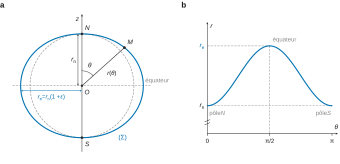
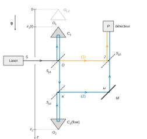
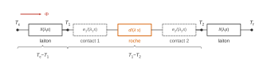
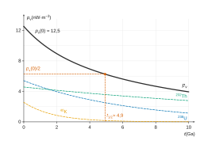
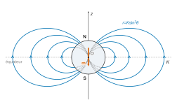

# CCINP MP — Physique-chimie 2026 · Corrigé brut

*Corrigé rédigé par IA, non officiel. Signalez toute erreur.*

Épreuve de 4 heures, calculatrices interdites. Les applications numériques sont menées avec la table de logarithmes décimaux de l'annexe et données avec un ou deux chiffres significatifs, comme l'autorise l'énoncé. Base sphérique $(\vec u_r,\vec u_\theta,\vec u_\varphi)$, $\vec u_z$ unitaire de l'axe des pôles orienté du sud vers le nord.

## Partie I — Champ gravitationnel et champ de pesanteur

### Q1

Une masse ponctuelle $m$ et une charge ponctuelle $q$ placées en $O$ créent en $M$, repéré par $\overrightarrow{OM}=r\,\vec u_r$, les champs :

$$\vec G(M)=-\frac{Gm}{r^2}\,\vec u_r$$

$$\vec E(M)=\frac{q}{4\pi\varepsilon_0 r^2}\,\vec u_r$$

Le signe $-$ du champ gravitationnel traduit le caractère toujours attractif de la gravitation. L'identification $\dfrac{q}{4\pi\varepsilon_0}\leftrightarrow -Gm$ donne les analogies :

$$\boxed{\begin{aligned}
q\ &\longleftrightarrow\ m\\
\frac{1}{\varepsilon_0}\ &\longleftrightarrow\ -4\pi G\quad\left(\varepsilon_0\leftrightarrow-\frac{1}{4\pi G}\right)
\end{aligned}}$$

Le théorème de Gauss électrostatique s'écrit, pour une surface fermée $S$ :

$$\oint_S\vec E\cdot\mathrm d\vec S_{\rm ext}=\frac{Q_{\rm int}}{\varepsilon_0}$$

Il devient : **le flux du champ gravitationnel sortant d'une surface fermée $S$ est égal à $-4\pi G$ fois la masse intérieure, contenue dans le volume $V$ que $S$ délimite** :

$$\boxed{\oint_{S}\vec G(P)\cdot\mathrm d\vec S_{\rm ext}=-4\pi G\iiint_V\mu(P)\,\mathrm d\tau}$$

### Q2

La boule homogène est invariante par toute rotation autour de $O$ : la norme du champ ne dépend que de $r$.

Tout plan contenant $O$ et $M$ est plan de symétrie de la distribution de masse. Le champ en $M$ appartient donc à la droite $(OM)$ :

$$\vec G_T(M)=G(r)\,\vec u_r$$

On applique le théorème de Gauss à la sphère de centre $O$ et de rayon $r$, surface **fermée** orientée vers l'extérieur. Elle délimite la boule de rayon $r$, de masse intérieure $M_{\rm int}(r)$ :

$$\begin{aligned}
\oint_S\vec G_T\cdot\mathrm d\vec S_{\rm ext}&=4\pi r^2G(r)\\
&=-4\pi G\,M_{\rm int}(r)
\end{aligned}$$

- Pour $r\ge R_T$, toute la Terre est intérieure : $M_{\rm int}=M_T=\frac43\pi R_T^3\mu_T$, d'où
$$\boxed{\begin{aligned}\vec G_T(M)&=-\frac{GM_T}{r^2}\,\vec u_r\\&=-\frac{4\pi G\mu_T R_T^3}{3r^2}\,\vec u_r\qquad(r\ge R_T)\end{aligned}}$$
- Pour $r\le R_T$, seule la boule de rayon $r$ est intérieure : $M_{\rm int}=\frac43\pi r^3\mu_T$, d'où
$$\boxed{\vec G_T(M)=-\frac{4\pi G\mu_T}{3}\,r\,\vec u_r\ \ (r\le R_T)}$$

Les deux expressions se raccordent en $r=R_T$, où la norme vaut $GM_T/R_T^2$. Le champ est nul au centre.

### Q3

On applique le principe de superposition. La Terre avec gisement est la somme de deux distributions :

- la Terre homogène pleine, de masse volumique $\mu_T$ ;
- une boule de centre $C$ et de rayon $r'$, de masse volumique $\mu_p-\mu_T$, qui retire la petite sphère de Terre et la remplace par le pétrole.

Cette boule fictive a pour masse :

$$m'=\frac43\pi r'^3(\mu_p-\mu_T)<0$$

Le point $M$ lui est extérieur ($d>r'$), avec $\overrightarrow{CM}=d\,\vec u_z$. En $M$, on a aussi $\vec u_r=\vec u_z$. D'après Q2, la Terre pleine crée en $M$, à la surface :

$$G_T(M)=-\frac{4\pi G\mu_TR_T}{3}$$

La boule fictive crée en $M$ le champ d'une masse ponctuelle $m'$ placée en $C$ :

$$\begin{aligned}
\vec G_{\rm corr}(M)&=-\frac{Gm'}{d^2}\,\vec u_z\\
&=\frac{4\pi G r'^3(\mu_T-\mu_p)}{3d^2}\,\vec u_z
\end{aligned}$$

Par superposition, $\vec G_{Tp}=\vec G_T+\vec G_{\rm corr}$ :

$$\boxed{G_{Tp}(M)\,\vec u_z=-\frac{4\pi G}{3}\left[\mu_TR_T-\frac{(\mu_T-\mu_p)\,r'^3}{d^2}\right]\vec u_z}$$

La variation relative s'en déduit :

$$\begin{aligned}
\varepsilon&=\frac{G_T-G_{Tp}}{G_T}\\
&=-\frac{G_{\rm corr}}{G_T}\\
&=\left(1-\frac{\mu_p}{\mu_T}\right)\frac{r'^3}{d^2R_T}
\end{aligned}$$

$$\boxed{\varepsilon=\left(1-\frac{\mu_p}{\mu_T}\right)\left(\frac{r'}{d}\right)^2\frac{r'}{R_T}}$$

Comme $\mu_p<\mu_T$, le champ correcteur est dirigé vers le haut, opposé au champ terrestre. On a donc $\varepsilon>0$ et $|G_{Tp}|<|G_T|$. **En présence de pétrole, le champ gravitationnel est moins intense** : on a remplacé de la roche par un fluide moins dense.

Application numérique :

$$\begin{aligned}
\varepsilon&=\frac56\times\frac14\times\frac{10^{-3}}{4}\\
&=5{,}2\cdot10^{-5}\\
&\approx\boxed{5\cdot10^{-5}}
\end{aligned}$$

Cette anomalie est environ $5\cdot10^{3}$ fois supérieure à la précision relative des gravimètres ($10^{-8}$) : **le gisement est largement détectable**, la gravimétrie est une méthode de prospection pertinente.

## Partie II — Forme de la Terre

### Q4

Le référentiel terrestre $R'$ est en rotation uniforme, de vecteur $\vec\Omega=\Omega\vec u_z$, autour de l'axe fixe $Oz$ du référentiel géocentrique supposé galiléen. Un point $M$ y subit, outre les forces réelles, deux forces d'inertie :

- la force d'inertie d'entraînement $\vec F_{ie}=-m\vec a_e$ ; l'entraînement est un mouvement circulaire uniforme de rayon $HM$, d'accélération centripète $\vec a_e=-\Omega^2\overrightarrow{HM}$, donc $\vec F_{ie}=m\Omega^2\overrightarrow{HM}$ ;
- la force de Coriolis $\vec F_{ic}=-2m\vec\Omega\wedge\vec v_{R'}$.

Le poids est défini pour un corps **au repos** dans $R'$ : la force de Coriolis est alors nulle. Le poids est la somme de l'attraction gravitationnelle et de la force d'inertie d'entraînement :

$$\vec P=m\vec g(M)=m\Big(\underbrace{-\frac{GM_T}{r^2}\vec u_r}_{\text{gravitation}}+\underbrace{\Omega^2\overrightarrow{HM}}_{\text{inertie d'entraînement}}\Big).$$

Ordre de grandeur à la surface : le terme d'entraînement est négligeable (moins de 0,4 %, cf. Q6), et

$$\begin{aligned}
g&\approx\frac{GM_T}{R_T^2}\\
\log g&=-10{,}17+24{,}78-2\times6{,}81\\
&=0{,}99
\end{aligned}$$

d'où $\boxed{g\approx10\ \mathrm{m\,s^{-2}}}$, soit la valeur bien connue $9{,}8\ \mathrm{m\,s^{-2}}$.

### Q5

La force de Coriolis s'écrit $\vec F_{ic}=-2m\vec\Omega\wedge\vec v$, où $\vec v$ est la vitesse du train dans $R'$. La norme d'un produit vectoriel est majorée par le produit des normes : $\|\vec F_{ic}\|\le2m\Omega v$. Pour $v=100\ \mathrm{m\,s^{-1}}$ :

$$\begin{aligned}
\frac{\|\vec F_{ic}\|}{mg}&\le\frac{2\Omega v}{g}\\
&=\frac{2\times7{,}3\cdot10^{-5}\times100}{9{,}8}\\
&\approx\boxed{1{,}5\cdot10^{-3}}
\end{aligned}$$

La force de Coriolis vaut au plus 0,15 % du poids : elle est négligeable devant lui.

### Q6

À la surface ($r=R_T$), le terme d'inertie d'entraînement a pour norme $\Omega^2HM=\Omega^2R_T\sin\theta$. Le terme de gravitation a pour norme $GM_T/R_T^2$. Leur rapport vérifie :

$$\begin{aligned}
\frac{\Omega^2R_T\sin\theta}{GM_T/R_T^2}&=\frac{\Omega^2R_T^3}{GM_T}\sin\theta\\
&\le\frac{\Omega^2R_T^3}{GM_T}
\end{aligned}$$

$$\boxed{\eta=\frac{\Omega^2R_T^3}{GM_T}}$$

L'égalité a lieu à l'équateur ($\theta=\pi/2$). Le facteur $R_T^3$ vient de $R_T$ (distance à l'axe) multiplié par $R_T^2$ (dénominateur du champ de gravitation). Numériquement :

$$\begin{aligned}
\log\eta&=2(-4{,}14)+3(6{,}81)+10{,}17-24{,}78\\
&=-2{,}46
\end{aligned}$$

d'où $\boxed{\eta\approx3{,}5\cdot10^{-3}}$.

Ce rapport est très petit devant 1 : le terme d'inertie d'entraînement est au plus de l'ordre de 0,3 % du terme gravitationnel, et le champ de pesanteur est très proche du champ de gravitation. Ce petit terme suffit toutefois à rendre $g$ plus faible à l'équateur et à déformer la Terre (Q8).

### Q7

**a)** La force est $\vec F_G=-\dfrac{GM_Tm}{r^2}\vec u_r$. Pour un déplacement élémentaire $\mathrm d\vec\ell$, seule sa composante radiale $\mathrm dr$ travaille :

$$\begin{aligned}
\delta W&=\vec F_G\cdot\mathrm d\vec\ell\\
&=-\frac{GM_Tm}{r^2}\,\mathrm dr\\
&=-\mathrm d\!\left(-\frac{GM_Tm}{r}\right)
\end{aligned}$$

La force dérive donc de $-GM_Tm/r+\text{cte}$. Avec $E_{pG}\to0$ à l'infini, la constante est nulle :

$$\boxed{E_{pG}(M)=-\frac{GM_Tm}{r}}$$

**b)** Soit $\rho=HM$ la distance à l'axe et $\vec u_\rho$ le vecteur unitaire de $\overrightarrow{HM}$. La force s'écrit $\vec F_e=m\Omega^2\rho\,\vec u_\rho$.

Le déplacement $\mathrm d\vec\ell$ a pour composante $\mathrm d\rho$ selon $\vec u_\rho$ ; ses autres composantes sont orthogonales à $\vec F_e$. Ainsi :

$$\begin{aligned}
\delta W&=m\Omega^2\rho\,\mathrm d\rho\\
&=-\mathrm d\!\left(-\tfrac12m\Omega^2\rho^2\right)
\end{aligned}$$

La force dérive donc de $E_{pe}=-\frac12m\Omega^2\rho^2+\text{cte}$. La constante est nulle avec $E_{pe}=0$ en $r=0$, où $\rho=0$. Comme $\rho=r\sin\theta$ :

$$\boxed{\begin{aligned}E_{pe}(M)&=-\frac12m\Omega^2\left(\overrightarrow{HM}\right)^2\\&=-\frac12m\Omega^2r^2\sin^2\theta\end{aligned}}$$

**c)** Le poids est la somme des deux forces, qui dérivent chacune d'une énergie potentielle : les énergies potentielles s'ajoutent.

$$\boxed{E_{pp}(M)=-\frac{GM_Tm}{r}-\frac12m\Omega^2r^2\sin^2\theta}$$

### Q8

Au pôle Nord, $\theta=0$ et $E_{pp}(N)=-GM_Tm/r_n$. La trace de $(\Sigma)$ dans un plan méridien vérifie $E_{pp}(M)=E_{pp}(N)$, soit, après division par $-m$ :

$$\begin{aligned}
\frac{GM_T}{r}+\frac12\Omega^2r^2\sin^2\theta&=\frac{GM_T}{r_n}\\
\frac1r&=\frac1{r_n}-\frac{\Omega^2r^2\sin^2\theta}{2GM_T}\\
r&=\frac{r_n}{1-\dfrac{\Omega^2r_nr^2\sin^2\theta}{2GM_T}}
\end{aligned}$$

Le terme soustrait au dénominateur est au plus de l'ordre de $\Omega^2R_T^3/(2GM_T)=\eta/2\approx2\cdot10^{-3}\ll1$, car $r$ et $r_n$ restent voisins de $R_T$.

Au premier ordre en ce petit terme, $(1-u)^{-1}\approx1+u$. Dans le terme correctif, on peut remplacer $r$ par $r_n$ : l'erreur commise est du second ordre. D'où :

$$\boxed{\begin{aligned}
r(\theta)&\approx r_n\left(1+\varepsilon\sin^2\theta\right)\\
\varepsilon&=\frac{\Omega^2r_n^3}{2GM_T}\\
&=\frac{\eta}{2}\left(\frac{r_n}{R_T}\right)^3
\end{aligned}}$$

Allure (figure 1) : $r$ est minimal aux pôles, où $r=r_n$, et maximal à l'équateur, où $r=r_n(1+\varepsilon)$. Au premier ordre, la trace est une ellipse aplatie aux pôles.



Aplatissement, avec $r_e=r(\pi/2)$ et $r_n\approx R_T$ :

$$\begin{aligned}
\varepsilon'&=\frac{r_e-r_n}{r_n}\\
&=\varepsilon\\
&=\frac{\eta}{2}\left(\frac{r_n}{R_T}\right)^3
\end{aligned}$$

$$\boxed{\varepsilon'\approx\frac{\eta}{2}\approx1{,}7\cdot10^{-3}\approx\frac1{580}}$$

(L'aplatissement réel, $1/298$, est environ double : le modèle néglige la déformation du champ gravitationnel lui-même.)

## Partie III — Détermination optique du champ de pesanteur

### Q9

**a)** En négligeant le terme d'entraînement, $g(h)=GM_T/(R_T+h)^2$. Comme $h/R_T\approx1{,}6\cdot10^{-7}\ll1$, un développement limité au premier ordre, $(1+u)^{-2}\approx1-2u$, donne :

$$\begin{aligned}
\frac{g(h)-g(0)}{g(0)}&=\left(1+\frac h{R_T}\right)^{-2}-1\\
&\approx-\frac{2h}{R_T}\\
&=-\frac{2}{6{,}4\cdot10^6}\\
&\approx\boxed{-3\cdot10^{-7}}
\end{aligned}$$

Sur 1 m de chute, $g$ varie de quelques $10^{-7}$ en valeur relative : on peut le considérer constant.

**b)** L'axe vertical est orienté vers le bas, d'origine $O_{1,0}$, position de $O_1$ à $t=0$. Dans le vide, seul le poids agit, et il est dirigé dans le sens positif de l'axe. Le principe fondamental de la dynamique donne $\ddot z_1=+g$, avec $z_1(0)=0$ et $\dot z_1(0)=0$ :

$$\boxed{z_1(t)=\frac12gt^2}$$

### Q10

**a)** Dans l'air ($n=1$), chemin optique et longueur géométrique coïncident. On suit les rayons sur la figure 3(a) avec les lois de la réflexion sur les séparatrices et le miroir inclinés à 45°, et la propriété du coin de cube, qui renvoie la lumière parallèlement à elle-même :

- rayon (1) : transmis par $S_{p1}$, il va de $O$ à $J$, où $S_{p3}$ le réfléchit vers $P$ ;
- rayon (2) : réfléchi vers le haut par $S_{p1}$, il est renvoyé vers le bas par le coin de cube $C_1$ ;
- il traverse ensuite $S_{p1}$ puis $S_{p2}$ et descend jusqu'au coin de cube fixe $C_2$, qui le renvoie vers le haut ;
- en $K$, $S_{p2}$ le réfléchit vers $H$, et le miroir $M$ le renvoie vers le haut ;
- il traverse enfin $S_{p3}$ en $J$ et atteint $P$ (figure 2).



On repère les points par des cotes $Z$ ascendantes et on note $L=OJ=KH$. Les chemins optiques sont :

$$\begin{aligned}
(2)&=2(Z_{O_1}-Z_O)+(Z_O-Z_K)+2(Z_K-Z_{O_2})+L+(Z_J-Z_H)+JP\\
(1)&=L+JP
\end{aligned}$$

Comme $Z_J-Z_H=Z_O-Z_K$, toutes les longueurs fixes se compensent :

$$\begin{aligned}
\delta&=(2)-(1)\\
&=2(Z_{O_1}-Z_{O_2})
\end{aligned}$$

Sur l'axe descendant d'origine $O_{1,0}$, on a $Z_{O_1}-Z_{O_2}=z_2-z_1(t)$, d'où :

$$\boxed{\begin{aligned}\delta(P,t)&=2\big(z_2-z_1(t)\big)\\&=2z_2-gt^2\end{aligned}}$$

**b)** Les deux ondes sont issues du même laser par division d'amplitude : elles sont cohérentes. Pour deux ondes de même intensité $I_0$, la formule de Fresnel donne :

$$I=2I_0\left[1+\cos\left(\frac{2\pi\delta}{\lambda}\right)\right]$$

On introduit l'ordre d'interférence $p(t)=\delta(P,t)/\lambda$. L'intensité est minimale (nulle) quand $\cos(2\pi p)=-1$, c'est-à-dire pour un ordre demi-entier :

$$p=k+\frac12,\qquad k\in\mathbb Z$$

Comme $\delta$ décroît strictement avec $t$, l'ordre décroît aussi. Deux minima successifs ont des ordres qui diffèrent d'exactement 1 : entre $t_0$ et $t_q$, l'ordre a diminué de $q$. D'une part :

$$\boxed{\Delta_q=\delta(P,t_q)-\delta(P,t_0)=-q\lambda}$$

D'autre part, avec $\delta=2z_2-gt^2$ :

$$\Delta_q=-g\left(t_q^2-t_0^2\right)$$

En égalant les deux expressions :

$$\boxed{g=\frac{q\lambda}{t_q^2-t_0^2}}$$

**c)** On pose $y(q)=t_q^2-t_0^2$. D'après (b), cette fonction est linéaire en $q$ :

$$y(q)=\frac{\lambda}{g}\,q$$

On relève sur la figure 3(b) les instants $t_q$ des minima successifs, on trace $y$ en fonction de $q$ et on ajuste une droite passant par l'origine. Sa pente vaut $a=\lambda/g$.

Les temps étant lus en microsecondes, la pente mesurée est $a=64\,598\ \mu\mathrm s^2=6{,}4598\cdot10^{-8}\ \mathrm s^2$. Alors :

$$\begin{aligned}
g&=\frac{\lambda}{a}\\
&=\frac{632{,}82\cdot10^{-9}\ \mathrm m}{64\,598\cdot10^{-12}\ \mathrm s^2}\\
&\approx\boxed{9{,}796\ \mathrm{m\,s^{-2}}}
\end{aligned}$$

ce qui redonne $g=9{,}7961\ \mathrm{m\,s^{-2}}$ à l'arrondi de la pente près.

## Partie IV — Le calcaire et l'argile : des richesses du sol bon marché

### Partie IV.1 — Calcination du calcaire

### Q11

**a)** Dans l'approximation d'Ellingham, $\Delta_rH_1^0$ et $\Delta_rS_1^0$ ne dépendent pas de $T$, et :

$$\Delta_rG_1^0=\Delta_rH_1^0-T\Delta_rS_1^0$$

Par identification avec l'expression donnée :

$$\boxed{\Delta_rH_1^0=177{,}4\ \mathrm{kJ\,mol^{-1}}>0}$$

**La réaction est endothermique.**

**b)** L'identification donne aussi :

$$\boxed{\begin{aligned}\Delta_rS_1^0&=+0{,}1589\ \mathrm{kJ\,K^{-1}\,mol^{-1}}\\&=159\ \mathrm{J\,K^{-1}\,mol^{-1}}\end{aligned}}$$

Ce signe positif est attendu : la réaction produit une mole de gaz à partir d'un solide ($\Delta\nu_{\rm gaz}=+1$), le désordre augmente.

**c)** La relation $\Delta_rG_1^0=-RT\ln K_1^0$ donne, avec $\Delta_rG_1^0$ en $\mathrm{J\,mol^{-1}}$ :

$$\boxed{\begin{aligned}K_1^0(T)&=\exp\!\left(-\frac{177\,400-158{,}9\,T}{RT}\right)\\&=\exp\!\left(19{,}1-\frac{2{,}13\cdot10^4}{T}\right)\end{aligned}}$$

On a $K_1^0=1$ si et seulement si $\Delta_rG_1^0=0$ :

$$\boxed{\begin{aligned}T_{1,i}&=\frac{177{,}4}{0{,}1589}\\&=1116\ \mathrm K\ \ (843\ ^\circ\mathrm C)\end{aligned}}$$

**d)** Les solides, purs et seuls dans leur phase, ont une activité égale à 1 ; le gaz, supposé parfait, a pour activité $P_{\mathrm{CO_2}}/P^0$ :

$$\boxed{Q_{r,1}=\frac{a(\mathrm{CaO})\,a(\mathrm{CO_2})}{a(\mathrm{CaCO_3})}=\frac{P_{\mathrm{CO_2}}}{P^0}}$$

### Q12

**a)** De même, $\Delta_rH_2^0=118{,}0\ \mathrm{kJ\,mol^{-1}}$ et $\Delta_rS_2^0=175\ \mathrm{J\,K^{-1}\,mol^{-1}}$. La température d'inversion est $T_{2,i}=674\ \mathrm K$ (401 °C).

Pour chaque réaction $k$, $\Delta_rG_k=\Delta_rG_k^0+RT\ln Q_{r,k}$. Sous $P_{\mathrm{CO_2}}=P^0$, les deux quotients valent 1, donc $\Delta_rG_k=\Delta_rG_k^0$. En chauffant :

- pour $T<674$ K, $\Delta_rG_1^0>0$ et $\Delta_rG_2^0>0$ : aucune décomposition ;
- à $T=674$ K, l'équilibre (2) s'établit ; tant qu'on apporte de la chaleur, $\mathrm{MgCO_3}$ se décompose à température constante, jusqu'à disparition totale ;
- au-delà, $\Delta_rG_2<0$ et il n'y a plus de réactif : rupture d'équilibre (2) ;
- de 674 K à 1116 K, le solide contient $\mathrm{CaCO_3}$ et $\mathrm{MgO}$ ;
- à $T=1116$ K, $\mathrm{CaCO_3}$ se décompose à son tour, totalement, à température constante.

**Les deux équilibres ne peuvent pas être simultanés.** La phase gazeuse est commune aux deux équilibres. Leur coexistence imposerait les deux relations $P_{\mathrm{CO_2}}=K_1^0P^0$ et $P_{\mathrm{CO_2}}=K_2^0P^0$, donc $K_1^0(T)=K_2^0(T)$, soit $\Delta_rG_1^0(T)=\Delta_rG_2^0(T)$ :

$$\begin{aligned}
177{,}4-0{,}1589\,T&=118{,}0-0{,}175\,T\\
T&=-\frac{59{,}4}{0{,}0161}\\
&\approx-3{,}7\cdot10^3\ \mathrm K
\end{aligned}$$

Cette température négative est impossible. Sous $P^0$, les décompositions sont donc successives ; $\mathrm{MgCO_3}$, moins stable, se décompose en premier.

**b)** On raisonne sur 100 g de mélange contenant $x$ g de $\mathrm{MgCO_3}$, de masse molaire $24+12+48=84\ \mathrm{g\,mol^{-1}}$. La première perte de masse est le $\mathrm{CO_2}$ ($44\ \mathrm{g\,mol^{-1}}$) libéré par la décomposition totale de $\mathrm{MgCO_3}$ ; une mole de carbonate libère une mole de gaz :

$$\begin{aligned}
\frac{44\,x}{84}&=2{,}2\\
x&=\frac{2{,}2\times84}{44}\\
&=\boxed{4{,}2\ \%}
\end{aligned}$$

Cette teneur est inférieure à la limite de 6 % : le calcaire convient. La seconde perte de masse, due à $\mathrm{CaCO_3}$ ($100\ \mathrm{g\,mol^{-1}}$), vaut $0{,}44\times95{,}8\approx42$ g pour 100 g de mélange initial.

### Partie IV.2 — Obtention d'un ciment

### Q13

$$\begin{aligned}
\text{A :}\quad & 3\,\mathrm{CaO_{(s)}}+\mathrm{SiO_{2(s)}}\longrightarrow\mathrm{Ca_3SiO_{5(s)}}\\
\text{B :}\quad & 2\,\mathrm{CaO_{(s)}}+\mathrm{SiO_{2(s)}}\longrightarrow\mathrm{Ca_2SiO_{4(s)}}\\
\text{C :}\quad & 3\,\mathrm{CaO_{(s)}}+\mathrm{Al_2O_{3(s)}}\longrightarrow\mathrm{Ca_3Al_2O_{6(s)}}\\
\text{D :}\quad & 4\,\mathrm{CaO_{(s)}}+\mathrm{Al_2O_{3(s)}}+\mathrm{Fe_2O_{3(s)}}\longrightarrow\mathrm{Ca_4Al_2Fe_2O_{10(s)}}
\end{aligned}$$

Bilans en oxygène : 5, 4, 6 et 10 atomes de part et d'autre.

### Q14

On raisonne sur 100 g de ciment. Le composant $j$ ($j=5,\dots,8$) y a une masse $p_j$ (en g), soit une quantité de matière $p_j/M_j$.

Une mole du composant $j$ contient $\nu_{ij}$ moles de l'oxyde $i$ ($i=1,\dots,4$), lues sur les formules oxydes du tableau 2. La masse d'oxyde $i$ apportée par le composant $j$ vaut donc :

$$m_{ij}=\nu_{ij}\,\frac{M_i}{M_j}\,p_j$$

Les hypothèses (H1) à (H4) garantissent que chaque oxyde du mélange réactionnel se retrouve entièrement dans les composants indiqués ; 100 g de mélange donnent 100 g de ciment. En sommant sur $j$, $p_i=\sum_j\beta_{ij}p_j$, avec :

$$\boxed{\beta_{ij}=\nu_{ij}\,\frac{M_i}{M_j}}$$

$$\begin{aligned}
p_1&=3\tfrac{M_1}{M_5}p_5+2\tfrac{M_1}{M_6}p_6+3\tfrac{M_1}{M_7}p_7+4\tfrac{M_1}{M_8}p_8\\
p_2&=\tfrac{M_2}{M_5}p_5+\tfrac{M_2}{M_6}p_6\\
p_3&=\tfrac{M_3}{M_7}p_7+\tfrac{M_3}{M_8}p_8\\
p_4&=\tfrac{M_4}{M_8}p_8
\end{aligned}$$

Ligne 5 du script :

```python
gob=np.array([[3*M1/M5, 2*M1/M6, 3*M1/M7, 4*M1/M8],
              [  M2/M5,   M2/M6,       0,       0],
              [      0,       0,   M3/M7,   M3/M8],
              [      0,       0,       0,   M4/M8]])
```

Avec `oxy=[62, 24, 9, 5]`, le script affiche `cim= [ 2.51 66.91 15.33 15.25]`, de somme 100 (conservation de la masse) : environ 2,5 % de A, 66,9 % de B, 15,3 % de C et 15,3 % de D.

La matrice est inversible. La dernière ligne donne $p_8$, la troisième $p_7$ ; il reste un système $2\times2$ en $(p_5,p_6)$ dont le déterminant vaut $M_1M_2/(M_5M_6)\neq0$.

Remarque : le script pose `M4=159` alors que le tableau 1 donne $160\ \mathrm{g\,mol^{-1}}$ (d'où $M_8=485$ au lieu de 486) ; l'écart est sans conséquence ($0{,}05$ point au plus sur les pourcentages).

### Q15

Une masse $m_c$ de ciment contient la masse $m_cp_j/100$ du composant $j$, soit la quantité de matière $n_j=m_cp_j/(100M_j)$.

Chaque mole de A, B, C et D fixe respectivement 3, 2, 6 et 10 moles d'eau. La quantité d'eau consommée est donc :

$$n_e=3n_5+2n_6+6n_7+10n_8$$

Sa masse est $m_e=M_0n_e$. En divisant par $m_c$ :

$$\boxed{r=\frac{m_e}{m_c}=\frac{M_0}{100}\left(\frac{3p_5}{M_5}+\frac{2p_6}{M_6}+\frac{6p_7}{M_7}+\frac{10p_8}{M_8}\right)}$$

Le facteur 100 vient de $p_5+p_6+p_7+p_8=100$ : les $p_j$ sont des pourcentages. Le rapport est bien sans dimension. Avec les valeurs de Q14 et $M_0=18\ \mathrm{g\,mol^{-1}}$, on trouve $r\approx0{,}26$.

### Q16

**a)** Le produit de solubilité $K_s$ est la constante de l'équilibre de dissolution du solide. Cet équilibre est réalisé quand la solution est saturée, c'est-à-dire en présence du solide :

$$\mathrm{Ca(OH)_{2(s)}}=\mathrm{Ca^{2+}_{(aq)}}+2\,\mathrm{OH^-_{(aq)}}$$

$$K_s=\frac{[\mathrm{Ca^{2+}}][\mathrm{OH^-}]^2}{(c^0)^3}$$

La solubilité $s$ est la quantité maximale de solide que l'on peut dissoudre par litre de solution. Dans la solution saturée, $[\mathrm{Ca^{2+}}]=s$ et $[\mathrm{OH^-}]=2s$, l'autoprotolyse de l'eau étant négligeable. Donc $K_s=4s^3$ (concentrations en $\mathrm{mol\,L^{-1}}$) :

$$\begin{aligned}
s&=\left(\frac{K_s}{4}\right)^{1/3}\\
\log s&=\frac{-5{,}2-0{,}60}{3}\\
&=-1{,}93\\
[\mathrm{OH^-}]&=2s\\
&\approx2{,}3\cdot10^{-2}\ \mathrm{mol\,L^{-1}}
\end{aligned}$$

$$\begin{aligned}
\mathrm{pH}&=14+\log(2s)\\
&\approx\boxed{12{,}4}
\end{aligned}$$

**b)** En milieu basique, le fer(III) précipite : il est sous forme d'hydroxyde solide, et non d'ions $\mathrm{Fe^{3+}}$. Les demi-équations sont :

$$\mathrm{Fe_{(s)}}+3\,\mathrm{OH^-}=\mathrm{Fe(OH)_{3(s)}}+3e^-$$

$$\mathrm{O_2}+2\,\mathrm{H_2O}+4e^-=4\,\mathrm{OH^-}$$

$$\boxed{4\,\mathrm{Fe_{(s)}}+3\,\mathrm{O_{2}}+6\,\mathrm{H_2O}\longrightarrow4\,\mathrm{Fe(OH)_{3(s)}}}$$

**Passivation** : le métal oxydé se recouvre d'une couche compacte, adhérente et très peu soluble d'oxyde ou d'hydroxyde qui l'isole du milieu ; la corrosion devient alors extrêmement lente. Sur la courbe courant-potentiel, le courant anodique chute à une valeur résiduelle très faible sur un domaine de potentiel. À pH 12,4, le fer des armatures est passivé : le béton protège l'acier.

**c)** En milieu acide, le fer(III) est soluble : l'oxydation donne des ions et non une couche protectrice.

$$4\,\mathrm{Fe_{(s)}}+3\,\mathrm{O_2}+12\,\mathrm{H^+}\longrightarrow4\,\mathrm{Fe^{3+}}+6\,\mathrm{H_2O}$$

Les ions $\mathrm{H^+}$ attaquent aussi le fer :

$$\mathrm{Fe_{(s)}}+2\,\mathrm{H^+}\longrightarrow\mathrm{Fe^{2+}}+\mathrm{H_{2(g)}}$$

Une couche d'hydroxyde éventuellement formée se dissout ($\mathrm{Fe(OH)_3}+3\,\mathrm{H^+}\to\mathrm{Fe^{3+}}+3\,\mathrm{H_2O}$). **Il n'y a plus de passivation : le fer se corrode.** C'est ce qui menace le béton armé lorsque son milieu interstitiel s'acidifie (carbonatation, pluies acides) : la rouille, plus volumineuse que le fer, fait éclater le béton et expose de nouvelles armatures.

### Q17

La masse molaire de K est $M_K=102+60x+18y$ (en $\mathrm{g\,mol^{-1}}$). Une mole de K contient $y$ moles d'eau et $x$ moles de silice.

La perte de masse à 550 °C est le départ de l'eau de constitution : c'est la fraction massique d'eau dans K. La seconde donnée est la fraction massique de silice :

$$\boxed{\left\{\begin{aligned}\frac{18\,y}{102+60x+18y}&=0{,}140\\[1mm]\frac{60\,x}{102+60x+18y}&=0{,}465\end{aligned}\right.}$$

(Sa résolution, non demandée, donne $x=y=2$ : kaolinite $\mathrm{Al_2O_3\cdot2SiO_2\cdot2H_2O}$.)

### Partie IV.3 — Les pluies acides

### Q18

**a)** Première acidité :

$$\mathrm{H_2CO_3}+\mathrm{H_2O}=\mathrm{HCO_3^-}+\mathrm{H_3O^+}$$

$$Q_{r,1}=\frac{[\mathrm{HCO_3^-}][\mathrm{H_3O^+}]}{[\mathrm{H_2CO_3}]\,c^0}$$

Seconde acidité :

$$\mathrm{HCO_3^-}+\mathrm{H_2O}=\mathrm{CO_3^{2-}}+\mathrm{H_3O^+}$$

$$Q_{r,2}=\frac{[\mathrm{CO_3^{2-}}][\mathrm{H_3O^+}]}{[\mathrm{HCO_3^-}]\,c^0}$$

avec $c^0=1\ \mathrm{mol\,L^{-1}}$ et $a(\mathrm{H_2O})=1$ (solvant). À l'équilibre, $Q_{r,1}=K_{a1}$ et $Q_{r,2}=K_{a2}$.

**b)** La forme la plus protonée prédomine aux faibles pH, la plus déprotonée aux pH élevés, l'ampholyte entre les deux :

$$\boxed{\begin{aligned}(1)&=\mathrm{H_2CO_3}\ (\mathrm{CO_{2,aq},H_2O})\\(2)&=\mathrm{HCO_3^-}\\(3)&=\mathrm{CO_3^{2-}}\end{aligned}}$$

**c)** D'après la loi d'action des masses :

$$\mathrm{pH}=\mathrm pK_{a1}+\log\frac{[\mathrm{HCO_3^-}]}{[\mathrm{H_2CO_3}]}$$

À l'intersection de deux courbes conjuguées (50 % chacune), $\mathrm{pH}=\mathrm pK_a$. On lit $\mathrm{pH}\approx6{,}3$ pour (1)/(2) et $\mathrm{pH}\approx10{,}3$ pour (2)/(3). Avec $K_a=10^{-\mathrm pK_a}$ :

$$\boxed{\begin{aligned}K_{a1}&=10^{-6{,}3}\approx5\cdot10^{-7}\\K_{a2}&=10^{-10{,}3}\approx5\cdot10^{-11}\end{aligned}}$$

(Contrôle : le maximum de la courbe (2) est à $\mathrm{pH}=(6{,}3+10{,}3)/2=8{,}3$.)

### Q19

L'équilibre $\mathrm{CO_{2(g)}}+\mathrm{H_2O}=(\mathrm{CO_{2(aq)}},\mathrm{H_2O})$ est réalisé en présence de l'atmosphère, réservoir de $\mathrm{CO_2}$ de composition fixée. Avec $P_{\mathrm{CO_2}}=x_{\mathrm{CO_2}}P$ :

$$\begin{aligned}
K^0&=\frac{c/c^0}{P_{\mathrm{CO_2}}/P^0}\\
c&=K^0(T)\,x_{\mathrm{CO_2}}\,\frac{P}{P^0}\,c^0
\end{aligned}$$

À température et pression fixées, tous les termes du second membre sont fixés : **$c$ est constante**, quelles que soient les réactions acido-basiques en solution (le gaz renouvelle le $\mathrm{CO_2}$ dissous consommé). Pour $P=P^0$ :

$$\begin{aligned}
c&=3{,}1\cdot10^{-2}\times3{,}4\cdot10^{-4}\\
&=1{,}1\cdot10^{-5}\ \mathrm{mol\,L^{-1}}
\end{aligned}$$

Électroneutralité, avec $h=[\mathrm{H_3O^+}]$ :

$$h=[\mathrm{HCO_3^-}]+2[\mathrm{CO_3^{2-}}]+[\mathrm{OH^-}]$$

La solution est acide, donc $[\mathrm{OH^-}]\ll h$ ; la seconde acidité est négligeable, à vérifier. Alors $h\approx[\mathrm{HCO_3^-}]$ et $K_{a1}=h^2/c$ :

$$\begin{aligned}
\mathrm{pH}&=\frac12\left(\mathrm pK_{a1}-\log c\right)\\
&=\frac12(6{,}3+4{,}98)\\
&\approx\boxed{5{,}6}
\end{aligned}$$

Concentrations (en $\mathrm{mol\,L^{-1}}$) :

| Espèce | Concentration |
|---|---|
| $\mathrm{H_2CO_3}$ (soit $\mathrm{CO_{2,aq}}$) | $c=1{,}1\cdot10^{-5}$ |
| $\mathrm{H_3O^+}$ | $h=\sqrt{K_{a1}c}=2{,}3\cdot10^{-6}$ |
| $\mathrm{HCO_3^-}$ | $\approx h=2{,}3\cdot10^{-6}$ |
| $\mathrm{OH^-}$ | $K_e/h=4{,}3\cdot10^{-9}$ |
| $\mathrm{CO_3^{2-}}$ | $K_{a2}[\mathrm{HCO_3^-}]/h=K_{a2}=5\cdot10^{-11}$ |

Vérification : $[\mathrm{OH^-}]$ et $2[\mathrm{CO_3^{2-}}]$ sont négligeables devant $h$. Une eau de pluie en équilibre avec l'air est naturellement acide (pH 5,6). L'augmentation de $x_{\mathrm{CO_2}}$, dont la production de ciment est une source importante, l'acidifie davantage.

## Partie V — Quelques propriétés thermodynamiques de la Terre

### Partie V.1 — Mesure de la conductivité thermique d'une roche

### Q20

**Définition.** En régime stationnaire, un conducteur dont les faces d'entrée et de sortie sont aux températures $T_e$ et $T_s$, traversé par le flux thermique $\Phi$ (en W), a pour résistance thermique :

$$R_{\rm th}=\frac{T_e-T_s}{\Phi}\quad(\mathrm{K\,W^{-1}})$$

C'est l'analogue de la loi d'Ohm ($T\leftrightarrow V$, $\Phi\leftrightarrow I$).

**Expression.** Sans source et en régime stationnaire, le flux $\Phi=j\,s$ se conserve le long du conducteur. La loi de Fourier donne :

$$\begin{aligned}
j&=-\lambda\,\frac{\mathrm dT}{\mathrm dz}\\
\mathrm dT&=-\frac{\Phi}{\lambda s}\,\mathrm dz\\
T_e-T_s&=\frac{\Phi\,l}{\lambda s}
\end{aligned}$$

après intégration sur la longueur $l$. D'où :

$$\boxed{R_{\rm th}=\frac{l}{\lambda s}}$$

### Q21

En régime stationnaire, sans source, la température ne dépendant que de $z$, toutes les couches (de même section $s$) sont traversées par le même flux $\Phi$ : **leurs résistances thermiques sont en série** (figure 3).



Le laiton inférieur, puis l'ensemble contact 1, roche et contact 2, donnent :

$$\begin{aligned}
T_c-T_1&=\Phi\,\frac{l}{\lambda_l s}\\
T_1-T_2&=\Phi\left(\frac{e_1}{\lambda_1s}+\frac{d}{\lambda s}+\frac{e_2}{\lambda_2s}\right)
\end{aligned}$$

Le rapport élimine $\Phi$ et $s$ :

$$\boxed{\frac{T_1-T_2}{T_c-T_1}=\frac{\lambda_l}{l}\left(\frac{d}{\lambda}+\frac{e_1}{\lambda_1}+\frac{e_2}{\lambda_2}\right)}$$

Détermination de $\lambda$ : le second membre est une fonction affine de $d$,

$$y=\frac{T_1-T_2}{T_c-T_1}=\frac{\lambda_l}{l\lambda}\,d+\frac{\lambda_l}{l}\left(\frac{e_1}{\lambda_1}+\frac{e_2}{\lambda_2}\right)$$

On mesure $y$ pour plusieurs échantillons de la même roche, d'épaisseurs $d$ différentes, en reproduisant à l'identique les contacts (même serrage, même état de surface). La droite $y(d)$ a pour pente $a=\lambda_l/(l\lambda)$, indépendante des contacts, d'où $\boxed{\lambda=\lambda_l/(l\,a)}$. Les résistances de contact n'affectent que l'ordonnée à l'origine.

### Partie V.2 — Évolution de la température à l'intérieur de la Terre

### Q22

**a)** La sphère homogène de masse $m$ crée à l'extérieur le champ d'une masse ponctuelle placée en $O$ (Q2). On adapte donc Q7a, en remplaçant $M_T$ par $m$ et $m$ par $\mathrm dm$.

Amenée de l'infini à la distance $r$ de $O$, la masse $\mathrm dm$ a l'énergie potentielle :

$$\boxed{\mathrm dE_{pG}(r)=-\frac{G\,m\,\mathrm dm}{r}}$$

**b)** Quand la sphère a le rayon $r$, sa masse est $m(r)=\frac43\pi r^3\mu$. La coquille suivante apporte $\mathrm dm=4\pi r^2\mu\,\mathrm dr$ :

$$\begin{aligned}
\mathrm dE_{pG}&=-\frac{G}{r}\cdot\frac43\pi r^3\mu\cdot4\pi r^2\mu\,\mathrm dr\\
&=-\frac{16\pi^2}{3}G\mu^2r^4\,\mathrm dr
\end{aligned}$$

On intègre de $r=0$ à $r=R$ :

$$\begin{aligned}
E_{pG}(R)&=-\frac{16\pi^2}{3}G\mu^2\int_0^Rr^4\,\mathrm dr\\
&=-\frac{16\pi^2}{15}G\mu^2R^5
\end{aligned}$$

Avec $\mu=\dfrac{3M}{4\pi R^3}$ :

$$\boxed{E_{pG}(R)=-\frac35\,\frac{GM^2}{R}}$$

L'énergie est négative : le système est lié ; il faudrait fournir $\frac35GM^2/R$ pour en disperser la matière à l'infini. Réciproquement, la formation de la sphère a libéré cette énergie.

### Q23

Toute l'énergie libérée, $-E_{pG}=\frac35GM_T^2/R_T$, chauffe la Terre de $0$ K à $T_{eq}$ :

$$\begin{aligned}
M_TC\,T_{eq}&=\frac35\frac{GM_T^2}{R_T}\\
T_{eq}&=\frac{3\,GM_T}{5\,C\,R_T}
\end{aligned}$$

$$\boxed{T_{eq}=\frac{3\,GM_T}{5\,C\,R_T}}$$

Une masse $M_T$ se simplifie, l'autre subsiste. Contrôle d'homogénéité : $GM_T/R_T$ s'exprime en $\mathrm{J\,kg^{-1}}$ et, divisé par $C$ en $\mathrm{J\,kg^{-1}\,K^{-1}}$, donne bien une température, positive. Numériquement :

$$\begin{aligned}
\log T_{eq}&=\log0{,}6-10{,}17+24{,}78-3{,}00-6{,}81\\
&=-0{,}22+4{,}80\\
&=4{,}58
\end{aligned}$$

d'où $\boxed{T_{eq}\approx4\cdot10^4\ \mathrm K}$.

Cette valeur est très supérieure à la température actuelle du centre de la Terre (de l'ordre de $6\cdot10^3$ K) : une grande partie de l'énergie d'accrétion a été rayonnée pendant la formation, des changements d'état ont absorbé de l'énergie, et la Terre se refroidit depuis 4,5 milliards d'années. L'énergie d'accrétion suffisait néanmoins largement à fondre la planète.

### Q24

On sépare les variables : $\dfrac{\mathrm dN_i}{N_i}=-\dfrac{\ln2}{\tau_i}\mathrm dt$. Avec $N_i(0)=N_{i0}$ :

$$\boxed{\begin{aligned}N_i(t)&=N_{i0}\exp\!\left(-\frac{\ln2}{\tau_i}t\right)\\&=N_{i0}\,2^{-t/\tau_i}\end{aligned}}$$

et l'on vérifie $N_i(\tau_i)=N_{i0}/2$.

### Q25

$N_i$ est un nombre de noyaux par unité de volume de roche : c'est une grandeur volumique. Pendant $\mathrm dt$, le nombre de désintégrations par unité de volume est $-\mathrm dN_i$, et chacune libère l'énergie $\varepsilon_i$. La puissance libérée par unité de volume est donc :

$$\begin{aligned}
p_{v,i}(t)&=\varepsilon_i\left(-\frac{\mathrm dN_i}{\mathrm dt}\right)\\
&=\varepsilon_i\,\frac{\ln2}{\tau_i}\,N_i(t)
\end{aligned}$$

Un volume unité de roche a la masse $\mu$ et contient la masse $x_i\mu$ d'isotope. Le nombre initial de noyaux par unité de volume est donc, avec $M_i$ en $\mathrm{kg\,mol^{-1}}$ :

$$N_{i0}=\frac{x_i\,\mu\,\mathcal N_A}{M_i}$$

$$\boxed{p_{v,i}(t)=\frac{\ln2\;\varepsilon_i\,x_i\,\mu\,\mathcal N_A}{\tau_i\,M_i}\,e^{-\ln2\,t/\tau_i}}$$

Les puissances s'ajoutent, et un même volume de roche contient les trois éléments : la puissance volumique totale est la somme des trois contributions.

$$\boxed{p_v(t)=\sum_{i=1}^3\frac{\ln2\;\varepsilon_i\,x_i\,\mu\,\mathcal N_A}{\tau_i\,M_i}\,e^{-\ln2\,t/\tau_i}}$$

Contrôle numérique ($\mu=4{,}5\cdot10^3\ \mathrm{kg\,m^{-3}}$, $1\ \text{an}=3{,}16\cdot10^7$ s) :

| Noyau | $N_{i0}$ ($\mathrm{m^{-3}}$) | $p_{v,i}(0)$ ($\mathrm{nW\,m^{-3}}$) |
|---|---|---|
| $^{238}\mathrm U$ | $1{,}5\cdot10^{20}$ | $5{,}4$ |
| $^{232}\mathrm{Th}$ | $4{,}7\cdot10^{20}$ | $4{,}6$ |
| $^{40}\mathrm K$ | $1{,}3\cdot10^{21}$ | $2{,}6$ |

On obtient $p_v(0)\approx12{,}5\ \mathrm{nW\,m^{-3}}$, valeur initiale de la figure 6. La puissance totale, grandeur extensive, s'obtient en multipliant par le volume du manteau, $0{,}84\times\frac43\pi R_T^3=9{,}2\cdot10^{20}\ \mathrm m^3$ : on retrouve $P\approx1{,}2\cdot10^{13}$ W.

### Q26

Allure (figure 4) : courbe décroissante et convexe, de $12{,}5$ à environ $4\ \mathrm{nW\,m^{-3}}$ en 10 milliards d'années. Ce n'est pas une exponentielle : $p_v$ est la somme de trois exponentielles de demi-vies différentes (1,26 ; 4,46 ; 14,0 Ga), et sa demi-vie n'est celle d'aucun des trois noyaux.



On trace l'horizontale $p_v=p_v(0)/2\approx6{,}25\ \mathrm{nW\,m^{-3}}$ ; elle coupe la courbe en

$$\boxed{t_{1/2}\approx5\cdot10^9\ \text{ans}}\quad(\approx4{,}9\ \text{Ga}).$$

Cette durée est comprise entre les demi-vies du potassium et du thorium, proche de celle de l'uranium : le potassium, rapide, s'épuise d'abord, puis la décroissance est dominée par l'uranium et le thorium.

### Q27

La « source » de la diffusion thermique est l'inhomogénéité de température : d'après la loi de Fourier, $\vec j=-\lambda\,\overrightarrow{\mathrm{grad}}\,T$. On étudie donc les causes qui fixent le champ de température :

- le milieu, homogène ($\mu$, $C$ et $\lambda$ uniformes) ;
- les sources radioactives, réparties avec la symétrie sphérique ;
- la condition aux limites, une température de surface uniforme.

Ces causes sont invariantes par toute rotation autour de $O$. Le champ de température l'est aussi : $T$ ne dépend ni de $\theta$ ni de $\varphi$, mais seulement de $r$ et de $t$.

$$T(M,t)=T(r,t)$$

Avec l'expression du gradient rappelée par l'énoncé :

$$\begin{aligned}
\vec j&=-\lambda\,\overrightarrow{\mathrm{grad}}\,T\\
&=-\lambda\,\frac{\partial T}{\partial r}\,\vec u_r
\end{aligned}$$

$$\boxed{\begin{aligned}\vec j&=j(r,t)\,\vec u_r\\j(r,t)&=-\lambda\,\frac{\partial T}{\partial r}\end{aligned}}$$

Invariances : par toute rotation autour de $O$, donc aucune dépendance en $\theta$ ni en $\varphi$ ; $j$ ne dépend que de $r$ et de $t$.

### Q28

Système : la coquille comprise entre $r$ et $r+\mathrm dr$, de volume $4\pi r^2\mathrm dr$, solide indéformable et immobile. Premier principe entre $t$ et $t+\mathrm dt$ : $\mathrm dU=\delta Q$, aucun travail n'étant échangé.

- $\mathrm dU=\mu\,4\pi r^2\mathrm dr\,C\,\dfrac{\partial T}{\partial t}\mathrm dt$ : **variation d'énergie interne** de la coquille.
- Elle reçoit par conduction $\Phi(r)\,\mathrm dt$ par sa face interne et cède $\Phi(r+\mathrm dr)\,\mathrm dt$ par sa face externe, avec $\Phi=j\,4\pi r^2$.
- Le transfert net est donc $\delta Q_{\rm cond}=-\mathrm d\!\left(j\,4\pi r^2\right)\mathrm dt$ : **bilan net des échanges conductifs** (énergie entrante moins sortante).
- La radioactivité y produit $\delta Q_{\rm prod}=p'_v\,4\pi r^2\mathrm dr\,\mathrm dt$ : **énergie produite dans le volume** par les sources internes.

$$\boxed{\mu C\,4\pi r^2\frac{\partial T}{\partial t}\,\mathrm dt\,\mathrm dr=-\mathrm d\!\left(j\,4\pi r^2\right)\mathrm dt+p'_v\,4\pi r^2\,\mathrm dr\,\mathrm dt}$$

### Q29

**a)** En régime stationnaire, le premier membre de Q28 est nul ; on divise par $4\pi\,\mathrm dr\,\mathrm dt$ :

$$\frac{\mathrm d}{\mathrm dr}\left(r^2j\right)=p'_v\,r^2$$

Avec $j=-\lambda\,\dfrac{\mathrm dT}{\mathrm dr}$ :

$$\boxed{\frac1{r^2}\frac{\mathrm d}{\mathrm dr}\left(r^2\frac{\mathrm dT}{\mathrm dr}\right)=-\frac{p'_v}{\lambda}}$$

**b)** On intègre l'équation sous cette forme, sans développer la dérivée. Avec $p'_v$ uniforme et deux constantes $A$ et $B$ :

$$\begin{aligned}
r^2\frac{\mathrm dT}{\mathrm dr}&=-\frac{p'_v}{3\lambda}r^3+A\\
T(r)&=-\frac{p'_v}{6\lambda}r^2-\frac Ar+B
\end{aligned}$$

$T$ finie en $r=0$ impose $A=0$, et $T(R_T)=T_s$ donne $B$ :

$$\boxed{T(r)=T_s+\frac{p'_v}{6\lambda}\left(R_T^2-r^2\right)}$$

Le profil est parabolique, maximal au centre.

**c)**

$$\boxed{\begin{aligned}j(r)&=-\lambda\frac{\mathrm dT}{\mathrm dr}\\&=\frac{p'_v\,r}{3}\end{aligned}}$$

(Contrôle : $4\pi r^2j(r)=\frac43\pi r^3p'_v$, puissance produite dans la boule de rayon $r$.)

**d)** En $r=R_T$ :

$$\begin{aligned}
p'_v&=\frac{3\,j(R_T)}{R_T}\\
&=\frac{3\times70\cdot10^{-3}}{6{,}4\cdot10^6}\\
&\approx\boxed{3\cdot10^{-8}\ \mathrm{W\,m^{-3}}}
\end{aligned}$$

soit environ $33\ \mathrm{nW\,m^{-3}}$.

D'après Q25–Q26, la radioactivité fournit actuellement $p_v\approx12{,}5\ \mathrm{nW\,m^{-3}}$, soit environ trois fois moins, et encore moins rapporté à toute la Terre, puisqu'elle n'est attribuée qu'au manteau.

La radioactivité n'explique donc qu'une partie (de l'ordre de 40 %) du flux géothermique. Le reste est de la chaleur héritée de la formation (Q23) que la Terre évacue en se refroidissant : l'hypothèse de régime stationnaire n'est pas justifiée.

Par ailleurs, avec $\lambda\approx3\ \mathrm{W\,K^{-1}\,m^{-1}}$, le profil de (b) donnerait au centre $T(0)\approx7\cdot10^4$ K, valeur irréaliste. La chaleur est en réalité évacuée surtout par convection dans le manteau, bien plus efficace que la conduction.

## Partie VI — Le champ magnétique terrestre

### Q30

On projette $\vec u_z$ sur la base sphérique par produits scalaires : $\vec u_z\cdot\vec u_r=\cos\theta$, $\vec u_z\cdot\vec u_\theta=-\sin\theta$ et $\vec u_z\cdot\vec u_\varphi=0$. Donc :

$$\begin{aligned}
\vec u_z&=\cos\theta\,\vec u_r-\sin\theta\,\vec u_\theta\\
\vec m&=-m\cos\theta\,\vec u_r+m\sin\theta\,\vec u_\theta\\
\vec m\cdot\vec r&=-mr\cos\theta
\end{aligned}$$

En reportant dans l'expression intrinsèque, avec $\vec r=r\,\vec u_r$ :

$$\vec B=\frac{\mu_0}{4\pi r^3}\left[-3m\cos\theta\,\vec u_r+m\cos\theta\,\vec u_r-m\sin\theta\,\vec u_\theta\right]$$

$$\boxed{\begin{aligned}B_r&=-\frac{\mu_0m\cos\theta}{2\pi r^3}\\B_\theta&=-\frac{\mu_0m\sin\theta}{4\pi r^3}\\B_\varphi&=0\end{aligned}}$$

($B_\varphi=0$ : tout plan méridien est plan d'antisymétrie de la distribution de courants équivalente, le champ y est contenu.)

### Q31

Une ligne de champ est une courbe tangente en chacun de ses points au champ $\vec B$. Le déplacement élémentaire le long de la ligne vérifie donc $\mathrm d\vec\ell\wedge\vec B=\vec 0$.

Dans un plan méridien ($B_\varphi=0$), $\mathrm d\vec\ell=\mathrm dr\,\vec u_r+r\,\mathrm d\theta\,\vec u_\theta$ est colinéaire à $\vec B$. Pour $0<\theta<\pi$ :

$$\begin{aligned}
\frac{\mathrm dr}{B_r}&=\frac{r\,\mathrm d\theta}{B_\theta}\\
\frac{\mathrm dr}{r}&=\frac{2\cos\theta}{\sin\theta}\,\mathrm d\theta
\end{aligned}$$

d'où $\ln r=2\ln\sin\theta+\text{cte}$ :

$$\boxed{r(\theta)=K\sin^2\theta,\qquad K>0}$$

Allure (figure 5) : chaque ligne est une boucle qui part de $O$ et y revient ($r\to0$ aux pôles). Elle coupe le plan équatorial en $r=K$ ; les boucles sont symétriques par rapport à ce plan et emboîtées, et l'axe des pôles est lui-même une ligne de champ.



Sens : au pôle Nord ($\theta=0$), $B_r<0$ ; à l'équateur, $B_\theta<0$, champ dirigé vers le nord. À l'extérieur de la Terre, **les lignes de champ vont du pôle Sud géographique vers le pôle Nord géographique**, où elles rentrent dans le sol.

### Q32

À la surface ($r=R_T$), $\vec u_r$ est la verticale ascendante et $\vec u_\theta$ l'horizontale du méridien dirigée vers le sud.

Avec $\Lambda=\pi/2-\theta$, on a $\cos\theta=\sin\Lambda$ et $\sin\theta=\cos\Lambda$ :

$$\boxed{\begin{aligned}B_h&=|B_\theta|=\frac{\mu_0m\cos\Lambda}{4\pi R_T^3}\quad\text{(dirigée vers le nord)}\\B_v&=B_r=-\frac{\mu_0m\sin\Lambda}{2\pi R_T^3}\end{aligned}}$$

$B_v$ est compté sur la verticale ascendante : dans l'hémisphère Nord, le champ plonge vers le sol. On a $|B_v|/B_h=2\tan\Lambda$ : le champ est horizontal à l'équateur et vertical aux pôles.

### Q33

À l'équateur ($\Lambda=0$), $B_v=0$ et $B=B_h=\dfrac{\mu_0m}{4\pi R_T^3}$, d'où, avec $\mu_0/4\pi=10^{-7}\ \mathrm{H\,m^{-1}}$ :

$$\boxed{\begin{aligned}m&=\frac{4\pi R_T^3B}{\mu_0}\\&=\frac{R_T^3B}{10^{-7}}\end{aligned}}$$

$$\begin{aligned}
\log m&=3\times6{,}81+\log(2{,}6\cdot10^{-5})+7\\
&=20{,}43-4{,}59+7\\
&=22{,}84
\end{aligned}$$

d'où $\boxed{m\approx7\cdot10^{22}\ \mathrm{A\,m^2}}$.

FIN
