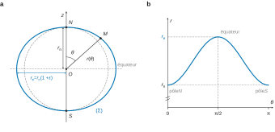
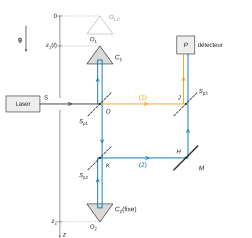
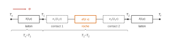
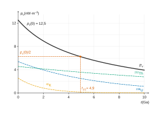
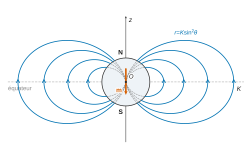

# CCINP MP — Physique-chimie 2026 · Corrigé guidé

*Corrigé rédigé par IA, non officiel. Signalez toute erreur.*

## Présentation du sujet

**Cadre.** Épreuve spécifique MP2PC, 4 heures, **calculatrices interdites**. Une annexe donne les logarithmes décimaux des données et une courbe de $\log_{10}x$ sur $[1,10]$ ; les résultats numériques peuvent être donnés avec un seul chiffre significatif. Le sujet, intitulé « Notre Terre : attractive, si chaleureuse et… magn(if)(ét)ique », compte **33 questions** (Q1 à Q33, plusieurs avec des sous-questions) en six parties indépendantes.

**Données générales.** $R_T=6{,}4\cdot10^6$ m ; $M_T=6{,}0\cdot10^{24}$ kg ; $G=6{,}7\cdot10^{-11}\ \mathrm{N\,m^2\,kg^{-2}}$.

Rotation et thermique : $\Omega=7{,}3\cdot10^{-5}\ \mathrm{rad\,s^{-1}}$ ; $C\approx10^3\ \mathrm{J\,kg^{-1}\,K^{-1}}$.

Autres constantes : $\mathcal N_A=6{,}02\cdot10^{23}\ \mathrm{mol^{-1}}$ ; $\mu_0=4\pi\cdot10^{-7}\ \mathrm{H\,m^{-1}}$. Pour la chimie : $R=8{,}31\ \mathrm{J\,K^{-1}\,mol^{-1}}$, masses molaires de C, O, Mg, Ca (12, 16, 24, 40), $K_e=10^{-14}$.

**Les six parties.**

- *Partie I (Q1–Q3)* : analogie gravitation/électrostatique, théorème de Gauss gravitationnel, champ d'une boule homogène, puis détection d'un gisement de pétrole par superposition.
- *Partie II (Q4–Q8)* : poids dans le référentiel terrestre (force d'inertie d'entraînement), négligeabilité de Coriolis, énergies potentielles et forme approchée de l'équipotentielle de pesanteur : aplatissement de la Terre.
- *Partie III (Q9–Q10)* : gravimètre absolu à interférométrie (Mach-Zehnder et coins de cube) : différence de marche, minima d'intensité, exploitation d'une droite.
- *Partie IV (Q11–Q19)* : chimie. IV.1 thermodynamique de la calcination (approximation d'Ellingham, rupture d'équilibre) ; IV.2 ciment : formules de Bogue mises en matrice en Python, eau de gâchage, solubilité, corrosion et passivation, composition d'une argile ; IV.3 diacide carbonique, diagramme de distribution et pH d'une pluie en équilibre avec l'air.
- *Partie V (Q20–Q29)* : résistance thermique et mesure de conductivité ; énergie gravitationnelle d'une boule, température d'accrétion ; décroissance radioactive et puissance volumique ; bilan thermique en sphérique avec source et profil de température.
- *Partie VI (Q30–Q33)* : champ d'un dipôle magnétique, lignes de champ, composantes horizontale et verticale, estimation du moment dipolaire terrestre.

**Notions du programme mobilisées.** Théorème de Gauss et symétries ; dynamique en référentiel en rotation uniforme ; énergie potentielle ; développement limité au premier ordre ; interférences à deux ondes ; enthalpie libre standard, constante d'équilibre, quotient réactionnel ; stœchiométrie ; produit de solubilité ; oxydoréduction et corrosion ; couples acide-base ; diffusion thermique et résistance thermique ; premier principe infinitésimal ; décroissance radioactive (équation différentielle d'ordre 1) ; champ magnétique, lignes de champ.

**Ce qu'en dit le jury.** Le rapport 2026 juge le sujet « légèrement long » et indique que « La note moyenne a été de 8,79/20 avec un écart-type de 3,57. » Il classe les candidats par l'alternance de questions simples et de « questions plus difficiles (Q3, Q8, Q10, Q20, Q28) ». Il ajoute que « L'annexe au sujet (située à la dernière page) a été peu utilisée » et que « peu de candidats ont traité la dernière partie ». Les erreurs générales relevées sont l'oubli du signe $-$ dans le champ et les énergies potentielles de gravitation et de pesanteur, des températures absolues négatives, « l'application défectueuse du théorème de Gauss », « le problème de rigueur entre scalaire et vecteur » et les erreurs de calcul, d'homogénéité et d'unités.

**Questions discriminantes.** D'après les commentaires par question du rapport 2026 :

| Question | Constat du jury |
|---|---|
| Q3 | superposition mal maîtrisée, petite sphère de Terre non retirée |
| Q5, Q7 | questions de cours rarement justes ou mal établies |
| Q8 | « Mal traitée dans l'ensemble. » |
| Q10 | marche des rayons et caractérisation des minima très mal traitées |
| Q12 | deux équilibres simultanés : rarement correct |
| Q14, Q15, Q17 | stœchiométrie mal gérée |
| Q19, Q25 | rarement traitées ; Q25 jugée « très difficile » |
| Q30–Q33 | souvent mal traitées ou pas abordées, « étant en fin d'épreuve » |

**Questions à ne pas laisser passer.** Q1, Q2, Q4, Q5, Q7, Q9, Q11, Q13, Q16a, Q18, Q20, Q22, Q24, Q30, Q33 sont des applications directes du cours.

**Gestion du temps.** Environ 30 min pour la partie I, 40 min pour la II, 25 min pour la III, 1 h 10 pour la IV, 1 h pour la V et 15 min pour la VI. Le rapport 2026 invite à « tirer profit de l'indépendance entre les parties du sujet » : on peut commencer par la VI et la V.1, très proches du cours, plutôt que de les sacrifier en fin d'épreuve.

---

## Partie I — Champ gravitationnel et champ de pesanteur

On établit le théorème de Gauss gravitationnel par analogie, on l'applique à une boule homogène, puis on utilise la superposition pour modéliser une cavité de densité différente.

### Question 1

> [!INDICATION]
> Écrire côte à côte les deux champs en $1/r^2$ et identifier terme à terme.

> [!INDICATION]
> Attention au signe : la gravitation est toujours attractive. Que devient alors $1/\varepsilon_0$ ?

#### Solution

Une masse $m$ et une charge $q$ placées en $O$ créent en $M$, avec $\overrightarrow{OM}=r\,\vec u_r$ :

$$\vec G(M)=-\frac{Gm}{r^2}\,\vec u_r$$

$$\vec E(M)=\frac{q}{4\pi\varepsilon_0 r^2}\,\vec u_r$$

L'identification $\dfrac{q}{4\pi\varepsilon_0}\leftrightarrow-Gm$ donne :

$$\boxed{\begin{aligned}q&\leftrightarrow m\\\frac1{\varepsilon_0}&\leftrightarrow-4\pi G\end{aligned}}$$

Le théorème de Gauss électrostatique s'écrit $\oint_S\vec E\cdot\mathrm d\vec S_{\rm ext}=Q_{\rm int}/\varepsilon_0$. Il devient : le flux de $\vec G$ sortant d'une surface **fermée** $S$ vaut $-4\pi G$ fois la masse intérieure,

$$\boxed{\oint_S\vec G(P)\cdot\mathrm d\vec S_{\rm ext}=-4\pi G\iiint_V\mu(P)\,\mathrm d\tau}$$

> [!PIEGE]
> Oublier le signe $-$ : l'analogue de $\varepsilon_0$ est négatif, c'est la trace mathématique de l'attraction. Ce signe se propage dans tout le sujet ; le rapport 2026 place son oubli dans le champ et les énergies potentielles de gravitation en tête des erreurs évitables.

> [!JURY]
> Le rapport 2026 note : « Il est curieux de constater des erreurs dans l'expression du champ de gravitation, alors qu'il est donné – et souvent reconnu – à la partie II. Les candidats doivent prendre un peu de recul. » Un coup d'œil à la suite du sujet sert de contrôle.

### Question 2

> [!INDICATION]
> Commencer par les symétries et invariances de la boule pour obtenir la direction et les variables du champ.

> [!INDICATION]
> Choisir une surface de Gauss sphérique et distinguer $r\ge R_T$ et $r\le R_T$ : la masse intérieure n'est pas la même.

#### Solution

La distribution est invariante par toute rotation autour de $O$ : la norme du champ ne dépend que de $r$. Tout plan contenant $O$ et $M$ est plan de symétrie, d'où :

$$\vec G_T(M)=G(r)\,\vec u_r$$

On applique le théorème de Gauss à la sphère de rayon $r$, surface fermée qui contient la masse intérieure $M_{\rm int}(r)$ :

$$4\pi r^2G(r)=-4\pi G\, M_{\rm int}(r)$$

Pour $r\ge R_T$, $M_{\rm int}=M_T$ ; pour $r\le R_T$, $M_{\rm int}=\frac43\pi r^3\mu_T$. D'où :

$$\boxed{\begin{aligned}
\vec G_T&=-\frac{GM_T}{r^2}\vec u_r &&(r\ge R_T)\\
\vec G_T&=-\frac{4\pi G\mu_T}{3}\,r\,\vec u_r &&(r\le R_T)
\end{aligned}}$$

Le champ est nul au centre, croît linéairement jusqu'à la surface puis décroît en $1/r^2$ ; les deux expressions se raccordent en $R_T$.

> [!METHODE]
> Symétries (direction) puis invariances (variables) puis surface de Gauss adaptée : c'est l'ordre attendu, dans toute la physique des champs à symétrie sphérique ou cylindrique.

> [!JURY]
> Parmi les erreurs générales, le rapport 2026 cite « l'application défectueuse du théorème de Gauss » et demande de « spécifier surface fermée et donc masse intérieure » : il faut nommer la surface de Gauss, dire qu'elle est fermée et préciser la masse qu'elle contient dans chaque domaine.

### Question 3

> [!INDICATION]
> Une cavité de masse volumique $\mu_p$ dans un milieu $\mu_T$ équivaut à la superposition du milieu plein et d'une boule de masse volumique bien choisie.

> [!INDICATION]
> La boule fictive a pour masse volumique $\mu_p-\mu_T$, négative. Le point $M$ lui est extérieur : appliquer le résultat de Q2.

#### Solution

On superpose la Terre homogène pleine et une boule de centre $C$ et de rayon $r'$, de masse :

$$m'=\frac43\pi r'^3(\mu_p-\mu_T)<0$$

En $M$, on a $\vec u_r=\vec u_z$ et $CM=d>r'$. La Terre pleine et la boule fictive y créent :

$$G_T(M)=-\frac{4\pi G\mu_TR_T}{3}$$

$$\begin{aligned}
\vec G_{\rm corr}&=-\frac{Gm'}{d^2}\vec u_z\\
&=+\frac{4\pi Gr'^3(\mu_T-\mu_p)}{3d^2}\vec u_z
\end{aligned}$$

Par superposition :

$$\boxed{G_{Tp}(M)=-\frac{4\pi G}{3}\left[\mu_TR_T-\frac{(\mu_T-\mu_p)r'^3}{d^2}\right]}$$

$$\boxed{\varepsilon=\left(1-\frac{\mu_p}{\mu_T}\right)\left(\frac{r'}{d}\right)^2\frac{r'}{R_T}}$$

On a $\varepsilon>0$ : le champ correcteur, vers le haut, s'oppose au champ terrestre. **Le champ est moins intense** au-dessus du pétrole, moins dense que la roche.

$$\begin{aligned}
\varepsilon&=\frac56\times\frac14\times2{,}5\cdot10^{-4}\\
&\approx\boxed{5\cdot10^{-5}}
\end{aligned}$$

C'est environ $5\cdot10^3$ fois la précision des gravimètres ($10^{-8}$) : le gisement est détectable.

> [!PIEGE]
> Superposer la Terre pleine et une boule de masse volumique $\mu_p$ revient à compter deux fois la matière à l'emplacement du gisement. C'est la **différence** $\mu_p-\mu_T$ qu'on ajoute.

> [!JURY]
> Le rapport 2026 classe Q3 parmi les questions difficiles : « Le principe de superposition n'est pas bien maîtrisé pour certains. Beaucoup oublient de retirer la petite sphère de Terre dans le calcul. »

> [!METHODE]
> Pour conclure sur « plus ou moins intense » avec des composantes algébriques négatives, raisonner explicitement sur les normes.

---

## Partie II — Forme de la Terre

On passe dans le référentiel terrestre, non galiléen. Le poids inclut la force d'inertie d'entraînement ; on en déduit une énergie potentielle de pesanteur, et la surface équipotentielle donne l'aplatissement de la Terre.

### Question 4

> [!INDICATION]
> Écrire les forces d'inertie dans un référentiel en rotation uniforme autour d'un axe fixe.

> [!INDICATION]
> Le poids se mesure sur un corps au repos dans le référentiel terrestre : que devient alors la force de Coriolis ?

#### Solution

Dans $R'$, en rotation uniforme $\vec\Omega=\Omega\vec u_z$ par rapport au référentiel géocentrique galiléen, les forces d'inertie sont :

$$\begin{aligned}
\vec F_{ie}&=-m\vec a_e=m\Omega^2\overrightarrow{HM}\\
\vec F_{ic}&=-2m\vec\Omega\wedge\vec v_{R'}
\end{aligned}$$

Le poids est défini pour un corps au repos dans $R'$ : $\vec v_{R'}=\vec 0$, la force de Coriolis est nulle, et

$$\vec P=m\vec g=m\Big(\underbrace{-\frac{GM_T}{r^2}\vec u_r}_{\text{gravitation}}+\underbrace{\Omega^2\overrightarrow{HM}}_{\text{inertie d'entraînement}}\Big).$$

Ordre de grandeur : le terme d'entraînement est négligeable (Q6), et

$$\begin{aligned}
\log\frac{GM_T}{R_T^2}&=-10{,}17+24{,}78-13{,}62\\
&=0{,}99
\end{aligned}$$

donc $\boxed{g\approx10\ \mathrm{m\,s^{-2}}}$, la valeur bien connue $9{,}8\ \mathrm{m\,s^{-2}}$.

Le terme gravitationnel est radial et centripète ; le terme d'entraînement est perpendiculaire à l'axe des pôles et dirigé vers l'extérieur. Leur somme n'est donc pas exactement radiale (sauf aux pôles et à l'équateur) : c'est ce qui définit la verticale locale, légèrement différente de la direction du centre de la Terre.

> [!PIEGE]
> $\overrightarrow{HM}$ joint l'axe des pôles au point (norme $r\sin\theta$), ce n'est pas $\overrightarrow{OM}$. L'accélération d'entraînement est centripète, la force d'inertie est axifuge.

> [!PIEGE]
> Recalculer $g$ et accepter un résultat aberrant. Le rapport 2026 le relève : « L'ordre de grandeur de g (bien connu !) a parfois été (re)calculé, et mal calculé, occasionnant des valeurs aberrantes. » Un résultat éloigné de $10\ \mathrm{m\,s^{-2}}$ signale une erreur de calcul.

### Question 5

> [!INDICATION]
> Majorer la norme d'un produit vectoriel par le produit des normes, puis comparer au poids.

#### Solution

La force de Coriolis s'écrit $\vec F_{ic}=-2m\vec\Omega\wedge\vec v$, avec $\vec v$ la vitesse du train dans $R'$ ; donc $\|\vec F_{ic}\|\le2m\Omega v$, et

$$\begin{aligned}
\frac{\|\vec F_{ic}\|}{mg}&\le\frac{2\Omega v}{g}\\
&=\frac{2\times7{,}3\cdot10^{-5}\times100}{9{,}8}\\
&\approx\boxed{1{,}5\cdot10^{-3}}
\end{aligned}$$

La force de Coriolis vaut au plus 0,15 % du poids : elle est négligeable.

> [!PIEGE]
> Ne pas confondre $v$, vitesse du train dans le référentiel terrestre, avec la vitesse d'entraînement d'un point de l'équateur, $\Omega R_T\approx470\ \mathrm{m\,s^{-1}}$, qui n'intervient pas dans la force de Coriolis.

> [!JURY]
> Le rapport 2026 juge cette question « Rarement juste, alors que c'est du cours. » On attend l'expression de la force de Coriolis, une majoration propre et une comparaison chiffrée au poids.

### Question 6

> [!INDICATION]
> Exprimer le rapport en un point de colatitude $\theta$ à la surface ; où est-il maximal ?

> [!INDICATION]
> Pour l'application numérique, prendre le logarithme de l'expression littérale et utiliser l'annexe.

#### Solution

Le terme d'entraînement a pour norme $\Omega^2R_T\sin\theta$ à la surface, le terme de gravitation $GM_T/R_T^2$ :

$$\begin{aligned}
\frac{\Omega^2R_T\sin\theta}{GM_T/R_T^2}&=\frac{\Omega^2R_T^3}{GM_T}\sin\theta\\
&\le\frac{\Omega^2R_T^3}{GM_T}
\end{aligned}$$

$$\boxed{\eta=\frac{\Omega^2R_T^3}{GM_T}}$$

L'égalité a lieu à l'équateur. Numériquement :

$$\begin{aligned}
\log\eta&=2(-4{,}14)+3(6{,}81)+10{,}17-24{,}78\\
&=-2{,}46
\end{aligned}$$

d'où $\boxed{\eta\approx3{,}5\cdot10^{-3}}$, soit $3\cdot10^{-3}$ à un chiffre. Le terme d'entraînement est une petite correction (0,3 %) au champ de gravitation, mais c'est elle qui aplatit la Terre (Q8).

> [!METHODE]
> Sans calculatrice : $\log(\text{expression})=\sum\pm k\log(\text{donnée})$, puis lecture de $10^{\text{partie décimale}}$ sur la courbe de l'annexe ($10^{0{,}54}\approx3{,}5$).

> [!PIEGE]
> Perdre une puissance de $R_T$ change le rapport d'un facteur $6{,}4\cdot10^6$ : on conclut alors à tort que le terme d'inertie domine. Le rapport 2026 relève « Beaucoup d'erreurs de calculs » et des oublis de puissances de $R_T$ « donnant parfois une conclusion inverse à celle attendue ». Le contrôle : $\eta$ est sans dimension.

### Question 7

> [!INDICATION]
> Dans chaque cas, calculer le travail élémentaire $\delta W=\vec F\cdot\mathrm d\vec\ell$ et l'écrire comme $-\mathrm dE_p$.

> [!INDICATION]
> Pour (b), utiliser la distance $\rho$ à l'axe comme variable : la force est portée par le vecteur unitaire de $\overrightarrow{HM}$.

#### Solution

**a)** Seule la composante radiale du déplacement travaille :

$$\begin{aligned}
\delta W&=-\frac{GM_Tm}{r^2}\,\mathrm dr\\
&=-\mathrm d\!\left(-\frac{GM_Tm}{r}\right)
\end{aligned}$$

Avec une énergie nulle à l'infini :

$$\boxed{E_{pG}=-\frac{GM_Tm}{r}}$$

**b)** On a $\vec F_e=m\Omega^2\rho\,\vec u_\rho$ ; seule la composante $\mathrm d\rho$ de $\mathrm d\vec\ell$ travaille :

$$\begin{aligned}
\delta W&=m\Omega^2\rho\,\mathrm d\rho\\
&=-\mathrm d\!\left(-\tfrac12m\Omega^2\rho^2\right)
\end{aligned}$$

Avec une énergie nulle en $r=0$ :

$$\boxed{\begin{aligned}E_{pe}&=-\frac12m\Omega^2\left(\overrightarrow{HM}\right)^2\\&=-\frac12m\Omega^2r^2\sin^2\theta\end{aligned}}$$

**c)** Les deux énergies potentielles s'ajoutent :

$$\boxed{E_{pp}=-\frac{GM_Tm}{r}-\frac12m\Omega^2r^2\sin^2\theta}$$

> [!PIEGE]
> L'énergie potentielle centrifuge est négative et décroît quand on s'éloigne de l'axe : la force pousse vers les $\rho$ croissants.

> [!JURY]
> Le rapport 2026 constate « Encore des résultats de cours, mal établis. » La question demande d'établir le résultat : on écrit le travail élémentaire, on l'identifie à $-\mathrm dE_p$ et on fixe la constante par la condition imposée.

### Question 8

> [!INDICATION]
> Écrire l'égalité $E_{pp}(M)=E_{pp}(N)$ et isoler $1/r$.

> [!INDICATION]
> Le terme centrifuge est petit (Q6) : développer au premier ordre et, dans le terme correctif, remplacer $r$ par $r_n$.

> [!INDICATION]
> Pour faire apparaître $\eta$, il faut faire intervenir $R_T^3$ au numérateur et au dénominateur.

#### Solution

L'égalité $E_{pp}(M)=E_{pp}(N)$ s'écrit, après division par $-m$ :

$$\begin{aligned}
\frac{GM_T}{r}+\frac12\Omega^2r^2\sin^2\theta&=\frac{GM_T}{r_n}\\
r&=\frac{r_n}{1-\dfrac{\Omega^2r_nr^2\sin^2\theta}{2GM_T}}
\end{aligned}$$

Le terme soustrait est d'ordre $\eta/2\ll1$. Au premier ordre, $(1-u)^{-1}\approx1+u$, et $r\approx r_n$ dans la correction (erreur du second ordre) :

$$\boxed{\begin{aligned}
r(\theta)&\approx r_n(1+\varepsilon\sin^2\theta)\\
\varepsilon&=\frac{\Omega^2r_n^3}{2GM_T}\\
&=\frac\eta2\left(\frac{r_n}{R_T}\right)^3
\end{aligned}}$$

Allure (figure 1) : $r_n$ aux pôles, $r_n(1+\varepsilon)$ à l'équateur ; cercle légèrement aplati aux pôles (ellipse au premier ordre).



$$\begin{aligned}
\varepsilon'&=\frac{r_e-r_n}{r_n}\\
&=\varepsilon
\end{aligned}$$

$$\boxed{\varepsilon'\approx\frac\eta2\approx1{,}7\cdot10^{-3}\approx\frac1{580}}$$

Ordre de grandeur de l'effet : $r_e-r_n=\varepsilon r_n\approx1{,}7\cdot10^{-3}\times6{,}4\cdot10^6\approx11$ km. Le modèle prévoit donc un renflement équatorial d'une dizaine de kilomètres (la valeur réelle, environ 21 km, est du même ordre).

> [!METHODE]
> Équation implicite avec un petit paramètre : résoudre à l'ordre 0 ($r=r_n$), puis réinjecter dans le terme correctif. C'est le principe d'un développement perturbatif ; il faut annoncer l'ordre auquel on travaille.

> [!PIEGE]
> L'aplatissement réel ($1/298$) est environ double : ce n'est pas une erreur de calcul, le modèle suppose un champ de gravitation sphérique alors que la Terre déformée ne l'est plus.

> [!JURY]
> Question discriminante : le rapport 2026 la classe parmi les plus difficiles et la dit « Mal traitée dans l'ensemble. » Il revient en Q31 sur la notion d'équipotentielle, qui n'est pas maîtrisée : c'est le lieu des points de même énergie potentielle de pesanteur, et rien de plus.

---

## Partie III — Détermination optique du champ de pesanteur

Un coin de cube en chute libre modifie la différence de marche d'un interféromètre ; chaque minimum d'intensité marque une variation de $\lambda$ de cette différence de marche. On en tire $g$.

### Question 9

> [!INDICATION]
> Pour (a), écrire $g(h)$ et faire un développement limité en $h/R_T$.

> [!INDICATION]
> Pour (b), attention à l'orientation imposée de l'axe.

#### Solution

**a)** Avec $g(h)=GM_T/(R_T+h)^2$ et $h/R_T\ll1$, on fait un développement limité au premier ordre :

$$\begin{aligned}
\frac{g(h)-g(0)}{g(0)}&=\left(1+\frac h{R_T}\right)^{-2}-1\\
&\approx-\frac{2h}{R_T}\\
&\approx\boxed{-3\cdot10^{-7}}
\end{aligned}$$

$g$ peut être tenu pour constant sur 1 m.

**b)** L'axe est descendant, d'origine $O_{1,0}$ : le poids est dans le sens positif. Donc $\ddot z_1=+g$, avec $z_1(0)=\dot z_1(0)=0$ :

$$\boxed{z_1(t)=\frac12gt^2}$$

> [!JURY]
> Le rapport 2026 attend en (a) un calcul chiffré : Q9a est « Rarement traitée quantitativement, avec le développement limité attendu. » En (b), « Le sens de l'axe est souvent faux (erreur de signe) et l'origine mal prise en compte. »

> [!PIEGE]
> Écrire $z_1=-\frac12gt^2$ par habitude d'un axe ascendant, ou ajouter une position initiale non nulle : ici l'axe descend et l'origine est la position initiale $O_{1,0}$.

### Question 10

> [!INDICATION]
> Suivre sur la figure 3(a) le trajet de chaque rayon depuis $S_{p1}$ jusqu'à $P$, en notant qu'un coin de cube renvoie la lumière parallèlement à elle-même.

> [!INDICATION]
> Repérer chaque point par sa cote : les longueurs fixes du montage doivent se compenser, seule subsiste la position relative des sommets des coins de cube.

> [!INDICATION]
> Pour (b) et (c) : entre deux minima successifs, de combien varie l'ordre d'interférence ? Puis chercher une grandeur qui soit proportionnelle à $q$.

#### Solution

**a)** On applique les lois de la réflexion aux lames inclinées à 45° et au miroir :

- rayon (1) : transmis par $S_{p1}$, il va de $O$ à $J$, où $S_{p3}$ le réfléchit vers $P$ ;
- rayon (2) : réfléchi vers $C_1$, renvoyé vers le bas, il traverse $S_{p1}$ et $S_{p2}$ jusqu'à $C_2$ ;
- il remonte, est réfléchi par $S_{p2}$ vers $H$, puis par $M$ vers $J$ et $P$ (figure 2).



Avec des cotes ascendantes et $L=OJ=KH$, puis $Z_J-Z_H=Z_O-Z_K$ :

$$\begin{aligned}
(2)-(1)&=2(Z_{O_1}-Z_O)+(Z_O-Z_K)+2(Z_K-Z_{O_2})+(Z_J-Z_H)\\
&=2(Z_{O_1}-Z_{O_2})
\end{aligned}$$

Sur l'axe descendant d'origine $O_{1,0}$ :

$$\boxed{\begin{aligned}\delta(P,t)&=2\big(z_2-z_1(t)\big)\\&=2z_2-gt^2\end{aligned}}$$

Numériquement, $\delta(P,0)=2z_2=0{,}60$ m ; cette valeur n'est pas un multiple entier de $\lambda$, ce qui explique que l'intensité initiale de la figure 3(b) ne soit pas maximale.

**b)** Les deux ondes, issues du même laser, sont cohérentes ; de même intensité $I_0$, elles donnent :

$$I=2I_0\left[1+\cos\left(\frac{2\pi\delta}{\lambda}\right)\right]$$

Un minimum d'intensité correspond à un ordre d'interférence $p=\delta/\lambda$ demi-entier. Comme $\delta$ décroît strictement, l'ordre diminue d'une unité d'un minimum au suivant : du premier minimum au $q$-ième suivant, il diminue de $q$.

$$\boxed{\begin{aligned}\Delta_q&=-g(t_q^2-t_0^2)\\&=-q\lambda\end{aligned}}$$

$$\boxed{g=\frac{q\lambda}{t_q^2-t_0^2}}$$

**c)** On pose :

$$\boxed{\begin{aligned}y(q)&=t_q^2-t_0^2\\&=\frac\lambda g\,q\end{aligned}}$$

fonction linéaire de $q$. On relève les $t_q$ sur la figure 3(b), on trace $y(q)$ et on ajuste la pente $a=\lambda/g$.

Avec les temps en microsecondes, $a=64\,598\ \mu\mathrm s^2=6{,}4598\cdot10^{-8}\ \mathrm s^2$, et

$$\begin{aligned}
g&=\frac{\lambda}{a}\\
&=\frac{632{,}82\cdot10^{-9}}{6{,}4598\cdot10^{-8}}\ \mathrm{m\,s^{-2}}\\
&\approx9{,}796\ \mathrm{m\,s^{-2}}
\end{aligned}$$

soit $9{,}7961\ \mathrm{m\,s^{-2}}$ à l'arrondi de la pente près.

Contrôle sur la figure 3(b) : le premier minimum est vers $t_0\approx155\ \mu$s. La relation donne $t_1=\sqrt{t_0^2+64\,598}\approx298\ \mu$s et $t_2\approx391\ \mu$s, en accord avec les minima suivants du tracé. Les minima se resserrent bien au cours du temps.

> [!JURY]
> Q10 est la plus mal réussie du sujet d'après le rapport 2026. En (a), « Beaucoup de candidats ont raté la marche des rayons lumineux conformément aux lois de la réflexion et de la réfraction. » En (b), « Très mal traitée : une faible proportion de candidats a caractérisé les minima de l'intensité d'interférence (définition, écart des ordres). » On attend donc la condition de minimum sur l'ordre et l'écart de 1 entre deux minima successifs.

> [!PIEGE]
> Oublier le facteur 2 du coin de cube (aller-retour) fait trouver $g=2q\lambda/(t_q^2-t_0^2)$, deux fois trop grand. Le compter une seconde fois, en écrivant des minima espacés de $\lambda/2$ en différence de marche, divise $g$ par deux. Ici $\delta$ contient déjà le 2, et deux minima consécutifs correspondent à une variation de $\lambda$.

> [!PIEGE]
> L'unité de la pente : $\mu\mathrm s^2=10^{-12}\ \mathrm s^2$.

> [!METHODE]
> Exploiter tous les minima par une régression plutôt que deux points isolés : l'incertitude diminue. On remarque aussi le resserrement des franges sur la figure 3(b), signature d'une phase quadratique en $t$.

---

## Partie IV — Le calcaire et l'argile : des richesses du sol bon marché

### Partie IV.1 — Calcination du calcaire

Deux équilibres hétérogènes de décomposition de carbonates ; l'approximation d'Ellingham donne $\Delta_rH^0$ et $\Delta_rS^0$ par lecture directe.

### Question 11

> [!INDICATION]
> Identifier l'expression donnée avec $\Delta_rG^0=\Delta_rH^0-T\Delta_rS^0$.

> [!INDICATION]
> Relier $K^0$ et $\Delta_rG^0$ ; écrire les activités des solides purs et du gaz.

#### Solution

**a)** $\boxed{\Delta_rH_1^0=177{,}4\ \mathrm{kJ\,mol^{-1}}>0}$ : réaction **endothermique**.

**b)** $\boxed{\Delta_rS_1^0=159\ \mathrm{J\,K^{-1}\,mol^{-1}}>0}$, cohérent avec la formation d'un gaz à partir d'un solide ($\Delta\nu_{\rm gaz}=+1$).

**c)** Avec $\Delta_rG_1^0=-RT\ln K_1^0$ :

$$\boxed{\begin{aligned}K_1^0(T)&=\exp\left(-\frac{\Delta_rG_1^0}{RT}\right)\\&=\exp\left(19{,}1-\frac{2{,}13\cdot10^4}{T}\right)\end{aligned}}$$

On a $K_1^0=1$ si et seulement si $\Delta_rG_1^0=0$, d'où $\boxed{T_{1,i}=1116\ \mathrm K\ (843\ ^\circ\mathrm C)}$.

**d)** Les solides purs ont une activité égale à 1 :

$$\boxed{Q_{r,1}=\dfrac{a(\mathrm{CaO})\,a(\mathrm{CO_2})}{a(\mathrm{CaCO_3})}=\dfrac{P_{\mathrm{CO_2}}}{P^0}}$$

> [!PIEGE]
> C'est l'ordonnée à l'origine de $\Delta_rG^0(T)$ qui donne $\Delta_rH^0$, la pente donne $-\Delta_rS^0$. Et ne pas oublier la conversion kJ en J dans l'exponentielle.

> [!JURY]
> Le rapport 2026 classe Q11 parmi les « Questions de cours, en général bien réussies. » Ce sont des points à ne pas perdre.

### Question 12

> [!INDICATION]
> Sous $P_{\mathrm{CO_2}}=P^0$, que vaut le quotient de chaque réaction ? Conclure sur le signe de $\Delta_rG$ selon $T$.

> [!INDICATION]
> Deux équilibres partagent la même phase gazeuse : quelle condition sur $K_1^0$ et $K_2^0$ leur coexistence imposerait-elle ?

> [!INDICATION]
> Pour (b), la perte de masse est celle du gaz dégagé, pas du carbonate.

#### Solution

**a)** On a $T_{2,i}=118{,}0/0{,}175=674$ K. Sous $P_{\mathrm{CO_2}}=P^0$, $Q_r=1$ et $\Delta_rG=\Delta_rG^0$ pour les deux réactions :

- rien ne se passe en dessous de 674 K ;
- à 674 K, $\mathrm{MgCO_3}$ se décompose totalement à température constante (rupture d'équilibre) ;
- entre 674 et 1116 K, il reste $\mathrm{CaCO_3}$ et $\mathrm{MgO}$ ;
- à 1116 K, $\mathrm{CaCO_3}$ se décompose à son tour.

Simultanéité : la phase gazeuse étant commune, il faudrait $P_{\mathrm{CO_2}}=K_1^0P^0=K_2^0P^0$, donc $\Delta_rG_1^0(T)=\Delta_rG_2^0(T)$. Cela donne $T=-59{,}4/0{,}0161\approx-3{,}7\cdot10^3$ K : impossible. **Les deux équilibres ne peuvent pas être simultanés** ; les décompositions sont successives.

**b)** On raisonne sur 100 g de mélange, contenant $x$ g de $\mathrm{MgCO_3}$ ($M=24+12+48=84\ \mathrm{g\,mol^{-1}}$).

La première perte de masse est le $\mathrm{CO_2}$ ($44\ \mathrm{g\,mol^{-1}}$) dégagé par la décomposition totale de $\mathrm{MgCO_3}$, le $\mathrm{MgO}$ restant dans le solide :

$$\begin{aligned}
\frac{44\,x}{84}&=2{,}2\\
x&=\boxed{4{,}2\,\%}
\end{aligned}$$

C'est sous la limite de 6 % : le calcaire est utilisable. La seconde perte, due à $\mathrm{CaCO_3}$ ($100\ \mathrm{g\,mol^{-1}}$), vaut $0{,}44\times95{,}8\approx42$ g : bien plus grande, comme attendu.

> [!PIEGE]
> Attribuer la première perte de masse au carbonate le plus abondant : c'est la température de décomposition qui décide.

> [!JURY]
> D'après le rapport 2026, « L'étude de la simultanéité ou non des deux équilibres n'a pas été correctement traitée. » ; il note que les exercices à plusieurs équilibres sont devenus rares. La partie (b) est « Rarement abordée et encore plus rarement correctement traitée. » Une justification attendue : la condition $K_1^0(T)=K_2^0(T)$ et sa conséquence chiffrée.

> [!METHODE]
> Pour un équilibre hétérogène dont le seul gaz est imposé, $Q_r$ est fixé : l'équilibre n'existe qu'à une température donnée, et au-delà la réaction est totale (rupture d'équilibre).

### Partie IV.2 — Obtention d'un ciment

Bilans de matière de la cimenterie, traduits en système linéaire résolu par `numpy`, puis hydratation, solubilité de la chaux et corrosion des armatures.

### Question 13

> [!INDICATION]
> La notation cimentière ($3\mathrm{CaO\cdot SiO_2}$…) donne directement les coefficients.

#### Solution

$$\begin{aligned}
&3\,\mathrm{CaO}+\mathrm{SiO_2}\to\mathrm{Ca_3SiO_5}\ (\text{A})\\
&2\,\mathrm{CaO}+\mathrm{SiO_2}\to\mathrm{Ca_2SiO_4}\ (\text{B})\\
&3\,\mathrm{CaO}+\mathrm{Al_2O_3}\to\mathrm{Ca_3Al_2O_6}\ (\text{C})\\
&4\,\mathrm{CaO}+\mathrm{Al_2O_3}+\mathrm{Fe_2O_3}\to\mathrm{Ca_4Al_2Fe_2O_{10}}\ (\text{D})
\end{aligned}$$

Tous les réactifs et produits sont solides. Bilans en oxygène : 5, 4, 6, 10.

### Question 14

> [!INDICATION]
> Partir de $p_j$ grammes du composant $j$ : combien de moles, combien de moles de chaque oxyde, quelle masse d'oxyde ?

> [!INDICATION]
> Les lignes de `gob` correspondent aux oxydes, les colonnes aux composants, puisque `oxy = gob * cim`.

#### Solution

Dans 100 g de ciment, $p_j$ grammes du composant $j$ représentent $p_j/M_j$ moles. Ils contiennent $\nu_{ij}$ fois plus de moles de l'oxyde $i$, soit une masse d'oxyde $\nu_{ij}M_ip_j/M_j$. D'où :

$$\beta_{ij}=\nu_{ij}\,\frac{M_i}{M_j}$$

```python
gob=np.array([[3*M1/M5, 2*M1/M6, 3*M1/M7, 4*M1/M8],
              [  M2/M5,   M2/M6,       0,       0],
              [      0,       0,   M3/M7,   M3/M8],
              [      0,       0,       0,   M4/M8]])
```

Exécuté avec `oxy=[62, 24, 9, 5]`, le script affiche environ `cim= [ 2.51 66.91 15.33 15.25]`, de somme 100 : environ 2,5 % de A, 66,9 % de B, 15,3 % de C et 15,3 % de D.

Lecture de la matrice : la dernière ligne traduit (H1) (tout le fer est dans D), la troisième (H2) (l'alumine est dans C et D), la deuxième (H3) (la silice dans A et B), la première (H4) (la chaux partout).

On peut donc résoudre à la main par substitutions successives : $p_4$ donne $p_8$, puis $p_3$ donne $p_7$.

Il reste un système $2\times2$ en $(p_5,p_6)$, de déterminant $M_1M_2/(M_5M_6)\ne0$ ; c'est ce qu'automatise `np.linalg.inv`.

> [!PIEGE]
> Écrire la transposée : le script tourne quand même et affiche des valeurs fausses, parfois négatives. Le contrôle « somme des $p_j$ égale à 100 » détecte l'erreur.

> [!JURY]
> Le rapport 2026 regroupe Q14, Q15 et Q17 : « La stœchiométrie (proportions) en chimie n'a pas été bien gérée » pour les pourcentages, la matrice `gob`, le rapport eau/ciment et l'argile. Il faut écrire explicitement le passage masse, puis quantité de matière, puis masse, avec les coefficients des formules oxydes.

> [!METHODE]
> Signaler les incohérences d'énoncé sans s'y arrêter : ici `M4=159` dans le script contre 160 dans le tableau 1 (écart négligeable).

### Question 15

> [!INDICATION]
> Pourcentages massiques puis quantités de matière, multiplier par les moles d'eau, revenir en masse.

#### Solution

$$\boxed{r=\frac{m_e}{m_c}=\frac{M_0}{100}\left(\frac{3p_5}{M_5}+\frac{2p_6}{M_6}+\frac{6p_7}{M_7}+\frac{10p_8}{M_8}\right)}$$

Le 100 est $p_5+p_6+p_7+p_8$. Démarche : une masse $m_c$ de ciment contient $m_cp_j/100$ g du composant $j$, soit $m_cp_j/(100M_j)$ mol.

Ces quantités consomment respectivement 3, 2, 6 et 10 fois plus de moles d'eau ; on multiplie la somme par $M_0$ et on divise par $m_c$. Avec Q14 et $M_0=18\ \mathrm{g\,mol^{-1}}$, $r\approx0{,}26$, soit environ 260 g d'eau par kilogramme de ciment pour l'hydratation seule.

> [!PIEGE]
> $r$ est sans dimension : $M_0$ doit apparaître au numérateur.

### Question 16

> [!INDICATION]
> Pour (a), écrire $K_s$ en fonction de la solubilité, sans oublier le coefficient 2.

> [!INDICATION]
> Pour (b), équilibrer les demi-équations avec $\mathrm{OH^-}$ ; sous quelle forme le fer(III) existe-t-il en milieu basique ?

> [!INDICATION]
> Pour (c), la couche protectrice est-elle encore stable en milieu acide ?

#### Solution

**a)** $K_s$ est la constante de l'équilibre $\mathrm{Ca(OH)_{2(s)}}=\mathrm{Ca^{2+}}+2\,\mathrm{OH^-}$, réalisé dans une solution saturée. La solubilité $s$ est la quantité maximale de solide dissous par litre : $[\mathrm{Ca^{2+}}]=s$ et $[\mathrm{OH^-}]=2s$.

$$\begin{aligned}
K_s&=s(2s)^2\\
&=4s^3\\
\log s&=\frac13(-5{,}2-0{,}60)\\
&=-1{,}93
\end{aligned}$$

Donc $[\mathrm{OH^-}]=2s=2{,}3\cdot10^{-2}\ \mathrm{mol\,L^{-1}}$ et $\boxed{\mathrm{pH}\approx12{,}4}$.

**b)** Demi-équations en milieu basique, le fer(III) étant sous forme d'hydroxyde solide :

$$\mathrm{Fe}+3\,\mathrm{OH^-}=\mathrm{Fe(OH)_3}+3e^-$$

$$\mathrm{O_2}+2\,\mathrm{H_2O}+4e^-=4\,\mathrm{OH^-}$$

$$\boxed{4\,\mathrm{Fe_{(s)}}+3\,\mathrm{O_2}+6\,\mathrm{H_2O}\to4\,\mathrm{Fe(OH)_{3(s)}}}$$

Passivation : la couche d'oxyde ou d'hydroxyde formée est compacte, adhérente et très peu soluble ; elle isole le métal et rend la corrosion extrêmement lente (courant anodique résiduel très faible sur la courbe courant-potentiel). À pH 12,4, les armatures sont passivées.

**c)** En milieu acide, le fer(III) est soluble :

$$4\,\mathrm{Fe}+3\,\mathrm{O_2}+12\,\mathrm{H^+}\to4\,\mathrm{Fe^{3+}}+6\,\mathrm{H_2O}$$

Les ions $\mathrm{H^+}$ attaquent aussi le fer ($\mathrm{Fe}+2\,\mathrm{H^+}\to\mathrm{Fe^{2+}}+\mathrm{H_2}$), et la couche d'hydroxyde se dissout. **Plus de passivation : le fer se corrode.** La rouille, plus volumineuse que le fer, fait éclater le béton : c'est la dégradation du béton armé acidifié.

> [!PIEGE]
> Écrire en (b) un produit $\mathrm{Fe^{3+}}$ dissous : en milieu basique le fer(III) précipite, et c'est ce solide qui forme la couche passivante. Le rapport 2026 relève que l'équilibre redox est le plus souvent écrit avec des ions $\mathrm{Fe^{3+}}$ et pas de solide. Même vigilance pour les demi-équations, à équilibrer avec $\mathrm{OH^-}$ et non $\mathrm{H^+}$.

> [!JURY]
> En (a), le rapport 2026 constate que la définition du produit de solubilité et celle de la solubilité d'une solution saturée ne sont pas toujours connues. On les énonce avant tout calcul.

### Question 17

> [!INDICATION]
> Exprimer la masse molaire de K en fonction de $x$ et $y$ ; à quoi correspond la perte de masse au chauffage ?

#### Solution

On a $M_K=102+60x+18y$ (en $\mathrm{g\,mol^{-1}}$). Vers 550 °C, ni la silice ni l'alumine ne sont volatiles : la perte de masse est l'eau de constitution, et sa valeur relative est la fraction massique d'eau dans K. L'autre analyse donne la fraction massique de silice :

$$\boxed{\left\{\begin{aligned}\frac{18y}{102+60x+18y}&=0{,}140\\[1mm]\frac{60x}{102+60x+18y}&=0{,}465\end{aligned}\right.}$$

(Solution : $x=y=2$, kaolinite.)

### Partie IV.3 — Les pluies acides

### Question 18

> [!INDICATION]
> Écrire deux réactions de l'acide sur l'eau ; ordonner les espèces de la plus acide à la plus basique.

> [!INDICATION]
> Que vaut le pH au croisement des courbes de deux espèces conjuguées ?

#### Solution

**a)** Les deux équilibres et leurs quotients sont :

$$\mathrm{H_2CO_3}+\mathrm{H_2O}=\mathrm{HCO_3^-}+\mathrm{H_3O^+}$$

$$Q_{r,1}=\dfrac{[\mathrm{HCO_3^-}][\mathrm{H_3O^+}]}{[\mathrm{H_2CO_3}]c^0}$$

$$\mathrm{HCO_3^-}+\mathrm{H_2O}=\mathrm{CO_3^{2-}}+\mathrm{H_3O^+}$$

$$Q_{r,2}=\dfrac{[\mathrm{CO_3^{2-}}][\mathrm{H_3O^+}]}{[\mathrm{HCO_3^-}]c^0}$$

**b)** La forme la plus protonée domine aux bas pH, l'ampholyte au milieu :

$$\boxed{\begin{aligned}(1)&=\mathrm{H_2CO_3}\\(2)&=\mathrm{HCO_3^-}\\(3)&=\mathrm{CO_3^{2-}}\end{aligned}}$$

**c)** Aux croisements, $\mathrm{pH}=\mathrm pK_a$, et $K_a=10^{-\mathrm pK_a}$ :

$$\boxed{\begin{aligned}K_{a1}&=10^{-6{,}3}\approx5\cdot10^{-7}\\K_{a2}&=10^{-10{,}3}\approx5\cdot10^{-11}\end{aligned}}$$

> [!PIEGE]
> Le maximum de la courbe en cloche (pH 8,3) n'est pas un $\mathrm pK_a$ : c'est leur demi-somme, utile comme contrôle.

> [!PIEGE]
> Répondre $K_{a1}=6{,}3$ : la lecture graphique donne un $\mathrm pK_a$, et la question demande la constante elle-même. Le rapport 2026 signale cette confusion entre $K_a$ et $\mathrm pK_a$ dans des questions par ailleurs bien traitées.

### Question 19

> [!INDICATION]
> Écrire la constante de l'équilibre de dissolution du gaz : de quoi dépend la concentration dissoute ?

> [!INDICATION]
> Électroneutralité simplifiée et première acidité ; la concentration de la forme acide n'est pas consommée, elle est imposée.

#### Solution

$$\begin{aligned}
K^0&=\frac{c/c^0}{P_{\mathrm{CO_2}}/P^0}\\
c&=K^0\,x_{\mathrm{CO_2}}\frac{P}{P^0}c^0
\end{aligned}$$

Cette concentration est constante à $T$ et $P$ fixées. Pour $P=P^0$, $c=1{,}1\cdot10^{-5}\ \mathrm{mol\,L^{-1}}$.

Avec $h\approx[\mathrm{HCO_3^-}]$ et $K_{a1}=h^2/c$ :

$$\boxed{\mathrm{pH}=\frac12(\mathrm pK_{a1}-\log c)\approx5{,}6}$$

Justification de l'électroneutralité simplifiée : la solution est acide, donc $[\mathrm{OH^-}]\ll h$, et $K_{a2}$ est très petit devant $h$, donc $[\mathrm{CO_3^{2-}}]\ll[\mathrm{HCO_3^-}]$. On le vérifie a posteriori.

Concentrations ($\mathrm{mol\,L^{-1}}$) :

| Espèce | Concentration |
|---|---|
| $\mathrm{H_2CO_3}$ | $1{,}1\cdot10^{-5}$ |
| $\mathrm{H_3O^+}$ et $\mathrm{HCO_3^-}$ | $2{,}3\cdot10^{-6}$ |
| $\mathrm{OH^-}$ | $4{,}3\cdot10^{-9}$ |
| $\mathrm{CO_3^{2-}}$ | $K_{a2}=5\cdot10^{-11}$ |

Les approximations sont vérifiées.

> [!METHODE]
> Une phase gazeuse de composition fixée impose la concentration du gaz dissous : on écrit $h^2=K_{a1}c$, et non $h^2=K_{a1}(c-h)$ comme pour un acide faible en solution fermée.

> [!JURY]
> Le rapport 2026 note seulement « Question rarement traitée. » et constate plus généralement que « L'acido-basicité, et plus encore, la solubilité et l'oxydoréduction ont posé problème. » Quand l'énoncé demande toutes les concentrations, on donne chaque espèce, y compris les minoritaires, qui servent à valider les approximations.

---

## Partie V — Quelques propriétés thermodynamiques de la Terre

### Partie V.1 — Mesure de la conductivité thermique d'une roche

Analogie électrique et association en série, puis un protocole qui élimine des inconnues parasites.

### Question 20

> [!INDICATION]
> Définition par analogie avec la loi d'Ohm, puis intégration de la loi de Fourier à flux constant.

#### Solution

En régime stationnaire, la résistance thermique est définie par :

$$R_{\rm th}=\frac{T_e-T_s}{\Phi}$$

Avec $\Phi=js$ conservé et $j=-\lambda\,\mathrm dT/\mathrm dz$, l'intégration sur la longueur $l$ donne $\boxed{R_{\rm th}=\dfrac{l}{\lambda s}}$.

> [!JURY]
> Le rapport 2026 dit cette question « Résultat de cours, très souvent bien réussi. », tout en la citant parmi les questions plus difficiles en introduction. On donne la définition et l'expression, avec l'hypothèse de régime stationnaire.

### Question 21

> [!INDICATION]
> Même flux dans toutes les couches : écrire deux différences de température et en faire le rapport.

> [!INDICATION]
> Pour éliminer les contacts, faire varier un paramètre dont la relation dépend de façon affine.

#### Solution

Les cinq couches sont **en série**, traversées par le même flux $\Phi$ (figure 3).



$$\begin{aligned}
T_c-T_1&=\Phi\frac{l}{\lambda_ls}\\
T_1-T_2&=\Phi\left(\frac{e_1}{\lambda_1s}+\frac{d}{\lambda s}+\frac{e_2}{\lambda_2s}\right)
\end{aligned}$$

d'où

$$\boxed{\frac{T_1-T_2}{T_c-T_1}=\frac{\lambda_l}{l}\left(\frac d\lambda+\frac{e_1}{\lambda_1}+\frac{e_2}{\lambda_2}\right)}$$

Le rapport est affine en $d$. On utilise plusieurs échantillons de même roche d'épaisseurs différentes, avec des contacts reproduits à l'identique. La pente $a=\lambda_l/(l\lambda)$ donne $\boxed{\lambda=\lambda_l/(la)}$ ; les contacts ne modifient que l'ordonnée à l'origine.

> [!JURY]
> Selon le rapport 2026, Q21 est « En général assez bien traitée, parfois oubli de signaler qu'on a des résistances en série. » C'est cette association, justifiée par la conservation du flux, qui permet d'additionner les résistances.

> [!METHODE]
> Une contribution parasite additive inconnue se neutralise en exploitant une pente, pas une mesure unique.

### Partie V.2 — Évolution de la température à l'intérieur de la Terre

Énergie gravitationnelle d'une boule, chaleur radiogénique, puis bilan thermique local en sphérique.

### Question 22

> [!INDICATION]
> Pour (a), la sphère déjà formée agit à l'extérieur comme une masse ponctuelle : un résultat de la partie II s'adapte directement.

> [!INDICATION]
> Pour (b), la masse de la sphère augmente avec $r$ : utiliser $m(r)$, pas la masse finale.

#### Solution

**a)** On adapte Q7a ($M_T\to m$, $m\to\mathrm dm$) :

$$\boxed{\mathrm dE_{pG}(r)=-\dfrac{Gm\,\mathrm dm}{r}}$$

**b)** On a $m(r)=\frac43\pi r^3\mu$ et $\mathrm dm=4\pi r^2\mu\,\mathrm dr$, puis on intègre de $0$ à $R$ :

$$\begin{aligned}
\mathrm dE_{pG}&=-\frac{16\pi^2}3G\mu^2r^4\,\mathrm dr\\
E_{pG}&=-\frac{16\pi^2}{15}G\mu^2R^5
\end{aligned}$$

Avec $\mu=\frac{3M}{4\pi R^3}$ :

$$\boxed{E_{pG}(R)=-\frac35\frac{GM^2}{R}}$$

Énergie négative : système lié ; sa formation a libéré $\frac35GM^2/R$.

> [!PIEGE]
> Prendre la masse totale $M$ au lieu de $m(r)$ donne un facteur $3/2$ au lieu de $3/5$.

> [!JURY]
> Le rapport 2026 rappelle qu'en (a) il s'agissait de « réécrire (adapter) un résultat déjà établi » en Q7a, et regrette en (b) de « ne pas faire une intégration correcte, car facile, pour retrouver un résultat donné par l'énoncé ».

### Question 23

> [!INDICATION]
> Bilan énergétique : énergie libérée égale à $M_TC\,\Delta T$.

#### Solution

$$\boxed{T_{eq}=\frac{3GM_T}{5CR_T}}$$

$$\begin{aligned}
\log T_{eq}&=-0{,}22-10{,}17+24{,}78-3{,}00-6{,}81\\
&=4{,}58
\end{aligned}$$

d'où $\boxed{T_{eq}\approx4\cdot10^4\ \mathrm K}$.

C'est beaucoup plus que la température actuelle du centre de la Terre (quelques milliers de kelvins) : énergie rayonnée pendant l'accrétion, changements d'état, refroidissement depuis 4,5 Ga. Mais l'énergie disponible suffisait largement à fondre la planète.

> [!PIEGE]
> Oublier la masse $M_T$ dans l'énergie thermique, en écrivant $CT_{eq}=\frac35GM_T^2/R_T$, ou garder le signe de $E_{pG}$ et trouver $T_{eq}<0$. Le rapport 2026 : « Souvent, en égalisant les deux énergies, certains candidats oublient la masse de la Terre (d'où l'intérêt d'une analyse dimensionnelle) » ; d'autres obtiennent des températures négatives. Contrôle : $GM_T/(CR_T)$ est bien une température.

### Question 24

> [!INDICATION]
> Équation linéaire du premier ordre à coefficient constant.

#### Solution

$$\boxed{\begin{aligned}N_i(t)&=N_{i0}\,e^{-\ln2\,t/\tau_i}\\&=N_{i0}\,2^{-t/\tau_i}\end{aligned}}$$

et $N_i(\tau_i)=N_{i0}/2$.

### Question 25

> [!INDICATION]
> Puissance volumique = énergie par désintégration × nombre de désintégrations par seconde et par mètre cube.

> [!INDICATION]
> Exprimer $N_{i0}$ à partir de $x_i$, $\mu$, $M_i$ et $\mathcal N_A$, en surveillant les unités.

#### Solution

$N_i$ est un nombre de noyaux par unité de volume : $p_{v,i}=\varepsilon_i(-\mathrm dN_i/\mathrm dt)$, avec $N_{i0}=x_i\mu\mathcal N_A/M_i$.

$$\boxed{p_{v,i}(t)=\frac{\ln2\,\varepsilon_ix_i\mu\mathcal N_A}{\tau_iM_i}e^{-\ln2\,t/\tau_i}}$$

Les trois éléments sont dans le même volume de roche : leurs puissances s'ajoutent.

$$\boxed{p_v=\sum_{i=1}^3p_{v,i}}$$

Contrôle avec $\mu=4{,}5\cdot10^3\ \mathrm{kg\,m^{-3}}$ et $1\ \text{an}=3{,}16\cdot10^7$ s :

| Noyau | $N_{i0}$ ($\mathrm{m^{-3}}$) | $p_{v,i}(0)$ ($\mathrm{nW\,m^{-3}}$) |
|---|---|---|
| $^{238}\mathrm U$ | $1{,}5\cdot10^{20}$ | $5{,}4$ |
| $^{232}\mathrm{Th}$ | $4{,}7\cdot10^{20}$ | $4{,}6$ |
| $^{40}\mathrm K$ | $1{,}3\cdot10^{21}$ | $2{,}6$ |

Au total, $p_v(0)\approx12{,}5\ \mathrm{nW\,m^{-3}}$, comme sur la figure 6. Multipliée par le volume du manteau, cette puissance volumique redonne la puissance totale de l'énoncé : $p_v(0)\times0{,}84\times\frac43\pi R_T^3\approx1{,}2\cdot10^{13}$ W.

> [!PIEGE]
> $M_i$ en $\mathrm{kg\,mol^{-1}}$ et $\tau_i$ en secondes : oublier ces conversions décale le résultat de nombreux ordres de grandeur.

> [!JURY]
> Le rapport 2026 indique que « Les candidats l'ont trouvée très difficile » et que « les aspects extensif et volumique de la puissance volumique ont échappé à la plupart des (rares) candidats ayant traité cette question ». Il faut dire que $N_i$ et $p_{v,i}$ sont rapportés à l'unité de volume, que les contributions s'additionnent, et ne pas confondre $p_v$ (en $\mathrm{W\,m^{-3}}$) avec la puissance totale $P$ (en W).

### Question 26

> [!INDICATION]
> $p_v$ est une somme d'exponentielles : sa « demi-vie » n'est celle d'aucun des trois noyaux.

> [!INDICATION]
> Construction graphique à la demi-valeur initiale.

#### Solution

On reproduit la courbe, décroissante et convexe (figure 4).



L'horizontale $p_v(0)/2\approx6{,}25\ \mathrm{nW\,m^{-3}}$ la coupe en $\boxed{t_{1/2}\approx5\cdot10^9\ \text{ans}}$ (4,9 Ga). La valeur est intermédiaire entre les demi-vies : le potassium s'épuise vite, l'uranium et le thorium décroissent lentement.

> [!PIEGE]
> Répondre $4{,}46$ Ga (demi-vie de l'uranium) ou la moyenne des trois demi-vies : une somme d'exponentielles n'est pas une exponentielle.

### Question 27

> [!INDICATION]
> Qu'est-ce qui crée le courant thermique ? Chercher les invariances de cette cause, pas celles du vecteur cherché.

> [!INDICATION]
> Conclure avec la loi de Fourier et l'expression du gradient donnée en tête du sujet.

#### Solution

La « source » de la diffusion est l'inhomogénéité de température, puisque $\vec j=-\lambda\overrightarrow{\mathrm{grad}}\,T$. Le champ de température est fixé par le milieu (homogène), les sources (réparties avec la symétrie sphérique) et la condition aux limites (température de surface uniforme).

Ces causes sont invariantes par toute rotation autour de $O$, d'où $T=T(r,t)$. Avec l'expression du gradient donnée par l'énoncé :

$$\begin{aligned}
\vec j&=-\lambda\overrightarrow{\mathrm{grad}}\,T\\
&=-\lambda\frac{\partial T}{\partial r}\,\vec u_r
\end{aligned}$$

$$\boxed{\vec j=j(r,t)\,\vec u_r}$$

Invariances : par rotation autour de $O$, donc $j$ ne dépend ni de $\theta$ ni de $\varphi$.

> [!PIEGE]
> Invoquer la symétrie du système sans dire laquelle, ou la symétrie de $\vec j$ lui-même, que l'on cherche justement à établir. Le rapport 2026 relève que beaucoup l'ont fait, « voire du vecteur j lui-même », faute de trouver la « source » de la diffusion thermique : c'est le champ de température.

### Question 28

> [!INDICATION]
> Premier principe pour la coquille, solide immobile, entre $t$ et $t+\mathrm dt$.

> [!INDICATION]
> Ce qui entre par la face de rayon $r$ moins ce qui sort par celle de rayon $r+\mathrm dr$.

#### Solution

Premier principe, $\mathrm dU=\delta Q$, avec :

- $\mathrm dU=\mu C4\pi r^2\mathrm dr\,\dfrac{\partial T}{\partial t}\mathrm dt$ : variation d'énergie interne ;
- $[\Phi(r)-\Phi(r+\mathrm dr)]\mathrm dt=-\mathrm d(j4\pi r^2)\mathrm dt$ : énergie nette reçue par conduction ;
- $p'_v4\pi r^2\mathrm dr\,\mathrm dt$ : énergie produite par la radioactivité dans la coquille.

$$\boxed{\mu C4\pi r^2\frac{\partial T}{\partial t}\mathrm dt\,\mathrm dr=-\mathrm d(j4\pi r^2)\mathrm dt+p'_v4\pi r^2\mathrm dr\,\mathrm dt}$$

> [!METHODE]
> Un bilan local se construit toujours de la même façon : système (ici une coquille), durée $\mathrm dt$, premier principe, puis inventaire « stockage = entrée − sortie + production ». Les mises en équation locales au programme se font sur des géométries à une seule variable d'espace, ce qui est le cas ici.

> [!PIEGE]
> Le signe $-$ devant $\mathrm d(j4\pi r^2)$ : une erreur ici donne une température croissante vers la surface.

### Question 29

> [!INDICATION]
> Annuler la dérivée temporelle, puis injecter la loi de Fourier.

> [!INDICATION]
> Deux intégrations successives de l'équation telle qu'elle se présente ; la condition au centre élimine une constante.

> [!INDICATION]
> Pour (d), évaluer $j$ en $R_T$ et comparer à la puissance volumique radiogénique de Q25–Q26.

#### Solution

**a)** En régime stationnaire, $\dfrac{\mathrm d}{\mathrm dr}(r^2j)=p'_vr^2$, et avec la loi de Fourier :

$$\boxed{\frac1{r^2}\frac{\mathrm d}{\mathrm dr}\left(r^2\frac{\mathrm dT}{\mathrm dr}\right)=-\frac{p'_v}\lambda}$$

**b)** On intègre deux fois, sans développer la dérivée :

$$\begin{aligned}
r^2\frac{\mathrm dT}{\mathrm dr}&=-\frac{p'_v}{3\lambda}r^3+A\\
T&=-\frac{p'_v}{6\lambda}r^2-\frac Ar+B
\end{aligned}$$

$T(0)$ finie impose $A=0$, et $T(R_T)=T_s$ fixe $B$ :

$$\boxed{T(r)=T_s+\frac{p'_v}{6\lambda}(R_T^2-r^2)}$$

**c)** $\boxed{j(r)=\dfrac{p'_vr}3}$, et $4\pi r^2j=\frac43\pi r^3p'_v$ : tout ce qui est produit est évacué.

**d)** En $r=R_T$ :

$$\begin{aligned}
p'_v&=\frac{3j(R_T)}{R_T}\\
&=\frac{3\times0{,}070}{6{,}4\cdot10^6}\\
&\approx\boxed{3\cdot10^{-8}\ \mathrm{W\,m^{-3}}}
\end{aligned}$$

soit $33\ \mathrm{nW\,m^{-3}}$, environ trois fois la puissance radiogénique actuelle ($12{,}5\ \mathrm{nW\,m^{-3}}$).

La radioactivité n'explique qu'une partie du flux géothermique ; le reste est la chaleur primitive évacuée par une Terre qui se refroidit, si bien que le régime n'est pas stationnaire. De plus, $T(0)\approx7\cdot10^4$ K avec $\lambda=3\ \mathrm{W\,K^{-1}\,m^{-1}}$ est irréaliste : la convection du manteau évacue la chaleur bien plus efficacement que la conduction.

> [!PIEGE]
> Développer $\frac{\mathrm d}{\mathrm dr}(r^2\frac{\mathrm dT}{\mathrm dr})$ en une équation en $\frac{\mathrm d^2T}{\mathrm dr^2}$ et $\frac{\mathrm dT}{\mathrm dr}$, qu'on ne sait plus intégrer directement. Le rapport 2026 : « Rappelons aux candidats que lorsqu'on souhaite intégrer une équation, il ne faut pas la dériver. »

> [!JURY]
> « Commenter compte tenu de Q26 » appelle une comparaison chiffrée entre les deux puissances volumiques et une conclusion physique, pas seulement la valeur obtenue.

---

## Partie VI — Le champ magnétique terrestre

Projection d'une expression intrinsèque, équation des lignes de champ, passage aux composantes locales. Le rapport 2026 note que cette partie, en fin de sujet, a été peu traitée : elle est pourtant courte et proche du cours.

### Question 30

> [!INDICATION]
> Décomposer $\vec u_z$ sur $(\vec u_r,\vec u_\theta)$ par produits scalaires et calculer $\vec m\cdot\vec r$.

#### Solution

Par produits scalaires, $\vec u_z\cdot\vec u_r=\cos\theta$ et $\vec u_z\cdot\vec u_\theta=-\sin\theta$ :

$$\begin{aligned}
\vec u_z&=\cos\theta\,\vec u_r-\sin\theta\,\vec u_\theta\\
\vec m\cdot\vec r&=-mr\cos\theta
\end{aligned}$$

$$\boxed{\begin{aligned}B_r&=-\frac{\mu_0m\cos\theta}{2\pi r^3}\\B_\theta&=-\frac{\mu_0m\sin\theta}{4\pi r^3}\\B_\varphi&=0\end{aligned}}$$

> [!PIEGE]
> Le signe de $\vec m=-m\vec u_z$ : le champ obtenu est l'opposé du champ du dipôle « standard » des formulaires. Contrôle : $B_r/B_\theta=2\cot\theta$.

> [!JURY]
> Le rapport 2026 : « Une simple question de projections et de produits scalaires, qui hélas a souvent été très mal traitée, étant en fin de problème. » Écrire explicitement les projections de $\vec u_z$ évite les erreurs de signe.

### Question 31

> [!INDICATION]
> Une ligne de champ est tangente au champ en chacun de ses points : écrire la colinéarité du déplacement élémentaire et du champ dans un plan méridien.

> [!INDICATION]
> Ne pas oublier le facteur $r$ devant $\mathrm d\theta$.

#### Solution

Une ligne de champ est une courbe tangente en tout point à $\vec B$ : $\mathrm d\vec\ell\wedge\vec B=\vec 0$. Dans un plan méridien :

$$\begin{aligned}
\frac{\mathrm dr}{B_r}&=\frac{r\,\mathrm d\theta}{B_\theta}\\
\frac{\mathrm dr}r&=2\frac{\cos\theta}{\sin\theta}\,\mathrm d\theta
\end{aligned}$$

d'où $\boxed{r=K\sin^2\theta}$.

Allure (figure 5) : boucles emboîtées, symétriques par rapport à l'équateur, qu'elles coupent en $r=K$.



Avec $\vec m$ dirigé vers le sud, le champ sort de la Terre dans l'hémisphère Sud et y rentre dans l'hémisphère Nord : à l'extérieur, les lignes vont du pôle Sud géographique vers le pôle Nord géographique.

> [!PIEGE]
> Écrire $\mathrm dr/B_r=\mathrm d\theta/B_\theta$, en oubliant le facteur $r$ : on obtient $r=2\ln(\sin\theta)+\text{cte}$, relation non homogène (une longueur égale à un nombre sans dimension), donc fausse.

> [!JURY]
> Le rapport 2026 rattache Q31 aux compléments d'analyse vectorielle : « la notion de ligne de champ, au même titre que l'équipotentielle (Q8), n'est pas bien maîtrisée ». On commence par la définition.

### Question 32

> [!INDICATION]
> À la surface, $\vec u_r$ est la verticale ascendante et $\vec u_\theta$ une horizontale : vers quel point cardinal pointe-t-elle ?

#### Solution

$\vec u_\theta$ pointe vers le sud ; on a $\cos\theta=\sin\Lambda$ et $\sin\theta=\cos\Lambda$ :

$$\boxed{\begin{aligned}B_h&=\frac{\mu_0m\cos\Lambda}{4\pi R_T^3}\ (\text{vers le nord})\\B_v&=-\frac{\mu_0m\sin\Lambda}{2\pi R_T^3}\ (\text{sur la verticale ascendante})\end{aligned}}$$

Le champ est horizontal à l'équateur, vertical aux pôles, plongeant dans l'hémisphère Nord. L'inclinaison $I$ sous l'horizontale vérifie $\tan I=|B_v|/B_h=2\tan\Lambda$.

> [!PIEGE]
> Confondre latitude et colatitude échange sinus et cosinus. Contrôle immédiat : à l'équateur, une boussole d'inclinaison reste horizontale, donc $B_v(0)=0$.

### Question 33

> [!INDICATION]
> À l'équateur, quelle composante subsiste ? Utiliser $\mu_0/4\pi=10^{-7}$.

#### Solution

À l'équateur, $B=B_h=\dfrac{\mu_0m}{4\pi R_T^3}$, d'où $\boxed{m=\dfrac{4\pi R_T^3B}{\mu_0}}$.

$$\begin{aligned}
\log m&=20{,}43-4{,}59+7\\
&=22{,}84
\end{aligned}$$

d'où $\boxed{m\approx7\cdot10^{22}\ \mathrm{A\,m^2}}$, ordre de grandeur du moment dipolaire terrestre admis.

> [!PIEGE]
> Prendre pour $B$ la norme du champ au pôle, $\mu_0m/(2\pi R_T^3)$, au lieu de la composante horizontale à l'équateur, $\mu_0m/(4\pi R_T^3)$ : on se trompe d'un facteur 2 sur $m$.

---

## Bilan

**Méthodes à retenir.**
- Analogie gravitation/électrostatique : $q\leftrightarrow m$, $1/\varepsilon_0\leftrightarrow-4\pi G$ ; théorème de Gauss précédé des symétries et invariances, sur une surface fermée dont on précise la masse intérieure.
- Superposition pour une cavité : ajouter la différence de masse volumique.
- Référentiel en rotation uniforme : poids = gravitation + inertie d'entraînement ; énergie potentielle centrifuge $-\frac12m\Omega^2\rho^2$.
- Développement perturbatif d'une équation implicite à petit paramètre.
- Interférométrie : comptage des chemins optiques, facteur 2 d'un rétroréflecteur, minimum à ordre demi-entier, une frange = $\lambda$ de différence de marche, exploitation linéaire.
- Approximation d'Ellingham, $K^0=1$ si et seulement si $\Delta_rG^0=0$, rupture d'équilibre pour un équilibre hétérogène à gaz imposé.
- Bilan de matière d'oxydes mis en matrice ; contrôle par conservation de la masse.
- pH d'une solution au contact d'un réservoir gazeux : concentration dissoute imposée.
- Résistances thermiques en série ; élimination d'inconnues par variation d'un paramètre.
- Énergie d'une boule homogène $-\frac35GM^2/R$ ; décroissance radioactive ; bilan local sur une coquille sphérique, intégré sans le dériver.
- Dipôle : $r=K\sin^2\theta$, composantes horizontale et verticale.

**Ce que retient le rapport 2026.** Les questions discriminantes sont Q3, Q8 et Q10, puis la chimie à plusieurs équilibres et la stœchiométrie (Q12, Q14, Q15, Q17), la puissance volumique (Q25) et la partie VI, peu abordée. En conclusion, le jury insiste : « Il faut s'assurer de l'homogénéité (dimension) avant d'utiliser un résultat obtenu. » et « Il faut s'entraîner à faire des calculs numériques en veillant à préciser l'unité des grandeurs. » Il rappelle aussi que « Lire (rapidement) l'énoncé n'est pas une perte de temps », pour aborder les parties dans l'ordre de ses points forts.

**Prérequis à revoir.** Coordonnées sphériques (éléments de longueur, décomposition de $\vec u_z$), calcul de logarithmes à la main, écriture des quotients réactionnels avec activités, demi-équations en milieu basique, loi de Fourier.

**Questions classiques transposables.** Champ d'une boule homogène (Q2), aplatissement par la rotation (Q8), gravimètre interférométrique (Q10), température de décomposition d'un carbonate (Q11–Q12), pH d'une eau de pluie (Q19), mesure de conductivité avec résistances de contact (Q21), énergie de liaison gravitationnelle (Q22), profil de température avec source uniforme (Q29), lignes de champ dipolaires (Q31).
