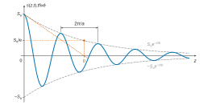
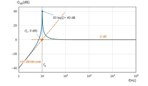
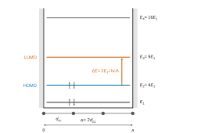
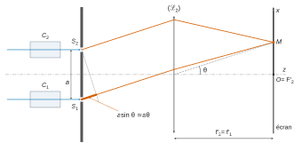
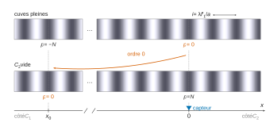

# CCINP MP — Physique 2026 · Corrigé brut

*Corrigé rédigé par IA, non officiel. Signalez toute erreur.*

Épreuve MP5P, 4 heures, calculatrices interdites. Notation : l'imaginaire pur noté $\iota$ dans l'énoncé est écrit ici $\mathrm{i}$, avec $\mathrm{i}^2=-1$. La charge de l'électron est $-e$, avec $e=1{,}6\cdot10^{-19}$ C.

## Partie I — Le ressort, couteau-suisse de la physique

### I.1 — Mesures du champ de pesanteur de la planète

**Q1. a)** La planète est une sphère à répartition de masse homogène, donc à symétrie sphérique. Le champ de gravitation $\vec{\mathcal G}$ ne dépend que de la distance $r$ au centre (invariance par rotation) et il est radial (tout plan contenant le centre et le point est plan de symétrie) : $\vec{\mathcal G}=\mathcal G(r)\,\vec u_r$.

Théorème de Gauss gravitationnel sur la sphère de rayon $r>R_\mathrm{p}$ :

$$\begin{aligned}
\oint\vec{\mathcal G}\cdot\mathrm{d}\vec S&=-4\pi G\,M_\text{int}\\
4\pi r^2\,\mathcal G(r)&=-4\pi G\,M_\mathrm{p}\\
\vec{\mathcal G}(r)&=-\frac{GM_\mathrm{p}}{r^2}\,\vec u_r
\end{aligned}$$

La masse $m$ est à la distance $r=R_\mathrm{p}+z$ du centre. La force de gravitation est attractive :

$$\vec F_\text{grav}=-\frac{GM_\mathrm{p}m}{(R_\mathrm{p}+z)^2}\,\vec u_r$$

Son intensité se développe avec $u=z/R_\mathrm{p}\ll1$ et $(1+u)^{-2}\simeq1-2u$ :

$$\begin{aligned}
F_\text{grav}&=\frac{GM_\mathrm{p}m}{R_\mathrm{p}^2}\left(1+\frac{z}{R_\mathrm{p}}\right)^{-2}\\
&\simeq mg_\mathrm{o}\left(1-\frac{2z}{R_\mathrm{p}}\right)
\end{aligned}$$

$$\boxed{g_\mathrm{o}=\frac{GM_\mathrm{p}}{R_\mathrm{p}^2}>0}$$

$g_\mathrm{o}$ est l'intensité du champ de gravitation au sol.

**b)** La variation relative de l'intensité entre le sol et l'altitude $z$ est

$$\frac{|F_\text{grav}(z)-F_\text{grav}(0)|}{F_\text{grav}(0)}=\frac{2z}{R_\mathrm{p}}$$

Elle reste inférieure à $1\,\%$ si $2z/R_\mathrm{p}\le10^{-2}$, soit $z\le R_\mathrm{p}/200$ :

$$\boxed{z_\text{max}=\frac{R_\mathrm{p}}{200}=20\ \text{km}}$$

**Commentaire :** $20$ km est très grand devant la taille de tout dispositif de mesure (pendule, ressort, laboratoire). Le champ de gravitation peut donc être considéré comme uniforme pour toutes les expériences de Major Tom, ce qui justifie l'hypothèse $\vec F=m\vec g_\mathrm{o}$ uniforme faite ensuite.

**Q2.** Référentiel du sol galiléen, base polaire $(\vec u_r,\vec u_\theta)$ de la figure 1, et $\overrightarrow{OM}=\ell\vec u_r$ avec $\ell$ constant. L'accélération vaut

$$\vec a=-\ell\dot\theta^2\,\vec u_r+\ell\ddot\theta\,\vec u_\theta$$

Forces : la tension $\vec T=-T\vec u_r$ et la force de gravitation, constante et uniforme d'après Q1.b à l'échelle du pendule :

$$\vec F=mg_\mathrm{o}\left(\cos\theta\,\vec u_r-\sin\theta\,\vec u_\theta\right)$$

La projection du principe fondamental de la dynamique sur $\vec u_\theta$ élimine $T$ et donne $m\ell\ddot\theta=-mg_\mathrm{o}\sin\theta$ :

$$\boxed{\ddot\theta+\frac{g_\mathrm{o}}{\ell}\sin\theta=0}$$

Pour de petites oscillations, $\sin\theta\simeq\theta$ : oscillateur harmonique de pulsation $\sqrt{g_\mathrm{o}/\ell}$. Sa période $T_\mathrm{o}=2\pi\sqrt{\ell/g_\mathrm{o}}$ est indépendante de l'amplitude.

**Mesure de $g_\mathrm{o}$ :** on mesure $\ell$ à la règle et on lance le pendule avec une faible amplitude (quelques degrés). On chronomètre la durée $t_N$ de $N$ oscillations (par exemple $N=20$, pour réduire l'effet du temps de réaction). Alors $T_\mathrm{o}=t_N/N$ et

$$\boxed{g_\mathrm{o}=\frac{4\pi^2\ell}{T_\mathrm{o}^2}}$$

**Q3.** Le référentiel lié au sol tourne uniformément à la vitesse angulaire $\Omega$ autour de l'axe des pôles, fixe dans le référentiel planétocentrique supposé galiléen. Pour un point au repos relatif, le point coïncident décrit un cercle de centre $H$ (projeté sur l'axe) et de rayon $HM=R_\mathrm{p}\cos\lambda$, à vitesse angulaire constante.

Son accélération d'entraînement est donc centripète, dirigée de $M$ vers $H$ :

$$\vec a_e=-\Omega^2\,\overrightarrow{HM}=-\Omega^2R_\mathrm{p}\cos\lambda\,\vec u$$

La force d'inertie d'entraînement est son opposée, multipliée par $m$ :

$$\boxed{\vec F_{ie}=-m\vec a_e=m\Omega^2R_\mathrm{p}\cos\lambda\;\vec u}$$

C'est une force centrifuge (dirigée selon $+\vec u$, en s'éloignant de l'axe), maximale à l'équateur et nulle aux pôles. La force de Coriolis est nulle pour un corps au repos relatif.

**Q4. a)** Le poids est $m\vec g=m\vec g_\mathrm{o}+\vec F_{ie}$, d'où

$$\boxed{\vec g=\vec g_\mathrm{o}+\Omega^2R_\mathrm{p}\cos\lambda\;\vec u}$$

C'est une relation vectorielle : $\vec g_\mathrm{o}$ (dirigé vers le centre) et $\vec u$ ne sont colinéaires qu'à l'équateur.

**b)** On peut confondre $\vec g$ et $\vec g_\mathrm{o}$ à toute latitude si le terme centrifuge est négligeable dans le cas le plus défavorable, l'équateur ($\cos\lambda=1$). Il faut $\Omega^2R_\mathrm{p}\ll g_\mathrm{o}$, avec $g_\mathrm{o}=GM_\mathrm{p}/R_\mathrm{p}^2$ :

$$\boxed{\Omega^2R_\mathrm{p}^3\ll GM_\mathrm{p}}$$

La planète doit tourner beaucoup plus lentement qu'un satellite en orbite rasante.

**Q5.** Le ressort de longueur à vide $\ell_\mathrm{o}$ a, à l'équilibre, la longueur $\ell_\mathrm{o}+h$. Son allongement est donc $(\ell_\mathrm{o}+h)-\ell_\mathrm{o}=h$.

La masse $m$ est soumise à son poids $mg$ (vers le bas) et à la tension $k(\ell-\ell_\mathrm{o})=kh$ (vers le haut), la masse du ressort étant négligée. L'équilibre impose $mg=kh$, d'où

$$\boxed{g=\frac{kh}{m}}$$

**Q6.** Application numérique :

$$g=\frac{50{,}0\times2{,}0\cdot10^{-2}}{0{,}200}$$

$$\boxed{g=5{,}0\ \text{m·s}^{-2}}$$

La planète étant inconnue, il n'y a aucune raison de retrouver la valeur terrestre.

$g$ est un produit-quotient de grandeurs indépendantes, donc

$$\frac{u(g)}{g}=\sqrt{\left(\frac{u(k)}{k}\right)^2+\left(\frac{u(h)}{h}\right)^2+\left(\frac{u(m)}{m}\right)^2}$$

Faute d'indication, on prend pour chaque donnée une loi uniforme de demi-étendue une demi-unité du dernier chiffre écrit. Si $\Delta$ est une unité du dernier chiffre, $u=\Delta/(2\sqrt3)$. On obtient :

- $u(k)/k\simeq6\cdot10^{-4}$ ;
- $u(m)/m\simeq1{,}4\cdot10^{-3}$ ;
- $u(h)/h=\dfrac{0{,}1}{2\sqrt3\times2{,}0}\simeq1{,}4\cdot10^{-2}$.

Le terme en $h$, connu avec deux chiffres significatifs seulement, domine :

$$\boxed{\frac{u(g)}{g}\simeq1{,}4\cdot10^{-2}\approx1\ \text{à}\ 2\,\%}$$

soit $u(g)\simeq0{,}07$ m·s⁻² et $g=(5{,}00\pm0{,}07)$ m·s⁻².

Si l'on retient une incertitude de lecture d'un millimètre sur $h$, on obtient $u(g)/g$ de quelques pour cent ; la conclusion « l'incertitude est dominée par $h$ » ne change pas.

**Q7.** Longueurs utiles : $\ell_\mathrm{o}$ est la longueur à vide, $\ell_\mathrm{o}+h$ la longueur à l'équilibre. On repère la masse par son écart $x$ à la position d'équilibre, axe orienté vers le bas. La longueur vaut alors $\ell_\mathrm{o}+h+x$ et l'allongement $h+x$.

Le principe fondamental de la dynamique (référentiel du sol galiléen), avec $mg=kh$ (Q5), donne

$$\begin{aligned}
m\ddot x&=mg-k(h+x)\\
&=-kx
\end{aligned}$$

$$\boxed{\ddot x+\frac{k}{m}x=0}$$

**Q8.** Avec $\omega_\mathrm{o}=\sqrt{k/m}$, l'équation caractéristique $r^2+\omega_\mathrm{o}^2=0$ a deux racines imaginaires pures $\pm\mathrm{i}\omega_\mathrm{o}$ : les solutions sont sinusoïdales, jamais exponentielles réelles.

$$x(t)=A\cos(\omega_\mathrm{o}t)+B\sin(\omega_\mathrm{o}t)$$

Les conditions initiales $x(0)=x_\mathrm{o}$ et $\dot x(0)=0$ donnent $A=x_\mathrm{o}$ et $B=0$ :

$$\boxed{\begin{aligned}
x(t)&=x_\mathrm{o}\cos(\omega_\mathrm{o}t)\\
\omega_\mathrm{o}&=\sqrt{\frac km}
\end{aligned}}$$

**Q9. a)** $g=kh/m$ et $\omega_\mathrm{o}^2=k/m$, donc

$$\boxed{g=\omega_\mathrm{o}^2\,h}$$

Il suffit de mesurer une longueur et une durée ; ni $k$ ni $m$ ne sont nécessaires.

**b)** Un aller-retour est une période : $T=T_{10}/N=0{,}40$ s, donc $\omega_\mathrm{o}=2\pi/T=5\pi$ rad·s⁻¹. Avec $\pi^2\simeq10$ :

$$\begin{aligned}
g&=(5\pi)^2\times2{,}0\cdot10^{-2}\\
&=0{,}50\,\pi^2
\end{aligned}$$

$$\boxed{g\simeq5{,}0\ \text{m·s}^{-2}}$$

**Commentaire :** la méthode dynamique redonne la valeur de la méthode statique (Q6) ; les deux mesures sont compatibles. La durée $T_{10}=4$ s n'est donnée qu'avec un chiffre significatif, ce qui limite la précision de cette seconde mesure.

**Q10. a)** $\xi(\tau,t)=\dfrac{\tau}{\ell}x_\mathrm{o}\cos(\Gamma t)$. À $\tau$ fixé :

$$\frac{\partial\xi}{\partial t}=-\frac{\tau}{\ell}x_\mathrm{o}\Gamma\sin(\Gamma t)$$

$$\mathrm{d}E_c=\frac12\,\frac{m_\mathrm{o}\,\mathrm{d}\tau}{\ell}\,\frac{\tau^2}{\ell^2}x_\mathrm{o}^2\Gamma^2\sin^2(\Gamma t)$$

En sommant sur $\tau\in[0,\ell]$, avec $\int_0^\ell\tau^2\,\mathrm{d}\tau=\ell^3/3$ :

$$\boxed{E_c(t)=\frac16\,m_\mathrm{o}\,x_\mathrm{o}^2\,\Gamma^2\sin^2(\Gamma t)}$$

**b)** $\sin^2(\Gamma t)$ atteint la valeur $1$ (en $\Gamma t=\pi/2$) :

$$\boxed{E_{c,\max}=\frac16\,m_\mathrm{o}\,x_\mathrm{o}^2\,\Gamma^2}$$

**Q11.** L'extrémité $\tau=\ell$ porte la masse $m$, qui se déplace de $\xi(\ell,t)=x_\mathrm{o}\cos(\Gamma t)$. Son énergie cinétique est $\frac12mx_\mathrm{o}^2\Gamma^2\sin^2(\Gamma t)$. Énergie cinétique totale :

$$E_c^\text{tot}=\frac12\left(m+\frac{m_\mathrm{o}}{3}\right)x_\mathrm{o}^2\Gamma^2\sin^2(\Gamma t)$$

L'énergie potentielle (élastique et de pesanteur), avec $x$ compté depuis l'équilibre et $kh=mg$, vaut $E_p=\frac12kx^2+\text{cte}$, soit $\frac12kx_\mathrm{o}^2\cos^2(\Gamma t)+\text{cte}$.

Le système est conservatif. $E_c^\text{tot}+E_p$ constante impose l'égalité des coefficients de $\sin^2$ et de $\cos^2$ :

$$\begin{aligned}
\frac12\left(m+\frac{m_\mathrm{o}}3\right)\Gamma^2&=\frac12k\\
\Gamma^2&=\frac{k/m}{1+\dfrac{m_\mathrm{o}}{3m}}
\end{aligned}$$

$$\boxed{\begin{aligned}
\Gamma&=\frac{\omega_\mathrm{o}}{\sqrt{1+\beta}}\\
\beta&=\frac{m_\mathrm{o}}{3m}
\end{aligned}}$$

Tout se passe comme si un tiers de la masse du ressort s'ajoutait à $m$.

**Q12.** La loi de Hooke étant inchangée, l'équilibre statique donne toujours $g=kh/m=\omega_\mathrm{o}^2h$. Mais la pulsation mesurée au chronomètre est maintenant $\Gamma$, avec $\omega_\mathrm{o}^2=(1+\beta)\Gamma^2$ :

$$\boxed{\begin{aligned}
g&=\omega_\mathrm{o}^2h\\
&=(1+\beta)\,\Gamma^2h
\end{aligned}}$$

Autrement dit, si l'on note $\omega_\mathrm{o}$ la pulsation effectivement mesurée (comme en Q9), il faut corriger la formule de Q9.a en $g=(1+\beta)\,\omega_\mathrm{o}^2h$.

**Q13.** $m_\mathrm{o}=m/10$ donne $\beta=1/30$. La pulsation mesurée en Q9.b est $\Gamma=5\pi$ rad·s⁻¹, avec $\Gamma^2h\simeq5{,}0$ m·s⁻² :

$$\begin{aligned}
g&=\left(1+\frac1{30}\right)\times5{,}0\\
&=\frac{31}{30}\times5{,}0
\end{aligned}$$

$$\boxed{g\simeq5{,}2\ \text{m·s}^{-2}}$$

**Commentaire :** la correction relative, $\beta\simeq3\,\%$, est du même ordre que l'incertitude estimée en Q6, et même supérieure. Négliger la masse du ressort sous-estime $g$ de façon non négligeable pour une mesure fine. La masse du ressort doit donc être prise en compte dès que l'on vise une précision de l'ordre du pour cent.

### I.2 — Que tremble la planète !

**Q14. a)** Une onde est **longitudinale** si la grandeur vectorielle qui se propage (ici le déplacement de la matière) est parallèle à la direction de propagation. Elle est **transversale** si cette grandeur est perpendiculaire à la direction de propagation.

Exemples : onde sonore dans un fluide, ondes sismiques P (longitudinales) ; onde sur une corde vibrante, ondes sismiques S, onde électromagnétique dans le vide (transversales).

**b)** $c_s$ est la **célérité** de l'onde sismique, vitesse de propagation en m·s⁻¹. Elle ne dépend pas de la fréquence : la propagation se fait sans déformation. C'est une onde mécanique, propagée par le milieu matériel : $c_s$ est une propriété de la roche (quelques km·s⁻¹ sur Terre), sans rapport avec la vitesse de la lumière $c$.

**Q15. a)** La phase $\omega t-kz$ est constante sur les plans $z=(\omega t-\text{cte})/k$, qui se déplacent à la vitesse $\omega/k>0$. L'onde se propage **selon $(Oz)$, dans le sens des $z$ croissants**.

**b)** Avec $\partial_t\to\mathrm{i}\omega$ et $\partial_z\to-\mathrm{i}k$, l'équation de d'Alembert donne $-\dfrac{\omega^2}{c_s^2}\underline s=-k^2\underline s$. Avec $\underline s\neq0$ :

$$\boxed{k^2=\frac{\omega^2}{c_s^2}}$$

soit $k=\omega/c_s$ pour la propagation vers $+z$. La relation est linéaire : milieu non dispersif.

**Q16. a)** La même substitution dans la nouvelle équation donne $-\dfrac{\omega^2}{c_s^2}+\mathrm{i}\eta\omega=-k^2$ :

$$\boxed{\begin{aligned}
k^2&=\frac{\omega^2}{c_s^2}-\mathrm{i}\eta\omega\\
&=\frac{\omega^2}{c_s^2}\left(1-\mathrm{i}\frac{\eta c_s^2}{\omega}\right)
\end{aligned}}$$

**b)** On prend la racine carrée de la forme factorisée, avec $\eta c_s^2/\omega\ll1$ et $\sqrt{1+u}\simeq1+u/2$ :

$$\begin{aligned}
k&=\pm\frac{\omega}{c_s}\left(1-\mathrm{i}\frac{\eta c_s^2}{2\omega}\right)\\
&=\pm\left(\frac{\omega}{c_s}-\mathrm{i}\frac{\eta c_s}{2}\right)
\end{aligned}$$

L'onde se propage vers les $z$ croissants (Q15.a) : on garde $k_r>0$. Alors

$$\boxed{\begin{aligned}
k_r&=\frac{\omega}{c_s}\\
k_i&=-\frac{\eta c_s}{2}
\end{aligned}}$$

Le signe de $k_i$ est cohérent : $e^{-\mathrm{i}kz}$ contient $e^{k_iz}$, qui décroît avec $z$ (onde atténuée dans le sens de propagation).

**c)** $\underline s=S_\mathrm{o}e^{k_iz}e^{\mathrm{i}(\omega t-k_rz)}$. En prenant la partie réelle ($S_\mathrm{o}$ réel) :

$$s(z,t)=S_\mathrm{o}\cos(\omega t-k_rz)\,e^{k_iz}$$

Par identification avec la forme demandée :

$$\boxed{\begin{aligned}
a&=k_r=\frac{\omega}{c_s}\\
b&=-\frac1{k_i}=\frac{2}{\eta c_s}
\end{aligned}}$$

$b$ est bien positif.

**d)** $b$ est la **distance caractéristique d'atténuation** de l'onde : l'amplitude est divisée par $e$ sur une distance $b$.

À $t$ fixé (ici $\omega t=0$), la courbe $z\mapsto S_\mathrm{o}\cos(\omega t-az)e^{-z/b}$ est une sinusoïde amortie, comprise entre les enveloppes $\pm S_\mathrm{o}e^{-z/b}$. Elle touche ces enveloppes là où $\cos(\omega t-az)=\pm1$, juste après chaque extremum.

$a$ est le nombre d'onde, pas la longueur d'onde : la pseudo-période spatiale vaut $2\pi/a$, distance entre deux maxima successifs. On fait apparaître $S_\mathrm{o}$, la pseudo-période $2\pi/a$ et l'abscisse $b$, où l'enveloppe vaut $S_\mathrm{o}/e$ (figure 1).



**Q17.** On travaille dans le référentiel $\mathcal R_b$ du bâti. Il est **non galiléen** : il est en translation, d'accélération $\vec A=\ddot X\vec e_x$, par rapport au référentiel de la planète supposé galiléen. Il faut donc ajouter la force d'inertie d'entraînement $-M\vec A=-M\ddot X\vec e_x$. Il n'y a pas de force de Coriolis, faute de rotation.

Axe $\vec e_x$ vers le bas, $M$ repérée par la longueur $\ell$ du ressort. Forces :

- poids $Mg\,\vec e_x$ ;
- rappel élastique $-k(\ell-\ell_\mathrm{o})\vec e_x$ ;
- frottement $-\alpha\dot\ell\,\vec e_x$ (vitesse relative au bâti) ;
- force d'inertie d'entraînement $-M\ddot X\vec e_x$.

$$M\ddot\ell=Mg-k(\ell-\ell_\mathrm{o})-\alpha\dot\ell-M\ddot X$$

À l'équilibre relatif, sans excitation, le poids est compensé par le rappel : $Mg=k(\ell_{eq}-\ell_\mathrm{o})$. En retranchant et avec $u=\ell-\ell_{eq}$ :

$$\ddot u+\frac{\alpha}{M}\dot u+\frac kMu=-\ddot X$$

Par identification avec la forme demandée :

$$\boxed{\begin{aligned}
\Omega_\mathrm{o}&=\sqrt{\frac kM}\\
Q&=\frac{M\Omega_\mathrm{o}}{\alpha}=\frac{\sqrt{kM}}{\alpha}
\end{aligned}}$$

**Q18.** $A$ est l'amplitude du déplacement du sol (donc du bâti) au passage de l'onde sismique, grandeur que l'on cherche à mesurer. $B$ est l'amplitude du déplacement de la masse $M$ par rapport au bâti, grandeur enregistrée par l'appareil. $\phi$ est le déphasage du mouvement relatif $u$ par rapport au mouvement du sol $X$.

**Q19.** En régime sinusoïdal forcé, $\underline{\ddot X}=-\omega^2\underline X$, $\underline{\dot u}=\mathrm{i}\omega\underline u$ et $\underline{\ddot u}=-\omega^2\underline u$ :

$$\left(\Omega_\mathrm{o}^2-\omega^2+\mathrm{i}\frac{\omega\Omega_\mathrm{o}}{Q}\right)\underline u=\omega^2\underline X$$

$$\frac{\underline u}{\underline X}=\frac{\omega^2}{\Omega_\mathrm{o}^2-\omega^2+\mathrm{i}\,\omega\Omega_\mathrm{o}/Q}$$

En prenant le module, avec $x=\omega/\Omega_\mathrm{o}$ :

$$\boxed{\begin{aligned}
H(\omega)&=\frac{\omega^2}{\sqrt{\left(\Omega_\mathrm{o}^2-\omega^2\right)^2+\left(\dfrac{\omega\Omega_\mathrm{o}}{Q}\right)^2}}\\
&=\frac{x^2}{\sqrt{(1-x^2)^2+(x/Q)^2}}
\end{aligned}}$$

C'est la fonction $g(x,Q)$ du script 1 (figure 4), tracée en figure 6.

**Q20.** Avec $\omega_0=2\pi f_0$, $\alpha=\omega_0/Q$ (coefficient de $\dot u$ dans l'équation réduite) et $\omega=2\pi f$ :

```python
omega0 = 2*np.pi*f0
alpha = omega0/Q
gain_db = 20*np.log10((2*np.pi*frequencies)**2 / np.sqrt((omega0**2 - (2*np.pi*frequencies)**2)**2 + (alpha*2*np.pi*frequencies)**2))
```

Avec $f_0=10$ Hz et $Q=100$, ce code donne −40 dB à 1 Hz et 0 dB à 10⁵ Hz, avec un pic d'environ +40 dB vers 10 Hz, comme la figure 7.

**Q21. a)** $\underline H=\dfrac{x^2}{1-x^2+\mathrm{i}x/Q}$ avec $x=f/f_0$. On cherche des équivalents (non nuls), pas seulement des limites.

- Basses fréquences ($x\ll1$) : $\underline H\sim x^2$, donc $H\sim\left(\dfrac{f}{f_0}\right)^2$, qui tend vers $0$.
- Hautes fréquences ($x\gg1$) : $\underline H\sim-1$, donc $H\sim1$.

**b)** $G_\mathrm{dB}=20\log H$ :

$$\boxed{\begin{aligned}
G_\mathrm{dB}^\mathrm{BF}&=40\log\left(\frac f{f_0}\right)\\
G_\mathrm{dB}^\mathrm{HF}&=0
\end{aligned}}$$

Pente $+40$ dB par décade en basse fréquence, asymptote horizontale en haute fréquence.

**c)** À l'intersection, $40\log(f/f_0)=0$, donc $\log(f/f_0)=0$ :

$$\boxed{\left(\log\frac f{f_0},\,G_\mathrm{dB}\right)=(0,\ 0\ \text{dB}),\ \text{soit}\ f=f_0}$$



**d)** Gain nul en basse fréquence, égal à $1$ en haute fréquence, pente $+40$ dB/décade, dénominateur du second degré en $\omega$ : **filtre passe-haut du second ordre**. Le sismomètre restitue fidèlement ($B\simeq A$) les vibrations de fréquence grande devant $f_0$.

**e)** On cherche le maximum de $H$ par le calcul. On pose $X=x^2$ et

$$\Phi(X)=\frac1{H^2}=\frac{(1-X)^2+X/Q^2}{X^2}$$

Le calcul de la dérivée donne

$$\Phi'(X)=\frac{1}{X^3}\left(2X-\frac{X}{Q^2}-2\right)$$

Elle est négative puis positive et s'annule en $X_\text{rés}=\dfrac{2Q^2}{2Q^2-1}$, à condition que $Q>1/\sqrt2$. $\Phi$ y est minimale, donc $H$ maximale :

$$\boxed{\omega_\text{rés}=\frac{\Omega_\mathrm{o}}{\sqrt{1-\dfrac1{2Q^2}}}\quad(\text{résonance si et seulement si }Q>1/\sqrt2)}$$

La résonance a lieu au-dessus de $\Omega_\mathrm{o}$, avec $H_\text{max}=\dfrac{Q}{\sqrt{1-1/(4Q^2)}}$, voisin de $Q$ pour $Q\gg1$.

**f)** Pour $Q\gg1$, $\omega_\text{rés}\simeq\Omega_\mathrm{o}$ et $H_\text{max}\simeq H(\Omega_\mathrm{o})=Q$.

La figure 6 montre un pic de hauteur $100$ en $x=1$. La figure 7 montre un maximum de $+40$ dB, soit $H_\text{max}=10^{40/20}=100$ :

$$\boxed{Q\simeq100}$$

La figure 7 donne aussi $f_0=10$ Hz, donc $\Omega_\mathrm{o}=2\pi f_0=20\pi\simeq63$ rad·s⁻¹. La raideur du sismomètre n'est pas donnée en I.2 : on prend celle du ressort de Major Tom, $k=50{,}0$ N·m⁻¹ (initiative signalée). Alors

$$\begin{aligned}
M&=\frac{k}{\Omega_\mathrm{o}^2}=\frac{50}{400\pi^2}\\
&\simeq\frac{50}{4\,000}=1{,}25\cdot10^{-2}\ \text{kg}
\end{aligned}$$

$$\begin{aligned}
\alpha&=\frac{\sqrt{kM}}{Q}=\frac{\sqrt{0{,}625}}{100}\\
&=\frac{\sqrt{2{,}5}}{2\times100}\\
&\simeq\frac{1{,}6}{200}
\end{aligned}$$

$$\boxed{\alpha\simeq8\cdot10^{-3}\ \text{kg·s}^{-1}}$$

De façon équivalente, $\alpha=k/(Q\Omega_\mathrm{o})$. Le coefficient réduit du script vaut $\alpha/M=\Omega_\mathrm{o}/Q\simeq0{,}63$ s⁻¹.

### I.3 — Température de l'atmosphère

**Q22. a)** Second principe : $\mathrm{d}S=\delta S_\text{e}+\delta S_\text{c}$, avec $\delta S_\text{e}=\delta Q/T_\text{ext}$. Adiabatique : $\delta Q=0$ ; réversible : $\delta S_\text{c}=0$. Donc

$$\boxed{\mathrm{d}S=0\ \text{(transformation isentropique)}}$$

**b)** Avec $PV=nRT$, $P/T=nR/V$. La condition $\mathrm{d}S=0$ s'écrit

$$\frac{nR}{\gamma-1}\frac{\mathrm{d}T}{T}+nR\frac{\mathrm{d}V}{V}=0$$

En multipliant par $(\gamma-1)/(nR)$ :

$$\boxed{\frac{\mathrm{d}T}{T}+(\gamma-1)\frac{\mathrm{d}V}{V}=0}$$

**c)** En intégrant ($T,V>0$, $\gamma$ constant) : $\ln T+(\gamma-1)\ln V=\text{cte}$, soit

$$\boxed{TV^{\gamma-1}=\text{cte}}$$

C'est la **loi de Laplace** (gaz parfait, $\gamma$ constant, transformation adiabatique réversible). Elle s'écrit aussi $PV^\gamma=\text{cte}$.

**Q23. a)** Par analogie avec le gaz parfait, où $nR/(\gamma-1)=C_V$, $C_\ell$ est la **capacité thermique du ressort à longueur constante**. À $\ell$ fixée, $\delta Q_\text{rév}=T\,\mathrm{d}S=C_\ell\,\mathrm{d}T$. Elle s'exprime en J·K⁻¹.

**b)** La transformation est isentropique :

$$C_\ell\frac{\mathrm{d}T}{T}+D(\ell-\ell_\mathrm{o})\,\mathrm{d}\ell=0$$

Avec $C_\ell$ et $D$ constants, on intègre de $(T_i,\ell_i)$ à $(T_f,\ell_f)$, en notant que $(\ell-\ell_\mathrm{o})\,\mathrm{d}\ell$ a pour primitive $\frac12(\ell-\ell_\mathrm{o})^2$ :

$$C_\ell\ln\frac{T_f}{T_i}+\frac D2\left[(\ell_f-\ell_\mathrm{o})^2-(\ell_i-\ell_\mathrm{o})^2\right]=0$$

$$\boxed{T_f=T_i\exp\left(-\frac{D}{2C_\ell}\left[(\ell_f-\ell_\mathrm{o})^2-(\ell_i-\ell_\mathrm{o})^2\right]\right)}$$

La longueur à vide $\ell_\mathrm{o}$, constante du ressort, figure nécessairement dans le résultat (imprécision de l'énoncé). Un étirement isentrope ($|\ell_f-\ell_\mathrm{o}|>|\ell_i-\ell_\mathrm{o}|$) refroidit le ressort.

**c)** Protocole proposé (les constantes $k_\mathrm{o}$ et $D$ ont été établies préalablement par Major Tom) :

1. laisser le ressort, muni d'une masse connue $m$, en contact prolongé avec l'atmosphère pour qu'il soit à la température $T$ de celle-ci ;
2. mesurer au chronomètre la durée de $N$ petites oscillations, d'où la période $T_\text{osc}$ et la raideur $k=4\pi^2m/T_\text{osc}^2$ ;
3. en déduire $\boxed{T=\dfrac{k_\mathrm{o}-k}{D}}$.

Le résultat de Q23.b justifie la mesure. Les oscillations, rapides devant les échanges thermiques et quasi statiques, sont isentropes. Pour de faibles amplitudes $x_\mathrm{o}$ autour de $\ell_\text{eq}$, l'exposant de Q23.b est petit. La température du ressort reste donc égale à $T$, à $\frac{D}{C_\ell}(\ell_\text{eq}-\ell_\mathrm{o})\,x_\mathrm{o}$ près en valeur relative.

Variante qui n'utilise pas $k_\mathrm{o}$ : mesurer $k_i$ à $T_i=T$, puis étirer rapidement (adiabatique) mais sans à-coups (réversible) de $\ell_i$ à $\ell_f$, et mesurer aussitôt $k_f$. On note

$$\Delta=\frac{D}{2C_\ell}\left[(\ell_f-\ell_\mathrm{o})^2-(\ell_i-\ell_\mathrm{o})^2\right]$$

On a alors $k_f-k_i=DT(1-e^{-\Delta})$, d'où $T=\dfrac{k_f-k_i}{D(1-e^{-\Delta})}$. Cette variante est peu sensible, car $\Delta$ est petit.

## Partie II — Interaction lumière-matière

### II.1 — Modèle de l'électron élastiquement lié et propagation du rayonnement

**Q24.** La charge positive porte l'essentiel de la masse de l'atome : sa masse est au moins $m_\text{p}/m\simeq1\,836$ fois celle de l'électron. Soumise à des forces du même ordre (actions réciproques, force électrique proportionnelle à la charge), elle subit une accélération au moins mille fois plus faible. Son mouvement est négligeable : on la considère comme fixe, le référentiel qui lui est lié étant galiléen.

**Q25. a)** **Invariances** : la boule uniformément chargée est invariante par toute rotation autour de $O$. En coordonnées sphériques de centre $O$, le champ ne dépend donc que de $r$.

**Symétries** : tout plan contenant $O$ et $M$ est plan de symétrie de la distribution. $\vec E(M)$ appartient à tous ces plans, donc à leur intersection, la droite $(OM)$. Ainsi $\vec E(M)=E(r)\,\vec u_r$.

**b)** La densité volumique de charge est uniforme :

$$\rho=\frac{Q_\mathrm{o}}{\frac43\pi R_\mathrm{o}^3}$$

La sphère de centre $O$ et de rayon $r<R_\mathrm{o}$ contient la charge

$$Q_\text{int}=\rho\,\frac43\pi r^3=Q_\mathrm{o}\frac{r^3}{R_\mathrm{o}^3}$$

Le théorème de Gauss sur cette sphère donne $4\pi r^2E(r)=Q_\text{int}/\varepsilon_\mathrm{o}$ :

$$\boxed{\vec E(M)=\frac{Q_\mathrm{o}\,r}{4\pi\varepsilon_\mathrm{o}R_\mathrm{o}^3}\,\vec u_r\qquad(r<R_\mathrm{o})}$$

**c)** L'électron (charge $-e$) placé dans la boule subit la force

$$\vec f=-e\vec E=-\frac{eQ_\mathrm{o}}{4\pi\varepsilon_\mathrm{o}R_\mathrm{o}^3}\,\overrightarrow{OM}$$

La force de rappel modélise donc **l'attraction électrostatique exercée sur l'électron par la distribution de charge positive** dans laquelle il baigne, avec

$$\boxed{\kappa=\frac{eQ_\mathrm{o}}{4\pi\varepsilon_\mathrm{o}R_\mathrm{o}^3}}$$

**Q26.** Dans le vide (sans charge ni courant), les équations de Maxwell s'écrivent :

$$\begin{aligned}
\mathrm{div}\,\vec E&=0\\
\mathrm{div}\,\vec B&=0\\
\overrightarrow{\mathrm{rot}}\,\vec E&=-\frac{\partial\vec B}{\partial t}\\
\overrightarrow{\mathrm{rot}}\,\vec B&=\mu_\mathrm{o}\varepsilon_\mathrm{o}\frac{\partial\vec E}{\partial t}
\end{aligned}$$

Les trois premières sont identiques dans le milieu ; seule Maxwell-Ampère change, par la substitution $\varepsilon_\mathrm{o}\to\varepsilon_\mathrm{o}\varepsilon_r$. Le milieu (neutre, isolant) se comporte comme un vide de permittivité $\varepsilon_\mathrm{o}\varepsilon_r$. La réponse des électrons liés (polarisation) est entièrement contenue dans $\varepsilon_r$, qui est complexe.

**Q27.** Propagation selon $+\vec u_z$ ; vecteur d'onde $\vec k=k\,\vec u_z$ (avec $k$ éventuellement complexe) ; polarisation rectiligne selon $\vec u_x$.

**Q28.** Pour une onde plane en $e^{\mathrm{i}(\omega t-kz)}$, $\mathrm{div}\,\underline{\vec E}=-\mathrm{i}\vec k\cdot\underline{\vec E}$. Maxwell-Gauss dans le milieu, $\mathrm{div}\,\vec E=0$, donne $\vec k\cdot\underline{\vec E}=0$. $\vec E$ n'a pas de composante selon la direction de propagation : il est **transverse**.

**Q29.** Maxwell-Faraday s'écrit $-\mathrm{i}\vec k\wedge\underline{\vec E}=-\mathrm{i}\omega\underline{\vec B}$, donc

$$\boxed{\begin{aligned}
\underline{\vec B}&=\frac{\vec k\wedge\underline{\vec E}}{\omega}\\
&=\frac{k}{\omega}E_\mathrm{o}e^{\mathrm{i}(\omega t-kz)}\,\vec u_y
\end{aligned}}$$

$\underline{\vec B}$ est orthogonal à $\vec k$ (produit vectoriel ; on le retrouve aussi par $\mathrm{div}\,\vec B=0$) : il est transverse.

**Q30.** D'après Q29, $\|\vec B\|\sim\dfrac{|k|}{\omega}\|\vec E\|=\dfrac{\|\vec E\|}{v}$, avec $v=\omega/|k|$ de l'ordre de $c$ dans un milieu peu dense. Le rapport des deux forces vérifie

$$\frac{\|q_e\vec v_e\wedge\vec B\|}{\|q_e\vec E\|}\le\frac{v_e}{v}$$

La force magnétique est donc négligeable si

$$\boxed{v_e\ll c}$$

c'est-à-dire si l'électron reste non relativiste (champ d'amplitude modérée).

**Q31.** La taille d'un atome est de l'ordre de $d\sim10^{-10}$ m. Pour $\lambda=200$ nm, la phase $kz$ du champ varie sur l'atome de

$$\frac{2\pi d}{\lambda}=\frac{2\pi\times10^{-10}}{2\cdot10^{-7}}\simeq3\cdot10^{-3}\ \text{rad}\ll1$$

Pour $|z|\lesssim d$, on a donc $\cos(\omega t-kz)\simeq\cos(\omega t)$ : à un instant donné, le champ a la même valeur en tout point de l'atome. Il est **uniforme à l'échelle atomique** : $\vec E(M,t)\simeq\vec E(O,t)$.

**Q32.** Dans le référentiel de la charge positive, galiléen (Q24), l'électron subit $-\kappa\vec r$, $-\alpha\dot{\vec r}$ et $-e\vec E(O,t)$. La force magnétique est négligée (Q30), le champ est uniforme (Q31) et le poids est négligeable. Avec l'atome en $z=0$, $\vec E(O,t)=E_\mathrm{o}\cos(\omega t)\,\vec u_x$ :

$$\boxed{m\frac{\mathrm{d}^2\vec r}{\mathrm{d}t^2}+\alpha\frac{\mathrm{d}\vec r}{\mathrm{d}t}+\kappa\vec r=-eE_\mathrm{o}\cos(\omega t)\,\vec u_x}$$

**Q33.** En régime sinusoïdal forcé, $\underline{\dot{\vec r}}=\mathrm{i}\omega\underline{\vec r}$ et $\underline{\ddot{\vec r}}=-\omega^2\underline{\vec r}$ :

$$\left(\frac\kappa m-\omega^2+\mathrm{i}\frac\alpha m\omega\right)\underline{\vec r}=-\frac em\underline{\vec E}$$

On identifie avec la forme donnée, $\underline{\vec r}=\dfrac{-e/m}{\omega_\mathrm{o}^2-\omega^2+\mathrm{i}\,\omega\omega_\mathrm{o}/Q}\,\underline{\vec E}$ :

$$\boxed{\begin{aligned}
\omega_\mathrm{o}&=\sqrt{\frac\kappa m}\\
Q&=\frac{m\omega_\mathrm{o}}{\alpha}=\frac{\sqrt{m\kappa}}{\alpha}
\end{aligned}}$$

### II.2 — Solution des équations de Maxwell et aspect énergétique

**Q34.** $\Delta\underline{\vec E}=-k^2\underline{\vec E}$ et $\partial_t^2\underline{\vec E}=-\omega^2\underline{\vec E}$. L'équation de propagation donne

$$\boxed{k^2=\varepsilon_r\frac{\omega^2}{c^2}}$$

**Q35.** On développe les deux membres :

$$\begin{aligned}
(k_1-\mathrm{i}k_2)^2&=k_1^2-k_2^2-2\mathrm{i}k_1k_2\\
\varepsilon_r\frac{\omega^2}{c^2}&=(\varepsilon_1-\mathrm{i}\varepsilon_2)\frac{\omega^2}{c^2}
\end{aligned}$$

Les quatre grandeurs $k_1$, $k_2$, $\varepsilon_1$, $\varepsilon_2$ étant réelles, on identifie parties réelles et parties imaginaires :

$$\boxed{\begin{aligned}
k_1^2-k_2^2&=\frac{\omega^2}{c^2}\varepsilon_1(\omega)\\
2k_1k_2&=\frac{\omega^2}{c^2}\varepsilon_2(\omega)
\end{aligned}}$$

$\varepsilon_2>0$ impose $k_1$ et $k_2$ de même signe ; pour une propagation vers $+z$ ($k_1>0$), $k_2>0$.

**Q36.** $\mathrm{i}(\omega t-kz)=\mathrm{i}(\omega t-k_1z)-k_2z$. Le champ complexe s'écrit $\underline{\vec E}=E_\mathrm{o}e^{-k_2z}e^{\mathrm{i}(\omega t-k_1z)}\vec u_x$ ; sa partie réelle ($E_\mathrm{o}$ réel) est

$$\boxed{\vec E(z,t)=E_\mathrm{o}\,e^{-k_2z}\cos(\omega t-k_1z)\,\vec u_x}$$

**Q37.** $\delta=1/k_2$ est la **distance caractéristique d'atténuation** (profondeur de pénétration) de l'onde. L'amplitude du champ est divisée par $e$ chaque fois que l'onde progresse de $\delta$ dans le milieu. L'énergie, quadratique en champ, décroît sur $\delta/2$.

**Q38.** Milieu peu absorbant : $\varepsilon_2\ll\varepsilon_1$. On développe à l'ordre un en $\varepsilon_2/\varepsilon_1$ :

$$\begin{aligned}
k&=\frac{\omega}{c}\sqrt{\varepsilon_1-\mathrm{i}\varepsilon_2}\\
&=\frac{\omega}{c}\sqrt{\varepsilon_1}\left(1-\mathrm{i}\frac{\varepsilon_2}{\varepsilon_1}\right)^{1/2}\\
&\simeq\frac{\omega}{c}\sqrt{\varepsilon_1}\left(1-\mathrm{i}\frac{\varepsilon_2}{2\varepsilon_1}\right)
\end{aligned}$$

La racine de partie réelle positive correspond à $k_1>0$. Par identification avec $k=k_1-\mathrm{i}k_2$ :

$$\boxed{\begin{aligned}
k_1&\simeq\frac\omega c\sqrt{\varepsilon_1(\omega)}\\
k_2&\simeq\frac{\omega}{c}\,\frac{\varepsilon_2(\omega)}{2\sqrt{\varepsilon_1(\omega)}}
\end{aligned}}$$

Contrôles : les deux expressions sont homogènes à $\omega/c$ (inverse d'une longueur), et $k_2/k_1=\varepsilon_2/(2\varepsilon_1)\ll1$. On retrouve le même résultat à partir de Q35, en négligeant $k_2^2$ dans la première relation puis en reportant dans la seconde.

**Q39.** La vitesse de phase est la vitesse de déplacement des plans d'égale phase $\omega t-k_1z=\text{cte}$. Elle fait intervenir la partie réelle $k_1$ de $k$ :

$$\boxed{v_\varphi=\frac{\omega}{k_1(\omega)}=\frac{c}{\sqrt{\varepsilon_1(\omega)}}}$$

$\varepsilon_1$ dépend de $\omega$ (expression de l'énoncé), donc $v_\varphi$ aussi : **le milieu est dispersif**. La vitesse de groupe, $\mathrm{d}\omega/\mathrm{d}k_1$, est une autre grandeur.

**Q40.** La relation de Q29 reste valable avec $k$ complexe :

$$\underline{\vec B}=\frac{k_1-\mathrm{i}k_2}{\omega}E_\mathrm{o}e^{-k_2z}e^{\mathrm{i}(\omega t-k_1z)}\vec u_y$$

Le champ magnétique réel comporte deux termes, dont l'un vient de $k_2$ :

$$\vec B(z,t)=\frac{E_\mathrm{o}}{\omega}e^{-k_2z}\left[k_1\cos(\omega t-k_1z)+k_2\sin(\omega t-k_1z)\right]\vec u_y$$

Le vecteur de Poynting $\vec\Pi=\vec E\wedge\vec B/\mu_\mathrm{o}$ vaut, avec $\vec u_x\wedge\vec u_y=\vec u_z$,

$$\vec\Pi=\frac{E_\mathrm{o}^2}{\mu_\mathrm{o}\omega}e^{-2k_2z}\left[k_1\cos^2(\omega t-k_1z)+k_2\sin(\omega t-k_1z)\cos(\omega t-k_1z)\right]\vec u_z$$

En moyenne temporelle, $\langle\cos^2\rangle=1/2$ et $\langle\sin\cos\rangle=0$ : le terme en $k_2$ ne contribue pas à la moyenne.

$$\boxed{\langle\vec\Pi\rangle=\frac{k_1(\omega)\,E_\mathrm{o}^2}{2\mu_\mathrm{o}\,\omega}\,e^{-2k_2(\omega)z}\,\vec u_z}$$

On retrouve ce résultat par la notation complexe : $\langle\vec\Pi\rangle=\dfrac{1}{2\mu_\mathrm{o}}\mathrm{Re}\left(\underline{\vec E}\wedge\underline{\vec B}^*\right)$.

**Q41.** Le rapport des normes ne dépend pas de $z$ :

$$\frac{\|\langle\vec\Pi\rangle(z+L)\|}{\|\langle\vec\Pi\rangle(z)\|}=e^{-2k_2L}$$

Donc

$$\boxed{\mathcal A_L=-\log_{10}\left(e^{-2k_2L}\right)=\frac{2L}{\ln10}\,k_2(\omega)}$$

C'est une grandeur proportionnelle à $k_2$ à $\omega$ et $L$ fixés : c'est la loi de Beer-Lambert.

**Q42.** La mesure de $\mathcal A_L$ donne $k_2(\omega)$, donc $\varepsilon_2(\omega)$ par Q38. Or $\varepsilon_2$ présente un pic marqué au voisinage de $\omega_\mathrm{o}$, de largeur de l'ordre de $\omega_\mathrm{o}/Q$.

En balayant $\omega$, Major Tom obtient le **spectre d'absorption** de l'échantillon. La position des pics donne les pulsations propres $\omega_\mathrm{o}$ caractéristiques des espèces présentes (identification). Leur largeur renseigne sur l'amortissement ($Q$). Leur hauteur, via $\Omega$ liée à la densité d'électrons oscillants, renseigne sur la quantité d'espèce absorbante.

## Partie III — Mesure optique et spectroscopie

### III.1 — Spectroscopie Ultra-Violette/Visible (UV/Vis)

**Q43.** Un état stationnaire est un état d'énergie parfaitement déterminée $E$ (état propre de l'hamiltonien) : sa fonction d'onde s'écrit $\Psi(x,t)=\varphi(x)e^{-\mathrm{i}Et/\hbar}$, et la densité de probabilité de présence $|\Psi(x,t)|^2=|\varphi(x)|^2$ est indépendante du temps. Toutes les grandeurs mesurables y ont des propriétés statistiques indépendantes du temps, d'où le nom « stationnaire ».

**Q44.** L'équation de Schrödinger est du premier ordre en temps :

$$\boxed{\mathrm{i}\hbar\frac{\partial\Psi}{\partial t}(x,t)=-\frac{\hbar^2}{2m}\frac{\partial^2\Psi}{\partial x^2}(x,t)+V(x)\Psi(x,t)}$$

**Q45.** Sur $]0,a[$, $V=0$ : $\varphi''+\kappa^2\varphi=0$, avec $\kappa^2=2mE/\hbar^2>0$ puisque $E>0$. D'où

$$\boxed{\varphi(x)=A\cos(\kappa x)+B\sin(\kappa x),\quad(A,B)\in\mathbb C^2}$$

**Q46.** Hors du segment, la particule ne peut pas se trouver : $\varphi=0$. Par continuité de la fonction d'onde, $\varphi(0)=\varphi(a)=0$.

La première condition donne $A=0$. La seconde donne $B\sin(\kappa a)=0$ avec $B\neq0$, sinon $\varphi\equiv0$ ne serait pas normalisable.

D'où $\kappa a=n\pi$ avec $n\in\mathbb N^*$ : $n=0$ redonne la fonction nulle et $n<0$ ne donne pas de nouvel état. Avec $E=\hbar^2\kappa^2/(2m)$ :

$$\boxed{\begin{aligned}
E_n&=\frac{n^2\pi^2\hbar^2}{2ma^2}=\frac{n^2h^2}{8ma^2}\\
E_1&=\frac{h^2}{8ma^2}\\
E_n&=n^2E_1
\end{aligned}}$$

**Q47. a)** Les $4$ atomes de carbone alignés délimitent $3$ intervalles :

$$\boxed{a=3\,d_{cc}}$$

En général, $a=(N-1)d_{cc}$.

**b)** Pour $N=4$, les niveaux $n=1$ et $n=2$ sont occupés : HOMO $n=2$, LUMO $n=3$. L'écart d'énergie vaut

$$\begin{aligned}
\Delta E&=E_3-E_2=5E_1\\
&=\frac{5h^2}{8m(3d_{cc})^2}=\frac{5h^2}{72\,m\,d_{cc}^2}
\end{aligned}$$

Avec $\Delta E=hc/\lambda$ :

$$\boxed{\lambda=\frac{hc}{\Delta E}=\frac{72\,m\,c\,d_{cc}^2}{5\,h}}$$

En général, HOMO $n=N/2$ et LUMO $N/2+1$, d'où $\Delta E=(N+1)E_1$ et $\lambda=\dfrac{8mc(N-1)^2d_{cc}^2}{(N+1)h}$.



**c)** On sépare mantisses et puissances de dix :

$$\begin{aligned}
\lambda&=\frac{72\times9{,}1\cdot10^{-31}\times3{,}0\cdot10^8\times10^{-20}}{5\times6{,}6\cdot10^{-34}}\\
&=\frac{72\times9{,}1\times3{,}0}{33}\cdot10^{-9}\ \text{m}\\
&\simeq\frac{1\,970}{33}\cdot10^{-9}\ \text{m}
\end{aligned}$$

$$\boxed{\lambda\sim6\cdot10^{-8}\ \text{m}=60\ \text{nm}}$$

La transition est dans l'ultraviolet (UV lointain) : c'est la longueur d'onde de référence pour l'étalonnage. Le modèle est grossier : la valeur dépend fortement de $d_{cc}$, puisque $\lambda\propto d_{cc}^2$.

### III.2 — Interféromètre d'Young : mesure de l'indice optique

**Q48.** $S$ étant au foyer objet de $(\mathcal L_1)$, le faisceau émergent est parallèle à l'axe : une onde plane arrive en **incidence normale** sur les cuves et sur le plan des fentes.

- Le plan des fentes est un plan d'onde : les deux fentes sont éclairées en phase, les chemins $(SS_1)$ et $(SS_2)$ sont égaux hors cuves. La différence de marche ne dépend plus que du point d'observation et du contenu des cuves.
- Les deux faisceaux traversent les cuves sous incidence normale, sur la même longueur $\ell$, ce qui rend la contribution des cuves simple ($n\ell$ chacune).

La seconde lentille $(\mathcal L_2)$ ramène dans son plan focal image, à distance finie, les interférences qui se formeraient à l'infini. L'écran y reçoit des franges nettes et lumineuses, observées dans les conditions de Fraunhofer.

**Q49.** L'écran est dans le plan focal image de $(\mathcal L_2)$. Au point $M(x,y,0)$ convergent les rayons issus des fentes parallèles à une direction d'angle $\theta$. Dans les conditions de Gauss, avec $f_2'=f_1'$ :

$$x=f_2'\tan\theta\simeq f_1'\theta$$

On note $S_1$ la fente côté $C_1$, en $x=-a/2$, et $S_2$ la fente côté $C_2$, en $x=+a/2$.

- Par le principe du retour inverse, une source fictive placée en $M$ donnerait après $(\mathcal L_2)$ une onde plane de direction $\theta$.
- Par le théorème de Malus, les plans perpendiculaires à cette direction sont des surfaces d'onde. Soit $H$ le projeté de $S_2$ sur le rayon issu de $S_1$ : $(HM)=(S_2M)$.
- La différence de chemin optique entre les deux rayons est donc $S_1H$, projection de $\overrightarrow{S_1S_2}$ sur la direction de propagation : $S_1H=a\sin\theta\simeq a\theta$.

Les cuves étant initialement identiques, leurs contributions se compensent :

$$\boxed{\delta(M)=(SS_1M)-(SS_2M)=\frac{a\,x}{f_1'}}$$

$\delta$ est indépendante de $y$ : franges rectilignes parallèles à $(Oy)$, d'interfrange $i=\lambda f_1'/a$.



**Q50.** Les deux cuves sont identiques et remplies du même gaz à la même pression : leurs chemins optiques se compensent. La frange d'ordre nul ($\delta=0$) est en

$$\boxed{x=0\ :\ \text{sur l'axe optique, en } O=F_2'}$$

C'est une frange brillante.

**Q51. a)** $C_2$ est vide (indice $1$), $C_1$ toujours remplie (indice $n_\text{gaz}$).

Le chemin optique par $S_1$ augmente de $(n_\text{gaz}-1)\ell$ par rapport à celui par $S_2$ :

$$\delta(M)=\frac{ax}{f_1'}+(n_\text{gaz}-1)\ell$$

La frange d'ordre nul est là où $\delta=0$ :

$$\boxed{x_0=-\frac{(n_\text{gaz}-1)\,\ell\,f_1'}{a}}$$

La frange d'ordre nul s'est déplacée du côté de la cuve $C_1$ (bras de plus grand chemin optique) ; l'interfrange est inchangé.



**b)** Au capteur fixe ($x=0$), l'ordre d'interférence vaut

$$p=\frac{\delta(0)}{\lambda}=\frac{(n_\text{gaz}-n_2)\ell}{\lambda}$$

où $n_2$ est l'indice du gaz restant dans $C_2$. Il varie continûment de $0$ (cuves identiques) à $(n_\text{gaz}-1)\ell/\lambda$ ($C_2$ vide).

Chaque frange brillante qui défile correspond à une variation d'une unité de $p$. L'intensité étant maximale à l'état final, $p_f$ est l'entier $N$ :

$$\frac{(n_\text{gaz}-1)\ell}{\lambda}=N$$

$$\boxed{n_\text{gaz}=1+\frac{N\lambda}{\ell}}$$

Application numérique :

$$\begin{aligned}
n_\text{gaz}&=1+\frac{100\times600\cdot10^{-9}}{0{,}200}\\
&=1+3{,}0\cdot10^{-4}
\end{aligned}$$

$$\boxed{n_\text{gaz}=1{,}000\,30}$$

Valeur typique d'un gaz à pression ordinaire (l'air terrestre a $n-1\simeq2{,}9\cdot10^{-4}$).

FIN
