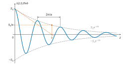
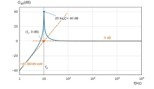
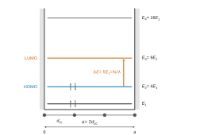
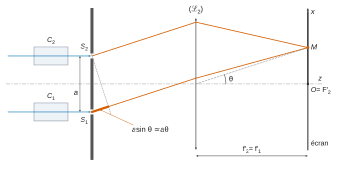
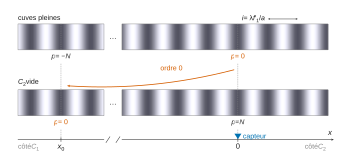

# CCINP MP — Physique 2026 · Corrigé guidé

*Corrigé rédigé par IA, non officiel. Signalez toute erreur.*

## Présentation du sujet

**Cadre.** Épreuve spécifique MP5P, 4 heures, **calculatrices interdites**. Le sujet, « Cahier de bord d'une expédition sur la planète X », compte **51 questions** (Q1 à Q51, souvent subdivisées) en trois parties **totalement indépendantes**.

Les données fournissent $e$, $m$, $h$, $c$ et deux aides au calcul mental : $\sqrt{2{,}5}\simeq1{,}6$ et $\pi^2\simeq10$.

Notation : l'imaginaire pur $\iota$ de l'énoncé est écrit ici $\mathrm{i}$.

**Partie I — Le ressort, couteau-suisse de la physique (Q1–Q23).**

- *I.1 (Q1–Q13), champ de pesanteur* : gravitation d'une sphère homogène et développement limité, pendule simple, force d'inertie d'entraînement d'un référentiel en rotation, puis ressort vertical : mesure statique et dynamique de $g$, incertitude-type, et correction due à la masse du ressort (le « tiers de la masse du ressort ») par un bilan énergétique.
- *I.2 (Q14–Q21), sismologie* : ondes longitudinales et transversales, équation de d'Alembert, onde amortie par un terme en $\partial_t s$ (vecteur d'onde complexe), sismomètre modélisé par un oscillateur amorti dans un référentiel non galiléen, fonction de transfert passe-haut d'ordre 2, script Python à compléter, lecture d'un diagramme de Bode.
- *I.3 (Q22–Q23), thermodynamique* : loi de Laplace à partir de l'expression de $\mathrm{d}S$, puis analogie ressort–gaz parfait et protocole de mesure de température.

**Partie II — Interaction lumière-matière (Q24–Q42).** Modèle de l'électron élastiquement lié : origine de la force de rappel par le théorème de Gauss (modèle de Thomson), équations de Maxwell dans un diélectrique, structure de l'onde plane, approximations (force magnétique négligeable, champ uniforme à l'échelle atomique), réponse en régime forcé. Puis relation de dispersion avec $\varepsilon_r$ complexe, atténuation, vitesse de phase, vecteur de Poynting moyen et absorbance (loi de Beer-Lambert).

**Partie III — Mesure optique et spectroscopie (Q43–Q51).** Puits de potentiel infini, quantification de l'énergie, application au but-1,3-diène (transition HOMO–LUMO) ; trous d'Young éclairés en lumière parallèle, avec deux cuves, et mesure de l'indice d'un gaz par comptage de franges.

**Notions mobilisées.** Mécanique du point (PFD, référentiels non galiléens, énergie), oscillateurs libres et forcés, filtrage et diagrammes de Bode, ondes, thermodynamique (second principe), électrostatique (Gauss), électromagnétisme (Maxwell, ondes planes, Poynting), mécanique quantique (Schrödinger), optique ondulatoire. Un peu de Python (numpy).

**Difficulté et longueur.** Sujet long (51 questions en 4 heures, environ 4 à 5 minutes par question) mais très progressif ; la plupart des questions sont des applications directes du cours. Les difficultés sont ponctuelles : choix de la racine complexe (Q16.b), résonance d'un passe-haut (Q21.e), estimation de $\alpha$ (Q21.f), moyenne du vecteur de Poynting avec $k$ complexe (Q40), protocole ouvert (Q23.c).

**Ce qu'en dit le rapport 2026.** Le rapport ne publie pas de statistiques par question. Il signale toutefois les questions où se sont faits les écarts :

- les **définitions de cours** mal sues : ondes longitudinales et transversales (Q14), état stationnaire (Q43), force de gravitation vectorielle (Q1) ;
- l'**incertitude-type** de Q6, qualifiée de question emblématique des lacunes en métrologie ;
- les **justifications** de Q17 (référentiel non galiléen, poids compensé par l'équilibre) et de Q49 (Malus, retour inverse) ;
- les questions très peu réussies : Q20 (script), Q21 (équivalents, résonance, $Q$ et $\alpha$), Q35–Q38 et Q40 (calculs avec $k$ complexe), Q47 (« presque jamais juste ») ;
- les questions **non abordées** par la plupart des candidats : Q11–Q13, Q42, Q51. Ce sont autant de points accessibles pour qui gère bien son temps.

**Questions à ne pas laisser passer.** Q1, Q2, Q5–Q9, Q14, Q15, Q22, Q25, Q27–Q29, Q34–Q37, Q43–Q46, Q47.a, Q49–Q50. Toutes les parties sont indépendantes : en cas de blocage, on change de partie.

**Gestion du temps.** Environ 1 h 45 pour la partie I (la plus longue), 1 h 15 pour la partie II, 45 minutes pour la partie III, et un peu de temps de relecture. Les applications numériques se font de tête : séparer mantisses et puissances de dix, puis vérifier l'ordre de grandeur obtenu.

---

## Partie I — Le ressort, couteau-suisse de la physique

### I.1 — Mesures du champ de pesanteur de la planète

On mesure $g$ de trois façons (pendule, ressort statique, ressort dynamique), puis on raffine le modèle du ressort en tenant compte de sa masse. Outils : gravitation, PFD, référentiels non galiléens, énergie mécanique.

### Question 1

> [!INDICATION]
> a) Pour une distribution de masse à symétrie sphérique, quel théorème donne le champ à l'extérieur ? À quelle distance du centre se trouve la masse ?

> [!INDICATION]
> a) Faire apparaître le petit paramètre $z/R_\mathrm{p}$ et utiliser un développement limité à l'ordre un. b) Écrire la variation relative à partir du résultat de a).

#### Solution

**a)** La planète est une sphère homogène, donc à symétrie sphérique. Le champ de gravitation ne dépend que de $r$ (invariance par rotation) et il est radial (plans de symétrie contenant le centre) : $\vec{\mathcal G}=\mathcal G(r)\vec u_r$.

Théorème de Gauss gravitationnel sur la sphère de rayon $r>R_\mathrm{p}$ :

$$\begin{aligned}
4\pi r^2\,\mathcal G(r)&=-4\pi G\,M_\mathrm{p}\\
\vec{\mathcal G}(r)&=-\frac{GM_\mathrm{p}}{r^2}\,\vec u_r
\end{aligned}$$

La masse $m$ est à la distance $R_\mathrm{p}+z$ du centre :

$$\vec F_\text{grav}=-\frac{GM_\mathrm{p}m}{(R_\mathrm{p}+z)^2}\,\vec u_r$$

Son intensité se développe à l'ordre un en $z/R_\mathrm{p}$ :

$$\begin{aligned}
F_\text{grav}&=\frac{GM_\mathrm{p}m}{R_\mathrm{p}^2}\left(1+\frac{z}{R_\mathrm{p}}\right)^{-2}\\
&\simeq mg_\mathrm{o}\left(1-\frac{2z}{R_\mathrm{p}}\right)
\end{aligned}$$

$$\boxed{g_\mathrm{o}=\frac{GM_\mathrm{p}}{R_\mathrm{p}^2}>0}$$

**b)** La variation relative vaut $|F_\text{grav}(z)-F_\text{grav}(0)|/F_\text{grav}(0)=2z/R_\mathrm{p}$. Elle reste inférieure à $10^{-2}$ si $z\le R_\mathrm{p}/200$ :

$$\boxed{z_\text{max}=\frac{R_\mathrm{p}}{200}=20\ \text{km}}$$

$20$ km est immense devant la taille des dispositifs de mesure : le champ de gravitation peut être considéré comme uniforme dans toutes les expériences de Major Tom.

> [!PIEGE]
> L'altitude est comptée depuis le sol : la distance au centre est $R_\mathrm{p}+z$, pas $z$. La variation **relative** est un rapport sans dimension, à ne pas confondre avec la variation absolue $|F(z)-F(0)|$. Et $g_\mathrm{o}$, intensité, est positif : le signe moins est porté par $-\vec u_r$.

> [!JURY]
> Rapport 2026 : « Le théorème de Gauss gravitationnel n’est quasiment jamais cité et l’expression est souvent donnée uniquement en norme, sans vecteur. » Pour Q1.b, il ajoute que « le commentaire final attendu est fréquemment oublié » : la comparaison de $20$ km à l'échelle des expériences rapporte des points.

### Question 2

> [!INDICATION]
> Choisir la base polaire liée au fil. Sur quel vecteur projeter le PFD pour éliminer la tension inconnue ?

> [!INDICATION]
> Pour la mesure, penser à l'isochronisme des petites oscillations et à la façon de réduire l'erreur due au déclenchement du chronomètre.

#### Solution

Dans le référentiel du sol (galiléen), $\overrightarrow{OM}=\ell\vec u_r$ et

$$\vec a=-\ell\dot\theta^2\vec u_r+\ell\ddot\theta\,\vec u_\theta$$

La tension est portée par $\vec u_r$. La force de gravitation, constante et uniforme à l'échelle du pendule d'après Q1.b, s'écrit

$$\vec F=mg_\mathrm{o}(\cos\theta\,\vec u_r-\sin\theta\,\vec u_\theta)$$

En projection sur $\vec u_\theta$, $m\ell\ddot\theta=-mg_\mathrm{o}\sin\theta$ :

$$\boxed{\ddot\theta+\frac{g_\mathrm{o}}{\ell}\sin\theta=0}$$

Pour de petites amplitudes, $\sin\theta\simeq\theta$ : période $T_\mathrm{o}=2\pi\sqrt{\ell/g_\mathrm{o}}$, indépendante de l'amplitude.

Protocole : mesurer $\ell$, lancer le pendule à faible amplitude, chronométrer la durée $t_N$ de $N$ oscillations ($N\simeq20$). On en tire $T_\mathrm{o}=t_N/N$ et

$$\boxed{g_\mathrm{o}=\frac{4\pi^2\ell}{T_\mathrm{o}^2}}$$

> [!METHODE]
> Pour un mouvement circulaire, projeter le PFD sur $\vec u_\theta$ donne l'équation du mouvement ; la projection sur $\vec u_r$ ne sert qu'à calculer la tension. Chronométrer $N$ périodes divise par $N$ l'incertitude due au temps de réaction.

> [!JURY]
> Le rapport 2026 relève des confusions entre champ et force de gravitation et des erreurs de projection. Il regrette que « le caractère constant du champ à basse altitude n’est pas toujours relevé comme un point significatif » : c'est le résultat de Q1.b qui autorise $\vec F=m\vec g_\mathrm{o}$ constant.

### Question 3

> [!INDICATION]
> Pour un corps au repos dans un référentiel en rotation uniforme, quelle est la trajectoire du point coïncident dans le référentiel galiléen ?

> [!INDICATION]
> Le rayon du cercle décrit est la distance à l'axe de rotation, à exprimer avec la latitude. L'accélération d'un mouvement circulaire uniforme est dirigée vers le centre du cercle.

#### Solution

Le point coïncident décrit un cercle de centre $H$ (projeté sur l'axe) et de rayon $HM=R_\mathrm{p}\cos\lambda$, à la vitesse angulaire $\Omega$ constante. Son accélération est centripète :

$$\vec a_e=-\Omega^2\,\overrightarrow{HM}=-\Omega^2R_\mathrm{p}\cos\lambda\,\vec u$$

$$\boxed{\vec F_{ie}=-m\vec a_e=m\Omega^2R_\mathrm{p}\cos\lambda\;\vec u}$$

Force centrifuge, maximale à l'équateur, nulle aux pôles. La force de Coriolis est nulle pour un corps au repos relatif.

> [!PIEGE]
> Le rayon est $R_\mathrm{p}\cos\lambda$ (distance à l'axe), non $R_\mathrm{p}$ (distance au centre). Une force d'inertie dirigée vers l'axe signale une erreur de signe sur $\vec a_e$.

> [!JURY]
> Rapport 2026 : « Les erreurs de signe sur l’accélération d’entraînement sont très fréquentes, ce qui aboutit à une force d’inertie centripète dépourvue de sens physique. » Le jury note aussi des confusions entre force d'inertie d'entraînement et force de Coriolis.

### Question 4

> [!INDICATION]
> a) Traduire la définition rappelée par l'énoncé, en restant vectoriel.

> [!INDICATION]
> b) Une condition « à toute latitude » se teste à la latitude la plus défavorable. Puis éliminer $g_\mathrm{o}$ avec Q1.

#### Solution

**a)** $m\vec g=m\vec g_\mathrm{o}+\vec F_{ie}$ :

$$\boxed{\vec g=\vec g_\mathrm{o}+\Omega^2R_\mathrm{p}\cos\lambda\;\vec u}$$

**b)** Le terme centrifuge est maximal à l'équateur. On peut prendre $g\simeq g_\mathrm{o}$ partout si $\Omega^2R_\mathrm{p}\ll GM_\mathrm{p}/R_\mathrm{p}^2$ :

$$\boxed{\Omega^2R_\mathrm{p}^3\ll GM_\mathrm{p}}$$

La planète doit tourner beaucoup plus lentement qu'un satellite en orbite rasante.

> [!PIEGE]
> En a), une relation scalaire $g=g_\mathrm{o}+\Omega^2R_\mathrm{p}\cos\lambda$ est fausse : $\vec g_\mathrm{o}$ et $\vec u$ ne sont pas colinéaires en général.

### Question 5

> [!INDICATION]
> Écrire la longueur du ressort à l'équilibre, puis son allongement, puis l'équilibre de la masse.

#### Solution

À l'équilibre, la longueur du ressort est $\ell_\mathrm{o}+h$. Son allongement vaut donc $(\ell_\mathrm{o}+h)-\ell_\mathrm{o}=h$, et la tension $kh$.

Poids $mg$ vers le bas, tension $kh$ vers le haut (masse du ressort négligée) : $mg=kh$, d'où

$$\boxed{g=\frac{kh}{m}}$$

> [!JURY]
> Le rapport 2026 note que la simplification de $\ell_\mathrm{o}+h-\ell_\mathrm{o}$ pose parfois problème et relève « une confusion entre la longueur du ressort et son allongement ». La loi de Hooke porte sur l'allongement $\ell-\ell_\mathrm{o}$.

### Question 6

> [!INDICATION]
> Pour l'incertitude, $g$ est un produit-quotient : comment se composent les incertitudes relatives ?

> [!INDICATION]
> Annoncer une convention pour l'incertitude-type de chaque donnée (à partir du nombre de chiffres écrits), puis repérer le terme dominant.

#### Solution

$$g=\frac{50{,}0\times2{,}0\cdot10^{-2}}{0{,}200}$$

$$\boxed{g=5{,}0\ \text{m·s}^{-2}}$$

Pour un produit-quotient de grandeurs indépendantes :

$$\frac{u(g)}{g}=\sqrt{\left(\frac{u(k)}{k}\right)^2+\left(\frac{u(h)}{h}\right)^2+\left(\frac{u(m)}{m}\right)^2}$$

Convention : une unité du dernier chiffre écrit comme étendue d'une loi uniforme, soit $u=\Delta/(2\sqrt3)$. On obtient :

- $u(k)/k\simeq6\cdot10^{-4}$ ;
- $u(m)/m\simeq1{,}4\cdot10^{-3}$ ;
- $u(h)/h\simeq1{,}4\cdot10^{-2}$.

Le terme en $h$ domine :

$$\boxed{\frac{u(g)}{g}\simeq1{,}4\cdot10^{-2}}$$

soit $g=(5{,}00\pm0{,}07)$ m·s⁻².

Avec une incertitude de lecture d'un millimètre sur $h$ on trouverait quelques pour cent. Dans tous les cas, l'allongement, connu avec deux chiffres significatifs, limite la précision.

> [!METHODE]
> Produit-quotient : somme quadratique des incertitudes relatives. On commence toujours par annoncer d'où viennent les incertitudes-types, puis on identifie le terme dominant.

> [!PIEGE]
> L'incertitude relative est sans dimension ; une formule qui additionne $u(k)$ et $u(h)$ n'est pas homogène. Et la planète est inconnue : ne pas chercher $9{,}8$ m·s⁻², ni calculer un écart relatif à la valeur terrestre.

> [!JURY]
> Rapport 2026 : « Question emblématique des lacunes en métrologie ». Le jury relève la confusion entre incertitude absolue et relative, des formules non homogènes, et des candidats qui « s’étonnent de ne pas retrouver g = 9,8 m·s⁻², oubliant que la planète est inconnue ». Il signale aussi les erreurs de calcul mental.

### Question 7

> [!INDICATION]
> Nommer les longueurs : à vide, à l'équilibre, à l'instant $t$. Choisir l'origine à la position d'équilibre : que devient le poids dans l'équation ?

#### Solution

Longueur à vide $\ell_\mathrm{o}$, longueur à l'équilibre $\ell_\mathrm{o}+h$. Avec $x$ l'écart à l'équilibre (vers le bas), la longueur vaut $\ell_\mathrm{o}+h+x$ et l'allongement $h+x$. Avec $mg=kh$ :

$$\begin{aligned}
m\ddot x&=mg-k(h+x)\\
&=-kx
\end{aligned}$$

$$\boxed{\ddot x+\frac kmx=0}$$

> [!METHODE]
> Pour un oscillateur vertical, repérer la position à partir de l'équilibre fait disparaître le poids et la longueur à vide.

> [!JURY]
> Rapport 2026 : « Confusion généralisée entre longueur au repos, longueur à vide, longueur à l’équilibre et allongement. » Définir chaque longueur avant d'écrire la force de rappel évite cette confusion.

### Question 8

> [!INDICATION]
> Solution générale d'un oscillateur harmonique, puis deux conditions initiales.

#### Solution

L'équation caractéristique $r^2+\omega_\mathrm{o}^2=0$ a pour racines $\pm\mathrm{i}\omega_\mathrm{o}$ : les solutions sont sinusoïdales.

$$x(t)=A\cos(\omega_\mathrm{o}t)+B\sin(\omega_\mathrm{o}t)$$

Avec $x(0)=x_\mathrm{o}$ et $\dot x(0)=0$ :

$$\boxed{\begin{aligned}
x(t)&=x_\mathrm{o}\cos(\omega_\mathrm{o}t)\\
\omega_\mathrm{o}&=\sqrt{\frac km}
\end{aligned}}$$

> [!PIEGE]
> Des exponentielles réelles pour un oscillateur harmonique trahissent une erreur de signe dans l'équation de Q7 : la force de rappel doit s'opposer à l'écart. Le rapport 2026 relève cet « Étonnement des solutions exponentielles réelles pour un oscillateur harmonique. »

### Question 9

> [!INDICATION]
> a) Éliminer le rapport $k/m$ entre Q5 et Q8.

> [!INDICATION]
> b) Combien de périodes dans $N$ allers-retours ? Penser à l'aide $\pi^2\simeq10$.

#### Solution

**a)** $g=kh/m$ et $\omega_\mathrm{o}^2=k/m$ :

$$\boxed{g=\omega_\mathrm{o}^2h}$$

**b)** Un aller-retour est une période : $T=4/10=0{,}40$ s, donc $\omega_\mathrm{o}=2\pi/T=5\pi$ rad·s⁻¹.

$$\begin{aligned}
g&=25\pi^2\times2{,}0\cdot10^{-2}\\
&=0{,}50\,\pi^2
\end{aligned}$$

$$\boxed{g\simeq5{,}0\ \text{m·s}^{-2}}$$

Même valeur que la méthode statique : les deux mesures sont compatibles. $T_{10}=4$ s n'a qu'un chiffre significatif, ce qui limite la précision de cette mesure.

> [!PIEGE]
> Un aller-retour est une période complète, pas une demi-période ; la confusion donnerait une valeur quatre fois trop petite.

### Question 10

> [!INDICATION]
> a) Dériver $\xi$ par rapport au temps à $\tau$ fixé, puis sommer les énergies cinétiques des éléments de ressort.

> [!INDICATION]
> a) L'intégrale à calculer porte sur $\tau^2$, entre $0$ et $\ell$. b) Quel est le maximum de $\sin^2$ ?

#### Solution

**a)** À $\tau$ fixé :

$$\frac{\partial\xi}{\partial t}=-\frac\tau\ell x_\mathrm{o}\Gamma\sin(\Gamma t)$$

$$\mathrm{d}E_c=\frac12\,\frac{m_\mathrm{o}\,\mathrm{d}\tau}{\ell}\,\frac{\tau^2}{\ell^2}x_\mathrm{o}^2\Gamma^2\sin^2(\Gamma t)$$

Avec $\int_0^\ell\tau^2\mathrm{d}\tau=\ell^3/3$ :

$$\boxed{E_c(t)=\frac16m_\mathrm{o}x_\mathrm{o}^2\Gamma^2\sin^2(\Gamma t)}$$

**b)** $\sin^2(\Gamma t)$ atteint $1$ :

$$\boxed{E_{c,\max}=\frac16m_\mathrm{o}x_\mathrm{o}^2\Gamma^2}$$

> [!METHODE]
> Le résultat ne dépend pas de $\ell$ : c'est un contrôle immédiat de l'intégration.

### Question 11

> [!INDICATION]
> Le système comprend le ressort et la masse : écrire l'énergie cinétique totale (la masse est à l'extrémité $\tau=\ell$).

> [!INDICATION]
> Autour de l'équilibre, l'énergie potentielle totale (élastique et pesanteur) se réduit à $\frac12kx^2$ à une constante près. La conservation de l'énergie impose une relation entre les coefficients de $\sin^2$ et $\cos^2$.

#### Solution

La masse $m$ a pour énergie cinétique $\frac12mx_\mathrm{o}^2\Gamma^2\sin^2(\Gamma t)$, d'où

$$E_c^\text{tot}=\frac12\left(m+\frac{m_\mathrm{o}}3\right)x_\mathrm{o}^2\Gamma^2\sin^2(\Gamma t)$$

L'énergie potentielle se simplifie grâce à $kh=mg$ :

$$\begin{aligned}
E_p&=\frac12k(h+x)^2-mgx+\text{cte}\\
&=\frac12kx^2+\text{cte}'\\
&=\frac12kx_\mathrm{o}^2\cos^2(\Gamma t)+\text{cte}'
\end{aligned}$$

L'énergie totale étant constante, les coefficients de $\sin^2$ et $\cos^2$ sont égaux :

$$\left(m+\frac{m_\mathrm{o}}3\right)\Gamma^2=k$$

$$\boxed{\begin{aligned}
\Gamma&=\frac{\omega_\mathrm{o}}{\sqrt{1+\beta}}\\
\beta&=\frac{m_\mathrm{o}}{3m}
\end{aligned}}$$

Le ressort se comporte comme une masse $m_\mathrm{o}/3$ ajoutée à $m$ ; $\Gamma<\omega_\mathrm{o}$, l'oscillateur alourdi est plus lent.

> [!PIEGE]
> Oublier l'énergie cinétique de $m$, ou garder le terme de pesanteur dans $E_p$ sans utiliser $kh=mg$.

### Question 12

> [!INDICATION]
> La statique ne change pas ; qu'est-ce qui change dans la mesure dynamique ?

> [!INDICATION]
> La pulsation lue au chronomètre est maintenant $\Gamma$ : exprimer $\omega_\mathrm{o}$ en fonction d'elle grâce à Q11.

#### Solution

L'équilibre donne toujours $g=kh/m=\omega_\mathrm{o}^2h$, mais la pulsation mesurée est $\Gamma$, avec $\omega_\mathrm{o}^2=(1+\beta)\Gamma^2$ :

$$\boxed{\begin{aligned}
g&=\omega_\mathrm{o}^2h\\
&=(1+\beta)\,\Gamma^2h
\end{aligned}}$$

Si l'on note $\omega_\mathrm{o}$ la pulsation effectivement mesurée, comme en Q9, la formule corrigée s'écrit $g=(1+\beta)\,\omega_\mathrm{o}^2h$.

> [!PIEGE]
> L'énoncé fait figurer $\beta$ dans la réponse : c'est le signe que la grandeur mesurée n'est plus $\omega_\mathrm{o}$. Préciser quelle pulsation on mesure lève l'ambiguïté.

### Question 13

> [!INDICATION]
> Calculer $\beta$, puis réutiliser la mesure de Q9.b, qui est en réalité une mesure de $\Gamma$.

> [!INDICATION]
> Pour commenter, comparer la correction relative à l'incertitude de Q6.

#### Solution

$\beta=1/30$ ; avec $\Gamma^2h\simeq5{,}0$ m·s⁻² :

$$\begin{aligned}
g&=\frac{31}{30}\times5{,}0\\
&\simeq5{,}17\ \text{m·s}^{-2}
\end{aligned}$$

$$\boxed{g\simeq5{,}2\ \text{m·s}^{-2}}$$

La correction ($\simeq3\,\%$) dépasse l'incertitude relative estimée en Q6 : pour une mesure fine, on ne peut pas négliger la masse du ressort.

> [!METHODE]
> Commenter une correction, c'est la comparer à l'incertitude de mesure : elle n'est négligeable que si elle lui est nettement inférieure.

> [!JURY]
> D'après le rapport 2026, les questions Q11 à Q13 n'ont pas été abordées. Elles ne demandent pourtant qu'un bilan d'énergie et une application numérique : ce sont des points à prendre.

### I.2 — Que tremble la planète !

On passe aux ondes sismiques, d'abord libres puis amorties, et à l'instrument qui les détecte. Outils : ondes, notation complexe, référentiel non galiléen en translation, fonction de transfert, diagramme de Bode, Python.

### Question 14

> [!INDICATION]
> a) Comparer la direction de la grandeur qui vibre et celle de la propagation. b) Quelle est la dimension de $c_s$ ? De quelle nature est l'onde sismique ?

#### Solution

**a)** Onde **longitudinale** : la grandeur vectorielle qui se propage (déplacement de matière) est parallèle à la direction de propagation. Exemples : son dans un fluide, ondes sismiques P.

Onde **transversale** : cette grandeur est perpendiculaire à la direction de propagation. Exemples : corde vibrante, ondes sismiques S, onde électromagnétique dans le vide.

**b)** $c_s$ est la **célérité** de l'onde, vitesse de propagation en m·s⁻¹, indépendante de la fréquence pour l'équation de d'Alembert. L'onde sismique est mécanique : $c_s$ est une propriété de la roche (quelques km·s⁻¹ sur Terre), sans rapport avec la vitesse de la lumière.

> [!PIEGE]
> Ne pas confondre la célérité de l'onde et la vitesse de déplacement de la matière $\partial s/\partial t$. Les vagues ne sont pas un bon exemple d'onde longitudinale : le mouvement des particules d'eau y est elliptique.

> [!JURY]
> Rapport 2026 : les définitions sont « très rarement exactes » et « l’onde électromagnétique, exemple canonique d’onde transversale, est singulièrement absente ». Pour $c_s$, « une proportion impressionnante de candidats l’identifie à la vitesse de la lumière dans le vide, oubliant le caractère mécanique des ondes sismiques ».

### Question 15

> [!INDICATION]
> a) Suivre un plan de phase constante. b) Remplacer les dérivées par des multiplications en notation complexe.

#### Solution

**a)** La phase $\omega t-kz$ est constante sur des plans qui avancent à la vitesse $\omega/k>0$ : propagation **selon $(Oz)$, vers les $z$ croissants**.

**b)** Avec $\partial_t\to\mathrm{i}\omega$ et $\partial_z\to-\mathrm{i}k$ :

$$\boxed{k^2=\frac{\omega^2}{c_s^2}}$$

soit $k=\omega/c_s$ pour une propagation vers $+z$. Milieu non dispersif.

### Question 16

> [!INDICATION]
> a) Même méthode qu'en Q15.b, en gardant le nouveau terme. b) Mettre $\omega^2/c_s^2$ en facteur pour faire apparaître le petit paramètre, puis développer la racine.

> [!INDICATION]
> b) Une racine carrée complexe a deux déterminations : laquelle décrit une onde qui avance vers $+z$ en s'atténuant ? c) Séparer partie réelle et partie imaginaire de $k$ dans l'exponentielle.

> [!INDICATION]
> d) Penser au tracé d'une sinusoïde « enveloppée » par deux exponentielles.

#### Solution

**a)**

$$\boxed{\begin{aligned}
k^2&=\frac{\omega^2}{c_s^2}-\mathrm{i}\eta\omega\\
&=\frac{\omega^2}{c_s^2}\left(1-\mathrm{i}\frac{\eta c_s^2}{\omega}\right)
\end{aligned}}$$

**b)** Avec $\sqrt{1+u}\simeq1+u/2$ appliqué à la forme factorisée :

$$k=\pm\left(\frac{\omega}{c_s}-\mathrm{i}\frac{\eta c_s}{2}\right)$$

Propagation vers $+z$ : $k_r>0$, donc

$$\boxed{\begin{aligned}
k_r&=\frac\omega{c_s}\\
k_i&=-\frac{\eta c_s}{2}
\end{aligned}}$$

$e^{-\mathrm{i}kz}$ contient $e^{k_iz}$, décroissant avec $z$ : l'onde s'atténue bien dans le sens de propagation.

**c)** En prenant la partie réelle :

$$s=\mathrm{Re}\left(S_\mathrm{o}e^{k_iz}e^{\mathrm{i}(\omega t-k_rz)}\right)=S_\mathrm{o}\cos(\omega t-k_rz)e^{k_iz}$$

$$\boxed{\begin{aligned}
a&=\frac\omega{c_s}\\
b&=-\frac1{k_i}=\frac2{\eta c_s}
\end{aligned}}$$

**d)** $b$ est la **distance caractéristique d'atténuation** : l'amplitude est divisée par $e$ sur la distance $b$.

À $t$ fixé ($\omega t=0$), la courbe est une sinusoïde amortie, comprise entre les enveloppes $\pm S_\mathrm{o}e^{-z/b}$.

$a$ est un nombre d'onde : la **pseudo-période spatiale** vaut $2\pi/a$, distance entre deux maxima. On fait figurer $S_\mathrm{o}$, cette pseudo-période et l'abscisse $b$, où l'enveloppe vaut $S_\mathrm{o}/e\simeq0{,}37\,S_\mathrm{o}$ (figure 1).



> [!PIEGE]
> Le signe de $k_i$ ne se choisit pas au hasard : avec la convention $e^{\mathrm{i}(\omega t-kz)}$, une onde atténuée vers $+z$ impose $k_i<0$, donc $b=-1/k_i>0$.
>
> Sur le graphe, $a$ n'est pas une longueur d'onde : c'est $2\pi/a$ qui en est une.

> [!JURY]
> Rapport 2026, sur Q16.b : « Rarement conduite simplement : beaucoup se lancent dans des calculs inextricables. » Le coefficient $b$ y est « obtenu au signe près ». Sur Q16.d, « "a" est souvent confondu avec la longueur d’onde et la pseudo-période spatiale "2π/a" est rarement mentionnée correctement ».

### Question 17

> [!INDICATION]
> Préciser le référentiel d'étude : celui du bâti est-il galiléen ? Quelle force d'inertie apparaît pour une translation accélérée ?

> [!INDICATION]
> Écrire le PFD avec la longueur $\ell$, poids compris, puis soustraire la condition d'équilibre relatif pour passer à $u$.

#### Solution

Le référentiel $\mathcal R_b$ du bâti est **non galiléen** : il est en translation d'accélération $\vec A=\ddot X\vec e_x$ par rapport au référentiel galiléen de la planète. On ajoute donc la force d'inertie d'entraînement $-M\ddot X\vec e_x$ ; il n'y a pas de force de Coriolis.

Avec $\vec e_x$ vers le bas, les forces sont le poids $Mg\vec e_x$, le rappel $-k(\ell-\ell_\mathrm{o})\vec e_x$, le frottement $-\alpha\dot\ell\vec e_x$ et la force d'inertie :

$$M\ddot\ell=Mg-k(\ell-\ell_\mathrm{o})-\alpha\dot\ell-M\ddot X$$

L'équilibre relatif donne $Mg=k(\ell_{eq}-\ell_\mathrm{o})$ : le poids est compensé, il ne disparaît pas par magie. Avec $u=\ell-\ell_{eq}$ :

$$\ddot u+\frac\alpha M\dot u+\frac kMu=-\ddot X$$

$$\boxed{\begin{aligned}
\Omega_\mathrm{o}&=\sqrt{\frac kM}\\
Q&=\frac{\sqrt{kM}}{\alpha}
\end{aligned}}$$

> [!PIEGE]
> Le frottement porte sur la vitesse relative au bâti, comme le précise l'énoncé. Rayer le poids sans écrire la condition d'équilibre fait perdre l'essentiel des points.

> [!JURY]
> Rapport 2026 : la question est « Mal traitée malgré la présence de l’équation finale dans l’énoncé ». Le jury précise que « le référentiel non galiléen n’est presque jamais précisé, la force d’inertie d’entraînement est ajoutée de façon ad hoc et le poids est souvent omis (parfois rayé) plutôt que compensé par la condition d’équilibre ».

### Question 18

> [!INDICATION]
> Distinguer le mouvement du sol et le mouvement de la masse par rapport au bâti.

#### Solution

$A$ : amplitude du déplacement du sol (et du bâti), grandeur à mesurer.

$B$ : amplitude du déplacement de la masse $M$ par rapport au bâti, grandeur enregistrée.

$\phi$ : déphasage de $u$ par rapport à $X$.

### Question 19

> [!INDICATION]
> En complexe, $\ddot X=-\omega^2X$ ; attention aux deux signes moins.

#### Solution

$$\left(\Omega_\mathrm{o}^2-\omega^2+\mathrm{i}\frac{\omega\Omega_\mathrm{o}}{Q}\right)\underline u=\omega^2\underline X$$

En prenant le module du rapport, avec $x=\omega/\Omega_\mathrm{o}$ :

$$\boxed{\begin{aligned}
H(\omega)&=\frac{\omega^2}{\sqrt{(\Omega_\mathrm{o}^2-\omega^2)^2+(\omega\Omega_\mathrm{o}/Q)^2}}\\
&=\frac{x^2}{\sqrt{(1-x^2)^2+(x/Q)^2}}
\end{aligned}}$$

C'est la fonction $g(x,Q)$ du script 1 (figure 6).

### Question 20

> [!INDICATION]
> Le tableau `frequencies` contient des fréquences, pas des pulsations.

> [!INDICATION]
> Choisir une définition de `alpha` (coefficient du terme d'amortissement), puis écrire le gain en décibels de façon cohérente avec ce choix, avec des fonctions numpy vectorielles.

#### Solution

Avec `alpha` $=\omega_0/Q$ :

```python
omega0 = 2*np.pi*f0
alpha = omega0/Q
gain_db = 20*np.log10((2*np.pi*frequencies)**2 / np.sqrt((omega0**2 - (2*np.pi*frequencies)**2)**2 + (alpha*2*np.pi*frequencies)**2))
```

Pour $f_0=10$ Hz et $Q=100$, ce code donne −40 dB à 1 Hz et 0 dB en haute fréquence, avec un pic de +40 dB vers 10 Hz : c'est la figure 7.

> [!PIEGE]
> Oublier le facteur $2\pi$, utiliser $10\log_{10}$ (réservé aux puissances) ou `math.sqrt`, qui n'accepte pas de tableau.

> [!JURY]
> Le rapport 2026 se contente d'un constat : « Peu de bonnes réponses. » Trois lignes cohérentes avec les notations du sujet suffisent.

### Question 21

> [!INDICATION]
> a) Garder le terme dominant du dénominateur dans chaque limite : on cherche un équivalent, pas une limite. b) et c) Prendre $20\log$ des équivalents.

> [!INDICATION]
> e) Plutôt que de dériver $H$, étudier $1/H^2$ en fonction de $X=x^2$ ; ne pas oublier la condition d'existence.

> [!INDICATION]
> f) Que vaut $H$ en $x=1$ ? Lire le pic sur les figures 6 et 7. Pour $\alpha$, il faut une raideur : laquelle connaît-on ?

#### Solution

**a)** $\underline H=\dfrac{x^2}{1-x^2+\mathrm{i}x/Q}$. En basses fréquences $H\sim(f/f_0)^2$ ; en hautes fréquences $H\sim1$.

**b)**

$$\boxed{\begin{aligned}
G_\mathrm{dB}^\mathrm{BF}&=40\log\left(\frac f{f_0}\right)\\
G_\mathrm{dB}^\mathrm{HF}&=0
\end{aligned}}$$

**c)** Intersection en $\log(f/f_0)=0$, soit $\boxed{f=f_0,\ G_\mathrm{dB}=0}$.



**d)** **Passe-haut du second ordre** : le sismomètre restitue fidèlement les vibrations de fréquence grande devant $f_0$.

**e)** On étudie

$$\Phi(X)=\frac1{H^2}=\frac{(1-X)^2+X/Q^2}{X^2}$$

$$\Phi'(X)=\frac{1}{X^3}\left(2X-\frac X{Q^2}-2\right)$$

$\Phi'$ s'annule en $X=\dfrac{2Q^2}{2Q^2-1}$ (si $Q>1/\sqrt2$), où $\Phi$ est minimale :

$$\boxed{\omega_\text{rés}=\frac{\Omega_\mathrm{o}}{\sqrt{1-\dfrac1{2Q^2}}}\quad(Q>1/\sqrt2)}$$

On en déduit $H_\text{max}=Q/\sqrt{1-1/(4Q^2)}$, voisin de $Q$ pour $Q\gg1$.

**f)** $H(1)=Q$ et, pour $Q\gg1$, $H_\text{max}\simeq Q$. Figure 6 : pic à $100$ ; figure 7 : pic à $40$ dB, soit $10^2$ :

$$\boxed{Q\simeq100}$$

Figure 7 : $f_0=10$ Hz, $\Omega_\mathrm{o}=20\pi$ rad·s⁻¹. On prend la raideur $k=50{,}0$ N·m⁻¹ du ressort de Major Tom (initiative à signaler). Alors $M=k/\Omega_\mathrm{o}^2\simeq50/4\,000=1{,}25\cdot10^{-2}$ kg et

$$\begin{aligned}
\alpha&=\frac{\sqrt{kM}}Q\\
&=\frac{\sqrt{2{,}5}}{2\times100}
\end{aligned}$$

$$\boxed{\alpha\simeq8\cdot10^{-3}\ \text{kg·s}^{-1}}$$

> [!PIEGE]
> La résonance d'un passe-haut est au-dessus de $\Omega_\mathrm{o}$ : la formule $\Omega_\mathrm{o}\sqrt{1-1/(2Q^2)}$ est celle de la résonance en élongation d'un passe-bas. Et un équivalent n'est jamais nul : écrire « $H\sim0$ » en basse fréquence est faux, c'est $H\sim(f/f_0)^2$.

> [!METHODE]
> Les aides numériques de l'énoncé indiquent souvent le calcul attendu : ici $\sqrt{2{,}5}$ apparaît exactement dans $\sqrt{kM}$.

> [!JURY]
> Rapport 2026 : « Confusions entre limite et équivalent (un équivalent ne peut pas être nul) », erreurs sur le gain en décibels et sur la nature du filtre. Le jury reproche que « La pulsation de résonance est déduite graphiquement sans calcul de dérivé » ; quant à $Q$ et $\alpha$, la question « n’est presque jamais abordée ».

### I.3 — Température de l'atmosphère

On établit la loi de Laplace, puis on transpose au ressort par analogie, $(P,V)$ devenant le couple force–longueur. Outils : second principe, intégration d'une forme différentielle.

### Question 22

> [!INDICATION]
> a) Second principe : quels sont les deux termes de $\mathrm{d}S$, et lequel s'annule sous chaque hypothèse ? b) Éliminer $P$ avec l'équation d'état.

> [!INDICATION]
> c) Intégrer une somme de dérivées logarithmiques.

#### Solution

**a)** $\mathrm{d}S=\delta S_\text{e}+\delta S_\text{c}$. Adiabatique : $\delta S_\text{e}=0$ ; réversible : $\delta S_\text{c}=0$. Donc $\boxed{\mathrm{d}S=0}$ (isentropique).

**b)** Avec $P/T=nR/V$, la condition $\mathrm{d}S=0$ devient

$$\frac{nR}{\gamma-1}\frac{\mathrm{d}T}T+nR\frac{\mathrm{d}V}V=0$$

$$\boxed{\frac{\mathrm{d}T}T+(\gamma-1)\frac{\mathrm{d}V}V=0}$$

**c)** $\boxed{TV^{\gamma-1}=\text{cte}}$ : **loi de Laplace** (gaz parfait, $\gamma$ constant, adiabatique réversible).

> [!PIEGE]
> L'exposant de $V$ est $\gamma-1$ quand on travaille en $(T,V)$ ; c'est $PV^\gamma$ qui est constant. Le rapport 2026 signale la forme erronée $TV^\gamma=\text{cte}$.

### Question 23

> [!INDICATION]
> a) Que devient $\mathrm{d}S$ à longueur constante ? À quoi correspond le coefficient $nR/(\gamma-1)$ pour le gaz ?

> [!INDICATION]
> b) Séparer les variables et intégrer ; le terme en $\ell$ donne un carré. c) Quelle grandeur mesurable avec les moyens de Major Tom dépend de $T$ ?

> [!INDICATION]
> c) La raideur se mesure par une période d'oscillation. Utiliser Q23.b pour discuter l'effet des oscillations sur la température du ressort.

#### Solution

**a)** $C_\ell$ est la **capacité thermique du ressort à longueur constante** (analogue de $C_V$) : à $\ell$ fixée, $\delta Q_\text{rév}=T\mathrm{d}S=C_\ell\mathrm{d}T$ ; unité J·K⁻¹.

**b)** On sépare les variables :

$$C_\ell\frac{\mathrm{d}T}{T}=-D(\ell-\ell_\mathrm{o})\mathrm{d}\ell$$

En intégrant, la primitive de $(\ell-\ell_\mathrm{o})$ est $\frac12(\ell-\ell_\mathrm{o})^2$ :

$$\boxed{T_f=T_i\exp\left(-\frac D{2C_\ell}\left[(\ell_f-\ell_\mathrm{o})^2-(\ell_i-\ell_\mathrm{o})^2\right]\right)}$$

$\ell_\mathrm{o}$ apparaît nécessairement (imprécision de l'énoncé). Un étirement isentrope refroidit le ressort.

**c)** Les constantes $k_\mathrm{o}$ et $D$ sont connues (mesures préalables). Protocole :

1. laisser le ressort, chargé d'une masse connue $m$, s'équilibrer thermiquement avec l'atmosphère ;
2. chronométrer $N$ petites oscillations, d'où la période $T_\text{osc}$ et $k=4\pi^2m/T_\text{osc}^2$ ;
3. en déduire $\boxed{T=\dfrac{k_\mathrm{o}-k}{D}}$.

D'après Q23.b, les oscillations (rapides, donc adiabatiques, et quasi statiques) sont isentropes. La température du ressort fluctue relativement de l'ordre de $\frac D{C_\ell}(\ell_\text{eq}-\ell_\mathrm{o})x_\mathrm{o}$, négligeable pour de petites amplitudes, et de moyenne nulle au premier ordre.

Variante sans $k_\mathrm{o}$ : mesurer $k_i$, étirer rapidement et sans à-coups de $\ell_i$ à $\ell_f$, mesurer $k_f$. On note

$$\Delta=\frac{D}{2C_\ell}\left[(\ell_f-\ell_\mathrm{o})^2-(\ell_i-\ell_\mathrm{o})^2\right]$$

On obtient $T=\dfrac{k_f-k_i}{D(1-e^{-\Delta})}$, méthode peu sensible car $\Delta$ est petit.

> [!METHODE]
> « Rapide » assure l'adiabaticité (pas le temps d'échanger de la chaleur), « sans à-coups » la quasi-staticité : les deux ensemble donnent une transformation isentrope.

> [!JURY]
> Le rapport 2026 note que la capacité thermique est parfois mentionnée mais que la précision « à longueur constante » est omise dans la plupart des copies. Il signale des erreurs d'exposant dans l'intégration et note que « la description du protocole reste souvent peu convaincante » : il faut dire quoi mesurer, avec quel instrument, et comment en déduire $T$.

---

## Partie II — Interaction lumière-matière

### II.1 — Modèle de l'électron élastiquement lié et propagation du rayonnement

On justifie le modèle de l'électron lié (origine électrostatique de la force de rappel), puis on étudie l'onde dans le milieu et la réponse de l'électron. Outils : théorème de Gauss, équations de Maxwell, notation complexe, oscillateur forcé.

### Question 24

> [!INDICATION]
> Comparer les masses, donc les accélérations sous des forces du même ordre.

#### Solution

La charge positive porte l'essentiel de la masse de l'atome, au moins $m_\text{p}/m\simeq1\,836$ fois celle de l'électron. Soumise à des forces du même ordre (actions réciproques, force électrique proportionnelle à la charge), elle a une accélération au moins mille fois plus faible. On la considère donc comme fixe, et son référentiel comme galiléen.

> [!METHODE]
> « Motiver un choix de modèle » appelle un argument quantitatif : un rapport de masses, de durées ou de longueurs.

> [!JURY]
> Rapport 2026 : « La réponse attendue est rarement donnée clairement. » Les explications citées par le jury (« charge du noyau très faible », « dynamique imprévisible ») passent à côté du seul argument attendu, le rapport des masses.

### Question 25

> [!INDICATION]
> a) Invariances pour la dépendance, symétries pour la direction : ce sont deux arguments distincts.

> [!INDICATION]
> b) Théorème de Gauss sur une sphère intérieure : seule la charge contenue compte, calculée avec la densité volumique. c) Calculer la force sur une charge $-e$ et l'écrire en fonction de $\overrightarrow{OM}$.

#### Solution

**a)** Invariance par toute rotation autour de $O$ : $\vec E$ ne dépend que de $r$.

Tout plan contenant $O$ et $M$ est plan de symétrie : $\vec E(M)$ est porté par $(OM)$. Donc $\vec E=E(r)\vec u_r$.

**b)** La densité volumique est $\rho=3Q_\mathrm{o}/(4\pi R_\mathrm{o}^3)$. La sphère de rayon $r<R_\mathrm{o}$ contient donc

$$Q_\text{int}=\rho\,\frac43\pi r^3=Q_\mathrm{o}\frac{r^3}{R_\mathrm{o}^3}$$

Le théorème de Gauss donne $4\pi r^2E(r)=Q_\text{int}/\varepsilon_\mathrm{o}$ :

$$\boxed{\vec E=\frac{Q_\mathrm{o}\,r}{4\pi\varepsilon_\mathrm{o}R_\mathrm{o}^3}\vec u_r\quad(r<R_\mathrm{o})}$$

**c)** La force sur l'électron est

$$\vec f=-e\vec E=-\frac{eQ_\mathrm{o}}{4\pi\varepsilon_\mathrm{o}R_\mathrm{o}^3}\overrightarrow{OM}$$

La force de rappel modélise **l'attraction électrostatique de la charge positive répartie** sur l'électron, avec

$$\boxed{\kappa=\frac{eQ_\mathrm{o}}{4\pi\varepsilon_\mathrm{o}R_\mathrm{o}^3}}$$

> [!PIEGE]
> À l'intérieur d'une distribution volumique, $Q_\text{int}\neq Q_\mathrm{o}$ : c'est le facteur $(r/R_\mathrm{o})^3$ qui rend la force proportionnelle à $r$. En c), $\kappa$ s'identifie sur la force $-e\vec E$, pas sur le champ.

> [!JURY]
> Rapport 2026 : « le calcul de la charge intérieure est fréquemment faux par confusion entre charge totale et densité volumique ». Le jury relève aussi des invariances et symétries « énoncées de manière maladroite », et la confusion entre force et champ électrique dans l'identification finale.

### Question 26

> [!INDICATION]
> Écrire les équations dans le vide (sans charge ni courant) et repérer celle qui diffère.

#### Solution

Dans le vide :

$$\begin{aligned}
\mathrm{div}\,\vec E&=0\\
\mathrm{div}\,\vec B&=0\\
\overrightarrow{\mathrm{rot}}\,\vec E&=-\partial_t\vec B\\
\overrightarrow{\mathrm{rot}}\,\vec B&=\mu_\mathrm{o}\varepsilon_\mathrm{o}\partial_t\vec E
\end{aligned}$$

Seule Maxwell-Ampère change, par $\varepsilon_\mathrm{o}\to\varepsilon_\mathrm{o}\varepsilon_r$. Le milieu neutre et isolant se comporte comme un vide de permittivité $\varepsilon_\mathrm{o}\varepsilon_r$, la réponse des électrons liés étant contenue dans $\varepsilon_r$ (complexe).

> [!PIEGE]
> Dans le vide il n'y a ni $\rho$ ni $\vec\jmath$ : comparer avec la forme générale des équations ne répond pas à la question.

### Question 27

> [!INDICATION]
> Lire la phase et la direction du vecteur champ.

#### Solution

Propagation selon $+\vec u_z$, vecteur d'onde $\vec k=k\vec u_z$, polarisation rectiligne selon $\vec u_x$.

### Question 28

> [!INDICATION]
> Pour une onde plane, que devient l'opérateur divergence ? Utiliser Maxwell-Gauss dans le milieu.

#### Solution

$\mathrm{div}\,\underline{\vec E}=-\mathrm{i}\vec k\cdot\underline{\vec E}=0$ : $\vec E$ est orthogonal à la direction de propagation, il est **transverse**.

### Question 29

> [!INDICATION]
> Maxwell-Faraday en notation complexe, puis un produit vectoriel.

#### Solution

$-\mathrm{i}\vec k\wedge\underline{\vec E}=-\mathrm{i}\omega\underline{\vec B}$ :

$$\boxed{\begin{aligned}
\underline{\vec B}&=\frac{\vec k\wedge\underline{\vec E}}\omega\\
&=\frac k\omega E_\mathrm{o}e^{\mathrm{i}(\omega t-kz)}\vec u_y
\end{aligned}}$$

$\underline{\vec B}\perp\vec k$ : transverse.

> [!METHODE]
> Pour une onde plane, $\nabla\to-\mathrm{i}\vec k$ et $\partial_t\to\mathrm{i}\omega$ transforment les équations de Maxwell en relations algébriques.

### Question 30

> [!INDICATION]
> Comparer $\|\vec v\wedge\vec B\|$ à $\|\vec E\|$ en utilisant la relation de structure de Q29.

#### Solution

$\|\vec B\|\sim\|\vec E\|/v$ avec $v=\omega/|k|\sim c$. Le rapport des forces est au plus $v_e/v$ :

$$\boxed{v_e\ll c}$$

l'électron doit rester non relativiste (champ d'amplitude modérée).

### Question 31

> [!INDICATION]
> Donner un ordre de grandeur de la taille atomique, puis calculer la variation de phase du champ sur l'atome.

#### Solution

Taille d'un atome : $d\sim10^{-10}$ m. Pour $\lambda=200$ nm, la phase varie sur l'atome de

$$\frac{2\pi d}{\lambda}\simeq3\cdot10^{-3}\ \text{rad}\ll1$$

Donc $\cos(\omega t-kz)\simeq\cos(\omega t)$ en tout point de l'atome : à chaque instant, le champ y prend la même valeur. Il est **uniforme à l'échelle atomique**.

> [!JURY]
> Rapport 2026 : « L’ordre de grandeur de la taille de l’atome est connu mais le lien avec l’uniformité du champ électrique est rarement explicité. » Donner $10^{-10}$ m ne suffit pas : il faut comparer à $\lambda$ et conclure sur la phase.

### Question 32

> [!INDICATION]
> Bilan des forces dans le référentiel de la charge positive, en utilisant les deux approximations précédentes.

> [!INDICATION]
> L'équation porte sur la grandeur réelle $\vec r(t)$ : écrire le champ réel au niveau de l'atome.

#### Solution

$$\boxed{m\ddot{\vec r}+\alpha\dot{\vec r}+\kappa\vec r=-eE_\mathrm{o}\cos(\omega t)\vec u_x}$$

L'atome est placé en $z=0$. La force magnétique est négligée (Q30), le champ est uniforme (Q31) et le poids est négligeable.

> [!PIEGE]
> Le second membre porte la charge $-e$ ; un signe faux ne change pas les modules mais fausse les phases.

### Question 33

> [!INDICATION]
> Passer en complexe, puis identifier terme à terme avec la forme donnée.

#### Solution

$$\left(\frac\kappa m-\omega^2+\mathrm{i}\frac\alpha m\omega\right)\underline{\vec r}=-\frac em\underline{\vec E}$$

$$\boxed{\begin{aligned}
\omega_\mathrm{o}&=\sqrt{\frac\kappa m}\\
Q&=\frac{\sqrt{m\kappa}}\alpha
\end{aligned}}$$

> [!METHODE]
> C'est la même identification que pour le sismomètre (Q17) : un oscillateur amorti se résume toujours à $(\omega_\mathrm{o},Q)$.

### II.2 — Solution des équations de Maxwell et aspect énergétique

On exploite $\varepsilon_r$ complexe : $k$ devient complexe, l'onde s'atténue, et l'absorbance mesure la partie imaginaire. Outils : notation complexe, moyenne temporelle de grandeurs quadratiques.

### Question 34

> [!INDICATION]
> Injecter l'onde plane dans l'équation de propagation.

#### Solution

$$\boxed{k^2=\varepsilon_r\frac{\omega^2}{c^2}}$$

### Question 35

> [!INDICATION]
> Développer $(k_1-\mathrm{i}k_2)^2$ et identifier parties réelles et imaginaires (licite car les quatre grandeurs sont réelles).

#### Solution

On développe $(k_1-\mathrm{i}k_2)^2=k_1^2-k_2^2-2\mathrm{i}k_1k_2$ et on l'égale à $(\varepsilon_1-\mathrm{i}\varepsilon_2)\omega^2/c^2$ :

$$\boxed{\begin{aligned}
k_1^2-k_2^2&=\frac{\omega^2}{c^2}\varepsilon_1\\
2k_1k_2&=\frac{\omega^2}{c^2}\varepsilon_2
\end{aligned}}$$

$\varepsilon_2>0$ : $k_1$ et $k_2$ de même signe ; avec $k_1>0$, $k_2>0$ (onde atténuée).

> [!JURY]
> Rapport 2026 : « La séparation des parties réelle et imaginaire de la Q35 est souvent entamée mais pas aboutie ». Les deux relations encadrées sont le résultat attendu, sans chercher $k_1$ et $k_2$ explicitement.

### Question 36

> [!INDICATION]
> Séparer $e^{-\mathrm{i}kz}$ en un terme oscillant et un terme réel, puis prendre la partie réelle.

#### Solution

$-\mathrm{i}kz=-\mathrm{i}k_1z-k_2z$, d'où, en prenant la partie réelle :

$$\boxed{\vec E=E_\mathrm{o}e^{-k_2z}\cos(\omega t-k_1z)\vec u_x}$$

> [!PIEGE]
> Le champ réel ne contient plus d'exponentielle complexe. Le signe de l'exposant réel se contrôle : avec $k_2>0$, l'amplitude doit décroître vers $+z$. Le rapport 2026 relève ici des erreurs de signe, « certains laissant même une exponentielle complexe pour le champ réel ».

### Question 37

> [!INDICATION]
> Sur quelle distance l'amplitude est-elle divisée par $e$ ?

#### Solution

$\delta=1/k_2$ est la **distance caractéristique d'atténuation** (profondeur de pénétration) de l'amplitude : celle-ci est divisée par $e$ chaque fois que l'onde progresse de $\delta$. L'énergie décroît sur $\delta/2$.

> [!JURY]
> Rapport 2026 : la notion de profondeur de peau « est connue de nom, mais la définition est rarement reformulée correctement ». Le jury cite des confusions avec la différence de marche ou le facteur de qualité.

### Question 38

> [!INDICATION]
> Traduire « peu absorbant » par $\varepsilon_2\ll\varepsilon_1$, puis développer la racine de $k^2$ à l'ordre un.

#### Solution

On développe à l'ordre un en $\varepsilon_2/\varepsilon_1$ :

$$\begin{aligned}
k&=\frac\omega c\sqrt{\varepsilon_1}\left(1-\mathrm{i}\frac{\varepsilon_2}{\varepsilon_1}\right)^{1/2}\\
&\simeq\frac\omega c\sqrt{\varepsilon_1}\left(1-\mathrm{i}\frac{\varepsilon_2}{2\varepsilon_1}\right)
\end{aligned}$$

Par identification avec $k_1-\mathrm{i}k_2$ :

$$\boxed{\begin{aligned}
k_1&\simeq\frac\omega c\sqrt{\varepsilon_1}\\
k_2&\simeq\frac\omega c\frac{\varepsilon_2}{2\sqrt{\varepsilon_1}}
\end{aligned}}$$

Vérification : les deux sont homogènes à $\omega/c$, et $k_2/k_1=\varepsilon_2/(2\varepsilon_1)\ll1$.

> [!METHODE]
> Raisonnement d'auto-cohérence : on suppose une approximation, on calcule, puis on vérifie que le résultat la respecte. On obtient la même chose à partir de Q35 en négligeant $k_2^2$.

> [!JURY]
> Rapport 2026 : « Le développement limité de la Q38 est peu traité et lorsqu’il l’est, il comporte des erreurs d’homogénéité ou des signes incorrects. » Le contrôle d'homogénéité final est donc bienvenu.

### Question 39

> [!INDICATION]
> Vitesse des plans de phase constante : quelle partie de $k$ intervient ? Le critère de dispersion est la dépendance en $\omega$.

#### Solution

$$\boxed{v_\varphi=\frac\omega{k_1}=\frac c{\sqrt{\varepsilon_1(\omega)}}}$$

$\varepsilon_1$ dépend de $\omega$ : **milieu dispersif**.

> [!PIEGE]
> La vitesse de phase est $\omega/k_1$, pas $\mathrm{d}\omega/\mathrm{d}k_1$ (vitesse de groupe) ni $\omega/|k|$.

> [!JURY]
> Rapport 2026 : « La vitesse de phase est très souvent confondue avec la vitesse de groupe » et « Beaucoup affirment que le milieu n’est pas dispersif sans s’apercevoir que ε₁ dépend de ω. »

### Question 40

> [!INDICATION]
> La relation de Q29 reste vraie avec $k$ complexe : écrire le champ magnétique réel complet.

> [!INDICATION]
> Le vecteur de Poynting est quadratique : faire la moyenne des produits de cosinus et de sinus, ou utiliser la formule avec un complexe conjugué.

#### Solution

Avec $k=k_1-\mathrm{i}k_2$, la partie réelle de $\underline{\vec B}$ comporte deux termes :

$$\vec B=\frac{E_\mathrm{o}}{\omega}e^{-k_2z}\left[k_1\cos(\omega t-k_1z)+k_2\sin(\omega t-k_1z)\right]\vec u_y$$

On forme $\vec\Pi=\vec E\wedge\vec B/\mu_\mathrm{o}$, dirigé selon $\vec u_z$. En moyenne, $\langle\cos^2\rangle=1/2$ et $\langle\sin\cos\rangle=0$ : le terme en $k_2$ ne contribue pas.

$$\boxed{\langle\vec\Pi\rangle=\frac{k_1E_\mathrm{o}^2}{2\mu_\mathrm{o}\omega}e^{-2k_2z}\vec u_z}$$

La formule complexe $\langle\vec\Pi\rangle=\frac1{2\mu_\mathrm{o}}\mathrm{Re}(\underline{\vec E}\wedge\underline{\vec B}^*)$ donne le même résultat.

> [!PIEGE]
> Multiplier les complexes sans conjuguer, oublier le terme en $k_2$ de $\vec B$, ou écrire $e^{-k_2z}$ au lieu de $e^{-2k_2z}$.

> [!JURY]
> Rapport 2026 : la définition du vecteur de Poynting est généralement sue, « mais le champ magnétique réel est rarement complet (absence de la contribution en k₂) ». Pour Q41, l'absorbance n'est correctement exprimée que par ceux qui ont réussi Q40.

### Question 41

> [!INDICATION]
> Former le rapport des normes en $z+L$ et $z$ ; il ne dépend pas de $z$.

#### Solution

Le rapport vaut $e^{-2k_2L}$ :

$$\boxed{\mathcal A_L=\frac{2L}{\ln10}k_2(\omega)}$$

C'est une grandeur proportionnelle à $k_2$ : loi de Beer-Lambert.

### Question 42

> [!INDICATION]
> Remonter la chaîne $\mathcal A_L\to k_2\to\varepsilon_2$, puis regarder où $\varepsilon_2$ est grand.

#### Solution

L'absorbance donne $k_2(\omega)$, donc $\varepsilon_2(\omega)$, maximal au voisinage de $\omega_\mathrm{o}$ (largeur de l'ordre de $\omega_\mathrm{o}/Q$).

En balayant $\omega$, Major Tom obtient le **spectre d'absorption**. La position des pics identifie les espèces (pulsations propres). Leur largeur renseigne sur l'amortissement, leur hauteur (via $\Omega$) sur la quantité d'espèce absorbante.

> [!JURY]
> Selon le rapport 2026, Q42 n'a pas été abordée : une question qualitative en fin de partie, facile à rédiger à partir de Q38 et Q41.

---

## Partie III — Mesure optique et spectroscopie

### III.1 — Spectroscopie Ultra-Violette/Visible (UV/Vis)

On quantifie l'énergie d'une particule dans un puits infini et l'on applique le résultat aux électrons délocalisés d'une molécule conjuguée. Outils : équation de Schrödinger, conditions aux limites, relation de Planck-Einstein.

### Question 43

> [!INDICATION]
> Qu'est-ce qui est parfaitement déterminé dans un tel état ? Qu'est-ce qui ne dépend pas du temps ?

#### Solution

Un état stationnaire est un état d'**énergie parfaitement déterminée** $E$. Sa fonction d'onde s'écrit $\Psi(x,t)=\varphi(x)e^{-\mathrm{i}Et/\hbar}$, et la densité de probabilité $|\Psi|^2=|\varphi|^2$ est indépendante du temps.

> [!PIEGE]
> C'est $|\Psi|^2$ qui est stationnaire, pas $\Psi$, dont la phase dépend du temps.

> [!JURY]
> Rapport 2026 : « les candidats se contentent d’évoquer la séparation des variables espace/temps, déjà mentionnée dans l’énoncé, sans donner la définition propre à la physique quantique ». Il faut dire : énergie définie, densité de probabilité indépendante du temps.

### Question 44

> [!INDICATION]
> Question de cours : soigner les signes, l'ordre de la dérivée temporelle et le facteur $\hbar^2/(2m)$.

#### Solution

$$\boxed{\mathrm{i}\hbar\frac{\partial\Psi}{\partial t}=-\frac{\hbar^2}{2m}\frac{\partial^2\Psi}{\partial x^2}+V(x)\Psi}$$

En y injectant $\Psi=\varphi e^{-\mathrm{i}Et/\hbar}$, on retrouve l'équation stationnaire de l'énoncé.

> [!PIEGE]
> L'équation est du **premier ordre** en temps ; le rapport 2026 relève des copies qui l'écrivent « parfois avec une dérivée seconde temporelle ».

### Question 45

> [!INDICATION]
> Avec $V=0$, l'équation stationnaire est celle d'un oscillateur harmonique ; utiliser le signe de $E$.

#### Solution

$\varphi''+\kappa^2\varphi=0$ avec $\kappa^2=2mE/\hbar^2>0$ :

$$\boxed{\varphi(x)=A\cos(\kappa x)+B\sin(\kappa x)}$$

### Question 46

> [!INDICATION]
> La fonction d'onde est nulle hors du puits et continue : conditions en $x=0$ et $x=a$.

> [!INDICATION]
> Exclure la solution identiquement nulle, puis passer de $\kappa$ à $E$.

#### Solution

$\varphi(0)=0$ donne $A=0$. Puis $\varphi(a)=0$ avec $B\neq0$ donne $\kappa a=n\pi$, $n\in\mathbb N^*$ :

$$\boxed{\begin{aligned}
E_n&=\frac{n^2h^2}{8ma^2}\\
E_1&=\frac{h^2}{8ma^2}\\
E_n&=n^2E_1
\end{aligned}}$$

> [!METHODE]
> Confinement $\Rightarrow$ quantification : ce sont les conditions aux limites qui sélectionnent les valeurs de l'énergie.

> [!JURY]
> Le rapport 2026 juge la résolution de Q45–Q46 « globalement bien menée », avec « quelques étourderies sur le signe du coefficient 2mE/ħ² ou l’oubli du carré dans les niveaux d’énergie ». Vérifier que $E_n$ croît comme $n^2$.

### Question 47

> [!INDICATION]
> a) Compter les intervalles entre carbones, pas les carbones. b) Pour $N=4$, quels sont les niveaux HOMO et LUMO ?

> [!INDICATION]
> b) Égaler l'écart d'énergie à l'énergie du photon. c) Séparer mantisses et puissances de dix.

#### Solution

**a)** $\boxed{a=3\,d_{cc}}$.

**b)** HOMO $n=2$, LUMO $n=3$ :

$$\begin{aligned}
\Delta E&=E_3-E_2=5E_1\\
&=\frac{5h^2}{72md_{cc}^2}
\end{aligned}$$

Avec $\Delta E=hc/\lambda$ :

$$\boxed{\lambda=\frac{72\,m\,c\,d_{cc}^2}{5h}}$$



**c)** On sépare mantisses et puissances de dix :

$$\begin{aligned}
\lambda&=\frac{72\times9{,}1\times3{,}0}{5\times6{,}6}\cdot10^{-31+8-20+34}\ \text{m}\\
&\simeq60\cdot10^{-9}\ \text{m}
\end{aligned}$$

$$\boxed{\lambda\sim6\cdot10^{-8}\ \text{m}=60\ \text{nm}}$$

Ultraviolet : la référence d'étalonnage est dans l'UV. Le modèle est grossier ($\lambda\propto d_{cc}^2$).

> [!PIEGE]
> HOMO et LUMO sont $n=N/2$ et $N/2+1$, pas $1$ et $2$ ; et $a=(N-1)d_{cc}$, pas $Nd_{cc}$.

> [!JURY]
> Rapport 2026 : « Très rarement traitée et presque jamais juste. » C'est la question la plus sélective de la partie III : elle ne demande pourtant que Q46, un comptage de niveaux et la relation de Planck-Einstein.

### III.2 — Interféromètre d'Young : mesure de l'indice optique

Trous d'Young en lumière parallèle, observation à l'infini, puis mesure d'un très petit écart d'indice par défilement de franges. Outils : chemin optique, théorème de Malus, ordre d'interférence.

### Question 48

> [!INDICATION]
> Que devient le faisceau issu d'une source au foyer objet ? Conséquence sur l'éclairement des deux fentes et sur la traversée des cuves. À quoi sert la seconde lentille ?

#### Solution

Le faisceau émergent est parallèle à l'axe : une onde plane en **incidence normale**.

- Les fentes sont sur un même plan d'onde, donc éclairées en phase : pas de terme de source dans la différence de marche.
- Les deux faisceaux traversent les cuves sous incidence normale, sur la même longueur $\ell$.
- La seconde lentille ramène dans son plan focal image les interférences qui se formeraient à l'infini.

> [!PIEGE]
> Translater la source dans le plan focal incline l'onde plane et translate les franges : c'est la position de la source sur l'axe qui place l'ordre zéro au centre.

> [!JURY]
> Rapport 2026 : « si les faisceaux parallèles sont mentionnés, l’incidence normale est omise et l’intérêt des lentilles est mal décrit ». Citer les deux lentilles et le rôle de chacune.

### Question 49

> [!INDICATION]
> L'écran est dans le plan focal image : en $M$ convergent des rayons parallèles entre eux. Relier leur inclinaison à $x$.

> [!INDICATION]
> Principe du retour inverse et théorème de Malus : la différence de marche entre deux rayons parallèles issus des fentes est une projection de $\overrightarrow{S_1S_2}$.

#### Solution

Dans les conditions de Gauss, $x=f_2'\tan\theta\simeq f_1'\theta$. On place $S_1$ (côté $C_1$) en $-a/2$ et $S_2$ en $+a/2$.

- Retour inverse : une source fictive en $M$ donnerait après $(\mathcal L_2)$ une onde plane de direction $\theta$.
- Malus : les plans orthogonaux à cette direction sont des surfaces d'onde. Avec $H$ le projeté de $S_2$ sur le rayon issu de $S_1$, $(HM)=(S_2M)$.
- La différence de chemin optique est donc $S_1H=a\sin\theta\simeq a\theta$.

$$\boxed{\delta(M)=(SS_1M)-(SS_2M)=\frac{ax}{f_1'}}$$

Franges rectilignes parallèles à $(Oy)$, interfrange $\lambda f_1'/a$.



> [!JURY]
> Rapport 2026 : « Le résultat est souvent donné, sans justification, sans tracé de rayons clairs et le théorème de Malus ainsi que le principe du retour inverse ne sont qu’évoqués sans être appliqués rigoureusement. » Un schéma propre, avec le point $H$, porte l'essentiel de la justification.

### Question 50

> [!INDICATION]
> Que valent les contributions des deux cuves quand elles sont identiques ?

#### Solution

Les chemins optiques dans les cuves se compensent : l'ordre nul est en $\boxed{x=0}$, sur l'axe, au foyer $F_2'$ (frange brillante).

### Question 51

> [!INDICATION]
> a) Ajouter à $\delta$ la différence de chemin optique due aux cuves ; chercher où elle s'annule.

> [!INDICATION]
> b) Au point fixe $x=0$, suivre l'ordre d'interférence pendant la vidange : de combien varie-t-il quand une frange brillante défile ?

#### Solution

**a)** Avec $C_2$ vide, le chemin par $S_1$ gagne $(n_\text{gaz}-1)\ell$ :

$$\delta=\frac{ax}{f_1'}+(n_\text{gaz}-1)\ell$$

$\delta$ s'annule en

$$\boxed{x_0=-\frac{(n_\text{gaz}-1)\ell f_1'}a}$$

Déplacement du côté de $C_1$ (bras de plus grand chemin optique), interfrange inchangé.



**b)** En $x=0$, $p$ passe de $0$ à $(n_\text{gaz}-1)\ell/\lambda$. Chaque frange brillante qui défile correspond à $\Delta p=1$, et l'état final est brillant :

$$\boxed{n_\text{gaz}=1+\frac{N\lambda}\ell}$$

$$\begin{aligned}
n_\text{gaz}&=1+\frac{100\times6{,}00\cdot10^{-7}}{0{,}200}\\
&=1+3{,}0\cdot10^{-4}
\end{aligned}$$

$$\boxed{n_\text{gaz}=1{,}000\,30}$$

Ordre de grandeur typique d'un gaz ($n-1\sim10^{-4}$) ; seule une méthode interférentielle mesure un écart aussi faible.

> [!METHODE]
> Compter des franges qui défilent en un point fixe, c'est mesurer la variation de l'ordre d'interférence, donc de la différence de marche, en unités de $\lambda$.

> [!JURY]
> D'après le rapport 2026, Q51 n'a pas été abordée. Elle ne demande que la différence de marche de Q49 complétée par le terme des cuves : une fin de sujet rentable.

---

## Bilan

**Questions discriminantes selon le rapport 2026.** Sans statistiques publiées, le rapport désigne par ses remarques les questions qui ont fait la différence : Q6 (incertitude-type), Q14 (définitions), Q16.b (calcul simple de $k$), Q17 (justification en référentiel non galiléen), Q20–Q21 (script, équivalents, résonance), Q35–Q40 ($k$ complexe et Poynting), Q43 (état stationnaire), Q47 (HOMO–LUMO), Q49 (Malus). Les questions non abordées (Q11–Q13, Q42, Q51) étaient pourtant accessibles.

**Méthodes à retenir.**

- Oscillateur vertical : prendre l'origine à l'équilibre pour éliminer poids et longueur à vide (Q7, Q17).
- Correction de masse d'un ressort : bilan d'énergie avec un champ de déplacement affine, d'où la masse effective $m+m_\mathrm{o}/3$ (Q10–Q11).
- Référentiel non galiléen : en rotation uniforme, force d'inertie d'entraînement centrifuge $m\Omega^2HM$ ; en translation, $-M\vec A$ sans Coriolis (Q3, Q17).
- Onde amortie : $k$ complexe, choix de la détermination par l'argument physique (propagation et atténuation dans le même sens) (Q16, Q35–Q36).
- Résonance : étudier $1/H^2$ en fonction de $x^2$, ne pas oublier la condition d'existence (Q21.e).
- Moyenne d'une grandeur quadratique : $\frac12\mathrm{Re}(\underline a\,\underline b^*)$, ou moyenne des produits de fonctions trigonométriques (Q40).
- Puits infini : conditions aux limites $\Rightarrow$ quantification $E_n=n^2E_1$ ; HOMO–LUMO pour une molécule conjuguée (Q46–Q47).
- Interférences : différence de marche par le théorème de Malus en observation à l'infini, défilement de franges $=$ variation d'ordre (Q49–Q51).

**Prérequis à revoir.** Théorème de Gauss et symétries, équations de Maxwell et structure de l'onde plane, second principe et loi de Laplace, filtres du second ordre et diagrammes de Bode, incertitudes-types composées, numpy vectoriel. Le rapport 2026 insiste sur un regard critique : « Un regard plus critique sur les résultats obtenus, notamment sur les applications numériques, aurait permis de déceler et de corriger ces erreurs. »

**Questions classiques transposables.** Pendule simple et mesure de $g$ ; « un tiers de la masse du ressort » ; sismomètre passe-haut ; électron élastiquement lié et indice complexe ; loi de Beer-Lambert ; modèle de la particule dans une boîte pour les polyènes ; réfractomètre interférentiel de Jamin ou de Rayleigh (mesure d'indice d'un gaz par comptage de franges).
