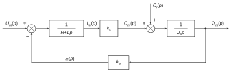
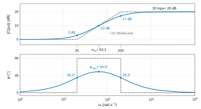
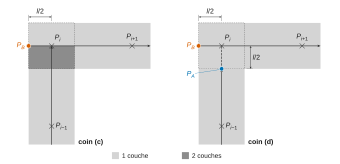
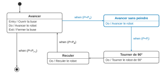
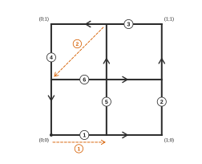

# CCINP MP — Sciences industrielles 2026 · Corrigé brut

*Corrigé rédigé par IA, non officiel. Signalez toute erreur.*

Épreuve MP7SI (mutualisée avec e3a-Polytech), 4 h, calculatrice interdite. Support : Bering, robot autonome de marquage au sol. Cinq parties indépendantes, 46 questions.

**Document Réponse.** Le Document Réponse (16 pages) n'est pas reproduit dans nos sources. Pour les questions qui s'y appuient (tableau de Q25, courbes de Q28 et Q32–Q33, diagrammes d'états de Q34 et Q36, figures des coins, scripts Python de la partie V, figure du carré en Q46), la réponse est donnée sur une reconstruction fidèle à l'énoncé, explicitée à chaque fois.

---

## Partie I — Étude du déplacement de Bering

### I.2 — Consigne de vitesse des moteurs

**Q1.** Chaque roue est en liaison pivot d'axe $(P,\vec y_1)$ avec le châssis. Les centres $C_d$ et $C_g$ sont sur cet axe, car $\overrightarrow{PC_d} = -a\vec y_1$ et $\overrightarrow{PC_g} = a\vec y_1$.

Le torseur d'une pivot a pour résultante le vecteur rotation, porté par l'axe, et un moment (vitesse) nul en tout point de l'axe. Écrits à leur point de réduction, résultante en haut et moment en bas :

$$\boxed{\{\mathcal V_{2/1}\} = \left\{\begin{matrix}\omega_{21}\,\vec y_1\\ \vec 0\end{matrix}\right\}_{C_d}}$$

$$\boxed{\{\mathcal V_{3/1}\} = \left\{\begin{matrix}\omega_{31}\,\vec y_1\\ \vec 0\end{matrix}\right\}_{C_g}}$$

**Q2.** Composition des vitesses : $\vec V_{I_d\in 2/0} = \vec V_{I_d\in 2/1} + \vec V_{I_d\in 1/0}$.

Mouvement 2/1, par changement de point depuis $C_d$ :

$$\begin{aligned}
\vec V_{I_d\in 2/1} &= \vec V_{C_d\in 2/1} + \overrightarrow{I_dC_d}\wedge\vec\Omega_{2/1}\\
&= r\vec z_1\wedge\omega_{21}\vec y_1\\
&= -r\,\omega_{21}\,\vec x_1
\end{aligned}$$

Mouvement 1/0, depuis $P$ : $\overrightarrow{I_dP} = \overrightarrow{I_dC_d} + \overrightarrow{C_dP} = r\vec z_1 + a\vec y_1$, et $\vec z_0 = \vec z_1$.

$$\begin{aligned}
\vec V_{I_d\in 1/0} &= V\vec x_1 + (r\vec z_1 + a\vec y_1)\wedge\omega_{10}\vec z_1\\
&= (V + a\,\omega_{10})\,\vec x_1
\end{aligned}$$

$$\boxed{\vec V_{I_d\in 2/0} = \left(V + a\,\omega_{10} - r\,\omega_{21}\right)\vec x_1}$$

**Q3.** La roue 2 roule sans glisser sur le sol en $I_d$ (hypothèse de l'énoncé). La vitesse de glissement est donc nulle : $\vec V_{I_d\in 2/0} = \vec 0$. Avec Q2, $V + a\,\omega_{10} - r\,\omega_{21} = 0$, et comme $r \neq 0$ :

$$\boxed{\omega_{21} = \frac{V + a\,\omega_{10}}{r}}$$

**Q4.** Même calcul en $I_g$, avec $\overrightarrow{I_gP} = r\vec z_1 - a\vec y_1$. On obtient $\vec V_{I_g\in 1/0} = (V - a\,\omega_{10})\vec x_1$ et $\vec V_{I_g\in 3/1} = -r\,\omega_{31}\vec x_1$. Le roulement sans glissement en $I_g$ donne

$$\boxed{\omega_{31} = \frac{V - a\,\omega_{10}}{r}}$$

### I.3 — Trajectoires particulières

**Q5.** En ligne droite, l'orientation du châssis est constante : $\theta_{10}$ est constant, donc $\omega_{10} = 0$. La direction $\vec x_1$ est alors fixe dans $\mathcal R_0$.

La trajectoire de $P$ est une droite ; le mouvement du solide 1 par rapport à 0 est une **translation rectiligne** de direction $\vec x_1$ (uniforme si $V$ est constante). Le torseur se réduit à un couple, identique en tout point :

$$\boxed{\{\mathcal V_{1/0}\} = \left\{\begin{matrix}\vec 0\\ V\vec x_1\end{matrix}\right\}_{\forall M}}$$

**Q6.** Avec $\omega_{10} = 0$ dans Q3 et Q4 :

$$\boxed{\omega_{21} = \omega_{31} = \frac{V}{r}}$$

**Q7.** $O$ est fixe et $R$ constant. On dérive $\overrightarrow{OP} = R\vec y_1$ dans $\mathcal R_0$ :

$$\begin{aligned}
\vec V_{P\in 1/0} &= R\left.\frac{d\vec y_1}{dt}\right|_{\mathcal R_0}\\
&= R\,\omega_{10}\,\vec z_1\wedge\vec y_1\\
&= -R\,\omega_{10}\,\vec x_1
\end{aligned}$$

En identifiant avec $V\vec x_1$ :

$$\boxed{V = -R\,\omega_{10}}$$

soit $|V| = R|\omega_{10}|$. Le centre $O$ est du côté $-\vec y_1$, celui de la roue droite 2. En marche avant ($V > 0$), le robot tourne donc à droite et $\omega_{10} < 0$, ce qui est cohérent avec la figure 4.

**Q8.** On reporte $\omega_{10} = -V/R$ dans Q3 et Q4 :

$$\boxed{\omega_{21} = \frac{V\,(R-a)}{r\,R}}$$

$$\boxed{\omega_{31} = \frac{V\,(R+a)}{r\,R}}$$

Contrôles : $R\to\infty$ redonne Q6 ; la roue 2, intérieure au virage, tourne moins vite que la roue 3.

**Q9.** Rotation autour de $P$ sans déplacement de $P$ : $V = 0$ et $\omega_{10} \neq 0$. Alors

$$\boxed{\omega_{21} = \frac{a\,\omega_{10}}{r}}$$

$$\boxed{\omega_{31} = -\frac{a\,\omega_{10}}{r}}$$

$$\boxed{\frac{\omega_{21}}{\omega_{31}} = -1}$$

Les roues tournent à la même vitesse en sens opposés (pivotement sur place).

---

## Partie II — Étude du basculement du robot dans un virage

### II.1 — Modélisation des caractéristiques inertielles du robot

**Q10.** Le plan $(P,\vec x_1,\vec z_1)$ est plan de symétrie matérielle de l'ensemble. Châssis et réservoir sont homogènes et symétriques par rapport à ce plan. Les deux stators, identiques (même masse $m_M$, mêmes dimensions), sont symétriques l'un de l'autre par rapport à ce plan. Le centre d'inertie d'un ensemble admettant un plan de symétrie matérielle appartient à ce plan, donc $\boxed{y_G = 0}$.

**Q11.** Positions des centres d'inertie lues sur la figure 5 (origine $P$) :

| Solide | Masse | $x$ | $z$ |
|---|---|---|---|
| stators M1, M2 (axe $(P,\vec y_1)$) | $m_M$ chacun | $0$ | $0$ |
| châssis C (face arrière passant par $P$, posé sur les stators) | $m_C$ | $a_C/2$ | $d_M/2 + c_C/2$ |
| réservoir R (face arrière passant par $P$, posé sur le châssis) | $m_R$ | $a_R/2$ | $d_M/2 + c_C + c_R/2$ |

La masse totale est $m_1 = 2m_M + m_C + m_R$, et $m_1\overrightarrow{PG} = \sum m_i\overrightarrow{PG_i}$ :

$$\boxed{x_G = \frac{m_C\,a_C + m_R\,a_R}{2\,(2m_M + m_C + m_R)}}$$

$$\boxed{z_G = \frac{m_C\,(d_M + c_C) + m_R\,(d_M + 2c_C + c_R)}{2\,(2m_M + m_C + m_R)}}$$

**Q12.** Le stator est un cylindre d'axe $\vec y_1$, de rayon $d_M/2$ et de hauteur $h_M$.

On transpose la matrice donnée : l'axe $\vec z$ devient $\vec y_1$, le rayon devient $d_M/2$ et la hauteur $h_M$. Par symétrie de révolution, $\mathcal B_1$ est principale :

$$\boxed{I(G_{M1}, M1) = \begin{pmatrix} m_M\left(\dfrac{d_M^2}{16} + \dfrac{h_M^2}{12}\right) & 0 & 0\\ 0 & \dfrac{m_M\,d_M^2}{8} & 0\\ 0 & 0 & m_M\left(\dfrac{d_M^2}{16} + \dfrac{h_M^2}{12}\right)\end{pmatrix}_{\mathcal B_1}}$$

**Q13.** La section extrême du stator M1 coïncide avec la face latérale du châssis, en $y = b_C/2$ (M1 est du côté $+\vec y_1$ sur la vue de derrière). Son centre est à mi-hauteur : $\overrightarrow{PG_{M1}} = \dfrac{b_C - h_M}{2}\,\vec y_1$. Avec $\overrightarrow{PG} = x_G\vec x_1 + z_G\vec z_1$ :

$$\boxed{\overrightarrow{GG_{M1}} = -x_G\,\vec x_1 + \frac{b_C - h_M}{2}\,\vec y_1 - z_G\,\vec z_1}$$

**Q14.** Théorème de Huygens pour l'axe $(G,\vec x_1)$, parallèle à $(G_{M1},\vec x_1)$ : on ajoute $m_M d^2$.

Ici $d^2$ est le carré de la distance entre les axes. C'est la somme des carrés des composantes de $\overrightarrow{GG_{M1}}$ selon $\vec y_1$ et $\vec z_1$ ; $x_G$ n'intervient pas.

$$\boxed{I_{Gx_1} = m_M\left[\frac{d_M^2}{16} + \frac{h_M^2}{12} + \left(\frac{b_C - h_M}{2}\right)^2 + z_G^2\right]}$$

### II.2 — Modélisation du comportement dynamique du robot en virage

**Q15.** On écrit $\overrightarrow{OG} = R\vec y_1 + x_G\vec x_1 + z_G\vec z_1$, avec $R$, $x_G$, $z_G$ et $\omega_{10}$ constants. Les dérivées des vecteurs de base dans $\mathcal R_0$ sont

$$\left.\frac{d\vec x_1}{dt}\right|_0 = \omega_{10}\,\vec y_1$$

$$\left.\frac{d\vec y_1}{dt}\right|_0 = -\omega_{10}\,\vec x_1$$

D'où, en dérivant deux fois :

$$\begin{aligned}
\vec V_{G,1/0} &= -R\,\omega_{10}\,\vec x_1 + x_G\,\omega_{10}\,\vec y_1\\
\vec a_{G,1/0} &= -x_G\,\omega_{10}^2\,\vec x_1 - R\,\omega_{10}^2\,\vec y_1
\end{aligned}$$

$$\boxed{\vec R_d(1/0) = m_1\,\vec a_{G,1/0} = -m_1\,\omega_{10}^2\left(x_G\,\vec x_1 + R\,\vec y_1\right)}$$

**Q16.** En $G$, $\vec\sigma(G,1/0) = I(G,1)\,\vec\Omega_{1/0}$ avec $\vec\Omega_{1/0} = \omega_{10}\vec z_1$. Le produit de la matrice par le vecteur $(0, 0, \omega_{10})$ donne

$$\vec\sigma(G,1/0) = -E\,\omega_{10}\,\vec x_1 + C\,\omega_{10}\,\vec z_1$$

En $G$, $\vec\delta(G,1/0)$ est la dérivée de $\vec\sigma(G,1/0)$ dans $\mathcal R_0$. Les composantes dans $\mathcal B_1$ sont constantes : il reste le terme de changement de base.

$$\begin{aligned}
\vec\delta(G,1/0) &= \omega_{10}\vec z_1\wedge\left(-E\,\omega_{10}\,\vec x_1 + C\,\omega_{10}\,\vec z_1\right)\\
&= -E\,\omega_{10}^2\,\vec y_1
\end{aligned}$$

$$\boxed{\vec\delta(G,1/0) = -E\,\omega_{10}^2\,\vec y_1}$$

**Q17.** On isole le robot dans $\mathcal R_0$ galiléen. Actions extérieures : le poids $-m_1 g\,\vec z_1$, appliqué en $G$, et les actions du sol sur les roues 2, 3 et 4. Le théorème de la résultante dynamique, projeté dans $\mathcal B_1$, donne

$$\boxed{\begin{aligned} X_2 + X_3 + X_4 &= -m_1\,\omega_{10}^2\,x_G\\ Y_2 + Y_3 + Y_4 &= -m_1\,\omega_{10}^2\,R\\ Z_2 + Z_3 + Z_4 - m_1 g &= 0\end{aligned}}$$

**Q18.** Une roue ne touche plus le sol quand l'effort normal qu'elle reçoit s'annule. Le centre du virage est du côté $-\vec y_1$, celui de la roue 2 : la roue 2 est la roue **intérieure**. Les expressions données fournissent

$$Z_3 - Z_2 = \frac{m_1\,\omega_{10}^2\,(z_G + r)\,R}{a} > 0$$

Donc $Z_2 < Z_3$ dès que le robot tourne : la roue 3 (extérieure) est la plus chargée des deux roues arrière. La roue avant ne décolle pas non plus : $Z_4$ contient le terme de poids $x_G m_1 g/b > 0$ et le terme $m_1\omega_{10}^2 x_G(z_G + r)/b > 0$, qui croît avec la vitesse (le produit d'inertie $E$ étant d'influence secondaire).

Enfin $Z_2$ décroît quand $\omega_{10}^2$ augmente. À la vitesse limite, **la roue 2 (roue droite, intérieure au virage) décolle** ; la vitesse limite se détermine en écrivant $\boxed{Z_2 = 0}$, puis $|V| = R\,|\omega_{10}|$.

**Q19.** Avec deux roues folles de même voie, les contacts extérieurs (côté $+\vec y_1$) sont alignés sur une droite $\Delta$ parallèle à $\vec x_1$, au niveau du sol. À la limite, les deux roues intérieures décollent : les seules actions du sol s'exercent sur $\Delta$, et leur moment par rapport à $\Delta$ est nul.

Soit $J \in \Delta$ avec $\overrightarrow{PJ} = a\vec y_1 - r\vec z_1$. Alors $\overrightarrow{JG} = x_G\vec x_1 - a\vec y_1 + (z_G + r)\vec z_1$. On écrit le théorème du moment dynamique en $J$, projeté sur $\vec x_1$ :

$$\left[\vec\delta(G,1/0) + \overrightarrow{JG}\wedge m_1\vec a_{G,1/0}\right]\cdot\vec x_1 = \left[\overrightarrow{JG}\wedge(-m_1 g\,\vec z_1)\right]\cdot\vec x_1$$

Le terme $\vec\delta(G,1/0)\cdot\vec x_1$ est nul (Q16). Il reste

$$m_1\,\omega_{10}^2\,R\,(z_G + r) = m_1\,g\,a$$

$$V_{max} = R\,|\omega_{10}| = \sqrt{\frac{g\,a\,R}{z_G + r}}$$

$V_{max}$ croît avec $R$ et avec $a$ :

- **augmenter le rayon de virage $R$ augmente la vitesse maximale** (l'accélération centripète $V^2/R$ diminue à vitesse donnée) ;
- **augmenter la demi-voie $a$ augmente la vitesse maximale** (le bras de levier stabilisant du poids autour de l'axe de basculement croît).

**Q20.** L'exigence 1.1.1 impose l'absence de basculement à $V = 1{,}5\ \text{m·s}^{-1}$ dans un virage de rayon $0{,}5$ m : ce sont les conditions de la figure 8. Les deux courbes sont décroissantes. Il faut $V_{max}(z_G) \geq 1{,}5\ \text{m·s}^{-1}$, ce qui définit un intervalle $z_G \leq z_{G,lim}$.

- **Une roue folle** : la courbe passe à $1{,}5\ \text{m·s}^{-1}$ pour $z_G \approx 0{,}35$ m, donc $\boxed{z_G \lesssim 0{,}35\ \text{m}}$.
- **Deux roues folles** : la courbe reste au-dessus de $1{,}5\ \text{m·s}^{-1}$ sur tout le domaine tracé (elle y arrive en $z_G = 1$ m), donc $\boxed{z_G \lesssim 1\ \text{m}}$, soit toute hauteur réaliste.

L'exigence 1.1.1 est satisfaite sans condition pratique avec deux roues folles. Avec une roue folle, elle impose de garder le centre d'inertie sous 35 cm environ, réservoir plein compris (le réservoir, au-dessus du châssis, remonte $z_G$).

---

## Partie III — Étude de l'asservissement du déplacement

Dans cette partie, $b$ est la voie (distance $I_gI_d$, soit $2a$ avec les notations de la partie I) : la différence des distances parcourues par les deux roues, divisée par $b$, donne l'angle de lacet.

### III.2 — Modélisation du comportement du moteur

**Q21.** Sous les conditions de Heaviside (conditions initiales nulles) :

$$\begin{aligned}
U_m(p) &= (R + Lp)\,I_m(p) + E(p)\\
J_e\,p\,\Omega_m(p) &= C_m(p) + C_r(p)\\
E(p) &= k_e\,\Omega_m(p)\\
C_m(p) &= k_c\,I_m(p)
\end{aligned}$$

Schéma-bloc (figure 1) : chaque équation donne un bloc. La force contre-électromotrice $E = k_e\,\Omega_m$ ferme une boucle interne, et $C_r$ s'ajoute (signe +) au couple moteur.



**Q22.** En éliminant $I_m$, $C_m$ et $E$ :

$$\left[J_e\,p\,(R + Lp) + k_c k_e\right]\Omega_m = k_c\,U_m + (R + Lp)\,C_r$$

On divise par $k_ck_e$ pour faire apparaître la forme canonique (terme constant égal à 1 au dénominateur) :

$$\Omega_m = \frac{\dfrac{1}{k_e}}{1 + \dfrac{R J_e}{k_c k_e}\,p + \dfrac{L J_e}{k_c k_e}\,p^2}\left[U_m + \frac{R + Lp}{k_c}\,C_r\right]$$

La figure 12 impose $\Omega_m = H_m\,(U_m + H_{pert}\,C_r)$. Par identification :

$$\boxed{H_m(p) = \frac{K_m}{1 + \dfrac{2\xi}{\omega_0}\,p + \dfrac{p^2}{\omega_0^2}}}$$

avec les paramètres caractéristiques

$$\begin{aligned}
K_m &= \frac{1}{k_e}\\
\omega_0 &= \sqrt{\frac{k_c k_e}{J_e L}}\\
\xi &= \frac{R}{2}\sqrt{\frac{J_e}{L\,k_c k_e}}
\end{aligned}$$

$$\boxed{H_{pert}(p) = \frac{R + Lp}{k_c} = \frac{R}{k_c}\left(1 + \frac{L}{R}\,p\right)}$$

$H_m$ est un second ordre de gain statique $1/k_e$ (en $\text{rad·s}^{-1}\text{·V}^{-1}$), de pulsation propre $\omega_0$ et de coefficient d'amortissement $\xi$.

**Q23.** $T(p) = r/p$ donne $\dot d = r\,\omega_m$ : la vitesse d'avance est $v = r\,\omega_m$, et la roue (rayon $r$) tourne à $\omega_m$, en entraînement direct. En ligne droite, $\omega_{mg} = \omega_{md} = \omega_m$ et le châssis est en translation. L'énergie cinétique de l'ensemble (robot en translation, deux roues et deux rotors en rotation), répartie sur les deux moteurs, s'écrit

$$\frac12\,m\,r^2\,\omega_m^2 + 2\cdot\frac12\,J_r\,\omega_m^2 + 2\cdot\frac12\,J_m\,\omega_m^2 = 2\cdot\frac12\,J_e\,\omega_m^2$$

$$\boxed{J_e = J_m + J_r + \frac{m\,r^2}{2}}$$

AN, sans calculatrice : $r^2 = 3{,}61\cdot10^{-2}\ \text{m}^2$. La masse maximale est $m = 7{,}7$ kg. On estime la masse minimale en retirant la charge maximale de l'exigence 1.3 : $m \approx 7{,}7 - 4{,}6 = 3{,}1$ kg.

$$\begin{aligned}
J_e^{max} &\approx 6{,}4\cdot10^{-6} + 5\cdot10^{-3} + \frac{7{,}7\times3{,}61\cdot10^{-2}}{2}\\
&\approx 1{,}4\cdot10^{-1}\ \text{kg·m}^2
\end{aligned}$$

$$\begin{aligned}
J_e^{min} &\approx 6{,}4\cdot10^{-6} + 5\cdot10^{-3} + 5{,}6\cdot10^{-2}\\
&\approx 6{,}1\cdot10^{-2}\ \text{kg·m}^2
\end{aligned}$$

$$\boxed{6\cdot10^{-2}\ \text{kg·m}^2 \lesssim J_e \lesssim 1{,}4\cdot10^{-1}\ \text{kg·m}^2}$$

Le terme $mr^2/2$ représente 92 à 96 % de $J_e$ ; $J_m$ est négligeable.

**Q24.** La peinture n'agit que par la masse $m$, donc par $J_e$, multiplié par environ 2,3 entre vide et plein. D'après Q22 :

- $K_m = 1/k_e$ est **inchangé** : la vitesse atteinte en régime permanent ne dépend pas du remplissage ;
- $\omega_0 \propto 1/\sqrt{J_e}$ **diminue** et $\xi \propto \sqrt{J_e}$ **augmente**, le produit $\xi\omega_0 = R/(2L)$ restant constant.

Plus le réservoir est plein, plus le moteur est lent : le temps de réponse s'allonge. Dans le modèle du premier ordre utilisé ensuite, la constante de temps $\tau_m = RJ_e/(k_ck_e)$ est proportionnelle à $J_e$. Le correcteur doit être réglé pour le cas le plus défavorable (réservoir plein).

### III.3 — Modélisation du comportement en lacet

**Q25.** Avec $\beta_c = 0$ : $\varepsilon_\beta = -\beta$. Correcteur et adaptateur ont des gains positifs, donc $\Delta\Omega_c$ a le signe de $\varepsilon_\beta$. La figure 11 donne $\Omega_{cg} = \Omega_c - \Delta\Omega_c$ et $\Omega_{cd} = \Omega_c + \Delta\Omega_c$.

| Signe de $\beta$ mesuré | Signe de $\varepsilon_\beta$ | Signe de $\Delta\Omega_c$ | Évolution de $\Omega_{mg}$ | Évolution de $\Omega_{md}$ |
|---|---|---|---|---|
| $\beta > 0$ | $-$ | $-$ | ↗ | ↘ |
| $\beta < 0$ | $+$ | $+$ | ↘ | ↗ |

Vérification : si $\beta > 0$ (robot orienté trop à gauche), la roue gauche accélère et la droite ralentit. Le robot tourne vers la droite, ce qui ramène $\beta$ vers 0.

**Q26.** Les deux voies s'écrivent

$$\begin{aligned}
\Omega_{mg} &= H_m\,(\Omega_c - \Delta\Omega_c)\\
\Omega_{md} &= H_m\,(\Omega_c + \Delta\Omega_c)
\end{aligned}$$

avec $d_g = T\,\Omega_{mg}$, $d_d = T\,\Omega_{md}$ et $\beta = (d_d - d_g)/b$. Les deux chaînes étant identiques, $\Omega_c$ s'élimine et $\Delta\Omega_c$ intervient deux fois :

$$\beta = \frac{T\,H_m\left[(\Omega_c + \Delta\Omega_c) - (\Omega_c - \Delta\Omega_c)\right]}{b}$$

$$\boxed{H_1(p) = \frac{\beta(p)}{\Delta\Omega_c(p)} = \frac{2\,H_m(p)\,T(p)}{b}}$$

**Q27.** Le retour est unitaire ; la chaîne directe comprend $C(p)$, $k_a$ et $H_1(p)$. Avec $H_m = K_m/(1 + \tau_m p)$ et $T = r/p$ :

$$\begin{aligned}
H_{BO}(p) &= \frac{2\,k_a\,C(p)\,H_m(p)\,T(p)}{b}\\
&= \frac{2\,k_a\,r\,K_m}{b}\cdot\frac{C(p)}{p\,(1 + \tau_m\,p)}
\end{aligned}$$

Le système est de classe 1 (intégrateur de $T$). Avec $C = 1$, on identifie la forme retenue ensuite : $\tau_m = 0{,}05$ s et $2k_arK_m/b = 5\ \text{s}^{-1}$.

**Q28.** On prend $C = 1$ et $H_{BO} = \dfrac{5}{p(1 + 0{,}05p)}$ (courbe du Document Réponse) :

$$\begin{aligned}
\frac{\beta}{\beta_c} &= \frac{5}{0{,}05\,p^2 + p + 5}\\
&= \frac{100}{(p + 10)^2}
\end{aligned}$$

C'est un second ordre de gain 1, avec $\omega_0 = 10\ \text{rad·s}^{-1}$ et $\xi = 1$. On confronte les trois exigences temporelles :

| Exigence | Critère | Système non corrigé | Verdict |
|---|---|---|---|
| 1.1.3.2.1 | erreur statique nulle | classe 1 : $\beta \to 1°$, $\varepsilon_\infty = 0$ | satisfaite |
| 1.1.3.2.4 | dépassement $< 10\ \%$ | $\xi = 1$ : pas de dépassement | satisfaite |
| 1.1.3.2.2 | $t_{5\%} < 0{,}01$ s | $t_{5\%} = 4{,}74/\omega_0 \approx 0{,}47$ s | **non satisfaite** |

Pour $\xi = 1$, la réponse indicielle est $s(t) = 1 - (1 + \omega_0 t)\,e^{-\omega_0 t}$. L'équation $(1 + x)e^{-x} = 0{,}05$ a pour solution $x \approx 4{,}74$, d'où $t_{5\%}$.

En complément : $\omega_{0\,\text{dB}} \approx 4{,}9\ \text{rad·s}^{-1}$, donc la bande passante n'est pas satisfaite. La stabilité l'est : $M_\varphi \approx 76°$ et $M_G$ infinie. **Le système non corrigé est précis, stable et sans dépassement, mais beaucoup trop lent.**

### III.4 — Choix du correcteur

**Q29.** Seule la rapidité est en défaut. Il faut augmenter fortement $\omega_{0\,\text{dB}}$ (au-delà de 100 rad/s) sans perdre la marge de phase.

Un simple gain qui placerait $\omega_{0\,\text{dB}}$ à 100 rad/s donnerait une marge inacceptable ($45°$ au moins sont exigés) :

$$M_\varphi = 90° - \arctan(0{,}05\times100) \approx 11°$$

La précision est déjà acquise : $H_{BO}$ est de classe 1, l'erreur statique est nulle (exigence 1.1.3.2.1). Une action intégrale est donc inutile et dégraderait la phase.

Le correcteur à avance de phase ($a > 1$) augmente le gain en haute fréquence et apporte de la phase autour de la nouvelle pulsation de coupure. Il accélère le système en préservant la marge de phase, et il ne change pas la classe : la précision est conservée. **Ce choix est donc justifié.**

**Q30.** La seule cassure de $H_{BO}$ est $\omega_1 = 1/0{,}05 = 20\ \text{rad·s}^{-1}$.

L'action asymptotique de $C$ (pente $+20$ dB/décade) s'étend de $1/(a\tau)$ à $1/\tau$. « Sur une décade à partir de $\omega_1$ » impose donc

$$\begin{aligned}
\frac{1}{a\tau} &= 20\ \text{rad·s}^{-1}\\
\frac{1}{\tau} &= 200\ \text{rad·s}^{-1}
\end{aligned}$$

d'où

$$\boxed{\tau = 5\cdot10^{-3}\ \text{s}}$$

$$\boxed{a = 10}$$

Alors $a\tau = 0{,}05$ s $= \tau_m$ : le zéro compense le pôle, et $H_{BO}^{c}(p) = \dfrac{5\,K_p}{p\,(1 + 0{,}005\,p)}$.

**Q31.** $C(p) = \dfrac{1 + 0{,}05p}{1 + 0{,}005p}$ ($K_p = 1$).

*Gain.* Asymptotes : 0 dB pour $\omega < 20$ ; $+20$ dB/décade de 20 à 200 rad/s ; $20\log a = 20$ dB au-delà. Courbe réelle : 3 dB en $\omega = 20$, 10 dB en $\omega_m = 63{,}2$, 17 dB en $\omega = 200$ rad/s.

*Phase.* Asymptotes : 0° pour $\omega < 20$, $+90°$ entre 20 et 200 rad/s, 0° au-delà. La courbe réelle est

$$\varphi(\omega) = \arctan(0{,}05\,\omega) - \arctan(0{,}005\,\omega)$$

Elle est en cloche, nulle aux extrémités, vaut 39,3° en 20 et en 200 rad/s, et elle est maximale en

$$\omega_m = \frac{1}{\tau\sqrt a} = \sqrt{20\times200} \approx 63{,}2\ \text{rad·s}^{-1}$$

où elle vaut

$$\varphi_{max} = \arcsin\frac{a - 1}{a + 1} = \arcsin\frac{9}{11} \approx 55°$$



| $\omega$ (rad/s) | 2 | 20 | 63,2 | 200 | 2000 |
|---|---|---|---|---|---|
| gain asymptotique (dB) | 0 | 0 | 10 | 20 | 20 |
| gain réel (dB) | ≈ 0 | 3,0 | 10 | 17,0 | ≈ 20 |
| phase asymptotique | 0° | 0°/90° | 90° | 90°/0° | 0° |
| phase réelle | ≈ 5° | 39,3° | 54,9° | 39,3° | ≈ 5° |

**Q32.** On a $H_{BO}^{c} = \dfrac{5K_p}{p(1 + 0{,}005p)}$, dont la phase est $-90° - \arctan(0{,}005\,\omega)$. Elle ne franchit jamais $-180°$ : $M_G$ est infinie, donc supérieure à 10 dB pour tout $K_p$.

Les deux exigences restantes se traduisent sur la pulsation de coupure :

- **stabilité** : $M_\varphi = 90° - \arctan(0{,}005\,\omega_{0\,\text{dB}}) > 45°$ impose $\omega_{0\,\text{dB}} < 200$ rad/s ;
- **rapidité** : la bande passante impose $\omega_{0\,\text{dB}} > 100$ rad/s.

Sur le diagramme de $H_{BO}$ corrigée pour $K_p = 1$, le gain vaut environ $-27$ dB à 100 rad/s et $-35$ dB à 200 rad/s :

$$\begin{aligned}
20\log\frac{5}{100\sqrt{1{,}25}} &\approx -27\ \text{dB}\\
20\log\frac{5}{200\sqrt2} &\approx -35\ \text{dB}
\end{aligned}$$

Il faut donc relever le gain de plus de 27 dB (rapidité : **valeur minimale** de $K_p$) et de moins de 35 dB (marge de phase : **valeur maximale** de $K_p$) :

$$\boxed{10^{27/20} < K_p < 10^{35/20}}$$

soit $22{,}4 < K_p < 56$.

**Q33.** En boucle fermée :

$$\frac{\beta}{\beta_c} = \frac{1000\,K_p}{p^2 + 200\,p + 1000\,K_p}$$

On identifie $\omega_0 = \sqrt{1000K_p}$ et $\xi = 100/\omega_0$. La partie réelle des pôles vaut $-100\ \text{s}^{-1}$ dès que $K_p > 10$.

| $K_p$ | $\omega_0$ (rad/s) | $\xi$ | dépassement | $t_{5\%}$ |
|---|---|---|---|---|
| $10^{27/20} \approx 22{,}4$ | 150 | 0,67 | 5,9 % | 0,033 s |
| 28,6 | 169 | 0,59 | 10 % | 0,031 s |
| $10^{35/20} \approx 56$ | 237 | 0,42 | 23 % | 0,031 s |

- 1.1.3.2.1, erreur statique nulle : **satisfaite** (classe 1 conservée).
- 1.1.3.2.3, stabilité : **satisfaite** ($M_\varphi$ de 45° à 63°, $M_G$ infinie).
- 1.1.3.2.4, dépassement $< 10\ \%$ : satisfaite seulement si $\xi > 0{,}59$, soit $K_p < 28{,}6$ ; on retient $22{,}4 < K_p < 28{,}6$.
- 1.1.3.2.2, rapidité : bande passante **satisfaite** ($\omega_{0\,\text{dB}} > 100$ rad/s), mais $t_{5\%} \approx 0{,}03$ s $> 0{,}01$ s : **non satisfaite**.

**Conclusion.** L'exigence 1.1.3.2 n'est pas entièrement validée : le temps de réponse reste environ trois fois trop grand pour tout $K_p$ admissible. La partie réelle des pôles est en effet bloquée à $-100\ \text{s}^{-1}$ par le pôle du correcteur ($1/\tau = 200$). Il faudrait accélérer la boucle de vitesse des moteurs (réduire $\tau_m$) ou revoir la structure de correction.

---

## Partie IV — Étude de l'élaboration d'un coin

Modèle de dépôt : la buse dépose une ligne de largeur $L$ (notée $l$ dans le texte), centrée sur $P$ et perpendiculaire au déplacement.

On note $\vec u_1$ la direction $P_{i-1}\to P_i$ et $\vec u_2$ la direction $P_i\to P_{i+1}$. Le carré de coin, de côté $L$, est centré sur $P_i$.

**Q34.** Dans les deux cas, le robot avance jusqu'à $P_i$, pivote de 90° sur place (partie I, Q9), puis avance jusqu'à $P_{i+1}$.

Le coin (b) présente un arrondi extérieur (quart de disque de rayon $L/2$) et un quart de disque à trois couches dans l'angle intérieur. C'est le balayage de la ligne de peinture par la rotation autour de $P_i$ : la buse est donc ouverte pendant la rotation. En (a), il n'y a ni arrondi ni zone à trois couches : la buse reste fermée pendant la rotation (l'action `Exit / Fermer la buse` de l'état `Avancer` l'a déjà fermée).

| | ① garde `Avancer` → `Tourner` | ② garde `Avancer` → état final | ③ action de `Tourner` | ④ action de `Tourner` |
|---|---|---|---|---|
| coin (a) | `when (P = Pi)` | `when (P = Pi+1)` | × | × |
| coin (b) | `when (P = Pi)` | `when (P = Pi+1)` | `Entry / Ouvrir la buse` | `Exit / Fermer la buse` |

**Q35.** Séquence de la figure 16 : avancer buse ouverte jusqu'à $P_i$, pivoter de 90°, reculer (selon $-\vec u_2$) jusqu'à $P_B$, puis avancer buse ouverte jusqu'à $P_{i+1}$. La première bande s'arrête au niveau de $P_i$ ; la seconde commence en $P_B$.

L'angle extérieur doit être entièrement couvert, et la zone à deux couches de (c) occupe toute la moitié inférieure du carré de coin. La seconde bande doit donc commencer au bord extérieur de la première :

$$\boxed{\overrightarrow{P_iP_B} = -\frac{l}{2}\,\vec u_2}$$

$P_B$ est sur la droite $(P_iP_{i+1})$, à la distance $l/2$ de $P_i$, du côté opposé à $P_{i+1}$ (sur le bord extérieur de la bande entrante). Il est placé au même endroit sur la figure du coin (d).

**Q36.** En (d), la seconde bande (depuis $P_B$) couvre tout le carré de coin. Pour supprimer le recouvrement, la première doit s'arrêter au bord de la seconde :

$$\boxed{\overrightarrow{P_iP_A} = -\frac{l}{2}\,\vec u_1}$$



$P_A$ est sur $(P_{i-1}P_i)$, à $l/2$ avant $P_i$ (figure 3).

Le robot doit cependant pivoter en $P_i$, seul point commun aux deux trajectoires. Il continue donc d'avancer buse fermée de $P_A$ à $P_i$, dans un second état `Avancer sans peindre` (action `Do / Avancer le robot`). Diagramme d'états de l'état composite (figure 4) :



---

## Partie V — Optimisation du parcours de marquage (ITC)

Script de création du dictionnaire (reconstruit d'après l'énoncé ; le fichier commence par une ligne d'en-tête `xp1 yp1 xp2 yp2`) :

```python
fichier = open("carre.txt", "r")
traces = {}
k = 0
for ligne in fichier:
    if k > 0:
        elements = ligne.split()                                   # ligne manquante 1
        traces[k-1] = [(float(elements[0]), float(elements[1])),
                       (float(elements[2]), float(elements[3]))]   # ligne manquante 2
    k = k + 1
fichier.close()
```

**Q37.** `k` compte les lignes lues dans le fichier (0 pour la première). La première ligne est l'en-tête `xp1 yp1 xp2 yp2`, qui ne contient pas de nombres : la condition `if k > 0` l'écarte (sa conversion par `float` lèverait une erreur `ValueError`). Elle sert aussi à numéroter les lignes à tracer : la ligne de rang `k` du fichier est la ligne à tracer numéro `k-1`, ce qui fait commencer les clés à 0.

**Q38.** Les deux lignes manquantes :

```python
        elements = ligne.split()
        traces[k-1] = [(float(elements[0]), float(elements[1])),
                       (float(elements[2]), float(elements[3]))]
```

La clé vaut **`k-1`**. `split()` découpe sur les tabulations et retire le retour à la ligne. Les `float` sont indispensables (coordonnées de type `float`) et la valeur est une liste de deux 2-uplets. On obtient `{0: [(0.0, 0.0), (1.0, 0.0)], 1: [(0.0, 0.0), (0.0, 1.0)], ...}`.

**Q39.**

```python
from math import sqrt

def distance(A: (float, float), B: (float, float)) -> float:
    """Renvoie la distance euclidienne entre les deux points A et B"""
    return sqrt((B[0] - A[0])**2 + (B[1] - A[1])**2)
```

**Q40.**

```python
def PPE(A: (float, float), traces: dict) -> (int, int):
    """Renvoie le couple (cle, i) tel que traces[cle][i] est, parmi toutes les
    extremites des lignes de traces, la plus proche du point A (distance
    euclidienne) ; i vaut 0 ou 1. Precondition : traces est non vide."""
```

`PPE` reçoit des coordonnées (le point `A`) et le dictionnaire, mais renvoie une **position dans le dictionnaire** (clé de la ligne, indice de l'extrémité), pas les coordonnées de l'extrémité.

**Q41.** Code de `PPE` (reconstruit) et rôle de chaque ligne :

```python
def PPE(A, traces):
    cles = list(traces.keys())             # cles des lignes restant a tracer
    cle_min = cles[0]                      # candidat initial : premiere ligne...
    i_min = 0                              # ... par son extremite d'indice 0
    dmin = distance(A, traces[cle_min][0]) # distance du candidat initial
    for cle in cles:                       # parcours de toutes les lignes
        for i in range(2):                 # parcours des deux extremites
            d = distance(A, traces[cle][i])  # distance de A a l'extremite
            if d < dmin:                   # strictement plus proche ?
                dmin = d                   # nouveau minimum
                cle_min = cle              # ligne correspondante
                i_min = i                  # extremite correspondante
    return cle_min, i_min                  # ligne et extremite de depart
```

`cle` est un numéro de ligne et `i` un indice (0 ou 1) dans la liste des extrémités ; seul `traces[cle][i]` est un point (2-uplet de coordonnées). Le minimum est initialisé sur une distance réellement atteinte (pas sur 0), ce qui exige un dictionnaire non vide. La complexité est linéaire en le nombre de lignes restantes.

**Q42.**

```python
def trajet(depart: (float, float), traces: dict) -> list:
    parcours = []
    position = depart
    while len(traces) > 0:
        cle, i = PPE(position, traces)   # ligne la plus proche et extremite de depart
        parcours.append((cle, i))
        position = traces[cle][1 - i]    # on arrive a l'autre extremite
        del traces[cle]                  # la ligne est tracee : on la retire
    return parcours
```

La boucle termine : le nombre de clés diminue de 1 à chaque tour.

**Q43.** **Non.** Le dictionnaire est un objet mutable : dans `trajet`, `traces` désigne le même objet que dans le programme appelant, et chaque `del traces[cle]` le modifie. À la fin de l'appel, `traces` est vide (`{}`) ; on ne peut plus convertir les clés du parcours en coordonnées, ni relancer un calcul.

**Q44.** **Oui**, avec `from copy import copy` et à condition d'utiliser ensuite `traces1` comme sauvegarde (ou d'appeler `trajet` sur la copie). `copy` crée un nouveau dictionnaire contenant les mêmes associations ; les listes de 2-uplets sont partagées, mais `trajet` ne fait que supprimer des clés du dictionnaire qu'il reçoit, sans modifier ces listes. Une copie superficielle suffit donc ; il faudrait `deepcopy` seulement si les valeurs étaient modifiées en place.

**Q45.** Les deux conditions proposées pour la mise à jour, `d < dmin` et `d <= dmin`, ne diffèrent qu'en cas d'égalité de distances. Avec `d < dmin`, c'est la **première** extrémité rencontrée (ordre des clés, indice 0 avant 1) qui est retenue ; avec `d <= dmin`, c'est la **dernière**. Sur le carré, les égalités sont nombreuses : depuis $(0,0)$, les lignes 1 (clé 0) et 2 (clé 1) ont une extrémité à distance nulle. On obtient :

```text
d <  dmin : [(0, 0), (3, 1), (2, 0), (1, 1), (4, 0), (5, 0)]
d <= dmin : [(1, 0), (2, 1), (3, 0), (0, 1), (5, 0), (4, 1)]
```

Les deux parcours sont symétriques par rapport à la diagonale du carré et ont la même longueur à vide ($0{,}5 + \sqrt2/2 \approx 1{,}21$ m). Le choix n'a pas de conséquence sur la distance ici, mais il change l'ordre et le sens des tracés.

**Q46.** Appel `trajet((0,0), traces)` avec la condition `d < dmin` :

| Ordre | Ligne (fig. 17) | Clé, indice | Sens de tracé | Trajet sans peinture préalable |
|---|---|---|---|---|
| 1 | ligne 1 (bas) | (0, 0) | $(0;0)\to(1;0)$ | aucun |
| 2 | ligne 4 (droite) | (3, 1) | $(1;0)\to(1;1)$ | aucun |
| 3 | ligne 3 (haut) | (2, 0) | $(1;1)\to(0;1)$ | aucun |
| 4 | ligne 2 (gauche) | (1, 1) | $(0;1)\to(0;0)$ | aucun |
| 5 | ligne 5 (médiane verticale) | (4, 0) | $(0{,}5;0)\to(0{,}5;1)$ | trajet ① : $(0;0)\to(0{,}5;0)$, 0,5 m |
| 6 | ligne 6 (médiane horizontale) | (5, 0) | $(0;0{,}5)\to(1;0{,}5)$ | trajet ② : $(0{,}5;1)\to(0;0{,}5)$, $\sqrt2/2 \approx 0{,}71$ m |



Le robot fait le tour du carré dans le sens trigonométrique, puis trace les deux médianes après les trajets à vide ① et ②. Longueur peinte 4 m, longueur à vide $\approx 1{,}21$ m.

**FIN**
