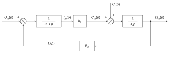
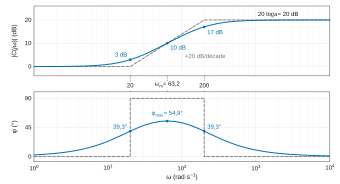
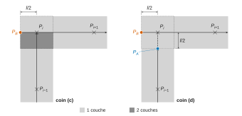
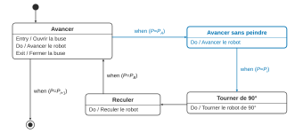
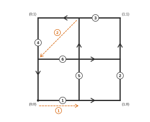

# CCINP MP — Sciences industrielles 2026 · Corrigé guidé

*Corrigé rédigé par IA, non officiel. Signalez toute erreur.*

## Présentation du sujet

**Support.** Bering est un robot autonome de traçage au sol (terrains de sport, signalisation routière). Il a deux roues motrices arrière, actionnées chacune par un servomoteur, et une ou deux roues folles à l'avant. Un GPS corrigé et une centrale inertielle permettent d'asservir son mouvement. Le fil directeur est la **validation d'exigences** du diagramme de la figure 18 : non-basculement (1.1.1), asservissement du lacet (1.1.3.2 et ses quatre exigences filles), respect des normes de tracé (1.2.2), optimisation du parcours (1.2.3).

**Conditions.** 4 h, calculatrice interdite, cinq parties annoncées indépendantes. Le Document Réponse (16 pages) est seul rendu. Il n'est pas reproduit dans nos sources : pour les questions qui s'y appuient, ce corrigé reconstruit le document à partir de l'énoncé et le signale.

| Partie | Contenu | Questions | Durée indicative |
|---|---|---|---|
| I | Cinématique : roulement sans glissement, consignes de vitesse des roues en ligne droite, en arc de cercle, en pivotement sur place | Q1–Q9 | 30 min |
| II | Centre d'inertie, matrice d'inertie, Huygens ; résultante et moment dynamiques en virage ; basculement, lecture d'abaque | Q10–Q20 | 50 min |
| III | Moteur à courant continu, inertie équivalente, schéma-bloc du lacet, correcteur à avance de phase, validation des exigences | Q21–Q33 | 1 h 20 |
| IV | Diagrammes d'états pour le tracé d'un coin sans recouvrement | Q34–Q36 | 25 min |
| V | Python : lecture de fichier, dictionnaire, algorithme glouton du plus proche voisin, mutabilité | Q37–Q46 | 35 min |

**Notions mobilisées.** Torseur cinématique d'une liaison pivot, composition des vitesses, roulement sans glissement ; dérivation vectorielle en base mobile ; barycentre, symétries matérielles, matrice d'inertie, théorème de Huygens ; théorèmes de la résultante et du moment dynamiques ; transformée de Laplace, schéma-bloc, formes canoniques, inertie équivalente par l'énergie cinétique ; diagrammes de Bode, marges, réponse d'un second ordre, correcteur à avance de phase ; diagrammes d'états SysML ; Python (fichiers, dictionnaires, copies).

**Difficulté.** Sujet de longueur raisonnable pour 4 h, très guidé : la partie II donne même les expressions de $Z_2$, $Z_3$, $Z_4$, et la partie III recale $H_{BO}$ avant le réglage du correcteur. Les difficultés réelles sont les signes de la partie I, le moment dynamique avec produit d'inertie (Q16), le raisonnement sur l'axe de basculement (Q19), la lecture fine du schéma-bloc de la figure 12 (Q22) et le réglage chiffré du correcteur sans calculatrice (Q32–Q33).

**Ce qu'en dit le rapport 2026.** La moyenne est de 9,93/20, avec un écart-type de 3,29. Le jury juge l'épreuve « plutôt classique avec une longueur assez raisonnable », mais relève des résultats de cours « parfois mal maîtrisés ou mal appliqués ». Il insiste sur trois défauts : la rétro-analyse (partir du résultat donné à la question suivante, surtout pour le signe d'un produit vectoriel), l'oubli du poids dans le principe fondamental de la dynamique, et des lacunes de base en informatique (distance euclidienne, dictionnaires). La partie IV n'a été traitée que par la moitié environ des candidats, qui l'ont en général bien réussie.

**Questions discriminantes** d'après le rapport : Q22 ($H_{pert}$ « rarement correctement réalisée »), Q23 (« très peu traitée »), Q31 (« Très souvent mal traitée »), Q32 (borne due à la rapidité), Q40, Q42 (« quasiment jamais juste ») et Q45 (« rarement juste »). Ce sont aussi les questions où une réponse juste et justifiée rapporte le plus par rapport à la moyenne.

**Questions à ne pas laisser passer.** Q1–Q9, Q10, Q12, Q17, Q21, Q25–Q27, Q30, Q34–Q36, Q37–Q39, Q43–Q44 : du cours appliqué, rapide et rentable.

**Gestion du temps.** Les parties étant indépendantes, on peut commencer par la partie V (courte et sûre) ou la partie I. La partie III est la plus longue et la plus dense en points : ne pas la laisser pour la dernière demi-heure. Le jury regrette que des candidats bloqués ne passent pas au bloc de questions suivant : il n'y a pas d'impasse à faire sur une partie entière.

---

## Partie I — Étude du déplacement de Bering

On établit la loi entrée-sortie cinématique du robot : quelles vitesses de roues imposer pour obtenir une vitesse $V$ du point $P$ et une vitesse de lacet $\omega_{10}$. Outils : torseur d'une liaison pivot, formule de changement de point, composition des mouvements, roulement sans glissement.

### Question 1

> [!INDICATION]
> Quelle est la forme du torseur cinématique d'une liaison pivot, et en quels points son moment est-il nul ?

> [!INDICATION]
> Vérifier que $C_d$ et $C_g$ appartiennent à l'axe $(P,\vec y_1)$.

#### Solution

Chaque roue est en liaison pivot d'axe $(P,\vec y_1)$ avec le châssis. Le torseur d'une pivot a pour résultante le vecteur rotation, porté par l'axe, et un moment (vitesse) nul en tout point de l'axe.

Or $\overrightarrow{PC_d} = -a\vec y_1$ et $\overrightarrow{PC_g} = a\vec y_1$ : les deux centres sont sur l'axe. Résultante en haut, moment en bas, point de réduction en indice :

$$\boxed{\{\mathcal V_{2/1}\} = \left\{\begin{matrix}\omega_{21}\,\vec y_1\\ \vec 0\end{matrix}\right\}_{C_d}}$$

$$\boxed{\{\mathcal V_{3/1}\} = \left\{\begin{matrix}\omega_{31}\,\vec y_1\\ \vec 0\end{matrix}\right\}_{C_g}}$$

> [!PIEGE]
> Les bases $\mathcal B_2$ et $\mathcal B_3$ partagent $\vec y_1$ avec $\mathcal B_1$ : la rotation se fait autour de ce vecteur commun. Ne pas permuter résultante et moment.

> [!JURY]
> Le rapport 2026 relève l'« Oubli sur l’écriture du point d’application et inversion résultante/moment. » Un torseur sans point de réduction est incomplet.

### Question 2

> [!INDICATION]
> Décomposer $\vec V_{I_d\in 2/0}$ par composition des mouvements en passant par le châssis 1.

> [!INDICATION]
> Pour chaque terme, partir du point où le torseur est connu ($C_d$ pour 2/1, $P$ pour 1/0) et transporter le moment jusqu'à $I_d$. Écrire soigneusement $\overrightarrow{I_dP}$ à partir des données $\overrightarrow{I_dC_d}$ et $\overrightarrow{PC_d}$.

#### Solution

On décompose : $\vec V_{I_d\in 2/0} = \vec V_{I_d\in 2/1} + \vec V_{I_d\in 1/0}$.

Mouvement 2/1, depuis $C_d$ :

$$\begin{aligned}
\vec V_{I_d\in 2/1} &= \vec V_{C_d\in 2/1} + \overrightarrow{I_dC_d}\wedge\vec\Omega_{2/1}\\
&= \vec 0 + r\vec z_1\wedge\omega_{21}\vec y_1\\
&= -r\,\omega_{21}\,\vec x_1
\end{aligned}$$

Mouvement 1/0, depuis $P$ : $\overrightarrow{I_dP} = r\vec z_1 + a\vec y_1$ et $\vec\Omega_{1/0} = \omega_{10}\vec z_0 = \omega_{10}\vec z_1$.

$$\begin{aligned}
\vec V_{I_d\in 1/0} &= V\vec x_1 + (r\vec z_1 + a\vec y_1)\wedge\omega_{10}\vec z_1\\
&= (V + a\,\omega_{10})\,\vec x_1
\end{aligned}$$

$$\boxed{\vec V_{I_d\in 2/0} = \left(V + a\,\omega_{10} - r\,\omega_{21}\right)\vec x_1}$$

> [!METHODE]
> Formule de changement de point : $\vec V_{A} = \vec V_{B} + \overrightarrow{AB}\wedge\vec\Omega$. Retenir l'ordre $\overrightarrow{AB}\wedge\vec\Omega$ (ou $\vec\Omega\wedge\overrightarrow{BA}$) pour ne pas se tromper de signe.

> [!PIEGE]
> Une erreur de signe sur $\overrightarrow{I_dP}$ change le signe de $a\,\omega_{10}$ et fausse toute la partie. Le résultat de Q3 sert de contrôle a posteriori, pas de guide : on calcule d'abord, on compare ensuite.

> [!JURY]
> Le rapport 2026 signale la « Rétro-analyse en utilisant la réponse donnée en Q3., erreur courante sur le calcul du produit vectoriel. » Il note aussi que « Certains candidats passent, péniblement, par la dérivation du vecteur position. » La formule de changement de point est ici la voie directe.

### Question 3

> [!INDICATION]
> Que signifie, en termes de vitesse, le roulement sans glissement d'une roue sur le sol en un point de contact ?

#### Solution

L'énoncé suppose que la roue 2 roule sans glisser en $I_d$ : la vitesse de glissement $\vec V_{I_d\in 2/0}$ est nulle. Avec Q2, $V + a\,\omega_{10} - r\,\omega_{21} = 0$, et comme $r \neq 0$ :

$$\boxed{\omega_{21} = \frac{V + a\,\omega_{10}}{r}}$$

> [!PIEGE]
> Dire que « le point $I_d$ est fixe » est faux : le point géométrique de contact se déplace sur le sol. C'est le point de la roue qui coïncide avec lui qui a une vitesse nulle par rapport au sol.

> [!JURY]
> Pour une question dont le résultat est donné, le rapport 2026 précise qu'« une attention particulière est apportée sur la justification et l’application rigoureuse de la méthode ». Il faut nommer l'hypothèse (roulement sans glissement en $I_d$) et écrire sa traduction ($\vec V_{I_d\in 2/0} = \vec 0$).

### Question 4

> [!INDICATION]
> Reprendre Q2–Q3 en remplaçant $C_d$ par $C_g$ : seul le vecteur $\overrightarrow{PC_g}$ change de signe.

#### Solution

Ici $\overrightarrow{I_gP} = r\vec z_1 - a\vec y_1$. On obtient $\vec V_{I_g\in 1/0} = (V - a\,\omega_{10})\vec x_1$ et $\vec V_{I_g\in 3/1} = -r\,\omega_{31}\vec x_1$. Le roulement sans glissement en $I_g$ donne

$$\boxed{\omega_{31} = \frac{V - a\,\omega_{10}}{r}}$$

> [!METHODE]
> Contrôle utile : $\omega_{21} - \omega_{31} = 2a\,\omega_{10}/r$. La différence des vitesses des roues commande la vitesse de lacet ; c'est le principe de la commande différentielle de la partie III.

### Question 5

> [!INDICATION]
> En ligne droite, comment évolue l'orientation du châssis ? Que vaut alors $\omega_{10}$ ?

> [!INDICATION]
> Un torseur cinématique de résultante nulle caractérise un type de mouvement bien précis.

#### Solution

En ligne droite, $\theta_{10}$ est constant, donc $\omega_{10} = 0$ : la direction $\vec x_1$ est fixe dans $\mathcal R_0$.

La trajectoire de $P$ est une droite. Le mouvement de 1/0 est une **translation rectiligne** de direction $\vec x_1$ (uniforme si $V$ est constante). Le torseur est un couple, le même en tout point :

$$\boxed{\{\mathcal V_{1/0}\} = \left\{\begin{matrix}\vec 0\\ V\vec x_1\end{matrix}\right\}_{\forall M}}$$

> [!PIEGE]
> « Ligne droite » décrit la trajectoire d'un point ; « translation rectiligne » décrit le mouvement du solide. Il faut nommer le mouvement et en donner la direction.

> [!JURY]
> Le rapport 2026 relève une « Confusion entre trajectoire et mouvement. » et l'« Oubli des caractéristiques du mouvement (direction, axes, etc.). »

### Question 6

> [!INDICATION]
> Reporter la valeur de $\omega_{10}$ trouvée en Q5 dans les résultats de Q3 et Q4.

#### Solution

$$\boxed{\omega_{21} = \omega_{31} = \frac{V}{r}}$$

Deux roues identiques à la même vitesse : trajectoire rectiligne, comme attendu.

### Question 7

> [!INDICATION]
> $P$ décrit un cercle de centre $O$ fixe. Dériver $\overrightarrow{OP}$ par rapport au temps dans $\mathcal R_0$.

> [!INDICATION]
> $\vec y_1$ tourne avec le châssis : sa dérivée dans $\mathcal R_0$ s'obtient par $\vec\Omega_{1/0}\wedge\vec y_1$.

#### Solution

$$\begin{aligned}
\vec V_{P\in 1/0} &= R\left.\frac{d\vec y_1}{dt}\right|_{\mathcal R_0}\\
&= R\,\omega_{10}\vec z_1\wedge\vec y_1\\
&= -R\,\omega_{10}\,\vec x_1
\end{aligned}$$

En identifiant avec $V\vec x_1$ :

$$\boxed{V = -R\,\omega_{10}}$$

soit $|V| = R|\omega_{10}|$, relation rappelée en partie II. Comme $\overrightarrow{OP} = +R\vec y_1$, le centre du virage est du côté $-\vec y_1$, celui de la roue droite 2. En marche avant, le robot tourne donc à droite et $\omega_{10} < 0$, ce que confirme la figure 4.

> [!PIEGE]
> Écrire $V = R\,\omega_{10}$ sans discuter l'orientation conduit en Q8 à une roue intérieure plus rapide que la roue extérieure, ce qui est physiquement absurde.

### Question 8

> [!INDICATION]
> Substituer la relation de Q7 dans Q3 et Q4, puis vérifier le résultat par trois contrôles : homogénéité, limite $R\to\infty$, roue la plus rapide.

#### Solution

Avec $\omega_{10} = -V/R$ :

$$\boxed{\omega_{21} = \frac{V}{r}\left(1 - \frac{a}{R}\right)}$$

$$\boxed{\omega_{31} = \frac{V}{r}\left(1 + \frac{a}{R}\right)}$$

Le rapport $a/R$ est sans dimension, et $R\to\infty$ redonne Q6. La roue 2, intérieure, est plus lente. Si $R = a$, la roue 2 est immobile (pivotement autour de $C_d$).

> [!METHODE]
> Les trois contrôles (dimension, cas limite, sens physique) coûtent deux lignes et sécurisent une question de signes.

> [!JURY]
> Le rapport 2026 rappelle que « Le résultat doit faire intervenir les paramètres et variables précisés dans la question. » Ici $V$, $R$, $r$ et $a$ seulement : $\omega_{10}$ doit avoir disparu.

### Question 9

> [!INDICATION]
> « Sans modification de la position du point $P$ » : que vaut $V$ ?

#### Solution

$V = 0$ et $\omega_{10} \neq 0$, d'où

$$\boxed{\omega_{21} = \frac{a\,\omega_{10}}{r}}$$

$$\boxed{\omega_{31} = -\frac{a\,\omega_{10}}{r}}$$

$$\boxed{\frac{\omega_{21}}{\omega_{31}} = -1}$$

Les roues tournent à la même vitesse en sens opposés. Le rapport a un sens car $\omega_{31} \neq 0$ ($a$, $r$, $\omega_{10}$ non nuls). C'est ce pivotement autour du point de peinture $P$ qu'utilise la partie IV.

> [!PIEGE]
> Il n'y a aucun engrenage ici : le « rapport » demandé est un rapport de vitesses angulaires, tiré de Q3 et Q4 avec $V = 0$. Le rapport 2026 cite des candidats qui « répondent par un rapport de nombre de dents » ; d'autres partent à tort du résultat de Q8, établi pour un virage de rayon $R$.

---

## Partie II — Étude du basculement du robot dans un virage

On construit un modèle inertiel simplifié, on calcule le torseur dynamique du robot en virage uniforme, puis on cherche quelle roue décolle et à quelle vitesse. Outils : symétries, barycentre, Huygens, dérivation en base mobile, théorèmes généraux.

### Question 10

> [!INDICATION]
> Chercher un plan de symétrie matérielle de l'ensemble des quatre solides modélisés.

#### Solution

Le plan $(P,\vec x_1,\vec z_1)$ est plan de symétrie matérielle. Le châssis et le réservoir, homogènes, sont symétriques par rapport à lui ; les deux stators, identiques, sont symétriques l'un de l'autre. Le centre d'inertie appartient à tout plan de symétrie matérielle, donc $\boxed{y_G = 0}$.

> [!PIEGE]
> Le résultat est donné : la question vaut par la justification. Il faut nommer un **plan** (pas un axe) de symétrie **matérielle** (masses comprises, pas seulement la géométrie) et vérifier la symétrie de chaque solide, stators compris.

> [!JURY]
> Le rapport 2026 note une « Justification parfois confuse (axe/plan de symétrie géométrique). »

### Question 11

> [!INDICATION]
> Barycentre des centres d'inertie des quatre solides. Il faut d'abord placer chacun d'eux sur la figure 5 dans le repère d'origine $P$.

> [!INDICATION]
> Lire les appuis : axe des stators passant par $P$, châssis posé sur les stators, réservoir posé sur le châssis, faces arrière du châssis et du réservoir à l'aplomb de $P$ sur la vue de côté.

#### Solution

| Solide | Masse | $x$ | $z$ |
|---|---|---|---|
| stators M1 et M2 | $m_M$ chacun | $0$ | $0$ |
| châssis C | $m_C$ | $a_C/2$ | $d_M/2 + c_C/2$ |
| réservoir R | $m_R$ | $a_R/2$ | $d_M/2 + c_C + c_R/2$ |

Avec la masse totale $m_1 = 2m_M + m_C + m_R$ :

$$\boxed{x_G = \frac{m_C\,a_C + m_R\,a_R}{2\,(2m_M + m_C + m_R)}}$$

$$\boxed{z_G = \frac{m_C\,(d_M + c_C) + m_R\,(d_M + 2c_C + c_R)}{2\,(2m_M + m_C + m_R)}}$$

Contrôle : avec $m_M = m_R = 0$, on retrouve le centre du seul châssis.

> [!PIEGE]
> Trois oublis fréquents : les stators comptent au dénominateur mais pas aux numérateurs ; le châssis est décalé de $d_M/2$ par l'épaisseur des stators ; le réservoir est au-dessus de toute la hauteur $c_C$ du châssis.

> [!JURY]
> Le rapport 2026 signale l'« Oubli fréquent de la masse totale. » Le dénominateur est $m_1$, avec les **deux** stators.

### Question 12

> [!INDICATION]
> La matrice fournie est écrite pour un cylindre d'axe $\vec z$ ; ici l'axe de révolution est $\vec y_1$.

> [!INDICATION]
> Attention : la figure donne un diamètre, la formule un rayon.

#### Solution

Rayon $d_M/2$, hauteur $h_M$, axe $\vec y_1$ ; la symétrie de révolution rend $\mathcal B_1$ principale :

$$\boxed{I(G_{M1}, M1) = \begin{pmatrix} m_M\left(\dfrac{d_M^2}{16} + \dfrac{h_M^2}{12}\right) & 0 & 0\\ 0 & \dfrac{m_M\,d_M^2}{8} & 0\\ 0 & 0 & m_M\left(\dfrac{d_M^2}{16} + \dfrac{h_M^2}{12}\right)\end{pmatrix}_{\mathcal B_1}}$$

> [!PIEGE]
> Recopier la matrice telle quelle place le moment axial $m R^2/2$ sur $\vec z_1$ au lieu de $\vec y_1$. Le rapport 2026 parle d'une « Mauvaise prise en compte du repère du cylindre. »

### Question 13

> [!INDICATION]
> Relation de Chasles par $P$. Où se trouve la section extrême du stator M1 selon $\vec y_1$ ?

> [!INDICATION]
> L'énoncé dit que les sections extrêmes des stators coïncident avec les faces du châssis de normale $\vec y_1$. Le centre du cylindre est à mi-hauteur.

#### Solution

M1 est du côté $+\vec y_1$ (vue de derrière). Sa face extrême est en $y = b_C/2$, et son centre en $y = (b_C - h_M)/2$, sur l'axe ($x = z = 0$). Avec $\overrightarrow{GP} = -x_G\vec x_1 - z_G\vec z_1$ :

$$\boxed{\overrightarrow{GG_{M1}} = -x_G\,\vec x_1 + \frac{b_C - h_M}{2}\,\vec y_1 - z_G\,\vec z_1}$$

> [!METHODE]
> La liste des variables imposée par l'énoncé ($x_G$, $z_G$, $b_C$, $h_M$) est un indice sur la géométrie à lire.

### Question 14

> [!INDICATION]
> Transport d'un moment d'inertie entre deux axes parallèles : théorème de Huygens.

> [!INDICATION]
> La distance entre les axes $(G,\vec x_1)$ et $(G_{M1},\vec x_1)$ ne fait intervenir que les composantes de $\overrightarrow{GG_{M1}}$ orthogonales à $\vec x_1$.

#### Solution

On transporte le seul terme demandé :

$$I_{Gx_1} = I_{G_{M1}x_1} + m_M\,d^2$$

avec $d^2 = \left(\frac{b_C - h_M}{2}\right)^2 + z_G^2$. D'où

$$\boxed{I_{Gx_1} = m_M\left[\frac{d_M^2}{16} + \frac{h_M^2}{12} + \left(\frac{b_C - h_M}{2}\right)^2 + z_G^2\right]}$$

> [!PIEGE]
> $x_G$ n'apparaît pas : la composante selon l'axe ne change pas la distance à l'axe. On additionne des carrés de distances, pas des distances.

> [!JURY]
> Le rapport 2026 note que « la matrice de Huyghens n’est très souvent pas bien écrite », et que « Certains calculent tous les termes de la matrice, le sujet n’en demandait qu’un seul. » Un seul moment d'inertie est demandé : inutile de transporter toute la matrice.

### Question 15

> [!INDICATION]
> La résultante dynamique vaut $m_1\,\vec a_{G,1/0}$. Exprimer $\overrightarrow{OG}$ dans $\mathcal B_1$ et dériver deux fois.

> [!INDICATION]
> Seuls les vecteurs $\vec x_1$ et $\vec y_1$ varient ; $R$, $x_G$, $z_G$ et $\omega_{10}$ sont constants.

#### Solution

On écrit $\overrightarrow{OG} = R\vec y_1 + x_G\vec x_1 + z_G\vec z_1$. Les dérivées des vecteurs de base dans $\mathcal R_0$ sont

$$\left.\frac{d\vec x_1}{dt}\right|_0 = \omega_{10}\,\vec y_1$$

$$\left.\frac{d\vec y_1}{dt}\right|_0 = -\omega_{10}\,\vec x_1$$

D'où, en dérivant deux fois :

$$\begin{aligned}
\vec V_{G,1/0} &= -R\,\omega_{10}\,\vec x_1 + x_G\,\omega_{10}\,\vec y_1\\
\vec a_{G,1/0} &= -x_G\,\omega_{10}^2\,\vec x_1 - R\,\omega_{10}^2\,\vec y_1
\end{aligned}$$

$$\boxed{\vec R_d(1/0) = -m_1\,\omega_{10}^2\left(x_G\,\vec x_1 + R\,\vec y_1\right)}$$

C'est une accélération centripète : $G$ décrit un cercle d'axe vertical passant par $O$, de rayon $\sqrt{R^2 + x_G^2}$.

> [!JURY]
> Le rapport 2026 relève un « Problème récurrent sur le calcul de la dérivation vectorielle. » Écrire explicitement la dérivée de chaque vecteur de base avant de dériver $\overrightarrow{OG}$ évite l'essentiel des erreurs.

### Question 16

> [!INDICATION]
> En $G$, le moment dynamique est la dérivée du moment cinétique, lui-même produit de la matrice d'inertie par le vecteur rotation.

> [!INDICATION]
> Les composantes de $\vec\sigma$ dans $\mathcal B_1$ sont constantes ; seule la rotation de la base contribue à la dérivée dans $\mathcal R_0$.

#### Solution

Le produit de la matrice $I(G,1)$ par le vecteur $(0, 0, \omega_{10})$ donne

$$\vec\sigma(G,1/0) = -E\,\omega_{10}\,\vec x_1 + C\,\omega_{10}\,\vec z_1$$

En $G$, $\vec\delta(G,1/0)$ est la dérivée de $\vec\sigma(G,1/0)$ dans $\mathcal R_0$ :

$$\begin{aligned}
\vec\delta(G,1/0) &= \vec 0 + \omega_{10}\vec z_1\wedge\vec\sigma(G,1/0)\\
&= \omega_{10}\vec z_1\wedge\left(-E\,\omega_{10}\,\vec x_1 + C\,\omega_{10}\,\vec z_1\right)\\
&= -E\,\omega_{10}^2\,\vec y_1
\end{aligned}$$

$$\boxed{\vec\delta(G,1/0) = -E\,\omega_{10}^2\,\vec y_1}$$

> [!PIEGE]
> Dériver les composantes sans le terme $\vec\Omega_{1/0}\wedge\vec\sigma$ donne $\vec 0$ ; oublier le produit d'inertie $E$ aussi. Le terme obtenu est le couple qui apparaît dans les expressions de $Z_2$, $Z_3$, $Z_4$ fournies plus loin.

> [!JURY]
> Le rapport 2026 signale un « Problème récurrent sur le calcul d’un produit matrice/vecteur. » Écrire la matrice et le vecteur colonne côte à côte, puis multiplier ligne par ligne.

### Question 17

> [!INDICATION]
> Faire le bilan des actions extérieures au robot, puis appliquer le théorème de la résultante dynamique dans $\mathcal R_0$ galiléen.

#### Solution

Actions extérieures : le poids $-m_1g\,\vec z_1$, appliqué en $G$, et les actions du sol sur les roues 2, 3 et 4. Avec Q15 :

$$\boxed{\begin{aligned} X_2 + X_3 + X_4 &= -m_1\,\omega_{10}^2\,x_G\\ Y_2 + Y_3 + Y_4 &= -m_1\,\omega_{10}^2\,R\\ Z_2 + Z_3 + Z_4 - m_1 g &= 0\end{aligned}}$$

> [!METHODE]
> La troisième équation sert de contrôle aux expressions fournies : on vérifie que $Z_2 + Z_3 + Z_4 = m_1 g$.

> [!JURY]
> Le rapport 2026 relève l'« Oubli des actions de la pesanteur. » Il recommande fortement un inventaire rigoureux des actions mécaniques extérieures à l'ensemble isolé, écrit avant toute équation.

### Question 18

> [!INDICATION]
> De quel côté du robot se trouve le centre du virage ? Quelle roue est à l'intérieur ?

> [!INDICATION]
> Comparer $Z_2$ et $Z_3$ en formant leur différence à partir des expressions fournies ; examiner aussi le signe de $Z_4$.

#### Solution

Une roue ne touche plus le sol quand l'effort normal $Z_i$ qu'elle reçoit s'annule. On a $\overrightarrow{PO} = -R\vec y_1$ : le centre du virage est du côté de la roue 2 ($\overrightarrow{PC_d} = -a\vec y_1$), qui est donc intérieure. Les expressions données fournissent

$$Z_3 - Z_2 = \frac{m_1\,\omega_{10}^2\,(z_G + r)\,R}{a} > 0$$

Donc $Z_2 < Z_3$ dès que le robot tourne. La roue avant ne décolle pas non plus : $Z_4$ contient le terme de poids $x_G m_1 g/b > 0$ et un terme $m_1\omega_{10}^2 x_G(z_G + r)/b > 0$ qui croît avec la vitesse (le produit d'inertie $E$ étant d'influence secondaire).

$Z_2$ est la plus faible et décroît quand $\omega_{10}^2$ croît : **la roue 2 (droite, intérieure) décolle**. La vitesse limite s'obtient en écrivant $\boxed{Z_2 = 0}$, puis $V = R|\omega_{10}|$.

> [!PIEGE]
> Ce n'est pas la roue extérieure qui décolle : l'effet d'inertie dirigé vers l'extérieur charge les roues extérieures et décharge les roues intérieures.

> [!JURY]
> Pour Q18 comme pour Q19, le rapport 2026 juge la « Réponse souvent non justifiée et parfois au hasard. » Le signe de $Z_3 - Z_2$, tiré des expressions fournies, est la justification attendue.

### Question 19

> [!INDICATION]
> Au moment du basculement, deux roues décollent : lesquelles, et autour de quelle droite le robot tend-il à pivoter ?

> [!INDICATION]
> Écrire le théorème du moment dynamique en un point de cette droite, projeté sur sa direction : les actions des roues restées au sol disparaissent.

> [!INDICATION]
> Utiliser $\vec\delta(J) = \vec\delta(G) + \overrightarrow{JG}\wedge m_1\vec a_G$ avec les résultats de Q15 et Q16.

#### Solution

Les deux roues intérieures (côté $-\vec y_1$) décollent. Le robot pivote autour de la droite $\Delta$ des contacts extérieurs, de direction $\vec x_1$, au niveau du sol.

Soit $J \in \Delta$ avec $\overrightarrow{PJ} = a\vec y_1 - r\vec z_1$. Alors $\overrightarrow{JG} = x_G\vec x_1 - a\vec y_1 + (z_G + r)\vec z_1$. On projette sur $\vec x_1$ le théorème du moment dynamique en $J$ ; les actions du sol ont un moment nul sur $\Delta$.

- Moment dynamique : $\vec\delta(G)\cdot\vec x_1 = 0$, et le terme de transport vaut $m_1\,\omega_{10}^2\,R\,(z_G + r)$.
- Poids : $\left[\overrightarrow{JG}\wedge(-m_1 g\vec z_1)\right]\cdot\vec x_1 = m_1\,g\,a$.

On en déduit

$$m_1\,\omega_{10}^2\,R\,(z_G + r) = m_1\,g\,a$$

$$V_{max} = \sqrt{\frac{g\,a\,R}{z_G + r}}$$

Conclusion :

- **augmenter $R$ augmente la vitesse maximale** (l'accélération centripète $V^2/R$ diminue à vitesse donnée) ;
- **augmenter $a$ augmente la vitesse maximale** (le bras de levier stabilisant du poids autour de $\Delta$ croît).

> [!METHODE]
> Pour un problème de basculement, le moment par rapport à l'axe de basculement élimine d'un coup toutes les actions inconnues des appuis restants. C'est plus rapide que la résolution du système complet.

> [!PIEGE]
> Une réponse de « bon sens » sans justification vaut peu : le rapport 2026 renvoie ici au même défaut qu'en Q18 (« Idem »). La loi $V_{max}^2(z_G + r) = \text{cte}$ est d'ailleurs cohérente avec l'allure de la courbe « deux roues folles » de la figure 8.

### Question 20

> [!INDICATION]
> Quelles sont les conditions de l'exigence 1.1.1 ? Comparer avec les conditions de tracé de la figure 8.

> [!INDICATION]
> Les courbes sont décroissantes : la condition $V_{max} \geq$ seuil donne un intervalle de $z_G$.

#### Solution

L'exigence 1.1.1 impose de ne pas basculer à $1{,}5\ \text{m·s}^{-1}$ dans un virage de $0{,}5$ m, rayon pour lequel la figure 8 est tracée. On trace l'horizontale $V = 1{,}5\ \text{m·s}^{-1}$ :

- **une roue folle** : intersection vers $z_G \approx 0{,}35$ m, donc $\boxed{z_G \lesssim 0{,}35\ \text{m}}$ ;
- **deux roues folles** : la courbe reste au-dessus du seuil sur tout le graphe (elle l'atteint en $z_G = 1$ m), donc $\boxed{z_G \lesssim 1\ \text{m}}$, toute hauteur réaliste convient.

La version à deux roues folles respecte largement l'exigence. Avec une roue folle, il faut maintenir $z_G$ sous 35 cm environ, y compris réservoir plein.

> [!JURY]
> Le rapport 2026 constate que « La lecture de courbes semble difficile pour bon nombre de candidats ». On attend un intervalle (et non une seule valeur), le sens de l'inégalité justifié par la monotonie des courbes, et une conclusion qui cite l'exigence et ses valeurs.

---

## Partie III — Étude de l'asservissement du déplacement

On modélise le moteur, on calcule l'inertie qu'il voit, on établit la boucle ouverte de l'asservissement en lacet, puis on règle un correcteur à avance de phase et on confronte les performances aux exigences 1.1.3.2.x. Dans cette partie, $b$ est la voie du robot ($b = 2a$ avec les notations de la partie I).

### Question 21

> [!INDICATION]
> Sous les conditions de Heaviside, une dérivée temporelle devient une multiplication par $p$.

> [!INDICATION]
> Chaque équation devient un bloc ou un comparateur ; la force contre-électromotrice crée une boucle de retour interne.

#### Solution

$$\begin{aligned}
U_m(p) &= (R + Lp)\,I_m(p) + E(p)\\
J_e\,p\,\Omega_m(p) &= C_m(p) + C_r(p)\\
E(p) &= k_e\,\Omega_m(p)\\
C_m(p) &= k_c\,I_m(p)
\end{aligned}$$

Schéma-bloc (figure 1) : une chaîne électrique, couple, mécanique, bouclée par la force contre-électromotrice $E = k_e\,\Omega_m$ vers l'entrée (−) du comparateur.



> [!PIEGE]
> Le couple $C_r$ entre avec le signe + : l'énoncé écrit $J_e\dot\omega_m = c_m + c_r$ (sa valeur sera négative en pratique).

### Question 22

> [!INDICATION]
> Éliminer $I_m$, $C_m$ et $E$ pour exprimer $\Omega_m$ en fonction de $U_m$ et $C_r$.

> [!INDICATION]
> Regarder attentivement la figure 12 : à quel endroit la perturbation rejoint-elle la chaîne ? $H_{pert}$ n'est pas forcément le rapport $\Omega_m/C_r$.

> [!INDICATION]
> Mettre la relation obtenue sous la forme $\Omega_m = H_m\,(U_m + H_{pert}\,C_r)$ et identifier.

#### Solution

En éliminant $I_m$, $C_m$ et $E$ :

$$\left[J_e\,p\,(R + Lp) + k_c k_e\right]\Omega_m = k_c\,U_m + (R + Lp)\,C_r$$

On divise par $k_ck_e$ pour obtenir la forme canonique (terme constant égal à 1 au dénominateur) :

$$\Omega_m = \frac{\dfrac{1}{k_e}}{1 + \dfrac{R J_e}{k_c k_e}\,p + \dfrac{L J_e}{k_c k_e}\,p^2}\left[U_m + \frac{R + Lp}{k_c}\,C_r\right]$$

Sur la figure 12, $C_r$ traverse $H_{pert}$ puis s'ajoute à $U_m$ avant $H_m$ : $\Omega_m = H_m\,(U_m + H_{pert}\,C_r)$. Par identification :

$$\boxed{H_m(p) = \frac{K_m}{1 + \dfrac{2\xi}{\omega_0}\,p + \dfrac{p^2}{\omega_0^2}}}$$

avec les paramètres caractéristiques

$$\begin{aligned}
K_m &= \frac{1}{k_e}\\
\omega_0 &= \sqrt{\frac{k_c k_e}{J_e L}}\\
\xi &= \frac{R}{2}\sqrt{\frac{J_e}{L\,k_c k_e}}
\end{aligned}$$

$$\boxed{H_{pert}(p) = \frac{R}{k_c}\left(1 + \frac{L}{R}\,p\right)}$$

> [!PIEGE]
> Calculer $\Omega_m/C_r$ à $U_m = 0$ donne $H_m\cdot H_{pert}$, pas $H_{pert}$. La position du sommateur sur le schéma-bloc fixe la définition de chaque fonction de transfert.

> [!METHODE]
> Pour $\xi$, partir de $\dfrac{2\xi}{\omega_0} = \dfrac{RJ_e}{k_ck_e}$ et substituer $\omega_0$ plutôt que de manipuler des carrés.
>
> Contrôle : $k_ck_e$ est homogène à des $\text{J}$ (ou $\text{N·m·s}$), donc $LJ_e/(k_ck_e)$ est bien en $\text{s}^2$.

> [!JURY]
> Le rapport 2026 relève une « Formule de Black parfois non maîtrisée, difficulté ou oubli de mise sous forme canonique. » Il ajoute : « Détermination de Hpert difficile et rarement correctement réalisée. » C'est l'une des questions discriminantes du sujet.

### Question 23

> [!INDICATION]
> L'inertie équivalente se définit par l'énergie cinétique : écrire celle de tout ce qui bouge en ligne droite, en fonction de la vitesse d'un moteur.

> [!INDICATION]
> Que dit $T(p) = r/p$ sur le lien entre rotation du moteur et rotation de la roue ? Combien de moteurs se partagent l'énergie cinétique du robot ?

#### Solution

$T(p) = r/p$ donne $\dot d = r\,\omega_m$ : la vitesse d'avance est $v = r\,\omega_m$ et la roue est entraînée directement à $\omega_m$.

En ligne droite, le châssis est en translation et $\omega_{mg} = \omega_{md} = \omega_m$. L'énergie cinétique de l'ensemble (robot en translation, deux roues et deux rotors en rotation), répartie sur les deux moteurs, s'écrit

$$\frac12\,m\,r^2\,\omega_m^2 + 2\cdot\frac12\,J_r\,\omega_m^2 + 2\cdot\frac12\,J_m\,\omega_m^2 = 2\cdot\frac12\,J_e\,\omega_m^2$$

$$\boxed{J_e = J_m + J_r + \frac{m\,r^2}{2}}$$

AN, sans calculatrice : $r^2 = 0{,}0361\ \text{m}^2$.

- Pour $m = 7{,}7$ kg (maximum), $mr^2/2 \approx 0{,}139$.
- Pour $m \approx 7{,}7 - 4{,}6 = 3{,}1$ kg (robot sans la charge maximale de l'exigence 1.3), $mr^2/2 \approx 0{,}056$.

En ajoutant $J_r = 0{,}005$ et $J_m$ négligeable :

$$\boxed{6\cdot10^{-2}\ \text{kg·m}^2 \lesssim J_e \lesssim 1{,}4\cdot10^{-1}\ \text{kg·m}^2}$$

Le terme $mr^2/2$ pèse 92 à 96 % de $J_e$.

> [!PIEGE]
> Le facteur $1/2$ devant $mr^2$ vient de ce que deux moteurs entraînent la même masse. L'oublier double la masse ramenée sur chaque arbre.

> [!JURY]
> Le rapport 2026 : « Question très peu traitée. L’écriture de l’énergie cinétique de l’ensemble est très souvent fausse. L’application numérique approchée a été très rarement traitée. » Sans calculatrice, on arrondit franchement ($0{,}19^2 \approx 0{,}036$) : l'ordre de grandeur et l'encadrement suffisent.

### Question 24

> [!INDICATION]
> Par quel paramètre la quantité de peinture intervient-elle dans le modèle du moteur ?

> [!INDICATION]
> Regarder comment $K_m$, $\omega_0$ et $\xi$ (Q22) dépendent de $J_e$.

#### Solution

La peinture agit sur $m$, donc sur $J_e$ (environ ×2,3 entre vide et plein). D'après Q22 :

- $K_m = 1/k_e$ est **inchangé** : la vitesse en régime permanent ne dépend pas du remplissage ;
- $\omega_0 \propto 1/\sqrt{J_e}$ **diminue** et $\xi \propto \sqrt{J_e}$ **augmente**, le produit $\xi\omega_0 = R/(2L)$ restant constant.

Le moteur devient plus lent. Dans le modèle du premier ordre utilisé ensuite, $\tau_m = RJ_e/(k_ck_e)$ croît proportionnellement à $J_e$. Le réglage doit être valable réservoir plein, cas le plus lent.

> [!JURY]
> Le rapport 2026 regrette qu'une réponse « scientifique » soit très rare et que « beaucoup de candidats énoncent des banalités ». « Le robot est plus lourd » ne suffit pas : il faut dire quel paramètre du modèle change ($J_e$) et dans quel sens évoluent $K_m$, $\omega_0$, $\xi$ ou $\tau_m$.

### Question 25

> [!INDICATION]
> Suivre les signes le long de la figure 11 : comparateur d'entrée, puis les deux comparateurs qui produisent $\omega_{cg}$ et $\omega_{cd}$.

> [!INDICATION]
> Vérifier ensuite que la correction fait bien revenir $\beta$ vers 0 : une roue plus rapide fait tourner le robot du côté opposé.

#### Solution

Avec $\beta_c = 0$, $\varepsilon_\beta = -\beta$ ; $\Delta\Omega_c$ a le signe de $\varepsilon_\beta$ (gains positifs). La figure 11 donne $\Omega_{cg} = \Omega_c - \Delta\Omega_c$ et $\Omega_{cd} = \Omega_c + \Delta\Omega_c$.

| Signe de $\beta$ mesuré | Signe de $\varepsilon_\beta$ | Signe de $\Delta\Omega_c$ | Évolution de $\Omega_{mg}$ | Évolution de $\Omega_{md}$ |
|---|---|---|---|---|
| $\beta > 0$ | $-$ | $-$ | ↗ | ↘ |
| $\beta < 0$ | $+$ | $+$ | ↘ | ↗ |

Si $\beta > 0$ (robot trop orienté à gauche), la roue gauche accélère et la droite ralentit : le robot tourne à droite et $\beta$ revient vers 0. La boucle est bien une contre-réaction. (Le tableau du Document Réponse n'est pas disponible ; sa forme exacte peut différer, le contenu reste celui-ci.)

> [!PIEGE]
> Un tableau dont la conclusion éloigne $\beta$ de 0 est incohérent : le contrôle physique de la dernière phrase le détecte. Le rapport 2026 juge cette question « simple de lecture du schéma-bloc » mais note que les réponses y « sont souvent incohérentes ».

### Question 26

> [!INDICATION]
> Écrire les deux voies, gauche et droite, puis la différence $d_d - d_g$.

#### Solution

$$\beta = \frac{T\,H_m\left[(\Omega_c + \Delta\Omega_c) - (\Omega_c - \Delta\Omega_c)\right]}{b}$$

$$\boxed{H_1(p) = \frac{2\,H_m(p)\,T(p)}{b}}$$

La consigne commune $\Omega_c$ disparaît parce que les deux chaînes sont identiques ; $\Delta\Omega_c$, retranché à gauche et ajouté à droite, compte deux fois.

> [!PIEGE]
> Le facteur 2 se perd si l'on ne raisonne que sur une voie. Le rapport 2026 : « L’oubli du facteur 2 est très courant. »

### Question 27

> [!INDICATION]
> Retour unitaire : la boucle ouverte est le produit des blocs de la chaîne directe.

#### Solution

Avec $H_m = K_m/(1 + \tau_m p)$ et $T = r/p$ :

$$\begin{aligned}
H_{BO}(p) &= C(p)\,k_a\,H_1(p)\\
&= \frac{2\,k_a\,r\,K_m}{b}\cdot\frac{C(p)}{p\,(1 + \tau_m\,p)}
\end{aligned}$$

Classe 1 : l'intégrateur vient de la transmission, qui transforme une vitesse en distance. Pour $C = 1$, on retrouve la forme $5/[p(1 + 0{,}05p)]$ retenue ensuite, avec $\tau_m = 0{,}05$ s et $2k_arK_m/b = 5\ \text{s}^{-1}$.

> [!JURY]
> Le rapport 2026 juge la « Réponse souvent partielle. » On attend l'expression littérale complète, en fonction des paramètres de l'étude ($C(p)$, $k_a$, $r$, $K_m$, $\tau_m$, $b$), et non le seul produit des blocs.

### Question 28

> [!INDICATION]
> Quelles sont les exigences « temporelles » filles de 1.1.3.2 ? Pour chacune, quelle grandeur lire sur la réponse indicielle ?

> [!INDICATION]
> À défaut de courbe, la boucle fermée de $5/[p(1 + 0{,}05p)]$ se calcule exactement : identifier $\omega_0$ et $\xi$.

#### Solution

$$\begin{aligned}
\frac{\beta}{\beta_c} &= \frac{5}{0{,}05\,p^2 + p + 5}\\
&= \frac{100}{(p + 10)^2}
\end{aligned}$$

On identifie $\omega_0 = 10\ \text{rad·s}^{-1}$ et $\xi = 1$.

| Exigence | Critère | Système non corrigé | Verdict |
|---|---|---|---|
| 1.1.3.2.1 | erreur statique nulle | $\beta \to 1°$ (classe 1) | satisfaite |
| 1.1.3.2.4 | dépassement $< 10\ \%$ | aucun ($\xi = 1$) | satisfaite |
| 1.1.3.2.2 | $t_{5\%} < 0{,}01$ s | $t_{5\%} \approx 4{,}74/\omega_0 \approx 0{,}47$ s | **non satisfaite** |

En complément, $\omega_{0\,\text{dB}} \approx 4{,}9$ rad/s (bande passante insuffisante) et $M_\varphi \approx 76°$. **Le système non corrigé est précis, stable, sans dépassement, mais beaucoup trop lent** (facteur 47 sur le temps de réponse).

> [!METHODE]
> Pour $\xi = 1$, l'abaque du temps de réponse réduit donne $t_{5\%}\,\omega_0 \approx 4{,}75$ ; on peut aussi lire directement le temps sur la courbe à 0,95°.

> [!JURY]
> Le rapport 2026 : « Bon nombre de candidats se limitent à la validation d’un seul critère de performances alors que la question fait bien référence à plusieurs exigences. » Un tableau exigence par exigence, avec valeur lue et verdict, répond à cette attente.

### Question 29

> [!INDICATION]
> Partir du diagnostic de Q28 : quelle performance faut-il améliorer, lesquelles faut-il préserver ?

> [!INDICATION]
> Évaluer ce que donnerait un simple gain réglé pour atteindre la bande passante voulue.

#### Solution

Seule la rapidité est en défaut. Un gain pur plaçant $\omega_{0\,\text{dB}}$ à 100 rad/s laisserait une marge bien en dessous de 45° :

$$M_\varphi = 90° - \arctan 5 \approx 11°$$

La précision est déjà acquise : $H_{BO}$ est de classe 1, l'erreur statique est nulle (exigence 1.1.3.2.1). Une action intégrale est donc inutile et coûterait de la phase.

L'avance de phase relève le gain en hautes fréquences (donc $\omega_{0\,\text{dB}}$) et apporte de la phase autour de la nouvelle coupure. Elle ne change pas la classe : la précision est conservée. **C'est le correcteur adapté.**

> [!JURY]
> Le rapport 2026 : « Le critère de rapidité est énoncé, mais pas celui de précision. » La justification complète dit ce que le correcteur améliore (rapidité) **et** ce qu'il préserve (précision par la classe, stabilité par l'apport de phase).

### Question 30

> [!INDICATION]
> Où sont les deux cassures du correcteur, et entre elles quelle est la pente asymptotique de son gain ?

> [!INDICATION]
> « À partir de » fixe la première cassure, « sur une décade » fixe le rapport des deux.

#### Solution

La cassure de $H_{BO}$ est $1/0{,}05 = 20$ rad/s. Il faut donc

$$\begin{aligned}
\frac{1}{a\tau} &= 20\ \text{rad·s}^{-1}\\
\frac{1}{\tau} &= 200\ \text{rad·s}^{-1}
\end{aligned}$$

d'où

$$\boxed{\tau = 5\cdot10^{-3}\ \text{s}}$$

$$\boxed{a = 10}$$

Alors $a\tau = 0{,}05$ s : le zéro du correcteur compense le pôle du moteur, et $H_{BO}^c = \dfrac{5K_p}{p\,(1 + 0{,}005\,p)}$.

> [!PIEGE]
> Centrer l'avance de phase sur 20 rad/s ou prendre $a = \sqrt{10}$ sont des lectures erronées de l'énoncé. Le rapport 2026 parle d'une « Méthode de réglage du correcteur peu maîtrisée (action asymptotique sur une décade). »

### Question 31

> [!INDICATION]
> Tracer d'abord les asymptotes de chaque facteur (un zéro, un pôle), puis les sommer.

> [!INDICATION]
> Valeurs remarquables : écarts aux asymptotes aux cassures, phase maximale et pulsation où elle est atteinte (moyenne géométrique des cassures).

#### Solution

$C(p) = \dfrac{1 + 0{,}05p}{1 + 0{,}005p}$.

**Gain.** Asymptotes : 0 dB jusqu'à 20 rad/s, $+20$ dB/décade de 20 à 200 rad/s, 20 dB au-delà. Courbe réelle : 3 dB à 20 rad/s, 10 dB à 63,2 rad/s, 17 dB à 200 rad/s.

**Phase.** Asymptotes en créneau : 0° jusqu'à 20 rad/s, $+90°$ de 20 à 200 rad/s, 0° au-delà. Courbe réelle en cloche : 39,3° aux deux cassures, maximum en

$$\omega_m = \sqrt{20\times200} \approx 63{,}2\ \text{rad·s}^{-1}$$

où elle vaut

$$\varphi_{max} = \arcsin\frac{a - 1}{a + 1} = \arcsin\frac{9}{11} \approx 55°$$



| $\omega$ (rad/s) | 2 | 20 | 63,2 | 200 | 2000 |
|---|---|---|---|---|---|
| gain asymptotique (dB) | 0 | 0 | 10 | 20 | 20 |
| gain réel (dB) | ≈ 0 | 3,0 | 10 | 17,0 | ≈ 20 |
| phase asymptotique | 0° | 0°/90° | 90° | 90°/0° | 0° |
| phase réelle | ≈ 5° | 39,3° | 54,9° | 39,3° | ≈ 5° |

> [!PIEGE]
> Une avance de phase a une phase **positive** et un gain qui **monte** : un tracé qui descend est celui d'un retard de phase. $\omega_m$ est la moyenne géométrique des cassures (milieu en échelle logarithmique), pas la moyenne arithmétique 110 rad/s.

> [!JURY]
> Le rapport 2026 : question « Très souvent mal traitée », avec « confusion entre avance et retard de phase, pulsation de cassure incohérente (même par rapport à la réponse donnée en Q30) ». Les cassures du tracé doivent être celles calculées en Q30.

### Question 32

> [!INDICATION]
> Traduire chacune des deux exigences (marge de phase, bande passante) en une condition sur la pulsation de coupure à 0 dB.

> [!INDICATION]
> La forme $10^{p/q}$ suggère un raisonnement en décibels sur le diagramme tracé pour $K_p = 1$ : de combien faut-il relever la courbe ?

#### Solution

La phase de $H_{BO}^c$ vaut $-90° - \arctan(0{,}005\,\omega)$ et reste au-dessus de $-180°$ : $M_G$ est infinie. Les deux autres exigences portent sur la coupure :

- **stabilité** : $M_\varphi = 90° - \arctan(0{,}005\,\omega_{0\,\text{dB}}) > 45°$ impose $\omega_{0\,\text{dB}} < 200$ rad/s ;
- **rapidité** : la bande passante impose $\omega_{0\,\text{dB}} > 100$ rad/s.

Pour $K_p = 1$, le gain vaut environ $-27$ dB à 100 rad/s et $-35$ dB à 200 rad/s. La rapidité donne une **valeur minimale** de $K_p$ (relever de plus de 27 dB), la stabilité une **valeur maximale** (moins de 35 dB) :

$$\boxed{10^{27/20} < K_p < 10^{35/20}}$$

soit $22{,}4 < K_p < 56$.

> [!PIEGE]
> Lire sur l'asymptote au lieu de la courbe réelle fait perdre 1 à 3 dB.

> [!JURY]
> Le rapport 2026 : « La contrainte sur la marge de stabilité est maîtrisée mais pas celle sur la rapidité. Le fait de trouver une valeur limite (supérieure ou inférieure du gain suivant le cas) n’est pas très souvent mentionnée. » Chaque exigence doit être reliée explicitement à la borne qu'elle fournit.

### Question 33

> [!INDICATION]
> Écrire la boucle fermée et identifier $\omega_0$ et $\xi$ en fonction de $K_p$. Que remarquez-vous sur le produit $\xi\,\omega_0$ ?

> [!INDICATION]
> Passer en revue les quatre exigences filles de 1.1.3.2 une par une, avec une valeur numérique pour chacune.

#### Solution

En boucle fermée :

$$\frac{\beta}{\beta_c} = \frac{1000\,K_p}{p^2 + 200\,p + 1000\,K_p}$$

On identifie $\omega_0 = \sqrt{1000K_p}$ et $\xi = 100/\omega_0$. La partie réelle des pôles vaut $-100\ \text{s}^{-1}$ pour tout $K_p > 10$.

| $K_p$ | $\omega_0$ (rad/s) | $\xi$ | dépassement | $t_{5\%}$ |
|---|---|---|---|---|
| 22,4 | 150 | 0,67 | 5,9 % | 0,033 s |
| 28,6 | 169 | 0,59 | 10 % | 0,031 s |
| 56 | 237 | 0,42 | 23 % | 0,031 s |

- 1.1.3.2.1 : erreur statique nulle, **satisfaite** (classe 1).
- 1.1.3.2.3 : stabilité, **satisfaite** ($M_\varphi$ entre 45° et 63°, $M_G$ infinie).
- 1.1.3.2.4 : dépassement $< 10\ \%$ si $K_p < 28{,}6$ ; on restreint donc à $22{,}4 < K_p < 28{,}6$.
- 1.1.3.2.2 : bande passante **satisfaite**, mais $t_{5\%} \approx 0{,}03$ s $> 0{,}01$ s : **non satisfaite**.

**L'exigence 1.1.3.2 n'est pas entièrement validée** : aucun $K_p$ ne ramène le temps de réponse sous 0,01 s. Les pôles restent à partie réelle $-100\ \text{s}^{-1}$, fixée par le pôle du correcteur. Il faudrait réduire $\tau_m$ (boucle de vitesse plus performante) ou changer de structure de correction.

> [!METHODE]
> Pour un second ordre $\omega_0^2/(p^2 + 2\xi\omega_0 p + \omega_0^2)$, le dépassement $D = \exp\left(-\pi\xi/\sqrt{1 - \xi^2}\right)$ vaut 10 % pour $\xi \approx 0{,}59$ et 5 % pour $\xi \approx 0{,}69$ ; ces deux valeurs méritent d'être connues.

> [!JURY]
> Pour Q33, le rapport 2026 renvoie au défaut de Q28 (« Idem Q28. ») : se limiter à un seul critère. Il faut conclure sur **chacune** des exigences 1.1.3.2.x, en comparant une valeur à un critère, et signaler celle qui n'est pas atteinte en expliquant pourquoi.

---

## Partie IV — Étude de l'élaboration d'un coin

On décrit par des diagrammes d'états quatre manières de tracer un angle droit, et on place les points intermédiaires qui suppriment manque et recouvrement. La buse dépose une ligne de largeur $L$ (notée $l$ dans le texte), centrée sur $P$, perpendiculaire au déplacement.

On note $\vec u_1$ la direction $P_{i-1}\to P_i$ et $\vec u_2$ la direction $P_i\to P_{i+1}$.

Le rapport 2026 indique que la moitié environ des candidats ont traité cette partie et l'ont en général bien réussie : ce sont des points accessibles.

### Question 34

> [!INDICATION]
> Les gardes ① et ② sont les deux transitions qui quittent l'état `Avancer` : où le robot doit-il cesser d'avancer ?

> [!INDICATION]
> Qu'est-ce qui distingue géométriquement les traces (a) et (b) ? Que balaie une ligne de peinture qui pivote de 90° autour de son milieu ?

#### Solution

Dans les deux cas, le robot avance jusqu'à $P_i$, pivote sur place de 90°, puis avance jusqu'à $P_{i+1}$.

Une ligne de largeur $L$ pivotant autour de $P_i$ balaie deux quarts de disque de rayon $L/2$ opposés par le sommet. C'est exactement l'arrondi extérieur et le quart de disque à trois couches de (b). En (b), la buse est donc ouverte pendant la rotation ; en (a), elle reste fermée (l'action `Exit / Fermer la buse` d'`Avancer` l'a fermée).

| | ① garde `Avancer` → `Tourner` | ② garde `Avancer` → état final | ③ action de `Tourner` | ④ action de `Tourner` |
|---|---|---|---|---|
| coin (a) | `when (P = Pi)` | `when (P = Pi+1)` | × | × |
| coin (b) | `when (P = Pi)` | `when (P = Pi+1)` | `Entry / Ouvrir la buse` | `Exit / Fermer la buse` |

> [!PIEGE]
> Une garde est une condition (`when (...)`), une action est précédée de son moment d'exécution (`Entry`, `Do`, `Exit`). Ne pas mélanger les deux colonnes, et marquer × les cases vides comme demandé.

> [!JURY]
> Le rapport 2026 n'a qu'une remarque : « Attention sur la syntaxe du when. » On recopie la forme de la figure 16, `when (P = Pi)`, condition entre parenthèses.

### Question 35

> [!INDICATION]
> Traduire la figure 16 en suite de mouvements. Après la rotation, dans quel sens se fait le recul ?

> [!INDICATION]
> Comparer la zone à deux couches de (c) à celle de (a) : où doit commencer la seconde bande pour couvrir aussi le quart extérieur du carré de coin ?

#### Solution

Séquence : avancer en peignant jusqu'à $P_i$, pivoter de 90°, reculer selon $-\vec u_2$ jusqu'à $P_B$, puis avancer en peignant jusqu'à $P_{i+1}$. La première bande s'arrête au niveau de $P_i$ ; la seconde commence en $P_B$.

Il faut couvrir l'angle extérieur et obtenir la zone à deux couches de (c), qui occupe toute la moitié du carré de coin située du côté de $P_{i-1}$. La seconde bande doit donc commencer au bord extérieur de la première :

$$\boxed{\overrightarrow{P_iP_B} = -\frac{l}{2}\,\vec u_2}$$

$P_B$ est sur la droite $(P_iP_{i+1})$, à $l/2$ de $P_i$, du côté opposé à $P_{i+1}$ ; on le reporte au même endroit sur la figure (d).

> [!PIEGE]
> $P_B$ ne peut pas être entre $P_i$ et $P_{i+1}$ : le robot l'atteint en reculant.

### Question 36

> [!INDICATION]
> En (d), la seconde bande couvre déjà tout le carré de coin. Où doit s'arrêter la première pour ne pas la chevaucher ?

> [!INDICATION]
> Le pivotement se fait sans déplacer $P$ : en quel point doit-il avoir lieu pour que la ligne suivante soit bien sur $(P_iP_{i+1})$ ? Comment rejoindre ce point sans peindre ?

#### Solution

$$\boxed{\overrightarrow{P_iP_A} = -\frac{l}{2}\,\vec u_1}$$



$P_A$ est sur $(P_{i-1}P_i)$, à $l/2$ avant $P_i$ (figure 3).

Le pivotement doit avoir lieu en $P_i$, seul point commun aux deux droites. Le robot continue donc d'avancer buse fermée de $P_A$ à $P_i$, ce qui demande un second état `Avancer sans peindre`, sans action sur la buse (figure 4).



Le tracé obtenu est le coin en équerre sans aucune surépaisseur de la figure 15(d).

> [!METHODE]
> Pour concevoir un diagramme d'états, écrire d'abord la séquence de mouvements et l'état de la buse sur chaque segment, puis faire un état par couple (mouvement, état de la buse) et une garde par point de changement.

---

## Partie V — Optimisation du parcours de marquage (ITC)

On lit un fichier texte dans un dictionnaire, puis on construit un parcours par un algorithme glouton (toujours aller à l'extrémité la plus proche). Le rapport 2026 juge les bases souvent fragiles : distance euclidienne mal écrite, dictionnaires mal maîtrisés, et des confusions « entre clé/indice et coordonnées » dans le code comme dans les commentaires. Les scripts du Document Réponse sont reconstruits d'après l'énoncé :

```python
fichier = open("carre.txt", "r")
traces = {}
k = 0
for ligne in fichier:
    if k > 0:
        # ligne manquante 1
        # ligne manquante 2
    k = k + 1
fichier.close()
```

### Question 37

> [!INDICATION]
> Que contient la première ligne du fichier `carre.txt` de la figure 17 ?

> [!INDICATION]
> Comparer le rang d'une ligne dans le fichier et la clé attendue dans le dictionnaire.

#### Solution

`k` compte les lignes lues (0 pour la première). La première ligne est l'en-tête `xp1 yp1 xp2 yp2` : la condition `if k > 0` l'écarte, car sa conversion en `float` lèverait une `ValueError`. `k` sert aussi à numéroter : la ligne de rang `k` du fichier est la ligne à tracer de clé `k-1`, ce qui fait partir les clés de 0.

> [!JURY]
> Le rapport 2026 note un « Manque de rigueur dans la réponse. » Il faut donner les **deux** rôles de `k` (compteur de lignes, source de la clé) et la raison précise du test (l'en-tête non numérique).

### Question 38

> [!INDICATION]
> Une ligne pour découper la chaîne en quatre champs, une ligne pour construire la valeur et l'affecter.

> [!INDICATION]
> Respecter les types : des `float`, rangés dans une liste de deux 2-uplets.

#### Solution

```python
        elements = ligne.split()
        traces[k-1] = [(float(elements[0]), float(elements[1])),
                       (float(elements[2]), float(elements[3]))]
```

La clé vaut **`k-1`**. On obtient `{0: [(0.0, 0.0), (1.0, 0.0)], 1: [(0.0, 0.0), (0.0, 1.0)], ...}`, conforme à l'énoncé.

> [!PIEGE]
> `traces[k]` décale toutes les clés d'une unité ; sans `float`, on stocke des chaînes et les distances échouent. Le rapport 2026 relève exactement ces deux défauts : « oubli de conversion, problème d’indice ».

### Question 39

> [!INDICATION]
> Commencer par l'importation de `sqrt`, puis appliquer la formule de la distance dans le plan.

#### Solution

```python
from math import sqrt

def distance(A: (float, float), B: (float, float)) -> float:
    """Renvoie la distance euclidienne entre les deux points A et B"""
    return sqrt((B[0] - A[0])**2 + (B[1] - A[1])**2)
```

`distance((0, 0), (1, 0))` renvoie `1.0`.

> [!PIEGE]
> La fonction doit renvoyer (`return`), pas afficher (`print`). L'importation fait partie de la réponse : l'énoncé demande que « les commandes nécessaires à sa bonne utilisation » soient précisées.

> [!JURY]
> Le rapport 2026 : « Question la plus traitée de la partie informatique avec toutefois des réponses ubuesques et des oublis d’importation de bibliothèque. »

### Question 40

> [!INDICATION]
> De quoi `trajet` a-t-il besoin pour avancer d'une ligne : seulement de la clé de la ligne, ou aussi de l'extrémité par laquelle commencer ?

#### Solution

```python
def PPE(A: (float, float), traces: dict) -> (int, int):
    """Renvoie le couple (cle, i) tel que traces[cle][i] est, parmi toutes les
    extremites des lignes de traces, la plus proche du point A (distance
    euclidienne) ; i vaut 0 ou 1. Precondition : traces est non vide."""
```

La spécification dit ce que la fonction renvoie, avec sa précondition, pas comment elle le calcule. `PPE` prend des coordonnées mais renvoie une position dans le dictionnaire (clé, indice), pas des coordonnées.

> [!JURY]
> Le rapport 2026 : « Très peu de bonnes réponses et peu traitée, les candidats semblent ne pas comprendre les variables manipulées dans le code. » Identifier le type de chaque variable (point, clé entière, indice 0 ou 1) avant d'écrire la signature.

### Question 41

> [!INDICATION]
> Repérer la structure : initialisation d'un minimum, double boucle (lignes puis extrémités), mise à jour conditionnelle, renvoi.

#### Solution

Code reconstruit, commenté ligne à ligne :

```python
def PPE(A, traces):
    cles = list(traces.keys())             # cles des lignes restant a tracer
    cle_min = cles[0]                      # candidat initial : premiere ligne...
    i_min = 0                              # ... par son extremite d'indice 0
    dmin = distance(A, traces[cle_min][0]) # distance du candidat initial
    for cle in cles:                       # parcours de toutes les lignes
        for i in range(2):                 # parcours des deux extremites
            d = distance(A, traces[cle][i])  # distance de A a l'extremite
            if d < dmin:                   # strictement plus proche ?
                dmin = d                   # nouveau minimum
                cle_min = cle              # ligne correspondante
                i_min = i                  # extremite correspondante
    return cle_min, i_min                  # ligne et extremite de depart
```

`cle` est un numéro de ligne et `i` un indice (0 ou 1) ; seul `traces[cle][i]` est un point. L'initialisation sur une distance effectivement atteinte garantit la correction (et exige un dictionnaire non vide). Les trois mises à jour sont solidaires. Complexité linéaire en le nombre de lignes.

> [!METHODE]
> Commenter, c'est dire le rôle d'une ligne dans l'algorithme (« distance de la position courante à l'extrémité `i` de la ligne `cle` »), pas paraphraser la syntaxe.

> [!PIEGE]
> Malgré son nom, `PPE` n'est pas un algorithme des k plus proches voisins (KNN) : c'est une simple recherche de minimum. Le rapport 2026 note que « le nom de la fonction a guidé bon nombre de candidats sur l’étude d’un algorithme KNN », et relève une « confusion entre les coordonnées d’un point et le couple clé/indice du point dans le dictionnaire ».

### Question 42

> [!INDICATION]
> Boucler tant qu'il reste des lignes : choisir la plus proche, la mémoriser, se déplacer, la retirer.

> [!INDICATION]
> Après avoir tracé une ligne commencée par l'extrémité d'indice `i`, le robot se trouve à l'extrémité d'indice `1 - i`.

#### Solution

```python
def trajet(depart: (float, float), traces: dict) -> list:
    parcours = []
    position = depart
    while len(traces) > 0:
        cle, i = PPE(position, traces)   # ligne la plus proche et extremite de depart
        parcours.append((cle, i))
        position = traces[cle][1 - i]    # on arrive a l'autre extremite
        del traces[cle]                  # la ligne est tracee : on la retire
    return parcours
```

La boucle termine : le dictionnaire perd une clé à chaque tour.

> [!PIEGE]
> Sans `del`, `PPE` renvoie indéfiniment la même ligne ; sans mise à jour de `position`, on cherche toujours depuis le point de départ. Parcourir le dictionnaire avec `for` en le modifiant lève une `RuntimeError`.

> [!JURY]
> Le rapport 2026 : « Très peu traitée et quasiment jamais juste. » Question discriminante : la mise à jour de `position` par l'extrémité opposée `1 - i` est le point le plus souvent manqué dans ce type d'algorithme.

### Question 43

> [!INDICATION]
> Que fait `trajet` à son argument, et l'objet modifié est-il une copie ou l'objet de l'appelant ?

#### Solution

**Non.** Un dictionnaire est mutable : `trajet` reçoit une référence au même objet et le vide par des `del`. Après l'appel, `traces` vaut `{}` : on ne peut plus convertir les clés du parcours en coordonnées ni refaire un calcul.

> [!JURY]
> Le rapport 2026 : « Réponse très souvent non justifiée. » Le « non » ne vaut que par son explication : mutabilité, passage de la même référence, effet des `del`.

### Question 44

> [!INDICATION]
> Quelle différence entre copie superficielle et copie profonde ? `trajet` modifie-t-il le dictionnaire, ou les listes qu'il contient ?

#### Solution

**Oui**, avec `from copy import copy`, et à condition de se servir ensuite de `traces1` (ou d'appeler `trajet` sur la copie). `copy` crée un nouveau dictionnaire avec les mêmes associations ; les listes sont partagées, mais `trajet` ne fait que retirer des clés, sans modifier ces listes. La copie superficielle suffit ; `deepcopy` ne serait nécessaire que si les valeurs étaient modifiées en place.

> [!PIEGE]
> Répondre « oui » sans dire pourquoi la copie superficielle suffit, ou exiger `deepcopy` sans avoir lu `trajet`, passe à côté de la question.

### Question 45

> [!INDICATION]
> Les deux conditions ne diffèrent que dans un cas particulier : lequel ? Est-il fréquent sur le carré ?

> [!INDICATION]
> Dans chaque cas, quelle extrémité est conservée parmi plusieurs ex æquo : la première ou la dernière rencontrée ?

#### Solution

On compare `d < dmin` et `d <= dmin` (variantes reconstruites). Avec `<`, la **première** extrémité rencontrée à distance minimale est retenue ; avec `<=`, la **dernière**. Sur le carré, les égalités sont fréquentes : depuis $(0,0)$, les lignes 1 et 2 sont à distance nulle.

```text
d <  dmin : [(0, 0), (3, 1), (2, 0), (1, 1), (4, 0), (5, 0)]
d <= dmin : [(1, 0), (2, 1), (3, 0), (0, 1), (5, 0), (4, 1)]
```

Les deux parcours sont symétriques par rapport à la diagonale et ont la même longueur à vide ($\approx 1{,}21$ m) ; seuls l'ordre et le sens changent. L'algorithme reste glouton dans les deux cas, donc non optimal en général.

> [!JURY]
> Le rapport 2026 : « Peu traitée et rarement juste. » La réponse attendue porte sur le traitement des ex æquo, à illustrer sur le carré.

### Question 46

> [!INDICATION]
> Dérouler l'appel tour par tour : position courante, ligne choisie, extrémité de départ, nouvelle position.

> [!INDICATION]
> Un trajet sans peinture n'existe que si la ligne choisie ne commence pas là où le robot se trouve.

#### Solution

Avec `d < dmin` depuis $(0,0)$ :

| Ordre | Ligne (fig. 17) | Clé, indice | Sens de tracé | Trajet sans peinture préalable |
|---|---|---|---|---|
| 1 | ligne 1 (bas) | (0, 0) | $(0;0)\to(1;0)$ | aucun |
| 2 | ligne 4 (droite) | (3, 1) | $(1;0)\to(1;1)$ | aucun |
| 3 | ligne 3 (haut) | (2, 0) | $(1;1)\to(0;1)$ | aucun |
| 4 | ligne 2 (gauche) | (1, 1) | $(0;1)\to(0;0)$ | aucun |
| 5 | ligne 5 (médiane verticale) | (4, 0) | $(0{,}5;0)\to(0{,}5;1)$ | ① $(0;0)\to(0{,}5;0)$, 0,5 m |
| 6 | ligne 6 (médiane horizontale) | (5, 0) | $(0;0{,}5)\to(1;0{,}5)$ | ② $(0{,}5;1)\to(0;0{,}5)$, $\approx 0{,}71$ m |



Tour du carré dans le sens trigonométrique, puis les deux médianes après les trajets à vide ① et ②. Total : 4 m peints, environ 1,21 m à vide.

> [!METHODE]
> Contrôle final d'un déroulé : chaque ligne apparaît une seule fois, la somme des longueurs peintes vaut la longueur totale du dessin, et chaque trajet à vide relie la fin d'une ligne au début de la suivante.

---

## Bilan

**Méthodes à retenir.**

- Roulement sans glissement : $\vec V_{I\in S/S'} = \vec 0$, puis composition des mouvements et changement de point. Vérifier les signes par un cas limite et par le sens physique (roue intérieure plus lente), sans partir du résultat de la question suivante.
- Dérivation en base mobile : $\left.\frac{d\vec u}{dt}\right|_0 = \left.\frac{d\vec u}{dt}\right|_1 + \vec\Omega_{1/0}\wedge\vec u$, pour l'accélération comme pour le moment cinétique ; en $G$, $\vec\delta = d\vec\sigma/dt$.
- Principe fondamental de la dynamique : inventaire écrit des actions extérieures, poids compris, avant toute équation.
- Basculement : moment par rapport à l'axe de basculement, qui élimine les actions des appuis restants.
- Schéma-bloc : la position des sommateurs définit les fonctions de transfert ; identifier sous la forme imposée par la figure.
- Inertie équivalente par l'énergie cinétique, en partageant entre les moteurs.
- Avance de phase : cassures $1/(a\tau)$ et $1/\tau$, et $\varphi_{max} = \arcsin\frac{a-1}{a+1}$ en $\omega_m = 1/(\tau\sqrt a)$. Le gain y vaut $10\log a$. On règle $K_p$ en dB, lu sur le diagramme, en associant chaque exigence à sa borne.
- Second ordre : $D = \exp(-\pi\xi/\sqrt{1 - \xi^2})$ ; $t_{5\%}\,\omega_0 \approx 4{,}75$ pour $\xi = 1$, minimal ($\approx 3$) vers $\xi = 0{,}7$.
- Python : mutabilité et passage par référence, copie superficielle ou profonde, gestion des ex æquo dans une recherche de minimum ; distinguer clé, indice et coordonnées.

**Questions discriminantes (rapport 2026).** Q22 ($H_{pert}$), Q23 (énergie cinétique et application numérique approchée), Q31 (Bode de l'avance de phase), Q32 (borne de rapidité), Q40–Q42 (signature, lecture et écriture de l'algorithme glouton), Q45 (ex æquo). Le jury recommande de lire l'intitulé complet de chaque question, d'« éviter les rétro-analyses, justifier chaque étape » et de s'entraîner aux valeurs approchées sans calculatrice. Il rappelle aussi que les résultats doivent être encadrés sur le Document Réponse.

**Prérequis à revoir.** Torseurs cinématiques et liaisons normalisées ; matrices d'inertie et Huygens ; diagrammes de Bode asymptotiques (y compris la phase en créneau d'un correcteur à avance) ; diagrammes d'états SysML (gardes `when`, actions `Entry`/`Do`/`Exit`).

**Questions classiques transposables.** Consignes de vitesse d'un robot différentiel (Q1–Q9), basculement d'un véhicule en virage (Q18–Q19), inertie équivalente d'un véhicule entraîné par deux moteurs (Q23), réglage d'une avance de phase par compensation de pôle (Q30–Q33), algorithme glouton du plus proche voisin (Q42).
