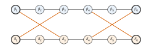
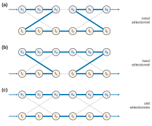
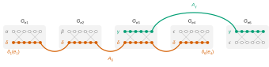
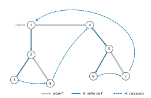
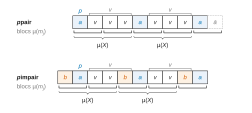

# CCINP MPI — Informatique 2026 · Corrigé brut

*Corrigé rédigé par IA, non officiel. Signalez toute erreur.*

Épreuve spécifique de la filière MPI (MPI5IN, mutualisée avec e3a-Polytech), 4 heures, calculatrices interdites. Deux parties indépendantes : la partie I (Q1–Q22) demande du code **C**, la partie II (Q23–Q41) du code **OCaml**. Tous les codes ci-dessous ont été compilés et exécutés sur des exemples (gcc, OCaml 4.14).

Conventions C : les en-têtes `<assert.h>`, `<stdbool.h>`, `<stdio.h>` et `<stdlib.h>` sont supposés inclus, comme le prévoit le programme. Les opérateurs d'incrémentation ne sont pas utilisés.

---

## Partie I — Problème du voyageur de commerce

### Q1

Une instance de TSP est un couple $(G,k)$, avec $G=(S,A,c)$ donné par sa matrice des coûts et $n=|S|$.

- **Certificat** : une suite $\sigma=(s_0,s_1,\dots,s_{n-1})$ de sommets. Elle comporte $n$ entiers de $[\![0,n-1]\!]$ : sa taille est polynomiale en celle de l'instance.
- **Existence** : si $(G,k)$ est une instance positive, l'ordre de visite d'un cycle hamiltonien de coût $\le k$ est un tel certificat.
- **Vérification** :
  1. $(s_0,\dots,s_{n-1})$ est une permutation de $S$. On le teste avec un tableau de booléens `vu` de taille $n$, en refusant tout sommet déjà vu : $O(n)$.
  2. Pour tout $i\in[\![0,n-1]\!]$, $c(s_i,s_{i+1 \bmod n})\neq+\infty$, c'est-à-dire que l'arête existe : $n$ accès à la matrice, $O(n)$.
  3. $\sum_{i=0}^{n-1}c(s_i,s_{i+1\bmod n})\le k$ : $n$ additions, $O(n)$.

Si $\sigma$ passe ces tests, $(s_0,\dots,s_{n-1},s_0)$ est un cycle hamiltonien de coût $\le k$. Réciproquement, un tel cycle fournit un certificat accepté. La vérification se fait en temps polynomial, donc **TSP ∈ NP**.

### I.1 — Réduction de CYCLE-HAMILTONIEN vers TSP

### Q2

- **Certificat** : une suite $(s_0,\dots,s_{n-1})$ de sommets, de taille $O(n)$, donc polynomiale.
- **Existence** : si $G$ possède un cycle hamiltonien, son ordre de visite est un certificat.
- **Vérification** : on teste que la suite est une permutation de $S$, en $O(n)$ avec un tableau de booléens. On teste ensuite que $\{s_i,s_{i+1\bmod n}\}\in A$ pour tout $i$ : $n$ tests d'adjacence, $O(n)$ avec une matrice d'adjacence.

Un certificat est accepté si et seulement si $G$ possède un cycle hamiltonien. Donc **CYCLE-HAMILTONIEN ∈ NP**.

### Q3

Soit $n=|S|$. On suppose $G$ donné par matrice d'adjacence. Sinon, on la construit en $O(n^2+|A|)$.

- $G'$ est complet : il a $n$ sommets et $\binom n2$ arêtes, quel que soit $|A|$.
- Pour chaque paire $\{s,t\}$, un accès en $O(1)$ à la matrice de $G$ décide du coût, $1$ ou $2$.
- La matrice des coûts de $G'$ (diagonale nulle) se remplit donc en $O(n^2)$.
- $k=|S|$ s'obtient en $O(1)$.

La sortie est de taille $O(n^2)$ et la construction se fait en **$O(n^2)$** : elle est polynomiale en la taille de $G$. Une construction en $O(|S|+|A|)$ est impossible, puisqu'il faut écrire toutes les arêtes de $G'$.

### Q4

Soit $H=(s_0,\dots,s_{n-1},s_0)$ un cycle hamiltonien de $G$. Comme $S'=S$ et que $G'$ est complet, c'est aussi un cycle hamiltonien de $G'$.

Il emprunte exactement $n$ arêtes $\{s_i,s_{i+1}\}$ (indices modulo $n$). Ce sont toutes des arêtes de $G$, qui coûtent donc $1$ dans $G'$. Ainsi :

$$c(H)=n=k.$$

**TSP répond Vrai sur $(G',k)$.**

### Q5

Soit $H'=(s_0,\dots,s_{n-1},s_0)$ un cycle hamiltonien de $G'$ tel que $c(H')\le k=n$.

Il compte $n$ arêtes, chacune de coût $1$ ou $2$, donc $c(H')\ge n$, d'où $c(H')=n$.

Si l'une des arêtes coûtait $2$, on aurait $c(H')\ge n+1$.

Toutes les arêtes coûtent donc $1$ : ce sont des arêtes de $G$. Comme $S'=S$, $H'$ est un cycle hamiltonien de $G$ : **CYCLE-HAMILTONIEN répond Vrai sur $G$.**

Avec Q3 et Q4, on obtient la réduction polynomiale $\text{CYCLE-HAMILTONIEN}\le_p\text{TSP}$.

### I.2 — Réduction de COUVERTURE-SOMMET vers CYCLE-HAMILTONIEN

Arêtes de la figure 1 :

- $e_1=\{\alpha,\delta\}$, $e_2=\{\beta,\delta\}$, $e_3=\{\gamma,\delta\}$ ;
- $e_4=\{\delta,\epsilon\}$, $e_5=\{\alpha,\beta\}$, $e_6=\{\gamma,\epsilon\}$.

Degrés : $d(\delta)=4$, et $2$ pour les quatre autres sommets.

### Q6

**$m=2$ : Faux.** Soit $S_c$ une couverture.

- Si $\delta\notin S_c$, les arêtes $e_1,e_2,e_3,e_4$ imposent $\alpha,\beta,\gamma,\epsilon\in S_c$, donc $|S_c|\ge 4$.
- Si $\delta\in S_c$, il reste à couvrir $e_5=\{\alpha,\beta\}$ et $e_6=\{\gamma,\epsilon\}$, qui sont disjointes. Il faut donc deux sommets de plus, et $|S_c|\ge 3$.

Dans les deux cas, $|S_c|>2$.

**$m=3$ : Vrai**, avec $S_c=\{\alpha,\gamma,\delta\}$.

- $\delta$ couvre $e_1,\dots,e_4$.
- $\alpha$ couvre $e_5$ et $\gamma$ couvre $e_6$.

Les ensembles $\{\beta,\gamma,\delta\}$, $\{\alpha,\epsilon,\delta\}$ et $\{\beta,\epsilon,\delta\}$ conviennent aussi.

### Q7

Pour $e_2=(\beta,\delta)$, on a $s=\beta$ et $t=\delta$.

Les 12 sommets sont $\beta_1,\dots,\beta_6$ (rangée du haut) et $\delta_1,\dots,\delta_6$ (rangée du bas, chaque $\delta_i$ sous $\beta_i$). Les 14 arêtes :

- la chaîne horizontale $\beta_1-\beta_2-\beta_3-\beta_4-\beta_5-\beta_6$ (5 arêtes) ;
- la chaîne horizontale $\delta_1-\delta_2-\delta_3-\delta_4-\delta_5-\delta_6$ (5 arêtes) ;
- les deux obliques $\{\beta_3,\delta_1\}$ et $\{\delta_3,\beta_1\}$, qui se croisent dans la zone des colonnes 1 à 3 ;
- les deux obliques $\{\beta_6,\delta_4\}$ et $\{\delta_6,\beta_4\}$, qui se croisent dans la zone des colonnes 4 à 6.



### Q8

On note $e=(s,t)$, $s_i=s_i(e)$ et $t_i=t_i(e)$.

Dans $G'$, seuls $s_1,t_1,s_6,t_6$ reçoivent des arêtes extérieures au gadget. Ce sont celles des étapes (iii) et (iv) : l'énoncé écrit « (ii) », il faut lire (iii)–(iv).

La trace d'un cycle hamiltonien sur $G_e$ est donc une réunion de chaînes disjointes qui couvrent les 12 sommets et dont les extrémités sont parmi $s_1,t_1,s_6,t_6$. Les trois traversées possibles sont :

$$\boxed{\begin{array}{ll}
\text{(a)} & s_1\,s_2\,s_3\,t_1\,t_2\,t_3\,t_4\,t_5\,t_6\,s_4\,s_5\,s_6 \quad (\text{entrée } s_1,\ \text{sortie } s_6)\\
\text{(b)} & t_1\,t_2\,t_3\,s_1\,s_2\,s_3\,s_4\,s_5\,s_6\,t_4\,t_5\,t_6 \quad (\text{entrée } t_1,\ \text{sortie } t_6)\\
\text{(c)} & s_1\,s_2\,\cdots\,s_6 \ \text{ et }\ t_1\,t_2\,\cdots\,t_6 \quad (\text{deux passages séparés})
\end{array}}$$



Chacune peut aussi être parcourue en sens inverse.

**Il n'y en a pas d'autre.**

- Les sommets $s_2,s_5,t_2,t_5$ sont de degré 2 dans $G_e$ et ne sont pas des extrémités.
- Les chaînes $s_1s_2s_3$, $s_4s_5s_6$, $t_1t_2t_3$ et $t_4t_5t_6$ sont donc forcées.
- Les sommets $s_3,s_4,t_3,t_4$, qui ne sont pas des extrémités, doivent recevoir une arête de plus.
- Cette arête est prise parmi $\{s_3,s_4\}$, $\{s_3,t_1\}$, $\{t_3,s_1\}$, $\{t_3,t_4\}$, $\{s_6,t_4\}$ et $\{t_6,s_4\}$.

On discute selon l'arête $\{s_3,s_4\}$.

- Si elle est prise et que $\{t_3,t_4\}$ l'est aussi, on obtient (c). Si $\{t_3,t_4\}$ ne l'est pas, $t_3$ se raccorde à $s_1$ et $t_4$ à $s_6$, et on obtient (b).
- Sinon, $s_3$ se raccorde à $t_1$ et $s_4$ à $t_6$.
  Alors $t_3$ ne peut pas se raccorder à $s_1$ : on fermerait le cycle $s_1s_2s_3t_1t_2t_3s_1$, ce qui est exclu. Donc $\{t_3,t_4\}$ est prise, et on obtient (a).

Le cas (a) correspond à « $s$ sélectionné, pas $t$ », le cas (b) à l'inverse. Le cas (c) correspond à « $s$ et $t$ tous deux dans la couverture » : le gadget est alors visité deux fois, une fois par le chemin de $s$ et une fois par celui de $t$.

### Q9

$\gamma$ est incident à $e_3$ et $e_6$ ; $\delta$ est incident à $e_1,e_2,e_3,e_4$. On choisit l'ordre croissant des indices :

$$\boxed{A_\gamma=\bigl\{\{\gamma_6(e_3),\gamma_1(e_6)\}\bigr\}}$$

$$\boxed{A_\delta=\bigl\{\{\delta_6(e_1),\delta_1(e_2)\},\ \{\delta_6(e_2),\delta_1(e_3)\},\ \{\delta_6(e_3),\delta_1(e_4)\}\bigr\}}$$

On a bien $|A_s|=d(s)-1$. Pour $\delta$, ces arêtes enchaînent les gadgets des arêtes $e_1$ à $e_4$ en un chemin de $\delta_1(e_1)$ à $\delta_6(e_4)$.



### Q10

Soient $n=|S|$ et $p=|A|$. On retire d'abord les sommets isolés, en $O(n)$ : ils ne changent pas la réponse de COUVERTURE-SOMMET et l'étape (iv) n'a pas de sens pour eux. Ensuite, avec la formule $\sum_s d(s)=2p$ :

$$|S'|=m+12p\le n+12p,$$

$$\begin{aligned}
|A'|&=14p+\sum_{s\in S}(d(s)-1)+2mn\\
&=14p+(2p-n)+2mn\\
&\le 16p+2n^2.
\end{aligned}$$

Coût de chaque étape :

- (i) : $O(m)=O(n)$ ;
- (ii) : $O(1)$ par arête, soit $O(p)$ ;
- (iii) : un parcours de $A$ range les arêtes incidentes à chaque sommet en $O(n+p)$, puis on écrit $2p-n$ arêtes ;
- (iv) : $2mn\le 2n^2$ arêtes.

Total : **$O(n^2+p)$**, polynomial en la taille de $(G,m)$, puisque $m\le n$.

### I.3 — Conclusion des réductions

### Q11

TSP est NP-complet s'il est **dans NP** et **NP-difficile**.

- TSP ∈ NP : c'est la question Q1.
- $\text{COUVERTURE-SOMMET}\le_p\text{CYCLE-HAMILTONIEN}$ : construction polynomiale (Q10) et équivalence admise.
- $\text{CYCLE-HAMILTONIEN}\le_p\text{TSP}$ (Q3, Q4, Q5).
- $\le_p$ est transitive. Si $f$ se calcule en temps $P(|x|)$, alors $|f(x)|\le P(|x|)$. La composée $g\circ f$ se calcule alors en temps $P(|x|)+Q(P(|x|))$, qui est polynomial.

Donc $\text{COUVERTURE-SOMMET}\le_p\text{TSP}$. Tout problème de NP se réduit à COUVERTURE-SOMMET, qui est NP-complet, donc à TSP : TSP est NP-difficile. Avec TSP ∈ NP : **TSP est NP-complet.** Au passage, CYCLE-HAMILTONIEN est lui aussi NP-complet (Q2).

### I.4 — 2-approximation du problème TSP

### Q12

L'« étape 2 » est ambiguë : l'algorithme 1 ne numérote pas ses instructions comme la figure 2.

**Lecture retenue : calcul de l'arbre $T$** (dénomination de la figure 2). On utilise l'**algorithme de Kruskal** : trier les arêtes par coût croissant, puis retenir chaque arête dont les extrémités sont dans deux composantes différentes. Une structure union-find teste et fusionne les composantes.

Complexité :

- $O(p\log p)$ pour le tri ;
- $p$ opérations union-find de coût quasi constant (ou $O(\log n)$) ;
- au total $O(p\log p)$.

Ici $G$ est complet, $p=n(n-1)/2$, donc la complexité est **$O(n^2\log n)$**. L'algorithme de Prim en version naïve sur la matrice des coûts donnerait $O(n^2)$.

**Autre lecture : parcours en profondeur de $T$** (deuxième instruction de l'algorithme). Sur un arbre à $n$ sommets et $n-1$ arêtes représenté par listes d'adjacence, il coûte **$O(n)$**. Avec le seul tableau `parent` de la structure `ACM`, la recherche des fils coûte $O(n)$ par sommet, d'où $O(n^2)$ (voir Q19).

### Q13

On suppose $n\ge 2$. Soit $H^\ast$ un cycle hamiltonien optimal ; on lui retire une arête $\{u,v\}$.

On obtient une chaîne qui passe par les $n$ sommets : un graphe connexe à $n$ sommets et $n-1$ arêtes, donc un arbre couvrant $P$. Les coûts étant positifs :

$$c(P)=c(H^\ast)-c(u,v)\le c(H^\ast).$$

Par minimalité de $T$ :

$$\boxed{c(T)\le c(P)\le c(H^\ast)}$$

### Q14

La liste $L$ enregistre chaque sommet à chaque passage, retours compris. Montrons par récurrence sur la taille de l'arbre deux propriétés :

- deux éléments consécutifs de $L$ sont adjacents dans $T$ ;
- chaque arête de $T$ est empruntée exactement deux fois.

Si l'arbre est réduit à sa racine $r$, $L=(r)$. Sinon, soient $v_1,\dots,v_k$ les fils de $r$, et $T_1,\dots,T_k$ leurs sous-arbres. Alors :

$$L(T,r)=(r)\cdot L(T_1,v_1)\cdot(r)\cdot L(T_2,v_2)\cdot(r)\cdots L(T_k,v_k)\cdot(r).$$

Chaque arête $\{r,v_j\}$ est empruntée une fois à la descente et une fois à la remontée. Les arêtes des $T_j$ le sont deux fois par hypothèse de récurrence. Donc, par Q13 :

$$\boxed{c(L)=2\,c(T)\le 2\,c(H^\ast)}$$

Sur la figure 2, on vérifie que $|L|=15=2\times 8-1$.

### Q15

Soit $L=(v_0,\dots,v_q)$, avec $v_q=v_0$. Soit $j\in[\![1,q-1]\!]$ tel que $v_j$ apparaisse aussi à une autre position. On supprime $v_j$ :

$$L'=(v_0,\dots,v_{j-1},v_{j+1},\dots,v_q).$$

$G$ étant complet, l'arête $\{v_{j-1},v_{j+1}\}$ existe. $L'$ visite encore tous les sommets et reste fermée. Par l'**inégalité triangulaire** :

$$c(L')-c(L)=c(v_{j-1},v_{j+1})-c(v_{j-1},v_j)-c(v_j,v_{j+1})\le 0.$$

**On peut donc supprimer une visite répétée sans augmenter le coût.**

### Q16

On applique Q15 tant qu'il reste, parmi $v_1,\dots,v_{q-1}$, une occurrence qui n'est pas la première de son sommet. Chaque suppression raccourcit la liste, donc le procédé termine.

Il reste alors la liste des **premières occurrences** des sommets dans $L$ (l'ordre préfixe du parcours de $T$), suivie du retour à la racine :

$$\boxed{H=(\text{sommets de } T \text{ en ordre préfixe},\ \text{racine})}$$

Ses $n$ premiers éléments sont distincts et décrivent $S$, et $G$ est complet : $H$ est un cycle hamiltonien. Sur la figure 2, $H=[1,2,3,8,4,5,6,7,1]$.



### Q17

$H$ est un cycle hamiltonien, donc une solution admissible : $c(H^\ast)\le c(H)$. En itérant Q15, $c(H)\le c(L)$, et Q14 donne $c(L)\le 2c(H^\ast)$. Donc :

$$\boxed{c(H^\ast)\le c(H)\le 2\,c(H^\ast)}$$

L'algorithme est polynomial : $O(n^2\log n)$ pour l'arbre (Q12), $O(n^2)$ pour le parcours et $O(n)$ pour l'extraction. **L'algorithme 1 est une 2-approximation de TSP.**

### Q18

Les sommets sont numérotés de $0$ à $n-1$ dans le fichier. S'ils l'étaient de $1$ à $n$, on retrancherait $1$ à `s` et `t` après lecture. $+\infty$ est représenté par une constante `INFINI`.

```c
const int INFINI = 1000000000;

Graphe* creer_graphe(char* nom_fichier) {
    FILE* f = fopen(nom_fichier, "r");
    assert(f != NULL);
    int n = 0;
    int p = 0;
    fscanf(f, "%d %d", &n, &p);
    Graphe* G = malloc(sizeof(Graphe));
    G->n = n;
    G->C = malloc(n * sizeof(int*));
    for (int i = 0; i < n; i = i + 1) {
        G->C[i] = malloc(n * sizeof(int));
        for (int j = 0; j < n; j = j + 1) {
            if (i == j) {
                G->C[i][j] = 0;
            } else {
                G->C[i][j] = INFINI;
            }
        }
    }
    for (int k = 0; k < p; k = k + 1) {
        int s = 0;
        int t = 0;
        int c = 0;
        fscanf(f, "%d %d %d", &s, &t, &c);
        G->C[s][t] = c;   /* graphe non orienté : matrice symétrique */
        G->C[t][s] = c;
    }
    fclose(f);
    return G;
}
```

La matrice est allouée en deux temps : un tableau de $n$ pointeurs (`sizeof(int*)`), puis une ligne de $n$ entiers pour chacun. `fscanf` reçoit les **adresses** des variables à remplir (`&n`, `&s`…), et les champs de la structure pointée sont atteints par `->`.

Complexité : $O(n^2+p)$ en temps et $O(n^2)$ en espace.

### Q19

Les fils de $s$ sont les sommets $v\neq s$ tels que `parent[v] == s`. Le test `v != s` couvre la convention `parent[racine] == racine`. Chaque sommet est écrit dans `chemin` lors de sa découverte (ordre préfixe).

```c
void dfs(ACM* a, int s, int* chemin, int* indice) {
    chemin[*indice] = s;
    *indice = *indice + 1;
    for (int v = 0; v < a->n; v = v + 1) {
        if (v != s && a->parent[v] == s) {
            dfs(a, v, chemin, indice);
        }
    }
}
```

Chaque appel balaie les $n$ sommets, et il y a $n$ appels : la complexité est $O(n^2)$, avec une pile de profondeur au plus la hauteur de l'arbre. Après l'appel depuis la racine, `*indice` vaut $n$.

### Q20

On garde la **première occurrence** de chaque sommet, ce qui est la construction de Q16, puis on referme le cycle.

Ce code convient que `chemin` soit l'ordre préfixe ($n$ cases distinctes) ou la liste $L$ avec les remontées (au plus $2n-1$ cases). Il ne lit jamais au-delà de la case où le $n$-ième sommet distinct apparaît.

```c
CH* calcule_CH(int* chemin, int n) {
    CH* h = malloc(sizeof(CH));
    h->l = n + 1;
    h->cycle = malloc((n + 1) * sizeof(int));
    bool* vu = malloc(n * sizeof(bool));
    for (int s = 0; s < n; s = s + 1) {
        vu[s] = false;
    }
    int k = 0;   /* nombre de sommets déjà placés */
    int i = 0;   /* position de lecture dans chemin */
    while (k < n) {
        int s = chemin[i];
        if (!vu[s]) {
            vu[s] = true;
            h->cycle[k] = s;
            k = k + 1;
        }
        i = i + 1;
    }
    h->cycle[n] = h->cycle[0];   /* fermeture du cycle */
    free(vu);
    return h;
}
```

Le champ `l` vaut $n+1$, la taille du tableau `cycle`.

### Q21

On libère le tableau interne avant la structure qui le référence.

```c
void free_ACM(ACM* a) {
    free(a->parent);
    free(a);
}

void free_CH(CH* cycle) {
    free(cycle->cycle);
    free(cycle);
}
```

### Q22

```c
CH* TSP2(Graphe* G) {
    ACM* a = Recherche_ACM(G);
    int racine = 0;
    for (int s = 0; s < a->n; s = s + 1) {
        if (a->parent[s] < 0 || a->parent[s] == s) {
            racine = s;
        }
    }
    int* chemin = malloc(G->n * sizeof(int));
    int indice = 0;
    dfs(a, racine, chemin, &indice);
    CH* h = calcule_CH(chemin, G->n);
    free(chemin);
    free_ACM(a);
    return h;
}
```

La racine est le sommet sans vrai parent : on accepte les conventions `parent[r] == -1` et `parent[r] == r`. `chemin` et l'ACM sont libérés avant le retour. Le `CH` renvoyé est à libérer par l'appelant avec `free_CH`. La complexité est $O(n^2\log n)$ avec Kruskal.

---

## Partie II — Suite de Prouhet-Thue-Morse

### II.1 — Définitions

### Q23

| $n$ | 0 | 1 | 2 | 3 | 4 | 5 | 6 | 7 |
|---|---|---|---|---|---|---|---|---|
| binaire | 0 | 1 | 10 | 11 | 100 | 101 | 110 | 111 |
| $b_n$ | 0 | 1 | 1 | 2 | 1 | 2 | 2 | 3 |
| $t_n$ | 0 | 1 | 1 | 0 | 1 | 0 | 0 | 1 |

$$\boxed{T_3=01101001}$$

### Q24

Pour $n>0$, l'écriture binaire de $n$ est celle de $n/2$ (quotient entier) suivie du chiffre $n \bmod 2$. D'où :

$$b_n=b_{n/2}+(n\bmod 2).$$

```ocaml
let rec compte_bits_a_un n =
  if n = 0 then 0
  else n mod 2 + compte_bits_a_un (n / 2)
```

La fonction est définie pour $n\ge 0$, en $O(\log n)$ appels.

### Q25

```ocaml
let rec puissance2 n =
  if n = 0 then 1 else 2 * puissance2 (n - 1)

let affiche_ptm n =
  for i = 0 to puissance2 n - 1 do
    print_int (compte_bits_a_un i mod 2)
  done
```

On a $t_i=b_i \bmod 2$. La borne de la boucle n'est évaluée qu'une fois. Complexité : $O(n\,2^n)$. `affiche_ptm 3` affiche `01101001`.

### Q26

On distingue les deux suites : $(t_j)$ est la suite de la définition 1, et $(t'_j)$ celle de la définition 2. Montrons par récurrence sur $n$ la propriété $\mathcal P(n)$ : $\forall i<2^n,\ t'_i=t_i$.

**Lemme.** Soit $0\le i<2^n$. L'écriture binaire de $2^n+i$ est celle de $i$ complétée par un chiffre $1$ de poids $2^n$, sans retenue puisque $i<2^n$. Donc :

$$b_{2^n+i}=b_i+1,$$

et $t_{2^n+i}=\overline{t_i}$.

- **Initialisation.** $\mathcal P(0)$ : $t'_0=0=t_0$.
- **Hérédité.** Supposons $\mathcal P(n)$ et soit $j<2^{n+1}$. Si $j<2^n$, $\mathcal P(n)$ conclut. Sinon $j=2^n+i$ avec $i<2^n$, et :

$$\begin{aligned}
t'_j&=\overline{t'_i} &&\text{(définition 2)}\\
&=\overline{t_i} &&(\mathcal P(n))\\
&=t_j &&\text{(lemme).}
\end{aligned}$$

Tout indice $j$ vérifie $j<2^n$ pour $n$ assez grand, donc **les définitions 1 et 2 donnent la même suite.**

### Q27

Soit $(t_m)$ la suite de la définition 1. Il suffit de vérifier qu'elle satisfait les relations de la définition 3, par **disjonction de cas** sur la parité de l'indice.

**Remarque sur l'énoncé.** Écrites « pour $n>0$ », les relations de la définition 3 ne déterminent pas $t_1$. On les lit pour $n\ge 0$, ce qui donne $t_1=\overline{t_0}=1$.

Soit $n\ge 0$.

- **Indice pair.** L'écriture binaire de $2n$ est celle de $n$ suivie de $0$. Donc $b_{2n}=b_n$, et $t_{2n}=t_n$.
- **Indice impair.** L'écriture binaire de $2n+1$ est celle de $n$ suivie de $1$. Donc $b_{2n+1}=b_n+1$, et $t_{2n+1}=\overline{t_n}$.

Enfin $t_0=0$. Or la définition 3 détermine une **unique** suite : $t_0$ est fixé, et tout terme d'indice $m\ge 1$ s'exprime à partir du terme d'indice $\lfloor m/2\rfloor<m$. La suite $(t_m)$ est donc celle de la définition 3. **La définition 3 donne la même suite que les définitions 1 et 2.**

### Q28

Pour $a\in\Sigma$, $\mu(a)=a\,\overline a$. Par la propriété de morphisme, étendue par récurrence à un nombre quelconque de facteurs :

$$\mu(a_0\cdots a_{p-1})=\mu(a_0)\cdots\mu(a_{p-1}).$$

**Remarque sur l'énoncé.** La relation $u_{i+1}=\mu(u_i)$ doit valoir aussi pour $i=0$, sans quoi $u_1$ n'est pas défini. On montre donc $u_i=T_i$ pour tout $i\ge 0$, par récurrence.

- **Initialisation.** $u_0=0=T_0$.
- **Hérédité.** Supposons $u_i=T_i=t_0\cdots t_{2^i-1}$. Alors :

$$\begin{aligned}
u_{i+1}&=\mu(T_i)\\
&=t_0\overline{t_0}\,t_1\overline{t_1}\cdots t_{2^i-1}\overline{t_{2^i-1}}.
\end{aligned}$$

Ce mot a $2^{i+1}$ lettres. Sa lettre d'indice $2j$ est $t_j=t_{2j}$, et celle d'indice $2j+1$ est $\overline{t_j}=t_{2j+1}$ (Q27). Donc $u_{i+1}=T_{i+1}$.

Cette récurrence simple s'appuie sur la définition 3 (Q27). Si l'on part au contraire de la définition 2, $T_{i+1}=T_i\overline{T_i}$, il faut une **récurrence double**. On utilise $\mu(\overline w)=\overline{\mu(w)}$, l'initialisation $u_0=T_0$, $u_1=01=T_1$, et pour $i\ge 1$ :

$$\begin{aligned}
u_{i+1}&=\mu(T_i) &&(\text{rang } i)\\
&=\mu(T_{i-1})\,\mu(\overline{T_{i-1}}) &&(\text{définition 2})\\
&=\mu(u_{i-1})\,\overline{\mu(u_{i-1})} &&(\text{rang } i-1)\\
&=u_i\,\overline{u_i}\\
&=T_i\,\overline{T_i} &&(\text{rang } i)\\
&=T_{i+1}.
\end{aligned}$$

Les hypothèses aux rangs $i-1$ et $i$ servent toutes deux. Dans les deux cas :

$$\boxed{\forall i\in\mathbb N^\ast,\ u_i=T_i}$$

L'égalité vaut aussi pour $i=0$. En particulier, $T_{i+1}=\mu(T_i)$ pour tout $i\ge 0$.

### Q29

```ocaml
exception INVALID_ARGUMENT

let rec morphisme m =
  match m with
  | [] -> []
  | 0 :: q -> 0 :: 1 :: morphisme q
  | 1 :: q -> 1 :: 0 :: morphisme q
  | _ -> raise INVALID_ARGUMENT

let thue_morse_4 n =
  let rec itere k mot =
    if k = 0 then mot else itere (k - 1) (morphisme mot)
  in
  itere n [0]
```

`morphisme m` calcule $\mu(m)$ et lève l'exception dès qu'une lettre n'est ni 0 ni 1 : le filtrage est exhaustif. `itere k mot` vaut $\mu^k(\texttt{mot})$, donc `thue_morse_4 n` vaut $\mu^n(u_0)=u_n=T_n$ (Q28).

Par exemple, `thue_morse_4 3 = [0;1;1;0;1;0;0;1]`. Complexité : $O(2^n)$.

### II.2 — Mot infini de Thue-Morse

### Q30

« Sans carré » signifie ici sans facteur carré **non vide** : le mot vide est un carré trivial. Un mot de longueur $\ge 4$ a un facteur $a_0a_1a_2a_3$ de longueur 4.

- S'il existe $i\le 2$ tel que $a_i=a_{i+1}$, alors $a_ia_{i+1}$ est le carré $w.w$ avec $w=a_i$.
- Sinon, comme $|\Sigma|=2$, on a $a_1=\overline{a_0}$, $a_2=a_0$ et $a_3=a_1$. Le facteur est $(a_0a_1)(a_0a_1)$, un carré.

**Tout mot binaire de longueur $\ge 4$ contient un carré non vide.** La borne est optimale : $010$ est sans carré.

### Q31

Une fonction auxiliaire récursive avance d'un pas sur une copie « lente » de $m$ et de deux pas sur une copie « rapide ». Quand la copie rapide est épuisée, la lente pointe sur le milieu. Les éléments parcourus par la copie lente sont reconstruits au retour des appels, dans leur ordre d'origine.

```ocaml
let divise_mot m =
  let rec aux lent rapide =
    match rapide with
    | _ :: _ :: r ->
        (match lent with
         | x :: q -> let (g, d) = aux q r in (x :: g, d)
         | [] -> assert false)   (* impossible : |lent| >= |rapide| *)
    | _ -> ([], lent)
  in
  aux m m
```

**Invariant.** Après $k$ appels, `rapide` est le suffixe de `m` de longueur $|m|-2k$, et `lent` celui de longueur $|m|-k$.

Pour $|m|=2h$, la récursion s'arrête après $h$ pas : `g` contient les $h$ premiers éléments et `d` les $h$ suivants. Complexité : $O(|m|)$.

### Q32

```ocaml
let est_carre m =
  List.length m mod 2 = 0 &&
  (let (g, d) = divise_mot m in g = d)
```

Un mot de longueur impaire n'est pas un carré, car $|w.w|=2|w|$ : la fonction renvoie alors `false`, sans lever d'exception. Si $|m|$ est pair, $m$ est un carré si et seulement si ses deux moitiés sont égales ; on les compare par l'égalité structurelle `=`.

L'opérateur `&&` est paresseux : `divise_mot` n'est appelée que sur un mot de longueur paire. `est_carre []` vaut `true`, ce qui est conforme à la définition 5 avec $w=\varepsilon$. Complexité : $O(|m|)$.

### Q33

D'après Q27, pour tout $n\ge 0$ :

$$t_{2n}t_{2n+1}=t_n\overline{t_n}\in\{01,10\}.$$

$T$ est donc une suite de blocs de deux lettres distinctes, qui occupent les positions $(2n,2n+1)$. Un facteur $t_it_{i+1}t_{i+2}$ contient un bloc complet :

- le bloc $(i,i+1)$ si $i$ est pair ;
- le bloc $(i+1,i+2)$ si $i$ est impair.

Ce bloc comporte un 0 et un 1, donc le facteur n'est ni $000$ ni $111$. **$T$ ne contient aucun cube de la forme $000$ ou $111$.**

### Q34

```ocaml
let rec sousliste lst i l =
  if l <= 0 then []
  else
    match lst with
    | [] -> []
    | x :: q ->
        if i > 0 then sousliste q (i - 1) l
        else x :: sousliste q 0 (l - 1)
```

On saute $i$ éléments, puis on en prend au plus $l$. La liste vide met fin à la récursion, ce qui donne la troncature. Exemples : `sousliste [1;2;3;4;5] 1 3 = [2;3;4]` et `sousliste [1;2;3] 2 5 = [3]`. Complexité : $O(\min(|lst|,i+l))$.

### Q35

**Traduction.** Supposons $xyz$ facteur de $m$, avec $xy=yz$ et $x,y,z$ non vides. On pose $\ell=|xy|$ et $d=|x|=|z|$.

- On a $\ell\ge 2$ et $1\le d\le\ell-1$.
- Si $xyz$ commence en position $i$, les facteurs de longueur $\ell$ commençant en $i$ et en $i+d$ sont égaux.
- Le facteur tient dans le mot : $i+d+\ell\le|m|$.

Réciproquement, de tels $(\ell,i,d)$ donnent trois facteurs non vides qui conviennent :

- $x=m[i,i+d[$ ;
- $y=m[i+d,i+\ell[$ ;
- $z=m[i+\ell,i+\ell+d[$.

On énumère donc les triplets $(\ell,i,d)$.

```ocaml
let est_entrelacement m =
  let n = List.length m in
  (* décalages d dans [d, l-1] pour la longueur l et la position i *)
  let rec test_d l i d =
    d < l && i + d + l <= n &&
    (sousliste m i l = sousliste m (i + d) l || test_d l i (d + 1))
  in
  (* positions i, pour la longueur l *)
  let rec test_i l i =
    i + l + 1 <= n && (test_d l i 1 || test_i l (i + 1))
  in
  (* longueurs l >= 2 *)
  let rec test_l l =
    l + 1 <= n && (test_i l 0 || test_l (l + 1))
  in
  test_l 2
```

Comme $i+d+\ell$ croît avec chacun des paramètres, on peut arrêter chaque boucle dès que cette somme dépasse $n$. Il y a $O(n^3)$ triplets, chacun comparé en $O(n)$ : la complexité est $O(n^4)$. Exemple : `est_entrelacement [1;0;1;0;1;0;0;1] = true`.

### Q36

Soit $w.w.w$ un facteur cube de $m$, avec $w\neq\varepsilon$. On pose $x=y=z=w$ : ils sont non vides, et $xyz=www$ est un facteur de $m$. De plus :

$$xy=ww=yz.$$

**$m$ est un entrelacement**, de partie commune $w$.

### Q37

Soit $m$ un entrelacement. D'après le résultat admis, il contient un facteur $xyz$ avec $x,z$ non vides et $|y|=1$. On note $y=a\in\Sigma$, de sorte que $xa=az$.

Comme $x$ est non vide, sa première lettre est celle de $az$, c'est-à-dire $a$ : on écrit $x=av$, avec $v\in\Sigma^\ast$. Alors :

$$\begin{aligned}
xyz&=x\,(az)\\
&=x\,(xa)\\
&=(av)(av)a\\
&=a\,v\,a\,v\,a.
\end{aligned}$$

**$m$ contient un facteur $avava$.**

### Q38

On appelle *mot aligné* un mot de longueur paire $c_0\cdots c_{2k-1}$ tel que chaque couple $c_{2i}c_{2i+1}$ soit $01$ ou $10$. Un tel mot contient exactement $k$ zéros et $k$ uns.

$m$ est aligné de longueur $2n$, donc il contient $n$ zéros.

Le mot $0m0$, de longueur $2n+2$, contient alors $n+2$ zéros. S'il était aligné, il en contiendrait exactement $n+1$. Contradiction.

De même, $1m1$ contient $n+2$ uns au lieu de $n+1$. **Ni $0m0$ ni $1m1$ n'est aligné.**

### Q39

**Blocs de $\mu(m)$.** On écrit $\mu(m)=\mu(m_0)\cdots\mu(m_{q-1})$. Le bloc $\mu(m_j)=m_j\overline{m_j}$ occupe les positions $(2j,2j+1)$.

Tout facteur de $\mu(m)$ qui commence à une position paire et a une longueur paire est donc aligné. C'est l'image $\mu(X)$ d'un facteur $X$ de $m$. Ce facteur $X$ s'obtient en lisant une lettre sur deux, ce qui le détermine de façon unique.

Supposons que $\mu(m)$ soit un entrelacement. Par Q37, il contient un facteur $avava$ ; soit $p$ la position de sa première lettre.

**Justification de l'indication : $|v|$ est impair.** Supposons $|v|$ pair.

- Le mot $ava$ apparaît en position $p$ et en position $p'=p+|v|+1$, deux positions de parités différentes. Notons $q$ celle qui est paire et $q'$ celle qui est impaire.
- Dans l'occurrence en $q'$, $v$ commence en $q'+1$, qui est pair, et sa longueur est paire : $v$ est aligné.
- Dans l'occurrence en $q$, $ava$ commence en position paire et sa longueur $|v|+2$ est paire : $ava$ est aligné.

Cela contredit Q38. Donc $|v|=2k-1$ avec $k\ge 1$, et $|av|=2k$.



**Cas $p$ pair.**

- Les deux copies de $av$ commencent en $p$ et $p+2k$, qui sont pairs.
- La première vaut donc $\mu(X)$, avec $X$ le facteur de $m$ de longueur $k$ commençant en $p/2$.
- La seconde est $\mu$ du facteur de longueur $k$ commençant en $p/2+k$. Par unicité, ce facteur est égal à $X$.
- Le dernier $a$ est en position paire $p+4k$ : c'est la première lettre du bloc $\mu(m_{p/2+2k})$, donc $m_{p/2+2k}=a$.

Ainsi $m$ contient $XXa$.

La première lettre de $X$ est celle de $\mu(X)=av$, c'est-à-dire $a$. Donc $X=aV$, et $m$ contient $aVaVa$.

**Cas $p$ impair.**

- La lettre en position $p$ est la seconde d'un bloc. La première, en position $p-1$, est $b=\overline a$.
- La dernière lettre de $v$ est en position $p+2k-1$, qui est paire. C'est la première lettre du bloc dont la seconde est le $a$ en position $p+2k$ : elle vaut donc $\overline a=b$.

Écrivons $v=v'b$. Le facteur qui commence en $p-1$ et a pour longueur $4k+1$ est :

$$b\,(av')\,b\,(av')\,b.$$

Il est de la forme $bv''bv''b$, avec $|v''|=|v|$ impair, et il commence en position paire. Le cas précédent s'applique : $m$ contient un facteur $bVbVb$.

**Conclusion.** Dans les deux cas, $m$ contient un facteur $\alpha U\alpha U\alpha$.

On pose $x=\alpha U$, $y=\alpha$ et $z=U\alpha$, non vides. Alors $xy=\alpha U\alpha=yz$ : **$m$ est un entrelacement.**

### Q40

Par récurrence sur $n$.

- **Initialisation.** $T_0=0$ est de longueur 1. Or un entrelacement contient un facteur $xyz$ avec $x,y,z$ non vides, donc de longueur $\ge 3$. $T_0$ n'est pas un entrelacement.
- **Hérédité.** Supposons que $T_n$ ne soit pas un entrelacement. On a $T_{n+1}=\mu(T_n)$ (Q28). Si $T_{n+1}$ était un entrelacement, $T_n$ en serait un d'après Q39 : contradiction.

$$\boxed{\forall n\in\mathbb N,\ T_n \text{ n'est pas un entrelacement.}}$$

### Q41

Si $T_n$ contenait un cube $www$ avec $w\neq\varepsilon$, ce serait un entrelacement par Q36, ce qui contredit Q40. **Pour tout $n$, $T_n$ ne contient pas de cube.**

En revanche, $T_n$ contient des carrés dès que $n\ge 2$ : par exemple $11$ dans $T_2=0110$, conformément à Q30.
