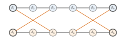
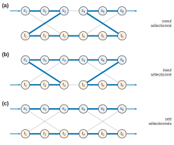
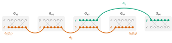
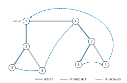
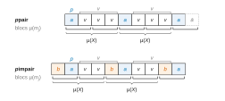

# CCINP MPI — Informatique 2026 · Corrigé guidé

*Corrigé rédigé par IA, non officiel. Signalez toute erreur.*

## Présentation du sujet

**Cadre.** Épreuve spécifique de la filière MPI (MPI5IN, mutualisée avec e3a-Polytech). Elle dure 4 heures, sans calculatrice. Le sujet compte **deux parties indépendantes** et 41 questions. Le langage est imposé : **C** dans la partie I, **OCaml** dans la partie II.

**Découpage.**

| Partie | Thème | Questions | Notions mobilisées |
|---|---|---|---|
| I.1–I.3 | NP-complétude du voyageur de commerce (TSP) | Q1–Q11 | classe NP, certificats, réductions polynomiales, transitivité, gadgets |
| I.4 | 2-approximation de TSP métrique | Q12–Q22 | arbre couvrant minimal (Kruskal), parcours en profondeur, inégalité triangulaire, C : fichiers, `malloc`/`free`, pointeurs |
| II.1 | Quatre définitions de la suite de Prouhet-Thue-Morse | Q23–Q29 | écriture binaire, récurrences (simple, double, forte), morphismes de mots, OCaml récursif sur les listes, exceptions |
| II.2 | Mot infini de Thue-Morse : carrés, cubes, entrelacements | Q30–Q41 | combinatoire des mots, facteurs, arguments de parité et d'alignement |

**Ce que fait chaque partie.** La partie I démontre que TSP est NP-complet par la chaîne COUVERTURE-SOMMET $\le_p$ CYCLE-HAMILTONIEN $\le_p$ TSP. La première réduction utilise le gadget classique à 12 sommets ; on n'en étudie que la construction.

La partie passe ensuite au problème d'optimisation. Sous inégalité triangulaire, parcourir un arbre couvrant minimal en profondeur et court-circuiter les sommets déjà vus coûte au plus deux fois l'optimum. On programme cet algorithme en C.

La partie II montre que quatre définitions de la suite PTM coïncident : parité du nombre de bits, doublement par complémentation, récurrence sur les indices, itération du morphisme $\mu$. Elle prouve ensuite que les mots $T_n$ n'ont pas de cube. On passe par la propriété plus forte « n'est pas un entrelacement », qui se transmet de $T_n$ à $\mu(T_n)=T_{n+1}$.

**Difficulté et longueur.** Le jury juge le sujet de longueur adéquate et discriminant ; la moyenne est de 10,01 sur 20, avec un écart type de 3,84 (rapport 2026). Le sujet est très guidé, mais ses thèmes sont moins accessibles à un candidat moyen. Les questions qui ont départagé les candidats sont celles qui demandent une **démonstration rigoureuse et structurée** :

- **Q26** (souvent mal traitée) et surtout **Q28** (très mal traitée) : des récurrences qu'il faut poser proprement ;
- **Q35** (très rarement bien traitée) et **Q39** (plus délicate), les deux questions les plus rarement abordées ;
- **Q37**, dont les réponses sont souvent partielles.

Les autres points sensibles sont la définition de NP (Q1, Q2, Q11) et la notion d'algorithme d'approximation (Q17).

**Questions à ne pas laisser passer.** Q1 à Q7, Q9, Q12, Q13, Q16, Q17, Q18, Q21, Q23, Q24, Q25, Q29, Q32, Q34, Q36, Q40 et Q41. Ce sont des applications directes du cours ou de l'énoncé, et le jury les a trouvées souvent bien traitées. Q40 et Q41 se font en trois lignes même si Q39 a résisté : on peut utiliser le résultat d'une question non traitée.

**Gestion du temps.** Comptez environ deux heures par partie. Dans la partie I, le C se rédige vite si les questions de gestion mémoire (Q20–Q22) sont pensées ensemble. Dans la partie II, ne restez pas bloqué sur Q39 : Q40 et Q41 s'en déduisent immédiatement.

**Remarques sur l'énoncé.** Quatre imprécisions sans conséquence, à signaler sur la copie :

1. En Q8, les arêtes supplémentaires viennent des étapes (iii) et (iv), et non de l'étape (ii).
2. En Q12, l'« étape 2 » peut désigner le calcul de l'arbre ou le parcours en profondeur. Le jury a accepté les deux lectures.
3. La définition 3 est posée « pour $n>0$ », ce qui laisse $t_1$ indéterminé. Il faut la lire pour $n\ge 0$.
4. La définition 4 est posée « pour $i\in\mathbb N^\ast$ », ce qui laisse $u_1$ indéterminé. Il faut la lire pour $i\ge 0$.

---

## Partie I — Problème du voyageur de commerce

On démontre que TSP est NP-complet : appartenance à NP, puis deux réductions polynomiales. Le seul outil est la définition de NP par certificat et la notion de réduction. Les sous-parties I.1 à I.3 ne demandent aucun code.

### Question 1

> [!INDICATION]
> Un problème est dans NP s'il admet des certificats de taille polynomiale vérifiables en temps polynomial. Quel objet prouve qu'une instance $(G,k)$ est positive ?

> [!INDICATION]
> Le certificat est un ordre de visite des sommets. Énumérez tout ce qu'il faut tester pour qu'il décrive un cycle hamiltonien de coût $\le k$, et chiffrez le coût de chaque test.

#### Solution

Soit une instance $(G,k)$ de TSP, avec $G=(S,A,c)$ donné par sa matrice des coûts et $n=|S|$.

- **Certificat** : une suite $\sigma=(s_0,\dots,s_{n-1})$ de $n$ sommets. Sa taille est $O(n\log n)$ bits, polynomiale en celle de l'instance.
- **Existence** : si l'instance est positive, l'ordre de visite d'un cycle hamiltonien de coût $\le k$ est un tel certificat.
- **Vérification** :
  1. $\sigma$ est une permutation de $S$ : avec un tableau de booléens `vu`, on rejette tout sommet rencontré deux fois, en $O(n)$ ;
  2. chaque arête $\{s_i,s_{i+1\bmod n}\}$ existe, c'est-à-dire que son coût n'est pas $+\infty$ : $O(n)$ ;
  3. $\sum_{i=0}^{n-1}c(s_i,s_{i+1\bmod n})\le k$ : $O(n)$.

Si les tests réussissent, $(s_0,\dots,s_{n-1},s_0)$ est un cycle hamiltonien de coût $\le k$. Réciproquement, un tel cycle fournit un certificat accepté. La vérification se fait en temps polynomial, donc **TSP ∈ NP**.

> [!PIEGE]
> Le test 1 n'est pas décoratif. Sans lui, la suite $(0,0,\dots,0)$ passerait les tests 2 et 3, puisque $c(s,s)=0$. Dire « on essaie tous les cycles » montre que le problème est décidable, pas qu'il est dans NP.

> [!JURY]
> Le rapport 2026 note que la définition de NP « n'est pas toujours bien maîtrisée » et que « de nombreux candidats oublient de justifier l'existence du certificat et sa taille polynomiale en l'instance considérée (même si c'est trivial et ne nécessite qu'une phrase) ». Il faut donc nommer le certificat, dire pourquoi il existe pour une instance positive, majorer sa taille et chiffrer la vérification.

### I.1 — Réduction de CYCLE-HAMILTONIEN vers TSP

### Question 2

> [!INDICATION]
> C'est la question 1 sans le coût : quel test devient sans objet ?

#### Solution

- **Certificat** : une suite $(s_0,\dots,s_{n-1})$ de sommets, de taille $O(n)$, donc polynomiale.
- **Existence** : si $G$ a un cycle hamiltonien, son ordre de visite est un certificat.
- **Vérification** : la suite est une permutation de $S$, en $O(n)$. Puis $\{s_i,s_{i+1\bmod n}\}\in A$ pour tout $i$ : $n$ tests en $O(1)$ avec une matrice d'adjacence.

Un certificat est accepté si et seulement si $G$ a un cycle hamiltonien. Donc **CYCLE-HAMILTONIEN ∈ NP**.

> [!JURY]
> Même remarque qu'en Q1 dans le rapport 2026 : l'existence du certificat et sa taille polynomiale se justifient en une phrase, mais cette phrase est attendue.

### Question 3

> [!INDICATION]
> Une réduction polynomiale demande deux choses : une sortie de taille polynomiale et un temps de calcul polynomial. Combien d'arêtes a $G'$ ?

> [!INDICATION]
> Pour chaque paire de sommets, combien d'opérations faut-il pour décider du coût $1$ ou $2$ ? Cela dépend de la représentation de $G$ : annoncez-la.

#### Solution

Soit $n=|S|$, avec $G$ donné par matrice d'adjacence (sinon on la construit en $O(n^2+|A|)$).

- $G'$ est complet : il a $n$ sommets et $\binom n2$ arêtes, quel que soit $|A|$.
- Le coût de chaque arête s'obtient par un accès en $O(1)$ à la matrice de $G$.
- Le seuil $k=n$ s'obtient en $O(1)$.

La sortie a une taille $O(n^2)$ et la construction se fait en **$O(n^2)$** : elle est polynomiale.

> [!PIEGE]
> Le rapport 2026 signale « parfois oubli du graphe complet en $O(|S|^2)$ d'où des réponses fausses en $O(|S|+|A|)$ ». Les arêtes de coût $2$ sont absentes de $G$ mais présentes dans $G'$ : il faut toutes les écrire.

> [!METHODE]
> Pour toute réduction, on écrit séparément la taille de l'instance produite et le coût de sa construction. Un algorithme qui produirait une sortie exponentielle ne serait jamais polynomial, même si chaque écriture coûtait $O(1)$.

### Question 4

> [!INDICATION]
> Un cycle hamiltonien de $G$ est-il encore un cycle hamiltonien de $G'$ ? Combien d'arêtes a-t-il, et combien coûte chacune ?

#### Solution

Soit $H=(s_0,\dots,s_{n-1},s_0)$ un cycle hamiltonien de $G$. Comme $S'=S$ et que $G'$ est complet, $H$ est un cycle hamiltonien de $G'$.

Ses $n$ arêtes sont des arêtes de $G$, donc chacune coûte $1$ :

$$c(H)=n=k.$$

**TSP répond Vrai sur $(G',k)$.**

> [!PIEGE]
> Un cycle hamiltonien sur $n$ sommets a $n$ arêtes, et non $n-1$ : il ne faut pas oublier l'arête de retour. C'est ce décompte qui rend le seuil $k=|S|$ exact.

### Question 5

> [!INDICATION]
> Minorez le coût de n'importe quel cycle hamiltonien de $G'$.

> [!INDICATION]
> Un cycle de coût $\le n$ formé de $n$ arêtes de coût $1$ ou $2$ : que peut-on dire de chacune de ses arêtes ?

#### Solution

Soit $H'$ un cycle hamiltonien de $G'$ tel que $c(H')\le n$.

Il a $n$ arêtes de coût $\ge 1$, donc $c(H')\ge n$, d'où $c(H')=n$.

Une seule arête de coût $2$ porterait le coût à $n+1$ au moins. Toutes coûtent donc $1$ et sont des arêtes de $G$.

Comme $S'=S$, $H'$ est un cycle hamiltonien de $G$.

**CYCLE-HAMILTONIEN répond Vrai sur $G$.** Avec Q3 et Q4 : $\text{CYCLE-HAMILTONIEN}\le_p\text{TSP}$.

> [!METHODE]
> L'encadrement $n\le c(H')\le n$, qui force l'égalité terme à terme, est un argument standard des réductions par pondération 1/2.

### I.2 — Réduction de COUVERTURE-SOMMET vers CYCLE-HAMILTONIEN

Il s'agit de la réduction classique, présentée par exemple dans le manuel de Cormen et al. L'énoncé admet l'équivalence et ne demande que d'étudier la construction sur le graphe de la figure 1. On y lit les arêtes suivantes :

- $e_1=\{\alpha,\delta\}$, $e_2=\{\beta,\delta\}$, $e_3=\{\gamma,\delta\}$ ;
- $e_4=\{\delta,\epsilon\}$, $e_5=\{\alpha,\beta\}$, $e_6=\{\gamma,\epsilon\}$.

### Question 6

> [!INDICATION]
> Repérez le sommet de plus grand degré et raisonnez selon qu'il appartient ou non à la couverture.

> [!INDICATION]
> Si $\delta$ est dans la couverture, quelles arêtes restent à couvrir ? Ont-elles une extrémité commune ?

#### Solution

**$m=2$ : Faux.**

- Si $\delta\notin S_c$, les arêtes $e_1,\dots,e_4$ imposent $\alpha,\beta,\gamma,\epsilon\in S_c$ : $|S_c|\ge 4$.
- Si $\delta\in S_c$, il reste $e_5=\{\alpha,\beta\}$ et $e_6=\{\gamma,\epsilon\}$, qui sont disjointes : il faut deux sommets de plus, et $|S_c|\ge 3$.

**$m=3$ : Vrai**, avec $S_c=\{\alpha,\gamma,\delta\}$.

- $\delta$ couvre $e_1$ à $e_4$.
- $\alpha$ couvre $e_5$ et $\gamma$ couvre $e_6$.

> [!PIEGE]
> Un « non » se démontre : présenter deux ou trois tentatives infructueuses ne prouve rien. Attention aussi à la lecture de la figure : l'arête $e_6$ relie $\gamma$ à $\epsilon$ et ne passe pas par $\delta$. La somme des degrés, $12=2\times 6$, permet de le contrôler.

### Question 7

> [!INDICATION]
> Appliquez la définition de $A_e$ avec $s=\beta$ et $t=\delta$ : deux chaînes de six sommets, puis quatre arêtes « croisées ».

#### Solution

Les sommets $\beta_1,\dots,\beta_6$ sont sur la ligne du haut et $\delta_1,\dots,\delta_6$ sur celle du bas, chaque $\delta_i$ sous $\beta_i$. Les arêtes sont :

- les chaînes $\beta_1-\beta_2-\cdots-\beta_6$ et $\delta_1-\delta_2-\cdots-\delta_6$ (10 arêtes) ;
- les obliques $\{\beta_3,\delta_1\}$ et $\{\delta_3,\beta_1\}$, qui forment un X sur les colonnes 1 à 3 ;
- les obliques $\{\beta_6,\delta_4\}$ et $\{\delta_6,\beta_4\}$, qui forment un X sur les colonnes 4 à 6.



On a bien $5+5+4=14$ arêtes. Seuls les quatre coins $\beta_1,\delta_1,\beta_6,\delta_6$ seront reliés au reste de $G'$.

> [!METHODE]
> Comptez les arêtes de votre dessin : l'énoncé en annonce 14, c'est un contrôle gratuit.

### Question 8

> [!INDICATION]
> Un cycle hamiltonien de $G'$ ne peut entrer dans le gadget et en sortir que par $s_1,t_1,s_6,t_6$. Sa trace sur $G_e$ est donc un ensemble de chaînes disjointes qui couvrent les 12 sommets, d'extrémités dans ces quatre sommets.

> [!INDICATION]
> Les sommets $s_2,s_5,t_2,t_5$ ne sont reliés qu'à deux voisins dans le gadget : quelles arêtes sont alors forcées ?

> [!INDICATION]
> Une fois les quatre chaînes de trois sommets forcées, discutez selon que l'arête $\{s_3,s_4\}$ est utilisée ou non. Un cycle hamiltonien ne contient pas de cycle plus petit.

#### Solution

On note $s_i=s_i(e)$ et $t_i=t_i(e)$. Les trois traversées sont, au sens près :

$$\begin{array}{ll}
\text{(a)} & s_1\,s_2\,s_3\,t_1\,t_2\,t_3\,t_4\,t_5\,t_6\,s_4\,s_5\,s_6 \quad\text{(entrée } s_1,\ \text{sortie } s_6)\\
\text{(b)} & t_1\,t_2\,t_3\,s_1\,s_2\,s_3\,s_4\,s_5\,s_6\,t_4\,t_5\,t_6 \quad\text{(entrée } t_1,\ \text{sortie } t_6)\\
\text{(c)} & s_1\cdots s_6\ \text{ puis, lors d'un autre passage, }\ t_1\cdots t_6
\end{array}$$



**Exhaustivité.**

- Les sommets $s_2,s_5,t_2,t_5$ ont degré 2 et ne sont pas des extrémités.
- Les chaînes $s_1s_2s_3$, $s_4s_5s_6$, $t_1t_2t_3$ et $t_4t_5t_6$ sont donc forcées.
- Les sommets $s_3,s_4,t_3,t_4$ ont besoin d'une arête de plus.
- Elle est prise parmi $\{s_3,s_4\}$, $\{s_3,t_1\}$, $\{t_3,s_1\}$, $\{t_3,t_4\}$, $\{s_6,t_4\}$ et $\{t_6,s_4\}$.

On discute selon l'arête $\{s_3,s_4\}$.

- Si elle est prise : avec $\{t_3,t_4\}$, on obtient (c) ; sinon $t_3$ se raccorde à $s_1$ et $t_4$ à $s_6$, ce qui donne (b).
- Sinon, $s_3$ se raccorde à $t_1$ et $s_4$ à $t_6$.
  $t_3$ ne peut pas se raccorder à $s_1$, car cela fermerait le cycle $s_1s_2s_3t_1t_2t_3s_1$. Donc $\{t_3,t_4\}$ est prise, ce qui donne (a).

Le cas (a) correspond à « $s$ sélectionné, pas $t$ », le cas (b) à l'inverse. Le cas (c) correspond à « $s$ et $t$ tous deux dans la couverture » : le gadget est traversé deux fois, par le chemin de $s$ puis par celui de $t$.

Aucune traversée n'existe si ni $s$ ni $t$ n'est sélectionné : c'est ce qui force la propriété de couverture.

> [!PIEGE]
> On peut croire qu'une chaîne de $s_1$ à $t_6$ couvrant le gadget existe. La discussion montre que non, et c'est précisément l'intérêt du gadget.

> [!JURY]
> Le rapport 2026 relève : « Le cas où s et t sont dans la couverture a été rarement mentionné. ». C'est la traversée (c), en deux passages séparés : elle fait partie des trois réponses attendues.

### Question 9

> [!INDICATION]
> Listez les arêtes incidentes à $\gamma$ et à $\delta$, choisissez un ordre et annoncez-le. Combien d'arêtes l'étape (iii) produit-elle pour un sommet de degré $d$ ?

#### Solution

On prend l'ordre croissant des indices.

$$A_\gamma=\bigl\{\{\gamma_6(e_3),\gamma_1(e_6)\}\bigr\}$$

$$A_\delta=\bigl\{\{\delta_6(e_1),\delta_1(e_2)\},\ \{\delta_6(e_2),\delta_1(e_3)\},\ \{\delta_6(e_3),\delta_1(e_4)\}\bigr\}$$

On a bien $|A_s|=d(s)-1$. Pour $\delta$, ces arêtes enfilent les quatre gadgets en un chemin de $\delta_1(e_1)$ à $\delta_6(e_4)$. L'étape (iv) relie ensuite les $a_i$ à ces deux extrémités.



> [!PIEGE]
> $\gamma_i(e)$ n'a de sens que si $\gamma$ est une extrémité de $e$. L'ordre des arêtes étant arbitraire, il doit être annoncé : $A_\delta$ en dépend.

### Question 10

> [!INDICATION]
> Comptez sommets et arêtes étape par étape. Quelle formule relie $\sum_s d(s)$ au nombre d'arêtes ?

> [!INDICATION]
> L'étape (iv) relie chaque $a_i$ à deux sommets pour chaque $s\in S$ : c'est elle qui donne le terme dominant. Que faire d'un sommet isolé ?

#### Solution

Soient $n=|S|$ et $p=|A|$. On retire au préalable les sommets isolés : ils ne changent pas la réponse et l'étape (iv) n'a pas de sens pour eux. Alors, avec $\sum_s d(s)=2p$ et $m\le n$ :

$$|S'|=m+12p,$$

$$\begin{aligned}
|A'|&=14p+\sum_s(d(s)-1)+2mn\\
&=16p-n+2mn\\
&\le 16p+2n^2.
\end{aligned}$$

Coût de chaque étape :

- (i) : $O(n)$ ;
- (ii) : $O(p)$ ;
- (iii) : $O(n+p)$, en rangeant d'abord les arêtes incidentes à chaque sommet ;
- (iv) : $O(mn)=O(n^2)$.

Au total : **$O(n^2+p)$**, polynomial.

### I.3 — Conclusion des réductions

### Question 11

> [!INDICATION]
> NP-complet signifie : dans NP, et NP-difficile. Quelles questions fournissent chacun des deux points ?

> [!INDICATION]
> Composez les deux réductions. Pourquoi la composée de deux réductions polynomiales est-elle polynomiale ? Pensez à la taille de la sortie de la première.

#### Solution

TSP est NP-complet s'il est **dans NP** et **NP-difficile**.

- TSP ∈ NP : c'est la question Q1.
- $\text{COUVERTURE-SOMMET}\le_p\text{CYCLE-HAMILTONIEN}$ (Q10 et l'équivalence admise).
- $\text{CYCLE-HAMILTONIEN}\le_p\text{TSP}$ (Q3–Q5).
- **Transitivité.** Si $f$ se calcule en temps $P(|x|)$, alors $|f(x)|\le P(|x|)$. Le calcul de $g(f(x))$ prend alors un temps $P(|x|)+Q(P(|x|))$, qui est polynomial.

Tout problème de NP se réduit à COUVERTURE-SOMMET, qui est NP-complet, donc à TSP par transitivité : TSP est NP-difficile. Avec Q1, **TSP est NP-complet.**

> [!PIEGE]
> Le sens des réductions est essentiel : on réduit le problème connu difficile **vers** le problème étudié.

> [!JURY]
> Le rapport 2026 constate : « Certains candidats oublient que NP complet est la conjonction de NP dur et NP (et oublient de rappeler que le deuxième a déjà été prouvé (en Q1)) ». Les deux points s'écrivent explicitement, avec le renvoi à Q1.

### I.4 — 2-approximation du problème TSP

On suppose désormais $G$ complet et $c$ vérifiant l'inégalité triangulaire. L'algorithme 1 calcule un arbre couvrant minimal $T$, le parcourt en profondeur (liste $L$) et ne garde que la première visite de chaque sommet. Les questions Q13 à Q17 forment une preuve en chaîne, puis Q18 à Q22 la programment en C.

### Question 12

> [!INDICATION]
> Que désigne l'« étape 2 » ? La figure 2 l'appelle « arbre $T$ », mais la deuxième instruction de l'algorithme est le parcours en profondeur. Annoncez votre lecture.

> [!INDICATION]
> Pour l'arbre : quel algorithme glouton du programme calcule un arbre couvrant de poids minimal ? Distinguez le tri des arêtes de la gestion des composantes, puis exprimez le résultat en fonction de $n$ seul, puisque $G$ est complet.

#### Solution

**Lecture retenue : calcul de l'arbre $T$.** On utilise l'**algorithme de Kruskal** : trier les arêtes par coût croissant, puis retenir chaque arête qui relie deux composantes distinctes, avec une structure union-find.

- Le tri coûte $O(p\log p)$.
- Les $p$ opérations union-find sont quasi constantes.
- Pour un graphe complet, $p=n(n-1)/2$, d'où **$O(n^2\log n)$**.

**Autre lecture : parcours en profondeur de $T$.** Sur un arbre à $n$ sommets et $n-1$ arêtes en listes d'adjacence, il coûte **$O(n)$**. Avec le seul tableau `parent`, chercher les fils coûte $O(n)$ par sommet, d'où $O(n^2)$ (Q19).

> [!JURY]
> D'après le rapport 2026, l'énoncé était ambigu sur l'étape 2 : les réponses « parcours en profondeur » et « arbre couvrant minimal » ont toutes les deux été acceptées (avec une complexité appropriée). Le jury note aussi, dans quelques copies, « une méconnaissance de la complexité des algorithmes au programme (Kruskal, parcours de graphe) ».

> [!METHODE]
> Sur un graphe complet, le nombre d'arêtes n'est pas un paramètre libre : traduisez toujours une complexité en $O(p\log p)$ en fonction de $n$. Pour un graphe dense donné par matrice, Prim en version naïve atteint $O(n^2)$.

### Question 13

> [!INDICATION]
> Retirez une arête d'un cycle hamiltonien : quel objet obtenez-vous ?

> [!INDICATION]
> Deux faits sont à justifier : cet objet est un arbre couvrant, et les coûts sont positifs.

#### Solution

Soit $H^\ast$ un cycle hamiltonien optimal ($n\ge 2$). On retire l'une de ses arêtes $\{u,v\}$.

On obtient une chaîne passant par les $n$ sommets : un graphe connexe à $n$ sommets et $n-1$ arêtes, donc un arbre couvrant $P$. Comme $c\ge 0$ :

$$c(P)=c(H^\ast)-c(u,v)\le c(H^\ast).$$

Par minimalité de $T$, $c(T)\le c(P)$, d'où

$$c(T)\le c(H^\ast).$$

> [!PIEGE]
> Le rapport 2026 signale des candidats qui passent à côté de cette réponse simple, enlever une arête quelconque de $H^\ast$ pour obtenir un arbre couvrant, et qui essaient au contraire de transformer $T$ en cycle hamiltonien. On part de l'optimum, pas de l'arbre.

### Question 14

> [!INDICATION]
> Combien de fois chaque arête de $T$ est-elle empruntée par le parcours $L$ ? Regardez la figure 2.

> [!INDICATION]
> Démontrez-le par récurrence sur l'arbre, en décrivant $L$ comme la racine, puis les parcours des sous-arbres séparés par des retours à la racine.

#### Solution

Si $r$ a pour fils $v_1,\dots,v_k$, de sous-arbres $T_1,\dots,T_k$, alors

$$L(T,r)=(r)\cdot L(T_1,v_1)\cdot(r)\cdots L(T_k,v_k)\cdot(r),$$

et $L=(r)$ pour un arbre réduit à sa racine.

Par récurrence sur la taille de l'arbre, deux éléments consécutifs de $L$ sont adjacents dans $T$. Chaque arête de $T$ est empruntée exactement deux fois : une à la descente, une à la remontée. Donc

$$c(L)=2c(T)\le 2c(H^\ast).$$

Sur la figure 2, on vérifie que $|L|=15=2\times 8-1$, soit 14 arêtes empruntées, deux fois 7.

> [!JURY]
> Le rapport 2026 mentionne « Quelques justifications parfois un peu confuses ». Affirmer « chaque arête est parcourue deux fois » sans justification revient à admettre le contenu de la question : une récurrence courte sur la structure de l'arbre est la façon la plus nette de le dire.

### Question 15

> [!INDICATION]
> Que devient le coût quand on remplace le détour $v_{j-1}\to v_j\to v_{j+1}$ par l'arête directe $v_{j-1}\to v_{j+1}$ ? Quelle hypothèse de I.4 garantit que cette arête existe ?

#### Solution

Soit $L=(v_0,\dots,v_q)$, et $v_j$ ($1\le j\le q-1$) un sommet qui apparaît aussi ailleurs. On le supprime.

L'arête $\{v_{j-1},v_{j+1}\}$ existe car $G$ est complet. Le parcours reste fermé et visite toujours tous les sommets. Par l'**inégalité triangulaire** :

$$c(L')-c(L)=c(v_{j-1},v_{j+1})-c(v_{j-1},v_j)-c(v_j,v_{j+1})\le 0.$$

> [!PIEGE]
> On ne supprime qu'une occurrence **répétée**, et jamais les extrémités $v_0$ et $v_q$. Sinon le parcours cesse de couvrir tous les sommets ou de se refermer.

> [!JURY]
> Selon le rapport 2026, certains « oublient l'hypothèse fondamentale d'inégalité triangulaire ou se lancent inutilement dans des rédactions sans fin ». Trois lignes suffisent : l'arête existe, puis l'inégalité triangulaire, citée explicitement.

### Question 16

> [!INDICATION]
> Itérez la question 15. Quelle occurrence de chaque sommet choisir de garder pour décrire simplement le résultat ?

#### Solution

On supprime, tant qu'il y en a, les occurrences $v_j$ ($1\le j\le q-1$) qui ne sont pas la première de leur sommet. La longueur décroît strictement, donc le procédé termine.

Il reste $H$ : **les sommets dans l'ordre de leur première apparition dans $L$ (ordre préfixe du parcours de $T$), suivis de la racine.**

Ses $n$ premiers sommets sont distincts et $G$ est complet, donc $H$ est un cycle hamiltonien. Sur la figure 2, $H=[1,2,3,8,4,5,6,7,1]$.



### Question 17

> [!INDICATION]
> Une $\rho$-approximation est une solution admissible, de coût au plus $\rho$ fois l'optimum, calculée en temps polynomial. Vérifiez les trois points.

#### Solution

$H$ est un cycle hamiltonien, donc admissible. Chaque suppression de Q16 ne fait pas croître le coût (Q15), donc $c(H)\le c(L)$. Par Q14, $c(L)\le 2c(H^\ast)$.

Le temps de calcul est polynomial : $O(n^2\log n)$ pour Kruskal, $O(n^2)$ pour le parcours, $O(n)$ pour l'extraction. Donc

$$c(H^\ast)\le c(H)\le 2c(H^\ast),$$

et **l'algorithme 1 est une 2-approximation de TSP.**

> [!PIEGE]
> Le rapport 2026 range la notion d'algorithme d'approximation parmi les erreurs les plus fréquentes. Les trois points sont nécessaires : la sortie est admissible (un vrai cycle hamiltonien), son coût est au plus deux fois l'optimum, et le calcul est polynomial. Un algorithme exponentiel exact n'est pas une approximation au sens du cours.

> [!METHODE]
> Le schéma « borne inférieure calculable (ici l'arbre couvrant minimal) + solution construite à partir d'elle » est celui de la plupart des algorithmes d'approximation. Sans inégalité triangulaire, aucun facteur constant n'est atteignable en temps polynomial, sauf si P = NP. On le voit en reprenant la réduction de I.1 avec un très grand coût à la place de $2$.

### Question 18

> [!INDICATION]
> Lisez d'abord $n$ et $p$, puis allouez la matrice. Quelles valeurs y mettre avant de lire les arêtes ? Revoyez la définition de $c$ dans l'énoncé.

> [!INDICATION]
> Le graphe est non orienté : chaque arête lue remplit deux cases.

#### Solution

On suppose les sommets numérotés de $0$ à $n-1$ (sinon, retrancher $1$ après lecture). $+\infty$ est représenté par une constante.

```c
const int INFINI = 1000000000;

Graphe* creer_graphe(char* nom_fichier) {
    FILE* f = fopen(nom_fichier, "r");
    assert(f != NULL);
    int n = 0;
    int p = 0;
    fscanf(f, "%d %d", &n, &p);
    Graphe* G = malloc(sizeof(Graphe));
    G->n = n;
    G->C = malloc(n * sizeof(int*));
    for (int i = 0; i < n; i = i + 1) {
        G->C[i] = malloc(n * sizeof(int));
        for (int j = 0; j < n; j = j + 1) {
            if (i == j) {
                G->C[i][j] = 0;
            } else {
                G->C[i][j] = INFINI;
            }
        }
    }
    for (int k = 0; k < p; k = k + 1) {
        int s = 0;
        int t = 0;
        int c = 0;
        fscanf(f, "%d %d %d", &s, &t, &c);
        G->C[s][t] = c;
        G->C[t][s] = c;
    }
    fclose(f);
    return G;
}
```

La matrice est allouée en deux temps : $n$ pointeurs de type `int*`, puis une ligne de $n$ entiers pour chacun. Complexité : $O(n^2+p)$.

> [!PIEGE]
> Le rapport 2026 note que « les allocations dynamiques sont assez souvent omises ou mal définies dans le cas d'un tableau à 2 dimensions ». Il faut un `malloc` pour le tableau de lignes (`sizeof(int*)`) et un pour chaque ligne (`sizeof(int)`). `malloc` n'initialise pas la mémoire : sans la double boucle, la matrice contient des valeurs arbitraires.

> [!JURY]
> Pour cette question, le rapport 2026 écrit : « Les fonctions de lecture et d'écriture dans un fichier, les opérateurs d'adresse et de déréférencement, ainsi que l'accès à une structure ne sont pas toujours maîtrisés. » Trois réflexes : `fscanf` reçoit des adresses (`&n`, `&s`), un champ d'une structure pointée s'atteint par `G->C`, et chaque `fopen` a son `fclose`.

### Question 19

> [!INDICATION]
> L'arbre n'est connu que par le tableau `parent`. Comment reconnaître les fils d'un sommet $s$, et combien cela coûte-t-il ?

> [!INDICATION]
> L'indice d'écriture est partagé par tous les appels récursifs : on le modifie à travers le pointeur.

#### Solution

On enregistre chaque sommet à sa découverte (ordre préfixe), puis on explore ses fils, c'est-à-dire les $v\neq s$ tels que `parent[v] == s`.

```c
void dfs(ACM* a, int s, int* chemin, int* indice) {
    chemin[*indice] = s;
    *indice = *indice + 1;
    for (int v = 0; v < a->n; v = v + 1) {
        if (v != s && a->parent[v] == s) {
            dfs(a, v, chemin, indice);
        }
    }
}
```

Le test `v != s` couvre la convention `parent[racine] == racine`. La complexité est $O(n)$ par appel et $n$ appels, soit $O(n^2)$. Aucun tableau de sommets visités n'est nécessaire, car un arbre enraciné n'a pas de cycle.

> [!PIEGE]
> Il faut écrire `*indice = *indice + 1` : `indice = indice + 1` déplacerait le pointeur au lieu d'incrémenter l'entier.

> [!METHODE]
> L'énoncé peut aussi se lire comme l'enregistrement de la liste $L$ complète, avec les remontées ($2n-1$ cases). Il suffit alors de réécrire `s` après chaque appel récursif. La fonction `calcule_CH` ci-dessous convient aux deux lectures.

### Question 20

> [!INDICATION]
> Allouez d'abord la structure, puis son tableau. Combien de cases faut-il pour un cycle **refermé** ?

> [!INDICATION]
> Pour être correct quelle que soit la forme de `chemin`, ne gardez que la première occurrence de chaque sommet : c'est exactement la question 16.

#### Solution

```c
CH* calcule_CH(int* chemin, int n) {
    CH* h = malloc(sizeof(CH));
    h->l = n + 1;
    h->cycle = malloc((n + 1) * sizeof(int));
    bool* vu = malloc(n * sizeof(bool));
    for (int s = 0; s < n; s = s + 1) {
        vu[s] = false;
    }
    int k = 0;
    int i = 0;
    while (k < n) {
        int s = chemin[i];
        if (!vu[s]) {
            vu[s] = true;
            h->cycle[k] = s;
            k = k + 1;
        }
        i = i + 1;
    }
    h->cycle[n] = h->cycle[0];
    free(vu);
    return h;
}
```

Le champ `l` vaut $n+1$, la taille du tableau. Si `chemin` est l'ordre préfixe, la boucle recopie ses $n$ cases. Si c'est $L$, elle s'arrête dès que les $n$ sommets distincts ont été vus. Sur la liste $L$ de la figure 2, le résultat est $[1,2,3,8,4,5,6,7,1]$.

> [!PIEGE]
> Allouer $n$ cases au lieu de $n+1$ provoque une écriture hors du tableau lors de la fermeture. Il ne faut pas non plus oublier de libérer le tableau auxiliaire `vu`.

### Question 21

> [!INDICATION]
> Dans quel ordre libérer une structure et le tableau qu'elle référence ?

#### Solution

```c
void free_ACM(ACM* a) {
    free(a->parent);
    free(a);
}

void free_CH(CH* cycle) {
    free(cycle->cycle);
    free(cycle);
}
```

Le tableau interne est libéré en premier : après `free(a)`, lire `a->parent` serait un comportement indéfini.

### Question 22

> [!INDICATION]
> Enchaînez les trois étapes de l'algorithme 1. Par quel sommet commencer le parcours, alors que seul le tableau `parent` est connu ?

> [!INDICATION]
> Faites l'inventaire des allocations : lesquelles sont temporaires, et laquelle constitue le résultat ?

#### Solution

```c
CH* TSP2(Graphe* G) {
    ACM* a = Recherche_ACM(G);
    int racine = 0;
    for (int s = 0; s < a->n; s = s + 1) {
        if (a->parent[s] < 0 || a->parent[s] == s) {
            racine = s;
        }
    }
    int* chemin = malloc(G->n * sizeof(int));
    int indice = 0;
    dfs(a, racine, chemin, &indice);
    CH* h = calcule_CH(chemin, G->n);
    free(chemin);
    free_ACM(a);
    return h;
}
```

La racine est le sommet sans vrai parent, quelle que soit la convention (`-1` ou lui-même). `chemin` et l'ACM sont temporaires et libérés. Le `CH` est renvoyé, et l'appelant le libérera par `free_CH`. La complexité est $O(n^2\log n)$.

> [!PIEGE]
> Lancer le parcours depuis un sommet qui n'est pas la racine ne visite que son sous-arbre. Libérer `h` avant de le renvoyer serait une faute grave.

> [!JURY]
> Quand l'énoncé insiste sur l'allocation et la désallocation, chaque `malloc` doit avoir son `free` à l'endroit pertinent : c'est un point de contrôle naturel pour le correcteur.

---

## Partie II — Suite de Prouhet-Thue-Morse

On établit d'abord l'équivalence de quatre définitions de la suite (II.1). Toutes reposent sur la même observation d'arithmétique binaire. On étudie ensuite les répétitions dans les mots $T_n$ (II.2) : il y a toujours des carrés, mais jamais de cube. L'outil central est la décomposition de $\mu(m)$ en blocs $01$/$10$ alignés sur les positions paires.

### II.1 — Définitions

### Question 23

> [!INDICATION]
> $T_3$ a $2^3$ lettres. Écrivez $0,\dots,7$ en binaire et comptez les $1$.

#### Solution

| $n$ | 0 | 1 | 2 | 3 | 4 | 5 | 6 | 7 |
|---|---|---|---|---|---|---|---|---|
| $b_n$ | 0 | 1 | 1 | 2 | 1 | 2 | 2 | 3 |
| $t_n$ | 0 | 1 | 1 | 0 | 1 | 0 | 0 | 1 |

$$T_3=01101001$$

> [!METHODE]
> Contrôle immédiat : $T_3$ doit commencer par $T_2=0110$ et finir par son complémentaire $1001$.

### Question 24

> [!INDICATION]
> Quel est le bit de poids faible de $n$ ? Quelle opération supprime ce bit ?

#### Solution

L'écriture binaire de $n>0$ est celle de $n/2$ suivie du chiffre $n\bmod 2$, donc :

$$b_n=(n\bmod 2)+b_{n/2}.$$

```ocaml
let rec compte_bits_a_un n =
  if n = 0 then 0
  else n mod 2 + compte_bits_a_un (n / 2)
```

La fonction est correcte pour $n\ge 0$, en $O(\log n)$ appels.

> [!PIEGE]
> Pour $n<0$, `n mod 2` peut valoir $-1$ en OCaml : la fonction n'a de sens que pour $n\ge 0$, ce qu'il est bon de préciser.

### Question 25

> [!INDICATION]
> $t_i$ ne dépend que de la parité de $b_i$. Faites varier $i$ de $0$ à $2^n-1$.

#### Solution

```ocaml
let rec puissance2 n =
  if n = 0 then 1 else 2 * puissance2 (n - 1)

let affiche_ptm n =
  for i = 0 to puissance2 n - 1 do
    print_int (compte_bits_a_un i mod 2)
  done
```

L'application de fonction est prioritaire sur `mod` : c'est bien $b_i \bmod 2$ qui est affiché. La borne de la boucle `for` n'est évaluée qu'une fois. Complexité : $O(n\,2^n)$. `affiche_ptm 3` affiche `01101001`.

> [!JURY]
> Le rapport 2026 relève « beaucoup de solutions inutilement optimisées (exponentiation rapide en particulier) » pour `puissance2`. La récursion naïve suffit, et elle se relit sans risque d'erreur.

### Question 26

> [!INDICATION]
> Pour $0\le i<2^n$, comparez les écritures binaires de $i$ et de $2^n+i$.

> [!INDICATION]
> Donnez un nom différent à la suite de chaque définition. Formulez ensuite une propriété $\mathcal P(n)$ portant sur **tous** les indices $i<2^n$, puis faites la récurrence sur $n$.

#### Solution

**Lemme.** Soit $0\le i<2^n$. Tous les chiffres de rang $\ge n$ de $i$ sont nuls.

Ajouter $2^n$ à $i$ ajoute donc un chiffre $1$ de poids $2^n$, sans retenue. D'où :

$$b_{2^n+i}=b_i+1,$$

et $t_{2^n+i}=\overline{t_i}$.

Soit $(t_j)$ la suite de la définition 1 et $(t'_j)$ celle de la définition 2. On note $\mathcal P(n)$ : « $t'_i=t_i$ pour tout $i<2^n$ ».

- $\mathcal P(0)$ : $t'_0=t_0=0$.
- Supposons $\mathcal P(n)$ et soit $j<2^{n+1}$. Si $j<2^n$, on conclut par $\mathcal P(n)$. Sinon $j=2^n+i$ avec $i<2^n$, et :

$$\begin{aligned}
t'_j&=\overline{t'_i} &&\text{(définition 2)}\\
&=\overline{t_i} &&(\mathcal P(n))\\
&=t_j &&\text{(lemme).}
\end{aligned}$$

Donc **les définitions 1 et 2 coïncident**, et $T_{n+1}=T_n\overline{T_n}$.

> [!JURY]
> Question souvent mal traitée selon le rapport 2026 : « la principale difficulté était de nommer les deux définitions différentes afin de pouvoir rédiger la preuve ». Tant que les deux suites portent le même nom $t$, l'énoncé à démontrer ne peut même pas s'écrire.

> [!PIEGE]
> L'hypothèse $i<2^n$ est indispensable : $b_{4+5}=b_9=2$, alors que $b_5+1=3$.

### Question 27

> [!INDICATION]
> Comparez l'écriture binaire de $n$ avec celles de $2n$ et de $2n+1$.

> [!INDICATION]
> Il suffit de vérifier que la suite de la définition 1 satisfait les relations de la définition 3. Regardez aussi comment la définition 3 détermine $t_1$.

#### Solution

**Énoncé.** Posées « pour $n>0$ », les relations ne définissent pas $t_1$. On les lit pour $n\ge 0$, d'où $t_1=\overline{t_0}=1$.

Soit $(t_m)$ la suite de la définition 1 et $n\ge 0$. On procède par **disjonction de cas** sur la parité de l'indice.

- L'écriture binaire de $2n$ est celle de $n$ suivie de $0$ : $b_{2n}=b_n$, donc $t_{2n}=t_n$.
- L'écriture binaire de $2n+1$ est celle de $n$ suivie de $1$ : $b_{2n+1}=b_n+1$, donc $t_{2n+1}=\overline{t_n}$.

Avec $t_0=0$, la suite $(t_m)$ vérifie donc la définition 3. Celle-ci détermine une **unique** suite, puisque chaque terme d'indice $m\ge 1$ s'obtient à partir de celui d'indice $\lfloor m/2\rfloor<m$. **La définition 3 donne la même suite.**

> [!JURY]
> Le rapport 2026 relève : « Beaucoup de récurrences inutiles alors qu'il suffisait d'une disjonction de cas. ». On vérifie les deux relations, une pour les indices pairs, une pour les impairs, et on conclut par l'unicité de la suite définie par récurrence.

> [!PIEGE]
> Signalez l'imprécision de l'énoncé ($n>0$ au lieu de $n\ge 0$) en une phrase et indiquez la lecture retenue, sans la contourner en silence.

### Question 28

> [!INDICATION]
> Écrivez $\mu(a)$ en fonction de $a$ et de $\overline a$.

> [!INDICATION]
> Appliquez $\mu$ lettre à lettre à $T_i$ : quelles sont les lettres d'indices $2j$ et $2j+1$ du résultat ? Comparez avec la définition 3.

> [!INDICATION]
> Si vous partez plutôt de $T_{i+1}=T_i\overline{T_i}$, le calcul de $\mu(T_i)$ fait intervenir $u_{i-1}$ et $u_i$ : il faut alors une hypothèse sur deux rangs.

#### Solution

On a $\mu(a)=a\overline a$. Par récurrence sur le nombre de facteurs :

$$\mu(a_0\cdots a_{p-1})=\mu(a_0)\cdots\mu(a_{p-1}).$$

On lit $u_{i+1}=\mu(u_i)$ pour tout $i\ge 0$ (sinon $u_1$ n'est pas défini). Montrons $u_i=T_i$ par récurrence.

- $u_0=0=T_0$.
- Supposons $u_i=T_i$. Alors $u_{i+1}=\mu(T_i)$ est le mot $t_0\overline{t_0}\cdots t_{2^i-1}\overline{t_{2^i-1}}$, de $2^{i+1}$ lettres.
- Ses lettres d'indices $2j$ et $2j+1$ sont $t_j=t_{2j}$ et $\overline{t_j}=t_{2j+1}$ (Q27). Donc $u_{i+1}=T_{i+1}$.

**Variante par récurrence double.** On part de la définition 2 et de $\mu(\overline w)=\overline{\mu(w)}$, qui vient de $\mu(\overline a)=\overline a\,a=\overline{\mu(a)}$.

On initialise avec $u_0=T_0$ et $u_1=01=T_1$. Pour $i\ge 1$, si $u_{i-1}=T_{i-1}$ et $u_i=T_i$ :

$$\begin{aligned}
u_{i+1}&=\mu(T_i) &&(\text{rang } i)\\
&=\mu(T_{i-1})\,\mu(\overline{T_{i-1}}) &&(\text{définition 2})\\
&=\mu(u_{i-1})\,\overline{\mu(u_{i-1})} &&(\text{rang } i-1)\\
&=u_i\,\overline{u_i}\\
&=T_i\,\overline{T_i} &&(\text{rang } i)\\
&=T_{i+1}.
\end{aligned}$$

**Pour tout $i\in\mathbb N^\ast$, $u_i=T_i$**, et en particulier $T_{i+1}=\mu(T_i)$.

> [!JURY]
> C'est la question la plus mal réussie de la partie II. Le rapport 2026 écrit : « Question très mal traitée, la plupart des candidats passent à côté de la nécessité d'une récurrence double (ou éventuellement une récurrence forte) ». Il y voit le symptôme de récurrences mal comprises ou mal rédigées.

> [!PIEGE]
> Dans la variante, l'hypothèse au seul rang $i$ ne suffit pas : on a besoin de $u_{i-1}=T_{i-1}$ pour écrire $\mu(T_{i-1})=u_i$. Une récurrence simple n'est légitime que si l'on s'appuie sur la définition 3, comme dans la première preuve. Dans tous les cas, l'hypothèse de récurrence s'énonce explicitement.

### Question 29

> [!INDICATION]
> Filtrez sur la tête de la liste : un cas pour 0, un pour 1, un cas « attrape-tout » placé en dernier pour l'exception.

> [!INDICATION]
> Quel mot $u_0$ faut-il itérer, et combien de fois ?

#### Solution

```ocaml
exception INVALID_ARGUMENT

let rec morphisme m =
  match m with
  | [] -> []
  | 0 :: q -> 0 :: 1 :: morphisme q
  | 1 :: q -> 1 :: 0 :: morphisme q
  | _ -> raise INVALID_ARGUMENT

let thue_morse_4 n =
  let rec itere k mot =
    if k = 0 then mot else itere (k - 1) (morphisme mot)
  in
  itere n [0]
```

`thue_morse_4 n` vaut $\mu^n(0)=u_n=T_n$ par Q28. Par exemple, `thue_morse_4 3 = [0;1;1;0;1;0;0;1]`.

> [!PIEGE]
> L'exception doit être **déclarée** avant d'être levée, et le filtrage doit être exhaustif : le rapport 2026 cite parmi les erreurs les plus fréquentes que « les filtrages en OCaml ne sont pas toujours exhaustifs ». La liste vide est un mot binaire légitime, elle ne doit pas provoquer d'exception.

> [!JURY]
> Le rapport 2026 note quelques `[0 ; 1 ] @ _` au lieu de `0 :: 1 :: _`. Deux `::` ajoutent les lettres en tête en temps constant, sans concaténation.

### II.2 — Mot infini de Thue-Morse

### Question 30

> [!INDICATION]
> Il suffit de traiter un facteur de longueur 4. Deux lettres consécutives égales donnent déjà un carré.

> [!INDICATION]
> Sur un alphabet à deux lettres, à quoi ressemble un mot sans deux lettres consécutives égales ?

#### Solution

On cherche un carré **non vide**. Soit $a_0a_1a_2a_3$ un facteur d'un mot de longueur $\ge 4$.

- Si $a_i=a_{i+1}$ pour un $i$, alors $a_ia_i$ est un carré.
- Sinon, comme $|\Sigma|=2$, le facteur alterne : il vaut $a_0a_1a_0a_1=(a_0a_1)^2$.

**Tout mot binaire de longueur $\ge 4$ contient un carré.** La borne est optimale, car $010$ est sans carré.

> [!METHODE]
> L'argument repose entièrement sur $|\Sigma|=2$. Sur trois lettres, il existe des mots sans carré arbitrairement longs, et on les construit justement à partir de la suite de Thue-Morse.

### Question 31

> [!INDICATION]
> On ne peut pas construire la première moitié « à l'endroit » en descendant : récupérez le couple renvoyé par l'appel récursif et ajoutez l'élément courant en tête au retour.

> [!INDICATION]
> Pour éviter de calculer la longueur au préalable, parcourez la liste avec deux curseurs : l'un avance d'un élément, l'autre de deux.

#### Solution

```ocaml
let divise_mot m =
  let rec aux lent rapide =
    match rapide with
    | _ :: _ :: r ->
        (match lent with
         | x :: q -> let (g, d) = aux q r in (x :: g, d)
         | [] -> assert false)
    | _ -> ([], lent)
  in
  aux m m
```

Après $k$ appels, `lent` est le suffixe de longueur $|m|-k$ et `rapide` celui de longueur $|m|-2k$.

Pour $|m|=2h$, on s'arrête quand $k=h$ : `lent` est alors la seconde moitié. Les $h$ éléments sautés sont replacés en tête au retour, dans leur ordre d'origine. Complexité : $O(|m|)$.

> [!PIEGE]
> Le rapport 2026 met en garde : « Attention à l'ordre des caractères dans les sous-mots. » Une version qui accumule la première moitié dans un argument la renvoie à l'envers. Il faut alors appliquer `List.rev`, ou reconstruire au retour des appels comme ici.

> [!METHODE]
> Le rapport 2026 rappelle que « La fonction List.length est au programme » : inutile de la recoder. Une variante plus directe calcule $h=|m|/2$ avec `List.length`, puis appelle une fonction récursive `prend h m` qui renvoie le couple (préfixe, reste).

### Question 32

> [!INDICATION]
> Commencez par la parité. Un mot de longueur paire est un carré si et seulement si…

#### Solution

```ocaml
let est_carre m =
  List.length m mod 2 = 0 &&
  (let (g, d) = divise_mot m in g = d)
```

Un mot de longueur impaire n'est pas un carré : la fonction renvoie `false`. Sinon, $m=ww$ si et seulement si les deux moitiés sont égales, ce que teste l'égalité structurelle `=`.

L'opérateur `&&` est paresseux, donc `divise_mot` n'est appelée que sur une longueur paire. `est_carre []` vaut `true`, conformément à la définition, avec $w=\varepsilon$.

> [!PIEGE]
> Le rapport 2026 observe « parfois une confusion entre retourner « false » et lever une exception, source de nombreuses réponses erronées ». Une longueur impaire est une réponse négative, pas une erreur. Si l'on recode l'égalité des listes, il faut traiter les cas où une seule des deux listes est vide, que le jury a vu souvent oubliés.

### Question 33

> [!INDICATION]
> D'après la définition 3, que vaut le couple $t_{2n}t_{2n+1}$ ?

> [!INDICATION]
> Trois positions consécutives contiennent toujours un couple $(2n,2n+1)$ complet : discutez selon la parité de la première position.

#### Solution

Pour tout $n$ :

$$t_{2n}t_{2n+1}=t_n\overline{t_n}\in\{01,10\}.$$

Un facteur $t_it_{i+1}t_{i+2}$ contient le bloc $(i,i+1)$ si $i$ est pair, et le bloc $(i+1,i+2)$ si $i$ est impair.

Ce bloc contient un 0 et un 1 : **ni $000$ ni $111$ n'apparaît dans $T$.**

> [!PIEGE]
> Sans la discussion sur la parité de $i$, on n'a traité que les facteurs qui commencent à une position paire.

### Question 34

> [!INDICATION]
> Deux compteurs décroissent : d'abord $i$, pour atteindre le début de la sous-liste, puis $l$, pour la construire. Quel cas de base réalise la troncature ?

#### Solution

```ocaml
let rec sousliste lst i l =
  if l <= 0 then []
  else
    match lst with
    | [] -> []
    | x :: q ->
        if i > 0 then sousliste q (i - 1) l
        else x :: sousliste q 0 (l - 1)
```

Exemples : `sousliste [1;2;3;4;5] 1 3 = [2;3;4]` et `sousliste [1;2;3] 2 5 = [3]` (troncature). Complexité : $O(\min(|lst|,i+l))$.

### Question 35

> [!INDICATION]
> Si $xy=yz$, comparez $|x|$ et $|z|$. Réécrivez la condition sous la forme « deux facteurs de même longueur, décalés de $d$, sont égaux ».

> [!INDICATION]
> Paramétrez par la longueur $\ell=|xy|$, la position $i$ et le décalage $d=|x|$.
>
> Quelles bornes garantissent que $x$, $y$ et $z$ sont non vides et que $xyz$ tient dans le mot ?

#### Solution

$m$ est un entrelacement si et seulement s'il existe trois entiers $\ell,i,d$ tels que :

- $\ell\ge 2$, $i\ge 0$ et $1\le d\le\ell-1$ ;
- $i+d+\ell\le|m|$ ;
- les facteurs de longueur $\ell$ en positions $i$ et $i+d$ sont égaux.

Dans un sens, on pose $\ell=|xy|$ et $d=|x|=|z|$. Dans l'autre, on prend $x=m[i,i+d[$, $y=m[i+d,i+\ell[$ et $z=m[i+\ell,i+\ell+d[$.

```ocaml
let est_entrelacement m =
  let n = List.length m in
  let rec test_d l i d =
    d < l && i + d + l <= n &&
    (sousliste m i l = sousliste m (i + d) l || test_d l i (d + 1))
  in
  let rec test_i l i =
    i + l + 1 <= n && (test_d l i 1 || test_i l (i + 1))
  in
  let rec test_l l =
    l + 1 <= n && (test_i l 0 || test_l (l + 1))
  in
  test_l 2
```

Chaque boucle s'arrête dès que $i+d+\ell>n$, ce qui est légitime puisque cette somme croît avec chaque paramètre. Complexité : $O(n^4)$. Sur l'exemple de l'énoncé, `est_entrelacement [1;0;1;0;1;0;0;1] = true`.

> [!JURY]
> Selon le rapport 2026, c'est une « Question plus difficile, très rarement bien traitée », et l'une des deux plus rarement abordées avec Q39. Elle rapporte donc à qui la mène proprement : traduction en indices, puis trois boucles récursives qui utilisent `sousliste`, comme l'impose l'énoncé.

> [!METHODE]
> Avant d'écrire une recherche exhaustive, traduisez la définition en contraintes d'indices. C'est cette traduction qui donne les bornes des boucles, et c'est là que se cachent les faux positifs.

### Question 36

> [!INDICATION]
> Cherchez le découpage $x,y,z$ le plus simple possible d'un cube $www$.

#### Solution

Pour un facteur $www$ avec $w\neq\varepsilon$, on pose $x=y=z=w$ : ils sont non vides et $xy=ww=yz$. **$m$ est un entrelacement.**

> [!PIEGE]
> La réciproque est fausse : $01010$ est un entrelacement ($x=01$, $y=0$, $z=10$) sans cube. C'est la contraposée qui servira en Q41.

### Question 37

> [!INDICATION]
> Utilisez le résultat admis pour vous ramener au cas $|y|=1$, avec $y=a$. Que dit l'égalité $xa=az$ de la première lettre de $x$ ?

> [!INDICATION]
> Dans $xyz=x(az)$, remplacez $az$ par l'expression égale qui fait apparaître $x$ deux fois.

#### Solution

Il existe un facteur $xyz$ avec $y=a\in\Sigma$, $xa=az$ et $x$ non vide.

La première lettre de $x$ est celle de $az$, c'est-à-dire $a$ : on écrit $x=av$. Alors

$$\begin{aligned}
xyz&=x(az)\\
&=x(xa)\\
&=(av)(av)a\\
&=avava.
\end{aligned}$$

**$m$ contient un facteur $avava$.** Si $v=\varepsilon$, ce facteur est le cube $aaa$.

> [!PIEGE]
> Le rapport 2026 juge les réponses « souvent partielles ». Les trois étapes sont nécessaires : le résultat admis pour avoir $|y|=1$, l'argument sur la première lettre de $x$ (qui exige $x$ non vide), puis le calcul de $xyz$.

### Question 38

> [!INDICATION]
> Un mot dont tous les couples $(2i,2i+1)$ valent $01$ ou $10$ : combien contient-il de $0$ ?

#### Solution

Un mot de longueur $2k$ dont les couples $(2i,2i+1)$ sont $01$ ou $10$ contient exactement $k$ zéros.

$m$ en contient donc $n$, et $0m0$, de longueur $2n+2$, en contient $n+2$.

S'il s'écrivait $b_0\cdots b_{2n+1}$ avec des couples $01$ ou $10$, il en contiendrait $n+1$. Contradiction.

De même, $1m1$ contient $n+2$ uns au lieu de $n+1$. **Aucun des deux mots n'a cette forme.**

> [!METHODE]
> Un invariant de comptage (ici le nombre de zéros) remplace avantageusement une propagation lettre à lettre. On peut aussi propager : le premier bloc de $0m0$ force $a_0=1$, puis $a_1=0$, et ainsi de suite jusqu'au dernier bloc, qui vaut $00$.

### Question 39

> [!INDICATION]
> $\mu(m)$ est une suite de blocs $m_j\overline{m_j}$ aux positions $(2j,2j+1)$. Un facteur de $\mu(m)$ qui commence à une position paire et a une longueur paire est l'image par $\mu$ d'un facteur de $m$, et ce facteur est unique.

> [!INDICATION]
> L'indication de l'énoncé, $|v|$ impair, se démontre avec la question 38. Si $|v|$ était pair, les deux occurrences de $ava$ dans $avava$ seraient décalées d'un nombre impair de positions : l'une est alignée, et dans l'autre c'est $v$ qui est aligné.

> [!INDICATION]
> Avec $|av|$ pair, discutez selon la parité de la position $p$ du facteur $avava$. Si $p$ est impair, ajoutez la lettre qui précède pour vous ramener au cas pair.

#### Solution

Appelons **aligné** un mot de longueur paire dont les couples $(2i,2i+1)$ valent $01$ ou $10$. Dans $\mu(m)$, tout facteur qui commence à une position paire et a une longueur paire est aligné.

Il vaut $\mu(X)$ pour un unique facteur $X$ de $m$, obtenu en lisant une lettre sur deux.

Supposons que $\mu(m)$ soit un entrelacement. D'après Q37, il contient $avava$ en position $p$.

***$|v|$ est impair.*** Sinon, $ava$ apparaît aux positions $p$ et $p+|v|+1$, qui sont de parités différentes.

- En la position paire, $ava$ (de longueur paire) est aligné.
- En la position impaire, $v$ commence une position plus loin, donc en position paire, et il est de longueur paire : $v$ est aligné.

On aurait un mot $ava$ aligné avec $v$ aligné, ce que Q38 interdit. Donc $|av|=2k$ avec $k\ge 1$.



***Cas $p$ pair.***

- Les deux copies de $av$, en $p$ et $p+2k$, sont $\mu$ de facteurs de $m$ de longueur $k$.
- Ces deux facteurs sont égaux par unicité : on note $X$ ce facteur.
- Le dernier $a$, en position paire $p+4k$, est la première lettre du bloc $\mu(m_{p/2+2k})$, donc $m_{p/2+2k}=a$.

Ainsi $m$ contient $XXa$.

La première lettre de $X$ est celle de $\mu(X)=av$. On a donc $X=aV$, et $m$ contient $aVaVa$.

***Cas $p$ impair.***

- La lettre en position $p-1$ est $b=\overline a$, car elle forme un bloc avec le $a$ en position $p$.
- La dernière lettre de $v$ est en position paire $p+2k-1$ et forme un bloc avec le $a$ qui la suit : elle vaut aussi $b$.

Écrivons $v=v'b$. Le facteur qui commence en $p-1$ et a pour longueur $4k+1$ est $b(av')b(av')b$. Il est de la même forme, avec un mot central de longueur $|v|$ impaire, et il commence à une position paire. Le cas précédent s'applique.

***Conclusion.*** $m$ contient un facteur $\alpha U\alpha U\alpha$.

Avec $x=\alpha U$, $y=\alpha$ et $z=U\alpha$, on a $xy=yz$ : **$m$ est un entrelacement.**

> [!JURY]
> Le rapport 2026 la qualifie de « Question plus délicate » ; elle est, avec Q35, l'une des plus rarement traitées. Une preuve partielle bien structurée (justification de l'indication par Q38, puis le seul cas $p$ pair) vaut mieux qu'une tentative confuse des deux cas.

> [!PIEGE]
> Il ne faut pas oublier le cas où $avava$ commence à une position impaire, ni « relever » un facteur de $\mu(m)$ en facteur de $m$ sans avoir vérifié qu'il est aligné.

> [!METHODE]
> La technique de **désubstitution** consiste à repérer les blocs $\mu(a)$, à aligner le motif sur ces blocs, puis à lire une lettre sur deux. C'est l'outil standard pour transférer une propriété de $\mu(m)$ à $m$.

### Question 40

> [!INDICATION]
> Récurrence sur $n$. Quel lien Q28 donne-t-elle entre $T_{n+1}$ et $T_n$ ? Lisez Q39 par contraposée.

#### Solution

- **Initialisation.** $T_0=0$ a une seule lettre, alors qu'un entrelacement contient un facteur $xyz$ de longueur $\ge 3$. $T_0$ n'est donc pas un entrelacement.
- **Hérédité.** Si $T_n$ n'en est pas un, alors $T_{n+1}=\mu(T_n)$ (Q28) n'en est pas un non plus, sinon Q39 ferait de $T_n$ un entrelacement.

**Pour tout $n$, $T_n$ n'est pas un entrelacement.**

> [!JURY]
> Le rapport 2026 classe Q40 et Q41 parmi les « Questions faciles, souvent bien traitées » : elles s'obtiennent même si Q39 n'a pas été démontrée. Il suffit de justifier vraiment l'initialisation (ici par un argument de longueur) et de citer par leur numéro les résultats antérieurs utilisés.

### Question 41

> [!INDICATION]
> Contraposée de Q36, combinée à Q40.

#### Solution

Si $T_n$ contenait un cube $www$ avec $w\ne\varepsilon$, ce serait un entrelacement (Q36), ce que Q40 exclut. **Pour tout $n\in\mathbb N$, $T_n$ ne contient pas de cube.**

Par passage à la limite, comme l'admet l'énoncé, le mot infini $T$ est sans cube. Il n'est pas pour autant sans carré : $T_2=0110$ contient $11$, conformément à Q30.

> [!METHODE]
> On démontre une propriété **plus forte** que celle visée (sans entrelacement plutôt que sans cube), parce qu'elle seule se transmet par $\mu$ et rend la récurrence possible.

---

## Bilan

**Ce que le jury a retenu.** D'après le rapport 2026, les erreurs les plus fréquentes portent sur la définition de NP, l'absence de récurrence double ou forte, la notion d'algorithme d'approximation, les filtrages OCaml non exhaustifs, la lecture de fichiers en C et l'allocation des tableaux à deux dimensions. Les questions qui ont départagé les candidats sont celles qui exigent une démonstration rigoureuse et une rédaction structurée : Q26, Q28, Q35, Q37 et Q39. Les parties de programmation ont été jugées globalement satisfaisantes.

**Méthodes à retenir.**

- **Appartenance à NP** : nommer le certificat, justifier qu'il existe, majorer sa taille, chiffrer la vérification (Q1, Q2).
- **Réduction polynomiale** : taille de la sortie et coût de la construction, puis les deux sens de l'équivalence. Un encadrement $n\le c\le n$ permet de forcer l'égalité terme à terme (Q3–Q5).
- **NP-complétude** : appartenance à NP, réduction depuis un problème NP-complet, transitivité de $\le_p$ (Q11).
- **Approximation** : minorer l'optimum par une quantité calculable (l'arbre couvrant minimal), construire une solution dont le coût est contrôlé par cette quantité, puis court-circuiter grâce à l'inégalité triangulaire (Q13–Q17).
- **C** : lire les dimensions avant d'allouer, allouer une matrice ligne par ligne, initialiser ce que `malloc` laisse indéterminé, passer un compteur partagé par pointeur, libérer les tableaux internes avant les structures, et ne jamais libérer le résultat renvoyé (Q18–Q22).
- **Arithmétique binaire** : $b_{2n}=b_n$ et $b_{2n+1}=b_n+1$, puis $b_{2^n+i}=b_i+1$ pour $i<2^n$. Ces identités suffisent pour toute la partie II.1.
- **Récurrences** : nommer différemment les objets à comparer (Q26), préférer une disjonction de cas quand elle suffit (Q27), et poser une récurrence double quand le pas fait intervenir deux rangs (Q28).
- **Combinatoire des mots** : décomposition de $\mu(m)$ en blocs alignés, désubstitution, invariant de comptage (Q33, Q38, Q39).
- **OCaml** : récursion sur les listes avec reconstruction au retour (Q31, Q34), exceptions déclarées et filtrages exhaustifs (Q29), `false` plutôt qu'une exception pour une réponse négative (Q32), opérateurs paresseux `&&` et `||` pour les recherches exhaustives (Q35).

**Prérequis à revoir.** La définition de NP et des réductions, Kruskal et union-find, le parcours en profondeur d'un arbre, la gestion de fichiers en C (`fopen`, `fscanf`, `fclose`), la récurrence double et forte, et l'écriture en base 2.

**Questions classiques transposables.** La réduction CYCLE-HAMILTONIEN $\le_p$ TSP par coûts 1 et 2, l'algorithme de 2-approximation de TSP métrique par arbre couvrant minimal, l'équivalence des définitions de la suite de Thue-Morse, et l'absence de cube (plus généralement de chevauchement) dans le mot de Thue-Morse. On retrouve régulièrement ces thèmes à l'écrit comme à l'oral.
