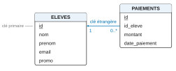
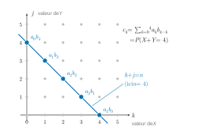
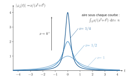
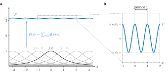

# CCINP MPI — Mathématiques 1 2026 · Corrigé brut

*Corrigé rédigé par IA, non officiel. Signalez toute erreur.*

Épreuve spécifique MPI (MPI1M1), durée 4 heures, calculatrices interdites. Deux exercices et un problème, 22 questions.

---

## Exercice I

La clé étrangère `PAIEMENTS.id_eleve` référence la clé primaire `ELEVES.id`. Un élève a donc zéro, un ou plusieurs paiements, et chaque paiement concerne un seul élève.



### Q1

On sélectionne sur `promo` avec l'opérateur de différence `<>`, on projette sur `email`, et `DISTINCT` supprime les doublons :

```sql
SELECT DISTINCT email
FROM ELEVES
WHERE promo <> 2025;
```

`DISTINCT` porte sur la ligne projetée, réduite ici à `email` : chaque adresse n'apparaît qu'une fois.

### Q2

Les noms sont dans `ELEVES` et les montants dans `PAIEMENTS` : il faut une jointure, puis une agrégation `SUM` par élève avec `GROUP BY`. On regroupe sur la clé primaire `e.id`, ce qui évite de fusionner deux homonymes. La jointure externe à gauche conserve les élèves sans paiement :

```sql
SELECT e.nom, e.prenom, SUM(p.montant) AS total
FROM ELEVES AS e
LEFT JOIN PAIEMENTS AS p ON p.id_eleve = e.id
GROUP BY e.id, e.nom, e.prenom
ORDER BY e.nom, e.prenom;
```

Un élève sans paiement figure dans le résultat avec un total `NULL`, puisque `SUM` porte alors sur un ensemble vide.

Pour afficher 0 avec les seules constructions au programme, on peut réunir deux requêtes. La première traite les élèves ayant payé, par une jointure interne. La seconde traite les élèves sans paiement, obtenus par `EXCEPT`. On garde `id` dans la sous-requête pour que `UNION` ne fusionne pas deux homonymes :

```sql
SELECT nom, prenom, total
FROM (SELECT e.id AS id, e.nom AS nom, e.prenom AS prenom, SUM(p.montant) AS total
      FROM ELEVES AS e JOIN PAIEMENTS AS p ON p.id_eleve = e.id
      GROUP BY e.id, e.nom, e.prenom
      UNION
      SELECT e.id, e.nom, e.prenom, 0
      FROM ELEVES AS e
      JOIN (SELECT id FROM ELEVES EXCEPT SELECT id_eleve FROM PAIEMENTS) AS s
        ON s.id = e.id) AS r
ORDER BY nom, prenom;
```

### Q3

Une ligne est en double s'il existe une autre ligne, d'identifiant différent, qui coïncide avec elle sur `nom`, `prenom`, `email` et `promo`. On fait une autojointure :

```sql
SELECT DISTINCT e1.id, e1.email
FROM ELEVES AS e1
JOIN ELEVES AS e2
  ON  e1.id <> e2.id
  AND e1.nom = e2.nom AND e1.prenom = e2.prenom
  AND e1.email = e2.email AND e1.promo = e2.promo;
```

La condition `e1.id <> e2.id` empêche une ligne de s'apparier avec elle-même. Une ligne présente $k$ fois, avec $k\ge3$, s'apparie avec $k-1$ autres lignes : `DISTINCT` évite qu'elle sorte $k-1$ fois.

Variante par agrégation :

```sql
SELECT e.id, e.email
FROM ELEVES AS e
JOIN (SELECT nom, prenom, email, promo
      FROM ELEVES
      GROUP BY nom, prenom, email, promo
      HAVING COUNT(*) >= 2) AS d
  ON  e.nom = d.nom AND e.prenom = d.prenom
  AND e.email = d.email AND e.promo = d.promo;
```

### Q4

Ne pas avoir de paiement, c'est n'avoir aucune ligne dans `PAIEMENTS`, et non avoir un paiement de montant 0. Première solution, par jointure externe à gauche. On ne garde que les élèves qui n'ont été appariés à aucun paiement :

```sql
SELECT e.id
FROM ELEVES AS e
LEFT JOIN PAIEMENTS AS p ON p.id_eleve = e.id
WHERE p.id IS NULL;
```

Le test porte sur `p.id`, clé primaire de `PAIEMENTS`. Cette colonne ne vaut jamais `NULL` pour une ligne réellement appariée.

Seconde solution, par différence ensembliste :

```sql
SELECT id FROM ELEVES
EXCEPT
SELECT id_eleve FROM PAIEMENTS;
```

---

## Exercice II

Pour $n\in\mathbb{N}$, on note $p_n=P(X=n)$.

### Q5

La famille $\big((X=n)\big)_{n\in\mathbb{N}}$ est un système complet d'événements, car $X$ est à valeurs dans $\mathbb{N}$. Donc $p_n\ge0$ pour tout $n$, et la série $\sum p_n$ converge, de somme 1.

Soit $t\in[-1,1]$. Comme $|t|\le1$, on a pour tout $n\in\mathbb{N}$

$$|p_nt^n|=p_n|t|^n\le p_n.$$

Par comparaison de séries à termes positifs, $\sum p_nt^n$ converge absolument, donc converge.

**$G_X$ est définie sur $[-1,1]$**. Le rayon de convergence de la série entière $\sum p_nt^n$ est donc au moins égal à 1, et $G_X(1)=1$.

### Q6

Si $X\sim\mathcal{P}(\lambda)$, alors pour tout $n\in\mathbb{N}$

$$P(X=n)=\mathrm{e}^{-\lambda}\frac{\lambda^n}{n!}.$$

Pour tout $t\in\mathbb{R}$, on utilise le développement en série entière de l'exponentielle, valable sur $\mathbb{R}$ :

$$\begin{aligned}
G_X(t)&=\sum_{n=0}^{+\infty}\mathrm{e}^{-\lambda}\frac{(\lambda t)^n}{n!}\\
&=\mathrm{e}^{-\lambda}\mathrm{e}^{\lambda t}.
\end{aligned}$$

$$\boxed{\forall t\in\mathbb{R},\ G_X(t)=\mathrm{e}^{\lambda(t-1)}}$$

### Q7

On pose $a_n=P(X=n)$ et $b_n=P(Y=n)$. D'après Q5, les séries entières $\sum a_nt^n$ et $\sum b_nt^n$ ont un rayon au moins égal à 1. Pour $t\in\,]-1,1[$, le théorème du produit de Cauchy de deux séries entières donne

$$G_X(t)\,G_Y(t)=\sum_{n=0}^{+\infty}c_nt^n,$$

où l'on a posé, pour tout $n\in\mathbb{N}$,

$$c_n=\sum_{k=0}^{n}a_kb_{n-k}.$$

Soit $n\in\mathbb{N}$. Les deux variables étant à valeurs dans $\mathbb{N}$, l'événement $(X+Y=n)$ est la réunion disjointe des événements $(X=k)\cap(Y=n-k)$, pour $k$ entier entre 0 et $n$.

Par additivité, puis par indépendance de $X$ et $Y$ :

$$\begin{aligned}
P(X+Y=n)&=\sum_{k=0}^{n}P\big((X=k)\cap(Y=n-k)\big)\\
&=\sum_{k=0}^{n}P(X=k)\,P(Y=n-k)\\
&=c_n.
\end{aligned}$$



La variable $X+Y$ est à valeurs dans $\mathbb{N}$. Pour tout $t\in\,]-1,1[$, on a donc

$$\begin{aligned}
G_{X+Y}(t)&=\sum_{n=0}^{+\infty}P(X+Y=n)\,t^n\\
&=\sum_{n=0}^{+\infty}c_nt^n.
\end{aligned}$$

$$\boxed{\forall t\in\,]-1,1[,\ G_{X+Y}(t)=G_X(t)\,G_Y(t)}$$

L'égalité vaut d'ailleurs sur $[-1,1]$. En $t=\pm1$, les deux séries convergent absolument, et le produit de Cauchy de deux séries absolument convergentes s'applique.

### Q8

$Z=X+Y$ est à valeurs dans $\mathbb{N}$. Pour tout $t\in\,]-1,1[$, Q7 (avec l'indépendance de $X$ et $Y$) puis Q6 donnent

$$\begin{aligned}
G_Z(t)&=\mathrm{e}^{\lambda(t-1)}\mathrm{e}^{\mu(t-1)}\\
&=\mathrm{e}^{(\lambda+\mu)(t-1)}\\
&=\sum_{n=0}^{+\infty}\mathrm{e}^{-(\lambda+\mu)}\frac{(\lambda+\mu)^n}{n!}t^n.
\end{aligned}$$

La dernière égalité est Q6 appliquée au paramètre $\lambda+\mu>0$. Les séries entières $\sum P(Z=n)t^n$ et $\sum \mathrm{e}^{-(\lambda+\mu)}\frac{(\lambda+\mu)^n}{n!}t^n$ ont des rayons au moins égaux à 1 et la même somme sur $]-1,1[$. Par unicité du développement en série entière, leurs coefficients coïncident. Pour tout $n\in\mathbb{N}$ :

$$P(Z=n)=\mathrm{e}^{-(\lambda+\mu)}\frac{(\lambda+\mu)^n}{n!}.$$

**$Z=X+Y$ suit la loi de Poisson de paramètre $\lambda+\mu$.**

On obtient le même résultat par le calcul direct de $P(Z=n)$ comme en Q7, puis la formule du binôme :

$$\begin{aligned}
P(Z=n)&=\frac{\mathrm{e}^{-(\lambda+\mu)}}{n!}\sum_{k=0}^{n}\binom{n}{k}\lambda^k\mu^{n-k}\\
&=\mathrm{e}^{-(\lambda+\mu)}\frac{(\lambda+\mu)^n}{n!}.
\end{aligned}$$

---

## Problème

### Partie I — Calcul d'une intégrale

### Q9

Soit $x>0$, et soit $\varphi_x(t)=\dfrac{x}{x^2+t^2}\mathrm{e}^{\mathrm{i}t}$. Comme $x>0$, on a $x^2+t^2\ge x^2>0$ : la fonction $\varphi_x$ est continue sur $\mathbb{R}$. Son module vérifie

$$|\varphi_x(t)|=\frac{x}{x^2+t^2}\underset{|t|\to+\infty}{\sim}\frac{x}{t^2}.$$

La fonction $t\mapsto1/t^2$ est intégrable au voisinage de $\pm\infty$ (Riemann, exposant $2>1$). Par comparaison de fonctions positives, $|\varphi_x|$ est intégrable sur $[1,+\infty[$ et sur $]-\infty,-1]$.

Elle est continue sur le segment $[-1,1]$. Donc $\varphi_x$ est intégrable sur $\mathbb{R}$.

**$g$ est bien définie sur $]0,+\infty[$.**

### Q10

Soit $x>0$. L'application $u\mapsto xu$ est une bijection $\mathcal{C}^1$ strictement croissante de $\mathbb{R}$ sur $\mathbb{R}$, et l'intégrale converge absolument. Le changement de variable $t=xu$ donne

$$\begin{aligned}
g(x)&=\int_{-\infty}^{+\infty}\frac{x}{x^2+x^2u^2}\mathrm{e}^{\mathrm{i}xu}\,x\,\mathrm{d}u\\
&=\int_{-\infty}^{+\infty}\frac{\mathrm{e}^{\mathrm{i}xu}}{1+u^2}\,\mathrm{d}u.
\end{aligned}$$

$$\boxed{g(x)=\int_{-\infty}^{+\infty}\frac{\mathrm{e}^{\mathrm{i}xu}}{1+u^2}\,\mathrm{d}u}$$

Comme $|\mathrm{e}^{\mathrm{i}xu}|=1$, on en déduit, pour tout $x>0$,

$$\begin{aligned}
|g(x)|&\le\int_{-\infty}^{+\infty}\frac{\mathrm{d}u}{1+u^2}\\
&=\lim_{A\to+\infty}\big[\arctan u\big]_{-A}^{A}\\
&=\pi.
\end{aligned}$$

**$g$ est bornée sur $]0,+\infty[$, par $\pi$.**

### Q11

On pose $h(x,u)=\dfrac{\mathrm{e}^{\mathrm{i}xu}}{1+u^2}$ sur $[0,+\infty[\times\mathbb{R}$ et $\Gamma(x)=\int_{\mathbb{R}}h(x,u)\,\mathrm{d}u$. On vérifie les hypothèses du théorème de continuité des intégrales à paramètre :

- pour tout $x\ge0$, $u\mapsto h(x,u)$ est continue sur $\mathbb{R}$ ;
- pour tout $u\in\mathbb{R}$, $x\mapsto h(x,u)$ est continue sur $[0,+\infty[$ ;
- pour tout $(x,u)$, $|h(x,u)|=\dfrac{1}{1+u^2}$, fonction intégrable sur $\mathbb{R}$ et indépendante de $x$.

$\Gamma$ est donc continue sur $[0,+\infty[$. D'après Q10, $\Gamma=g$ sur $]0,+\infty[$. De plus $\Gamma(0)=\int_{\mathbb{R}}\frac{\mathrm{d}u}{1+u^2}=\pi$. On en déduit

$$\boxed{\lim_{x\to0^+}g(x)=\Gamma(0)=\pi}$$



### Q12

On revient à la forme initiale. Avec la forme de Q10, dériver ferait apparaître $u/(1+u^2)$ puis $u^2/(1+u^2)$, qui ne sont pas intégrables.

On pose $\varphi(x,t)=\dfrac{x}{x^2+t^2}\mathrm{e}^{\mathrm{i}t}$ sur $]0,+\infty[\times\mathbb{R}$. Pour $t$ fixé, $x\mapsto\varphi(x,t)$ est de classe $\mathcal{C}^2$ (fraction rationnelle sans pôle sur $]0,+\infty[$). Par dérivation d'un quotient :

$$\frac{\partial\varphi}{\partial x}(x,t)=\frac{t^2-x^2}{(x^2+t^2)^2}\mathrm{e}^{\mathrm{i}t},$$

$$\frac{\partial^2\varphi}{\partial x^2}(x,t)=\frac{2x(x^2-3t^2)}{(x^2+t^2)^3}\mathrm{e}^{\mathrm{i}t}.$$

Soit $0<a<b$. Pour $x\in[a,b]$ et $t\in\mathbb{R}$, on utilise $|t^2-x^2|\le t^2+x^2$ et $x^2+3t^2\le3(x^2+t^2)$. On obtient les dominations suivantes :

$$|\varphi(x,t)|\le\frac{b}{a^2+t^2},$$

$$\begin{aligned}
\left|\frac{\partial\varphi}{\partial x}(x,t)\right|&\le\frac{1}{x^2+t^2}\\
&\le\frac{1}{a^2+t^2},
\end{aligned}$$

$$\begin{aligned}
\left|\frac{\partial^2\varphi}{\partial x^2}(x,t)\right|&\le\frac{2b\,(x^2+3t^2)}{(x^2+t^2)^3}\\
&\le\frac{6b}{(x^2+t^2)^2}\\
&\le\frac{6b}{(a^2+t^2)^2}.
\end{aligned}$$

Les trois majorants sont continus et intégrables sur $\mathbb{R}$ : ils sont en $O(1/t^2)$ en $\pm\infty$. On vérifie les hypothèses du théorème de régularité $\mathcal{C}^2$ des intégrales à paramètre, sur le segment $[a,b]$ :

- pour tout $t$, $x\mapsto\varphi(x,t)$ est $\mathcal{C}^2$ sur $[a,b]$ ;
- pour tout $x$, $t\mapsto\varphi(x,t)$ et $t\mapsto\partial_x\varphi(x,t)$ sont continues et intégrables sur $\mathbb{R}$, et $t\mapsto\partial_x^2\varphi(x,t)$ est continue ;
- la dérivée seconde est dominée sur $[a,b]\times\mathbb{R}$ par une fonction intégrable indépendante de $x$.

Donc $g$ est $\mathcal{C}^2$ sur $[a,b]$. Tout point de $]0,+\infty[$ appartient à un tel segment.

Donc $g$ est $\mathcal{C}^2$ sur $]0,+\infty[$, et pour tout $x>0$ :

$$\boxed{g''(x)=\int_{-\infty}^{+\infty}\frac{2x(x^2-3t^2)}{(x^2+t^2)^3}\mathrm{e}^{\mathrm{i}t}\,\mathrm{d}t}$$

### Q13

Soit $\psi(x,t)=\dfrac{x}{x^2+t^2}$. On calcule d'abord les dérivées par rapport à $x$ :

$$\frac{\partial\psi}{\partial x}=\frac{t^2-x^2}{(x^2+t^2)^2},$$

$$\begin{aligned}
\frac{\partial^2\psi}{\partial x^2}&=\frac{-2x(x^2+t^2)-4x(t^2-x^2)}{(x^2+t^2)^3}\\
&=\frac{2x(x^2-3t^2)}{(x^2+t^2)^3}.
\end{aligned}$$

Puis les dérivées par rapport à $t$ :

$$\frac{\partial\psi}{\partial t}=\frac{-2xt}{(x^2+t^2)^2},$$

$$\begin{aligned}
\frac{\partial^2\psi}{\partial t^2}&=\frac{-2x(x^2+t^2)+8xt^2}{(x^2+t^2)^3}\\
&=\frac{-2x(x^2-3t^2)}{(x^2+t^2)^3}.
\end{aligned}$$

En sommant :

$$\boxed{\frac{\partial^2}{\partial x^2}\left(\frac{x}{x^2+t^2}\right)+\frac{\partial^2}{\partial t^2}\left(\frac{x}{x^2+t^2}\right)=0}$$

pour tout $(x,t)\in\,]0,+\infty[\times\mathbb{R}$.

**Équation différentielle.** Fixons $x>0$ et notons $\psi_x=\psi(x,\cdot)$. Par Q12 et l'identité précédente,

$$g''(x)=-\int_{-\infty}^{+\infty}\psi_x''(t)\,\mathrm{e}^{\mathrm{i}t}\,\mathrm{d}t.$$

Quand $|t|\to+\infty$, on a les estimations suivantes :

$$\psi_x(t)=O\Big(\frac{1}{t^2}\Big),$$

$$\psi_x'(t)=O\Big(\frac{1}{|t|^3}\Big),$$

$$\psi_x''(t)=O\Big(\frac{1}{t^4}\Big).$$

Ces trois fonctions continues sont donc intégrables sur $\mathbb{R}$. De plus, $\psi_x$ et $\psi_x'$ tendent vers 0 en $\pm\infty$.

Pour $A>0$, deux intégrations par parties sur $[-A,A]$ donnent

$$\int_{-A}^{A}\psi_x''\mathrm{e}^{\mathrm{i}t}\,\mathrm{d}t=\Big[\psi_x'\mathrm{e}^{\mathrm{i}t}\Big]_{-A}^{A}-\mathrm{i}\int_{-A}^{A}\psi_x'\mathrm{e}^{\mathrm{i}t}\,\mathrm{d}t,$$

$$\int_{-A}^{A}\psi_x'\mathrm{e}^{\mathrm{i}t}\,\mathrm{d}t=\Big[\psi_x\mathrm{e}^{\mathrm{i}t}\Big]_{-A}^{A}-\mathrm{i}\int_{-A}^{A}\psi_x\mathrm{e}^{\mathrm{i}t}\,\mathrm{d}t.$$

Quand $A\to+\infty$, les crochets tendent vers 0, car $|\mathrm{e}^{\mathrm{i}t}|=1$ et $\psi_x,\psi_x'\to0$. Les intégrales convergent, d'où

$$\int_{\mathbb{R}}\psi_x'\mathrm{e}^{\mathrm{i}t}\,\mathrm{d}t=-\mathrm{i}\,g(x),$$

$$\begin{aligned}
\int_{\mathbb{R}}\psi_x''\mathrm{e}^{\mathrm{i}t}\,\mathrm{d}t&=(-\mathrm{i})^2g(x)\\
&=-g(x).
\end{aligned}$$

Donc $g''(x)=g(x)$ pour tout $x>0$ :

**$g$ est solution de $y''-y=0$ sur $]0,+\infty[$.**

### Q14

L'équation caractéristique $r^2-1=0$ a pour racines $\pm1$. Les solutions complexes de $y''-y=0$ sur $]0,+\infty[$ sont les fonctions $x\mapsto A\mathrm{e}^{x}+B\mathrm{e}^{-x}$, avec $(A,B)\in\mathbb{C}^2$.

Il existe donc $(A,B)\in\mathbb{C}^2$ tel que, pour tout $x>0$,

$$g(x)=A\mathrm{e}^x+B\mathrm{e}^{-x}.$$

- On a $\mathrm{e}^{-x}g(x)=A+B\mathrm{e}^{-2x}\to A$ quand $x\to+\infty$. Si $A\neq0$, alors $|g(x)|\sim|A|\mathrm{e}^x\to+\infty$, ce qui contredit Q10. Donc $A=0$.
- On a $g(x)=B\mathrm{e}^{-x}\to B$ quand $x\to0^+$. D'après Q11, $B=\pi$.

Pour tout $x>0$ :

$$\boxed{g(x)=\int_{-\infty}^{+\infty}\frac{\mathrm{e}^{\mathrm{i}xu}}{1+u^2}\,\mathrm{d}u=\pi\,\mathrm{e}^{-x}}$$

### Partie II — Formule sommatoire de Poisson

### Q15

Soit $x\in\mathbb{R}$ fixé ; l'indice de sommation est $n$. Les termes $f(x+n)$ et $f(x-n)$ sont strictement positifs. De plus, quand $n\to+\infty$,

$$n^2f(x\pm n)=\frac{n^2}{1+(x\pm n)^2}\longrightarrow1,$$

donc $f(x\pm n)\sim1/n^2$. Par comparaison de séries à termes positifs avec une série de Riemann convergente, les deux séries convergent, et $F(x)$ est bien défini.

Pour la périodicité, on décale les indices ($m=n+1$ dans la première série, $p=n-1$ dans la seconde) :

$$\begin{aligned}
F(x+1)&=\sum_{m=1}^{+\infty}f(x+m)+\sum_{p=0}^{+\infty}f(x-p)\\
&=\Big(f(x)+\sum_{m=1}^{+\infty}f(x+m)\Big)+\sum_{p=1}^{+\infty}f(x-p)\\
&=F(x).
\end{aligned}$$

**$F$ est définie sur $\mathbb{R}$ et 1-périodique.**



### Q16

Pour $n\in\mathbb{N}$, on pose $u_n(x)=f(x+n)$, et pour $n\ge1$, $v_n(x)=f(x-n)$. Ces fonctions sont continues sur $\mathbb{R}$. Pour $x\in[0,1]$ :

- si $n\ge1$, alors $x+n\ge n$, donc $0\le u_n(x)\le\dfrac{1}{1+n^2}\le\dfrac{1}{n^2}$ ;
- si $n\ge2$, alors $|x-n|=n-x\ge n-1\ge1$, donc $0\le v_n(x)\le\dfrac{1}{(n-1)^2}$.

Ainsi, pour $n\ge2$ :

$$\|u_n\|_{\infty,[0,1]}\le\frac{1}{n^2},$$

$$\|v_n\|_{\infty,[0,1]}\le\frac{1}{(n-1)^2}.$$

Ce sont les termes généraux de séries convergentes. Les séries $\sum_{n\ge1}u_n$ et $\sum_{n\ge2}v_n$ convergent donc normalement, donc uniformément, sur $[0,1]$.

Leurs termes sont continus : leurs sommes sont continues sur $[0,1]$. En ajoutant les termes continus $u_0$ et $v_1$, on obtient que **$F$ est continue sur $[0,1]$**.

Par Q15, $F(y+k)=F(y)$ pour tous $y\in\mathbb{R}$ et $k\in\mathbb{Z}$. Pour $x\in[k,k+1]$, on a $F(x)=F(x-k)$ avec $x-k\in[0,1]$.

$F$ est donc continue sur chaque $[k,k+1]$, comme composée de fonctions continues.

Soit $x_0\in\mathbb{R}$ et $k=\lfloor x_0\rfloor$. Les restrictions de $F$ à $[k-1,k]$ et à $[k,k+1]$ sont continues et prennent la même valeur en $k$.

$F$ est donc continue sur $[k-1,k+1]$, qui est un voisinage de $x_0$. **$F$ est continue sur $\mathbb{R}$.**

### Q17

Soit $k\in\mathbb{Z}$. Comme $|\mathrm{e}^{-2\mathrm{i}\pi kt}|=1$, les séries $\sum u_n(t)\mathrm{e}^{-2\mathrm{i}\pi kt}$ et $\sum v_n(t)\mathrm{e}^{-2\mathrm{i}\pi kt}$ convergent normalement sur $[0,1]$ (Q16), et leurs termes sont continus. Le théorème d'intégration terme à terme d'une série de fonctions uniformément convergente sur un segment donne

$$\begin{aligned}
c_k(F)={}&\sum_{n=0}^{+\infty}\int_0^1f(t+n)\mathrm{e}^{-2\mathrm{i}\pi kt}\,\mathrm{d}t\\
&+\sum_{n=1}^{+\infty}\int_0^1f(t-n)\mathrm{e}^{-2\mathrm{i}\pi kt}\,\mathrm{d}t.
\end{aligned}$$

On pose $\Phi(s)=f(s)\mathrm{e}^{-2\mathrm{i}\pi ks}$. On effectue les changements de variable $s=t+n$ et $s=t-n$. Comme $kn\in\mathbb{Z}$, on a $\mathrm{e}^{\pm2\mathrm{i}\pi kn}=1$, d'où

$$\int_0^1f(t+n)\mathrm{e}^{-2\mathrm{i}\pi kt}\,\mathrm{d}t=\int_n^{n+1}\Phi(s)\,\mathrm{d}s,$$

$$\int_0^1f(t-n)\mathrm{e}^{-2\mathrm{i}\pi kt}\,\mathrm{d}t=\int_{-n}^{-n+1}\Phi(s)\,\mathrm{d}s.$$

On a $|\Phi|=f$, intégrable sur $\mathbb{R}$, donc $\Phi$ est intégrable. Par la relation de Chasles, les sommes partielles valent

$$\sum_{n=0}^{N}\int_n^{n+1}\Phi=\int_0^{N+1}\Phi\xrightarrow[N\to+\infty]{}\int_0^{+\infty}\Phi,$$

$$\sum_{n=1}^{N}\int_{-n}^{-n+1}\Phi=\int_{-N}^{0}\Phi\xrightarrow[N\to+\infty]{}\int_{-\infty}^{0}\Phi.$$

D'où, pour tout $k\in\mathbb{Z}$ :

$$\boxed{c_k(F)=\int_{-\infty}^{+\infty}f(t)\,\mathrm{e}^{-2\mathrm{i}\pi kt}\,\mathrm{d}t}$$

### Q18

On pose $m=n+k\in\mathbb{Z}$. Si $m=0$, l'intégrande vaut 1 et l'intégrale vaut 1.

Si $m\neq0$, une primitive de $t\mapsto\mathrm{e}^{-2\mathrm{i}\pi mt}$ est $t\mapsto\frac{\mathrm{e}^{-2\mathrm{i}\pi mt}}{-2\mathrm{i}\pi m}$. De plus, $\mathrm{e}^{-2\mathrm{i}\pi m}=1$ car $m$ est entier :

$$\begin{aligned}
\int_0^1\mathrm{e}^{-2\mathrm{i}\pi mt}\,\mathrm{d}t&=\frac{\mathrm{e}^{-2\mathrm{i}\pi m}-1}{-2\mathrm{i}\pi m}\\
&=0.
\end{aligned}$$

$$\boxed{\int_0^1\mathrm{e}^{-2\mathrm{i}\pi(n+k)t}\,\mathrm{d}t=\begin{cases}1&\text{si }n+k=0,\\0&\text{si }n+k\neq0.\end{cases}}$$

### Partie III — Applications

### Q19

D'après Q17 avec $k=0$ :

$$c_0(F)=\int_{\mathbb{R}}\frac{\mathrm{d}t}{1+t^2}=\pi.$$

Soit $k\ge1$. D'après Q17, $c_k(F)=\int_{\mathbb{R}}\frac{\mathrm{e}^{-2\mathrm{i}\pi kt}}{1+t^2}\,\mathrm{d}t$. L'intégrale converge absolument. Le changement de variable $t=-u$ (bijection $\mathcal{C}^1$ strictement décroissante de $\mathbb{R}$ sur $\mathbb{R}$) donne

$$c_k(F)=\int_{-\infty}^{+\infty}\frac{\mathrm{e}^{2\mathrm{i}\pi ku}}{1+u^2}\,\mathrm{d}u.$$

C'est la forme de $g$ obtenue en Q10, au point $2\pi k>0$. Par Q14 :

$$\begin{aligned}
c_k(F)&=g(2\pi k)\\
&=\pi\,\mathrm{e}^{-2\pi k}.
\end{aligned}$$

$$\boxed{c_0(F)=\pi,\ \text{ et }\ \forall k\in\mathbb{N}^*,\ c_k(F)=\pi\,\mathrm{e}^{-2\pi k}}$$

La formule vaut aussi pour $k=0$. Avec la relation admise, $c_k(F)=\pi\mathrm{e}^{-2\pi|k|}$ pour tout $k\in\mathbb{Z}$.

### Q20

On pose $q=\mathrm{e}^{-2\pi}\in\,]0,1[$. Par Q19 et la relation admise, pour $n\ge0$,

$$c_n(F)=c_{-n}(F)=\pi q^n.$$

Les fonctions $x\mapsto c_n(F)\mathrm{e}^{2\mathrm{i}\pi nx}$ et $x\mapsto c_{-n}(F)\mathrm{e}^{-2\mathrm{i}\pi nx}$ sont continues sur $\mathbb{R}$ et de norme infinie $\pi q^n$.

C'est le terme général d'une série géométrique convergente. Les deux séries convergent donc normalement, donc uniformément, sur $\mathbb{R}$. Ainsi $G$ est bien définie, et **$G$ est continue sur $\mathbb{R}$**, comme somme d'une série uniformément convergente de fonctions continues.

Pour $n\in\mathbb{N}$, on a $\mathrm{e}^{\pm2\mathrm{i}\pi n(x+1)}=\mathrm{e}^{\pm2\mathrm{i}\pi nx}$. Chaque terme est donc 1-périodique et, en sommant, $G(x+1)=G(x)$ : **$G$ est 1-périodique**.

### Q21

$F$ et $G$ sont continues et 1-périodiques (Q15, Q16, Q20). D'après le résultat admis, il suffit d'établir $c_k(G)=c_k(F)$ pour tout $k\in\mathbb{Z}$.

Soit $k\in\mathbb{Z}$. Après multiplication par $\mathrm{e}^{-2\mathrm{i}\pi kt}$, de module 1, les séries de Q20 convergent encore normalement sur $[0,1]$. On intègre terme à terme sur le segment $[0,1]$ :

$$\begin{aligned}
c_k(G)={}&\sum_{n=0}^{+\infty}c_n(F)\int_0^1\mathrm{e}^{-2\mathrm{i}\pi(-n+k)t}\,\mathrm{d}t\\
&+\sum_{n=1}^{+\infty}c_{-n}(F)\int_0^1\mathrm{e}^{-2\mathrm{i}\pi(n+k)t}\,\mathrm{d}t.
\end{aligned}$$

Par Q18, la première intégrale vaut 1 si $n=k$ et 0 sinon ; la seconde vaut 1 si $n=-k$ et 0 sinon.

- Si $k\ge0$, seul le terme $n=k$ de la première somme subsiste : la seconde somme est nulle, puisque $n\ge1>-k$. On obtient $c_k(G)=c_k(F)$.
- Si $k<0$, la première somme est nulle, puisque $n\ge0>k$. Seul le terme $n=-k\ge1$ de la seconde subsiste et vaut $c_{-(-k)}(F)=c_k(F)$.

Dans les deux cas, $c_k(G)=c_k(F)$. Le résultat admis donne

$$\boxed{F=G}$$

### Q22

On pose $q=\mathrm{e}^{-2\pi}$ et $z=\mathrm{e}^{2\mathrm{i}\pi x}$, de sorte que $|z|=1$, $\bar z=z^{-1}$ et $z+\bar z=2\cos(2\pi x)$. Par Q19 et Q21, et puisque $|qz|=|q\bar z|=q<1$, on somme deux séries géométriques :

$$\begin{aligned}
F(x)&=\pi\sum_{n=0}^{+\infty}(qz)^n+\pi\sum_{n=1}^{+\infty}(q\bar z)^n\\
&=\pi\left(\frac{1}{1-qz}+\frac{q\bar z}{1-q\bar z}\right)\\
&=\pi\,\frac{1-q^2}{(1-qz)(1-q\bar z)}.
\end{aligned}$$

En effet, le numérateur vaut $1-q\bar z+q\bar z-q^2z\bar z=1-q^2$. Le dénominateur vaut $1-2q\cos(2\pi x)+q^2$. Il est supérieur ou égal à $(1-q)^2>0$, donc ne s'annule pas. On multiplie le numérateur et le dénominateur par $\mathrm{e}^{2\pi}$ :

$$\begin{aligned}
F(x)&=\frac{\pi(1-q^2)}{1-2q\cos(2\pi x)+q^2}\\
&=\frac{\pi(\mathrm{e}^{2\pi}-\mathrm{e}^{-2\pi})}{\mathrm{e}^{2\pi}+\mathrm{e}^{-2\pi}-2\cos(2\pi x)}.
\end{aligned}$$

Pour tout $x\in\mathbb{R}$ :

$$\boxed{F(x)=\frac{\pi\operatorname{sh}(2\pi)}{\operatorname{ch}(2\pi)-\cos(2\pi x)}}$$

Autrement dit, pour tout réel $x$, la somme $\sum_{n\in\mathbb{Z}}\frac{1}{1+(x+n)^2}$ vaut $\frac{\pi\operatorname{sh}(2\pi)}{\operatorname{ch}(2\pi)-\cos(2\pi x)}$.

On peut contrôler ce résultat en deux points. En $x=0$, on retrouve $\sum_{n\in\mathbb{Z}}\frac{1}{1+n^2}=\pi\coth\pi\approx3{,}1533$. En $x=\frac12$, on obtient $F(\tfrac12)=\pi\operatorname{th}\pi\approx3{,}1299$. $F$ oscille donc faiblement autour de sa valeur moyenne $c_0(F)=\pi$.

FIN
