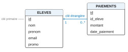
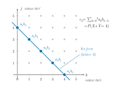
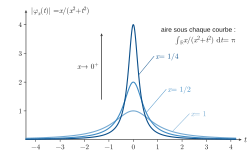
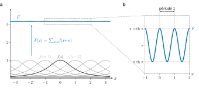

# CCINP MPI — Mathématiques 1 2026 · Corrigé guidé

*Corrigé rédigé par IA, non officiel. Signalez toute erreur.*

## Présentation du sujet

**Cadre.** Épreuve spécifique MPI (MPI1M1), 4 heures, calculatrices interdites. Le sujet comprend deux exercices indépendants et un problème en trois parties, soit 22 questions. Il est identique, au code près, au sujet de Mathématiques 1 de la filière MP.

**Exercice I (Q1 à Q4) : bases de données.** On écrit quatre requêtes SQL sur deux tables, `ELEVES` et `PAIEMENTS`, reliées par la clé étrangère `id_eleve`. Elles mobilisent la sélection et la projection avec `DISTINCT`, la jointure externe à gauche, l'agrégation `SUM … GROUP BY`, l'autojointure et la différence ensembliste `EXCEPT`. Ces notions relèvent du chapitre « Bases de données » du programme d'informatique MP2I/MPI. Le rapport 2026 souligne que cette compétence n'avait encore jamais été interrogée à l'écrit.



**Exercice II (Q5 à Q8) : fonctions génératrices.** On définit $G_X$ sur $[-1,1]$ et on calcule la fonction génératrice d'une loi de Poisson. On démontre ensuite $G_{X+Y}=G_XG_Y$ par produit de Cauchy, et on en déduit la stabilité de la loi de Poisson par somme indépendante. C'est un enchaînement de cours.

**Problème (Q9 à Q22) : un cas de la formule sommatoire de Poisson.**

- *Partie I (Q9 à Q14)* calcule $g(x)=\int_{\mathbb{R}}\frac{x}{x^2+t^2}\mathrm{e}^{\mathrm{i}t}\,\mathrm{d}t$ par la méthode de l'équation différentielle. On y utilise l'intégrabilité, un changement de variable, la continuité puis la régularité $\mathcal{C}^2$ d'une intégrale à paramètre. S'y ajoutent des intégrations par parties sur un intervalle non borné et la résolution de $y''-y=0$.
- *Partie II (Q15 à Q18)* étudie la périodisée $F(x)=\sum_{n\in\mathbb{Z}}f(x+n)$ de $f(t)=\frac{1}{1+t^2}$. On y traite la convergence de séries, la périodicité, la continuité par convergence normale sur un segment, l'intégration terme à terme et l'orthogonalité des exponentielles.
- *Partie III (Q19 à Q22)* utilise la partie I pour calculer les $c_k(F)$. Un résultat d'unicité admis permet ensuite d'identifier $F$ à une série trigonométrique $G$, d'où la formule close de $F$.

**Difficulté et longueur.** Le sujet est de longueur raisonnable pour 4 heures et très guidé, sans piège calculatoire majeur. La difficulté est dans la **rigueur des justifications** : choisir la bonne forme de $g$ selon l'usage, dominer sur des segments, justifier les interversions entre série et intégrale, discuter les indices. Le rapport 2026 donne une moyenne de 10,07 et un écart type de 4,18 en MPI, et juge que le sujet permet de classer les candidats.

**Questions discriminantes.** D'après le rapport 2026 : Q3 (doublons, « Question difficile qui a souvent été passée »), Q12 (régularité $\mathcal{C}^2$, « Question très peu réussie »), Q13 (le calcul de dérivées partielles a posé beaucoup de problèmes), Q18 (primitive classique mal réussie) et Q21, Q22, rarement abordées. Ce sont les questions où une copie soignée se distingue.

**Questions à ne pas laisser passer.** Q1, Q4, Q5, Q6, Q8, Q9, Q10, Q14, Q15, Q18 et $c_0(F)$ en Q19 sont courtes et standard. Q14 se traite même si Q12 et Q13 résistent, en admettant l'équation différentielle ; le rapport 2026 le relève expressément. La partie III se traite en admettant les résultats des parties I et II.

**Gestion du temps.** Une répartition raisonnable : environ 30 minutes pour l'exercice I, 40 minutes pour l'exercice II, 1 h 20 pour la partie I (Q12 et Q13 sont les plus longues), 50 minutes pour la partie II et 40 minutes pour la partie III.

---

## Exercice I — Requêtes SQL

Les quatre questions sont indépendantes. Il faut savoir sur quelle table on travaille, quand une jointure est nécessaire et quand une agrégation l'est. La clé étrangère `PAIEMENTS.id_eleve` référence `ELEVES.id` : un élève a zéro, un ou plusieurs paiements.

### Question 1

> [!INDICATION]
> Une seule table suffit. Repérez la condition de sélection, puis le mot-clé qui supprime les doublons du résultat.

#### Solution

```sql
SELECT DISTINCT email
FROM ELEVES
WHERE promo <> 2025;
```

`WHERE` sélectionne les élèves qui ne sont pas de la promotion 2025, la projection ne garde que `email`, et `DISTINCT` supprime les adresses répétées.

> [!PIEGE]
> `DISTINCT` porte sur la ligne entière du résultat. `SELECT DISTINCT id, email` ne supprimerait aucun doublon, puisque `id` est une clé primaire et que deux lignes ne peuvent pas la partager.

> [!JURY]
> Le rapport 2026 relève deux oublis : « Beaucoup oublient de mettre DISTINCT ou ne connaissent pas le symbole de négation <>. » La consigne « sans doublons » appelle `DISTINCT`, et la différence s'écrit `<>` en SQL.

### Question 2

> [!INDICATION]
> Il faut les montants, qui sont dans `PAIEMENTS`, et les noms, qui sont dans `ELEVES` : une jointure s'impose, suivie d'une agrégation par élève.

> [!INDICATION]
> « Pour chaque élève » : que devient, avec une jointure interne, un élève qui n'a rien payé ? Et sur quel attribut regrouper pour ne pas fusionner deux homonymes ?

#### Solution

```sql
SELECT e.nom, e.prenom, SUM(p.montant) AS total
FROM ELEVES AS e
LEFT JOIN PAIEMENTS AS p ON p.id_eleve = e.id
GROUP BY e.id, e.nom, e.prenom
ORDER BY e.nom, e.prenom;
```

Le regroupement sur la clé primaire `e.id` sépare deux élèves homonymes. Les colonnes projetées `nom` et `prenom` figurent aussi dans le `GROUP BY`. La jointure externe à gauche conserve les élèves sans paiement. Pour eux, `SUM` porte sur un ensemble vide et renvoie `NULL`.

Si l'on veut afficher 0 sans sortir des constructions au programme, on réunit deux requêtes. La première porte sur les élèves ayant payé, avec une jointure interne. La seconde porte sur les élèves sans paiement, obtenus par `EXCEPT`, avec un total constant 0. On garde `id` dans la sous-requête, sans quoi `UNION` fusionnerait deux homonymes de même total :

```sql
SELECT nom, prenom, total
FROM (SELECT e.id AS id, e.nom AS nom, e.prenom AS prenom, SUM(p.montant) AS total
      FROM ELEVES AS e JOIN PAIEMENTS AS p ON p.id_eleve = e.id
      GROUP BY e.id, e.nom, e.prenom
      UNION
      SELECT e.id, e.nom, e.prenom, 0
      FROM ELEVES AS e
      JOIN (SELECT id FROM ELEVES EXCEPT SELECT id_eleve FROM PAIEMENTS) AS s
        ON s.id = e.id) AS r
ORDER BY nom, prenom;
```

> [!PIEGE]
> Si l'on regroupe sur `(nom, prenom)` au lieu de la clé primaire, deux élèves homonymes voient leurs paiements additionnés. Il faut toujours regrouper sur une clé de l'entité que l'on veut décrire.

> [!METHODE]
> « Pour chaque X, y compris ceux qui n'ont aucun Y » appelle une jointure externe à gauche depuis la table de X. Une jointure interne ne garde que les X qui ont au moins un Y.

> [!JURY]
> Selon le rapport 2026, « L’agrégation avec un GROUP BY n’est pas connue de tous et plus basiquement encore, la jointure n’est pas maîtrisée. » Les trois ingrédients (jointure, `SUM`, `GROUP BY`) doivent figurer, avec la syntaxe exacte.

### Question 3

> [!INDICATION]
> On compare des lignes d'une même table entre elles : il faut faire intervenir deux copies de `ELEVES`.

> [!INDICATION]
> Deux lignes sont des doublons si elles diffèrent par `id` et coïncident sur tous les autres attributs. Que se passe-t-il si l'on oublie la condition sur `id` ? Et si un même élève est présent trois fois ?

#### Solution

```sql
SELECT DISTINCT e1.id, e1.email
FROM ELEVES AS e1
JOIN ELEVES AS e2
  ON  e1.id <> e2.id
  AND e1.nom = e2.nom AND e1.prenom = e2.prenom
  AND e1.email = e2.email AND e1.promo = e2.promo;
```

Sans la condition `e1.id <> e2.id`, chaque ligne s'apparierait avec elle-même et toute la table sortirait. Sans `DISTINCT`, une ligne présente $k$ fois, avec $k\ge3$, sortirait $k-1$ fois.

Une variante passe par l'agrégation. On repère les quadruplets présents au moins deux fois, puis on retrouve les lignes correspondantes :

```sql
SELECT e.id, e.email
FROM ELEVES AS e
JOIN (SELECT nom, prenom, email, promo
      FROM ELEVES
      GROUP BY nom, prenom, email, promo
      HAVING COUNT(*) >= 2) AS d
  ON  e.nom = d.nom AND e.prenom = d.prenom
  AND e.email = d.email AND e.promo = d.promo;
```

> [!PIEGE]
> Comparer seulement les adresses email ne suffit pas : deux élèves distincts peuvent partager une adresse sans être des doublons au sens de l'énoncé. Autre confusion fréquente : un agrégat se filtre dans `HAVING`, pas dans `WHERE`.

> [!JURY]
> Le rapport 2026 la qualifie de « Question difficile qui a souvent été passée. » C'est la question discriminante de l'exercice : l'autojointure avec la condition `e1.id <> e2.id` suffit à la traiter.

### Question 4

> [!INDICATION]
> « Aucun paiement » est une absence de ligne dans `PAIEMENTS`. Deux traductions sont possibles en SQL : une jointure qui laisse des trous, ou une différence d'ensembles.

#### Solution

Première solution, par jointure externe à gauche :

```sql
SELECT e.id
FROM ELEVES AS e
LEFT JOIN PAIEMENTS AS p ON p.id_eleve = e.id
WHERE p.id IS NULL;
```

Un élève sans paiement est apparié à une ligne entièrement `NULL` côté `PAIEMENTS`. On teste `p.id` : c'est la clé primaire, qui ne vaut jamais `NULL` pour une ligne réellement appariée.

Seconde solution, par différence ensembliste :

```sql
SELECT id FROM ELEVES
EXCEPT
SELECT id_eleve FROM PAIEMENTS;
```

> [!PIEGE]
> Filtrer sur `montant = 0` ne répond pas à la question. Un élève sans paiement n'a aucune ligne dans `PAIEMENTS` ; un paiement de 0 euro est, lui, un paiement enregistré. Le rapport 2026 signale que de nombreux candidats ont fait cette confusion.

> [!PIEGE]
> Avec un `JOIN` interne, le résultat serait vide. Si l'on place la condition `p.id IS NULL` dans le `ON` au lieu du `WHERE`, elle ne filtre plus rien et tous les élèves sortent.

> [!JURY]
> Le rapport 2026 accepte plusieurs réponses, et indique qu'« on pouvait utiliser la jointure LEFT JOIN avec une condition NULL ». C'est la première solution ci-dessus.

---

## Exercice II — Fonctions génératrices

L'exercice suit la progression du cours. On établit l'existence de $G_X$, on calcule un exemple, on démontre la propriété de morphisme et on l'applique. L'outil central est la série entière, avec le produit de Cauchy et l'unicité des coefficients.

### Question 5

> [!INDICATION]
> Majorez $|P(X=n)\,t^n|$ par une quantité indépendante de $t$ lorsque $|t|\le1$.

> [!INDICATION]
> Que vaut la somme des $P(X=n)$, et pourquoi ?

#### Solution

On pose $p_n=P(X=n)$. La famille $\big((X=n)\big)_{n\in\mathbb{N}}$ est un système complet d'événements. On a donc $p_n\ge0$, et la série $\sum p_n$ converge, de somme 1.

Pour $t\in[-1,1]$ et $n\in\mathbb{N}$, comme $|t|\le1$ :

$$|p_nt^n|=p_n|t|^n\le p_n.$$

Par comparaison de séries à termes positifs, $\sum p_nt^n$ converge absolument, donc converge.

**$G_X$ est définie sur $[-1,1]$**. Le rayon de convergence de $\sum p_nt^n$ est donc au moins égal à 1, et $G_X(1)=1$.

> [!PIEGE]
> Savoir que le rayon est au moins égal à 1 ne suffit pas à conclure en $t=\pm1$ : le rayon ne dit rien du comportement au bord. C'est la convergence absolue, obtenue par comparaison à $\sum p_n$, qui règle d'un coup tous les $t\in[-1,1]$.

> [!JURY]
> Le rapport 2026 note que beaucoup de candidats invoquent la série entière puis « perdent du temps à étudier les valeurs aux bords (alors qu’il suffisait de majorer t par 1 ici) ». La majoration de $|t|$ par 1 traite tout l'intervalle fermé en deux lignes.

### Question 6

> [!INDICATION]
> Écrivez $P(X=n)$, factorisez ce qui ne dépend pas de $n$ et reconnaissez une série de référence.

#### Solution

Si $X\sim\mathcal{P}(\lambda)$, alors pour tout $n\in\mathbb{N}$

$$P(X=n)=\mathrm{e}^{-\lambda}\frac{\lambda^n}{n!}.$$

Pour tout $t\in\mathbb{R}$, d'après le développement en série entière de l'exponentielle, de rayon infini :

$$\begin{aligned}
G_X(t)&=\mathrm{e}^{-\lambda}\sum_{n=0}^{+\infty}\frac{(\lambda t)^n}{n!}\\
&=\mathrm{e}^{-\lambda}\mathrm{e}^{\lambda t}.
\end{aligned}$$

$$\boxed{\forall t\in\mathbb{R},\ G_X(t)=\mathrm{e}^{\lambda(t-1)}}$$

On contrôle le résultat avec $G_X(1)=1$.

> [!JURY]
> Le rapport 2026 : « Très bien réussie sauf pour ceux qui ne connaissent pas la définition d’une loi de Poisson. » La loi $P(X=n)=\mathrm{e}^{-\lambda}\lambda^n/n!$ est à connaître sans hésitation. « Rappeler et démontrer » demande aussi le calcul, avec la mention du développement en série entière de l'exponentielle.

### Question 7

> [!INDICATION]
> Les deux séries entières $\sum P(X=n)t^n$ et $\sum P(Y=n)t^n$ ont un rayon au moins égal à 1. Écrivez le coefficient d'indice $n$ de leur produit de Cauchy.

> [!INDICATION]
> Décomposez l'événement $(X+Y=n)$ selon la valeur prise par $X$, et repérez à quel moment l'indépendance intervient.

#### Solution

On pose $a_n=P(X=n)$ et $b_n=P(Y=n)$. Par Q5, les deux séries entières ont un rayon au moins égal à 1. Pour $|t|<1$, le théorème du produit de Cauchy de deux séries entières donne

$$G_X(t)G_Y(t)=\sum_{n=0}^{+\infty}c_nt^n,$$

où l'on a posé, pour tout $n\in\mathbb{N}$,

$$c_n=\sum_{k=0}^{n}a_kb_{n-k}.$$

Soit $n\in\mathbb{N}$. Les deux variables étant à valeurs dans $\mathbb{N}$, l'événement $(X+Y=n)$ est la réunion disjointe des événements $(X=k)\cap(Y=n-k)$, pour $k$ entier entre 0 et $n$.

Par additivité, puis par indépendance de $X$ et $Y$ :

$$\begin{aligned}
P(X+Y=n)&=\sum_{k=0}^{n}P\big((X=k)\cap(Y=n-k)\big)\\
&=\sum_{k=0}^{n}P(X=k)P(Y=n-k)\\
&=c_n.
\end{aligned}$$



Puisque $X+Y$ est à valeurs dans $\mathbb{N}$, on obtient $G_{X+Y}(t)=\sum_n c_nt^n$, et

$$\boxed{\forall t\in\,]-1,1[,\ G_{X+Y}(t)=G_X(t)G_Y(t)}$$

Remarque : en $t=\pm1$, les deux séries numériques convergent absolument. Le produit de Cauchy de deux séries absolument convergentes donne donc l'égalité sur $[-1,1]$ tout entier.

> [!METHODE]
> Le coefficient d'indice $n$ d'un produit de Cauchy somme sur les couples $(k,j)$ tels que $k+j=n$. Placés dans le plan, ces couples forment une antidiagonale (figure 2). En probabilités, ils décrivent exactement les valeurs de $(X,Y)$ qui réalisent $(X+Y=n)$. C'est ce parallèle qui fait fonctionner les fonctions génératrices.

> [!PIEGE]
> L'indépendance ne sert qu'à un endroit précis : écrire $P\big((X=k)\cap(Y=n-k)\big)$ comme un produit. Il faut la citer à ce moment-là, pas dans un préambule vague.

> [!JURY]
> Le rapport 2026 juge la question « Plutôt bien traitée sauf quelques oublis de justifications (notamment l’indépendance) ». C'est l'hypothèse de l'énoncé : il faut écrire où elle sert.

### Question 8

> [!INDICATION]
> Calculez $G_Z$ avec Q7 et Q6, puis reconnaissez une fonction génératrice connue.

> [!INDICATION]
> Pour passer d'une égalité de fonctions à une égalité de lois, il faut un théorème d'unicité. Lequel, sur les séries entières ?

#### Solution

Pour $t\in\,]-1,1[$, Q7 (qui utilise l'indépendance) puis Q6 donnent

$$\begin{aligned}
G_Z(t)&=\mathrm{e}^{\lambda(t-1)}\mathrm{e}^{\mu(t-1)}\\
&=\mathrm{e}^{(\lambda+\mu)(t-1)}\\
&=\sum_{n=0}^{+\infty}\mathrm{e}^{-(\lambda+\mu)}\frac{(\lambda+\mu)^n}{n!}t^n,
\end{aligned}$$

la dernière égalité étant Q6 appliquée au paramètre $\lambda+\mu>0$. Les deux séries entières $\sum P(Z=n)t^n$ et $\sum \mathrm{e}^{-(\lambda+\mu)}\frac{(\lambda+\mu)^n}{n!}t^n$ ont la même somme sur $]-1,1[$. Par unicité du développement en série entière, elles ont les mêmes coefficients. Pour tout $n\in\mathbb{N}$ :

$$P(Z=n)=\mathrm{e}^{-(\lambda+\mu)}\frac{(\lambda+\mu)^n}{n!}.$$

**$Z$ suit la loi de Poisson de paramètre $\lambda+\mu$.**

On peut contrôler le résultat par le calcul direct, avec la formule du binôme :

$$\begin{aligned}
P(Z=n)&=\frac{\mathrm{e}^{-(\lambda+\mu)}}{n!}\sum_{k=0}^{n}\binom nk\lambda^k\mu^{n-k}\\
&=\mathrm{e}^{-(\lambda+\mu)}\frac{(\lambda+\mu)^n}{n!}.
\end{aligned}$$

> [!JURY]
> Le rapport 2026 remarque que « certains redémontrent le résultat sans utiliser les questions précédentes ». La question est placée après Q6 et Q7 pour qu'on s'en serve. Il faut alors nommer l'argument qui conclut : la fonction génératrice caractérise la loi, par unicité des coefficients d'une série entière.

---

## Problème — Partie I : calcul d'une intégrale

On calcule $g(x)$ sans la connaître à l'avance. On montre que $g$ est bornée et on calcule sa limite en $0^+$ (Q10, Q11). On montre qu'elle est $\mathcal{C}^2$ (Q12) et qu'elle vérifie $y''=y$ (Q13), puis on conclut (Q14). Le point subtil est de choisir, à chaque question, la bonne écriture de $g$.

### Question 9

> [!INDICATION]
> Pour $x>0$ fixé, étudiez la continuité de l'intégrande puis son comportement en $\pm\infty$. Que vaut $|\mathrm{e}^{\mathrm{i}t}|$ ?

#### Solution

Soit $x>0$, et soit $\varphi_x(t)=\frac{x}{x^2+t^2}\mathrm{e}^{\mathrm{i}t}$. Comme $x>0$, on a $x^2+t^2\ge x^2>0$ : la fonction $\varphi_x$ est continue sur $\mathbb{R}$. Son module vérifie

$$|\varphi_x(t)|=\frac{x}{x^2+t^2}\underset{|t|\to+\infty}{\sim}\frac{x}{t^2}.$$

Or $t\mapsto1/t^2$ est intégrable au voisinage de $\pm\infty$ (Riemann, $2>1$). Par comparaison de fonctions positives, $|\varphi_x|$ est intégrable sur $[1,+\infty[$ et sur $]-\infty,-1]$.

Elle est continue sur le segment $[-1,1]$. Donc $\varphi_x$ est intégrable sur $\mathbb{R}$ : **$g$ est bien définie sur $]0,+\infty[$**.

> [!PIEGE]
> Majorer $|\varphi_x(t)|$ par $x/t^2$ sur tout $\mathbb{R}$ ne prouve rien : cette fonction n'est pas intégrable au voisinage de 0. La comparaison à $1/t^2$ ne vaut qu'en $\pm\infty$ ; près de 0, c'est la continuité (grâce à $x>0$) qui conclut.

> [!JURY]
> Le rapport 2026 signale ces majorations par $1/t^2$, non intégrables sur $]0,+\infty[$. Il ajoute : « D’autres majorent uniformément (sans x) ce qui n’est pas utile ici. » Pour l'existence, $x$ est fixé : une domination indépendante de $x$ ne servira qu'aux théorèmes à paramètre (Q11, Q12).

### Question 10

> [!INDICATION]
> L'intégrande est homogène en $(x,t)$ : le changement de variable $t=xu$ s'impose.

> [!INDICATION]
> Pour la bornitude, majorez le module de l'intégrale par l'intégrale du module, et vérifiez que la borne obtenue ne dépend pas de $x$.

#### Solution

Soit $x>0$. On pose $t=xu$, bijection $\mathcal{C}^1$ strictement croissante de $\mathbb{R}$ sur $\mathbb{R}$. L'intégrale converge absolument, et $\mathrm{d}t=x\,\mathrm{d}u$ :

$$\begin{aligned}
g(x)&=\int_{-\infty}^{+\infty}\frac{x\cdot x}{x^2(1+u^2)}\mathrm{e}^{\mathrm{i}xu}\,\mathrm{d}u\\
&=\int_{-\infty}^{+\infty}\frac{\mathrm{e}^{\mathrm{i}xu}}{1+u^2}\,\mathrm{d}u.
\end{aligned}$$

Comme $|\mathrm{e}^{\mathrm{i}xu}|=1$, on en déduit

$$\begin{aligned}
|g(x)|&\le\int_{-\infty}^{+\infty}\frac{\mathrm{d}u}{1+u^2}\\
&=\Big[\arctan u\Big]_{-\infty}^{+\infty}\\
&=\pi.
\end{aligned}$$

**$g$ est bornée par $\pi$ sur $]0,+\infty[$.**

> [!METHODE]
> Le changement de variable $t=xu$ fait passer le paramètre de l'amplitude de l'intégrande vers la phase $\mathrm{e}^{\mathrm{i}xu}$, qui est de module 1. C'est ce qui rend possible une domination indépendante de $x$.

> [!PIEGE]
> « Intégrable » et « bornée » ne disent pas la même chose. On montre ici que la **fonction** $g$ est bornée : la borne $\pi$ est indépendante de $x$. L'intégrabilité de $u\mapsto\frac{1}{1+u^2}$ n'est qu'un outil. Le rapport 2026 relève « Plusieurs confusions de vocabulaire en mélangeant intégrable et bornée. »

### Question 11

> [!INDICATION]
> Utilisez la forme obtenue en Q10 et cherchez une domination valable aussi pour $x=0$.

> [!INDICATION]
> Appliquez le théorème de continuité sur $[0,+\infty[$ tout entier. La limite cherchée est alors une valeur en 0.

#### Solution

On pose $h(x,u)=\frac{\mathrm{e}^{\mathrm{i}xu}}{1+u^2}$ pour $(x,u)\in[0,+\infty[\times\mathbb{R}$. On vérifie les hypothèses du théorème de continuité des intégrales à paramètre :

- $h$ est continue en $u$ pour chaque $x$ et continue en $x$ pour chaque $u$ ;
- $|h(x,u)|=\frac{1}{1+u^2}$, fonction intégrable sur $\mathbb{R}$ et indépendante de $x$.

La fonction $\Gamma:x\mapsto\int_{\mathbb{R}}h(x,u)\,\mathrm{d}u$ est donc continue sur $[0,+\infty[$. Elle coïncide avec $g$ sur $]0,+\infty[$ (Q10). Donc

$$\begin{aligned}
\lim_{x\to0^+}g(x)&=\Gamma(0)\\
&=\int_{\mathbb{R}}\frac{\mathrm{d}u}{1+u^2}\\
&=\pi.
\end{aligned}$$



> [!PIEGE]
> Sur la forme initiale, la limite simple de l'intégrande quand $x\to0^+$ est nulle pour $t\neq0$. Passer naïvement à la limite donnerait donc 0. Sous cette forme, aucune domination n'est possible : à $t=0$, l'intégrande vaut $1/x$, qui tend vers l'infini.

> [!JURY]
> Le rapport 2026 la dit « Plutôt bien traitée pour ceux qui connaissent leur théorème. » Il faut nommer le théorème de continuité des intégrales à paramètre et vérifier ses hypothèses une par une, comme ci-dessus.

### Question 12

> [!INDICATION]
> Quelle forme de $g$ choisir ? Dériver en $x$ la forme de Q10 fait descendre des facteurs $\mathrm{i}u$. Ces facteurs sont-ils compatibles avec l'intégrabilité ?

> [!INDICATION]
> Avec la forme initiale, calculez les deux premières dérivées partielles en $x$, puis dominez-les sur un segment $[a,b]\subset\,]0,+\infty[$. L'inégalité $|t^2-x^2|\le t^2+x^2$ est utile.

#### Solution

Dérivée deux fois, la forme de Q10 ferait apparaître $\frac{u^2}{1+u^2}$, qui n'est pas intégrable. On travaille donc sur $\varphi(x,t)=\frac{x}{x^2+t^2}\mathrm{e}^{\mathrm{i}t}$. Par dérivation d'un quotient en $x$ :

$$\partial_x\varphi(x,t)=\frac{t^2-x^2}{(x^2+t^2)^2}\mathrm{e}^{\mathrm{i}t},$$

$$\partial_x^2\varphi(x,t)=\frac{2x(x^2-3t^2)}{(x^2+t^2)^3}\mathrm{e}^{\mathrm{i}t}.$$

Soit $0<a<b$. Pour $x\in[a,b]$, on utilise $|t^2-x^2|\le t^2+x^2$ et $x^2+3t^2\le3(x^2+t^2)$ :

$$|\varphi(x,t)|\le\frac{b}{a^2+t^2},$$

$$\begin{aligned}
|\partial_x\varphi(x,t)|&\le\frac{1}{x^2+t^2}\\
&\le\frac{1}{a^2+t^2},
\end{aligned}$$

$$\begin{aligned}
|\partial_x^2\varphi(x,t)|&\le\frac{6b}{(x^2+t^2)^2}\\
&\le\frac{6b}{(a^2+t^2)^2}.
\end{aligned}$$

Ces majorants sont continus et intégrables sur $\mathbb{R}$. On vérifie les hypothèses du théorème de régularité $\mathcal{C}^2$ des intégrales à paramètre, sur $[a,b]$ :

- $x\mapsto\varphi(x,t)$ est $\mathcal{C}^2$ ;
- $\varphi(x,\cdot)$ et $\partial_x\varphi(x,\cdot)$ sont continues et intégrables, et $\partial_x^2\varphi(x,\cdot)$ est continue ;
- $\partial_x^2\varphi$ est dominée sur $[a,b]\times\mathbb{R}$ par une fonction intégrable indépendante de $x$.

Donc $g$ est $\mathcal{C}^2$ sur tout $[a,b]$, donc sur $]0,+\infty[$, et

$$g''(x)=\int_{-\infty}^{+\infty}\frac{2x(x^2-3t^2)}{(x^2+t^2)^3}\mathrm{e}^{\mathrm{i}t}\,\mathrm{d}t.$$

> [!PIEGE]
> Une domination sur $]0,+\infty[$ tout entier est impossible. En posant $x=s|t|$, on trouve que la borne supérieure en $x>0$ de $|\partial_x^2\varphi(x,t)|$ vaut $C/|t|^3$, avec une constante $C>0$.
>
> Ce majorant optimal n'est pas intégrable au voisinage de $t=0$. Il faut donc travailler sur des segments $[a,b]$, puis conclure par le caractère local de la régularité.

> [!JURY]
> Le rapport 2026 : « Question très peu réussie. Il fallait se placer sur tout segment pour appliquer la domination. » C'est l'une des questions discriminantes du sujet. Le rapport demande aussi de citer tous les théorèmes utilisés et d'en rappeler les hypothèses sur le moment.

> [!METHODE]
> Pour une intégrale à paramètre de la forme $\int k(x,t)\,\mathrm{d}t$, on choisit l'écriture selon l'objectif. Pour la continuité et les limites, on prend une écriture où le paramètre est dans une phase de module 1. Pour la dérivabilité, on prend une écriture où chaque dérivation améliore la décroissance en $t$.

### Question 13

> [!INDICATION]
> Pour le calcul, appliquez la formule de dérivation d'un quotient. Contrôlez le résultat sur une valeur numérique, par exemple $x=t=1$.

> [!INDICATION]
> Pour l'équation différentielle, remplacez $\partial_x^2$ par $-\partial_t^2$ sous l'intégrale de $g''$. Faites ensuite porter la dérivation en $t$ sur $\mathrm{e}^{\mathrm{i}t}$ par intégrations par parties.

> [!INDICATION]
> Faites les intégrations par parties sur $[-A,A]$, puis passez à la limite : il faut justifier que les crochets s'annulent.

#### Solution

On pose $\psi(x,t)=\frac{x}{x^2+t^2}$. On calcule d'abord les dérivées en $x$ :

$$\partial_x\psi=\frac{t^2-x^2}{(x^2+t^2)^2},$$

$$\begin{aligned}
\partial_x^2\psi&=\frac{-2x(x^2+t^2)-4x(t^2-x^2)}{(x^2+t^2)^3}\\
&=\frac{2x(x^2-3t^2)}{(x^2+t^2)^3}.
\end{aligned}$$

Puis les dérivées en $t$ :

$$\partial_t\psi=\frac{-2xt}{(x^2+t^2)^2},$$

$$\begin{aligned}
\partial_t^2\psi&=\frac{-2x(x^2+t^2)+8xt^2}{(x^2+t^2)^3}\\
&=-\frac{2x(x^2-3t^2)}{(x^2+t^2)^3}.
\end{aligned}$$

Donc

$$\boxed{\frac{\partial^2}{\partial x^2}\left(\frac{x}{x^2+t^2}\right)+\frac{\partial^2}{\partial t^2}\left(\frac{x}{x^2+t^2}\right)=0}$$

Contrôle en $x=t=1$ : on trouve $\partial_x^2\psi=-\frac12$ et $\partial_t^2\psi=\frac12$.

Fixons $x>0$ et notons $\psi_x=\psi(x,\cdot)$. Par Q12 et l'identité précédente :

$$g''(x)=-\int_{\mathbb{R}}\psi_x''(t)\mathrm{e}^{\mathrm{i}t}\,\mathrm{d}t.$$

En $\pm\infty$, on a les estimations suivantes :

$$\psi_x(t)=O(t^{-2}),$$

$$\psi_x'(t)=O(|t|^{-3}),$$

$$\psi_x''(t)=O(t^{-4}).$$

Ces fonctions continues sont donc intégrables, et $\psi_x$ et $\psi_x'$ tendent vers 0. Sur $[-A,A]$ :

$$\int_{-A}^{A}\psi_x''\mathrm{e}^{\mathrm{i}t}=\Big[\psi_x'\mathrm{e}^{\mathrm{i}t}\Big]_{-A}^{A}-\mathrm{i}\int_{-A}^{A}\psi_x'\mathrm{e}^{\mathrm{i}t},$$

$$\int_{-A}^{A}\psi_x'\mathrm{e}^{\mathrm{i}t}=\Big[\psi_x\mathrm{e}^{\mathrm{i}t}\Big]_{-A}^{A}-\mathrm{i}\int_{-A}^{A}\psi_x\mathrm{e}^{\mathrm{i}t}.$$

Quand $A\to+\infty$, les crochets tendent vers 0. On obtient

$$\int_{\mathbb{R}}\psi_x'\mathrm{e}^{\mathrm{i}t}=-\mathrm{i}\,g(x),$$

$$\begin{aligned}
\int_{\mathbb{R}}\psi_x''\mathrm{e}^{\mathrm{i}t}&=(-\mathrm{i})^2g(x)\\
&=-g(x).
\end{aligned}$$

Donc $g''(x)=g(x)$ : **$g$ est solution de $y''-y=0$ sur $]0,+\infty[$**.

> [!PIEGE]
> Le signe final est le point sensible. Chaque intégration par parties fait sortir un facteur $-\mathrm{i}$, et $(-\mathrm{i})^2=-1$. Combiné au signe moins venant de l'identité $\partial_x^2\psi=-\partial_t^2\psi$, on obtient $g''=+g$. L'équation est bien $y''-y=0$, et non $y''+y=0$.

> [!JURY]
> Le rapport 2026 s'étonne que « le calcul de dérivée partielle a posé beaucoup de problèmes et peu ont trouvé la bonne réponse qui était 0 ». Un calcul de quotient posé proprement, suivi d'un contrôle numérique comme ci-dessus, évite de perdre ces points.

> [!METHODE]
> L'identité démontrée dit que $\psi$ est harmonique. Pour faire passer une dérivation d'une variable à l'autre sous l'intégrale, on combine une relation de ce type entre dérivées partielles avec des intégrations par parties.

### Question 14

> [!INDICATION]
> Résolvez l'équation linéaire à coefficients constants, en n'oubliant pas que $g$ est à valeurs complexes.

> [!INDICATION]
> Deux constantes à déterminer, deux informations disponibles : Q10 et Q11.

#### Solution

L'équation caractéristique $r^2-1=0$ a pour racines $\pm1$.

Les solutions de $y''-y=0$ sur $]0,+\infty[$ sont donc les fonctions $x\mapsto A\mathrm{e}^x+B\mathrm{e}^{-x}$, avec $(A,B)\in\mathbb{C}^2$. On a ainsi, pour tout $x>0$,

$$g(x)=A\mathrm{e}^x+B\mathrm{e}^{-x}.$$

- Comme $\mathrm{e}^{-x}g(x)\to A$ quand $x\to+\infty$, la condition $A\neq0$ entraînerait $|g(x)|\to+\infty$, ce qui contredit Q10. Donc $A=0$.
- $g(x)=B\mathrm{e}^{-x}\to B$ quand $x\to0^+$, donc $B=\pi$ par Q11.

$$\boxed{\forall x>0,\ g(x)=\pi\mathrm{e}^{-x}}$$

Autrement dit, $\int_{-\infty}^{+\infty}\frac{\mathrm{e}^{\mathrm{i}xu}}{1+u^2}\,\mathrm{d}u=\pi\mathrm{e}^{-x}$ pour $x>0$. Contrôle : la partie imaginaire $\int\frac{\sin(xu)}{1+u^2}\,\mathrm{d}u$ est nulle par imparité, et l'on retrouve bien une valeur réelle.

> [!PIEGE]
> Pour éliminer $A$, on n'a pas le droit de dire que « $g$ tend vers 0 en $+\infty$ » : cela n'a pas été démontré. Seule la bornitude de Q10 est disponible.

> [!JURY]
> Le rapport 2026 regrette que plusieurs candidats n'aient pas su résoudre cette équation « pourtant sous une forme très classique », et précise que « même sans avoir réussi les questions précédentes, il était possible de répondre à celle-ci ». Une question à ne jamais laisser passer.

---

## Problème — Partie II : formule sommatoire de Poisson

On construit la périodisée $F$ de $f$ et on montre que ses coefficients $c_k(F)$ sont des intégrales de $f$ sur $\mathbb{R}$ tout entier. Les outils sont les séries de fonctions : convergence normale sur un segment, continuité de la somme, intégration terme à terme.

### Question 15

> [!INDICATION]
> Pour la convergence, $x$ est fixé et c'est $n$ qui tend vers l'infini : cherchez un équivalent simple de $f(x\pm n)$.

> [!INDICATION]
> Pour la périodicité, écrivez $F(x+1)$ et décalez l'indice dans chacune des deux séries. Suivez attentivement le terme d'indice 0.

#### Solution

Soit $x\in\mathbb{R}$. Les termes sont strictement positifs, et $f(x\pm n)\sim\frac{1}{n^2}$ quand $n\to+\infty$, car $\frac{n^2}{1+(x\pm n)^2}\to1$. Par comparaison avec une série de Riemann, les deux séries convergent.

Pour la périodicité, on pose $m=n+1$ dans la première série et $p=n-1$ dans la seconde :

$$\begin{aligned}
F(x+1)&=\sum_{m=1}^{+\infty}f(x+m)+\sum_{p=0}^{+\infty}f(x-p)\\
&=\Big(f(x)+\sum_{m\ge1}f(x+m)\Big)+\sum_{p\ge1}f(x-p)\\
&=F(x).
\end{aligned}$$

**$F$ est définie sur $\mathbb{R}$ et 1-périodique.**

On peut aussi écrire $F(x)=\sum_{n\in\mathbb{Z}}f(x+n)$, somme d'une famille sommable de réels positifs, et invoquer l'invariance de la somme par la bijection $n\mapsto n+1$ de $\mathbb{Z}$.



> [!PIEGE]
> Un équivalent ne permet de conclure qu'entre séries de signe constant. Ici les termes sont positifs, et il faut le dire.

> [!PIEGE]
> Dans « $f(x+n)\sim1/n^2$ », la variable est $n$, et $x$ est un paramètre fixé. Le rapport 2026 note : « Quelques copies mélangent les variables entre n et x. » Écrire « quand $n\to+\infty$, à $x$ fixé » lève l'ambiguïté.

### Question 16

> [!INDICATION]
> Sur $[0,1]$, majorez $f(x+n)$ et $f(x-n)$ par des constantes sommables, indépendantes de $x$.

> [!INDICATION]
> Pour $f(x-n)$, minorez $|x-n|$ quand $x\in[0,1]$. Un terme doit être traité à part.

> [!INDICATION]
> Pour passer de $[0,1]$ à $\mathbb{R}$, il faut traiter le recollement aux points entiers.

#### Solution

On pose $u_n(x)=f(x+n)$ et $v_n(x)=f(x-n)$. Ces fonctions sont continues. Pour $x\in[0,1]$ :

- si $n\ge1$, alors $u_n(x)\le\frac{1}{1+n^2}\le\frac{1}{n^2}$ ;
- si $n\ge2$, alors $|x-n|\ge n-1\ge1$, donc $v_n(x)\le\frac{1}{(n-1)^2}$.

Les séries $\sum_{n\ge1}u_n$ et $\sum_{n\ge2}v_n$ convergent normalement, donc uniformément, sur $[0,1]$.

Avec les termes continus $u_0$ et $v_1$, on obtient que **$F$ est continue sur $[0,1]$**.

Par Q15, $F(y+k)=F(y)$ pour tout $k\in\mathbb{Z}$. Pour $x\in[k,k+1]$, on a $F(x)=F(x-k)$ : $F$ y est continue.

Soit $x_0\in\mathbb{R}$ et $k=\lfloor x_0\rfloor$. Les restrictions de $F$ à $[k-1,k]$ et à $[k,k+1]$ sont continues et coïncident en $k$.

$F$ est donc continue sur le voisinage $[k-1,k+1]$ de $x_0$. **$F$ est continue sur $\mathbb{R}$.**

> [!PIEGE]
> Constater que $\|u_n\|_\infty\to0$ ne prouve pas la convergence uniforme de la série $\sum u_n$ : c'est seulement une condition nécessaire. Ce qu'il faut, c'est la convergence de la série $\sum\|u_n\|_{\infty,[0,1]}$, c'est-à-dire la convergence normale. Le rapport 2026 cite cette confusion comme une erreur classique.

> [!METHODE]
> L'argument « continue sur $[0,1]$ et périodique, donc continue sur $\mathbb{R}$ » se justifie aux points entiers, où deux morceaux se raccordent. Une phrase de recollement suffit.

### Question 17

> [!INDICATION]
> Intervertissez somme et intégrale sur $[0,1]$. Quelle convergence a-t-on déjà obtenue ?

> [!INDICATION]
> Dans chaque intégrale, la translation $s=t\pm n$ fait apparaître $\mathrm{e}^{\pm2\mathrm{i}\pi kn}$. Que vaut ce facteur ?

> [!INDICATION]
> Recollez les morceaux $[n,n+1]$ en passant par les sommes partielles.

#### Solution

Soit $k\in\mathbb{Z}$. Comme $|\mathrm{e}^{-2\mathrm{i}\pi kt}|=1$, la convergence normale de Q16 est conservée après multiplication par $\mathrm{e}^{-2\mathrm{i}\pi kt}$. Le théorème d'intégration terme à terme sur un segment donne

$$\begin{aligned}
c_k(F)={}&\sum_{n\ge0}\int_0^1f(t+n)\mathrm{e}^{-2\mathrm{i}\pi kt}\,\mathrm{d}t\\
&+\sum_{n\ge1}\int_0^1f(t-n)\mathrm{e}^{-2\mathrm{i}\pi kt}\,\mathrm{d}t.
\end{aligned}$$

On pose $\Phi(s)=f(s)\mathrm{e}^{-2\mathrm{i}\pi ks}$. Avec $s=t\pm n$ et $\mathrm{e}^{\pm2\mathrm{i}\pi kn}=1$, les intégrales valent $\int_n^{n+1}\Phi$ et $\int_{-n}^{-n+1}\Phi$.

Comme $|\Phi|=f$ est intégrable sur $\mathbb{R}$, la relation de Chasles donne

$$\sum_{n=0}^{N}\int_n^{n+1}\Phi=\int_0^{N+1}\Phi\xrightarrow[N\to+\infty]{}\int_0^{+\infty}\Phi,$$

$$\sum_{n=1}^{N}\int_{-n}^{-n+1}\Phi=\int_{-N}^{0}\Phi\xrightarrow[N\to+\infty]{}\int_{-\infty}^{0}\Phi.$$

D'où, pour tout $k\in\mathbb{Z}$ :

$$\boxed{c_k(F)=\int_{-\infty}^{+\infty}f(t)\,\mathrm{e}^{-2\mathrm{i}\pi kt}\,\mathrm{d}t}$$

> [!METHODE]
> Pour intervertir une somme et une intégrale sur un segment, la convergence uniforme suffit, et la convergence normale la fournit à peu de frais. Sur un intervalle non borné, il faudrait le théorème d'intégration terme à terme pour les séries de fonctions intégrables, plus exigeant.

> [!JURY]
> Le rapport 2026 : « Certains n’ont pas vu l’interversion à effectuer. » Le cœur de la question est l'échange de $\int_0^1$ et de $\sum_n$ : il faut l'annoncer et le justifier par la convergence normale de Q16.

### Question 18

> [!INDICATION]
> Deux cas, selon que l'exposant est nul ou non.

#### Solution

On pose $m=n+k\in\mathbb{Z}$. Si $m=0$, l'intégrale vaut 1.

Si $m\neq0$, on intègre l'exponentielle et l'on utilise $\mathrm{e}^{-2\mathrm{i}\pi m}=1$, car $m$ est entier :

$$\begin{aligned}
\int_0^1\mathrm{e}^{-2\mathrm{i}\pi mt}\,\mathrm{d}t&=\frac{\mathrm{e}^{-2\mathrm{i}\pi m}-1}{-2\mathrm{i}\pi m}\\
&=0.
\end{aligned}$$

$$\boxed{\int_0^1\mathrm{e}^{-2\mathrm{i}\pi(n+k)t}\,\mathrm{d}t=\begin{cases}1&\text{si }n+k=0,\\0&\text{sinon.}\end{cases}}$$

> [!PIEGE]
> Si l'on oublie le cas $n+k=0$, on divise par zéro. C'est pourtant ce cas qui sert en Q21 : c'est lui qui isole un terme unique dans les séries.

> [!JURY]
> Le rapport 2026 parle d'une « Primitive extrêmement classique qui n’a pas été bien réussie. » Il ajoute que plusieurs candidats ne savent pas que $\mathrm{e}^{2\mathrm{i}\pi k}=1$ pour $k$ entier. C'est pourtant la seule simplification de la question.

---

## Problème — Partie III : applications

On assemble les résultats. La partie I fournit les $c_k(F)$, la partie II l'orthogonalité, et le résultat admis permet de conclure.

### Question 19

> [!INDICATION]
> Pour $k=0$, la Q17 donne une intégrale de référence.

> [!INDICATION]
> Pour $k>0$, comparez $\int\frac{\mathrm{e}^{-2\mathrm{i}\pi kt}}{1+t^2}\,\mathrm{d}t$ à la forme de $g$ obtenue en Q10. Le signe de l'exposant pose problème : quel changement de variable le corrige ?

#### Solution

Par Q17 avec $k=0$ :

$$c_0(F)=\int_{\mathbb{R}}\frac{\mathrm{d}t}{1+t^2}=\pi.$$

Soit $k\ge1$. L'intégrale converge absolument. On fait le changement de variable $t=-u$, bijection $\mathcal{C}^1$ strictement décroissante de $\mathbb{R}$ sur $\mathbb{R}$, et l'on utilise la parité de $f$ :

$$\begin{aligned}
c_k(F)&=\int_{-\infty}^{+\infty}\frac{\mathrm{e}^{2\mathrm{i}\pi ku}}{1+u^2}\,\mathrm{d}u\\
&=g(2\pi k)\\
&=\pi\mathrm{e}^{-2\pi k},
\end{aligned}$$

par Q10 et Q14, puisque $2\pi k>0$.

$$\boxed{c_0(F)=\pi,\ \text{ et }\ \forall k\in\mathbb{N}^*,\ c_k(F)=\pi\mathrm{e}^{-2\pi k}}$$

Avec la relation admise, on obtient $c_k(F)=\pi\mathrm{e}^{-2\pi|k|}$ pour tout $k\in\mathbb{Z}$.

> [!PIEGE]
> Appliquer Q14 avec $x=-2\pi k<0$ serait faux : la formule $g(x)=\pi\mathrm{e}^{-x}$ n'est établie que pour $x>0$, et l'intégrale vaut en réalité $\pi\mathrm{e}^{-|x|}$. Il faut d'abord ramener l'exposant au bon signe.

### Question 20

> [!INDICATION]
> Utilisez les valeurs de Q19 pour majorer chaque terme de $G$ en norme infinie sur $\mathbb{R}$.

#### Solution

On pose $q=\mathrm{e}^{-2\pi}\in\,]0,1[$. Pour $n\ge0$, on a $c_n(F)=c_{-n}(F)=\pi q^n$.

Les termes $x\mapsto c_{\pm n}(F)\mathrm{e}^{\pm2\mathrm{i}\pi nx}$ sont continus sur $\mathbb{R}$, de norme infinie $\pi q^n$. La série géométrique $\sum\pi q^n$ converge, donc les deux séries convergent normalement sur $\mathbb{R}$.

$G$ est donc bien définie et **continue sur $\mathbb{R}$**, comme somme uniforme de fonctions continues.

De plus, $\mathrm{e}^{\pm2\mathrm{i}\pi n(x+1)}=\mathrm{e}^{\pm2\mathrm{i}\pi nx}$ pour $n$ entier. Chaque terme est donc 1-périodique, et **$G$ est 1-périodique**.

> [!METHODE]
> La convergence normale repose sur la valeur explicite des coefficients obtenue en Q19 : il faut citer Q19. Pour des coefficients quelconques, une série trigonométrique n'a aucune raison de converger.

### Question 21

> [!INDICATION]
> Le résultat admis ramène l'égalité $F=G$ à l'égalité des coefficients. Calculez $c_k(G)$ en intégrant terme à terme.

> [!INDICATION]
> Q18 ne laisse subsister qu'un terme. Mais dans quelle somme se trouve-t-il ? La réponse dépend du signe de $k$.

#### Solution

$F$ et $G$ sont continues et 1-périodiques (Q15, Q16, Q20). Il suffit donc de montrer que $c_k(G)=c_k(F)$ pour tout $k\in\mathbb{Z}$. Soit $k\in\mathbb{Z}$. Par convergence normale sur $[0,1]$, on intègre terme à terme :

$$\begin{aligned}
c_k(G)={}&\sum_{n\ge0}c_n(F)\int_0^1\mathrm{e}^{-2\mathrm{i}\pi(-n+k)t}\,\mathrm{d}t\\
&+\sum_{n\ge1}c_{-n}(F)\int_0^1\mathrm{e}^{-2\mathrm{i}\pi(n+k)t}\,\mathrm{d}t.
\end{aligned}$$

Par Q18, la première intégrale vaut 1 si $n=k$ et 0 sinon ; la seconde vaut 1 si $n=-k$ et 0 sinon.

- Si $k\ge0$, seul le terme $n=k$ de la première somme subsiste, et $c_k(G)=c_k(F)$.
- Si $k<0$, seul le terme $n=-k\ge1$ de la seconde somme subsiste, et $c_k(G)=c_{-(-k)}(F)=c_k(F)$.

Par le résultat admis :

$$\boxed{F=G}$$

> [!PIEGE]
> Écrire directement « seul le terme $n=k$ subsiste » est faux pour $k<0$, puisque $n$ ne prend pas de valeurs négatives dans la première somme. Le terme qui subsiste est alors dans la seconde somme.

> [!JURY]
> Pour Q21 comme pour Q22, le rapport 2026 se borne à « Question abordée peu souvent. » Elles sont pourtant courtes une fois Q18 et Q19 acquises : les atteindre fait la différence.

### Question 22

> [!INDICATION]
> Remplacez $c_n(F)$ par sa valeur : $G$ devient la somme de deux séries géométriques de raisons complexes de module $\mathrm{e}^{-2\pi}$.

> [!INDICATION]
> Posez $z=\mathrm{e}^{2\mathrm{i}\pi x}$, réduisez au même dénominateur et utilisez $z\bar z=1$. Attention à l'indice de départ de la seconde série.

#### Solution

On pose $q=\mathrm{e}^{-2\pi}$ et $z=\mathrm{e}^{2\mathrm{i}\pi x}$, de sorte que $|z|=1$ et $z+\bar z=2\cos(2\pi x)$. Par Q19 et Q21 :

$$\begin{aligned}
F(x)&=\pi\sum_{n\ge0}(qz)^n+\pi\sum_{n\ge1}(q\bar z)^n\\
&=\pi\left(\frac{1}{1-qz}+\frac{q\bar z}{1-q\bar z}\right)\\
&=\frac{\pi(1-q^2)}{1-2q\cos(2\pi x)+q^2}.
\end{aligned}$$

Le numérateur vaut $1-q\bar z+q\bar z-q^2z\bar z=1-q^2$. Le dénominateur, $(1-qz)(1-q\bar z)=1-q(z+\bar z)+q^2$, est supérieur ou égal à $(1-q)^2>0$. En multipliant numérateur et dénominateur par $\mathrm{e}^{2\pi}$ :

$$\boxed{\forall x\in\mathbb{R},\ F(x)=\frac{\pi\operatorname{sh}(2\pi)}{\operatorname{ch}(2\pi)-\cos(2\pi x)}}$$

On contrôle en deux points. En $x=0$, on retrouve la somme classique $\sum_{n\in\mathbb{Z}}\frac{1}{1+n^2}=\pi\coth\pi\approx3{,}1533$. En $x=\frac12$, on obtient $F(\frac12)=\pi\operatorname{th}\pi\approx3{,}1299$.

$F$ oscille donc très peu autour de sa moyenne $c_0(F)=\pi$, ce qu'annonçait la décroissance rapide des $c_k(F)$.

> [!PIEGE]
> La seconde série commence à $n=1$. Sa somme est $\frac{q\bar z}{1-q\bar z}$, et non $\frac{1}{1-q\bar z}$. Avec la seconde expression, on compterait deux fois le terme constant.

---

## Bilan

**Méthodes à retenir.**

- *SQL* : regrouper sur la clé primaire ; utiliser la jointure externe à gauche pour « chaque élément, même sans correspondant » ; faire une autojointure avec une condition d'inégalité sur la clé pour repérer des doublons ; traduire une absence par `LEFT JOIN … IS NULL` ou par `EXCEPT`, jamais par un montant nul.
- *Fonctions génératrices* : le produit de Cauchy traduit la loi d'une somme de variables indépendantes ; l'unicité des coefficients d'une série entière permet de conclure sur la loi.
- *Intégrales à paramètre* : choisir l'écriture adaptée à chaque usage, dominer sur des segments, intégrer par parties sur $[-A,A]$ avant de passer à la limite.
- *Méthode de l'équation différentielle* : on établit une équation différentielle vérifiée par l'intégrale, puis on fixe les constantes avec des informations asymptotiques (bornitude, limite).
- *Séries de fonctions* : la convergence normale sur un segment donne la continuité et l'intégration terme à terme ; la seule convergence vers 0 des normes infinies ne suffit pas ; les indices se discutent soigneusement.

**Ce que retient le rapport 2026.** Les questions discriminantes sont Q3, Q12, Q13, Q18, puis Q21 et Q22, peu abordées. Le jury attend de la rigueur : « Certains candidats ne raisonnent pas correctement ou appliquent des théorèmes sans réflexion. » Parmi ses conseils : « Citer TOUS les théorèmes utilisés et rappeler sur le moment toutes les hypothèses utiles, même si elles figurent quelques lignes plus haut ou à la question précédente. »

**Prérequis à revoir.** Syntaxe SQL (`DISTINCT`, `<>`, jointures, `GROUP BY`), théorèmes de continuité et de dérivation des intégrales à paramètre, produit de Cauchy, unicité du développement en série entière, intégration terme à terme sur un segment, équations différentielles linéaires d'ordre 2 à coefficients constants.

**Questions transposables.** Le calcul de $\int_{\mathbb{R}}\frac{\mathrm{e}^{\mathrm{i}xu}}{1+u^2}\,\mathrm{d}u=\pi\mathrm{e}^{-|x|}$ est un classique, qui donne la transformée de Fourier de $\frac{1}{1+u^2}$. La stabilité de la loi de Poisson par somme indépendante revient souvent. La formule de Q22 et son cas $x=0$, $\sum_{n\in\mathbb{Z}}\frac{1}{1+n^2}=\pi\coth\pi$, réapparaissent dans de nombreux sujets sur les séries de fonctions.
