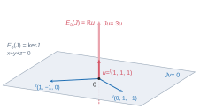
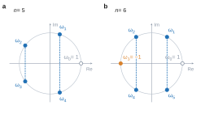
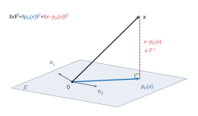

# CCINP MPI — Mathématiques 2 2026 · Corrigé brut

*Corrigé rédigé par IA, non officiel. Signalez toute erreur.*

Épreuve spécifique MPI (MPI3M2), 4 heures, calculatrices interdites. Deux exercices et un problème indépendants.

**Deux remarques sur l'énoncé**, signalées comme le N.B. y invite :

- en **Q15**, le crochet $\langle g\mid h_n^{(n)}\rangle$ doit se lire comme l'intégrale **sans poids** $\int_0^{+\infty}g(t)h_n^{(n)}(t)\,dt$.

  Avec le poids $e^{-t}$ de Q12, la relation demandée est fausse : pour $n=2$ et $g=X^2$, on trouve $-\frac14$ au lieu de $4$. C'est la lecture que retient le rapport du jury ;
- en **Q20**, « pour tout $\alpha\in\mathbb R$ » doit se lire « pour tout $\alpha>-\frac12$ » : pour $\alpha\le-\frac12$, $g_\alpha\notin E$.

---

## Exercice 1

On note $I=I_3$ et $\lambda=3a+b$. On remarque que $A=aJ+bI$ : les coefficients diagonaux valent $a+b$, les autres $a$.

### Q1

Les trois colonnes de $J$ sont égales à $u={}^t(1,1,1)\neq0$, donc $\operatorname{Im}J=\operatorname{Vect}(u)$ et
$$\boxed{\operatorname{rg}J=1.}$$
Par le théorème du rang, $\dim\ker J=2$. Ainsi $0$ est valeur propre, et $E_0(J)=\ker J$ est le plan d'équation $x+y+z=0$.

De plus $Ju=3u$ avec $u\neq0$ : $3$ est valeur propre et $\dim E_3(J)\ge1$.

Les sous-espaces propres associés à des valeurs propres distinctes sont en somme directe, donc $\dim E_0(J)+\dim E_3(J)\le3$. Comme cette somme vaut au moins $2+1$, elle vaut $3$ : $\dim E_3(J)=1$ et $\mathbb R^3=E_0(J)\oplus E_3(J)$.

La somme des dimensions des sous-espaces propres vaut $3$, donc $J$ est diagonalisable, et
$$\boxed{J\ \text{est semblable à}\ D=\operatorname{diag}(0,0,3).}$$
Base adaptée : ${}^t(1,-1,0)$ et ${}^t(0,1,-1)$ pour $\ker J$, puis $u$.

### Q2

D'après Q1, il existe $Q\in GL_3(\mathbb R)$ telle que $Q^{-1}JQ=D$. Alors
$$\begin{aligned}
Q^{-1}AQ&=Q^{-1}(aJ+bI)Q\\
&=aD+bI,
\end{aligned}$$
donc
$$\boxed{A\ \text{est semblable à}\ \operatorname{diag}(b,\,b,\,3a+b).}$$
Ainsi $\operatorname{Sp}(A)=\{b,\lambda\}$, avec $E_b(A)=\ker J$ de dimension 2 et $E_\lambda(A)=\mathbb Ru$ de dimension 1. Comme $a\neq0$, on a $\lambda\neq b$.

### Q3

Les racines de $\pi_A$ sont exactement les valeurs propres de $A$, à savoir $b$ et $\lambda$, distinctes car $a\neq0$.

Donc $(X-b)(X-\lambda)$ divise $\pi_A$.

Par ailleurs $A$ est diagonalisable (Q2). Une matrice est diagonalisable si et seulement si son polynôme minimal est scindé à racines simples : $\pi_A$ est donc scindé à racines simples. Ses racines étant $b$ et $\lambda$, $\pi_A$ divise $(X-b)(X-\lambda)$.

Les deux polynômes sont unitaires et se divisent mutuellement :
$$\boxed{\pi_A=(X-b)(X-3a-b).}$$

### Q4

**a)** Soit $n\in\mathbb N$. Comme $\pi_A$ est de degré 2, la division euclidienne de $X^n$ par $\pi_A$ s'écrit
$$X^n=S\,\pi_A+\alpha X+\beta,$$
avec $S\in\mathbb R[X]$ et $(\alpha,\beta)\in\mathbb R^2$. En évaluant en les racines $b$ et $\lambda$ de $\pi_A$ :
$$\begin{cases}b^n=\alpha b+\beta\\ \lambda^n=\alpha\lambda+\beta\end{cases}$$
Par différence, $\lambda^n-b^n=\alpha(\lambda-b)=3a\alpha$, et $3a\neq0$. D'où
$$\alpha=\frac{\lambda^n-b^n}{3a},$$
puis
$$\begin{aligned}
\beta&=b^n-\alpha b\\
&=\frac{\lambda b^n-b\lambda^n}{3a}.
\end{aligned}$$
Comme $\pi_A(A)=0$, on obtient $A^n=S(A)\pi_A(A)+\alpha A+\beta I=\alpha A+\beta I$. Pour tout $n\in\mathbb N$, avec $\lambda=3a+b$ :
$$\boxed{A^n=\frac{\lambda^n-b^n}{3a}\,A+\frac{\lambda b^n-b\lambda^n}{3a}\,I.}$$
Contrôles : pour $n=0$ on retrouve $I$, pour $n=1$ on retrouve $A$.

**b)** Pour tous $i,j$, $(J^2)_{i,j}=\sum_{k=1}^3J_{i,k}J_{k,j}=3$, donc $J^2=3J$. Si $J^k=3^{k-1}J$ pour un $k\ge1$, alors $J^{k+1}=3^{k-1}J^2=3^kJ$. Par récurrence :
$$\boxed{\forall k\ge1,\quad J^k=3^{k-1}J.}$$
Les matrices $aJ$ et $bI$ commutent, donc la formule du binôme s'applique. On isole le terme $k=0$, où $J^0=I$, avant d'utiliser $J^k=3^{k-1}J$, valable seulement pour $k\ge1$ :
$$\begin{aligned}
A^n&=\sum_{k=0}^n\binom nk a^kb^{n-k}J^k\\
&=b^nI+\left(\sum_{k=1}^n\binom nk a^kb^{n-k}3^{k-1}\right)J\\
&=b^nI+\frac13\left(\sum_{k=1}^n\binom nk(3a)^kb^{n-k}\right)J\\
&=b^nI+\frac{(3a+b)^n-b^n}{3}\,J.
\end{aligned}$$
$$\boxed{\forall n\in\mathbb N,\quad A^n=b^n\,I+\frac{(3a+b)^n-b^n}{3}\,J.}$$
Les deux résultats concordent. En reportant $A=aJ+bI$ dans la formule du a), le coefficient de $J$ vaut $\frac{\lambda^n-b^n}{3}$, et celui de $I$ vaut
$$\begin{aligned}
\frac{b(\lambda^n-b^n)+\lambda b^n-b\lambda^n}{3a}&=\frac{b^n(\lambda-b)}{3a}\\
&=b^n.
\end{aligned}$$

---

## Exercice 2

On note $\omega=\omega_1=e^{2i\pi/n}$, de sorte que $\omega_k=\omega^k$, et $P=\sum_{k=0}^{n-1}a_kX^k\in\mathbb R[X]$.

### Q5

On a $j=e^{2i\pi/3}\neq1$ et $j^3=1$, donc $(j-1)(1+j+j^2)=j^3-1=0$ :
$$\boxed{1+j+j^2=0.}$$
Exemple : $P=1+2X+3X^2$, de degré 2, à coefficients réels non nuls et deux à deux distincts. Ici $n=3$, $\omega_1=j$ et $\omega_2=j^2=\bar j$. Avec $j^2=-1-j$ :
$$\begin{aligned}
P(j)&=1+2j+3(-1-j)\\
&=-2-j\\
&=-\frac32-i\frac{\sqrt3}{2}.
\end{aligned}$$
Comme $P$ est à coefficients réels, $P(j^2)=P(\bar j)=\overline{P(j)}$, d'où
$$\begin{aligned}
P(\omega_1)P(\omega_2)&=|P(j)|^2\\
&=\frac94+\frac34,
\end{aligned}$$
$$\boxed{P(\omega_1)P(\omega_2)=3\in\mathbb R,}$$
ce qui vérifie $(*)$ sur cet exemple.

### Q6

On a $J_{i,j}=1$ si $j\equiv i+1\pmod n$ et $0$ sinon.

Pour $x={}^t(x_1,\dots,x_n)$, cela s'écrit : $(Jx)_i=x_{i+1}$ pour $1\le i\le n-1$, et $(Jx)_n=x_1$.

Soit $\mu\in\mathbb C$ tel que $\mu^n=1$, et $v_\mu={}^t(1,\mu,\dots,\mu^{n-1})\neq0$. 

Pour $1\le i\le n-1$, $(Jv_\mu)_i=\mu^i=\mu\,(v_\mu)_i$. Enfin $(Jv_\mu)_n=1=\mu^n=\mu\,(v_\mu)_n$. Donc $Jv_\mu=\mu v_\mu$.

Les $n$ nombres $\omega_0,\dots,\omega_{n-1}$ sont deux à deux distincts et vérifient $\omega_k^n=1$.

Ce sont donc $n$ valeurs propres distinctes de $J$, c'est-à-dire $n$ racines distinctes de $\chi_J=\det(XI_n-J)$.

Ainsi $\prod_{k=0}^{n-1}(X-\omega_k)$ divise $\chi_J$. Ces deux polynômes, unitaires de degré $n$, sont égaux.

Enfin $X^n-1$ est unitaire de degré $n$ et admet les $n$ racines distinctes $\omega_k$, donc $X^n-1=\prod_{k=0}^{n-1}(X-\omega_k)$ :
$$\boxed{\chi_J=X^n-1.}$$

### Q7

De $(Jx)_i=x_{i+1\,[n]}$ on tire par récurrence $(J^mx)_i=x_{i+m\,[n]}$. Donc $(J^m)_{i,j}=1$ si $j\equiv i+m\pmod n$, et $0$ sinon. Par linéarité,
$$\begin{aligned}
\bigl(P(J)\bigr)_{i,j}&=\sum_{m=0}^{n-1}a_m(J^m)_{i,j}\\
&=a_{(j-i)\bmod n}.
\end{aligned}$$
La ligne $1$ est $a_0,a_1,\dots,a_{n-1}$, la ligne $2$ est $a_{n-1},a_0,\dots,a_{n-2}$, et la ligne $n$ est $a_1,a_2,\dots,a_{n-1},a_0$ : c'est exactement la matrice de l'énoncé.
$$\boxed{A=P(J).}$$

### Q8

D'après Q6, $\chi_J=X^n-1$ est scindé à racines simples sur $\mathbb C$. La matrice $J$ a donc $n$ valeurs propres distinctes, et elle est diagonalisable dans $\mathcal M_n(\mathbb C)$ :
$$\boxed{J=Q\,\Delta\,Q^{-1},\ \text{avec}\ \Delta=\operatorname{diag}(\omega_0,\omega_1,\dots,\omega_{n-1})\ \text{et}\ Q\in GL_n(\mathbb C).}$$
On peut prendre pour $Q$ la matrice de colonnes $v_{\omega_0},\dots,v_{\omega_{n-1}}$.

Alors $J^m=Q\Delta^mQ^{-1}$ pour tout $m$, et par linéarité $P(J)=Q\,P(\Delta)\,Q^{-1}$. Comme $\Delta$ est diagonale, $P(\Delta)=\operatorname{diag}(P(\omega_0),\dots,P(\omega_{n-1}))$. Avec Q7 :
$$\boxed{A=Q\,\operatorname{diag}\bigl(P(\omega_0),P(\omega_1),\dots,P(\omega_{n-1})\bigr)\,Q^{-1}.}$$
$A$ est diagonalisable dans $\mathcal M_n(\mathbb C)$, de valeurs propres les $P(\omega_k)$, non nécessairement distinctes.

### Q9

Posons $Z=\prod_{k=1}^{n-1}P(\omega_k)$, produit vide égal à $1$ si $n=1$.

*Déduction de Q8.* Deux matrices semblables ont même déterminant, donc
$$\begin{aligned}
\det A&=\prod_{k=0}^{n-1}P(\omega_k)\\
&=P(1)\,Z.
\end{aligned}$$
Or $A\in\mathcal M_n(\mathbb R)$, donc $\det A\in\mathbb R$, et $P(1)=\sum a_k\in\mathbb R$. Si $P(1)\neq0$, alors $Z=\dfrac{\det A}{P(1)}\in\mathbb R$.

*Cas général, y compris $P(1)=0$.* $P$ étant à coefficients réels, $\overline{P(z)}=P(\bar z)$ pour tout $z\in\mathbb C$.

Pour $1\le k\le n-1$, $\overline{\omega_k}=e^{-2ik\pi/n}=\omega_{n-k}$. De plus, $k\mapsto n-k$ est une bijection de $\{1,\dots,n-1\}$ sur lui-même. Donc
$$\begin{aligned}
\overline Z&=\prod_{k=1}^{n-1}P(\overline{\omega_k})\\
&=\prod_{k=1}^{n-1}P(\omega_{n-k})\\
&=\prod_{k'=1}^{n-1}P(\omega_{k'})\\
&=Z.
\end{aligned}$$
$$\boxed{P(\omega_1)P(\omega_2)\cdots P(\omega_{n-1})\in\mathbb R.}$$
Plus précisément, en regroupant les facteurs conjugués :

- si $n$ est impair, $Z=\prod_{1\le k<n/2}|P(\omega_k)|^2$ ;
- si $n$ est pair, $Z=P(-1)\prod_{1\le k<n/2}|P(\omega_k)|^2$.

---

## Problème

### Q10

On n'utilise que la définition de $p_F(x)$ donnée par l'énoncé : $E$ n'est pas supposé de dimension finie.

**a)** Soit $y=\sum_{i=0}^n\langle x\mid e_i\rangle e_i$. C'est une combinaison linéaire des $e_i$, donc $y\in F$. Pour $0\le j\le n$, par bilinéarité et orthonormalité,
$$\begin{aligned}
\langle y\mid e_j\rangle&=\sum_{i=0}^n\langle x\mid e_i\rangle\langle e_i\mid e_j\rangle\\
&=\langle x\mid e_j\rangle,
\end{aligned}$$
donc $\langle x-y\mid e_j\rangle=0$.

Tout $z\in F$ s'écrit $z=\sum_j\mu_je_j$, donc $\langle x-y\mid z\rangle=\sum_j\mu_j\langle x-y\mid e_j\rangle=0$ : $x-y\in F^\perp$. Par unicité du vecteur de $F$ ayant cette propriété,
$$\boxed{p_F(x)=\sum_{i=0}^n\langle x\mid e_i\rangle\,e_i.}$$

**b)** Les vecteurs $p_F(x)\in F$ et $x-p_F(x)\in F^\perp$ sont orthogonaux. Le théorème de Pythagore appliqué à $x=p_F(x)+(x-p_F(x))$ donne
$$\begin{aligned}
\|x\|^2&=\|p_F(x)\|^2+\|x-p_F(x)\|^2\\
&\ge\|p_F(x)\|^2,
\end{aligned}$$
$$\boxed{\|p_F(x)\|^2\le\|x\|^2.}$$
La famille $(e_i)$ étant orthonormale, Pythagore donne aussi
$$\begin{aligned}
\|p_F(x)\|^2&=\sum_{i=0}^n\langle x\mid e_i\rangle^2\|e_i\|^2\\
&=\sum_{i=0}^n\langle x\mid e_i\rangle^2,
\end{aligned}$$
d'où
$$\boxed{\sum_{i=0}^n\langle x\mid e_i\rangle^2\le\|x\|^2.}$$

### Q11

Soit $(a,b)\in\mathbb R^2$. Comme $|a|^2=a^2$, $|b|^2=b^2$ et $|a||b|=|ab|$,
$$\begin{aligned}
0&\le(|a|-|b|)^2\\
&=a^2+b^2-2|ab|,
\end{aligned}$$
d'où
$$\boxed{|ab|\le\frac{a^2+b^2}{2}.}$$
Soient $f,g\in E$. La fonction $t\mapsto f(t)g(t)e^{-t}$ est continue sur $I$.

Pour tout $t\in I$, on applique l'inégalité à $a=f(t)$ et $b=g(t)$, puis on multiplie par $e^{-t}>0$ :
$$\bigl|f(t)g(t)e^{-t}\bigr|\le\frac12\Bigl(f(t)^2e^{-t}+g(t)^2e^{-t}\Bigr).$$
Le majorant est intégrable sur $I$ par définition de $E$. Par comparaison de fonctions positives, $t\mapsto|f(t)g(t)|e^{-t}$ est intégrable sur $I$ :
$$\boxed{t\mapsto f(t)g(t)e^{-t}\ \text{est intégrable sur}\ I.}$$

### Q12

*$E$ est un espace vectoriel.* On a $E\subset\mathcal C(I,\mathbb R)$, et la fonction nulle est dans $E$.

Soient $f,g\in E$ et $\mu\in\mathbb R$. La fonction $f+\mu g$ est continue sur $I$, et
$$(f+\mu g)^2(t)e^{-t}=f(t)^2e^{-t}+2\mu f(t)g(t)e^{-t}+\mu^2g(t)^2e^{-t}.$$
C'est une combinaison linéaire de trois fonctions intégrables sur $I$ (définition de $E$ et Q11), donc elle est intégrable : $f+\mu g\in E$. Ainsi **$E$ est un sous-espace vectoriel de $\mathcal C(I,\mathbb R)$**, donc un espace vectoriel.

*Produit scalaire.* D'après Q11, $\langle f\mid g\rangle$ est une intégrale absolument convergente pour tous $f,g\in E$.

- Symétrie : $f(t)g(t)=g(t)f(t)$, donc $\langle f\mid g\rangle=\langle g\mid f\rangle$.
- Linéarité à gauche : soient $f_1,f_2,g\in E$ et $\mu\in\mathbb R$. Comme $f_1+\mu f_2\in E$, l'intégrale $\langle f_1+\mu f_2\mid g\rangle$ converge, tout comme $\langle f_1\mid g\rangle$ et $\langle f_2\mid g\rangle$ (Q11).

  La linéarité de l'intégrale des fonctions intégrables donne alors
  $$\langle f_1+\mu f_2\mid g\rangle=\langle f_1\mid g\rangle+\mu\langle f_2\mid g\rangle.$$
  Avec la symétrie, l'application est bilinéaire.
- Positivité : $\langle f\mid f\rangle=\int_0^{+\infty}f(t)^2e^{-t}\,dt\ge0$, intégrale d'une fonction positive.
- Caractère défini : si $\langle f\mid f\rangle=0$, la fonction $t\mapsto f(t)^2e^{-t}$ est **continue**, positive et d'intégrale nulle sur $I$, donc nulle sur $I$. Comme $e^{-t}>0$, on obtient $f=0$.

$$\boxed{\langle f\mid g\rangle=\int_0^{+\infty}f(t)g(t)e^{-t}\,dt\ \text{définit un produit scalaire sur}\ E.}$$

### Q13

*Inclusion $\mathbb R[X]\subset E$.* Soit $P\in\mathbb R[X]$. La fonction $t\mapsto P(t)^2e^{-t}$ est continue sur $I$.
Par croissances comparées, $t^2P(t)^2e^{-t}\to0$ en $+\infty$, donc $P(t)^2e^{-t}=o(1/t^2)$.

La fonction $t\mapsto1/t^2$ est intégrable sur $[1,+\infty[$, et la fonction étudiée est continue sur le segment $[0,1]$ : elle est intégrable sur $I$, et $P\in E$.

L'identification est légitime : l'application linéaire $P\mapsto P_{\mid I}$ est injective, car un polynôme nul sur l'ensemble infini $I$ est nul.

*Structure.* $F=\mathbb R_n[X]$ est donc une partie de $E$. Elle contient $0$ et elle est stable par combinaison linéaire, puisque c'est un sous-espace vectoriel de $\mathbb R[X]$ et que les lois de $E$ prolongent celles de $\mathbb R[X]$. Donc
$$\boxed{F=\mathbb R_n[X]\ \text{est un sous-espace vectoriel de}\ E,\ \text{de dimension}\ n+1.}$$
De même, $\mathbb R[X]$ est un sous-espace de $E$, et la restriction à $\mathbb R[X]$ du produit scalaire de Q12 est un produit scalaire sur $\mathbb R[X]$.

### Q14

**a)** $h_n$ est de classe $\mathcal C^\infty$ sur $\mathbb R$.

Pour $k\le n$, $(x^n)^{(k)}=\frac{n!}{(n-k)!}x^{n-k}$, et $(e^{-x})^{(q)}=(-1)^qe^{-x}$. Par la formule de Leibniz, pour $0\le p\le n$ :
$$\boxed{h_n^{(p)}(x)=e^{-x}\sum_{k=0}^p(-1)^{p-k}\binom pk\frac{n!}{(n-k)!}\,x^{n-k}.}$$
Si $p<n$, chaque terme contient $x^{n-k}$ avec $n-k\ge n-p\ge1$, donc
$$\boxed{\forall p<n,\quad h_n^{(p)}(0)=0.}$$

**b)** Avec $p=n$, puis le changement d'indice $m=n-k$ :
$$\begin{aligned}
L_n(x)&=\frac{e^x}{n!}h_n^{(n)}(x)\\
&=\sum_{k=0}^n(-1)^{n-k}\binom nk\frac{x^{n-k}}{(n-k)!}\\
&=\sum_{m=0}^n(-1)^m\binom nm\frac{x^m}{m!}.
\end{aligned}$$
C'est une fonction polynomiale : $L_n\in\mathbb R[X]$. Le coefficient de $X^n$ vaut $\frac{(-1)^n}{n!}\neq0$. Ainsi
$$\boxed{L_n=\sum_{m=0}^n\frac{(-1)^m}{m!}\binom nm X^m,}$$
de **degré $n$** et de **coefficient dominant $\frac{(-1)^n}{n!}$**. Par exemple $L_0=1$, $L_1=1-X$ et $L_2=1-2X+\frac{X^2}{2}$.

### Q15

On lit $\langle g\mid h_n^{(n)}\rangle$ comme $\int_0^{+\infty}g(t)h_n^{(n)}(t)\,dt$ (voir la remarque en tête).

Soit $g\in\mathbb R[X]$ et $n\ge1$ ; pour $n=0$ tout est immédiat.

Toutes les fonctions $g^{(j)}h_n^{(m)}$ sont de la forme $t\mapsto R(t)e^{-t}$ avec $R$ polynomiale (Q14.a), donc intégrables sur $I$ (argument de Q13).

Pour $0\le j\le n-1$ et $X>0$, une intégration par parties sur $[0,X]$, entre fonctions de classe $\mathcal C^1$, donne
$$\int_0^Xg^{(j)}h_n^{(n-j)}\,dt=\Bigl[g^{(j)}h_n^{(n-j-1)}\Bigr]_0^X-\int_0^Xg^{(j+1)}h_n^{(n-j-1)}\,dt.$$
Le terme en $0$ est nul car $h_n^{(n-j-1)}(0)=0$, puisque $n-j-1<n$ (Q14.a).

Le terme en $X$ est de la forme $R(X)e^{-X}$, qui tend vers $0$ par croissances comparées. En faisant $X\to+\infty$ :
$$\int_0^{+\infty}g^{(j)}h_n^{(n-j)}\,dt=-\int_0^{+\infty}g^{(j+1)}h_n^{(n-j-1)}\,dt.$$
En enchaînant ces $n$ égalités, pour $j=0,\dots,n-1$ :
$$\boxed{\int_0^{+\infty}g(t)\,h_n^{(n)}(t)\,dt=(-1)^n\int_0^{+\infty}g^{(n)}(t)\,h_n(t)\,dt.}$$
Comme $L_n(t)e^{-t}=\frac1{n!}h_n^{(n)}(t)$ et $h_n(t)=t^ne^{-t}$ :
$$\begin{aligned}
\langle g\mid L_n\rangle&=\frac1{n!}\int_0^{+\infty}g(t)h_n^{(n)}(t)\,dt\\
&=\frac{(-1)^n}{n!}\int_0^{+\infty}g^{(n)}(t)\,t^ne^{-t}\,dt.
\end{aligned}$$
$$\boxed{\langle g\mid L_n\rangle=\frac{(-1)^n}{n!}\int_0^{+\infty}g^{(n)}(t)\,t^ne^{-t}\,dt.}$$

### Q16

Soient $i<j$. La Q15 appliquée à $g=L_i$ et à l'indice $j$ donne
$$\langle L_i\mid L_j\rangle=\frac{(-1)^j}{j!}\int_0^{+\infty}L_i^{(j)}(t)\,t^je^{-t}\,dt.$$
Or $\deg L_i=i<j$ (Q14.b), donc $L_i^{(j)}=0$ et l'intégrale est celle de la fonction nulle :
$$\boxed{\langle L_i\mid L_j\rangle=0\quad(i<j).}$$

### Q17

Soit $I_n=\int_0^{+\infty}t^ne^{-t}\,dt$. La fonction $t\mapsto t^ne^{-t}$ est continue sur $I$ et, par croissances comparées, $t^ne^{-t}=o(1/t^2)$ en $+\infty$ : l'intégrale converge. On a $I_0=1$.

Pour $n\ge1$ et $X>0$, une intégration par parties donne
$$\int_0^Xt^ne^{-t}\,dt=-X^ne^{-X}+n\int_0^Xt^{n-1}e^{-t}\,dt.$$
Comme $X^ne^{-X}\to0$, on obtient $I_n=nI_{n-1}$, puis par récurrence
$$\boxed{\int_0^{+\infty}t^ne^{-t}\,dt=n!.}$$
D'après Q14.b, $L_n^{(n)}=n!\cdot\frac{(-1)^n}{n!}=(-1)^n$. La Q15 avec $g=L_n$ donne
$$\begin{aligned}
\langle L_n\mid L_n\rangle&=\frac{(-1)^n}{n!}\int_0^{+\infty}(-1)^nt^ne^{-t}\,dt\\
&=\frac{n!}{n!},
\end{aligned}$$
$$\boxed{\langle L_n\mid L_n\rangle=1.}$$

### Q18

Par Q16 (et symétrie) et Q17, $\langle L_i\mid L_j\rangle=\delta_{i,j}$ : la famille $(L_0,\dots,L_n)$ est orthonormale, donc libre. Elle est formée de $n+1$ éléments de $F$, car $\deg L_k=k\le n$, et $\dim F=n+1$ :
$$\boxed{(L_0,L_1,\dots,L_n)\ \text{est une base orthonormale de}\ F.}$$
La Q10.a, appliquée dans l'espace préhilbertien $E$ au sous-espace $F$ de dimension finie, donne pour tout $g\in E$ :
$$\boxed{P_F(g)=\sum_{k=0}^n\langle g\mid L_k\rangle\,L_k,}$$
où $\langle g\mid L_k\rangle=\int_0^{+\infty}g(t)L_k(t)e^{-t}\,dt$.

### Q19

Soit $g\in E$.

Pour tout $N\in\mathbb N$, $(L_0,\dots,L_N)$ est une base orthonormale de $\mathbb R_N[X]$, sous-espace de dimension finie de $E$ (Q13, et Q18 avec $N$ à la place de $n$).

L'inégalité de Bessel (Q10.b) donne alors, pour tout $N\in\mathbb N$,
$$\sum_{k=0}^N\langle g\mid L_k\rangle^2\le\|g\|^2.$$
La série $\sum\langle g\mid L_n\rangle^2$ est à termes positifs, et ses sommes partielles sont majorées par $\|g\|^2$, indépendant de $N$. Elle converge donc, et par passage à la limite dans l'inégalité,
$$\boxed{\sum_{n=0}^{+\infty}\langle g\mid L_n\rangle^2\le\|g\|^2,}$$
où $\|g\|^2=\int_0^{+\infty}g(t)^2e^{-t}\,dt$.

### Q20

*Appartenance à $E$.* $g_\alpha$ est continue sur $I$ et $g_\alpha(t)^2e^{-t}=e^{-(2\alpha+1)t}$.

Cette fonction est intégrable sur $I$ si et seulement si $2\alpha+1>0$.

Donc $g_\alpha\in E$ **pour tout $\alpha>-\frac12$**, et seulement pour ceux-là : l'énoncé « pour tout $\alpha\in\mathbb R$ » est à corriger. Pour $\alpha>-\frac12$ :
$$\begin{aligned}
\|g_\alpha\|^2&=\int_0^{+\infty}e^{-(2\alpha+1)t}\,dt\\
&=\frac1{1+2\alpha}.
\end{aligned}$$

*Coefficients.* Soit $\alpha>-\frac12$ et $c=1+\alpha$, de sorte que $c>\frac12>0$.

Pour $m\in\mathbb N$, le changement de variable $u=ct$ (de classe $\mathcal C^1$, strictement croissant, bijectif de $]0,+\infty[$ sur lui-même) et Q17 donnent
$$\int_0^{+\infty}t^me^{-ct}\,dt=\frac{m!}{c^{m+1}}.$$
Avec l'expression de $L_n$ (Q14.b) et la linéarité de l'intégrale (somme finie) :
$$\begin{aligned}
\langle g_\alpha\mid L_n\rangle&=\sum_{m=0}^n\frac{(-1)^m}{m!}\binom nm\int_0^{+\infty}t^me^{-ct}\,dt\\
&=\frac1c\sum_{m=0}^n\binom nm\Bigl(-\frac1c\Bigr)^m\\
&=\frac1c\Bigl(1-\frac1c\Bigr)^n,
\end{aligned}$$
$$\boxed{\langle g_\alpha\mid L_n\rangle=\frac{\alpha^n}{(1+\alpha)^{n+1}}.}$$

*Somme.* On a $\langle g_\alpha\mid L_n\rangle^2=\frac{q^n}{(1+\alpha)^2}$, avec $q=\frac{\alpha^2}{(1+\alpha)^2}$. Or $(1+\alpha)^2-\alpha^2=1+2\alpha>0$, donc $0\le q<1$ et la série géométrique converge :
$$\begin{aligned}
\sum_{n=0}^{+\infty}\langle g_\alpha\mid L_n\rangle^2&=\frac1{(1+\alpha)^2}\cdot\frac1{1-q}\\
&=\frac1{(1+\alpha)^2-\alpha^2}\\
&=\frac1{1+2\alpha}.
\end{aligned}$$
$$\boxed{\sum_{n=0}^{+\infty}\langle g_\alpha\mid L_n\rangle^2=\|g_\alpha\|^2.}$$
L'inégalité de Bessel de Q19 est une égalité pour $g_\alpha$ : c'est l'égalité de Parseval pour la famille de Laguerre sur cet exemple.

**FIN**
