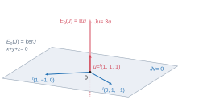
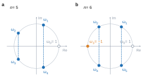
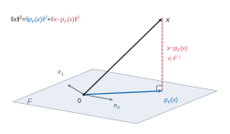

# CCINP MPI — Mathématiques 2 2026 · Corrigé guidé

*Corrigé rédigé par IA, non officiel. Signalez toute erreur.*

## Présentation du sujet

**Cadre.** Épreuve spécifique de la filière MPI (MPI3M2), 4 heures, calculatrices interdites. Le sujet comporte **deux exercices et un problème indépendants**, soit 20 questions (Q4, Q10 et Q14 ont des sous-questions a) et b)).

**Découpage.**

| Partie | Thème | Questions | Notions mobilisées |
|---|---|---|---|
| Exercice 1 | La matrice $A=aJ+bI$ d'ordre 3 | Q1–Q4 | rang, théorème du rang, sous-espaces propres, diagonalisation, polynôme minimal, division euclidienne, binôme de Newton |
| Exercice 2 | Matrices circulantes | Q5–Q9 | racines de l'unité, polynôme caractéristique, polynôme d'endomorphisme, diagonalisation dans $\mathbb C$, déterminant, conjugaison |
| Problème | Polynômes de Laguerre | Q10–Q20 | projection orthogonale, inégalité de Bessel, intégrabilité sur $[0,+\infty[$, produit scalaire intégral, formule de Leibniz, intégrations par parties, séries à termes positifs, séries géométriques |

**Ce que fait chaque partie.** L'exercice 1 réduit $J$ (toutes ses entrées valent 1) par un argument de dimension. Il en déduit la réduction de $A=aJ+bI$, son polynôme minimal, puis ses puissances par deux méthodes qui se contrôlent mutuellement.

L'exercice 2 fait le même geste en dimension $n$. La matrice $J$ de permutation circulaire a pour polynôme caractéristique $X^n-1$.

Toute matrice circulante s'écrit $P(J)$ et se diagonalise dans $\mathbb C$, avec les valeurs propres $P(\omega_k)$. On en déduit que $P(\omega_1)\cdots P(\omega_{n-1})$ est réel.

Le problème construit le produit scalaire $\langle f\mid g\rangle=\int_0^{+\infty}fge^{-t}\,dt$. Il montre que les polynômes de Laguerre (formule de Rodrigues) forment une base orthonormale de $\mathbb R_n[X]$, puis établit l'inégalité de Bessel et l'égalité de Parseval pour les exponentielles $g_\alpha$.

**Difficulté et longueur.** Sujet de longueur raisonnable et de difficulté modérée, très proche du cours. Le rapport 2026 donne une moyenne de 10,36 et un écart-type de 4,48. Il relève des fragilités sur des questions proches du cours, notamment en début de problème.

**Questions discriminantes selon le rapport 2026.** La justification du polynôme minimal (Q3), le reste de la division euclidienne (Q4.a, « rarement abordée »), la rédaction de la question de cours (Q10), l'inclusion $F\subset E$ (Q13, « mal traitée en grande partie »), l'orthogonalité (Q16, « Peu de réussite »), la convergence de la série en Q19 et la seconde moitié de Q20, rarement abordée. Les points délicats techniques sont Q9 (le cas $P(1)=0$), Q15 (énoncé défectueux, $n$ intégrations par parties sur un intervalle non borné) et Q20 (calcul des coefficients).

**Questions à ne pas laisser passer.** Q1, Q2, Q3, Q4.b, Q5, Q7, Q10 (question de cours), Q11, Q12, Q13, Q14, Q16, Q17, Q18 et Q19. On peut traiter Q16 à Q19 en admettant le résultat de Q15 : le rapport 2026 note que des candidats ont réussi Q15 en laissant de côté la première égalité.

**Gestion du temps.** Environ 45 minutes par exercice et 2 h 30 pour le problème, dont une bonne demi-heure pour Q15 et Q20.

**Remarques sur l'énoncé.** Deux défauts sont à signaler sur la copie :

1. En **Q15**, le crochet $\langle g\mid h_n^{(n)}\rangle$ ne peut pas désigner le produit scalaire de Q12, qui porte le poids $e^{-t}$ : la relation demandée serait fausse. Il faut lire $\int_0^{+\infty}g(t)h_n^{(n)}(t)\,dt$, sans poids. Le rapport 2026 confirme cette erreur d'énoncé et précise que le barème a été adapté.
2. En **Q20**, « pour tout $\alpha\in\mathbb R$, $g_\alpha\in E$ » est faux : il faut lire « pour tout $\alpha>-\frac12$ ».

---

## Exercice 1

On réduit d'abord $J$ sans déterminant, puis on transporte le résultat à $A=aJ+bI$. Tout repose sur deux observations : $\operatorname{rg}J=1$ et $J^2=3J$.

### Question 1

> [!INDICATION]
> Regardez les colonnes de $J$ pour le rang, puis appliquez le théorème du rang.

> [!INDICATION]
> Cherchez un vecteur propre évident associé à une valeur propre non nulle, puis comptez les dimensions des sous-espaces propres.

#### Solution

Les trois colonnes de $J$ sont égales à $u={}^t(1,1,1)\neq0$, donc $\operatorname{Im}J=\operatorname{Vect}(u)$ et
$$\boxed{\operatorname{rg}J=1.}$$
Par le théorème du rang, $\dim\ker J=2$ : $0$ est valeur propre et $E_0(J)=\ker J$ est le plan d'équation $x+y+z=0$.

De plus $Ju=3u$ avec $u\neq0$, donc $3$ est valeur propre et $\dim E_3(J)\ge1$.

Les sous-espaces propres associés à des valeurs propres distinctes sont en somme directe dans $\mathbb R^3$, donc $\dim E_0(J)+\dim E_3(J)\le3$. Comme cette somme vaut au moins $2+1$, elle vaut $3$.

Ainsi $\mathbb R^3=E_0(J)\oplus E_3(J)$ et $J$ est diagonalisable :
$$\boxed{J\ \text{est semblable à}\ \operatorname{diag}(0,0,3).}$$
Géométriquement (figure 1), $\mathbb R^3=\ker J\oplus\mathbb Ru$ et la droite $\mathbb Ru$ est orthogonale au plan.

> [!METHODE]
> Une matrice de rang $r$ a une valeur propre $0$ de multiplicité géométrique $n-r$. Si l'on trouve en plus des valeurs propres non nulles dont les sous-espaces propres complètent la dimension, la matrice est diagonalisable sans aucun calcul de déterminant. Pour une matrice de rang 1, la trace donne la valeur propre restante. Autre argument recevable ici : $J$ est réelle symétrique.

> [!PIEGE]
> Exhiber les valeurs propres $0$ et $3$ ne suffit pas : c'est l'égalité $\dim E_0+\dim E_3=3$ qui prouve la diagonalisabilité.

> [!JURY]
> Le rapport 2026 note que le rang a été bien trouvé, mais que « la justification de sa diagonalisation est trop parfois lacunaire ou absente ».

### Question 2

> [!INDICATION]
> Écrivez $A$ comme combinaison linéaire de $J$ et de $I$.

> [!INDICATION]
> Une matrice de passage qui diagonalise $J$ diagonalise aussi tout polynôme en $J$.

#### Solution

Les coefficients diagonaux de $A$ valent $a+b$ et les autres $a$, donc $A=aJ+bI$. D'après Q1, il existe $Q\in GL_3(\mathbb R)$ telle que $Q^{-1}JQ=\operatorname{diag}(0,0,3)$. Alors
$$\begin{aligned}
Q^{-1}AQ&=aQ^{-1}JQ+bI\\
&=\operatorname{diag}(b,b,3a+b),
\end{aligned}$$
$$\boxed{A\ \text{est semblable à}\ \operatorname{diag}(b,\,b,\,3a+b).}$$
Comme $a\neq0$, les valeurs propres $b$ et $\lambda=3a+b$ sont distinctes. On a $E_b(A)=\ker J$, de dimension 2, et $E_\lambda(A)=\mathbb Ru$, de dimension 1.

> [!PIEGE]
> $A$ et $J$ ont les mêmes **vecteurs** propres, pas les mêmes valeurs propres : celles-ci sont transformées par $x\mapsto ax+b$.

> [!JURY]
> Selon le rapport 2026, certains candidats « ne font pas le lien avec la question 1 » : la consigne « en déduire » impose de partir de la réduction de $J$.

### Question 3

> [!INDICATION]
> Deux faits du cours : quelles sont les racines du polynôme minimal, et comment se traduit la diagonalisabilité sur $\pi_A$ ?

> [!INDICATION]
> Montrez une divisibilité dans chaque sens.

#### Solution

Les racines de $\pi_A$ sont exactement les valeurs propres de $A$, soit $b$ et $\lambda$, distinctes car $a\neq0$.

Donc $(X-b)(X-\lambda)$ divise $\pi_A$.

Par ailleurs $A$ est diagonalisable (Q2). Une matrice est diagonalisable si et seulement si son polynôme minimal est scindé à racines simples : $\pi_A$ l'est donc. Ses racines étant $b$ et $\lambda$, $\pi_A$ divise $(X-b)(X-\lambda)$.

Les deux polynômes sont unitaires et se divisent l'un l'autre :
$$\boxed{\pi_A=(X-b)(X-3a-b).}$$

> [!PIEGE]
> Vérifier que $(A-bI)(A-\lambda I)=0$ ne suffirait pas : il faudrait encore exclure un polynôme minimal de degré 1, et ce calcul n'est pas demandé.

> [!JURY]
> Le rapport 2026 : « Peu justifient correctement (sans calcul) le polynôme minimal. La justification du caractère scindé à racines simples a été très souvent absente de la rédaction. » Il faut citer explicitement la caractérisation de la diagonalisabilité par le polynôme minimal.

### Question 4

> [!INDICATION]
> a) Le quotient de la division euclidienne disparaît quand on remplace $X$ par $A$. Pour trouver le reste, de degré au plus 1, évaluez l'identité en deux points bien choisis.

> [!INDICATION]
> b) Calculez $J^2$ et cherchez une relation simple entre $J^2$ et $J$. Les matrices $aJ$ et $bI$ commutent-elles ?

> [!INDICATION]
> b) Après le binôme, isolez le terme $k=0$ et reconnaissez une autre formule du binôme dans la somme restante.

#### Solution

**a)** Soit $n\in\mathbb N$. On écrit
$$X^n=S\,\pi_A+\alpha X+\beta,$$
avec $S\in\mathbb R[X]$ et $\alpha,\beta$ réels. En évaluant en $b$ et en $\lambda$, racines de $\pi_A$ :
$$\begin{cases}b^n=\alpha b+\beta\\ \lambda^n=\alpha\lambda+\beta\end{cases}$$
Par différence, $\lambda^n-b^n=\alpha(\lambda-b)=3a\alpha$, et $3a\neq0$. Donc
$$\alpha=\frac{\lambda^n-b^n}{3a},$$
puis
$$\begin{aligned}
\beta&=b^n-\alpha b\\
&=\frac{\lambda b^n-b\lambda^n}{3a}.
\end{aligned}$$
Comme $\pi_A(A)=0$, on a $A^n=S(A)\pi_A(A)+\alpha A+\beta I=\alpha A+\beta I$. Avec $\lambda=3a+b$ :
$$\boxed{A^n=\frac{\lambda^n-b^n}{3a}\,A+\frac{\lambda b^n-b\lambda^n}{3a}\,I.}$$
Pour $n=0$ on retrouve $I$, pour $n=1$ on retrouve $A$.

**b)** Chaque coefficient de $J^2$ vaut $\sum_{k=1}^31\cdot1=3$, donc $J^2=3J$. Par récurrence, si $J^k=3^{k-1}J$ pour un $k\ge1$, alors $J^{k+1}=3^{k-1}J^2=3^kJ$ :
$$\boxed{\forall k\ge1,\quad J^k=3^{k-1}J.}$$
Comme $aJ$ et $bI$ commutent ($bI$ est scalaire), le binôme de Newton s'applique. On sort le terme $k=0$, où $J^0=I$ :
$$\begin{aligned}
A^n&=\sum_{k=0}^n\binom nka^kb^{n-k}J^k\\
&=b^nI+\sum_{k=1}^n\binom nka^kb^{n-k}3^{k-1}J\\
&=b^nI+\frac13\Bigl((3a+b)^n-b^n\Bigr)J,
\end{aligned}$$
car $\sum_{k=1}^n\binom nk(3a)^kb^{n-k}=(3a+b)^n-b^n$. Donc
$$\boxed{A^n=b^n\,I+\frac{(3a+b)^n-b^n}{3}\,J.}$$
*Concordance.* Remplaçons $A$ par $aJ+bI$ dans le résultat du a). Le coefficient de $J$ est $\frac{\lambda^n-b^n}{3}$, et celui de $I$ est
$$\begin{aligned}
\frac{b(\lambda^n-b^n)+\lambda b^n-b\lambda^n}{3a}&=\frac{b^n(\lambda-b)}{3a}\\
&=b^n.
\end{aligned}$$
Les deux méthodes donnent le même résultat.

> [!METHODE]
> Si $\pi_A$ est de degré 2 à racines distinctes $r_1,r_2$, alors $A^n=\alpha_nA+\beta_nI$, où $\alpha_n,\beta_n$ s'obtiennent en résolvant $r_i^n=\alpha_nr_i+\beta_n$.
>
> La méthode vaut pour tout polynôme $Q$ : $Q(A)$ est égal au reste de la division de $Q$ par $\pi_A$, évalué en $A$.

> [!PIEGE]
> a) Inutile de poser la division de $X^n$ par $\pi_A$ : le rapport 2026 note que « certains tentent, en vain, de faire la division ». Seul le reste compte, et deux évaluations le donnent.

> [!PIEGE]
> b) Dans le binôme, le terme $k=0$ donne $J^0=I$, et non $3^{-1}J$. Le rapport 2026 signale précisément « l'oubli de la condition $k$ supérieur ou égal à 1 pour la puissance de $J$ ».

---

## Exercice 2

On reprend le schéma de l'exercice 1 en dimension $n$, avec la matrice $J$ de permutation circulaire. On note $\omega=e^{2i\pi/n}$, de sorte que $\omega_k=\omega^k$.

### Question 5

> [!INDICATION]
> Factorisez $j^3-1$.

> [!INDICATION]
> Pour l'exemple, $n=3$, $\omega_1=j$ et $\omega_2=j^2$. Comparez $j^2$ et $\bar j$, et utilisez le fait que $P$ est à coefficients réels.

#### Solution

On a $j\neq1$ et $j^3=1$, donc $(j-1)(1+j+j^2)=j^3-1=0$, et
$$\boxed{1+j+j^2=0.}$$
Prenons $P=1+2X+3X^2$ : degré 2, coefficients réels non nuls et deux à deux distincts. Ici $n=3$. Avec $j^2=-1-j$ :
$$\begin{aligned}
P(j)&=1+2j+3(-1-j)\\
&=-2-j\\
&=-\frac32-i\frac{\sqrt3}{2}.
\end{aligned}$$
Comme $j^2=\bar j$ et que $P$ est à coefficients réels, $P(j^2)=P(\bar j)=\overline{P(j)}$. Donc
$$\begin{aligned}
P(\omega_1)P(\omega_2)&=|P(j)|^2\\
&=\frac94+\frac34,
\end{aligned}$$
$$\boxed{P(\omega_1)P(\omega_2)=3\in\mathbb R.}$$
Contrôle : la matrice circulante de première ligne $(1,2,3)$ a pour déterminant $18=P(1)\times3$, ce qu'annoncent les questions Q8 et Q9.

> [!PIEGE]
> Les contraintes de l'énoncé (degré 2, coefficients réels **tous non nuls et tous différents**) font partie de la question. Selon le rapport 2026, plus de la moitié des candidats qui ont tenté cette partie ont choisi un polynôme ne satisfaisant pas ces hypothèses. Un exemple comme $1+X+X^2$, qui s'annule d'ailleurs en $j$, ne vérifie rien.

### Question 6

> [!INDICATION]
> Plutôt que de développer un déterminant, cherchez des vecteurs propres. Comment $J$ agit-elle sur les coordonnées d'un vecteur ?

> [!INDICATION]
> Essayez un vecteur dont les coordonnées sont les puissances successives d'une racine $n$-ième de l'unité.

> [!INDICATION]
> Avec $n$ valeurs propres distinctes, le polynôme caractéristique, unitaire de degré $n$, est entièrement déterminé.

#### Solution

On a $J_{i,j}=1$ si $j\equiv i+1\pmod n$ et $0$ sinon.

Pour $x={}^t(x_1,\dots,x_n)$, on a donc $(Jx)_i=x_{i+1}$ si $i\le n-1$, et $(Jx)_n=x_1$.

Soit $\mu\in\mathbb C$ tel que $\mu^n=1$, et $v_\mu={}^t(1,\mu,\dots,\mu^{n-1})\neq0$.

Pour $i\le n-1$, $(Jv_\mu)_i=\mu^i=\mu\cdot\mu^{i-1}$. Enfin $(Jv_\mu)_n=1=\mu^n=\mu\cdot\mu^{n-1}$. Donc $Jv_\mu=\mu v_\mu$.

Les $\omega_0,\dots,\omega_{n-1}$ sont $n$ racines $n$-ièmes de l'unité distinctes.

Ce sont donc $n$ valeurs propres distinctes de $J$, et $n$ racines distinctes de $\chi_J=\det(XI_n-J)$.

Ainsi $\prod_{k=0}^{n-1}(X-\omega_k)$ divise $\chi_J$ ; tous deux sont unitaires de degré $n$, donc égaux.

Enfin $X^n-1$, unitaire de degré $n$, a pour racines les $n$ nombres distincts $\omega_k$, donc $X^n-1=\prod_{k}(X-\omega_k)$ :
$$\boxed{\chi_J=X^n-1.}$$

> [!METHODE]
> Autre voie : $J^n=I_n$ et les matrices $I_n,J,\dots,J^{n-1}$ ont des supports disjoints, donc forment une famille libre. Le polynôme minimal est alors $X^n-1$, de degré $n$ ; il divise $\chi_J$, unitaire de même degré, d'où l'égalité. On peut aussi développer $\det(XI_n-J)$ selon la première colonne, en prenant garde aux signes.

> [!PIEGE]
> Avec la convention $\det(J-XI_n)$, on obtiendrait $(-1)^n(X^n-1)$. Le programme utilise $\chi_J=\det(XI_n-J)$, unitaire.

> [!JURY]
> Le rapport 2026 déplore « des calculs de déterminants manifestement truqués ou forcés pour aboutir au résultat ». Un développement de déterminant doit être mené honnêtement, signes compris ; sinon, mieux vaut la voie par les vecteurs propres, qui ne demande aucun déterminant.

### Question 7

> [!INDICATION]
> Où sont les coefficients égaux à 1 dans $J^m$ ? Pensez à l'action de $J$ sur les coordonnées.

> [!INDICATION]
> Exprimez le coefficient $(i,j)$ de $P(J)$ en fonction de $j-i$ modulo $n$.

#### Solution

Puisque $(Jx)_i=x_{i+1\,[n]}$, on obtient par récurrence $(J^mx)_i=x_{i+m\,[n]}$. Ainsi $(J^m)_{i,j}=1$ si $j\equiv i+m\pmod n$, et $0$ sinon (avec $J^0=I_n$). Par linéarité,
$$\begin{aligned}
\bigl(P(J)\bigr)_{i,j}&=\sum_{m=0}^{n-1}a_m(J^m)_{i,j}\\
&=a_{(j-i)\bmod n}.
\end{aligned}$$
Pour $i=1$ on lit $a_0,a_1,\dots,a_{n-1}$ ; pour $i=2$, $a_{n-1},a_0,\dots,a_{n-2}$ ; pour $i=n$, $a_1,\dots,a_{n-1},a_0$. Chaque ligne est la précédente décalée d'une case vers la droite : c'est la matrice de l'énoncé.
$$\boxed{A=P(J).}$$

### Question 8

> [!INDICATION]
> Que dit Q6 sur les racines de $\chi_J$ dans $\mathbb C$ ?

> [!INDICATION]
> Si $J=Q\Delta Q^{-1}$, que vaut $J^m$, puis $P(J)$ ?

#### Solution

$\chi_J=X^n-1$ a $n$ racines distinctes dans $\mathbb C$. Ainsi $J$ a $n$ valeurs propres distinctes, donc est diagonalisable dans $\mathcal M_n(\mathbb C)$ :
$$\boxed{J=Q\,\operatorname{diag}(\omega_0,\omega_1,\dots,\omega_{n-1})\,Q^{-1}}$$
avec $Q\in GL_n(\mathbb C)$, par exemple de colonnes $v_{\omega_0},\dots,v_{\omega_{n-1}}$. Notons $\Delta$ la matrice diagonale.

Pour tout $m$, $J^m=Q\Delta^mQ^{-1}$, donc par linéarité $P(J)=Q\,P(\Delta)\,Q^{-1}$, et $P(\Delta)=\operatorname{diag}(P(\omega_0),\dots,P(\omega_{n-1}))$. Avec Q7 :
$$\boxed{A=Q\,\operatorname{diag}\bigl(P(\omega_0),P(\omega_1),\dots,P(\omega_{n-1})\bigr)\,Q^{-1}.}$$
$A$ est diagonalisable dans $\mathcal M_n(\mathbb C)$, avec la même matrice de passage que $J$.

> [!PIEGE]
> Les $P(\omega_k)$ ne sont pas forcément distincts : $A$ est diagonalisable parce qu'elle est un polynôme en une matrice diagonalisable, pas parce qu'elle aurait $n$ valeurs propres distinctes.
>
> Sur $\mathbb R$, $J$ n'est pas diagonalisable dès que $n\ge3$, car $X^n-1$ n'y est pas scindé.

> [!JURY]
> Le rapport 2026 juge la question bien traitée pour les résultats, mais pas pour la rédaction : « Souvent $J$ a été diagonalisée sans justifier que c'était possible. » Le cœur de la réponse est de dire que $\chi_J$ est scindé à racines simples sur $\mathbb C$.

### Question 9

> [!INDICATION]
> Calculez $\det A$ de deux manières : à partir de Q8, et en remarquant que $A$ est réelle.

> [!INDICATION]
> La division par $P(1)$ pose problème dans un cas. Pour le traiter, comparez $\overline{\omega_k}$ avec un autre $\omega_{k'}$.

#### Solution

Posons $Z=\prod_{k=1}^{n-1}P(\omega_k)$.

*Par Q8.* Deux matrices semblables ont même déterminant :
$$\begin{aligned}
\det A&=\prod_{k=0}^{n-1}P(\omega_k)\\
&=P(1)\,Z.
\end{aligned}$$
$A$ étant réelle, $\det A\in\mathbb R$, et $P(1)=a_0+\dots+a_{n-1}\in\mathbb R$. Si $P(1)\neq0$, alors $Z=\det A/P(1)\in\mathbb R$.

*Cas général, y compris $P(1)=0$.* Comme $P$ est à coefficients réels, $\overline{P(z)}=P(\bar z)$.

Pour $1\le k\le n-1$, $\overline{\omega_k}=e^{-2ik\pi/n}=e^{2i(n-k)\pi/n}=\omega_{n-k}$. De plus, $k\mapsto n-k$ est une bijection de $\{1,\dots,n-1\}$ sur lui-même. Donc
$$\begin{aligned}
\overline Z&=\prod_{k=1}^{n-1}P(\overline{\omega_k})\\
&=\prod_{k=1}^{n-1}P(\omega_{n-k})\\
&=Z,
\end{aligned}$$
$$\boxed{P(\omega_1)P(\omega_2)\cdots P(\omega_{n-1})\in\mathbb R.}$$
En regroupant les facteurs conjugués :

- si $n$ est impair, $Z=\prod_{1\le k<n/2}|P(\omega_k)|^2$ ;
- si $n$ est pair, $Z=P(-1)\prod_{1\le k<n/2}|P(\omega_k)|^2$.

Pour $n=2$, $Z=P(-1)=a_0-a_1$ peut être négatif.

> [!PIEGE]
> Le cas $P(1)=0$ (par exemple $P=1-X$) rend la division impossible. Une copie qui conclut « $Z=\det A/P(1)$ est réel » sans traiter ce cas est incomplète.
>
> Le rapport 2026 relève que « Quelques candidats se sont posés la question du cas où 1 était racine de $P$ » : c'est la bonne question. On peut aussi conclure par continuité : $Z$ est la limite, quand $\varepsilon\to0$, du produit analogue pour $P+\varepsilon$, réel pour $\varepsilon\neq0$ petit.

> [!METHODE]
> Pour montrer qu'un nombre complexe est réel, montrer qu'il est égal à son conjugué. Avec un polynôme réel et des points répartis symétriquement par rapport à l'axe réel, c'est souvent immédiat.

---

## Problème

Le problème installe un produit scalaire intégral sur les fonctions continues de $[0,+\infty[$ et en construit une base orthonormale polynomiale, les polynômes de Laguerre. La question de cours Q10 sert à la fin (Q18, Q19). La question pivot est Q15 : $n$ intégrations par parties qui donnent d'un seul coup l'orthogonalité et la normalisation.

### Question 10

> [!INDICATION]
> a) L'énoncé caractérise $p_F(x)$ par unicité. Il suffit de proposer un candidat et de vérifier qu'il satisfait les deux conditions.

> [!INDICATION]
> b) Utilisez le théorème de Pythagore, deux fois.

#### Solution

**a)** Soit $y=\sum_{i=0}^n\langle x\mid e_i\rangle e_i$. C'est une combinaison linéaire des $e_i$, donc $y\in F$. Pour tout $j$, par bilinéarité et orthonormalité,
$$\begin{aligned}
\langle y\mid e_j\rangle&=\sum_{i=0}^n\langle x\mid e_i\rangle\langle e_i\mid e_j\rangle\\
&=\langle x\mid e_j\rangle,
\end{aligned}$$
donc $\langle x-y\mid e_j\rangle=0$.

Tout $z\in F$ s'écrit $\sum_j\mu_je_j$, d'où $\langle x-y\mid z\rangle=0$ : $x-y\in F^\perp$. Par unicité,
$$\boxed{p_F(x)=\sum_{i=0}^n\langle x\mid e_i\rangle\,e_i.}$$

**b)** $p_F(x)\in F$ et $x-p_F(x)\in F^\perp$ sont orthogonaux, donc par Pythagore
$$\begin{aligned}
\|x\|^2&=\|p_F(x)\|^2+\|x-p_F(x)\|^2\\
&\ge\|p_F(x)\|^2,
\end{aligned}$$
$$\boxed{\|p_F(x)\|^2\le\|x\|^2.}$$
Par Pythagore appliqué à la famille orthonormale $(e_i)$, on a $\|p_F(x)\|^2=\sum_{i=0}^n\langle x\mid e_i\rangle^2$, d'où
$$\boxed{\sum_{i=0}^n\langle x\mid e_i\rangle^2\le\|x\|^2.}$$
Les deux inégalités se lisent sur le triangle rectangle de la figure 3.

> [!PIEGE]
> Ne pas compléter $(e_0,\dots,e_n)$ en une base orthonormale de $E$ : selon le rapport 2026, « L'espace $E$ n'étant pas de dimension finie *a priori*, le théorème de la base incomplète ne s'applique pas ici. »

> [!JURY]
> Le rapport 2026 parle d'une « Rédaction très brouillonne » et regrette que peu de candidats aient répondu « en se basant sur les hypothèses données dans l'énoncé ». On attend une démonstration ordonnée qui n'utilise que la définition donnée : appartenance à $F$, orthogonalité à une base de $F$, extension à tout $F$ par linéarité, puis invocation explicite de l'unicité.

### Question 11

> [!INDICATION]
> Développez un carré bien choisi.

> [!INDICATION]
> Pour l'intégrabilité, majorez la **valeur absolue** de $f(t)g(t)e^{-t}$ par une fonction intégrable.

#### Solution

Soit $(a,b)\in\mathbb R^2$. Comme $|a|^2=a^2$, $|b|^2=b^2$ et $|a||b|=|ab|$,
$$\begin{aligned}
0&\le(|a|-|b|)^2\\
&=a^2+b^2-2|ab|,
\end{aligned}$$
d'où
$$\boxed{|ab|\le\frac{a^2+b^2}{2}.}$$
Soient $f,g\in E$. La fonction $t\mapsto f(t)g(t)e^{-t}$ est continue sur $I$, et pour tout $t\ge0$,
$$|f(t)g(t)|e^{-t}\le\frac12\bigl(f(t)^2e^{-t}+g(t)^2e^{-t}\bigr).$$
Le majorant est intégrable sur $I$ par définition de $E$. Par comparaison de fonctions positives,
$$\boxed{t\mapsto f(t)g(t)e^{-t}\ \text{est intégrable sur}\ I.}$$

> [!PIEGE]
> L'inégalité $fg\le\frac{f^2+g^2}{2}$ sans valeur absolue ne suffit pas : on ne conclut à l'intégrabilité qu'en majorant une fonction **positive**. Le rapport 2026 note que « La manipulation de la valeur absolue est mal maîtrisée par beaucoup de candidats ».

> [!PIEGE]
> Erreur relevée par le rapport 2026 : « le produit de deux fonctions intégrables est intégrable ». C'est faux : $t\mapsto1/\sqrt t$ est intégrable sur $]0,1]$, son carré ne l'est pas. C'est précisément pour cela que l'on passe par $|ab|\le\frac{a^2+b^2}2$.

### Question 12

> [!INDICATION]
> Montrez que $E$ est un sous-espace vectoriel d'un espace connu. Le seul point délicat est le double produit dans $(f+\mu g)^2$.

> [!INDICATION]
> Pour la bilinéarité, vérifiez que toutes les intégrales écrites convergent. Pour le caractère défini, utilisez le théorème sur les fonctions continues, positives, d'intégrale nulle.

#### Solution

*Structure.* $E\subset\mathcal C(I,\mathbb R)$ contient la fonction nulle. Pour $f,g\in E$ et $\mu\in\mathbb R$, $f+\mu g$ est continue et
$$(f+\mu g)^2e^{-t}=f^2e^{-t}+2\mu fge^{-t}+\mu^2g^2e^{-t}.$$
Cette fonction est intégrable, comme combinaison linéaire de trois fonctions intégrables (définition de $E$ et Q11). Donc $f+\mu g\in E$ : **$E$ est un sous-espace vectoriel de $\mathcal C(I,\mathbb R)$.**

*Produit scalaire.* L'application est bien définie sur $E\times E$ grâce à Q11.

- Elle est symétrique, puisque $fg=gf$.
- Elle est linéaire à gauche. Soient $f_1,f_2,g\in E$ et $\mu\in\mathbb R$ ; comme $f_1+\mu f_2\in E$, les intégrales $\langle f_1+\mu f_2\mid g\rangle$, $\langle f_1\mid g\rangle$ et $\langle f_2\mid g\rangle$ convergent toutes (Q11).

  La linéarité de l'intégrale des fonctions intégrables donne alors
  $$\langle f_1+\mu f_2\mid g\rangle=\langle f_1\mid g\rangle+\mu\langle f_2\mid g\rangle.$$
  Avec la symétrie, l'application est bilinéaire.
- Elle est positive : $\langle f\mid f\rangle=\int_0^{+\infty}f^2e^{-t}\,dt\ge0$.
- Elle est définie : si $\langle f\mid f\rangle=0$, la fonction $f^2e^{-t}$ est **continue**, positive et d'intégrale nulle sur $I$, donc nulle. Comme $e^{-t}>0$, $f=0$.

$$\boxed{(f,g)\mapsto\int_0^{+\infty}f(t)g(t)e^{-t}\,dt\ \text{est un produit scalaire sur}\ E.}$$

> [!METHODE]
> Pour montrer qu'un ensemble de fonctions est un espace vectoriel, on le présente comme un sous-espace d'un espace de référence ($\mathcal C(I,\mathbb R)$ ici) et l'on vérifie la stabilité par combinaison linéaire, **en revenant à la définition de l'ensemble** : ici, la continuité ne suffit pas, il faut l'intégrabilité de $(f+\mu g)^2e^{-t}$.

> [!PIEGE]
> Le caractère défini repose sur la **continuité** de $f$. Pour une fonction seulement continue par morceaux, une intégrale nulle n'implique pas la nullité.

> [!JURY]
> Le rapport 2026 relève que « la linéarité a souvent été affirmée sans justification de la convergence des différentes intégrales » et que le caractère défini a été traité « avec l'absence du caractère continu de la fonction dans l'intégrale ». Il signale aussi des copies où « la linéarité se réduit soit à l'additivité soit à l'homogénéité » : les deux sont à établir, ou bien la relation combinée ci-dessus.

### Question 13

> [!INDICATION]
> Il suffit de montrer que tout polynôme appartient à $E$. Où se situe la seule difficulté d'intégrabilité ?

> [!INDICATION]
> Comparez $P(t)^2e^{-t}$ à $1/t^2$ au voisinage de $+\infty$.

#### Solution

*Inclusion.* Soit $P\in\mathbb R[X]$. La fonction $t\mapsto P(t)^2e^{-t}$ est continue sur $I$.

Par croissances comparées, $t^2P(t)^2e^{-t}\to0$ quand $t\to+\infty$, donc $P(t)^2e^{-t}=o(1/t^2)$.

La fonction $t\mapsto1/t^2$ est intégrable sur $[1,+\infty[$, et la fonction étudiée est continue sur le segment $[0,1]$. Elle est donc intégrable sur $I$, et $P\in E$.

L'identification d'un polynôme à sa restriction à $I$ est légitime : l'application linéaire $P\mapsto P_{\mid I}$ est injective, car un polynôme nul sur l'ensemble infini $I$ est le polynôme nul.

*Structure.* $F=\mathbb R_n[X]$ est donc une partie de $E$. Elle contient $0$ et elle est stable par combinaison linéaire, puisque c'est un sous-espace de $\mathbb R[X]$ et que les lois de $E$ prolongent celles de $\mathbb R[X]$ :
$$\boxed{F=\mathbb R_n[X]\ \text{est un sous-espace vectoriel de}\ E,\ \text{de dimension}\ n+1.}$$
La restriction à $\mathbb R[X]$ du produit scalaire de Q12 reste un produit scalaire, ce qui justifie la dernière phrase de l'énoncé.

> [!PIEGE]
> Le rapport 2026 cite un équivalent faux, $t^{2k}e^{-t}$ « équivalent à » $e^{-t/2}$ en $+\infty$. Le quotient tend vers $0$ : on a seulement $t^{2k}e^{-t}=o(e^{-t/2})$, ce qui suffit d'ailleurs pour conclure. Un équivalent exige un quotient qui tend vers 1.

> [!JURY]
> Selon le rapport 2026, la question « a été mal traitée en grande partie » : beaucoup ont oublié de démontrer que $F$ était bien inclus dans $E$. Le point essentiel est l'inclusion ; la structure d'espace vectoriel vient ensuite de celle de $\mathbb R_n[X]$.

### Question 14

> [!INDICATION]
> a) $h_n$ est un produit : quelle formule donne ses dérivées successives ?

> [!INDICATION]
> a) Pour $p<n$, regardez la plus petite puissance de $x$ qui apparaît dans la somme.

> [!INDICATION]
> b) Reportez le résultat du a) avec $p=n$ : l'exponentielle disparaît.

#### Solution

**a)** $h_n$ est de classe $\mathcal C^\infty$.

Pour $k\le n$, $(x^n)^{(k)}=\frac{n!}{(n-k)!}x^{n-k}$ et $(e^{-x})^{(q)}=(-1)^qe^{-x}$. La formule de Leibniz donne, pour $0\le p\le n$ :
$$\boxed{h_n^{(p)}(x)=e^{-x}\sum_{k=0}^p(-1)^{p-k}\binom pk\frac{n!}{(n-k)!}\,x^{n-k}.}$$
Si $p<n$, chaque terme contient $x^{n-k}$ avec $n-k\ge n-p\ge1$, donc
$$\boxed{h_n^{(p)}(0)=0\quad(p<n).}$$
Pour $p=n$, seul le terme $k=n$ survit en $0$ : $h_n^{(n)}(0)=n!$.

**b)** Avec $p=n$ et le changement d'indice $m=n-k$ :
$$\begin{aligned}
L_n(x)&=\frac{e^x}{n!}\,h_n^{(n)}(x)\\
&=\sum_{k=0}^n(-1)^{n-k}\binom nk\frac{x^{n-k}}{(n-k)!}\\
&=\sum_{m=0}^n\frac{(-1)^m}{m!}\binom nm x^m.
\end{aligned}$$
$$\boxed{L_n\in\mathbb R[X],\ \text{de degré}\ n\ \text{et de coefficient dominant}\ \frac{(-1)^n}{n!}.}$$
Contrôles : $L_0=1$, $L_1=1-X$ (car $h_1'(x)=(1-x)e^{-x}$), $L_2=1-2X+\frac{X^2}{2}$, et $L_n(0)=1$ pour tout $n$.

> [!PIEGE]
> Ne pas confondre $\frac{n!}{(n-k)!}$, qui vient de la dérivée $k$-ième de $x^n$, avec $\binom nk$. Le contrôle sur $L_1$ détecte la plupart des erreurs de signe.

> [!JURY]
> Le rapport 2026 : « Quelques candidats ont tenté une récurrence, très souvent fausse et non aboutie. Peu d'erreurs pour ceux qui ont utilisé Leibniz. » Pour b), il relève des copies affirmant que l'exponentielle est un polynôme de degré infini : c'est le produit $e^x\cdot e^{-x}$ qui fait disparaître l'exponentielle.

### Question 15

> [!INDICATION]
> Commencez par lire l'énoncé de près : avec le produit scalaire de Q12, la relation demandée est-elle possible ? Le facteur $e^x$ dans la définition de $L_n$ suggère la bonne lecture.

> [!INDICATION]
> Faites passer les dérivées de $h_n$ sur $g$, une par une, par intégrations par parties sur un segment $[0,X]$.

> [!INDICATION]
> Les termes de bord s'annulent pour deux raisons différentes : l'une en $0$ (question précédente), l'autre en $+\infty$.

#### Solution

*Lecture de l'énoncé.* Avec le poids $e^{-t}$, $\langle g\mid h_n^{(n)}\rangle=\int_0^{+\infty}gh_n^{(n)}e^{-t}\,dt$ ne s'exprime pas à l'aide de $\int_0^{+\infty}g^{(n)}h_n\,dt$.

Par exemple, pour $n=2$ et $g=X^2$, on trouve $-\frac14$ d'un côté et $4$ de l'autre.

On lit donc $\int_0^{+\infty}g(t)h_n^{(n)}(t)\,dt$, sans poids. C'est exactement ce qui intervient dans $\langle g\mid L_n\rangle$, puisque $L_n(t)e^{-t}=\frac1{n!}h_n^{(n)}(t)$. On le signale sur la copie.

*Intégrations par parties.* Soient $g\in\mathbb R[X]$ et $n\ge1$.

D'après Q14.a, chaque $h_n^{(m)}$ est de la forme $R(t)e^{-t}$ avec $R$ polynomiale. Toutes les fonctions $g^{(j)}h_n^{(m)}$ sont donc intégrables sur $I$ (argument de Q13).

Pour $0\le j\le n-1$ et $X>0$ :
$$\int_0^Xg^{(j)}h_n^{(n-j)}\,dt=\Bigl[g^{(j)}h_n^{(n-j-1)}\Bigr]_0^X-\int_0^Xg^{(j+1)}h_n^{(n-j-1)}\,dt.$$
En $0$, le terme de bord est nul car $h_n^{(n-j-1)}(0)=0$ (Q14.a, puisque $n-j-1<n$).

En $X$, il est de la forme $R(X)e^{-X}$, qui tend vers $0$ par croissances comparées. Les intégrales convergeant, on fait $X\to+\infty$ :
$$\int_0^{+\infty}g^{(j)}h_n^{(n-j)}\,dt=-\int_0^{+\infty}g^{(j+1)}h_n^{(n-j-1)}\,dt.$$
En enchaînant pour $j=0,1,\dots,n-1$ :
$$\boxed{\int_0^{+\infty}g(t)\,h_n^{(n)}(t)\,dt=(-1)^n\int_0^{+\infty}g^{(n)}(t)\,h_n(t)\,dt.}$$
Enfin,
$$\begin{aligned}
\langle g\mid L_n\rangle&=\frac1{n!}\int_0^{+\infty}g(t)h_n^{(n)}(t)\,dt\\
&=\frac{(-1)^n}{n!}\int_0^{+\infty}g^{(n)}(t)\,t^ne^{-t}\,dt.
\end{aligned}$$
$$\boxed{\langle g\mid L_n\rangle=\frac{(-1)^n}{n!}\int_0^{+\infty}g^{(n)}(t)\,t^ne^{-t}\,dt.}$$
Contrôle pour $n=1$ et $g=X$ : d'un côté $\int_0^{+\infty}t(1-t)e^{-t}\,dt=1-2=-1$, de l'autre $-\int_0^{+\infty}te^{-t}\,dt=-1$.

> [!METHODE]
> Une intégration par parties sur un intervalle non borné se fait sur un segment $[0,X]$, puis on passe à la limite après avoir justifié la convergence des intégrales et la limite du terme de bord.

> [!JURY]
> Le rapport 2026 reconnaît l'erreur d'énoncé : la question devait être « exprimer $\int_0^{+\infty}g(t)h_n^{(n)}(t)\mathrm dt$ en fonction de $\int_0^{+\infty}g^{(n)}(t)h_n(t)\mathrm dt$ », et « Le barème a été adapté. » Il ajoute que « Des candidats ont quand même réussi la question en laissant de côté la première égalité à démontrer. » Conformément au N.B. de l'épreuve, on écrit en une phrase la lecture adoptée et pourquoi.

### Question 16

> [!INDICATION]
> Appliquez la formule de Q15 en choisissant bien quel polynôme joue le rôle de $g$ et quel indice joue le rôle de $n$.

> [!INDICATION]
> Que vaut la dérivée $j$-ième d'un polynôme de degré $i<j$ ?

#### Solution

Soient $i<j$. Q15 avec $g=L_i$ et l'indice $j$ donne
$$\langle L_i\mid L_j\rangle=\frac{(-1)^j}{j!}\int_0^{+\infty}L_i^{(j)}(t)\,t^je^{-t}\,dt.$$
Comme $\deg L_i=i<j$ (Q14.b), $L_i^{(j)}=0$, et l'intégrale est celle de la fonction nulle :
$$\boxed{\langle L_i\mid L_j\rangle=0\quad(i<j).}$$
Par symétrie, la famille $(L_k)$ est orthogonale.

> [!PIEGE]
> Il faut appliquer la formule avec l'indice le plus grand. Avec $g=L_j$ et l'indice $i$, la dérivée $L_j^{(i)}$ n'est pas nulle et rien ne se simplifie.

> [!JURY]
> Question peu réussie selon le rapport 2026, qui signale des candidats donnant « une intégrale qui visiblement n'était pas convergente et dont ils affirmaient qu'elle était nulle ». Chaque intégrale écrite doit être convergente, et l'annulation doit venir d'un argument : ici, $L_i^{(j)}=0$.

### Question 17

> [!INDICATION]
> Une intégration par parties relie l'intégrale d'indice $n$ à celle d'indice $n-1$.

> [!INDICATION]
> Pour $\langle L_n\mid L_n\rangle$, appliquez Q15 avec $g=L_n$ : la dérivée $n$-ième d'un polynôme de degré $n$ est une constante, que Q14.b permet de calculer.

#### Solution

Soit $I_n=\int_0^{+\infty}t^ne^{-t}\,dt$. La fonction $t\mapsto t^ne^{-t}$ est continue sur $I$ et, par croissances comparées, $t^ne^{-t}=o(1/t^2)$ en $+\infty$ : l'intégrale converge.

On a $I_0=1$. Pour $n\ge1$ et $X>0$ :
$$\begin{aligned}
\int_0^Xt^ne^{-t}\,dt&=\bigl[-t^ne^{-t}\bigr]_0^X+n\int_0^Xt^{n-1}e^{-t}\,dt\\
&=-X^ne^{-X}+n\int_0^Xt^{n-1}e^{-t}\,dt.
\end{aligned}$$
Comme $X^ne^{-X}\to0$, $I_n=nI_{n-1}$ et, par récurrence,
$$\boxed{\int_0^{+\infty}t^ne^{-t}\,dt=n!.}$$
D'après Q14.b, $L_n^{(n)}=n!\times\frac{(-1)^n}{n!}=(-1)^n$. Avec Q15 :
$$\begin{aligned}
\langle L_n\mid L_n\rangle&=\frac{(-1)^n}{n!}\int_0^{+\infty}(-1)^nt^ne^{-t}\,dt\\
&=\frac{n!}{n!},
\end{aligned}$$
$$\boxed{\langle L_n\mid L_n\rangle=1.}$$
Contrôle : $\|L_1\|^2=\int_0^{+\infty}(1-t)^2e^{-t}\,dt=I_0-2I_1+I_2=1$.

> [!JURY]
> Le rapport 2026 : « L'existence et le calcul de l'intégrale ont rarement été justifiés parfaitement ». Deux points à écrire : la convergence de $I_n$ avant tout calcul, et l'intégration par parties sur $[0,X]$ avec la limite du terme de bord.

### Question 18

> [!INDICATION]
> Combien de vecteurs compte la famille, et quelle est la dimension de $F$ ?

> [!INDICATION]
> Une fois la base orthonormale obtenue, la question de cours s'applique directement.

#### Solution

D'après Q16 (et la symétrie) et Q17, $\langle L_i\mid L_j\rangle=\delta_{i,j}$ : la famille $(L_0,\dots,L_n)$ est orthonormale, donc libre. Elle compte $n+1$ éléments de $F$, car $\deg L_k=k\le n$, et $\dim F=n+1$ :
$$\boxed{(L_0,L_1,\dots,L_n)\ \text{est une base orthonormale de}\ F.}$$
La Q10.a, appliquée dans $E$ au sous-espace $F$ de dimension finie, donne pour tout $g\in E$ :
$$\boxed{P_F(g)=\sum_{k=0}^n\langle g\mid L_k\rangle\,L_k,}$$
où $\langle g\mid L_k\rangle=\int_0^{+\infty}g(t)L_k(t)e^{-t}\,dt$.

> [!METHODE]
> Une famille orthonormale de cardinal égal à la dimension est une base orthonormale. Ici la famille est aussi échelonnée en degré : c'est, au signe près, l'orthonormalisée de Gram-Schmidt de $(1,X,\dots,X^n)$.

### Question 19

> [!INDICATION]
> Appliquez Q10.b, non pas à $F=\mathbb R_n[X]$ seulement, mais à $\mathbb R_N[X]$ pour tout $N$.

> [!INDICATION]
> Que sait-on d'une série à termes positifs dont les sommes partielles sont majorées ?

#### Solution

Soit $g\in E$.

Pour tout $N\in\mathbb N$, $(L_0,\dots,L_N)$ est une base orthonormale de $\mathbb R_N[X]$, sous-espace de dimension finie de $E$ (Q13 et Q18 avec $N$ à la place de $n$).

L'inégalité de Bessel (Q10.b) donne alors, pour tout $N\in\mathbb N$,
$$\sum_{k=0}^N\langle g\mid L_k\rangle^2\le\|g\|^2.$$
La série $\sum\langle g\mid L_n\rangle^2$ est à termes positifs, et ses sommes partielles sont majorées par $\|g\|^2$, qui ne dépend pas de $N$. Elle converge donc et, par passage à la limite dans l'inégalité,
$$\boxed{\sum_{n=0}^{+\infty}\langle g\mid L_n\rangle^2\le\|g\|^2,}$$
où $\|g\|^2=\int_0^{+\infty}g(t)^2e^{-t}\,dt$.

> [!PIEGE]
> Le majorant doit être indépendant de $N$. Les polynômes $L_k$ ne dépendent pas de la dimension de l'espace dans lequel on travaille, ce qui permet de faire varier $N$.

> [!JURY]
> Le rapport 2026 reproche des copies qui « passent à la limite pour dire ensuite que la limite existe ». L'ordre est imposé : d'abord la convergence (termes positifs, sommes partielles majorées), ensuite seulement le passage à la limite dans l'inégalité.

### Question 20

> [!INDICATION]
> Pour l'appartenance à $E$, calculez $g_\alpha(t)^2e^{-t}$ : pour quelles valeurs de $\alpha$ est-ce intégrable ? Confrontez à la formulation de l'énoncé.

> [!INDICATION]
> Pour $\langle g_\alpha\mid L_n\rangle$, deux voies : utiliser l'expression explicite de $L_n$ (Q14.b) avec $\int_0^{+\infty}t^me^{-ct}\,dt$, ou refaire les intégrations par parties de Q15 avec $g=g_\alpha$, en vérifiant les termes de bord.

> [!INDICATION]
> La somme des carrés est une série géométrique. Comparez sa raison à 1 en utilisant $\alpha>-\frac12$.

#### Solution

*Appartenance à $E$.* $g_\alpha$ est continue sur $I$ et $g_\alpha(t)^2e^{-t}=e^{-(2\alpha+1)t}$. Cette fonction est intégrable sur $[0,+\infty[$ si et seulement si $2\alpha+1>0$.

Donc $g_\alpha\in E$ si et seulement si $\alpha>-\frac12$ : l'énoncé « pour tout $\alpha\in\mathbb R$ » doit se lire « pour tout $\alpha>-\frac12$ », ce qu'on signale. Pour $\alpha>-\frac12$ :
$$\begin{aligned}
\|g_\alpha\|^2&=\int_0^{+\infty}e^{-(2\alpha+1)t}\,dt\\
&=\frac1{1+2\alpha}.
\end{aligned}$$

*Coefficients, première voie.* Soit $c=1+\alpha>\frac12>0$. Le changement de variable $u=ct$ et Q17 donnent
$$\int_0^{+\infty}t^me^{-ct}\,dt=\frac{m!}{c^{m+1}}.$$
Par Q14.b et linéarité (somme finie) :
$$\begin{aligned}
\langle g_\alpha\mid L_n\rangle&=\sum_{m=0}^n\frac{(-1)^m}{m!}\binom nm\frac{m!}{c^{m+1}}\\
&=\frac1c\sum_{m=0}^n\binom nm\Bigl(-\frac1c\Bigr)^m\\
&=\frac1c\Bigl(1-\frac1c\Bigr)^n\\
&=\frac{\alpha^n}{(1+\alpha)^{n+1}}.
\end{aligned}$$

*Coefficients, seconde voie.* Les intégrations par parties de Q15 restent valables pour $g=g_\alpha$. En $0$, les termes de bord s'annulent toujours grâce à Q14.a.

En $+\infty$, ils sont de la forme $R(X)e^{-(1+\alpha)X}$, qui tend vers $0$ car $1+\alpha>0$ ; pour la même raison, toutes les intégrales écrites convergent. Comme $g_\alpha^{(n)}=(-\alpha)^ng_\alpha$,
$$\begin{aligned}
\langle g_\alpha\mid L_n\rangle&=\frac{(-1)^n}{n!}(-\alpha)^n\int_0^{+\infty}t^ne^{-(1+\alpha)t}\,dt\\
&=\frac{\alpha^n}{n!}\cdot\frac{n!}{(1+\alpha)^{n+1}}.
\end{aligned}$$
$$\boxed{\langle g_\alpha\mid L_n\rangle=\frac{\alpha^n}{(1+\alpha)^{n+1}}.}$$

*Somme.* On a $\langle g_\alpha\mid L_n\rangle^2=\frac{q^n}{(1+\alpha)^2}$ avec $q=\frac{\alpha^2}{(1+\alpha)^2}$. Or $(1+\alpha)^2-\alpha^2=1+2\alpha>0$, donc $0\le q<1$ et
$$\begin{aligned}
\sum_{n=0}^{+\infty}\langle g_\alpha\mid L_n\rangle^2&=\frac1{(1+\alpha)^2}\cdot\frac1{1-q}\\
&=\frac1{(1+\alpha)^2-\alpha^2}\\
&=\frac1{1+2\alpha},
\end{aligned}$$
$$\boxed{\sum_{n=0}^{+\infty}\langle g_\alpha\mid L_n\rangle^2=\|g_\alpha\|^2.}$$
L'inégalité de Bessel de Q19 est donc une égalité pour les $g_\alpha$ : c'est l'égalité de Parseval sur cet exemple. Elle signifie que la distance de $g_\alpha$ à $\mathbb R_N[X]$ tend vers $0$ quand $N\to+\infty$.

La condition $\alpha>-\frac12$ qui assure $g_\alpha\in E$ est exactement celle qui donne $q<1$.

> [!PIEGE]
> La formule de Q15 a été démontrée pour $g$ polynomiale. L'appliquer telle quelle à $g_\alpha$ sans revérifier les termes de bord en $+\infty$ est une lacune de rigueur.

> [!METHODE]
> Pour montrer une égalité de Parseval sur un exemple, on calcule explicitement les coefficients, on somme la série (souvent géométrique) et l'on compare avec la norme calculée directement.

> [!JURY]
> Le rapport 2026 : « L'appartenance à $E$ a généralement été bien traitée », mais la seconde partie a été rarement abordée. Le calcul des coefficients par Q14.b est court : c'est une source de points pour qui a gardé du temps.

---

## Bilan

**Ce que le rapport 2026 retient.** Moyenne 10,36, écart-type 4,48. Les points perdus viennent moins des calculs que de la rédaction : diagonalisabilité affirmée sans justification (Q1, Q8), caractère scindé à racines simples oublié (Q3), convergence des intégrales non vérifiée (Q12, Q16, Q17), inclusion $F\subset E$ oubliée (Q13), convergence d'une série déduite à tort d'un passage à la limite (Q19). Ses conseils finaux insistent sur ce point : « Citer TOUS les théorèmes utilisés et rappeler sur le moment toutes les hypothèses utiles ».

**Méthodes à retenir.**

- Réduire une matrice de petit rang par les dimensions : $\dim\ker$ par le théorème du rang, puis des vecteurs propres évidents pour compléter.
- Le polynôme minimal d'une matrice diagonalisable est $\prod(X-\lambda)$ sur les valeurs propres **distinctes**. Les puissances s'obtiennent par le reste de la division euclidienne de $X^n$ par $\pi_A$.
- Une matrice circulante est un polynôme en la permutation circulaire $J$. Elle se diagonalise dans la base des vecteurs $(1,\omega,\dots,\omega^{n-1})$, avec les valeurs propres $P(\omega_k)$.
- Pour montrer qu'un complexe est réel, le comparer à son conjugué ; penser à $\overline{\omega_k}=\omega_{n-k}$.
- Projection orthogonale : proposer un candidat et vérifier les deux conditions de la caractérisation. Inégalité de Bessel : Pythagore deux fois.
- Produit scalaire intégral : intégrabilité par $|ab|\le\frac{a^2+b^2}2$, caractère défini par la continuité.
- Intégrations par parties sur $[0,+\infty[$ : travailler sur $[0,X]$, contrôler les termes de bord, passer à la limite.

**Prérequis à revoir.** Théorème du rang, critères de diagonalisabilité, polynôme minimal, racines de l'unité, formule de Leibniz, intégrales généralisées et comparaison (équivalents et négligeabilité), séries à termes positifs, projection orthogonale en dimension finie.

**Questions classiques transposables.** La diagonalisation de $aJ+bI$ (matrice « tout à $a$ » plus un multiple de l'identité) revient souvent. Les matrices circulantes et leur déterminant $\prod P(\omega_k)$ sont un classique.

Les polynômes de Laguerre suivent le même schéma que les polynômes de Legendre (poids 1 sur $[-1,1]$) ou d'Hermite (poids $e^{-t^2}$ sur $\mathbb R$) : formule de Rodrigues, intégrations par parties répétées pour l'orthogonalité, puis Bessel et Parseval.
