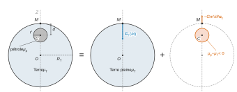
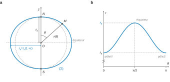
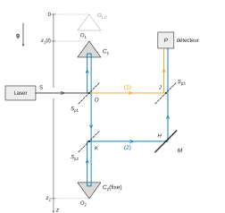
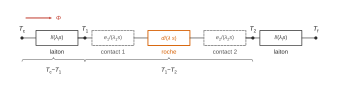
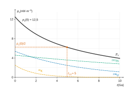
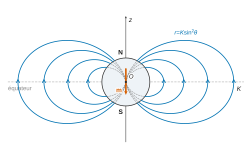

# CCINP MPI — Physique-chimie 2026 · Corrigé brut

*Corrigé rédigé par IA, non officiel. Signalez toute erreur.*

Épreuve de 4 heures, calculatrices interdites. Les applications numériques sont menées à la main avec la table de logarithmes décimaux de l'annexe, et données avec un ou deux chiffres significatifs, comme l'autorise l'énoncé.

| Donnée | $\log_{10}$ |
|---|---|
| $\pi$ | 0,50 |
| $R_T$ | 6,81 |
| $M_T$ | 24,78 |
| $G$ | −10,17 |
| $\Omega$ | −4,14 |
| $C$ | 3,00 |
| $N_A$ | 23,78 |
| $\mu_0$ | −5,90 |

Base sphérique $(\vec u_r,\vec u_\theta,\vec u_\varphi)$. Le vecteur $\vec u_z$ est unitaire de l'axe des pôles, orienté du sud vers le nord.

## Partie I — Champ gravitationnel et champ de pesanteur

### Q1

Une masse ponctuelle $m$ et une charge ponctuelle $q$ placées en $O$ créent en $M$, avec $\overrightarrow{OM}=r\,\vec u_r$ :

$$\begin{aligned}
\vec G(M)&=-\frac{Gm}{r^2}\,\vec u_r\\
\vec E(M)&=\frac{q}{4\pi\varepsilon_0\,r^2}\,\vec u_r
\end{aligned}$$

L'identification terme à terme donne les analogues gravitationnels :

$$\boxed{\begin{aligned}
q\ &\longleftrightarrow\ m\\
\frac{1}{4\pi\varepsilon_0}\ &\longleftrightarrow\ -G\\
\varepsilon_0\ &\longleftrightarrow\ -\frac{1}{4\pi G}
\end{aligned}}$$

Le signe traduit le caractère toujours attractif de la gravitation. Le théorème de Gauss électrostatique s'écrit

$$\oint_S\vec E\cdot\mathrm d\vec S_{\rm ext}=\frac{Q_{\rm int}}{\varepsilon_0}.$$

Il devient : **le flux du champ gravitationnel sortant d'une surface fermée $S$ est égal à $-4\pi G$ fois la masse $M_{\rm int}$ contenue dans le volume $V$ qu'elle délimite** :

$$\boxed{\oint_S\vec G\cdot\mathrm d\vec S_{\rm ext}=-4\pi G\iiint_V\mu(P)\,\mathrm d\tau}$$

### Q2

La boule homogène est invariante par toute rotation autour de $O$ : la norme du champ ne dépend que de $r$. Tout plan contenant $O$ et $M$ est plan de symétrie de la distribution de masse. Le champ en $M$ appartient donc à l'intersection de ces plans, la droite $(OM)$ :

$$\vec G_T(M)=G_T(r)\,\vec u_r .$$

Surface de Gauss : la sphère de centre $O$ passant par $M$, **surface fermée** sur laquelle $G_T(r)$ est uniforme et $\vec G_T$ colinéaire à $\mathrm d\vec S_{\rm ext}=\mathrm dS\,\vec u_r$. Le flux vaut $4\pi r^2G_T(r)$, d'où

$$4\pi r^2\,G_T(r)=-4\pi G\,M_{\rm int}(r).$$

- Pour $r\ge R_T$, la masse intérieure est $M_{\rm int}=M_T=\frac43\pi R_T^3\mu_T$ :
$$\boxed{\vec G_T(M)=-\frac{GM_T}{r^2}\,\vec u_r}$$
- Pour $r\le R_T$, la masse intérieure est $M_{\rm int}=\frac43\pi r^3\mu_T$ :
$$\boxed{\vec G_T(M)=-\frac{4\pi G\mu_T}{3}\,r\,\vec u_r}$$

Comme $M_T=\frac43\pi R_T^3\mu_T$, ces expressions s'écrivent aussi :

$$\begin{aligned}
\vec G_T(M)&=-\frac{4\pi G\mu_TR_T^3}{3r^2}\,\vec u_r\quad(r\ge R_T)\\
\vec G_T(M)&=-\frac{GM_T}{R_T^3}\,r\,\vec u_r\quad(r\le R_T)
\end{aligned}$$

Le champ est continu en $r=R_T$ et nul au centre. Contrôle : $\frac43\pi R_T^3\mu_T\approx4{,}19\times2{,}6\cdot10^{20}\times5400\approx6{,}0\cdot10^{24}$ kg, soit $M_T$.

### Q3



La distribution réelle est la superposition de deux boules homogènes :

- la Terre pleine, de masse volumique $\mu_T$ ;
- une boule de rayon $r'$ centrée en $C$, de masse volumique algébrique $\mu_p-\mu_T$, qui **retire** la roche remplacée par le pétrole.

Cette petite boule a la masse $m'=\frac43\pi r'^3(\mu_p-\mu_T)<0$. Le point $M$ est à la surface ($OM=R_T$) et extérieur à la petite boule.

D'après Q2, celle-ci crée en $M$ le champ $-\dfrac{Gm'}{d^2}\vec u_z$, où $\vec u_z$ est dirigé de $C$ vers $M$. Par superposition :

$$\boxed{G_{Tp}(M)\,\vec u_z=\left[-\frac{4\pi G\mu_TR_T}{3}-\frac{4\pi G\,r'^3(\mu_p-\mu_T)}{3\,d^2}\right]\vec u_z}$$

Avec $G_T(M)=-\frac43\pi G\mu_TR_T$ :

$$\begin{aligned}
G_T-G_{Tp}&=\frac{4\pi G\,r'^3(\mu_p-\mu_T)}{3\,d^2}\\
\varepsilon=\frac{G_T-G_{Tp}}{G_T}&=-\frac{r'^3(\mu_p-\mu_T)}{d^2\,\mu_T\,R_T}
\end{aligned}$$

soit

$$\boxed{\varepsilon=\left(\frac{r'}{d}\right)^2\frac{r'}{R_T}\,\frac{\mu_T-\mu_p}{\mu_T}}$$

Comme $\mu_p<\mu_T$, on a $\varepsilon>0$. Or $G_{Tp}=G_T(1-\varepsilon)$ avec $G_T<0$, donc $|G_{Tp}|<|G_T|$ : **le champ gravitationnel devient moins intense**. Il manque de la masse sous $M$, le pétrole étant moins dense que la roche.

Application numérique :

$$\begin{aligned}
\varepsilon&=\frac14\times\frac{10^{-3}}{4}\times\frac56\\
&=\frac{5\cdot10^{-3}}{96}\approx5\cdot10^{-5}
\end{aligned}$$

Cette variation relative est environ $5\cdot10^3$ fois supérieure à la précision des gravimètres ($10^{-8}$) : **un tel gisement est aisément détectable** par gravimétrie.

## Partie II — Forme de la Terre

### Q4

Le référentiel terrestre $R'$ est en rotation uniforme à $\Omega$ autour de l'axe fixe $OZ$ du référentiel géocentrique $R$, supposé galiléen. $R'$ n'est donc pas galiléen.

Dans $R'$, un point $M$ immobile subit l'attraction gravitationnelle et la force d'inertie d'entraînement $\vec F_{ie}=-m\vec a_e(M)$. L'accélération d'entraînement est celle du point coïncidant, en mouvement circulaire uniforme de rayon $HM$ autour de l'axe : $\vec a_e=-\Omega^2\overrightarrow{HM}$. La force de Coriolis est nulle puisque $\vec v_{R'}(M)=\vec 0$.

Le poids, défini comme l'opposé de la force qui maintient $M$ en équilibre dans $R'$, s'écrit donc

$$\vec P=m\vec g(M)=\underbrace{-\frac{GM_Tm}{r^2}\vec u_r}_{\text{terme gravitationnel}}+\underbrace{m\Omega^2\overrightarrow{HM}}_{\text{terme d'inertie d'entraînement}}$$

Ordre de grandeur : le terme d'entraînement est petit (Q6), donc $g\approx GM_T/R_T^2$. Le calcul par logarithmes confirme la valeur bien connue :

$$\log g=-10{,}17+24{,}78-2\times6{,}81=0{,}99$$

$$\boxed{g\approx10\ \mathrm{m\,s^{-2}}\quad(9{,}8\ \mathrm{m\,s^{-2}})}$$

### Q5

La force d'inertie de Coriolis vaut $\vec F_{ic}=-2m\vec\Omega\wedge\vec v$, donc $\|\vec F_{ic}\|\le2m\Omega v$. Pour le TGV ($v=100\ \mathrm{m\,s^{-1}}$) :

$$\begin{aligned}
\frac{\|\vec F_{ic}\|}{mg}&\le\frac{2\Omega v}{g}\\
&\approx\frac{2\times7{,}3\cdot10^{-5}\times10^2}{9{,}8}\approx1{,}5\cdot10^{-3}\ll1
\end{aligned}$$

**La force de Coriolis vaut au plus 0,15 % du poids : elle est négligeable devant lui.**

### Q6

À la surface, $r=R_T$ et $HM=R_T\sin\theta\le R_T$. Le rapport des normes vaut

$$\begin{aligned}
\frac{m\Omega^2R_T\sin\theta}{GM_Tm/R_T^2}&=\frac{\Omega^2R_T^3}{GM_T}\sin\theta\\
&\le\frac{\Omega^2R_T^3}{GM_T}
\end{aligned}$$

$$\boxed{\eta=\frac{\Omega^2R_T^3}{GM_T}}$$

La borne est atteinte à l'équateur ($\theta=\pi/2$). Application numérique :

$$\log\eta=2(-4{,}14)+3(6{,}81)+10{,}17-24{,}78=-2{,}46$$

$$\boxed{\eta\approx3{,}5\cdot10^{-3}}$$

Le terme d'inertie d'entraînement ne modifie le champ gravitationnel que de quelques millièmes : $\vec g$ est très voisin du champ gravitationnel. L'écart reste mesurable : variation de $g$ de quelques pour mille entre pôle et équateur, verticale légèrement non radiale.

### Q7

**a)** Le travail élémentaire de la force gravitationnelle est

$$\begin{aligned}
\delta W&=\vec F_G\cdot\mathrm d\overrightarrow{OM}=-\frac{GM_Tm}{r^2}\,\mathrm dr\\
&=-\mathrm d\!\left(-\frac{GM_Tm}{r}\right)
\end{aligned}$$

Avec $E_{pG}\to0$ à l'infini :

$$\boxed{E_{pG}(M)=-\frac{GM_Tm}{r}}$$

**b)** Soit $\rho=HM$ la distance à l'axe et $\vec u_\rho$ le vecteur unitaire radial cylindrique d'axe $OZ$. On a $\vec F_{ie}=m\Omega^2\rho\,\vec u_\rho$ et $\mathrm d\overrightarrow{OM}=\mathrm d\rho\,\vec u_\rho+\rho\,\mathrm d\varphi\,\vec u_\varphi+\mathrm dz\,\vec u_z$ :

$$\begin{aligned}
\delta W&=m\Omega^2\rho\,\mathrm d\rho\\
&=-\mathrm d\!\left(-\tfrac12m\Omega^2\rho^2\right)
\end{aligned}$$

La force dérive donc de $E_{pe}=-\frac12m\Omega^2\rho^2+\text{cte}$. La constante est nulle puisque $\rho=0$ en $r=0$ :

$$\boxed{E_{pe}(M)=-\frac12m\Omega^2\left(HM\right)^2}$$

**c)** En coordonnées sphériques, $HM=r\sin\theta$, d'où

$$\boxed{E_{pp}(M)=-\frac{GM_Tm}{r}-\frac12m\Omega^2r^2\sin^2\theta}$$

### Q8

Au pôle Nord, $\theta=0$ et $E_{pp}(N)=-GM_Tm/r_n$. Pour $M\in(\Sigma)$ :

$$-\frac{GM_T}{r}-\frac12\Omega^2r^2\sin^2\theta=-\frac{GM_T}{r_n}$$

ce qui équivaut à

$$\frac{r_n}{r}=1-\frac{\Omega^2r^2r_n\sin^2\theta}{2GM_T}.$$

Le dernier terme est de l'ordre de $\eta/2\ll1$ (Q6). Au premier ordre en $\eta$, on peut y remplacer $r$ par $r_n$, puis utiliser le développement limité $(1-x)^{-1}\approx1+x$ :

$$\boxed{r(\theta)\approx r_n\left(1+\varepsilon\sin^2\theta\right)}$$

$$\boxed{\varepsilon=\frac{\Omega^2r_n^3}{2GM_T}=\frac{\eta}{2}\left(\frac{r_n}{R_T}\right)^3}$$

Allure dans un plan méridien (figure 2) : courbe fermée symétrique par rapport à l'axe des pôles et au plan équatorial. Son rayon est minimal, égal à $r_n$, aux pôles ($\theta=0$ et $\pi$), et maximal, égal à $r_e$, à l'équateur ($\theta=\pi/2$). C'est un ovale aplati aux pôles, très proche d'un cercle (aplatissement de l'ordre de $10^{-3}$, à exagérer sur le dessin).



Dans le plan équatorial, $r_e=r_n(1+\varepsilon)$, donc, avec $r_n\approx R_T$ :

$$\boxed{\varepsilon'=\frac{r_e-r_n}{r_n}=\varepsilon}$$

$$\varepsilon'\approx\frac{\eta}{2}\approx1{,}7\cdot10^{-3}\approx\frac{1}{580}$$

L'aplatissement réel de la Terre ($1/298$) est environ le double : le modèle néglige l'excès de masse du bourrelet équatorial, qui renforce la déformation.

## Partie III — Détermination optique du champ de pesanteur

### Q9

**a)** D'après Q2, à l'altitude $h$ :

$$g(h)=\frac{GM_T}{(R_T+h)^2}=g(0)\left(1+\frac{h}{R_T}\right)^{-2}.$$

Comme $h/R_T\ll1$, le développement limité au premier ordre donne

$$\begin{aligned}
\frac{g(h)-g(0)}{g(0)}&\approx-\frac{2h}{R_T}\\
&\approx-\frac{2}{6{,}4\cdot10^6}\approx-3\cdot10^{-7}
\end{aligned}$$

**La variation est de l'ordre de $10^{-7}$ en valeur relative sur un mètre : $g$ peut être considéré comme uniforme.**

**b)** Dans le vide, $C_1$ n'est soumis qu'à son poids ; il est en translation, on étudie $O_1$. Sur l'axe vertical **descendant** d'origine $O_{1,0}$, le principe fondamental de la dynamique donne $\ddot z_1=+g$, avec $z_1(0)=0$ et $\dot z_1(0)=0$ :

$$\boxed{z_1(t)=\frac12gt^2}$$

### Q10

**a)** Lecture de la figure 3(a) : le faisceau du laser arrive horizontalement en $O$ sur $S_{p1}$. Les réflexions sur les séparatrices inclinées à 45° et sur le miroir $M$ suivent la loi de la réflexion ; un coin de cube renvoie la lumière parallèlement à elle-même.

- Rayon (1) : transmis par $S_{p1}$, il va de $O$ à $J$, où $S_{p3}$ le réfléchit vers $P$.
- Rayon (2), dans l'ordre :
  - réfléchi vers le haut par $S_{p1}$ en $O$, renvoyé vers le bas par le coin de cube $C_1$ ;
  - transmis par $S_{p1}$, il descend jusqu'en $K$ et traverse $S_{p2}$ ;
  - renvoyé vers le haut par $C_2$, il est réfléchi vers la droite par $S_{p2}$ en $K$ ;
  - réfléchi vers le haut par le miroir $M$ en $H$, il est transmis par $S_{p3}$ en $J$ vers $P$.



Le chemin aller-retour dans un coin de cube depuis un plan de référence vaut deux fois la distance de ce plan à son sommet, à une constante près, absorbée en prenant les sommets $O_1$ et $O_2$ comme repères. Les parcours $S\to O$ et $J\to P$ sont communs. Avec $n=1$ :

$$\delta(P,t)=\left[2\,OO_1+OK+2\,KO_2+KH+HJ\right]-OJ .$$

$OJHK$ est un rectangle : $KH=OJ$ et $HJ=OK$. Il reste

$$\delta=2(OO_1+OK+KO_2)=2\,O_1O_2 .$$

Sur l'axe descendant d'origine $O_{1,0}$, $O_1O_2=z_2-z_1(t)$, d'où

$$\boxed{\delta(P,t)=2\left(z_2-z_1(t)\right)=2z_2-g\,t^2}$$

**b)** Les deux ondes sont cohérentes et les réflexions n'introduisent pas de déphasage supplémentaire. L'intensité vaut

$$I=I_1+I_2+2\sqrt{I_1I_2}\cos\left(\frac{2\pi\delta}{\lambda}\right).$$

On introduit l'ordre d'interférence $p=\delta/\lambda$. L'intensité est minimale quand $p$ est demi-entier, c'est-à-dire $\delta=(k+\frac12)\lambda$ avec $k\in\mathbb Z$. Deux minima successifs correspondent à des ordres qui diffèrent de 1, donc à une variation de $\delta$ de $\lambda$.

Comme $\delta$ décroît avec $t$, le $q$-ième minimum après celui de $t_0$ vérifie $\delta(P,t_q)=\delta(P,t_0)-q\lambda$ :

$$\begin{aligned}
\Delta_q&=\delta(P,t_q)-\delta(P,t_0)\\
&=-g\left(t_q^2-t_0^2\right)\\
&=-q\lambda
\end{aligned}$$

$$\boxed{g=\frac{q\lambda}{t_q^2-t_0^2}}$$

Sur la figure 3(b), $t_0\approx155\ \mu$s et $t_1\approx300\ \mu$s donnent

$$g\approx\frac{6{,}3\cdot10^{-7}}{9{,}0\cdot10^{-8}-2{,}4\cdot10^{-8}}\approx10\ \mathrm{m\,s^{-2}}.$$

Les minima se resserrent car $t_q=\sqrt{t_0^2+q\lambda/g}$.

**c)** On pose

$$\boxed{y(q)=t_q^2-t_0^2=\frac{\lambda}{g}\,q}$$

fonction linéaire de $q$ de pente $a=\lambda/g$. On relève les instants $t_q$ des minima successifs, on trace $t_q^2-t_0^2$ en fonction de $q$, on ajuste une droite passant par l'origine et on en tire $g=\lambda/a$.

Ici les temps sont en microsecondes : $a=64\,598\ \mu\mathrm s^2=6{,}4598\cdot10^{-8}\ \mathrm{s^2}$, et

$$g=\frac{\lambda}{a}=\frac{632{,}82\cdot10^{-9}\ \mathrm m}{6{,}4598\cdot10^{-8}\ \mathrm{s^2}}\approx9{,}796\ \mathrm{m\,s^{-2}}.$$

C'est la valeur annoncée $g=9{,}7961\ \mathrm{m\,s^{-2}}$ ; le cinquième chiffre dépend de l'arrondi de la pente.

## Partie IV — Le calcaire et l'argile : des richesses du sol bon marché

### Partie IV.1 — Obtention d'un ciment

### Q11

Toutes les espèces sont solides :

$$\begin{aligned}
&(A)\quad 3\,\mathrm{CaO_{(s)}}+\mathrm{SiO_{2(s)}}\longrightarrow\mathrm{Ca_3SiO_{5(s)}}\\
&(B)\quad 2\,\mathrm{CaO_{(s)}}+\mathrm{SiO_{2(s)}}\longrightarrow\mathrm{Ca_2SiO_{4(s)}}\\
&(C)\quad 3\,\mathrm{CaO_{(s)}}+\mathrm{Al_2O_{3(s)}}\longrightarrow\mathrm{Ca_3Al_2O_{6(s)}}\\
&(D)\quad 4\,\mathrm{CaO_{(s)}}+\mathrm{Al_2O_{3(s)}}+\mathrm{Fe_2O_{3(s)}}\longrightarrow\mathrm{Ca_4Al_2Fe_2O_{10(s)}}
\end{aligned}$$

Contrôle par les masses molaires :

$$\begin{aligned}
3\times56+60&=228\\
2\times56+60&=172\\
3\times56+102&=270\\
4\times56+102+160&=486
\end{aligned}$$

### Q12

Raisonnons sur 100 g de mélange. Un motif $\mathrm{Ca_3SiO_5}$ contient trois motifs CaO et un motif $\mathrm{SiO_2}$.

Une masse $p_5$ de composant A renferme une masse $\frac{3M_1}{M_5}p_5$ de CaO et $\frac{M_2}{M_5}p_5$ de $\mathrm{SiO_2}$. On procède de même pour B, C et D (coefficients de Q11).

Les hypothèses (H1)–(H4) disent que chaque oxyde se retrouve entièrement dans les composants. La conservation de la masse de chaque oxyde donne :

$$\begin{aligned}
p_1&=\frac{3M_1}{M_5}p_5+\frac{2M_1}{M_6}p_6+\frac{3M_1}{M_7}p_7+\frac{4M_1}{M_8}p_8\\
p_2&=\frac{M_2}{M_5}p_5+\frac{M_2}{M_6}p_6\\
p_3&=\frac{M_3}{M_7}p_7+\frac{M_3}{M_8}p_8\\
p_4&=\frac{M_4}{M_8}p_8
\end{aligned}$$

soit $\mathtt{oxy}=\mathtt{gob}\cdot\mathtt{cim}$.

L'élément $\beta_{ij}=\nu_{ij}M_i/M_{j+4}$ est la masse d'oxyde $i$ contenue dans une unité de masse du composant $j$, où $\nu_{ij}$ est le nombre de motifs d'oxyde $i$ dans le composant $j$ :

$$\mathtt{gob}=\begin{pmatrix}\dfrac{3M_1}{M_5}&\dfrac{2M_1}{M_6}&\dfrac{3M_1}{M_7}&\dfrac{4M_1}{M_8}\\[2mm]\dfrac{M_2}{M_5}&\dfrac{M_2}{M_6}&0&0\\[2mm]0&0&\dfrac{M_3}{M_7}&\dfrac{M_3}{M_8}\\[2mm]0&0&0&\dfrac{M_4}{M_8}\end{pmatrix}$$

(lignes : CaO, SiO₂, Al₂O₃, Fe₂O₃ ; colonnes : A, B, C, D).

```python
5   gob=np.array([[3*M1/M5, 2*M1/M6, 3*M1/M7, 4*M1/M8],
                  [  M2/M5,   M2/M6,       0,       0],
                  [      0,       0,   M3/M7,   M3/M8],
                  [      0,       0,       0,   M4/M8]])
```

Chaque colonne est de somme 1 (conservation de la masse). La matrice est inversible : elle est triangulaire par blocs, de blocs diagonaux de déterminants $M_1M_2/(M_5M_6)\neq0$ et $M_3M_4/(M_7M_8)\neq0$. Avec l'exemple de la ligne 4, le script affiche `cim` $\approx[2{,}5\ ;\ 66{,}9\ ;\ 15{,}3\ ;\ 15{,}3]$ (somme 100).

Remarque : la ligne 2 donne `M4=159` alors que $M(\mathrm{Fe_2O_3})=160\ \mathrm{g\,mol^{-1}}$ (tableau 1), d'où $M_8=485$ au lieu de 486 ; l'écart est négligeable.

### Partie IV.2 — Les pluies acides

### Q13

**a)** On confond activités et concentrations (en $\mathrm{mol\,L^{-1}}$, $c^\circ=1\ \mathrm{mol\,L^{-1}}$) ; l'eau, solvant, a une activité égale à 1 :

$$\begin{aligned}
&\mathrm{H_2CO_3}+\mathrm{H_2O}=\mathrm{HCO_3^-}+\mathrm{H_3O^+}\\
&Q_{r1}=\frac{[\mathrm{HCO_3^-}][\mathrm{H_3O^+}]}{[\mathrm{H_2CO_3}]}\\
&\mathrm{HCO_3^-}+\mathrm{H_2O}=\mathrm{CO_3^{2-}}+\mathrm{H_3O^+}\\
&Q_{r2}=\frac{[\mathrm{CO_3^{2-}}][\mathrm{H_3O^+}]}{[\mathrm{HCO_3^-}]}
\end{aligned}$$

À l'équilibre, $Q_{r1}=K_{a1}$ et $Q_{r2}=K_{a2}$.

**b)** La forme la plus acide prédomine aux faibles pH, la plus basique aux pH élevés, et l'ampholyte est la seule espèce dont la proportion passe par un maximum :

$$\boxed{\begin{aligned}
(1)&:\ \mathrm{CO_{2(aq)},H_2O}\ (\mathrm{H_2CO_3})\\
(2)&:\ \mathrm{HCO_3^-}\\
(3)&:\ \mathrm{CO_3^{2-}}
\end{aligned}}$$

**c)** D'après la relation

$$\mathrm{pH}=\mathrm pK_{a1}+\log\frac{[\mathrm{HCO_3^-}]}{[\mathrm{H_2CO_3}]},$$

à l'intersection des courbes (1) et (2) les deux concentrations sont égales et $\mathrm{pH}=\mathrm pK_{a1}$ ; de même pour (2) et (3) avec $\mathrm pK_{a2}$. On lit les intersections à $\mathrm{pH}\approx6{,}35$ et $\mathrm{pH}\approx10{,}35$. Les constantes demandées sont les $K_a=10^{-\mathrm pK_a}$ :

$$\boxed{\begin{aligned}
K_{a1}&=10^{-6{,}35}\approx4{,}5\cdot10^{-7}\\
K_{a2}&=10^{-10{,}35}\approx4{,}5\cdot10^{-11}
\end{aligned}}$$

Contrôle : le maximum de la courbe (2) est en $\frac12(\mathrm pK_{a1}+\mathrm pK_{a2})\approx8{,}35$. La proportion d'ampholyte y vaut $1/(1+2\cdot10^{-2})\approx98\ \%$, conformément au graphe.

### Q14

Espèces présentes : $\mathrm{H_2CO_3}$ (c'est-à-dire $\mathrm{CO_{2(aq)},H_2O}$), $\mathrm{HCO_3^-}$, $\mathrm{CO_3^{2-}}$, $\mathrm{H_3O^+}$, $\mathrm{OH^-}$.

La concentration $[\mathrm{H_2CO_3}]=c$ est **imposée** par l'équilibre avec le $\mathrm{CO_2}$ atmosphérique : il n'y a pas de conservation de la matière à écrire. Avec $h=[\mathrm{H_3O^+}]$, les constantes d'équilibre donnent :

$$\begin{aligned}
[\mathrm{HCO_3^-}]&=\frac{K_{a1}c}{h}\\
[\mathrm{CO_3^{2-}}]&=\frac{K_{a1}K_{a2}c}{h^2}\\
[\mathrm{OH^-}]&=\frac{K_e}{h}
\end{aligned}$$

L'électroneutralité s'écrit

$$h=[\mathrm{HCO_3^-}]+2[\mathrm{CO_3^{2-}}]+[\mathrm{OH^-}].$$

La solution est acide : on néglige $[\mathrm{OH^-}]$. Comme $K_{a2}\ll K_{a1}$, on néglige aussi $2[\mathrm{CO_3^{2-}}]$ devant $[\mathrm{HCO_3^-}]$. Il reste $h\approx K_{a1}c/h$, d'où $h=\sqrt{K_{a1}c}$ et

$$\begin{aligned}
\mathrm{pH}&=\frac12\left(\mathrm pK_{a1}-\log c\right)\\
&=\frac12(6{,}35+5{,}0)
\end{aligned}$$

$$\boxed{\mathrm{pH}\approx5{,}7}$$

Concentrations (en $\mathrm{mol\,L^{-1}}$) :

$$\boxed{\begin{aligned}
[\mathrm{H_3O^+}]&=10^{-5{,}7}\approx2\cdot10^{-6}\\
[\mathrm{HCO_3^-}]&=[\mathrm{H_3O^+}]\approx2\cdot10^{-6}\\
[\mathrm{CO_{2(aq)},H_2O}]&=c=1{,}0\cdot10^{-5}\\
[\mathrm{CO_3^{2-}}]&=\frac{K_{a2}[\mathrm{HCO_3^-}]}{h}=K_{a2}\approx5\cdot10^{-11}\\
[\mathrm{OH^-}]&=\frac{K_e}{h}\approx5\cdot10^{-9}
\end{aligned}}$$

Validation : $[\mathrm{OH^-}]/h\approx2\cdot10^{-3}$ et $2[\mathrm{CO_3^{2-}}]/[\mathrm{HCO_3^-}]\approx4\cdot10^{-5}$ ; les approximations sont justifiées. Une pluie non polluée, en équilibre avec le $\mathrm{CO_2}$ de l'air, est donc naturellement acide (pH voisin de 5,7).

## Partie V — Quelques propriétés thermodynamiques de la Terre

### Partie V.1 — Mesure de la conductivité thermique d'une roche

### Q15

En régime stationnaire, considérons un conducteur dont les faces sont aux températures $T_1$ et $T_2$, traversé par le flux thermique $\Phi$ (de 1 vers 2). Sa résistance thermique est

$$\boxed{R_{th}=\frac{T_1-T_2}{\Phi}}\quad(\mathrm{K\,W^{-1}}),$$

analogue de $R=U/I$. La loi de Fourier s'écrit $\vec j=-\lambda\,\overrightarrow{\mathrm{grad}}\,T$. En régime stationnaire sans source, le flux $\Phi=js$ est conservé, donc $\mathrm dT/\mathrm dx=-\Phi/(\lambda s)$ est constant et $T_1-T_2=\Phi\,l/(\lambda s)$ :

$$\boxed{R_{th}=\frac{l}{\lambda\,s}}$$

### Q16

En régime stationnaire, le même flux $\Phi$ traverse toutes les couches, de section commune $s$ : **les résistances thermiques sont en série** et s'ajoutent.

Entre $z=0$ (eau chaude, $T_c$) et l'interface laiton/contact 1 ($T_1$), puis entre $T_1$ et $T_2$ :

$$\begin{aligned}
T_c-T_1&=\Phi\,\frac{l}{\lambda_l s}\\
T_1-T_2&=\Phi\left(\frac{e_1}{\lambda_1s}+\frac{d}{\lambda s}+\frac{e_2}{\lambda_2s}\right)
\end{aligned}$$



Le rapport élimine $\Phi$ et $s$ :

$$\boxed{\frac{T_1-T_2}{T_c-T_1}=\frac{\lambda_l}{l}\left(\frac{d}{\lambda}+\frac{e_1}{\lambda_1}+\frac{e_2}{\lambda_2}\right)}$$

Pour s'affranchir des contacts, on répète la mesure avec des échantillons de la même roche d'épaisseurs $d$ différentes, les contacts étant réalisés à l'identique. On trace $Y=\dfrac{T_1-T_2}{T_c-T_1}$ en fonction de $d$ : c'est une droite de pente $a=\dfrac{\lambda_l}{l\lambda}$. Son ordonnée à l'origine, $\dfrac{\lambda_l}{l}\left(\dfrac{e_1}{\lambda_1}+\dfrac{e_2}{\lambda_2}\right)$, contient seule les inconnues des contacts. La pente donne

$$\boxed{\lambda=\frac{\lambda_l}{l\,a}}$$

### Partie V.2 — Évolution de la température à l'intérieur de la Terre

### Q17

**a)** On adapte le résultat de Q7a. Vue d'un point extérieur, la sphère homogène de masse $m$ crée le champ d'une masse ponctuelle $m$ placée en $O$ (Q2).

Il suffit donc de remplacer, dans $E_{pG}=-GM_Tm/r$, la masse $M_T$ par $m$ et la masse test par $\mathrm dm$. Avec une énergie nulle quand $\mathrm dm$ est à l'infini :

$$\boxed{\mathrm dE_{pG}(r)=-\frac{G\,m\,\mathrm dm}{r}}$$

**b)** Quand la sphère a atteint le rayon $r$, sa masse est $m(r)=\frac43\pi r^3\mu$. La coquille apportée a la masse $\mathrm dm=\mu\,\mathrm d\tau=4\pi r^2\mu\,\mathrm dr$. L'apport de cette coquille contribue pour

$$\begin{aligned}
\mathrm dE_{pG}&=-\frac Gr\cdot\frac43\pi r^3\mu\cdot4\pi r^2\mu\,\mathrm dr\\
&=-\frac{16\pi^2G\mu^2}{3}\,r^4\,\mathrm dr
\end{aligned}$$

On somme ces contributions pendant la croissance du rayon de $0$ à $R$, puis on utilise $\mu=\dfrac{3M}{4\pi R^3}$ :

$$\begin{aligned}
E_{pG}(R)&=-\frac{16\pi^2G\mu^2}{3}\int_0^Rr^4\,\mathrm dr\\
&=-\frac{16\pi^2G\mu^2R^5}{15}\\
&=-\frac{16\pi^2G}{15}\cdot\frac{9M^2}{16\pi^2R^6}\cdot R^5
\end{aligned}$$

$$\boxed{E_{pG}(R)=-\frac35\,\frac{GM^2}{R}}$$

$E_{pG}<0$ : l'état lié est d'énergie inférieure à l'état dispersé (référence nulle). La formation de la sphère par accrétion **libère** l'énergie $\frac35GM^2/R$, l'interaction gravitationnelle étant attractive.

### Q18

L'énergie libérée $-E_{pG}$ élève la température de toute la masse $M_T$ de $0$ K à $T_{eq}$, avec $C$ supposée constante :

$$M_TC\,T_{eq}=\frac35\,\frac{GM_T^2}{R_T}$$

$$\boxed{T_{eq}=\frac{3GM_T}{5R_TC}}$$

Homogénéité : $GM_T/R_T$ est en $\mathrm{J\,kg^{-1}}$ (énergie potentielle massique) et $C$ en $\mathrm{J\,kg^{-1}\,K^{-1}}$ ; le rapport est bien une température, positive. Application numérique :

$$\begin{aligned}
\log T_{eq}&=\log0{,}6-10{,}17+24{,}78-6{,}81-3{,}00\\
&=-0{,}22+4{,}80=4{,}58
\end{aligned}$$

$$\boxed{T_{eq}\approx4\cdot10^4\ \mathrm K}$$

Cette température est très supérieure à celle du centre de la Terre (de l'ordre de $5\cdot10^3$ K). L'énergie d'accrétion suffisait à fondre la planète, mais le modèle surestime l'échauffement : il néglige l'énergie rayonnée vers l'espace pendant l'accrétion, les changements d'état et la variation de $C$.

### Q19

L'équation $\dfrac{\mathrm dN_i}{\mathrm dt}=-\dfrac{\ln2}{\tau_i}N_i$ est linéaire du premier ordre à coefficient constant :

$$\boxed{N_i(t)=N_{i0}\exp\left(-\frac{\ln2}{\tau_i}t\right)=N_{i0}\,2^{-t/\tau_i}}$$

On vérifie que $N_i(\tau_i)=N_{i0}/2$, conformément à la définition de la demi-vie.

### Q20

Un volume $V$ de roche, de masse volumique $\mu$, contient la masse $x_i\mu V$ d'isotope $i$, soit $x_i\mu VN_A/M_i$ noyaux. Le nombre initial de noyaux par unité de volume est donc

$$N_{i0}=\frac{x_i\,\mu\,N_A}{M_i}.$$

Chaque désintégration libère $\varepsilon_i$. Le nombre de désintégrations par unité de volume et de temps est $-\mathrm dN_i/\mathrm dt=\frac{\ln2}{\tau_i}N_i(t)$. La puissance volumique est le produit des deux :

$$\boxed{p_{v,i}(t)=\frac{\ln2\ \varepsilon_i\,x_i\,\mu\,N_A}{M_i\,\tau_i}\;\exp\left(-\frac{\ln2}{\tau_i}t\right)}$$

Les puissances dégagées par les trois éléments dans un même volume s'ajoutent (grandeur extensive) ; rapportée au même volume, la puissance volumique totale est leur somme :

$$\boxed{p_v(t)=\sum_{i=1}^3\frac{\ln2\ \varepsilon_i\,x_i\,\mu\,N_A}{M_i\,\tau_i}\;\exp\left(-\frac{\ln2}{\tau_i}t\right)}$$

($M_i$ en $\mathrm{kg\,mol^{-1}}$, $\tau_i$ en secondes, $p_v$ en $\mathrm{W\,m^{-3}}$).

### Q21

**a)** `pvi0` est le tableau des puissances volumiques initiales des trois éléments (U, Th, K), en $\mathrm{W\,m^{-3}}$ ($0{,}69\approx\ln2$) :

$$p_{v,i}(0)=\frac{\ln2\,\varepsilon_ix_i\mu N_A}{M_i\tau_i}.$$

Le script donne environ $5{,}4$, $4{,}6$ et $2{,}5\ \mathrm{nW\,m^{-3}}$.

**b)** `Dp` est le plus petit écart, sur les 100 dates échantillonnées, entre $p_v(t)$ et la moitié de sa valeur initiale $p_v(0)/2$.

**c)** `n` est l'indice, dans le tableau `t`, de la date où cet écart minimal est atteint : la date échantillonnée la plus proche de celle où $p_v$ vaut $p_v(0)/2$.

**d)** `pv(0)` est la puissance volumique totale à $t=0$ :

$$p_v(0)\approx1{,}25\cdot10^{-8}\ \mathrm{W\,m^{-3}}=12{,}5\ \mathrm{nW\,m^{-3}}.$$

`t0 = t[n]` est la date (en milliards d'années) à laquelle la puissance volumique totale a diminué de moitié, ici $\approx4{,}95$ Ga. Elle n'est connue qu'au pas d'échantillonnage près, $10/99\approx0{,}1$ Ga. Pour augmenter la précision, on augmente le nombre de points de `np.linspace` (ligne 11), ou l'on résout $p_v(t)=p_v(0)/2$ par dichotomie.

La fonction de la ligne 13 doit utiliser les demi-vies en milliards d'années (`tGyi`), puisque `t` est en milliards d'années :

```python
12  def pv(t):
13      return sum(pvi0[k]*np.exp(-np.log(2)*t/tGyi[k]) for k in range(0,3))
```

**e)** Lignes à ajouter après la ligne 19 :

```python
20  plt.plot(t, pv(t))
21  plt.xlabel("t (milliards d'années)")
22  plt.ylabel("pv (W/m3)")
23  plt.grid(False)
24  plt.show()
```

**f)** Allure (figure 6) : courbe décroissante, convexe, partant de $p_v(0)\approx12{,}5\ \mathrm{nW\,m^{-3}}$ et valant environ $4\ \mathrm{nW\,m^{-3}}$ à $t=10$ Ga. C'est une somme de trois exponentielles décroissantes ; la contribution du potassium ($\tau=1{,}26$ Ga) s'éteint le plus vite.

On trace l'horizontale $p_v=p_v(0)/2\approx6{,}25\ \mathrm{nW\,m^{-3}}$ et on lit l'abscisse de son intersection avec la courbe :

$$\boxed{t_{1/2}\approx5\cdot10^9\ \text{ans}}$$

soit $4{,}9$ à $5$ Ga, en accord avec `t0`. L'origine des temps est l'instant présent : les fractions $x_i$ sont actuelles, et $p_v(0)\times0{,}84\times\frac43\pi R_T^3\approx1{,}2\cdot10^{13}\ \mathrm W=P$. C'est donc dans environ 5 milliards d'années que la puissance radiogénique du manteau sera divisée par deux. $t_{1/2}$ n'est aucune des trois demi-vies, car $p_v$ n'est pas une exponentielle unique.



### Q22

On raisonne sur les **causes** du transfert thermique, c'est-à-dire sur ce qui fixe le champ de température : la Terre est homogène ($\mu$, $C$, $\lambda$ uniformes), la source radioactive $p'_v$ est uniforme et la température de surface est la même partout.

L'ensemble de ces causes est invariant par toute rotation autour de $O$ : **invariances par rotation d'angles $\theta$ et $\varphi$**. Le champ de température, qui en résulte, a les mêmes invariances, donc $T=T(r,t)$.

La loi de Fourier et l'expression du gradient rappelée par l'énoncé donnent alors

$$\vec j=-\lambda\,\overrightarrow{\mathrm{grad}}\,T=-\lambda\,\frac{\partial T}{\partial r}\,\vec u_r .$$

$$\boxed{\vec j=j(r,t)\,\vec u_r}$$

Le vecteur $\vec j$ est radial, et $j$ ne dépend ni de $\theta$ ni de $\varphi$.

### Q23

Système : la coquille comprise entre $r$ et $r+\mathrm dr$, fermée et indéformable, de masse $\mu\,4\pi r^2\mathrm dr$. Premier principe entre $t$ et $t+\mathrm dt$, sans travail :

$$\mathrm dU=\delta Q_{\rm cond}+\delta Q_{\rm prod}.$$

- $\mathrm dU=\mu C\,4\pi r^2\mathrm dr\,\dfrac{\partial T}{\partial t}\mathrm dt$ : **variation d'énergie interne** de la coquille.
- $\delta Q_{\rm cond}$ : **transfert thermique conductif reçu**, différence entre la puissance entrant par la sphère de rayon $r$ et celle sortant par la sphère de rayon $r+\mathrm dr$ :
$$\begin{aligned}
\delta Q_{\rm cond}&=\left[j(r)4\pi r^2-j(r+\mathrm dr)4\pi(r+\mathrm dr)^2\right]\mathrm dt\\
&=-\mathrm d\!\left(j\,4\pi r^2\right)\mathrm dt
\end{aligned}$$
- $\delta Q_{\rm prod}=p'_v\,4\pi r^2\mathrm dr\,\mathrm dt$ : **énergie produite** dans la coquille par la radioactivité.

D'où la relation demandée :

$$\boxed{\mu C\,4\pi r^2\frac{\partial T}{\partial t}\,\mathrm dt\,\mathrm dr=-\mathrm d\!\left(j\,4\pi r^2\right)\mathrm dt+p'_v\,4\pi r^2\,\mathrm dr\,\mathrm dt}$$

### Q24

**a)** En régime stationnaire, après division par $4\pi\,\mathrm dr\,\mathrm dt$ :

$$\frac{\mathrm d(r^2j)}{\mathrm dr}=p'_v\,r^2 .$$

Avec $j=-\lambda\dfrac{\mathrm dT}{\mathrm dr}$ :

$$\boxed{\frac{1}{r^2}\frac{\mathrm d}{\mathrm dr}\left(r^2\frac{\mathrm dT}{\mathrm dr}\right)=-\frac{p'_v}{\lambda}}$$

**b)** On intègre directement la forme conservative, sans la développer :

$$r^2j(r)=\frac{p'_v}{3}r^3+A .$$

Le terme $A/r^2$ dans $j$ donnerait $\mathrm dT/\mathrm dr=-A/(\lambda r^2)$, donc $T\sim A/(\lambda r)$, infinie au centre : $A=0$. Alors

$$\frac{\mathrm dT}{\mathrm dr}=-\frac{p'_v}{3\lambda}\,r .$$

Seconde intégration avec $T(R_T)=T_s$ :

$$\boxed{T(r)=T_s+\frac{p'_v}{6\lambda}\left(R_T^2-r^2\right)}$$

C'est un profil parabolique, maximal au centre.

**c)**

$$\boxed{j(r)=-\lambda\frac{\mathrm dT}{\mathrm dr}=\frac{p'_v\,r}{3}}$$

Contrôle : la puissance produite dans la boule de rayon $r$, $\frac43\pi r^3p'_v$, traverse la sphère d'aire $4\pi r^2$.

**d)** En $r=R_T$ :

$$\begin{aligned}
p'_v&=\frac{3j(R_T)}{R_T}\\
&=\frac{3\times7{,}0\cdot10^{-2}}{6{,}4\cdot10^6}
\end{aligned}$$

$$\boxed{p'_v\approx3\cdot10^{-8}\ \mathrm{W\,m^{-3}}\ (33\ \mathrm{nW\,m^{-3}})}$$

Comparaison avec Q21 : la radioactivité fournit **actuellement** $p_v(0)\approx12{,}5\ \mathrm{nW\,m^{-3}}$ dans le manteau. Rapporté au volume de la Terre, cela fait environ $0{,}84\times12{,}5\approx10\ \mathrm{nW\,m^{-3}}$. De même, $P=1{,}2\cdot10^{13}$ W est à comparer à la puissance géothermique $4\pi R_T^2j(R_T)\approx3{,}6\cdot10^{13}$ W.

La radioactivité n'explique donc qu'**environ un tiers** du flux géothermique. Le reste provient du refroidissement de la Terre (chaleur primitive d'accrétion, Q18), ce qui contredit l'hypothèse de régime stationnaire. Le modèle conductif à source uniforme donne en outre $T(0)=T_s+p'_vR_T^2/(6\lambda)\approx7\cdot10^4$ K, valeur irréaliste : la chaleur est évacuée en réalité par convection dans le manteau, et les éléments radioactifs sont concentrés près de la surface.

## Partie VI — Bilan énergétique sur le sol de la Terre, d'après une analyse documentaire

### Q25

On transpose terme à terme la relation de Q23 avec l'analogie $(R,u_{em})\leftrightarrow(j,\mu CT)$ :

- $\mu C\,\partial T/\partial t$ devient $\partial u_{em}/\partial t$ ;
- $j\,4\pi r^2$ devient $R\,4\pi r^2$, puissance rayonnée à travers la sphère de rayon $r$ ;
- le terme de production disparaît : il n'y a ni source ni absorption dans le vide.

Le bilan sur la coquille $[r,r+\mathrm dr]$ centrée sur le Soleil s'écrit

$$\boxed{4\pi r^2\,\frac{\partial u_{em}}{\partial t}\,\mathrm dt\,\mathrm dr=-\mathrm d\!\left(R\,4\pi r^2\right)\mathrm dt}$$

soit, sous forme locale,

$$\frac{\partial u_{em}}{\partial t}=-\frac{1}{r^2}\frac{\partial(r^2R)}{\partial r}.$$

En régime permanent, $r^2R(r)$ est constant : la puissance $P_{em}(r)=4\pi r^2R(r)$ est la même à travers toute sphère centrée sur le Soleil, en particulier à travers sa surface. D'où

$$\boxed{P_{em}(r=D)=P_S}$$

avec $P_{em}(D)=4\pi D^2R(D)$.

### Q26

À la distance $D$, la puissance surfacique est $P_S/(4\pi D^2)$. Le rayonnement, quasi parallèle, est intercepté par la section droite de la Terre, disque d'aire $\pi R_T^2$ :

$$\boxed{P_T=\frac{P_S}{4\pi D^2}\,\pi R_T^2=P_S\,\frac{R_T^2}{4D^2}}$$

### Q27

La loi de Wien donne la température de surface : $T_S=C_W/\lambda_S$. La loi de Stefan donne la puissance émise par unité de surface du corps noir, $\sigma T_S^4$, à multiplier par l'aire émettrice $S_S$. Donc

$$\boxed{P_S=\sigma S_S\,T_S^4=\sigma S_S\left(\frac{C_W}{\lambda_S}\right)^4}$$

Remarque : la valeur $C_W\approx0{,}03$ m·K de l'énoncé est dix fois trop grande ; elle donnerait $T_S\approx6\cdot10^4$ K. La constante de Wien vaut $2{,}9\cdot10^{-3}$ m·K, d'où $T_S\approx5{,}6\cdot10^3$ K. Cette valeur n'est pas utilisée dans la suite.

### Q28

**Puissance $P_S$.** La figure 7 est un bilan moyenné sur toute la surface terrestre : au sommet de l'atmosphère, $341=102+239$ (réfléchi + émis). La puissance surfacique $\varphi_S=341\ \mathrm{W\,m^{-2}}$ est donc rapportée à $4\pi R_T^2$ :

$$P_T=4\pi R_T^2\,\varphi_S .$$

Avec Q26 :

$$\frac{P_SR_T^2}{4D^2}=4\pi R_T^2\varphi_S$$

$$\boxed{P_S=16\pi D^2\varphi_S}$$

Application numérique :

$$\begin{aligned}
\log P_S&=\log16+\log\pi+2\log D+\log341\\
&=1{,}20+0{,}50+22{,}35+2{,}53=26{,}59
\end{aligned}$$

$$\boxed{P_S\approx4\cdot10^{26}\ \mathrm W}$$

(la constante solaire vaut $4\varphi_S\approx1{,}4\ \mathrm{kW\,m^{-2}}$).

**Bilan du sol seul.** Reçu : rayonnement solaire absorbé 161, rayonnement de retour de l'atmosphère 333. Cédé : rayonnement du sol 396, conduction-convection 17, évapotranspiration 80 (en $\mathrm{W\,m^{-2}}$) :

$$\boxed{\varphi_{tot}=161+333-396-17-80=+1\ \mathrm{W\,m^{-2}}}$$

Le sol reçoit un peu plus qu'il ne cède. Le déséquilibre est faible (0,2 % des flux échangés, de l'ordre de la précision des données) mais positif : la surface terrestre stocke de l'énergie et sa température tend à augmenter.

### Q29

L'énergie stockée pendant $\tau$ sur toute la surface échauffe la Terre, de capacité thermique $M_TC$ :

$$\boxed{\Delta T=\frac{4\pi R_T^2\,\varphi_{tot}\,\tau}{M_T\,C}}$$

Avec $\tau=10$ ans $\approx3{,}2\cdot10^8$ s :

$$\begin{aligned}
\log\Delta T&=1{,}10+13{,}62+0+8{,}50-24{,}78-3{,}00\\
&=-4{,}56
\end{aligned}$$

$$\boxed{\Delta T\approx3\cdot10^{-5}\ \mathrm K}$$

Cette valeur est infime parce que toute la masse de la Terre est supposée s'échauffer uniformément. En réalité, sur une décennie, seules l'atmosphère, la couche superficielle des océans et une faible épaisseur de sol participent, de masse bien plus faible ; l'échauffement observé est de l'ordre du dixième de kelvin par décennie.

## Partie VII — Le champ magnétique terrestre

### Q30

On projette $\vec u_z$ sur la base sphérique :

$$\vec u_z=\cos\theta\,\vec u_r-\sin\theta\,\vec u_\theta .$$

On en déduit les deux quantités qui figurent dans l'expression intrinsèque :

$$\begin{aligned}
\vec m&=-m\cos\theta\,\vec u_r+m\sin\theta\,\vec u_\theta\\
\vec m\cdot\vec r&=-mr\cos\theta
\end{aligned}$$

Donc

$$\vec B=\frac{\mu_0}{4\pi r^5}\left[-3mr^2\cos\theta\,\vec u_r+mr^2\cos\theta\,\vec u_r-mr^2\sin\theta\,\vec u_\theta\right]$$

$$\boxed{\begin{aligned}
B_r&=-\frac{\mu_0m\cos\theta}{2\pi r^3}\\
B_\theta&=-\frac{\mu_0m\sin\theta}{4\pi r^3}\\
B_\varphi&=0
\end{aligned}}$$

Contrôle : au pôle Nord, $B_r<0$, le champ est dirigé vers le centre, conformément à l'orientation de $\vec m$ vers le sud.

### Q31

Une ligne de champ est une courbe tangente en chacun de ses points au champ $\vec B$. Dans un plan méridien ($B_\varphi=0$), le déplacement élémentaire $\mathrm d\vec\ell=\mathrm dr\,\vec u_r+r\,\mathrm d\theta\,\vec u_\theta$ le long de la ligne est colinéaire à $\vec B$ :

$$\frac{\mathrm dr}{B_r}=\frac{r\,\mathrm d\theta}{B_\theta}$$

ce qui donne, avec Q30,

$$\frac{\mathrm dr}{r}=\frac{2\cos\theta}{\sin\theta}\,\mathrm d\theta .$$

On intègre : $\ln r=2\ln(\sin\theta)+\text{cte}$, soit

$$\boxed{r(\theta)=K\sin^2\theta}$$

$K>0$ est une constante propre à chaque ligne : sa distance maximale à $O$, atteinte dans le plan équatorial. Allure : boucles symétriques par rapport au plan équatorial, tangentes à l'axe des pôles en $O$, d'autant plus larges que $K$ est grand. À l'extérieur de la Terre, elles sortent dans l'hémisphère sud et rentrent dans l'hémisphère nord : le champ est orienté du sud vers le nord à l'équateur ($B_\theta<0$).



### Q32

Avec $\theta=\frac\pi2-\Lambda$, on a $\cos\theta=\sin\Lambda$ et $\sin\theta=\cos\Lambda$. En $r=R_T$ :

$$\begin{aligned}
B_r&=-\frac{\mu_0m\sin\Lambda}{2\pi R_T^3}\\
B_\theta&=-\frac{\mu_0m\cos\Lambda}{4\pi R_T^3}
\end{aligned}$$

Localement, $\vec u_r$ est la verticale ascendante et $-\vec u_\theta$ pointe vers le nord. On compte $B_h$ positivement vers le nord et $B_v$ positivement vers le bas :

$$\boxed{\begin{aligned}
B_h&=-B_\theta=\frac{\mu_0m\cos\Lambda}{4\pi R_T^3}\quad(\text{vers le nord})\\
B_v&=-B_r=\frac{\mu_0m\sin\Lambda}{2\pi R_T^3}\quad(\text{vers le bas dans l'hémisphère nord})
\end{aligned}}$$

L'inclinaison $I$ vérifie $\tan I=B_v/B_h=2\tan\Lambda$.

### Q33

À l'équateur, $\Lambda=0$ : $B_v=0$ et $B=B_h=\dfrac{\mu_0m}{4\pi R_T^3}$, d'où, avec $4\pi/\mu_0=10^7$ SI :

$$\boxed{m=\frac{4\pi R_T^3B}{\mu_0}=10^7R_T^3B}$$

Application numérique :

$$\begin{aligned}
\log m&=7+20{,}43+\log2{,}6-5\\
&=7+20{,}43+0{,}41-5=22{,}84
\end{aligned}$$

$$\boxed{m\approx7\cdot10^{22}\ \mathrm{A\,m^2}}$$

valeur proche du moment dipolaire géomagnétique admis ($8\cdot10^{22}\ \mathrm{A\,m^2}$).

**FIN**
