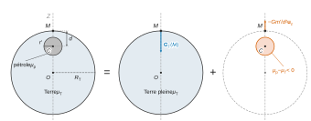
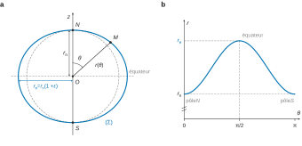
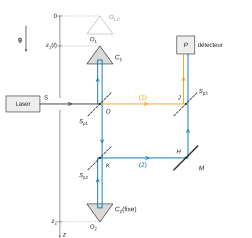
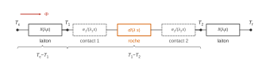
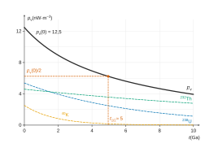
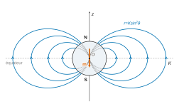

# CCINP MPI — Physique-chimie 2026 · Corrigé guidé

*Corrigé rédigé par IA, non officiel. Signalez toute erreur.*

## Présentation du sujet

**Cadre.** Épreuve spécifique MPI2PC, 4 heures, **calculatrices interdites**. Les résultats numériques peuvent être donnés avec **un seul chiffre significatif**. Le sujet, « Notre Terre : attractive, si chaleureuse et… magn(if)(ét)ique », compte **33 questions** (Q1 à Q33, beaucoup à sous-questions) réparties en **sept parties indépendantes**.

Une annexe, en dernière page, fournit une courbe de $\log_{10}x$ sur $[1,10]$ et les logarithmes décimaux des données :

| Donnée | Valeur | $\log_{10}$ |
|---|---|---|
| $\pi$ | 3,14 | 0,50 |
| $R_T$ | $6{,}4\cdot10^6$ m | 6,81 |
| $M_T$ | $6{,}0\cdot10^{24}$ kg | 24,78 |
| $G$ | $6{,}7\cdot10^{-11}\ \mathrm{N\,m^2\,kg^{-2}}$ | −10,17 |
| $\Omega$ | $7{,}3\cdot10^{-5}\ \mathrm{rad\,s^{-1}}$ | −4,14 |
| $C$ | $10^3\ \mathrm{J\,kg^{-1}\,K^{-1}}$ | 3,00 |
| $N_A$ | $6{,}02\cdot10^{23}\ \mathrm{mol^{-1}}$ | 23,78 |
| $\mu_0$ | $4\pi\cdot10^{-7}\ \mathrm{H\,m^{-1}}$ | −5,90 |

La partie IV ajoute $R=8{,}31\ \mathrm{J\,K^{-1}\,mol^{-1}}$, les masses molaires de C, O, Si, Al, Ca, Fe, et $K_e=10^{-14}$. Le rapport 2026 note que cette annexe a été peu utilisée : c'est pourtant elle qui rend les applications numériques rapides.

**Les sept parties.**

- *Partie I (Q1–Q3)* : analogie gravitation/électrostatique, théorème de Gauss gravitationnel, champ d'une boule homogène, puis détection gravimétrique d'un gisement de pétrole par superposition.
- *Partie II (Q4–Q8)* : poids en référentiel terrestre (force d'inertie d'entraînement), négligeabilité de Coriolis, énergies potentielles et forme approchée d'une équipotentielle de pesanteur : aplatissement de la Terre.
- *Partie III (Q9–Q10)* : gravimètre absolu interférométrique (Mach-Zehnder et coins de cube) : différence de marche, minima d'intensité, exploitation d'une droite.
- *Partie IV (Q11–Q14)* : chimie. IV.1 formules de Bogue du ciment mises sous forme matricielle en Python ; IV.2 diacide carbonique : diagramme de distribution, pH d'une pluie en équilibre avec le $\mathrm{CO_2}$ de l'air.
- *Partie V (Q15–Q24)* : résistance thermique et mesure de conductivité d'une roche ; énergie gravitationnelle d'une boule et température d'accrétion ; décroissance radioactive, puissance volumique et lecture d'un script Python ; bilan thermique en sphérique avec source et profil de température.
- *Partie VI (Q25–Q29)* : bilan radiatif d'après le document de Trenberth : conservation de la puissance rayonnée, lois de Wien et de Stefan, puissance solaire, bilan du sol, échauffement.
- *Partie VII (Q30–Q33)* : champ d'un dipôle magnétique, lignes de champ, composantes horizontale et verticale, moment dipolaire terrestre.

**Notions du programme mobilisées.** Théorème de Gauss et analyse des symétries ; dynamique en référentiel en rotation uniforme autour d'un axe fixe ; énergie potentielle ; développement limité au premier ordre ; interférences à deux ondes ; stœchiométrie ; couples acide-base et diagrammes de distribution ; loi de Fourier, résistance thermique, premier principe appliqué à un système élémentaire ; équation différentielle d'ordre 1 ; champ magnétique d'un dipôle et lignes de champ ; Python (numpy, matplotlib).

**Ce qu'en dit le jury.** Le rapport 2026 juge le sujet « facile à s’approprier (sauf exceptions) et de niveau adapté », mais « légèrement long ». La moyenne a été de 8,76/20, avec un écart-type de 3,46. Les questions simples, très nombreuses, ont été traitées par la plupart des candidats.

**Questions discriminantes.** Le rapport désigne comme questions difficiles, peu traitées et donc classantes, **Q3, Q8, Q10, Q20 et Q28** : superposition avec une masse volumique algébrique, forme de l'équipotentielle, marche des rayons et minima d'interférence, puissance volumique radioactive, puissance solaire tirée du document. S'y ajoutent, d'après les remarques par question, Q14 et Q28–Q29 (rarement traitées) et toute la partie VII, très peu abordée faute de temps.

**Questions à ne pas laisser passer.** Q1, Q2, Q4, Q5, Q7, Q9, Q11, Q13, Q15, Q16, Q17, Q19, Q22, Q23, Q26, Q27, Q30 sont des applications directes du cours. Le jury signale pourtant que Q5 est « Rarement juste, alors que c’est du cours » et que les résultats de cours de Q7 sont « mal établis » : ces points se gagnent par une rédaction complète.

**Erreurs générales relevées par le jury.** Oubli du signe moins dans le champ et les énergies potentielles de gravitation et de pesanteur ; températures absolues négatives ; théorème de Gauss appliqué sans préciser la surface fermée et la masse intérieure ; confusion entre scalaire et vecteur ; erreurs de calcul, d'homogénéité et unités omises.

**Gestion du temps.** Environ 25 min pour la partie I, 35 min pour la II, 25 min pour la III, 35 min pour la IV, 1 h 10 pour la V, 30 min pour la VI et 20 min pour la VII. Le rapport invite à lire tout le sujet avant de commencer et à profiter de l'indépendance des parties : peu de candidats ont atteint la partie VII, dont Q30 et Q31 sont pourtant courtes. On peut commencer par les parties les plus proches du cours (I, VII, V.1).

---

## Partie I — Champ gravitationnel et champ de pesanteur

On établit le théorème de Gauss gravitationnel par analogie, on l'applique à une boule homogène, puis on utilise la superposition pour modéliser une poche moins dense.

### Question 1

> [!INDICATION]
> Écrire côte à côte les deux champs créés en $M$ par une source ponctuelle en $O$ et identifier terme à terme.

> [!INDICATION]
> La gravitation est toujours attractive : quel signe doit porter l'analogue de $1/(4\pi\varepsilon_0)$ ?

#### Solution

$$\begin{aligned}
\vec G(M)&=-\frac{Gm}{r^2}\,\vec u_r\\
\vec E(M)&=\frac{q}{4\pi\varepsilon_0\,r^2}\,\vec u_r
\end{aligned}$$

L'identification donne

$$\boxed{\begin{aligned}
q\ &\longleftrightarrow\ m\\
\frac{1}{4\pi\varepsilon_0}\ &\longleftrightarrow\ -G\\
\varepsilon_0\ &\longleftrightarrow\ -\frac{1}{4\pi G}
\end{aligned}}$$

Le théorème de Gauss électrostatique s'écrit $\oint_S\vec E\cdot\mathrm d\vec S_{\rm ext}=Q_{\rm int}/\varepsilon_0$. Il devient : le flux du champ gravitationnel sortant d'une **surface fermée** $S$ est égal à $-4\pi G$ fois la masse **intérieure** au volume $V$ qu'elle délimite :

$$\boxed{\oint_S\vec G\cdot\mathrm d\vec S_{\rm ext}=-4\pi G\iiint_V\mu(P)\,\mathrm d\tau}$$

> [!PIEGE]
> Oublier le signe moins conduit à $\varepsilon_0\leftrightarrow1/(4\pi G)$, donc à un champ de gravitation répulsif. Contrôle : le flux est négatif, le champ est entrant.

> [!JURY]
> Le rapport 2026 trouve curieuses les erreurs sur l'expression du champ de gravitation, alors qu'il est donné en partie II : « Les candidats doivent prendre un peu de recul. » Il relève aussi, en remarque générale, un énoncé de Gauss qui oublie de spécifier la surface fermée et la masse intérieure.

### Question 2

> [!INDICATION]
> Commencer par les invariances et les plans de symétrie de la boule : quelle forme a $\vec G_T$ ?

> [!INDICATION]
> Prendre comme surface de Gauss une sphère de centre $O$ et distinguer $r\ge R_T$ et $r\le R_T$ : « en tout point de l'espace » impose les deux cas.

#### Solution

Invariance par toute rotation autour de $O$ : la norme ne dépend que de $r$. Tout plan contenant $O$ et $M$ est plan de symétrie de la distribution, donc

$$\vec G_T(M)=G_T(r)\,\vec u_r .$$

Surface de Gauss : la sphère fermée de centre $O$ et de rayon $r$, sur laquelle $G_T(r)$ est uniforme. Le flux sortant vaut $4\pi r^2G_T(r)$, d'où

$$4\pi r^2G_T(r)=-4\pi G\,M_{\rm int}(r).$$

Pour $r\ge R_T$, la masse intérieure est $M_T$ :

$$\boxed{\vec G_T=-\frac{GM_T}{r^2}\,\vec u_r}$$

Pour $r\le R_T$, la masse intérieure est $\frac43\pi r^3\mu_T$ :

$$\boxed{\vec G_T=-\frac{4\pi G\mu_T}{3}\,r\,\vec u_r}$$

soit aussi $\vec G_T=-\dfrac{GM_T}{R_T^3}\,r\,\vec u_r$. Le champ est continu en $R_T$, nul au centre. Contrôle : $\frac43\pi R_T^3\mu_T\approx6{,}0\cdot10^{24}$ kg, soit $M_T$.

> [!METHODE]
> Symétries d'abord (direction et variables du champ), Gauss ensuite : c'est l'analyse des symétries qui permet de sortir $G_T(r)$ de l'intégrale de flux.

> [!JURY]
> Le rapport 2026 juge Q2 « Généralement bien réussie ». Les points se perdent sur la rigueur : écrire un vecteur égal à un scalaire, ou oublier le signe moins, deux erreurs que le rapport cite parmi les plus fréquentes.

### Question 3

> [!INDICATION]
> La poche de pétrole « remplace » de la roche : comment écrire la distribution réelle comme somme de deux boules homogènes ?

> [!INDICATION]
> Terre pleine de masse volumique $\mu_T$ plus une petite boule de masse volumique algébrique bien choisie ; vue de $M$, extérieure à elle, cette petite boule agit comme une masse ponctuelle en $C$.

> [!INDICATION]
> Pour le sens de variation, raisonner sur les normes : les deux champs sont négatifs selon $\vec u_z$.

#### Solution



Distribution réelle : Terre homogène de masse volumique $\mu_T$, plus une boule de centre $C$ et de rayon $r'$, de masse volumique $\mu_p-\mu_T$.

Cette boule a la masse $m'=\frac43\pi r'^3(\mu_p-\mu_T)<0$ et crée en $M$ le champ $-Gm'/d^2\,\vec u_z$. D'où

$$\boxed{G_{Tp}(M)\,\vec u_z=\left[-\frac{4\pi G\mu_TR_T}{3}-\frac{4\pi G\,r'^3(\mu_p-\mu_T)}{3\,d^2}\right]\vec u_z}$$

Avec $G_T=-\frac43\pi G\mu_TR_T$ :

$$\boxed{\varepsilon=\left(\frac{r'}{d}\right)^2\frac{r'}{R_T}\,\frac{\mu_T-\mu_p}{\mu_T}}$$

On a $\varepsilon>0$ et $G_{Tp}=G_T(1-\varepsilon)$ avec $G_T<0$. Donc $|G_{Tp}|<|G_T|$ : **le champ devient moins intense** (déficit de masse sous $M$).

$$\varepsilon=\frac14\times\frac{10^{-3}}{4}\times\frac56\approx5\cdot10^{-5}$$

C'est environ $5\cdot10^3$ fois la précision relative des gravimètres : **le gisement est détectable**.

> [!PIEGE]
> Superposer la Terre pleine et une boule de masse volumique $\mu_p$ compte deux fois la matière dans la poche : c'est l'erreur que relève le jury, « Beaucoup oublient de retirer la petite sphère de Terre dans le calcul. » Autre piège : conclure de $\varepsilon>0$ que le champ augmente, alors que $G_T$ est négatif.

> [!METHODE]
> Une cavité ou une inclusion dans une distribution homogène se traite par superposition d'une distribution pleine et d'une distribution de densité algébrique (différence des masses volumiques).

> [!JURY]
> Q3 fait partie des questions difficiles et classantes du rapport 2026 : « Le principe de superposition n’est pas bien maîtrisé pour certains. »

---

## Partie II — Forme de la Terre

On définit le poids dans le référentiel terrestre, on justifie qu'on néglige Coriolis, puis on construit l'énergie potentielle de pesanteur pour obtenir la forme d'une équipotentielle et l'aplatissement.

### Question 4

> [!INDICATION]
> Le référentiel terrestre est en rotation uniforme autour d'un axe fixe du référentiel géocentrique : quelles forces d'inertie subit un point immobile dans $R'$ ?

> [!INDICATION]
> L'accélération d'entraînement est celle du point coïncidant, en mouvement circulaire uniforme autour de l'axe des pôles.

#### Solution

$R'$ tourne uniformément autour de l'axe fixe $OZ$ de $R$ (galiléen) : il n'est pas galiléen.

Pour $M$ immobile dans $R'$, la force de Coriolis est nulle. La force d'inertie d'entraînement vaut $-m\vec a_e=m\Omega^2\overrightarrow{HM}$, le point coïncidant décrivant un cercle de rayon $HM$.

Le poids, opposé de la force qui maintient $M$ en équilibre dans $R'$, est

$$\vec P=\underbrace{-\frac{GM_Tm}{r^2}\vec u_r}_{\text{gravitation}}+\underbrace{m\Omega^2\overrightarrow{HM}}_{\text{inertie d'entraînement}} .$$

Ordre de grandeur : le terme d'entraînement est petit (Q6), et l'on retrouve la valeur connue.

$$\log\frac{GM_T}{R_T^2}=-10{,}17+24{,}78-13{,}62=0{,}99$$

$$\boxed{g\approx10\ \mathrm{m\,s^{-2}}}$$

> [!PIEGE]
> La force d'inertie d'entraînement est centrifuge ($+m\Omega^2\overrightarrow{HM}$) ; un signe moins donnerait un poids plus fort à l'équateur qu'aux pôles.

> [!JURY]
> Pour l'ordre de grandeur, le rapport 2026 rappelle que $g$ est « bien connu ! » : il « a parfois été (re)calculé, et mal calculé, occasionnant des valeurs aberrantes. » Donner $g\approx10\ \mathrm{m\,s^{-2}}$ suffit ; un calcul, s'il est fait, doit retomber sur cette valeur.

### Question 5

> [!INDICATION]
> Majorer la norme de la force de Coriolis et la comparer au poids.

#### Solution

La force de Coriolis s'écrit $\vec F_{ic}=-2m\vec\Omega\wedge\vec v$, donc $\|\vec F_{ic}\|\le2m\Omega v$ :

$$\begin{aligned}
\frac{\|\vec F_{ic}\|}{mg}&\le\frac{2\Omega v}{g}\\
&\approx\frac{2\times7{,}3\cdot10^{-5}\times100}{9{,}8}\approx1{,}5\cdot10^{-3}\ll1
\end{aligned}$$

**La force de Coriolis ne dépasse pas 0,15 % du poids : elle est négligeable devant lui.**

> [!JURY]
> Le rapport 2026 constate que Q5 est « Rarement juste, alors que c’est du cours. » Il faut l'expression vectorielle de la force, une majoration de sa norme et une comparaison chiffrée au poids.

### Question 6

> [!INDICATION]
> Écrire le rapport des deux termes de Q4 à la surface et repérer ce qui dépend de la position.

> [!INDICATION]
> $HM=R_T\sin\theta$ : où ce rapport est-il maximal ?

#### Solution

$$\begin{aligned}
\frac{m\Omega^2R_T\sin\theta}{GM_Tm/R_T^2}&=\frac{\Omega^2R_T^3}{GM_T}\sin\theta\\
&\le\frac{\Omega^2R_T^3}{GM_T}
\end{aligned}$$

$$\boxed{\eta=\frac{\Omega^2R_T^3}{GM_T}}$$

La borne est atteinte à l'équateur. Application numérique :

$$\log\eta=-8{,}28+20{,}43+10{,}17-24{,}78=-2{,}46$$

$$\boxed{\eta\approx3{,}5\cdot10^{-3}}$$

Le champ de pesanteur ne diffère du champ gravitationnel que de quelques millièmes. L'effet reste mesurable : variation de $g$ entre pôle et équateur, verticale légèrement non radiale.

> [!METHODE]
> Pour montrer qu'une quantité est « majorée par », exhiber l'inégalité et dire où le maximum est atteint.

> [!PIEGE]
> Le rapport 2026 signale « Beaucoup d’erreurs de calculs et d’oublis de puissances de $R_T$ », menant parfois à la conclusion inverse. Contrôle d'homogénéité : $\Omega^2R_T^3$ et $GM_T$ sont tous deux en $\mathrm{m^3\,s^{-2}}$, $\eta$ est sans dimension.

### Question 7

> [!INDICATION]
> Pour chaque force, calculer le travail élémentaire $\delta W=\vec F\cdot\mathrm d\overrightarrow{OM}$ et l'écrire comme $-\mathrm dE_p$.

> [!INDICATION]
> Pour la force centrifuge, utiliser les coordonnées cylindriques d'axe $OZ$ : seule la distance $\rho=HM$ à l'axe intervient.

#### Solution

**a)** Le travail élémentaire de la force gravitationnelle est

$$\delta W=-\frac{GM_Tm}{r^2}\mathrm dr=-\mathrm d\!\left(-\frac{GM_Tm}{r}\right).$$

Avec $E_{pG}(\infty)=0$ :

$$\boxed{E_{pG}=-\frac{GM_Tm}{r}}$$

**b)** On a $\vec F_{ie}=m\Omega^2\rho\,\vec u_\rho$ et $\mathrm d\overrightarrow{OM}=\mathrm d\rho\,\vec u_\rho+\rho\,\mathrm d\varphi\,\vec u_\varphi+\mathrm dz\,\vec u_z$ :

$$\delta W=m\Omega^2\rho\,\mathrm d\rho=-\mathrm d\!\left(-\tfrac12m\Omega^2\rho^2\right).$$

La constante est nulle car $\rho=0$ en $r=0$ :

$$\boxed{E_{pe}=-\frac12m\Omega^2(HM)^2}$$

**c)** $HM=r\sin\theta$ :

$$\boxed{E_{pp}(M)=-\frac{GM_Tm}{r}-\frac12m\Omega^2r^2\sin^2\theta}$$

> [!JURY]
> Pour Q7, le rapport 2026 parle d'« Encore des résultats de cours, mal établis. » « Établir » demande le calcul du travail élémentaire et la fixation de la constante, pas seulement le résultat ; l'oubli du signe moins dans $E_{pG}$ et $E_{pp}$ figure parmi les erreurs générales du rapport.

### Question 8

> [!INDICATION]
> Écrire l'égalité $E_{pp}(M)=E_{pp}(N)$ et isoler $1/r$.

> [!INDICATION]
> Le terme centrifuge est petit devant le terme gravitationnel (Q6) : on travaille au premier ordre, ce qui autorise à remplacer $r$ par $r_n$ dans le terme correctif.

> [!INDICATION]
> Pour l'aplatissement, évaluer $r$ dans le plan équatorial.

#### Solution

L'égalité $E_{pp}(M)=E_{pp}(N)$, avec $E_{pp}(N)=-GM_Tm/r_n$, donne

$$\frac{r_n}{r}=1-\frac{\Omega^2r^2r_n\sin^2\theta}{2GM_T},$$

où le dernier terme est de l'ordre de $\eta/2\ll1$. Au premier ordre, $r\approx r_n$ dans ce terme et $(1-x)^{-1}\approx1+x$ :

$$\boxed{r(\theta)\approx r_n\left(1+\varepsilon\sin^2\theta\right)}$$

$$\boxed{\varepsilon=\frac{\Omega^2r_n^3}{2GM_T}=\frac\eta2\left(\frac{r_n}{R_T}\right)^3}$$



Allure : ovale symétrique par rapport à l'axe des pôles et au plan équatorial, de rayon minimal $r_n$ aux pôles et maximal $r_e$ à l'équateur. Il est très proche d'un cercle : l'aplatissement est à exagérer sur le dessin. Avec $r_e=r_n(1+\varepsilon)$ :

$$\boxed{\varepsilon'=\frac{r_e-r_n}{r_n}=\varepsilon}$$

$$\varepsilon'\approx\frac\eta2\approx1{,}7\cdot10^{-3}\approx\frac1{580}$$

L'aplatissement réel ($1/298$) est environ deux fois plus grand : le modèle ignore l'excès de masse du bourrelet équatorial.

> [!PIEGE]
> Sans l'argument du premier ordre, l'équation en $r$ est du troisième degré ; il faut écrire explicitement pourquoi on peut remplacer $r$ par $r_n$ dans le terme correctif.

> [!JURY]
> Le rapport 2026 classe Q8 parmi les questions difficiles et la juge « Mal traitée dans l’ensemble. » Il revient sur la notion d'équipotentielle en Q31, comme notion « pas bien maîtrisée ». Le dessin doit porter l'axe des pôles, $r_n$ et $r_e$, et signaler que l'échelle de la déformation est exagérée.

---

## Partie III — Détermination optique du champ de pesanteur

Un coin de cube en chute libre fait varier la différence de marche d'un interféromètre ; le défilement des minima d'intensité mesure $g$.

### Question 9

> [!INDICATION]
> a) Écrire $g(h)$ à partir de la loi de la gravitation et développer au premier ordre en $h/R_T$.

> [!INDICATION]
> b) Chute libre sans vitesse initiale, axe orienté vers le bas.

#### Solution

**a)** D'après Q2, $g(h)=g(0)(1+h/R_T)^{-2}$. Le développement limité au premier ordre donne

$$\frac{g(h)-g(0)}{g(0)}\approx-\frac{2h}{R_T}\approx-3\cdot10^{-7}.$$

**$g$ peut être pris uniforme** sur la hauteur de chute.

**b)** Sur l'axe **descendant** d'origine $O_{1,0}$, $\ddot z_1=+g$, avec $z_1(0)=0$ et $\dot z_1(0)=0$ :

$$\boxed{z_1(t)=\frac12gt^2}$$

> [!JURY]
> Le rapport 2026 note que Q9a est « Rarement traitée quantitativement, avec le développement limité attendu » : une phrase qualitative ne suffit pas. Pour Q9b, « Le sens de l’axe est souvent faux (erreur de signe) et l’origine mal prise en compte. »

### Question 10

> [!INDICATION]
> a) Suivre sur la figure 3(a) les deux rayons qui atteignent $P$ en tenant compte de l'orientation des séparatrices : l'un visite les deux coins de cube, l'autre va directement de $O$ à $J$.

> [!INDICATION]
> a) Un coin de cube impose un aller-retour : chemin double de la distance au sommet. Le quadrilatère $OJHK$ permet d'éliminer les longueurs inconnues.

> [!INDICATION]
> b) Introduire l'ordre d'interférence : que vaut-il en un minimum, et de combien varie-t-il entre deux minima consécutifs ? Dans quel sens varie $\delta$ ? c) Chercher une combinaison des $t_q$ proportionnelle à $q$.

#### Solution



**a)** Les réflexions suivent la loi de la réflexion sur les séparatrices à 45° et sur le miroir $M$.

- Rayon (1) : $S\to O\to J\to P$, transmis par $S_{p1}$ puis réfléchi par $S_{p3}$.
- Rayon (2), dans l'ordre :
  - réfléchi vers le haut en $O$ et renvoyé vers le bas par $C_1$ ;
  - transmis par $S_{p1}$ puis par $S_{p2}$, renvoyé vers le haut par $C_2$ ;
  - réfléchi vers la droite en $K$, puis vers le haut par le miroir $M$ en $H$ ;
  - transmis par $S_{p3}$ en $J$ vers $P$.

Avec $n=1$ et les portions communes éliminées :

$$\delta=\left[2\,OO_1+OK+2\,KO_2+KH+HJ\right]-OJ .$$

$OJHK$ est un rectangle ($KH=OJ$, $HJ=OK$), donc $\delta=2\,O_1O_2$, avec $O_1O_2=z_2-z_1$ :

$$\boxed{\delta(P,t)=2(z_2-z_1)=2z_2-g\,t^2}$$

**b)** L'intensité vaut

$$I=I_1+I_2+2\sqrt{I_1I_2}\cos\left(\frac{2\pi\delta}{\lambda}\right).$$

Un minimum correspond à un ordre d'interférence $p=\delta/\lambda$ demi-entier. Deux minima consécutifs ont des ordres qui diffèrent de 1 : $\delta$ varie de $\lambda$. Comme $\delta$ décroît :

$$\begin{aligned}
\Delta_q&=-g\left(t_q^2-t_0^2\right)\\
&=-q\lambda
\end{aligned}$$

$$\boxed{g=\frac{q\lambda}{t_q^2-t_0^2}}$$

Contrôle sur la figure 3(b) : $t_0\approx155\ \mu$s et $t_1\approx300\ \mu$s donnent $g\approx10\ \mathrm{m\,s^{-2}}$. Les minima se resserrent car $t_q=\sqrt{t_0^2+q\lambda/g}$.

**c)** On pose

$$\boxed{y(q)=t_q^2-t_0^2=\dfrac{\lambda}{g}\,q}$$

On relève les $t_q$, on trace $y$ en fonction de $q$ et on ajuste une droite passant par l'origine, de pente $a=\lambda/g$ ; alors $g=\lambda/a$.

Les temps étant en microsecondes, $a=64\,598\ \mu\mathrm s^2=6{,}4598\cdot10^{-8}\ \mathrm{s^2}$ :

$$g=\frac{632{,}82\cdot10^{-9}}{6{,}4598\cdot10^{-8}}\approx9{,}796\ \mathrm{m\,s^{-2}}$$

C'est la valeur annoncée $9{,}7961\ \mathrm{m\,s^{-2}}$ au cinquième chiffre près (arrondi de la pente).

> [!PIEGE]
> Oublier le facteur 2 de l'aller-retour sur le coin de cube donne un $g$ doublé ; oublier l'unité de la pente ($\mu\mathrm s^2$) fausse $g$ d'un facteur $10^{12}$.

> [!METHODE]
> Pour exploiter une loi non linéaire, chercher la grandeur qui varie linéairement (ici $t_q^2$ en fonction de $q$) et identifier la pente.

> [!JURY]
> Q10 est l'une des questions les plus discriminantes du rapport 2026. En a), « Beaucoup de candidats ont raté la marche des rayons lumineux conformément aux lois de la réflexion et de la réfraction. » En b), « une faible proportion de candidats a caractérisé les minima de l’intensité d’interférence (définition, écart des ordres) » : il faut écrire la condition de minimum et l'écart d'une unité d'ordre entre minima successifs. La c) a été très peu traitée, car elle découle des calculs précédents.

---

## Partie IV — Le calcaire et l'argile : des richesses du sol bon marché

La chimie du ciment conduit à un système linéaire résolu en Python ; les pluies acides mobilisent un diagramme de distribution et un calcul de pH.

### Partie IV.1 — Obtention d'un ciment

### Question 11

> [!INDICATION]
> La deuxième ligne du tableau 2 écrit chaque composant comme un assemblage d'oxydes : elle donne directement les coefficients.

#### Solution

$$\begin{aligned}
&(A)\quad 3\,\mathrm{CaO_{(s)}}+\mathrm{SiO_{2(s)}}\longrightarrow\mathrm{Ca_3SiO_{5(s)}}\\
&(B)\quad 2\,\mathrm{CaO_{(s)}}+\mathrm{SiO_{2(s)}}\longrightarrow\mathrm{Ca_2SiO_{4(s)}}\\
&(C)\quad 3\,\mathrm{CaO_{(s)}}+\mathrm{Al_2O_{3(s)}}\longrightarrow\mathrm{Ca_3Al_2O_{6(s)}}\\
&(D)\quad 4\,\mathrm{CaO_{(s)}}+\mathrm{Al_2O_{3(s)}}+\mathrm{Fe_2O_{3(s)}}\longrightarrow\mathrm{Ca_4Al_2Fe_2O_{10(s)}}
\end{aligned}$$

Contrôle par les masses molaires :

$$\begin{aligned}
3\times56+60&=228\\
2\times56+60&=172\\
3\times56+102&=270\\
4\times56+102+160&=486
\end{aligned}$$

### Question 12

> [!INDICATION]
> Raisonner sur 100 g de mélange : quelle masse d'oxyde $i$ contient une masse unité de composant $j$ ?

> [!INDICATION]
> Écrire d'abord les quatre relations donnant $p_1,\dots,p_4$ ; l'égalité $\mathtt{oxy}=\mathtt{gob}\cdot\mathtt{cim}$ fixe ensuite le sens de la matrice : lignes indexées par les oxydes, colonnes par les composants.

#### Solution

Un motif de composant contient les motifs d'oxydes donnés par Q11. La conservation de la masse de chaque oxyde, pour 100 g de mélange, donne :

$$\begin{aligned}
p_1&=\frac{3M_1}{M_5}p_5+\frac{2M_1}{M_6}p_6+\frac{3M_1}{M_7}p_7+\frac{4M_1}{M_8}p_8\\
p_2&=\frac{M_2}{M_5}p_5+\frac{M_2}{M_6}p_6\\
p_3&=\frac{M_3}{M_7}p_7+\frac{M_3}{M_8}p_8\\
p_4&=\frac{M_4}{M_8}p_8
\end{aligned}$$

Ainsi $\beta_{ij}=\nu_{ij}M_i/M_{j+4}$, où $\nu_{ij}$ est le nombre de motifs d'oxyde $i$ dans le composant $j$.

```python
5   gob=np.array([[3*M1/M5, 2*M1/M6, 3*M1/M7, 4*M1/M8],
                  [  M2/M5,   M2/M6,       0,       0],
                  [      0,       0,   M3/M7,   M3/M8],
                  [      0,       0,       0,   M4/M8]])
```

Chaque colonne est de somme 1 (conservation de la masse). Avec l'exemple de la ligne 4, le script affiche `cim` $\approx[2{,}5\ ;\ 66{,}9\ ;\ 15{,}3\ ;\ 15{,}3]$. On peut signaler que `M4=159` (ligne 2) diffère de $M(\mathrm{Fe_2O_3})=160\ \mathrm{g\,mol^{-1}}$, écart sans effet notable.

> [!PIEGE]
> Écrire la transposée donne un script qui s'exécute mais un résultat faux. $\beta_{ij}$ est un rapport de **masses** : la masse molaire de l'oxyde, multipliée par son coefficient stœchiométrique, est au numérateur, celle du composant au dénominateur.

> [!METHODE]
> Contrôle gratuit d'une matrice de composition massique : chaque colonne doit sommer à 1.

> [!JURY]
> Q11 est « Facile pour tous » selon le rapport 2026. En revanche, en Q12, « La stœchiométrie (proportions) en chimie n’a pas été bien gérée » pour établir les expressions des pourcentages et la matrice : le jury attend les quatre relations explicites avant le code.

### Partie IV.2 — Les pluies acides

### Question 13

> [!INDICATION]
> a) Un diacide cède successivement deux protons à l'eau. b) Quelle forme prédomine aux faibles pH, aux pH élevés, et laquelle passe par un maximum ?

> [!INDICATION]
> c) Que vaut le pH là où deux espèces conjuguées ont la même proportion ? Lire l'abscisse avec la précision du quadrillage (0,2 unité de pH par graduation).

#### Solution

**a)** Concentrations en $\mathrm{mol\,L^{-1}}$, activité de l'eau égale à 1 :

$$\begin{aligned}
&\mathrm{H_2CO_3}+\mathrm{H_2O}=\mathrm{HCO_3^-}+\mathrm{H_3O^+}\\
&Q_{r1}=\frac{[\mathrm{HCO_3^-}][\mathrm{H_3O^+}]}{[\mathrm{H_2CO_3}]}\\
&\mathrm{HCO_3^-}+\mathrm{H_2O}=\mathrm{CO_3^{2-}}+\mathrm{H_3O^+}\\
&Q_{r2}=\frac{[\mathrm{CO_3^{2-}}][\mathrm{H_3O^+}]}{[\mathrm{HCO_3^-}]}
\end{aligned}$$

**b)** L'acide le plus fort prédomine à pH faible, la base la plus forte à pH élevé, l'ampholyte passe par un maximum :

$$\boxed{\begin{aligned}
(1)&:\ \mathrm{CO_{2(aq)},H_2O}\\
(2)&:\ \mathrm{HCO_3^-}\\
(3)&:\ \mathrm{CO_3^{2-}}
\end{aligned}}$$

**c)** Aux intersections à 50 %, $\mathrm{pH}=\mathrm pK_a$. On lit $\mathrm{pH}\approx6{,}35$ pour (1)/(2) et $\approx10{,}35$ pour (2)/(3). Les constantes demandées sont les $K_a$ :

$$\boxed{\begin{aligned}
K_{a1}&=10^{-6{,}35}\approx4{,}5\cdot10^{-7}\\
K_{a2}&=10^{-10{,}35}\approx4{,}5\cdot10^{-11}
\end{aligned}}$$

Contrôle : le maximum de (2) est à $\mathrm{pH}=\frac12(\mathrm pK_{a1}+\mathrm pK_{a2})\approx8{,}35$, à environ 98 %, comme sur la figure.

> [!PIEGE]
> Le rapport 2026 juge Q13 « En général bien traitées, mais parfois confusion entre $K_a$ et $\mathrm pK_a$ » : la question demande les $K_a$, on donne donc $10^{-\mathrm pK_a}$. Une lecture grossière du graphe se répercute en outre directement sur le pH de Q14.

### Question 14

> [!INDICATION]
> La concentration de $\mathrm{CO_{2(aq)}}$ est imposée par l'atmosphère : ce n'est pas un acide de concentration apportée $c$, il n'y a pas de conservation de la matière à écrire.

> [!INDICATION]
> Écrire toutes les concentrations en fonction de $h=[\mathrm{H_3O^+}]$, puis l'électroneutralité ; annoncer les approximations avant de les faire et les vérifier ensuite.

#### Solution

Avec $h=[\mathrm{H_3O^+}]$ et $[\mathrm{H_2CO_3}]=c$ imposée :

$$\begin{aligned}
[\mathrm{HCO_3^-}]&=\frac{K_{a1}c}{h}\\
[\mathrm{CO_3^{2-}}]&=\frac{K_{a1}K_{a2}c}{h^2}\\
[\mathrm{OH^-}]&=\frac{K_e}{h}
\end{aligned}$$

Électroneutralité :

$$h=[\mathrm{HCO_3^-}]+2[\mathrm{CO_3^{2-}}]+[\mathrm{OH^-}].$$

On néglige $[\mathrm{OH^-}]$ (milieu acide) et $2[\mathrm{CO_3^{2-}}]$ ($K_{a2}\ll K_{a1}$). Il reste $h=\sqrt{K_{a1}c}$ :

$$\boxed{\mathrm{pH}=\frac12(\mathrm pK_{a1}-\log c)\approx5{,}7}$$

Concentrations (en $\mathrm{mol\,L^{-1}}$) :

$$\begin{aligned}
[\mathrm{H_3O^+}]&=[\mathrm{HCO_3^-}]\approx2\cdot10^{-6}\\
[\mathrm{CO_{2(aq)},H_2O}]&=1{,}0\cdot10^{-5}\\
[\mathrm{CO_3^{2-}}]&\approx K_{a2}\approx5\cdot10^{-11}\\
[\mathrm{OH^-}]&\approx5\cdot10^{-9}
\end{aligned}$$

Vérification : $[\mathrm{OH^-}]/h\approx2\cdot10^{-3}$ et $2[\mathrm{CO_3^{2-}}]/[\mathrm{HCO_3^-}]\approx4\cdot10^{-5}$. Une pluie non polluée est naturellement acide.

> [!JURY]
> Le rapport 2026 indique seulement que Q14 a été « rarement traitée ». C'est une question rentable pour qui a le temps : le résultat s'établit à partir des constantes et de l'électroneutralité, et l'énoncé demande toutes les concentrations, y compris $[\mathrm{OH^-}]$ et $[\mathrm{CO_3^{2-}}]$.

---

## Partie V — Quelques propriétés thermodynamiques de la Terre

V.1 exploite l'association en série de résistances thermiques pour mesurer une conductivité ; V.2 estime l'énergie d'accrétion, la puissance radioactive (avec un script Python) puis le profil de température d'une Terre conductrice avec source.

### Partie V.1 — Mesure de la conductivité thermique d'une roche

### Question 15

> [!INDICATION]
> Penser à l'analogie électrique : quelle grandeur joue le rôle de la tension, laquelle celui de l'intensité ?

> [!INDICATION]
> Pour l'expression, intégrer la loi de Fourier en régime stationnaire, sans source, flux uniforme.

#### Solution

$$\boxed{R_{th}=\frac{T_1-T_2}{\Phi}}\quad(\mathrm{K\,W^{-1}}),$$

où $\Phi$ est le flux thermique traversant le conducteur de la face à $T_1$ vers la face à $T_2$, en régime stationnaire. Avec $\vec j=-\lambda\,\overrightarrow{\mathrm{grad}}\,T$ et $\Phi=js$ conservé, $T_1-T_2=\Phi\,l/(\lambda s)$ :

$$\boxed{R_{th}=\frac{l}{\lambda\,s}}$$

### Question 16

> [!INDICATION]
> En régime stationnaire, le même flux traverse toutes les couches : comment s'associent leurs résistances ?

> [!INDICATION]
> Pour éliminer les contacts, faire varier un paramètre qui ne les modifie pas, puis tracer une droite.

#### Solution



Le même flux $\Phi$ traverse toutes les couches : **les résistances sont en série**.

$$\begin{aligned}
T_c-T_1&=\Phi\frac{l}{\lambda_ls}\\
T_1-T_2&=\Phi\left(\frac{e_1}{\lambda_1s}+\frac{d}{\lambda s}+\frac{e_2}{\lambda_2s}\right)
\end{aligned}$$

Le rapport élimine $\Phi$ et $s$ :

$$\boxed{\frac{T_1-T_2}{T_c-T_1}=\frac{\lambda_l}{l}\left(\frac d\lambda+\frac{e_1}{\lambda_1}+\frac{e_2}{\lambda_2}\right)}$$

On mesure le rapport $Y=\dfrac{T_1-T_2}{T_c-T_1}$ pour plusieurs échantillons de la même roche d'épaisseurs $d$ différentes, contacts réalisés à l'identique. $Y(d)$ est une droite de pente $a=\lambda_l/(l\lambda)$ ; les contacts n'interviennent que dans l'ordonnée à l'origine. D'où

$$\boxed{\lambda=\frac{\lambda_l}{l\,a}}$$

> [!PIEGE]
> Répondre « on mesure les températures et on applique la formule » ne règle rien : $e_1/\lambda_1$ et $e_2/\lambda_2$ restent inconnus.

> [!METHODE]
> Éliminer une inconnue parasite constante : faire varier un paramètre contrôlé et exploiter une pente, l'inconnue étant rejetée dans l'ordonnée à l'origine.

> [!JURY]
> Q16 est « En général assez bien traitée » d'après le rapport 2026, avec « parfois oubli de signaler qu’on a des résistances en série ». L'association en série est l'argument de la question : on l'écrit, avec sa justification (même flux).

### Partie V.2 — Évolution de la température à l'intérieur de la Terre

### Question 17

> [!INDICATION]
> a) Le résultat de Q7a s'adapte directement : vue de l'extérieur, une boule homogène équivaut à une masse ponctuelle placée en son centre.

> [!INDICATION]
> b) Quand la boule a le rayon $r$, exprimer sa masse et celle de la coquille apportée en fonction de $\mu$ et $r$, puis intégrer de $0$ à $R$.

#### Solution

**a)** On reprend $E_{pG}=-GM_Tm/r$ de Q7a, avec la masse $m$ de la sphère comme source et $\mathrm dm$ comme masse test :

$$\boxed{\mathrm dE_{pG}(r)=-\frac{Gm\,\mathrm dm}{r}}$$

**b)** Pour la boule de rayon $r$, $m(r)=\frac43\pi r^3\mu$, et la coquille apportée a la masse $\mathrm dm=4\pi r^2\mu\,\mathrm dr$ :

$$\mathrm dE_{pG}=-\frac{16\pi^2G\mu^2}{3}r^4\,\mathrm dr .$$

On intègre pendant la croissance du rayon de $0$ à $R$ :

$$E_{pG}(R)=-\frac{16\pi^2G\mu^2}{3}\int_0^Rr^4\,\mathrm dr=-\frac{16\pi^2G\mu^2R^5}{15}.$$

Avec $\mu=3M/(4\pi R^3)$ :

$$\boxed{E_{pG}(R)=-\frac35\,\frac{GM^2}{R}}$$

Le signe négatif traduit un état lié : la formation de la boule à partir de matière dispersée **libère** l'énergie $\frac35GM^2/R$.

> [!PIEGE]
> $m$ et $\mathrm dm$ dépendent tous deux de $r$ : il faut les exprimer avant d'intégrer, sinon on perd le facteur $3/5$.

> [!JURY]
> Le rapport 2026 précise qu'en Q17a « Il s’agissait de réécrire (et adapter) un résultat déjà établi en Q.7a). » En Q17b, il a été regrettable « de ne pas faire une intégration correcte pour retrouver un résultat donné par l’énoncé » : un résultat donné doit être démontré, bornes d'intégration comprises.

### Question 18

> [!INDICATION]
> Bilan d'énergie : l'énergie libérée sert à élever la température de toute la masse terrestre depuis 0 K.

#### Solution

$$M_TCT_{eq}=\frac35\frac{GM_T^2}{R_T}$$

$$\boxed{T_{eq}=\frac{3GM_T}{5R_TC}}$$

Homogénéité : $GM_T/R_T$ est en $\mathrm{J\,kg^{-1}}$ et $C$ en $\mathrm{J\,kg^{-1}\,K^{-1}}$, le rapport est une température, positive.

$$\log T_{eq}=-0{,}22-10{,}17+24{,}78-6{,}81-3{,}00=4{,}58$$

$$\boxed{T_{eq}\approx4\cdot10^4\ \mathrm K}$$

Cette valeur est très supérieure à la température du centre de la Terre (quelques milliers de kelvins). L'accrétion suffisait à fondre la planète, mais le modèle surestime l'échauffement : énergie rayonnée pendant l'accrétion et changements d'état négligés.

> [!PIEGE]
> Le rapport 2026 relève qu'en égalisant les deux énergies « certains candidats oublient la masse de la Terre (d’où l’intérêt d’une analyse dimensionnelle) et d’autres obtiennent des températures $T_{eq}(K) < 0$ ! » Une énergie libérée est positive ; c'est $-E_{pG}$ qui chauffe la Terre.

> [!METHODE]
> Estimer et commenter : confronter la valeur obtenue à une grandeur connue, puis discuter les hypothèses du modèle.

### Question 19

> [!INDICATION]
> Équation linéaire du premier ordre à coefficient constant.

#### Solution

$$\boxed{N_i(t)=N_{i0}\exp\left(-\frac{\ln2}{\tau_i}t\right)=N_{i0}\,2^{-t/\tau_i}}$$

On vérifie que $N_i(\tau_i)=N_{i0}/2$. Le rapport 2026 juge Q19 « Très bien réussie par (presque) tous ».

### Question 20

> [!INDICATION]
> Puissance volumique $=$ énergie par désintégration $\times$ nombre de désintégrations par unité de temps et de volume.

> [!INDICATION]
> Passer de la fraction massique au nombre de noyaux par unité de volume avec $\mu$, $M_i$ et $N_A$ ; la ligne 10 du script donne la structure du résultat.

#### Solution

Un volume $V$ de roche contient la masse $x_i\mu V$ d'isotope $i$, d'où le nombre initial de noyaux par unité de volume :

$$N_{i0}=\frac{x_i\mu N_A}{M_i}.$$

Le nombre de désintégrations par unité de volume et de temps est $-\mathrm dN_i/\mathrm dt=\frac{\ln2}{\tau_i}N_i$, chacune libérant $\varepsilon_i$ :

$$\boxed{p_{v,i}(t)=\frac{\ln2\ \varepsilon_ix_i\mu N_A}{M_i\tau_i}\exp\left(-\frac{\ln2}{\tau_i}t\right)}$$

Les puissances des trois éléments dans un même volume s'ajoutent :

$$\boxed{p_v(t)=\sum_{i=1}^3p_{v,i}(t)}$$

avec $M_i$ en $\mathrm{kg\,mol^{-1}}$ et $\tau_i$ en secondes.

> [!PIEGE]
> Les unités : le script écrit $M_i$ en $\mathrm{kg\,mol^{-1}}$ (0,238) et convertit les demi-vies en secondes (ligne 7) ; c'est indispensable pour obtenir des $\mathrm{W\,m^{-3}}$.

> [!JURY]
> Q20 est l'une des questions classantes du rapport 2026 : « les aspects extensif et volumique de la puissance volumique ont échappé à la plupart des (rares) candidats ayant traité cette question ». Il faut passer explicitement de la fraction massique au nombre de noyaux par unité de volume, puis sommer les puissances. Le jury ajoute qu'« il est à noter que le script Python esquissait la réponse » : la ligne 10 contient déjà $\ln2\,\mu N_Ax_i\varepsilon_i/(M_i\tau_i)$.

### Question 21

> [!INDICATION]
> Relier chaque ligne à une grandeur de Q20 : reconnaître $\ln2$, $N_{i0}$, $\tau_i$.

> [!INDICATION]
> b)–d) La grille temporelle est discrète : que cherche-t-on en minimisant $|p_v(t)-p_v(0)/2|$ ? De quoi dépend la précision ?

> [!INDICATION]
> f) Que signifie $t=0$ ? Comparer $p_v(0)$ multiplié par le volume du manteau à la puissance $P$ donnée dans l'énoncé.

#### Solution

**a)** `pvi0` contient les puissances volumiques à $t=0$ des trois éléments, $p_{v,i}(0)$, en $\mathrm{W\,m^{-3}}$ : environ 5,4 ; 4,6 et 2,5 $\mathrm{nW\,m^{-3}}$.

**b)** `Dp` est le plus petit écart, sur la grille de 100 dates, entre $p_v(t)$ et $p_v(0)/2$.

**c)** `n` est l'indice de la date de la grille où cet écart est minimal.

**d)** `pv(0)` $\approx12{,}5\ \mathrm{nW\,m^{-3}}$ est la puissance volumique totale à $t=0$. `t0` $\approx4{,}95$ Ga est la date de la grille la plus proche de celle où la puissance est réduite de moitié.

Le pas vaut $10/99\approx0{,}1$ Ga. On améliore la précision en augmentant le nombre de points de `np.linspace`, ou par une dichotomie sur $p_v(t)-p_v(0)/2$. La fonction de la ligne 13, avec `t` en milliards d'années :

```python
12  def pv(t):
13      return sum(pvi0[k]*np.exp(-np.log(2)*t/tGyi[k]) for k in range(0,3))
```

**e)**

```python
20  plt.plot(t, pv(t))
21  plt.xlabel("t (milliards d'années)")
22  plt.ylabel("pv (W/m3)")
23  plt.grid(False)
24  plt.show()
```

**f)** Courbe décroissante et convexe, de $12{,}5$ à environ $4\ \mathrm{nW\,m^{-3}}$ sur 10 Ga (somme de trois exponentielles). L'horizontale $p_v(0)/2\approx6{,}25\ \mathrm{nW\,m^{-3}}$ coupe la courbe en

$$\boxed{t_{1/2}\approx5\cdot10^9\ \text{ans}}$$



Ici $t=0$ est l'instant présent : $p_v(0)\times0{,}84\times\frac43\pi R_T^3\approx1{,}2\cdot10^{13}$ W, c'est la puissance $P$ estimée aujourd'hui. $t_{1/2}$ est donc une date future. Ce n'est aucune des trois demi-vies, $p_v$ n'étant pas une exponentielle unique.

> [!PIEGE]
> Utiliser `taui` (en secondes) à la ligne 13 avec `t` en milliards d'années rend la courbe plate. Autre piège : prendre $t=0$ pour la formation de la Terre, ce qui fausse la comparaison de Q24d.

> [!JURY]
> Le rapport 2026 note que cette question de compréhension de script n'a été traitée que par une partie des candidats, mais que la majorité a bien exploité la courbe en f). La lecture graphique de $t_{1/2}$ est donc un point accessible, à justifier par la construction de l'horizontale $p_v(0)/2$.

### Question 22

> [!INDICATION]
> Raisonner sur les causes du transfert thermique (géométrie, source, condition à la surface) plutôt que sur $\vec j$ lui-même.

> [!INDICATION]
> Une fois établi que $T$ ne dépend que de $r$ et $t$, l'expression du gradient rappelée en tête d'énoncé conclut.

#### Solution

Les causes du transfert sont la répartition de la source et la condition aux limites : matériau homogène, source $p'_v$ uniforme, température de surface uniforme. Elles sont invariantes par toute rotation autour de $O$ (**invariances par rotation d'angles $\theta$ et $\varphi$**), donc $T=T(r,t)$.

La loi de Fourier et l'expression du gradient donnent

$$\vec j=-\lambda\,\overrightarrow{\mathrm{grad}}\,T=-\lambda\frac{\partial T}{\partial r}\,\vec u_r .$$

$$\boxed{\vec j=j(r,t)\,\vec u_r}$$

$j$ ne dépend ni de $\theta$ ni de $\varphi$.

> [!PIEGE]
> Invoquer « la symétrie de $\vec j$ » pour démontrer que $\vec j$ est radial est circulaire. Le rapport 2026 constate que beaucoup de candidats ont évoqué la symétrie du « système », voire du vecteur $\vec j$ lui-même, faute d'identifier la source de la diffusion thermique.

### Question 23

> [!INDICATION]
> Appliquer le premier principe à la coquille, système fermé et indéformable, entre $t$ et $t+\mathrm dt$.

> [!INDICATION]
> Le flux sortant à travers la sphère de rayon $r$ vaut $j\,4\pi r^2$ : la surface dépend de $r$, il faut différentier le produit.

#### Solution

Premier principe, sans travail :

$$\mathrm dU=\delta Q_{\rm cond}+\delta Q_{\rm prod}$$

$$\boxed{\underbrace{\mu C\,4\pi r^2\frac{\partial T}{\partial t}\mathrm dt\,\mathrm dr}_{\text{variation d'énergie interne}}=\underbrace{-\mathrm d\!\left(j\,4\pi r^2\right)\mathrm dt}_{\text{transfert conductif reçu}}+\underbrace{p'_v\,4\pi r^2\mathrm dr\,\mathrm dt}_{\text{énergie produite}}}$$

Le premier terme est la variation d'énergie interne de la coquille pendant $\mathrm dt$. Le deuxième est la différence entre la puissance entrant par la sphère intérieure et celle sortant par la sphère extérieure. Le troisième est l'énergie libérée dans la coquille par la radioactivité.

> [!PIEGE]
> Écrire $-4\pi r^2\,\mathrm dj$ au lieu de $-\mathrm d(4\pi r^2j)$ oublie la variation de surface avec $r$.

### Question 24

> [!INDICATION]
> a) Annuler la dérivée temporelle et injecter la loi de Fourier. b) Intégrer la forme conservative telle quelle ; une constante est fixée par le centre, l'autre par la surface.

> [!INDICATION]
> d) Inverser c) en $r=R_T$. Pour le commentaire, comparer à la puissance radiogénique **actuelle** du manteau, en tenant compte de la fraction de volume qu'il occupe.

#### Solution

**a)** En régime stationnaire, $\dfrac{\mathrm d(r^2j)}{\mathrm dr}=p'_vr^2$, et $j=-\lambda\dfrac{\mathrm dT}{\mathrm dr}$ :

$$\boxed{\frac1{r^2}\frac{\mathrm d}{\mathrm dr}\left(r^2\frac{\mathrm dT}{\mathrm dr}\right)=-\frac{p'_v}{\lambda}}$$

**b)** Première intégration de la forme conservative :

$$r^2j=\frac{p'_v}{3}r^3+A .$$

On a $A=0$, sinon $T\sim A/(\lambda r)$ diverge au centre. Puis $\mathrm dT/\mathrm dr=-p'_vr/(3\lambda)$ et $T(R_T)=T_s$ :

$$\boxed{T(r)=T_s+\frac{p'_v}{6\lambda}\left(R_T^2-r^2\right)}$$

**c)**

$$\boxed{j(r)=\frac{p'_v\,r}{3}}$$

Contrôle : $\frac43\pi r^3p'_v=4\pi r^2j$.

**d)** En $r=R_T$ :

$$p'_v=\frac{3j(R_T)}{R_T}=\frac{3\times7{,}0\cdot10^{-2}}{6{,}4\cdot10^6}$$

$$\boxed{p'_v\approx3\cdot10^{-8}\ \mathrm{W\,m^{-3}}}$$

soit 33 $\mathrm{nW\,m^{-3}}$.

La radioactivité fournit aujourd'hui $12{,}5\ \mathrm{nW\,m^{-3}}$ dans le manteau, soit environ $10\ \mathrm{nW\,m^{-3}}$ en moyenne sur toute la Terre. De même, $P=1{,}2\cdot10^{13}$ W est à comparer à $4\pi R_T^2j(R_T)\approx3{,}6\cdot10^{13}$ W.

Elle n'explique donc qu'**environ un tiers** du flux géothermique ; le reste vient du refroidissement de la Terre (chaleur primitive, Q18), ce qui contredit l'hypothèse stationnaire. Le modèle conductif prévoit de plus $T(0)\approx7\cdot10^4$ K, irréaliste : le manteau évacue sa chaleur par convection et la radioactivité est concentrée près de la surface.

> [!METHODE]
> En sphérique avec source, la constante en $1/r^2$ s'élimine par la finitude au centre ; le flux se contrôle par un bilan global sur la boule de rayon $r$.

> [!JURY]
> Pour Q24, le rapport 2026 note que beaucoup de candidats ont développé la dérivée de $j\,r^2$ pour faire apparaître un terme en $\mathrm d^2T/\mathrm dr^2$, et conclut : « Rappelons aux candidats que lorsqu’on souhaite intégrer une équation, il ne faut pas la dériver. » La forme $\mathrm d(r^2j)/\mathrm dr=p'_vr^2$ s'intègre en une ligne.

---

## Partie VI — Bilan énergétique sur le sol de la Terre, d'après une analyse documentaire

On transpose le bilan thermique au rayonnement, on relie la puissance solaire à ce que reçoit la Terre, puis on exploite le document de Trenberth. Le rapport 2026 note que « Très peu de candidats ont abordé cette partie ».

### Question 25

> [!INDICATION]
> Remplacer dans la relation de Q23 chaque grandeur par son analogue ; que devient le terme de source dans le vide ?

> [!INDICATION]
> En régime permanent, quelle quantité est indépendante de $r$ ?

#### Solution

Transposition terme à terme : $\mu C\,\partial T/\partial t$ devient $\partial u_{em}/\partial t$, $j\,4\pi r^2$ devient $R\,4\pi r^2$, et le terme de production disparaît (ni source ni absorption dans le vide) :

$$\boxed{4\pi r^2\frac{\partial u_{em}}{\partial t}\,\mathrm dt\,\mathrm dr=-\mathrm d\!\left(R\,4\pi r^2\right)\mathrm dt}$$

En régime permanent, $4\pi r^2R$ est indépendant de $r$ : la puissance traversant toute sphère centrée sur le Soleil est la même. D'où

$$\boxed{P_{em}(D)=4\pi D^2R(D)=P_S}$$

> [!JURY]
> Le rapport 2026 relève que « Certains candidats ont mal exploité l’analogie (transposition) chaleur Q23 – électromagnétisme Q25. » Écrire la correspondance terme à terme avant la relation évite l'erreur.

### Question 26

> [!INDICATION]
> Quelle surface de la Terre intercepte un faisceau parallèle ?

#### Solution

$$\boxed{P_T=\frac{P_S}{4\pi D^2}\,\pi R_T^2=P_S\frac{R_T^2}{4D^2}}$$

La Terre intercepte le rayonnement par sa section droite, un disque de rayon $R_T$.

### Question 27

> [!INDICATION]
> Wien donne la température de surface, Stefan la puissance surfacique émise ; multiplier par l'aire émettrice.

#### Solution

La loi de Wien donne $T_S=C_W/\lambda_S$, la loi de Stefan la puissance surfacique $\sigma T_S^4$ :

$$\boxed{P_S=\sigma S_S\left(\dfrac{C_W}{\lambda_S}\right)^4}$$

On peut signaler que $C_W\approx0{,}03$ m·K est dix fois trop grand : la constante de Wien vaut $2{,}9\cdot10^{-3}$ m·K, ce qui donne $T_S\approx5{,}6\cdot10^3$ K pour $\lambda_S=0{,}52\ \mu$m. Aucune application numérique n'en dépend.

> [!METHODE]
> Un contrôle d'ordre de grandeur (ici la température de surface du Soleil) permet de repérer une donnée erronée : on la signale et on poursuit, comme le prévoit le préambule.

> [!JURY]
> Q27 est jugée « Facile, surtout avec les relations de cours rappelées dans l’énoncé » par le rapport 2026 : un point à prendre même en fin d'épreuve.

### Question 28

> [!INDICATION]
> Vérifier la cohérence du document au sommet de l'atmosphère (incident, réfléchi, émis) : sur quelle surface les flux sont-ils moyennés ?

> [!INDICATION]
> Pour le sol seul, faire la somme algébrique des seuls flux qui touchent la surface.

#### Solution

Au sommet de l'atmosphère, $341=102+239$ : les flux sont des moyennes sur toute la surface $4\pi R_T^2$. Donc $P_T=4\pi R_T^2\varphi_S$, et avec Q26 :

$$\boxed{P_S=16\pi D^2\varphi_S}$$

$$P_S\approx16\times3{,}14\times2{,}25\cdot10^{22}\times341\approx4\cdot10^{26}\ \mathrm W$$

Bilan du sol (en $\mathrm{W\,m^{-2}}$) : reçu $161+333$, cédé $396+17+80$.

$$\boxed{\varphi_{tot}=161+333-396-17-80=+1\ \mathrm{W\,m^{-2}}}$$

Le déséquilibre est faible (0,2 % des flux) mais positif : le sol accumule de l'énergie, sa température tend à croître.

> [!PIEGE]
> Prendre 341 comme éclairement d'un disque de section $\pi R_T^2$ donne $P_S\approx1\cdot10^{26}$ W, quatre fois trop peu. Pour le bilan, ne pas inclure les flux du sommet de l'atmosphère (341, 102, 239), qui ne concernent pas le sol.

> [!JURY]
> Q28 fait partie des questions difficiles et classantes du rapport 2026, qui la dit « Rarement traitée ». Le tri des flux pertinents et l'argument du facteur 4 sont ce qui rapporte.

### Question 29

> [!INDICATION]
> Énergie accumulée pendant $\tau$ sur toute la surface, puis capacité thermique de la Terre.

> [!INDICATION]
> Convertir 10 ans en secondes ($1\ \text{an}\approx\pi\cdot10^7$ s) et discuter la masse qui s'échauffe réellement.

#### Solution

$$\boxed{\Delta T=\frac{4\pi R_T^2\varphi_{tot}\,\tau}{M_TC}}$$

Avec $\tau\approx3{,}2\cdot10^8$ s :

$$\log\Delta T=1{,}10+13{,}62+8{,}50-24{,}78-3{,}00=-4{,}56$$

$$\boxed{\Delta T\approx3\cdot10^{-5}\ \mathrm K}$$

Valeur infime parce que toute la masse terrestre est supposée s'échauffer. Sur une décennie, seules l'atmosphère, la couche superficielle des océans et une faible épaisseur de sol participent ; l'échauffement observé est de l'ordre du dixième de kelvin par décennie.

---

## Partie VII — Le champ magnétique terrestre

On projette l'expression intrinsèque du champ dipolaire, on intègre l'équation des lignes de champ, puis on exploite une mesure au sol. Le rapport 2026 note que peu de candidats ont traité cette dernière partie.

### Question 30

> [!INDICATION]
> Décomposer $\vec u_z$ sur $(\vec u_r,\vec u_\theta)$ et calculer $\vec m\cdot\vec r$.

#### Solution

On projette $\vec u_z=\cos\theta\,\vec u_r-\sin\theta\,\vec u_\theta$ :

$$\begin{aligned}
\vec m&=-m\cos\theta\,\vec u_r+m\sin\theta\,\vec u_\theta\\
\vec m\cdot\vec r&=-mr\cos\theta
\end{aligned}$$

En reportant dans l'expression intrinsèque :

$$\boxed{\begin{aligned}
B_r&=-\frac{\mu_0m\cos\theta}{2\pi r^3}\\
B_\theta&=-\frac{\mu_0m\sin\theta}{4\pi r^3}\\
B_\varphi&=0
\end{aligned}}$$

Contrôle : au pôle Nord, $B_r<0$, le champ entre dans le sol.

> [!PIEGE]
> Oublier de projeter $\vec u_z$ fait disparaître $B_\theta$ ; oublier le signe de $\vec m=-m\vec u_z$ inverse tout le champ.

> [!JURY]
> Le rapport 2026 regrette que Q30, « Une simple question de projections et de produits scalaires », ait souvent été très mal traitée, étant en fin de problème : elle mérite d'être faite tôt si l'on gère son temps par parties.

### Question 31

> [!INDICATION]
> Une ligne de champ est tangente au champ en chacun de ses points : écrire la colinéarité de $\mathrm d\vec\ell$ et de $\vec B$ en coordonnées sphériques.

> [!INDICATION]
> Séparer les variables : le rapport $B_r/B_\theta$ ne dépend que de $\theta$.

#### Solution

La colinéarité de $\mathrm d\vec\ell=\mathrm dr\,\vec u_r+r\,\mathrm d\theta\,\vec u_\theta$ et de $\vec B$ s'écrit

$$\frac{\mathrm dr}{B_r}=\frac{r\,\mathrm d\theta}{B_\theta},$$

soit, avec Q30,

$$\frac{\mathrm dr}r=\frac{2\cos\theta}{\sin\theta}\,\mathrm d\theta .$$

$$\boxed{r(\theta)=K\sin^2\theta}$$

$K$ est la distance maximale de la ligne à $O$, atteinte dans le plan équatorial. Allure : boucles symétriques par rapport au plan équatorial, d'autant plus larges que $K$ est grand. Hors de la Terre, elles sortent dans l'hémisphère sud et rentrent dans l'hémisphère nord, le champ étant orienté du sud vers le nord à l'équateur.



> [!JURY]
> Selon le rapport 2026, « la notion de ligne de champ, au même titre que l’équipotentielle (Q8), n’est pas bien maîtrisée ». On commence donc par la définition (tangence en tout point) avant d'écrire l'équation différentielle, et l'on oriente les lignes sur le tracé.

### Question 32

> [!INDICATION]
> Exprimer $\cos\theta$ et $\sin\theta$ en fonction de $\Lambda$, puis identifier localement la verticale et la direction du nord dans la base sphérique.

#### Solution

On a $\cos\theta=\sin\Lambda$ et $\sin\theta=\cos\Lambda$. Localement, $\vec u_r$ est la verticale ascendante et $-\vec u_\theta$ pointe vers le nord. Avec $B_h$ compté vers le nord et $B_v$ vers le bas :

$$\boxed{\begin{aligned}
B_h&=\frac{\mu_0m\cos\Lambda}{4\pi R_T^3}\\
B_v&=\frac{\mu_0m\sin\Lambda}{2\pi R_T^3}
\end{aligned}}$$

L'inclinaison vérifie $\tan I=2\tan\Lambda$ ; dans l'hémisphère sud ($\Lambda<0$), le champ remonte vers le haut.

> [!METHODE]
> Une composante n'a de sens qu'avec son orientation : on précise toujours le sens choisi pour compter $B_h$ et $B_v$.

### Question 33

> [!INDICATION]
> À l'équateur, quelle composante est nulle ? Simplifier $4\pi/\mu_0$.

#### Solution

À l'équateur, $\Lambda=0$, donc $B=B_h=\dfrac{\mu_0m}{4\pi R_T^3}$, d'où

$$\boxed{m=\frac{4\pi R_T^3B}{\mu_0}=10^7R_T^3B}$$

$$\log m=7+20{,}43+0{,}41-5=22{,}84$$

$$\boxed{m\approx7\cdot10^{22}\ \mathrm{A\,m^2}}$$

C'est proche de la valeur admise ($8\cdot10^{22}\ \mathrm{A\,m^2}$).

> [!PIEGE]
> Utiliser la formule de $B_v$ (facteur 2) à l'équateur, où c'est la composante horizontale qui porte tout le champ.

---

## Bilan

**Questions discriminantes de la session.** Le rapport 2026 cite Q3, Q8, Q10, Q20 et Q28 comme les questions difficiles qui ont classé les candidats. Toutes reposent sur une idée simple mais à formuler avec soin : distribution de masse algébrique (Q3), développement au premier ordre justifié (Q8), marche des rayons et condition de minimum (Q10), passage de la fraction massique à la puissance volumique (Q20), tri des flux et facteur 4 (Q28).

**Méthodes à retenir.**

- Symétries et invariances des **causes** avant tout théorème de Gauss ou toute loi de Fourier (Q2, Q22) ; superposition avec masse volumique algébrique pour une cavité (Q3).
- Référentiel en rotation uniforme : force d'inertie d'entraînement centrifuge et énergie potentielle $-\frac12m\Omega^2\rho^2$ (Q4, Q7) ; développement au premier ordre justifié par un petit paramètre (Q8, Q9a).
- Interférométrie : différence de marche par lecture du montage, minima d'ordre demi-entier espacés d'une unité d'ordre, linéarisation $t_q^2=f(q)$ (Q10).
- Chimie : stœchiométrie matricielle et contrôle par conservation de la masse (Q12) ; $\mathrm{pH}=\mathrm pK_a$ à l'intersection des courbes de distribution ; pH avec concentration imposée par une phase gazeuse (Q13, Q14).
- Thermique : résistances en série et élimination d'une inconnue par variation d'épaisseur (Q16) ; bilan sur une coquille sphérique, forme conservative intégrée sans la développer, finitude au centre (Q23, Q24).
- Rayonnement : conservation de la puissance à travers une sphère, section interceptrice $\pi R_T^2$ contre surface moyenne $4\pi R_T^2$ (Q25–Q28).
- Dipôle : projection d'une expression intrinsèque, équation des lignes de champ $r=K\sin^2\theta$ (Q30, Q31).

**Réflexes de rédaction rappelés par le jury.** Vérifier le signe moins des champs et énergies de gravitation ; contrôler l'homogénéité avant d'utiliser un résultat ; une température absolue est positive ; préciser l'unité de toute application numérique ; connaître les ordres de grandeur usuels ($g\approx10\ \mathrm{N\,kg^{-1}}$).

**Prérequis à revoir.** Coordonnées sphériques et cylindriques ; table de logarithmes et calcul sans calculatrice ; lecture précise d'un graphe ; numpy (tableaux, `linalg.inv`, `dot`) et matplotlib.

**Questions classiques transposables.** Champ d'une boule homogène et énergie de constitution $-\frac35GM^2/R$ ; aplatissement d'une planète en rotation ; gravimètre absolu à coin de cube ; pH d'une eau en équilibre avec le $\mathrm{CO_2}$ atmosphérique ; profil parabolique de température d'une boule avec source ; température d'équilibre et bilan radiatif ; champ du dipôle terrestre et inclinaison magnétique.
