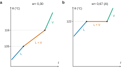
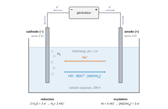
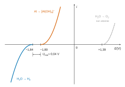
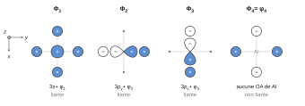
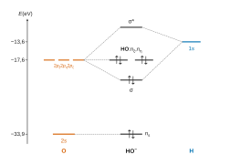
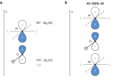

# CCINP PC — Chimie 2026 · Corrigé guidé

*Corrigé rédigé par IA, non officiel. Signalez toute erreur.*

## Présentation du sujet

**Cadre.** Épreuve spécifique PC3C, 4 heures, **calculatrices interdites**. Deux problèmes indépendants de 25 questions chacun (Q1 à Q50), chacun suivi de ses données : potentiels standard, conductivités ioniques molaires, constante de Faraday, surpotentiels sur aluminium, énergies des OA de H et O, table de $pK_a$, tables RMN et IR, fiches de sécurité.

Une « aide numérique » remplace la calculatrice ($6/11\approx0{,}55$, $7/8\approx0{,}88$, $1/48\approx0{,}02$, etc.) : si un calcul ne s'y ramène pas, il faut le revérifier.

**Problème 1 — Les MOFs (MIL-53(Al)).** Le fil conducteur est la fabrication d'un réseau métallo-organique à partir d'aluminium et d'acide téréphtalique recyclés.

- *Partie I (Q1–Q15)* : configuration électronique ; diagramme $E$-pH de l'aluminium (attribution des domaines, $E^\circ$, $K_s$, $\beta_4$, attaque acide) ; binaire eau/acide nitrique à azéotrope à maximum (domaines, analyse thermique, variance, théorème des moments, distillation) ; électrolyse sur électrodes d'aluminium (schéma, demi-équations, potentiels de Nernst, courbes courant-potentiel, rendement faradique, énergie).
- *Partie II (Q16–Q18)* : le PET, polyester ; titrage pH-métrique et conductimétrique de l'acide téréphtalique en présence d'acide sulfurique ; rendement de l'hydrolyse.
- *Partie III (Q19–Q21)* : RPAC en régime permanent, ordre 1, temps de passage, bilan thermique adiabatique.
- *Partie IV (Q22–Q25)* : OM du complexe plan carré $[\mathrm{AlL_4}]$ par la méthode des fragments, diagramme de $\mathrm{HO^-}$, interaction HO/BV et pontage par le ligand hydroxo.

**Problème 2 — Synthèse de 1,3-oxazines.** Synthèse à partir de l'acide (+)-tartrique, guidée par les figures 8 à 14.

- *Partie I (Q26–Q40)* : stéréodescripteurs, stéréoisomères et pouvoir rotatoire ; estérification de Fischer et Dean-Stark ; synthèse de Williamson (NaH, DMF) ; RMN ; saponification et techniques d'extraction ; anhydride cyclique ; formation d'un imide et choix de l'amine.
- *Partie II (Q41–Q50)* : déprotonation de l'imide et mésomérie, $N$-alkylation, IR, mécanisme par ion $N$-acyliminium ; silylation catalysée par l'imidazole, hydroboration au 9-BBN, oxydation et aldolisation-crotonisation dirigée ; addition de Michael ; stéréochimie de l'oxa-Michael.

**Notions du programme mobilisées.** Configuration électronique ; diagrammes $E$-pH, loi de Nernst, constantes d'équilibre et potentiels standard ; diagrammes binaires liquide-vapeur, variance, théorème des moments, distillation fractionnée ; courbes courant-potentiel, électrolyse, loi de Faraday ; titrages, conductimétrie ; réacteurs ouverts, bilans de matière et d'énergie ; orbitales moléculaires par fragments, interactions frontalières ; stéréochimie (CIP, énantiomérie, diastéréoisomérie, méso, pouvoir rotatoire) ; estérification, saponification, Williamson, réduction par $\mathrm{NaBH_4}$, hydroboration, oxydation des alcools, aldolisation-crotonisation, addition de Michael ; spectroscopies RMN et IR ; techniques d'extraction et de séchage.

**Difficulté et longueur.** Sujet long mais très progressif, avec beaucoup de questions proches du cours. Points délicats : Q4 (deux constantes à extraire des frontières), Q9–Q10 (lecture fine de la figure 2), Q12–Q15 (électrolyse, surpotentiels, rendement faradique), Q17–Q18 (deux acidités titrées ensemble), Q23–Q25 (orbitalaire), Q45, Q48 et Q50 (mécanismes et stéréochimie).

**Ce qu'en dit le jury (rapport 2026).** Le rapport ne donne ni moyenne ni barème. Il juge le sujet sans « question réellement bloquante » et note que « Sur l'ensemble des copies, au moins une bonne réponse est apportée à chaque question. » Il désigne deux blocs très mal traités, qui ont fait la différence :

| Bloc | Questions | Constat du rapport 2026 |
|---|---|---|
| Réactions électrochimiques dans la cellule d'électrolyse | Q12–Q15 | demi-équations écrites avec $\mathrm{H^+}$ en milieu basique, électrode non précisée ; potentiels de Nernst faux pour l'aluminate ; « très peu de bonnes réponses complètes » en Q14 |
| Titrage de l'acide téréphtalique et rendement de l'hydrolyse du PET | Q17–Q18 | les deux équivalences prises pour les deux acidités successives ; rendement juste dans de très rares copies |

D'autres questions sont signalées comme rarement réussies : le raisonnement de variance (Q8), la masse de résidu (Q10), le bilan enthalpique (Q21), le caractère pontant de l'ion hydroxo (Q25, « Ce résultat n'est pas perçu par les candidats »), le composé méso (Q27–Q28), le rôle des solvants (Q31, Q35) et le choix de la base (Q41).

Le jury insiste sur la rédaction : « Trop de réponses ne sont pas assez explicites. » Il relève des justifications absentes ou contradictoires et rappelle qu'« Une rédaction de qualité nécessite l'emploi de termes scientifiques adéquats. » Il conseille enfin de lire tout le sujet et chaque question, et d'exploiter les annexes.

**Questions abordables à ne pas laisser passer.** Q1, Q2, Q3, Q6, Q7, Q9, Q16, Q19, Q20, Q22, Q26, Q29, Q30, Q33, Q34, Q36, Q37, Q38, Q39, Q40, Q42, Q43, Q44, Q49.

**Gestion du temps.** Les deux problèmes sont de poids comparable : environ 2 h chacun. Dans le problème 1, les parties sont indépendantes ; la partie III (10 minutes) et le début de la partie II peuvent être traités en premier. Dans le problème 2, la lecture des structures dessinées conditionne la suite : prendre le temps de bien lire chaque figure.

---

## Problème 1, partie I — L'aluminium métallique

Trois blocs d'outils différents : atomistique (I.1), puis préparation du nitrate d'aluminium, qui mobilise le diagramme $E$-pH de l'aluminium et le binaire eau/acide nitrique (I.2), enfin électrolyse et courbes courant-potentiel (I.3). Toutes les valeurs se lisent sur les figures 1 et 2 ou se calculent avec les données de la page 9.

**I.1 — Atomistique.**

### Question 1

> [!INDICATION]
> Question de culture : quel prix récompense chaque année des travaux de chimie à Stockholm ?

> [!INDICATION]
> Le fondateur du prix était un industriel des explosifs.

#### Solution

Il s'agit du **prix Nobel de chimie** 2025. Alfred Nobel, qui l'a fondé par testament, est l'inventeur de la **dynamite** (1867) : nitroglycérine absorbée sur un support poreux inerte (kieselguhr), ce qui la rend manipulable.

> [!JURY]
> Le rapport 2026 note que « Le nom d'Alfred Nobel est très peu cité » et que l'invention de la dynamite l'est encore moins : deux points de culture faciles à prendre.

### Question 2

> [!INDICATION]
> Utiliser la position dans la classification : la période donne la couche de valence, la colonne le nombre d'électrons de valence.

> [!INDICATION]
> Règle de Klechkowski et principe de Pauli ; vérifier que la somme des exposants vaut $Z$.

#### Solution

Construction des trois premières lignes de la classification :

- la période 1 compte 2 éléments (remplissage de $1s$) et la période 2 en compte 8 ($2s$ puis $2p$) : 10 éléments en tout ;
- la période 3 s'ouvre avec Na ($Z=11$, colonne 1) et Mg ($Z=12$, colonne 2) ;
- les orbitales $3d$ ne se remplissent qu'à partir de la 4e période, après $4s$ (règle de Klechkowski) : la période 3 n'a pas d'éléments dans les colonnes 3 à 12.

L'élément de la 13e colonne est donc le troisième de la période 3, premier du bloc $p$ : $Z=2+8+3=13$.

$$\boxed{\mathrm{Al} : 1s^2\,2s^2\,2p^6\,3s^2\,3p^1}$$

Les trois électrons de valence $3s^2\,3p^1$ expliquent le nombre d'oxydation $+\mathrm{III}$ de l'ion $\mathrm{Al^{3+}}$.

> [!PIEGE]
> Écrire « 3s² 3d¹ » : le rapport 2026 relève cette configuration chez un nombre non négligeable de candidats. Les orbitales 3d ne se remplissent qu'à partir de la 4e période ; la 13e colonne est la première du bloc p, d'où un seul électron 3p. Toujours contrôler la somme des exposants.

> [!JURY]
> Le jury attend « une analyse de la construction de la classification périodique pour ses 3 premières lignes » (rapport 2026) : la configuration doit se déduire de la position donnée, pas seulement être affirmée.

**I.2 — Préparation du nitrate d'aluminium nonahydraté à partir de déchets d'aluminium.** Diagramme $E$-pH (Q3–Q5), puis diagramme binaire isobare (Q6–Q10).

### Question 3

> [!INDICATION]
> Classer d'abord les espèces par nombre d'oxydation : le plus bas en bas du diagramme.

> [!INDICATION]
> Une frontière verticale sépare deux espèces de même n.o. échangeant des ions $\mathrm{HO^-}$ ; quand le pH augmente, l'espèce s'enrichit en hydroxyde.

> [!INDICATION]
> Vérifier l'attribution en calculant la pente des frontières obliques à partir des demi-équations.

#### Solution

**Nombres d'oxydation.** Al(s) est au n.o. 0. Dans $\mathrm{Al^{3+}}$, $\mathrm{Al(OH)_3}$ et $[\mathrm{Al(OH)_4}]^-$, l'aluminium est au n.o. $+\mathrm{III}$ ; par exemple, pour l'ion aluminate :

$$\begin{aligned}
x+4\times(-\mathrm{II})+4\times(+\mathrm I)&=-1\\
x&=+\mathrm{III}
\end{aligned}$$

L'espèce de n.o. le plus bas occupe le bas du diagramme, sur tout l'intervalle de pH : **D = Al(s)**.

**Espèces de n.o. $+\mathrm{III}$.** Elles sont reliées par des réactions acido-basiques (échange d'ions $\mathrm{HO^-}$, sans électron), d'où les frontières verticales à pH 4 et pH 10 :

$$\mathrm{Al^{3+}}+3\,\mathrm{HO^-}\longrightarrow\mathrm{Al(OH)_3(s)}$$

$$\mathrm{Al(OH)_3(s)}+\mathrm{HO^-}\longrightarrow[\mathrm{Al(OH)_4}]^-$$

Le diagramme d'existence et de prédominance en fonction du pH place donc, de gauche à droite, l'espèce la moins puis la plus hydroxylée : $\mathrm{Al^{3+}}$ en milieu acide, le précipité au milieu, l'ion aluminate en milieu basique.

$$\boxed{\mathrm{A} : \mathrm{Al^{3+}(aq)}\quad \mathrm{B} : \mathrm{Al(OH)_3(s)}\quad \mathrm{C} : [\mathrm{Al(OH)_4}]^-(\mathrm{aq})\quad \mathrm{D} : \mathrm{Al(s)}}$$

**Vérification par les pentes** (pente $-0{,}06\,m/n$ V par unité de pH pour $m$ ions $\mathrm{H^+}$ et $n$ électrons) :

$$\begin{aligned}
\text{A/D} &: \mathrm{Al^{3+}}+3e^-=\mathrm{Al}, &&\text{pente nulle}\\
\text{B/D} &: \mathrm{Al(OH)_3}+3\mathrm{H^+}+3e^-=\mathrm{Al}+3\mathrm{H_2O}, &&\text{pente }-0{,}06\ \mathrm V\\
\text{C/D} &: [\mathrm{Al(OH)_4}]^-+4\mathrm{H^+}+3e^-=\mathrm{Al}+4\mathrm{H_2O}, &&\text{pente }-0{,}08\ \mathrm V
\end{aligned}$$

C'est ce que montre la figure 1.

> [!METHODE]
> Pour lire un diagramme $E$-pH : (1) n.o. croissant vers le haut ; (2) à n.o. fixé, espèces de plus en plus basiques vers la droite ; (3) contrôle par les pentes ($-0{,}06\,m/n$ V par unité de pH pour $m$ protons et $n$ électrons).

> [!JURY]
> « L'attribution des domaines du diagramme E-pH à une espèce devrait se justifier avec le nombre d'oxydation de Al » (rapport 2026), complété par les couples acido-basiques ou un diagramme d'existence selon le pH. Une attribution sans calcul de n.o. n'est pas une justification.

### Question 4

> [!INDICATION]
> La convention de tracé fixe la concentration de l'espèce dissoute sur chaque frontière : écrire la loi de Nernst sur le palier horizontal.

> [!INDICATION]
> Pour $\beta_4$, deux frontières verticales suffisent : l'une donne le produit de solubilité de l'hydroxyde, l'autre la constante de redissolution en complexe.

> [!INDICATION]
> Écrire la réaction de la frontière B/C comme combinaison de la dissolution du précipité et de la formation du complexe.

#### Solution

**Potentiel standard.** Couple $\mathrm{Al^{3+}}/\mathrm{Al}$ : $\mathrm{Al^{3+}}+3e^-=\mathrm{Al(s)}$. Sur la frontière A/D, la convention de tracé impose $[\mathrm{Al^{3+}}]=c_T$, et le solide a une activité égale à 1. Loi de Nernst :

$$\begin{aligned}
E&=E^\circ(\mathrm{Al^{3+}/Al})+\frac{0{,}06}{3}\log c_T\\
&=E^\circ(\mathrm{Al^{3+}/Al})-0{,}04\ \mathrm V
\end{aligned}$$

Le palier se lit à $E=-1{,}72$ V : c'est le potentiel de frontière, pas le potentiel standard. D'où

$$\boxed{E^\circ(\mathrm{Al^{3+}/Al})=-1{,}72+0{,}04=-1{,}68\ \mathrm V}$$

**Produit de solubilité (frontière A/B, pH 4).** Sur cette frontière, $[\mathrm{Al^{3+}}]=c_T=10^{-2}\ \mathrm{mol\,L^{-1}}$ et le précipité apparaît tout juste ; à pH 4, $[\mathrm{HO^-}]=K_e/h=10^{-10}\ \mathrm{mol\,L^{-1}}$ :

$$\begin{aligned}
K_s&=[\mathrm{Al^{3+}}][\mathrm{HO^-}]^3\\
&=10^{-2}\times\left(10^{-10}\right)^3\\
&=10^{-32}
\end{aligned}$$

**Frontière B/C (pH 10).** La réaction $\mathrm{Al(OH)_3(s)}+\mathrm{HO^-}=[\mathrm{Al(OH)_4}]^-$ a pour constante $K$. Sur la frontière, $[\mathrm{Al(OH)_4^-}]=c_T$ et $[\mathrm{HO^-}]=10^{-4}\ \mathrm{mol\,L^{-1}}$ :

$$\begin{aligned}
K&=\frac{[\mathrm{Al(OH)_4^-}]}{[\mathrm{HO^-}]}\\
&=\frac{10^{-2}}{10^{-4}}\\
&=10^{2}
\end{aligned}$$

**Constante $\beta_4$.** Elle est associée à la formation du complexe à partir de $\mathrm{Al^{3+}}$ : $\mathrm{Al^{3+}}+4\,\mathrm{HO^-}=[\mathrm{Al(OH)_4}]^-$. La réaction de la frontière B/C est la somme de la dissolution du précipité ($K_s$) et de cette formation ($\beta_4$), donc $K=K_s\beta_4$ :

$$\begin{aligned}
\beta_4&=\frac{K}{K_s}\\
&=\frac{10^{2}}{10^{-32}}
\end{aligned}$$

$$\boxed{\beta_4=10^{34}}$$

**Contrôle par la frontière C/D.** Elle passe par $-2{,}08$ V à pH 10 et par $-2{,}40$ V à pH 14. Avec $[\mathrm{Al(OH)_4^-}]=c_T$ et la pente $-0{,}08$ V par unité de pH :

$$\begin{aligned}
E^\circ([\mathrm{Al(OH)_4}]^-/\mathrm{Al})&=-2{,}40+0{,}08\times14+0{,}04\\
&=-1{,}24\ \mathrm V
\end{aligned}$$

En combinant les deux couples de l'aluminium :

$$\begin{aligned}
\log\beta_4&=-4\log K_e-\frac{3\,\big(E^\circ([\mathrm{Al(OH)_4}]^-/\mathrm{Al})-E^\circ(\mathrm{Al^{3+}/Al})\big)}{0{,}06}\\
&=56-\frac{3\times0{,}44}{0{,}06}\\
&=34
\end{aligned}$$

Le résultat est cohérent. La donnée $-1{,}18$ V de la page 9 diffère de $0{,}06$ V de la valeur lue sur la figure ; utilisée dans la même relation, elle conduirait à $\log\beta_4=31$.

> [!PIEGE]
> Confondre potentiel de frontière et potentiel standard : « Beaucoup de candidats identifient ainsi le potentiel de frontière du couple au potentiel standard d'oxydoréduction » (rapport 2026). Ici le terme $\frac{0{,}06}{3}\log c_T=-0{,}04$ V n'est pas négligeable.

> [!METHODE]
> Sur une frontière précipité/espèce dissoute, l'espèce dissoute est à la concentration de tracé et le précipité existe tout juste : on obtient directement $K_s$ ou une constante de complexation.

> [!JURY]
> Pour $\beta_4$, le rapport 2026 attend l'équation de formation du complexe à partir de $\mathrm{Al^{3+}}$ et l'usage des deux frontières verticales. La voie par les deux potentiels standard a été acceptée : « Leur réponse est valorisée bien que l'énoncé demande d'utiliser uniquement le diagramme. »

### Question 5

> [!INDICATION]
> Le métal est au contact d'un acide fort concentré et un gaz se dégage : quel est l'oxydant ?

> [!INDICATION]
> Relier $K^\circ$ aux potentiels standard par $\log K^\circ=n\Delta E^\circ/0{,}06$, après avoir équilibré l'équation.

> [!INDICATION]
> « Conclure » : comparer aussi les quantités de matière engagées pour savoir quel réactif est limitant.

#### Solution

L'acide chlorhydrique à $6\ \mathrm{mol\,L^{-1}}$ impose un pH négatif. Le diagramme montre qu'à ce pH l'aluminium au n.o. $+\mathrm{III}$ est sous forme $\mathrm{Al^{3+}}$, et non sous forme d'hydroxyde ou d'aluminate. L'oxydant est l'ion $\mathrm{H^+}$, réduit en dihydrogène :

$$\boxed{2\,\mathrm{Al(s)}+6\,\mathrm{H^+(aq)}\longrightarrow2\,\mathrm{Al^{3+}(aq)}+3\,\mathrm{H_2(g)}}$$

**Constante d'équilibre.** À l'équilibre, la solution a un potentiel unique : les potentiels de Nernst des deux couples sont égaux. En écrivant chaque couple pour 6 électrons échangés :

$$\begin{aligned}
E(\mathrm{Al^{3+}/Al})&=E^\circ(\mathrm{Al^{3+}/Al})+\frac{0{,}06}{6}\log[\mathrm{Al^{3+}}]^2\\
E(\mathrm{H^+/H_2})&=E^\circ(\mathrm{H^+/H_2})+\frac{0{,}06}{6}\log\frac{h^6}{(p_{\mathrm{H_2}}/p^\circ)^3}
\end{aligned}$$

L'égalité des deux potentiels fait apparaître le quotient de réaction à l'équilibre, c'est-à-dire $K^\circ$ :

$$\begin{aligned}
\log K^\circ&=\log\frac{[\mathrm{Al^{3+}}]^2\,(p_{\mathrm{H_2}}/p^\circ)^3}{h^6}\\
&=\frac{6\,\big(E^\circ(\mathrm{H^+/H_2})-E^\circ(\mathrm{Al^{3+}/Al})\big)}{0{,}06}\\
&=\frac{6\times1{,}68}{0{,}06}\\
&=168
\end{aligned}$$

$$\boxed{K^\circ=10^{168}}$$

**Conclusion.** La réaction est quantitative. Comparaison des quantités engagées :

$$\begin{aligned}
n(\mathrm{Al})&=\frac{5{,}0}{27}\approx0{,}185\ \mathrm{mol}\\
n(\mathrm{H^+})&=0{,}100\times6\\
&=0{,}60\ \mathrm{mol}\\
3\,n(\mathrm{Al})&\approx0{,}56\ \mathrm{mol}<n(\mathrm{H^+})
\end{aligned}$$

L'acide est en léger excès et **tout l'aluminium est oxydé** en $\mathrm{Al^{3+}}$. La réaction est exothermique et dégage $\mathrm{H_2}$, gaz inflammable, d'où les précautions demandées. La durée (12 h) traduit une limitation cinétique (couche d'alumine passivante, que les ions chlorure aident à attaquer), pas thermodynamique.

> [!PIEGE]
> Faire apparaître $\mathrm{Al(OH)_3}$ ou $[\mathrm{Al(OH)_4}]^-$ dans l'équation : le rapport 2026 signale cette erreur, en contradiction avec le diagramme, qui donne $\mathrm{Al^{3+}}$ en milieu très acide.

> [!PIEGE]
> La valeur de $K^\circ$ dépend de l'écriture de l'équation ($10^{168}$ pour 2 Al, $10^{84}$ pour 1 Al) : préciser l'équation utilisée.

> [!JURY]
> Rapport 2026 : « L'expression de la constante d'équilibre est parachutée lorsqu'elle est donnée, le plus souvent sans aucune justification et éventuellement fausse. » L'égalité des potentiels de Nernst à l'équilibre suffit à l'établir en trois lignes. Le jury ne sanctionne pas une valeur erronée de $E^\circ(\mathrm{Al^{3+}/Al})$ reprise de Q4.

### Question 6

> [!INDICATION]
> Le liquide est stable aux basses températures, la vapeur aux hautes températures.

> [!INDICATION]
> Les domaines compris entre deux courbes sont biphasés ; la courbe qui borde le domaine liquide est la courbe d'ébullition.

> [!INDICATION]
> De chaque côté de l'azéotrope, la vapeur est enrichie en le constituant qui bout le plus bas de ce côté.

#### Solution

Le diagramme présente un azéotrope à **maximum** de température en A ; les deux constituants sont totalement miscibles à l'état liquide.

| Domaine | Phases | Composition |
|---|---|---|
| I (en bas) | une phase liquide, mélange des deux constituants | $w_\ell=w$ (composition globale) |
| IV (en haut) | une phase vapeur, mélange des deux constituants | $w_v=w$ |
| II ($w<0{,}67$) | liquide + vapeur, deux mélanges binaires | à la température considérée, $w_\ell$ sur la courbe d'ébullition (a), $w_v$ sur la courbe de rosée ; $w_v<w_\ell$, la vapeur est enrichie en eau |
| III ($w>0{,}67$) | liquide + vapeur, deux mélanges binaires | $w_\ell$ sur la courbe d'ébullition, $w_v$ sur la courbe de rosée (b) ; $w_v>w_\ell$, la vapeur est enrichie en $\mathrm{HNO_3}$ |

Dans les domaines II et III, aucune des deux phases n'est un corps pur : chacune contient de l'eau et de l'acide nitrique, avec des compositions lues aux extrémités de l'horizontale (théorème de l'horizontale).

La courbe (a), qui borde le domaine liquide I, est la **courbe d'ébullition** ; la courbe (b), qui borde le domaine vapeur IV, est la **courbe de rosée**.

> [!METHODE]
> La règle topologique est sûre : la courbe qui limite le domaine liquide est l'ébullition, celle qui limite le domaine vapeur est la rosée, de part et d'autre de l'azéotrope.

> [!PIEGE]
> Dans les domaines biphasés, aucune phase n'est pure : « Trop de candidats écrivent l'existence d'une phase liquide pure coexistant avec une phase gazeuse dans ces domaines » (rapport 2026). Les courbes, elles, sont en général bien nommées.

### Question 7

> [!INDICATION]
> Une rupture de pente correspond à l'apparition ou à la disparition d'une phase.

> [!INDICATION]
> Lire sur la figure 2 les températures où la verticale $w=0{,}30$ coupe chacune des deux courbes.

> [!INDICATION]
> Pour la composition de l'azéotrope, les deux courbes sont confondues : que devient l'intervalle de changement d'état ?

#### Solution

Lectures sur la figure 2 :

- $w=0{,}30$ : la verticale coupe la courbe d'ébullition à $\theta_1\approx105\ ^\circ$C et la courbe de rosée à $\theta_2\approx116\ ^\circ$C ;
- $w=0{,}67$ (A) : les deux courbes se rejoignent, $\theta_1=\theta_2=122\ ^\circ$C.

Allure des courbes d'échauffement $\theta(t)$ (température croissante) à puissance de chauffe constante :

| Mélange | Segment | Système | Pente |
|---|---|---|---|
| $w=0{,}30$ | $\theta<105\ ^\circ$C | liquide seul | forte |
| | $105\to116\ ^\circ$C | liquide + vapeur | faible (oblique, pas de palier) |
| | $\theta>116\ ^\circ$C | vapeur seule | forte |
| $w=0{,}67$ | $\theta<122\ ^\circ$C | liquide seul | forte |
| | $122\ ^\circ$C | liquide + vapeur | **palier** horizontal |
| | $\theta>122\ ^\circ$C | vapeur seule | forte |

Interprétation des ruptures de pente :

- à $105\ ^\circ$C apparaît la première bulle de vapeur. La vaporisation est **endothermique** : une partie de la puissance reçue sert à vaporiser le liquide au lieu d'élever la température, d'où la diminution de la pente ;
- à $116\ ^\circ$C disparaît la dernière goutte de liquide ; toute la puissance échauffe la vapeur et la pente redevient forte ;
- pour le mélange de composition A, la vaporisation se fait à température constante, comme pour un corps pur (justification par le nombre de degrés de liberté en Q8).

> [!PIEGE]
> Le rapport 2026 relève des courbes de refroidissement tracées au lieu de courbes d'échauffement, et un segment horizontal pour $w=0{,}30$. À pression fixée, un mélange non azéotropique change d'état sur un intervalle de température : pas de palier.

> [!JURY]
> Rapport 2026 : « La rupture de pente se justifie en raison du fait que la vaporisation est endothermique (notion très peu mentionnée) ». Le calcul de variance n'est pas demandé ici, et l'argument « la variance diminue, donc la pente aussi » est explicitement rejeté.

### Question 8

> [!INDICATION]
> Rappeler les deux propriétés remarquables d'un mélange azéotropique lors de son ébullition.

> [!INDICATION]
> Compter les paramètres intensifs ($T$, $P$, compositions des deux phases) et les relations entre eux à l'équilibre.

> [!INDICATION]
> Au point azéotropique, une relation supplémentaire lie les compositions.

#### Solution

A est un **azéotrope** (homoazéotrope à maximum de température d'ébullition). Lors de sa vaporisation, un mélange de composition $w_A=0{,}67$ :

- bout à **température constante** ($122\ ^\circ$C sous 1 bar) ;
- donne une vapeur de **même composition** que le liquide.

Il se comporte comme un corps pur.

**Degrés de liberté du système biphasé en A.**

- Paramètres intensifs : $T$, $P$, $w_\ell$, $w_v$, soit 4 (la fraction massique de l'eau dans chaque phase s'en déduit).
- Relations : les deux équilibres de partage de l'eau et de l'acide nitrique entre liquide et vapeur (égalité des potentiels chimiques, 2 relations), plus la relation particulière de l'azéotrope $w_\ell=w_v$ (1 relation : l'égalité des fractions de l'eau en découle et n'est pas une relation de plus).

$$v=4-3=1$$

À pression fixée :

$$\boxed{v'=0}$$

Le système est invariant à $P$ fixée : la température ne peut pas varier tant que les deux phases coexistent, ce qui explique le palier de la courbe d'analyse thermique de Q7. Pour un mélange quelconque, la relation azéotropique n'existe pas, $v'=1$ et la température varie pendant le changement d'état.

> [!JURY]
> Rapport 2026 : « La réponse est le plus souvent connue mais le raisonnement pour obtenir la valeur le plus souvent faux. » Le jury attend la liste des paramètres intensifs, puis celle des relations, dont la relation particulière $w_\ell=w_v$ : « Peu de candidats font apparaître la relation particulière concernant la composition de la phase liquide égale à celle de la vapeur ».

> [!PIEGE]
> Compter des relations redondantes : écrire deux égalités de composition (pour l'eau et pour l'acide nitrique) alors qu'une seule est indépendante, ou oublier les deux équilibres de partage. Le rapport 2026 cite ces deux erreurs.

### Question 9

> [!INDICATION]
> Placer le point figuratif et vérifier qu'il est dans un domaine biphasé.

> [!INDICATION]
> Lire les compositions des deux phases aux extrémités de l'isotherme (conodale) à 105 °C.

> [!INDICATION]
> Théorème des moments en masses, puisque l'abscisse est une fraction massique ; les aides numériques permettent de contrôler la lecture.

#### Solution

Le point $(w=0{,}20 ;\ 105\ ^\circ\mathrm C)$ est dans le domaine II, biphasé.

**Compositions (théorème de l'horizontale).** L'isotherme $105\ ^\circ$C coupe la courbe de rosée en $w_v\approx0{,}08$ et la courbe d'ébullition en $w_\ell\approx0{,}30$.

**Masses des phases (théorème des moments).** Conservation de la masse totale et de la masse d'acide nitrique, avec $m=1{,}0$ kg :

$$\begin{aligned}
m_\ell+m_v&=m\\
m_\ell w_\ell+m_v w_v&=m\,w
\end{aligned}$$

d'où

$$\begin{aligned}
m_\ell&=m\,\frac{w-w_v}{w_\ell-w_v}\\
&=1{,}0\times\frac{0{,}20-0{,}08}{0{,}30-0{,}08}\\
&=\frac{6}{11}\ \mathrm{kg}
\end{aligned}$$

$$\boxed{\begin{aligned}
m_\ell&\approx0{,}55\ \mathrm{kg}\ \text{de liquide}\ (w_\ell=0{,}30)\\
m_v&\approx0{,}45\ \mathrm{kg}\ \text{de vapeur}\ (w_v=0{,}08)
\end{aligned}}$$

Le théorème des moments s'écrit en masses puisque l'abscisse est une fraction massique.

> [!PIEGE]
> Inverser les bras de levier : la phase la plus abondante est celle dont la composition est la plus proche de celle du point figuratif.

> [!JURY]
> La question demande la masse de chaque phase. Le rapport 2026 relève des candidats qui les confondent avec les masses d'une espèce dans une phase, et d'autres qui calculent la masse de chaque espèce dans chaque phase sans que ce soit demandé : « Ils perdent ainsi du temps et donc des points ! »

### Question 10

> [!INDICATION]
> De quel côté de l'azéotrope se trouve le mélange ?

> [!INDICATION]
> Dans une distillation fractionnée, la tête tend vers le point de plus basse température d'ébullition accessible, le bouilleur vers le point de plus haute température.

> [!INDICATION]
> Écrire la conservation de la masse d'acide nitrique.

#### Solution

$w=0{,}40<0{,}67$ : le mélange est du côté eau de l'azéotrope. Dans une distillation fractionnée, la tête de colonne s'enrichit en le constituant le plus volatil **de ce côté du diagramme**, l'eau ($100\ ^\circ$C), et le bouilleur tend vers le point de plus haute température d'ébullition, l'azéotrope ($122\ ^\circ$C). L'acide nitrique pur ($83\ ^\circ$C), bien que plus volatil que l'eau, n'est pas accessible depuis ce côté de l'azéotrope.

$$\boxed{\begin{aligned}
&\text{distillat : eau pure, } w_{\mathrm{HNO_3}}=0\\
&\text{résidu : azéotrope, } w_{\mathrm{HNO_3}}=0{,}67
\end{aligned}}$$

Le distillat ne contient pas d'acide : toute la masse initiale d'acide nitrique, $m\,w=0{,}40$ kg, se retrouve dans le résidu, de masse $m_r$ :

$$\begin{aligned}
m_r\times0{,}67&=m\,w\\
m_r&=\frac{1{,}0\times0{,}40}{0{,}67}
\end{aligned}$$

$$\boxed{m_r\approx0{,}60\ \mathrm{kg}}$$

C'est la masse de solution acide récupérée au bouilleur ; le distillat contient $0{,}40$ kg d'eau.

> [!METHODE]
> Avec un azéotrope à maximum, le résidu est l'azéotrope et le distillat le corps pur situé du même côté que le mélange initial ; avec un azéotrope à minimum, c'est l'inverse.

> [!PIEGE]
> Rapport 2026 : « Beaucoup de candidats répondent que le distillat contient l'acide nitrique pur, plus volatil que l'eau. » L'acide pur est bien le plus volatil des deux corps purs, mais il est inaccessible depuis le côté eau de l'azéotrope. Le jury note aussi que la masse de résidu est rarement calculée.

**I.3 — Obtention de sels d'aluminium par électrolyse.** On raisonne d'abord en thermodynamique (potentiels de Nernst à pH 14), puis on tient compte des surpotentiels.

### Question 11

> [!INDICATION]
> En électrolyse, quelle borne du générateur est reliée à l'électrode où a lieu l'oxydation ?

> [!INDICATION]
> Distinguer le transport du courant dans les fils (électrons) et dans la solution (ions).

> [!INDICATION]
> Pour la solubilité, comparer le pH de la solution aux $pK_a$ de l'acide téréphtalique et exprimer la solubilité totale en fonction de $h$.

#### Solution

Schéma de la cellule :

- **Anode** (siège de l'oxydation) : électrode d'aluminium reliée à la borne $+$ du générateur ; **cathode** (siège de la réduction) : électrode d'aluminium reliée à la borne $-$.
- Dans les fils, les électrons libérés à l'anode vont vers la borne $+$ ; ils sortent de la borne $-$ vers la cathode. Le courant circule en sens inverse.
- Dans la solution, le courant est porté par les ions : les cations ($\mathrm{Na^+}$) migrent vers la cathode, les anions ($\mathrm{HO^-}$, $\mathrm{BDC^{2-}}$, $[\mathrm{Al(OH)_4}]^-$) vers l'anode. Cette migration ferme le circuit et maintient l'électroneutralité au voisinage de chaque électrode.

**Double rôle de la soude.**

1. Elle **augmente la solubilité** de l'acide téréphtalique. Celui-ci est très peu soluble sous forme moléculaire ($s=1{,}02\cdot10^{-4}\ \mathrm{mol\,L^{-1}}$). À pH 14, très supérieur à $pK_{a2}=4{,}5$, il est entièrement converti en dianion, très soluble :
$$\mathrm{BDCH_2}+2\,\mathrm{HO^-}\longrightarrow\mathrm{BDC^{2-}}+2\,\mathrm{H_2O}.$$
La solubilité totale vaut
$$\begin{aligned}
s'&=s\left(1+\frac{K_{a1}}{h}+\frac{K_{a1}K_{a2}}{h^2}\right)\\
&\approx s\,\frac{K_{a1}K_{a2}}{h^2}\quad\text{pour pH}>pK_{a2}
\end{aligned}$$
Elle est multipliée par 100 à chaque unité de pH au-delà de $pK_{a2}$.
2. Elle sert d'**électrolyte** : les ions $\mathrm{Na^+}$ et $\mathrm{HO^-}$ assurent la conduction dans la solution. Elle fournit en outre les ions $\mathrm{HO^-}$ nécessaires au MIL-53, $\mathrm{Al(BDC)OH}$.

> [!PIEGE]
> Appliquer la convention des piles : dans un électrolyseur, l'anode est reliée à la borne $+$.

> [!JURY]
> Le rapport 2026 regrette des schémas incohérents, sans circulation des ions ni rôle de l'électrolyte, et des montages à trois électrodes ajoutés à tort, « confondant la cellule d'électrolyse avec le montage utilisé pour le tracé expérimental des courbes courant-potentiel ». Il ajoute : « Le double rôle de la soude est mal perçu » (solubilité de l'acide et électrolyte).

### Question 12

> [!INDICATION]
> Seuls l'aluminium et l'eau sont électroactifs : lister les couples que chacun forme.

> [!INDICATION]
> À pH 14, quelle est l'espèce de l'aluminium au n.o. $+\mathrm{III}$ ? Écrire les demi-équations avec $\mathrm{HO^-}$.

#### Solution

Conditions : pH 14, seuls l'aluminium et l'eau sont électroactifs. D'après le diagramme de Q3, l'aluminium au n.o. $+\mathrm{III}$ est sous forme $[\mathrm{Al(OH)_4}]^-$ à ce pH ; en milieu basique, les demi-équations s'écrivent avec $\mathrm{HO^-}$ et $\mathrm{H_2O}$, sans ions $\mathrm{H^+}$. La flèche indique le sens de la transformation à chaque électrode.

À l'**anode** (oxydations possibles) :
$$\mathrm{Al(s)}+4\,\mathrm{HO^-}\longrightarrow[\mathrm{Al(OH)_4}]^-+3\,e^-$$
$$4\,\mathrm{HO^-}\longrightarrow\mathrm{O_2(g)}+2\,\mathrm{H_2O}+4\,e^-$$

À la **cathode** (réductions possibles) :
$$2\,\mathrm{H_2O}+2\,e^-\longrightarrow\mathrm{H_2(g)}+2\,\mathrm{HO^-}$$
$$[\mathrm{Al(OH)_4}]^-+3\,e^-\longrightarrow\mathrm{Al(s)}+4\,\mathrm{HO^-}$$

La dernière n'est envisageable qu'une fois des ions aluminate formés en solution.

> [!JURY]
> Rapport 2026 : à pH 14, l'aluminium au n.o. $+\mathrm{III}$ se lit sur le diagramme de Q3, et « La réduction ou l'oxydation de l'eau ne peuvent pas mettre en jeu des ions hydrogène dans ce milieu. » Le jury demande aussi de préciser l'électrode (anode ou cathode) et d'écrire une flèche plutôt que le signe « = », pour distinguer l'espèce transformée de l'espèce formée.

### Question 13

> [!INDICATION]
> Calculer le potentiel de Nernst de chaque couple à pH 14 (activités égales à 1 sauf $\mathrm{H^+}$).

> [!INDICATION]
> Pour le couple de l'aluminate, compter les protons échangés pour obtenir la pente.

> [!INDICATION]
> À l'anode, le réducteur le plus fort s'oxyde ; à la cathode, l'oxydant le plus fort se réduit.

#### Solution

Les potentiels standard sont donnés à pH 0 : on écrit les demi-équations avec $\mathrm{H^+}$ pour appliquer la loi de Nernst, puis on fait pH = 14 (activités égales à 1 sauf $\mathrm{H^+}$).

$$[\mathrm{Al(OH)_4}]^-+4\,\mathrm{H^+}+3\,e^-=\mathrm{Al(s)}+4\,\mathrm{H_2O}$$

$$\begin{aligned}
E&=-1{,}18+\frac{0{,}06}{3}\log h^4\\
&=-1{,}18-0{,}08\,\mathrm{pH}
\end{aligned}$$

$$2\,\mathrm{H^+}+2\,e^-=\mathrm{H_2(g)}$$

$$\begin{aligned}
E&=0+\frac{0{,}06}{2}\log h^2\\
&=-0{,}06\,\mathrm{pH}
\end{aligned}$$

$$\mathrm{O_2(g)}+4\,\mathrm{H^+}+4\,e^-=2\,\mathrm{H_2O}$$

$$\begin{aligned}
E&=1{,}23+\frac{0{,}06}{4}\log h^4\\
&=1{,}23-0{,}06\,\mathrm{pH}
\end{aligned}$$

À pH 14 :

$$\begin{aligned}
E([\mathrm{Al(OH)_4}]^-/\mathrm{Al})&=-1{,}18-1{,}12\\
&=-2{,}30\ \mathrm V\\
E(\mathrm{H_2O/H_2})&=-0{,}84\ \mathrm V\\
E(\mathrm{O_2/H_2O})&=1{,}23-0{,}84\\
&=+0{,}39\ \mathrm V
\end{aligned}$$

- **Anode** : le réducteur le plus fort est celui du couple de plus bas potentiel. Comme $-2{,}30\ \mathrm V<+0{,}39\ \mathrm V$, c'est l'**oxydation de l'aluminium** : $\mathrm{Al}+4\,\mathrm{HO^-}\to[\mathrm{Al(OH)_4}]^-+3\,e^-$.
- **Cathode** : l'oxydant le plus fort est celui du couple de plus haut potentiel. Comme $-0{,}84\ \mathrm V>-2{,}30\ \mathrm V$, c'est la **réduction de l'eau** : $2\,\mathrm{H_2O}+2\,e^-\to\mathrm{H_2}+2\,\mathrm{HO^-}$.

> [!PIEGE]
> Inverser le critère : c'est le couple de plus bas potentiel dont le réducteur s'oxyde le plus facilement.

> [!JURY]
> Contrairement à Q12, il faut ici écrire les demi-équations avec $\mathrm{H^+}$, car « les potentiels standard d'oxydoréduction des couples redox de l'eau et de l'aluminium sont donnés à pH = 0 » (rapport 2026). Le jury relève beaucoup d'erreurs sur le couple de l'aluminate, et des candidats qui comparent les potentiels standard sans tenir compte du pH.

### Question 14

> [!INDICATION]
> Décaler chaque potentiel d'équilibre du surpotentiel correspondant (positif à l'anode, négatif à la cathode).

> [!INDICATION]
> La tension minimale est l'écart entre les pieds des vagues anodique et cathodique effectivement empruntées.

#### Solution

Les surpotentiels donnés sont des surpotentiels seuils (à intensité nulle) : ils fixent le pied de chaque vague. Potentiels de début de vague sur aluminium, à pH 14 :

| Processus | $E_{\rm éq}$ (V) | surpotentiel seuil (V) | début de vague (V) |
|---|---|---|---|
| oxydation $\mathrm{Al}\to[\mathrm{Al(OH)_4}]^-$ | $-2{,}30$ | $+0{,}5$ | $-1{,}80$ |
| oxydation $\mathrm{H_2O}\to\mathrm{O_2}$ | $+0{,}39$ | $+1{,}0$ | $+1{,}39$ |
| réduction $\mathrm{H_2O}\to\mathrm{H_2}$ | $-0{,}84$ | $-1{,}0$ | $-1{,}84$ |

Lecture du diagramme :

- côté anodique (courant positif), la première vague atteinte est celle de l'aluminium, qui part de $-1{,}80$ V ; celle de l'eau en $\mathrm{O_2}$ ($+1{,}39$ V) n'est pas atteinte ;
- côté cathodique (courant négatif), la vague de réduction de l'eau part de $-1{,}84$ V ; la réduction de l'aluminate, à $-2{,}30$ V au mieux, est plus loin.

La tension minimale est l'écart entre les deux pieds de vague :

$$\begin{aligned}
U_{\min}&=E_a-E_c\\
&=-1{,}80-(-1{,}84)
\end{aligned}$$

$$\boxed{U_{\min}\approx0{,}04\ \mathrm V}$$

La réaction est presque spontanée : c'est la corrosion de l'aluminium en milieu basique.

L'équation de l'électrolyse combine les deux réactions retenues sur le diagramme (anode $\times2$, cathode $\times3$, 6 électrons) :

$$\boxed{2\,\mathrm{Al(s)}+2\,\mathrm{HO^-}+6\,\mathrm{H_2O}\longrightarrow2\,[\mathrm{Al(OH)_4}]^-+3\,\mathrm{H_2(g)}}$$

> [!METHODE]
> Tension seuil d'électrolyse = $E_{\text{début vague anodique}}-E_{\text{début vague cathodique}}$, en ne retenant à chaque électrode que la vague atteinte la première.

> [!JURY]
> Question discriminante : « Il y a très peu de bonnes réponses complètes » (rapport 2026). Le jury reproche une équation de l'électrolyse « devinée à partir du texte d'introduction » au lieu d'être déduite des courbes courant-potentiel, tracées avec les surpotentiels seuils.

### Question 15

> [!INDICATION]
> Quels termes sont négligés dans un calcul fait à intensité nulle ?

> [!INDICATION]
> Loi de Faraday : $n(e^-)=It/F$, et trois électrons par atome d'aluminium.

> [!INDICATION]
> L'énergie électrique consommée vaut $UIt$ ; la rapporter à la masse réellement consommée.

#### Solution

**Écart de tension.** $U_{\min}$ est calculé à intensité nulle, avec les surpotentiels seuils. Pour faire passer $I=50$ mA, il faut en plus :

- des surpotentiels plus grands que les seuils, puisqu'on « monte » le long de chaque vague jusqu'à l'intensité imposée ;
- la **chute ohmique** $RI$ due à la résistance interne de la cellule (électrolyte, connexions, éventuelle couche d'oxyde).

$$U=U_{\min}+\eta_a(I)+|\eta_c(I)|+RI$$

d'où $1{,}0$ V au lieu de $0{,}04$ V.

**Rendement faradique.** Charge et quantité d'électrons en une heure :

$$\begin{aligned}
Q&=It\\
&=50\cdot10^{-3}\times3{,}6\cdot10^{3}\\
&=1{,}8\cdot10^{2}\ \mathrm C\\
n(e^-)&=\frac{Q}{F}\\
&=1{,}8\cdot10^{-3}\ \mathrm{mol}
\end{aligned}$$

Trois électrons par atome d'aluminium oxydé :

$$\begin{aligned}
m_{\rm th}&=\frac{n(e^-)}{3}\,M(\mathrm{Al})\\
&=\frac{1{,}8\cdot10^{-3}}{3}\times27\\
&=1{,}62\cdot10^{-2}\ \mathrm g
\end{aligned}$$

$$\boxed{\rho_F=\frac{m_{\rm réelle}}{m_{\rm th}}=\frac{14}{16{,}2}\approx0{,}86}$$

Une partie de la charge sert donc à d'autres processus : oxydation de l'eau si le potentiel anodique local le permet, croissance d'une couche d'alumine qui reste sur l'électrode, réduction du dioxygène dissous à la cathode.

**Énergie massique.** L'énergie électrique fournie en une heure, $W=UIt$, a consommé 14 mg d'aluminium :

$$\begin{aligned}
w&=\frac{UIt}{m}\\
&=\frac{1{,}0\times1{,}8\cdot10^{2}}{1{,}4\cdot10^{-2}}\ \mathrm{J\,g^{-1}}
\end{aligned}$$

$$\boxed{w\approx1{,}3\cdot10^{4}\ \mathrm{J\,g^{-1}}=13\ \mathrm{kJ\,g^{-1}}}$$

Contrôle : $w=3FU/(M\rho_F)=10^5/(9\times0{,}86)\approx13\ \mathrm{kJ\,g^{-1}}$. Avec un rendement faradique de 1, on aurait $3FU/M\approx11\ \mathrm{kJ\,g^{-1}}$.

> [!PIEGE]
> Une corrosion chimique de l'aluminium consommerait plus de métal que la loi de Faraday ne le prévoit : elle ne peut pas expliquer un rendement inférieur à 1.

> [!PIEGE]
> Parler d'« effet Joule » au lieu de chute ohmique : selon le rapport 2026, « la notion de chute ohmique a très souvent été remplacée par celle de perte par effet Joule ». De même, « Rares sont les candidats à maîtriser que les surpotentiels fournis sont les surpotentiels seuils et non à l'intensité fixée. »

---

## Problème 1, partie II — L'acide téréphtalique

Chimie des polymères (fonction ester du PET) puis dosage de l'acide téréphtalique récupéré par hydrolyse : titrage pH-métrique et conductimétrique d'un mélange acide fort + diacide faible.

**II.1 — Le PET** (Q16) ; **II.2 — Hydrolyse du PET et titrage** (Q17–Q18).

### Question 16

> [!INDICATION]
> Repérer dans le motif la liaison créée à chaque étape de polycondensation.

> [!INDICATION]
> Couper ces liaisons pour retrouver les deux monomères, puis contrôler avec la masse molaire du motif.

#### Solution

Le PET est un **polyester** : le groupe fonctionnel à l'origine de sa formation est la fonction **ester** (polycondensation d'un diacide et d'un diol, avec élimination d'eau).

- Acide téréphtalique $\mathrm{BDCH_2}$, acide benzène-1,4-dicarboxylique : cycle benzénique portant deux groupes $-\mathrm{COOH}$ en *para* ; SMILES `OC(=O)c1ccc(cc1)C(=O)O`.
- Autre monomère : **éthane-1,2-diol** (éthylène glycol), $\mathrm{HO{-}CH_2{-}CH_2{-}OH}$ ; SMILES `OCCO`.

Contrôle : motif $\mathrm{C_{10}H_8O_4}$, $M=120+8+64=192\ \mathrm{g\,mol^{-1}}$, valeur donnée.

> [!PIEGE]
> Le rapport 2026 note que les fonctions sont bien nommées, « contrairement aux structures des monomères à l'origine de la formation de macromolécules de PET ». Contrôler le diol et le diacide en recollant les liaisons ester du motif.

### Question 17

> [!INDICATION]
> Recenser les acides présents dans la solution titrée : l'acide sulfurique a été introduit en excès.

> [!INDICATION]
> Comparer l'écart entre les deux $pK_a$ de l'acide téréphtalique à 4 : les acidités sont-elles titrées séparément ?

> [!INDICATION]
> Justifier chaque pente de la courbe conductimétrique par les conductivités ioniques molaires fournies.

#### Solution

**Domaines de prédominance** : $\mathrm{BDCH_2}$ pour pH $<3{,}5$ ; $\mathrm{BDCH^-}$ entre 3,5 et 4,5 ; $\mathrm{BDC^{2-}}$ pour pH $>4{,}5$.

La solution titrée contient l'excès d'acide fort ($\mathrm{H_2SO_4}$, diacide fort : ions $\mathrm{H_3O^+}$) et l'acide téréphtalique reformé par acidification du téréphtalate de disodium. Les deux acidités de $\mathrm{BDCH_2}$ ont des $pK_a$ distants de 1, moins de 4 : elles sont titrées **simultanément**. Les deux équivalences correspondent donc à l'acide fort puis à l'acide téréphtalique, et non aux deux acidités successives de $\mathrm{BDCH_2}$.

Réactions support :

- pour $0<V<V_{e1}=16$ mL : $\mathrm{H_3O^+}+\mathrm{HO^-}\to2\,\mathrm{H_2O}$, de constante $10^{14}$ ;
- pour $V_{e1}<V<V_{e2}=29$ mL : $\mathrm{BDCH_2}+\mathrm{HO^-}\to\mathrm{BDCH^-}+\mathrm{H_2O}$ (constante $10^{10{,}5}$) et $\mathrm{BDCH^-}+\mathrm{HO^-}\to\mathrm{BDC^{2-}}+\mathrm{H_2O}$ (constante $10^{9{,}5}$).

Globalement, entre les deux équivalences :

$$\mathrm{BDCH_2}+2\,\mathrm{HO^-}\longrightarrow\mathrm{BDC^{2-}}+2\,\mathrm{H_2O}$$

Interprétation des courbes :

- avant $V_{e1}$ : pH bas (1,8 à 3), imposé par l'acide fort. $\sigma_{\rm corrigée}$ **décroît**, car $\mathrm{H_3O^+}$ ($\lambda=35$) est remplacé par $\mathrm{Na^+}$ ($\lambda=5$) ;
- en $V_{e1}$ : rupture de pente conductimétrique, sans saut de pH, car l'acide téréphtalique prend le relais ;
- entre $V_{e1}$ et $V_{e2}$ : zone tampon, pH de 3,5 à 4,5 environ, voisin de $\frac12(pK_{a1}+pK_{a2})=4$ vers 22 mL. La conductivité **croît lentement** : des ions $\mathrm{Na^+}$ et des anions téréphtalate peu conducteurs (conductivités ioniques molaires d'environ 3 et 7) apparaissent à partir d'une molécule neutre ;
- en $V_{e2}$ : saut de pH (de 5 à 11 environ) et rupture de pente ;
- après $V_{e2}$ : excès de soude, pH proche de 12. $\sigma$ **croît fortement** ($\mathrm{HO^-}$, $\lambda=20$, et $\mathrm{Na^+}$).

> [!METHODE]
> Titrage conductimétrique : écrire, sur chaque intervalle, quels ions apparaissent et disparaissent, et comparer leurs $\lambda$ ; la correction de dilution $\sigma V_{\rm tot}/V_0$ rend les portions rectilignes.

> [!PIEGE]
> Question discriminante : selon le rapport 2026, « de très nombreux candidats assimilent les 2 volumes équivalents au titrage successif des 2 acidités de l'acide téréphtalique », alors que les valeurs de pH et l'écart de $pK_a$, inférieur à 4, l'excluent. Le diagramme de prédominance est souvent tracé, rarement exploité.

### Question 18

> [!INDICATION]
> Quel intervalle de volume correspond au seul titrage de l'acide téréphtalique ?

> [!INDICATION]
> Un diacide consomme deux ions hydroxyde ; la quantité maximale est celle des motifs de PET.

#### Solution

Entre les deux équivalences, chaque $\mathrm{BDCH_2}$ consomme deux $\mathrm{HO^-}$ :

$$\begin{aligned}
n(\mathrm{BDCH_2})&=\frac{C_b(V_{e2}-V_{e1})}{2}\\
&=\frac{2{,}0\cdot10^{-2}\times13\cdot10^{-3}}{2}\\
&=1{,}3\cdot10^{-4}\ \mathrm{mol}
\end{aligned}$$

La quantité maximale est la quantité de motifs de PET hydrolysés :

$$\begin{aligned}
n_{\max}&=\frac{m}{M}\\
&=\frac{40\cdot10^{-3}}{192}\\
&=\frac{1}{48}\cdot10^{-2}\approx2{,}1\cdot10^{-4}\ \mathrm{mol}
\end{aligned}$$

$$\boxed{\eta=\frac{1{,}3\cdot10^{-4}}{2{,}08\cdot10^{-4}}\approx0{,}62=62\ \%}$$

> [!PIEGE]
> Utiliser $V_{e2}$ au lieu de $V_{e2}-V_{e1}$, ou oublier le facteur 2 : on obtient un rendement absurde.

> [!JURY]
> Le rendement correct « ne se rencontre que dans de très rares copies » (rapport 2026), la question dépendant de l'interprétation de Q17.

---

## Problème 1, partie III — Formation du MIL-53(Al) en mode continu

Génie chimique du programme PC : bilans de matière et d'énergie sur un réacteur parfaitement agité continu en régime permanent.

### Question 19

> [!INDICATION]
> Définir le taux de conversion en réacteur ouvert à débits égaux.

#### Solution

En RPAC, à débits volumiques d'entrée et de sortie égaux, le taux de conversion est défini à partir des concentrations d'entrée $c_0$ et de sortie $c$ :

$$X=\frac{c_0-c}{c_0}$$

$$\begin{aligned}
c&=c_0(1-X)\\
&=1{,}0\times(1-0{,}80)
\end{aligned}$$

$$\boxed{[\mathrm{Al^{3+}}]_{\rm sortie}=0{,}20\ \mathrm{mol\,L^{-1}}}$$

C'est aussi la concentration en tout point du réacteur, parfaitement agité.

> [!PIEGE]
> Donner 0,8 au lieu de 0,2 : le rapport 2026 relève des concentrations de sortie de 0,8 mol/L « au lieu de 0,2 mol/L attendue ». Le taux de conversion mesure ce qui a réagi, pas ce qui reste.

### Question 20

> [!INDICATION]
> Bilan de matière sur $\mathrm{Al^{3+}}$ en régime permanent : entrée − sortie − disparition = 0.

> [!INDICATION]
> Dans un RPAC, la vitesse est évaluée à la concentration de sortie.

#### Solution

Bilan de matière sur $\mathrm{Al^{3+}}$ en régime permanent (entrée − sortie − disparition = 0), avec la vitesse $r=kc$ (ordre 1 apparent, les autres réactifs étant en large excès), évaluée à la concentration de sortie :

$$\begin{aligned}
0&=Qc_0-Qc-kc\,\mathcal V\\
\tau&=\frac{\mathcal V}{Q}\\
&=\frac{c_0-c}{kc}\\
&=\frac{X}{k(1-X)}
\end{aligned}$$

Application numérique :

$$\begin{aligned}
\tau&=\frac{0{,}80}{5{,}0\times0{,}20}\ \mathrm{min}\\
\mathcal V&=Q\tau\\
&=300\times0{,}80\ \mathrm L
\end{aligned}$$

$$\boxed{\begin{aligned}
\tau&=0{,}80\ \mathrm{min}=48\ \mathrm s\\
\mathcal V&=2{,}4\cdot10^{2}\ \mathrm L
\end{aligned}}$$

> [!METHODE]
> RPAC à l'ordre 1 : $\tau=X/(k(1-X))$ ; le réacteur piston donnerait $\tau=-\ln(1-X)/k$, plus petit pour le même taux de conversion.

> [!JURY]
> La démonstration par le bilan de matière est attendue : le rapport 2026 note que « certains candidats parachutent une formule, malheureusement le plus souvent fausse ».

### Question 21

> [!INDICATION]
> Premier principe pour un système ouvert en régime permanent, adiabatique et sans travail utile.

> [!INDICATION]
> Décomposer : réaction à la température d'entrée, puis échauffement du flux sortant.

> [!INDICATION]
> Le débit d'avancement est $Qc_0X$ ; le débit massique est $\rho Q$.

#### Solution

**Bilan d'enthalpie.** Système ouvert (le RPAC), en régime permanent, adiabatique, sans travail utile, énergies cinétique et potentielle négligées : le premier principe impose l'égalité des flux d'enthalpie entrant et sortant. Avec $F_i$ les débits molaires et $H_{m,i}$ les enthalpies molaires :

$$\sum_i F_{i,s}\,H_{m,i}(T_s)-\sum_i F_{i,e}\,H_{m,i}(T_e)=0$$

On décompose ce passage en deux étapes fictives :

1. réaction à $T_e$ : la variation de flux d'enthalpie vaut $\sum_i(F_{i,s}-F_{i,e})H_{m,i}(T_e)=\dot\xi\,\Delta_rH^\circ$, avec le débit d'avancement $\dot\xi=Qc_0X$ ;
2. échauffement du flux sortant de $T_e$ à $T_s$ : $D_m\,C_{\rm moy}\,\Delta T$, avec le débit massique $D_m=\rho Q$.

$$\begin{aligned}
\dot\xi\,\Delta_rH^\circ+D_m\,C_{\rm moy}\,\Delta T&=0\\
\Delta T&=\frac{-\Delta_rH^\circ\,c_0X}{\rho\,C_{\rm moy}}\\
&=\frac{65\cdot10^3\times1{,}0\times0{,}80}{1\times5\cdot10^3}\ \mathrm K
\end{aligned}$$

$$\boxed{\Delta T\approx+10\ \mathrm K}$$

Unités : $c_0$ en $\mathrm{mol\,L^{-1}}$ et $\rho$ en $\mathrm{kg\,L^{-1}}$. Numériquement, $\dot\xi=240\ \mathrm{mol\,min^{-1}}$ et $D_m=300\ \mathrm{kg\,min^{-1}}$.

**Commentaire.** La réaction est exothermique : le flux sort plus chaud, d'environ 10 K. L'échauffement est modéré et compatible avec la fenêtre de synthèse annoncée (20 à 80 °C) ; l'hypothèse adiabatique est le cas le plus défavorable. $\Delta T$ est proportionnel à $c_0$ : une alimentation plus concentrée imposerait un refroidissement.

> [!PIEGE]
> Un $\Delta T$ négatif pour une réaction exothermique signale une erreur de signe.

> [!JURY]
> Le jury attend « un bilan énergétique mettant en jeu les flux molaires et les enthalpies molaires » ; très peu de candidats l'établissent, et beaucoup reprennent une formule du réacteur fermé (rapport 2026).

---

## Problème 1, partie IV — Étude de la liaison aluminium–oxygène dans le MIL-53(Al)

Orbitales moléculaires : méthode des fragments pour le complexe plan carré $[\mathrm{AlL_4}]$ (IV.1), diagramme de $\mathrm{HO^-}$ et interaction HO/BV qui explique le rôle pontant du ligand hydroxo (IV.2).

### Question 22

> [!INDICATION]
> Identifier, pour chaque OM du fragment $\mathrm{L_4}$, l'OA de l'aluminium de même symétrie.

> [!INDICATION]
> Une des OM du fragment n'a pas de partenaire parmi $3s$ et $3p$ : laquelle, et pourquoi ?

#### Solution

Les ligands sont sur les axes $Ox$ et $Oy$, l'aluminium à l'origine, au centre du fragment $\mathrm{L_4}$. Ses OA de valence sont $3s$, la plus basse, et les trois $3p$.

Deux orbitales interagissent si leur recouvrement est non nul (même comportement vis-à-vis des opérations de symétrie) et si leurs énergies sont proches. Sur la figure 6, les OM du fragment sont à une énergie intermédiaire entre $3s$ et $3p$ : le critère énergétique est rempli pour $3s$ comme pour $3p$. Reste à appliquer le critère de symétrie :

- $\varphi_1$ (quatre lobes de même signe) a la symétrie de $3s$ : $\Phi_1=3s+\varphi_1$, en phase, **liante**.
- $\varphi_2$ (deux lobes de signes opposés sur l'axe $Oy$, rien sur $Ox$) a la symétrie de $3p_y$ : $\Phi_2=3p_y+\varphi_2$, chaque lobe de $3p_y$ en phase avec le lobe de ligand qui lui fait face, **liante**.
- $\varphi_3$ (même chose sur l'axe $Ox$) : $\Phi_3=3p_x+\varphi_3$, **liante**, dégénérée avec $\Phi_2$.
- $\varphi_4$ (lobes de même signe sur l'axe des $y$, de signe opposé sur l'axe des $x$) a la symétrie d'une orbitale $d_{x^2-y^2}$, absente des OA de valence de l'aluminium. Son recouvrement est nul avec l'orbitale 3s comme avec les orbitales 3p : $\Phi_4=\varphi_4$, centrée sur les ligands, est **non liante**, à l'énergie du fragment (figure 6).

Signes des lobes (Al au centre, ligands en $\pm x$, $\pm y$) :

| OM | contribution de Al | L en $+x$ | L en $-x$ | L en $+y$ | L en $-y$ | caractère |
|---|---|---|---|---|---|---|
| $\Phi_1$ | $3s$ (+) | + | + | + | + | liante |
| $\Phi_2$ | $3p_y$ (lobe + vers $+y$) | 0 | 0 | + | − | liante |
| $\Phi_3$ | $3p_x$ (lobe + vers $+x$) | + | − | 0 | 0 | liante |
| $\Phi_4$ | aucune | − | − | + | + | non liante |

Dans les trois OM liantes, chaque lobe de l'OA de Al est de même signe que le lobe de ligand qui lui fait face (recouvrement en phase).

$\Phi_2$ et $\Phi_3$ ont un plan nodal, respectivement $xz$ et $yz$. $\Phi_4$ a deux plans nodaux (les bissectrices) et aucune contribution de Al.

$3p_z$, perpendiculaire au plan, ne recouvre aucune $\varphi_i$ : elle donne $\Phi_5$, non liante, vacante. $\Phi_6$, $\Phi_7$, $\Phi_8$ sont les combinaisons antiliantes.

> [!METHODE]
> Méthode des fragments : on ne combine que des orbitales de recouvrement non nul (même comportement vis-à-vis des symétries) et d'énergies voisines ; une orbitale sans partenaire reste non liante.

> [!JURY]
> Rapport 2026 : « la majorité des candidats ne précisent pas avec les critères énergétique et de symétrie que l'interaction est possible ». Les OA de l'aluminium doivent être dessinées au centre du fragment, et non juxtaposées à lui.

### Question 23

> [!INDICATION]
> Appliquer le critère des 10 eV à chaque paire d'OA (O, H).

> [!INDICATION]
> Parmi les trois $2p$ de l'oxygène, une seule a un recouvrement non nul avec $1s$(H).

> [!INDICATION]
> Compter les électrons de valence de $\mathrm{HO^-}$ sans oublier la charge.

#### Solution

On prend l'axe O–H comme axe $\zeta$ de l'ion. On applique le critère des 10 eV à chaque paire d'OA de valence, sans oublier l'orbitale $2s$ de l'oxygène :

- $2s$(O) et $1s$(H) : écart $|-33{,}9+13{,}6|=20{,}3$ eV, supérieur à 10 eV. Pas d'interaction : $2s$(O) donne une OM non liante, très basse.
- $2p$(O) et $1s$(H) : écart de $17{,}6-13{,}6=4{,}0$ eV, inférieur à 10 eV. L'interaction est possible, mais seule l'orbitale $2p_\zeta$, dirigée selon l'axe, recouvre l'orbitale de l'hydrogène. Elle forme une OM liante $\sigma$, plus basse que les orbitales 2p de l'oxygène, et une OM antiliante $\sigma^*$, plus haute que l'orbitale 1s.
- $2p_\xi$ et $2p_\eta$, perpendiculaires à l'axe, ont un recouvrement nul avec $1s$(H) : elles restent non liantes et dégénérées à $-17{,}6$ eV.

Ce diagramme n'a pas la forme de celui d'une molécule diatomique homonucléaire comme $\mathrm{O_2}$ : les deux atomes n'ont pas les mêmes OA ni les mêmes énergies.

Remplissage avec $6+1+1=8$ électrons de valence :

| OM | caractère | énergie | occupation |
|---|---|---|---|
| $\sigma^*$ | antiliante | $>-13{,}6$ eV | 0 |
| $n_\xi$, $n_\eta$ ($2p_\xi$, $2p_\eta$ de O) | non liantes | $-17{,}6$ eV | 4 |
| $\sigma$ ($2p_\zeta$ + $1s$) | liante | $<-17{,}6$ eV | 2 |
| $n_s$ ($2s$ de O) | non liante | $-33{,}9$ eV | 2 |

Indice de liaison : 1.

**Orbitales frontalières hautes occupées** : les deux OM non liantes dégénérées $n_\xi$ et $n_\eta$ ($2p_\xi$ et $2p_\eta$), centrées sur l'oxygène. Chacune est formée de deux lobes de signes opposés ; elles sont perpendiculaires entre elles et à la liaison O–H. Ce sont les deux doublets non liants « $p$ » de l'oxygène.

> [!PIEGE]
> Reproduire le diagramme de $\mathrm{O_2}$ : « Le plus souvent, le diagramme ressemble à celui du dioxygène » (rapport 2026), signe d'une réponse apprise par cœur. Autre erreur relevée : oublier l'orbitale 2s de l'oxygène, qui doit figurer, même non liante.

### Question 24

> [!INDICATION]
> Remplir le diagramme de la figure 6 avec 8 électrons pour trouver la HO et la BV du complexe.

> [!INDICATION]
> Une interaction stabilisante met en jeu deux électrons : HO d'un partenaire, BV de l'autre.

> [!INDICATION]
> Quelle orientation de la liaison O–H donne un recouvrement non nul avec $3p_z$ ?

#### Solution

**Décompte des électrons.** Le complexe a 8 électrons de valence : $\Phi_1$ à $\Phi_4$ sont doublement occupées.

$$\begin{aligned}
\text{HO}([\mathrm{AlL_4}])&=\Phi_4\ (\text{non liante, sur les ligands})\\
\text{BV}([\mathrm{AlL_4}])&=\Phi_5=3p_z(\mathrm{Al})
\end{aligned}$$

Pour $\mathrm{HO^-}$ (Q23), la HO est l'une des deux OM non liantes dégénérées $n_\xi$, $n_\eta$ ; la BV est $\sigma^*$.

**Interaction retenue.** L'interaction HO–HO (4 électrons) est déstabilisante. L'interaction stabilisante à 2 électrons associe la HO du ligand, nucléophile, et la BV du complexe, électrophile :

$$\boxed{\text{HO de }\mathrm{HO^-}\ (2p\text{ non liante de O})\ \longrightarrow\ \text{BV }\Phi_5=3p_z\text{ de Al}}$$

L'ion hydroxyde arrive selon $Oz$. Le recouvrement est axial (type $\sigma$) si l'orbitale $2p$ non liante engagée est dirigée selon cet axe, c'est-à-dire si la liaison O–H lui est perpendiculaire.

Le lobe inférieur de $3p_z$(Al) et le lobe supérieur de la $2p_z$ de O se font alors face, de même signe (recouvrement en phase), H étant hors de l'axe (schéma a ci-dessous) :

La paire d'électrons se stabilise dans l'OM liante Al–O formée : $\mathrm{HO^-}$ est un ligand $\sigma$-donneur, l'aluminium un accepteur.

> [!PIEGE]
> Une interaction entre deux orbitales occupées (4 électrons) est déstabilisante : elle n'explique pas une liaison.

> [!JURY]
> Le rapport 2026 rappelle l'ordre du raisonnement : identifier HO et BV des deux partenaires grâce à « un décompte correct des électrons de valence », puis retenir qualitativement l'interaction entre la BV du complexe (électrophile) et la HO du ligand (nucléophile).

### Question 25

> [!INDICATION]
> Relire le diagramme de Q23 : combien d'OM hautes occupées l'ion hydroxyde possède-t-il, et ont-elles la même énergie ?

> [!INDICATION]
> L'interaction de Q24 n'utilise qu'un doublet : que reste-t-il de disponible pour un second complexe ?

#### Solution

L'ion hydroxyde possède **deux OM hautes occupées dégénérées**, $n_\xi$ et $n_\eta$, chacune portant un doublet. L'interaction de Q24 avec la BV d'un premier complexe n'en engage qu'une. La seconde, de même énergie et toujours occupée, reste disponible pour une interaction HO/BV de même nature avec la BV $3p_z$ d'un second complexe $[\mathrm{AlL_4}]$.

Chaque doublet non liant de l'oxygène peut ainsi être cédé à un aluminium : l'ion hydroxo se lie à deux accepteurs à la fois, il est **pontant** ($\mu_2$). Le schéma b de la question 24 représente ce pont de façon idéalisée, les deux aluminiums de part et d'autre de l'oxygène selon $Oz$.

Chaque Al reçoit ainsi deux OH en *trans*, au-dessus et au-dessous du plan, et complète sa coordination octaédrique. On retrouve les chaînes $\cdots\mathrm{Al{-}OH{-}Al{-}OH}\cdots$ de la figure 5. Dans le MIL-53 réel, l'angle Al–O(H)–Al n'est pas de 180°.

> [!JURY]
> L'argument attendu : « La présence de 2 OM HO dégénérées était susceptible d'interpréter le caractère pontant du ligand. Ce résultat n'est pas perçu par les candidats. » (rapport 2026). Question discriminante.

---

## Problème 2, partie I — Formation d'un succinimide à partir de l'acide (+)-tartrique

Stéréochimie de l'acide tartrique (I.1), estérification, protection des alcools en éthers de benzyle et RMN (I.2), puis passage au succinimide par saponification, anhydride et imide, avec beaucoup de questions de techniques expérimentales (I.3).

**I.1 — Étude stéréochimique de l'acide (+)-tartrique.**

### Question 26

> [!INDICATION]
> Repérer les carbones asymétriques et classer leurs substituants par les règles CIP (duplication des liaisons C=O).

> [!INDICATION]
> Sur la représentation, où se trouvent les hydrogènes non dessinés ?

#### Solution

Chaîne $\mathrm{HOOC{-}C^2H(OH){-}C^3H(OH){-}COOH}$ : C2 et C3 portent quatre groupes différents, ce sont deux centres stéréogènes.

Priorités CIP (identiques en C2 et C3) : $\mathrm{OH}>\mathrm{COOH}$ (C : O,O,O) $>\mathrm{CH(OH)COOH}$ (C : O,C,H) $>\mathrm H$.

Sur la figure 8, les deux OH sont en coin plein (vers l'observateur), les H vers l'arrière. En C2 (sommet bas du zigzag) : OH en bas, COOH en haut à gauche, C3 en haut à droite ; OH → COOH → C3 tourne dans le sens horaire : **R**. En C3 (sommet haut) : OH en haut, COOH en bas à droite, C2 en bas à gauche ; OH → COOH → C2 tourne dans le sens horaire : **R**.
$$\boxed{\text{acide }(2R,3R)\text{-2,3-dihydroxybutanedioïque}}$$
SMILES : `O=C(O)[C@H](O)[C@@H](O)C(=O)O`.

> [!PIEGE]
> Comparer $\mathrm{COOH}$ et $\mathrm{CH(OH)COOH}$ : au premier point de différence, (O,O,O) l'emporte sur (O,C,H).

> [!JURY]
> Les descripteurs sont en général justes, mais « la nomenclature et l'identification des fonctions prioritaires posent problème à grand nombre de candidats » (rapport 2026) : l'acide carboxylique est la fonction principale, d'où le suffixe -dioïque et le préfixe hydroxy-.

### Question 27

> [!INDICATION]
> Deux centres stéréogènes donnent au plus quatre combinaisons.

> [!INDICATION]
> Les deux centres portent les mêmes substituants : chercher un élément de symétrie dans l'une des combinaisons.

#### Solution

Deux centres stéréogènes portant les mêmes substituants : $2^2=4$ combinaisons, dont deux identiques.

- $(2R,3R)$ et $(2S,3S)$ : images l'une de l'autre, non superposables (seul élément de symétrie : un axe $C_2$) : **couple d'énantiomères**, chiraux.
- $(2R,3S)\equiv(2S,3R)$ : plan de symétrie (conformation éclipsée) ou centre de symétrie (conformation décalée anti) : **composé méso**, achiral, diastéréoisomère des deux précédents.

$$\boxed{3\ \text{stéréoisomères de configuration}}$$

Représentations (même zigzag que la figure 8, chaîne HOOC–C2–C3–COOH, C2 en bas, C3 en haut) :

| Stéréoisomère | OH sur C2 (vers le bas) | OH sur C3 (vers le haut) | SMILES |
|---|---|---|---|
| $(2R,3R)$, acide (+)-tartrique | coin plein | coin plein | `O=C(O)[C@H](O)[C@@H](O)C(=O)O` |
| $(2S,3S)$ | coin hachuré | coin hachuré | `O=C(O)[C@@H](O)[C@H](O)C(=O)O` |
| $(2R,3S)$, méso | coin plein | coin hachuré | `O=C(O)[C@H](O)[C@H](O)C(=O)O` |

> [!PIEGE]
> Oublier le composé méso, ou désigner le mauvais stéréoisomère comme achiral : « Peu de candidats remarquent l'existence d'un composé méso achiral » (rapport 2026). On trouve alors 4 stéréoisomères au lieu de 3.

### Question 28

> [!INDICATION]
> Il s'agit d'une propriété optique mesurée au polarimètre.

> [!INDICATION]
> Que valent les pouvoirs rotatoires de deux énantiomères ? d'une molécule achirale ?

#### Solution

La mention (+) signifie **dextrogyre** : la substance fait tourner le plan de polarisation d'une lumière polarisée rectilignement vers la droite (dans le sens horaire pour un observateur qui reçoit la lumière) ; son pouvoir rotatoire spécifique est positif. Ce signe se mesure (polarimètre, loi de Biot) et ne se déduit pas des descripteurs R/S.

- $(2S,3S)$, énantiomère, a un pouvoir rotatoire opposé : il est **lévogyre**, acide (−)-tartrique.
- Le composé méso est achiral : pouvoir rotatoire nul, il est optiquement inactif et ne reçoit aucune mention.

> [!PIEGE]
> Il n'existe aucune correspondance générale entre descripteurs R/S et signe du pouvoir rotatoire.

> [!JURY]
> Le caractère dextrogyre et l'énantiomère lévogyre sont bien vus, mais « Très peu remarquent que le composé méso achiral ne présente pas d'activité optique » (rapport 2026).

**I.2 — Transformation de l'acide (+)-tartrique.**

### Question 29

> [!INDICATION]
> Réaction classique d'un acide carboxylique avec un alcool : lente et équilibrée.

> [!INDICATION]
> Deux leviers : catalyse (cinétique) et déplacement de l'équilibre (excès, élimination d'un produit).

> [!INDICATION]
> Pour le Dean-Stark, quelles propriétés le solvant doit-il avoir pour que l'eau se sépare dans le piège ?

#### Solution

Double **estérification de Fischer** : acide (+)-tartrique dans l'**éthanol en large excès**, avec une **quantité catalytique d'acide fort** (APTS ou $\mathrm{H_2SO_4}$ concentré), à reflux, en l'absence d'eau ajoutée :

$$\mathrm{HOOC{-}CH(OH){-}CH(OH){-}COOH}+2\,\mathrm{EtOH}\ \rightleftharpoons\ \mathrm{EtOOC{-}CH(OH){-}CH(OH){-}COOEt}+2\,\mathrm{H_2O}.$$

La réaction est lente (d'où le catalyseur acide) et équilibrée (constante voisine de 1) ; l'excès d'éthanol déplace l'équilibre. Les centres stéréogènes ne sont pas touchés : le tartrate de diéthyle est $(2R,3R)$.

**Conditions d'un montage Dean-Stark efficace.** Le montage déplace l'équilibre en éliminant l'eau formée, à condition d'ajouter un solvant :

1. **non miscible à l'eau** et formant avec elle un **hétéroazéotrope**, pour que l'eau soit entraînée à la distillation puis se sépare du solvant après condensation ;
2. **moins dense que l'eau**, pour que l'eau décante au fond du tube gradué (où on la soutire ou la mesure) pendant que le solvant, en surface, reflue dans le ballon ;
3. dont l'hétéroazéotrope avec l'eau **bout plus bas que les réactifs**, en particulier que l'éthanol ($78\ ^\circ$C), le plus volatil : sinon c'est l'éthanol qui distille et quitte le milieu.

Le cyclohexane convient (hétéroazéotrope avec l'eau vers $69\ ^\circ$C) ; le toluène, dont l'hétéroazéotrope avec l'eau bout vers $85\ ^\circ$C, ne remplit pas la troisième condition. L'éthanol seul, miscible à l'eau, ne convient pas. Comme l'éthanol est en partie entraîné et se dissout dans la phase aqueuse du piège, on l'emploie en excès suffisant. Le volume d'eau recueilli permet de suivre l'avancement.

> [!METHODE]
> Dean-Stark : solvant non miscible à l'eau, moins dense, dont l'hétéroazéotrope avec l'eau bout plus bas que les réactifs ; on suit l'avancement par le volume d'eau recueilli.

> [!JURY]
> Rapport 2026 : « Le Dean-Stark remplit son rôle si un solvant, non miscible à l'eau et moins dense que l'eau, est utilisé. » Il faut aussi que l'hétéroazéotrope eau–solvant bouille plus bas que les réactifs, en particulier que l'éthanol. La question porte sur le fonctionnement du montage, pas sur son intérêt.

> [!PIEGE]
> Le rapport 2026 relève l'eau choisie comme solvant (qu'il faudrait ensuite éliminer), l'oubli du catalyseur acide, et même la soude avec le chloroéthane, qui ne réalisent pas une estérification de Fischer.

### Question 30

> [!INDICATION]
> Comparer le tartrate de diéthyle et le composé 1 : quels groupes ont changé ?

> [!INDICATION]
> Comparer les $pK_a$ de $\mathrm{H_2/H^-}$ et de ROH/RO$^-$ donnés dans la table.

#### Solution

Les deux groupes OH sont devenus OBn : les fonctions créées sont deux fonctions **éther-oxyde** (éthers de benzyle), et non des esters. C'est une synthèse de Williamson, qui protège les deux alcools.

**Rôle de NaH** : l'ion hydrure est ici une **base** forte, non nucléophile (ni réducteur, ni acide), qui déprotone les alcools en alcoolates :

$$\mathrm{ROH}+\mathrm{H^-}\longrightarrow\mathrm{RO^-}+\mathrm{H_2(g)}$$

$$K^\circ=10^{pK_a(\mathrm{H_2/H^-})-pK_a(\mathrm{ROH})}\approx10^{35-17}=10^{18}$$

La réaction est totale et irréversible (départ de $\mathrm{H_2}$). Elle **active la nucléophilie** de l'alcool : l'alcoolate, chargé, est bien plus nucléophile que l'alcool vis-à-vis du bromure de benzyle.

> [!PIEGE]
> Prendre l'éther pour un ester, ou NaH pour un réducteur : « La fonction éther-oxyde est le plus souvent confondue avec la fonction ester » (rapport 2026), et le rôle de NaH est mal compris. Ici l'hydrure agit comme base.

> [!JURY]
> Rapport 2026 : « L'activation de la nucléophilie de l'alcool lors de sa transformation en alcoolate est peu mentionnée. » C'est pourtant la raison d'être de la déprotonation.

### Question 31

> [!INDICATION]
> Exploiter les deux données physiques fournies (moment dipolaire, permittivité) et l'absence de H labile.

> [!INDICATION]
> Penser à la solvatation différente du cation et de l'anion.

#### Solution

Le DMF (*N,N*-diméthylformamide, $\mathrm{HCON(CH_3)_2}$) est le **solvant** de la réaction.

**Structure.** Schéma de Lewis : $\mathrm{(CH_3)_2N{-}CH{=}O}$, l'azote portant un doublet non liant conjugué à la liaison C=O. Formes mésomères limites :

$$\mathrm{(CH_3)_2\ddot N{-}CH{=}O}\ \longleftrightarrow\ \mathrm{(CH_3)_2N^+{=}CH{-}O^-}$$

La seconde forme, à séparation de charges, explique :

- le **moment dipolaire élevé** ($3{,}85$ D) : le solvant est **polaire**. La charge partielle négative, localisée sur l'oxygène accessible, solvate fortement les cations ($\mathrm{Na^+}$) ;
- la **permittivité relative élevée** ($\varepsilon_r=38$) : le solvant est **dissociant**, les paires d'ions $\mathrm{RO^-,Na^+}$ sont séparées ;
- la charge partielle positive est portée par l'azote et le carbone, encombrés et délocalisés : les anions sont peu solvatés.

**Aprotique** : aucun H lié à un hétéroatome.

**Intérêt pour la synthèse de 1.** Le DMF dissout le diester organique comme les espèces ioniques. Il ne réagit ni avec NaH ni avec l'alcoolate, alors qu'un solvant protique serait déprotoné et détruirait la base. Ne formant pas de liaisons hydrogène avec l'alcoolate, il le laisse peu solvaté, donc très nucléophile : la $\mathrm{S_N2}$ sur BnBr est accélérée.

> [!METHODE]
> Solvant polaire aprotique (DMF, DMSO, acétone) : il solvate les cations, laisse les anions peu solvatés et accélère les $\mathrm{S_N2}$ avec nucléophiles anioniques.

> [!JURY]
> Le DMF « est le plus souvent confondu avec une base, un acide, un catalyseur » (rapport 2026). Quand il est reconnu comme solvant, sa polarité est affirmée « sans essayer d'interpréter cette propriété avec l'écriture d'un schéma de Lewis, de formes mésomères limites », et son intérêt pour la synthèse de Williamson est mal perçu.

### Question 32

> [!INDICATION]
> Deux actes : une réaction acide-base, puis une substitution nucléophile.

> [!INDICATION]
> Le carbone attaqué est-il un centre stéréogène du tartrate ?

> [!INDICATION]
> Pour l'activité optique : la molécule est-elle chirale ? l'échantillon est-il énantiopur ?

#### Solution

**Étape 1, acide-base (×2).** Une flèche part du doublet de $\mathrm{H^-}$ vers l'hydrogène du groupe OH ; une seconde flèche part du doublet de la liaison O–H vers l'oxygène. On obtient $\mathrm{RO^-}$, $\mathrm{Na^+}$ et $\mathrm{H_2}$.

**Étape 2, $\mathrm{S_N2}$ (×2).** Une flèche part d'un doublet non liant de $\mathrm{O^-}$ vers le carbone $\mathrm{CH_2}$ du bromure de benzyle, attaqué du côté opposé au brome ; une flèche part du doublet de la liaison C–Br vers Br. Acte élémentaire unique, état de transition où O, C et Br sont alignés (deux liaisons partielles O···C···Br) :

$$\mathrm{RO^-}+\mathrm{PhCH_2{-}Br}\longrightarrow\mathrm{RO{-}CH_2Ph}+\mathrm{Br^-}.$$

Carbone primaire et benzylique (état de transition stabilisé), bon nucléofuge $\mathrm{Br^-}$, solvant polaire aprotique : $\mathrm{S_N2}$ rapide. Un mécanisme $\mathrm{S_N1}$ par le carbocation benzylique, stabilisé par mésomérie avec le cycle, conduirait au même produit.

**Activité optique.** Aucune liaison des centres stéréogènes n'est rompue : on rompt O–H, et la substitution a lieu sur le carbone de BnBr, qui n'est pas stéréogène. Les configurations sont donc conservées, quel que soit le mécanisme de la substitution. **1** est le (2R,3R)-2,3-bis(benzyloxy)butanedioate de diéthyle, SMILES `CCOC(=O)[C@H](OCc1ccccc1)[C@@H](OCc1ccccc1)C(=O)OCC`. Il n'a ni plan ni centre de symétrie (seulement un axe $C_2$) : il est chiral, obtenu énantiopur à partir de l'acide (+)-tartrique. **Le composé 1 est optiquement actif.**

> [!PIEGE]
> Justifier la conservation de l'activité optique par la stéréospécificité de la $\mathrm{S_N2}$ : le substrat de la substitution est BnBr, achiral. L'argument attendu est que « les centres stéréogènes ne sont pas affectés lors de la formation des éthers benzyliques » (rapport 2026). Un mécanisme $\mathrm{S_N1}$ justifié par la stabilité du carbocation benzylique est aussi accepté.

> [!JURY]
> Le rapport 2026 rappelle, pour tous les mécanismes du sujet, des actes élémentaires parfois mal équilibrés et des flèches courbes « ne partant pas systématiquement d'un doublet d'électrons ».

### Question 33

> [!INDICATION]
> Utiliser la symétrie $C_2$ pour dénombrer les groupes de protons équivalents ; contrôler la somme des intégrations.

> [!INDICATION]
> Règle des $n+1$ ; deux protons équivalents ne présentent pas de couplage observable entre eux.

#### Solution

**1** : $\mathrm{EtOOC{-}CH(OBn){-}CH(OBn){-}COOEt}$, 26 H. L'axe $C_2$ rend les deux moitiés équivalentes, d'où cinq groupes de protons magnétiquement équivalents, étiquetés sur la formule :

$$\underset{a}{\mathrm{CH_3}}{-}\underset{b}{\mathrm{CH_2}}{-}\mathrm{O{-}CO}{-}\underset{c}{\mathrm{CH}}\big(\mathrm{O}{-}\underset{d}{\mathrm{CH_2}}{-}\underset{e}{\mathrm{C_6H_5}}\big){-}\cdots$$

(l'autre moitié, identique, porte les mêmes lettres).

| $\delta$ (ppm) | Intégration | Multiplicité | Attribution | Justification |
|---|---|---|---|---|
| 1,16 | 6 H | triplet, $J=7{,}2$ Hz | a : 2 × $\mathrm{CH_3}$ des groupes éthyle | couplage ${}^3J$ avec les 2 H équivalents b : $n+1=3$ raies ; zone $-\mathrm{CH{-}C-}$ |
| 4,12 | 4 H | quadruplet, $J=7{,}2$ Hz | b : 2 × $\mathrm{O{-}CH_2{-}CH_3}$ | couplage ${}^3J$ avec les 3 H équivalents a ; même $J$ que le triplet (couplage mutuel) ; déblindés par l'oxygène de l'ester |
| 4,37 | 2 H | singulet | c : 2 × CH (C2, C3) | les deux H c sont magnétiquement équivalents (axe $C_2$) : pas de couplage observable entre eux ; aucun autre H à trois liaisons ; déblindés par OBn et l'ester |
| 4,60 | 4 H | singulet | d : 2 × $\mathrm{O{-}CH_2{-}Ph}$ | aucun H à trois liaisons (O d'un côté, carbone aromatique quaternaire de l'autre) ; déblindés par O et le cycle |
| 7,30 | 10 H | multiplet | e : 2 × $\mathrm{C_6H_5}$ | protons aromatiques de déplacements voisins, couplés entre eux |

(Les deux H d'un même $\mathrm{OCH_2Ph}$ sont diastéréotopes ; leur différence de déplacement n'est pas résolue ici.)

> [!PIEGE]
> Attendre un doublet pour les deux CH voisins : ils sont équivalents, d'où un singulet.

> [!JURY]
> Rapport 2026 : « Beaucoup de termes impropres à la notion de couplage sont relevés » (protons « voisins », « interagissant »). Parler de couplage avec $n$ protons équivalents portés par l'atome adjacent. Le jury conseille aussi d'étiqueter les protons équivalents par une lettre sur la formule, l'énoncé n'imposant pas de numérotation.

**I.3 — Formation du succinimide 4.**

### Question 34

> [!INDICATION]
> Action d'une base forte aqueuse sur un ester.

> [!INDICATION]
> Comparer les formules brutes de 1 et de 2.

#### Solution

Le traitement d'un ester par la lithine en milieu hydroalcoolique est une **saponification** (hydrolyse basique des esters) : addition de $\mathrm{HO^-}$ sur le carbonyle, élimination de $\mathrm{EtO^-}$, puis déprotonation totale de l'acide formé (étape qui rend la réaction totale). L'acidification donne le diacide.

Contrôle : $\mathbf 1=\mathrm{C_{22}H_{26}O_6}$ ($386\ \mathrm{g\,mol^{-1}}$ ; 5 g = 13 mmol) ; remplacer deux Et par deux H donne $\mathrm{C_{18}H_{18}O_6}$ ($330\ \mathrm{g\,mol^{-1}}$ ; 4,27 g = 13 mmol, rendement quasi quantitatif).

**2** : acide (2R,3R)-2,3-bis(benzyloxy)butanedioïque, formule topologique spatiale identique à celle de la figure 8 en remplaçant chaque OH des carbones 2 et 3 par OBn (coins pleins) ; SMILES `OC(=O)[C@H](OCc1ccccc1)[C@@H](OCc1ccccc1)C(=O)O`. Les centres stéréogènes ne sont pas touchés.

> [!JURY]
> Rapport 2026 : « Le terme de « saponification » n'est globalement pas connu de tous les candidats ». La structure proposée pour 2 est souvent un anhydride au lieu du diacide : la formule brute $\mathrm{C_{18}H_{18}O_6}$ tranche.

### Question 35

> [!INDICATION]
> Qui est soluble dans l'eau, qui ne l'est pas ?

> [!INDICATION]
> L'étape suivante est une extraction liquide-liquide : quelle condition sur les phases ?

#### Solution

**Mélange éthanol/eau.** Il sert de solvant commun aux deux réactifs :

- la lithine monohydrate $\mathrm{LiOH{\cdot}H_2O}$, composé ionique, se dissout dans l'eau, qui est aussi le réactif de l'hydrolyse ;
- le composé **1**, peu polaire (deux benzyles, deux éthyles), insoluble dans l'eau, se dissout dans l'éthanol.

L'eau et l'éthanol étant miscibles, les deux réactifs sont dans **une même phase** et peuvent se rencontrer. L'éthanol ne déplace aucun équilibre : la saponification est totale par elle-même. C'est l'alcool libéré par la réaction, ce qui évite d'introduire un second alcool.

**Élimination de l'éthanol avant acidification.** L'étape suivante est l'extraction du diacide **2** de la phase aqueuse par l'éthanoate d'éthyle, qui exige deux phases non miscibles bien séparées. L'éthanol, miscible à l'eau et à l'éthanoate d'éthyle, gênerait la séparation des phases et augmenterait la solubilité du diacide en phase aqueuse, donc diminuerait la quantité extraite. Son élimination **facilite l'extraction** de **2**. (Une ré-estérification du diacide par l'éthanol, lente à froid et en l'absence de chauffage, n'est pas la raison de cette étape.)

> [!PIEGE]
> Le rapport 2026 écarte deux réponses fréquentes. L'éthanol ne sert pas à déplacer un équilibre : « Beaucoup de candidats pensent que la présence d'éthanol permet un déplacement d'état d'équilibre ! ». Son élimination ne vise pas non plus à éviter une estérification.

> [!JURY]
> Réponse attendue : « l'élimination de l'éthanol facilite l'extraction de la phase aqueuse du diacide carboxylique 2 » (rapport 2026), et le mélange eau/éthanol, miscible, réunit en une phase le réactif ionique et le composé organique.

### Question 36

> [!INDICATION]
> Sous quelle forme est le produit en fin de saponification ? sous quelle forme est-il extractible ?

> [!INDICATION]
> Introduire le coefficient de partage et calculer la fraction restant en phase aqueuse après $n$ extractions.

#### Solution

**Acidification.** En fin de saponification, le produit est le dicarboxylate de lithium, ionique, soluble dans l'eau et non extractible par l'éthanoate d'éthyle. À pH 2, inférieur de plus d'une unité aux $pK_a$ des acides carboxyliques (3 à 5), la forme prédominante est le **diacide neutre**, soluble dans la phase organique.

**4 × 100 mL plutôt que 1 × 400 mL.** L'extraction repose sur l'équilibre de partage du diacide entre les deux phases, de coefficient $K=c_{\rm org}/c_{\rm aq}$. Chaque nouvelle portion de solvant frais déplace à nouveau cet équilibre. Avec $V_a$ le volume aqueux et $V$ le volume total de solvant, la fraction restant en phase aqueuse après une extraction avec $V$ vaut :

$$f_1=\frac{1}{1+KV/V_a};$$

après $n$ extractions de $V/n$ chacune :

$$f_n=\left(\frac{1}{1+KV/(nV_a)}\right)^n.$$

Pour $n\ge2$ et $x=KV/V_a>0$, on a $\left(1+\frac{x}{n}\right)^n=1+x+\binom n2\frac{x^2}{n^2}+\dots>1+x$, donc :

$$\boxed{f_n<f_1}$$

À volume total égal, plusieurs extractions successives récupèrent davantage de produit. Exemple hypothétique avec $K=3$, $V_a=40$ mL et $V=400$ mL : $f_1\approx3\ \%$ et $f_4\approx0{,}02\ \%$.

> [!METHODE]
> À volume total de solvant fixé, plusieurs extractions successives sont plus efficaces qu'une seule ; la démonstration repose sur $(1+x/n)^n>1+x$.

> [!PIEGE]
> Confondre extraction et lavage : le rapport 2026 relève cette confusion. On extrait le produit d'une phase vers le solvant ; on lave une phase pour en retirer des impuretés.

### Question 37

> [!INDICATION]
> Que devient l'eau dissoute dans la phase organique au contact d'une solution saturée en ions ?

> [!INDICATION]
> Effet de la salinité sur la solubilité d'un composé organique dans l'eau.

#### Solution

Le lavage par une solution saturée de NaCl (saumure, qui reste une solution aqueuse) :

- **diminue la solubilité du diacide 2 dans la phase aqueuse de lavage** (relargage) : la phase aqueuse, très concentrée en ions fortement hydratés, dissout peu les composés organiques, et **2** n'est pas entraîné hors de la phase organique ;
- **diminue la quantité d'eau dissoute dans la phase organique** (l'éthanoate d'éthyle dissout quelques pour cent d'eau), qui passe vers la saumure : c'est un pré-séchage avant $\mathrm{MgSO_4}$ ;
- facilite la décantation (densité plus élevée de la phase aqueuse, moins d'émulsions).

Un lavage à l'eau pure ferait l'inverse : le diacide **2**, polaire et partiellement soluble dans l'eau, passerait en partie dans la phase aqueuse et serait perdu ; la phase organique se chargerait en eau. Ce n'est pas un risque de réaction parasite qui interdit l'eau, c'est cet entraînement du produit.

> [!PIEGE]
> « De nombreux candidats pensent qu'il n'y a pas du tout d'eau dans la saumure » (rapport 2026) : c'est une solution aqueuse saturée. Le jury relève aussi que l'interdiction de l'eau pure est souvent justifiée par une réaction parasite, alors qu'il s'agit d'éviter l'entraînement du diacide dans l'eau.

### Question 38

> [!INDICATION]
> Nombre d'insaturations $(2n_C+2-n_H)/2$, les oxygènes ne comptant pas.

> [!INDICATION]
> Comparer à la formule de 2 : quelle petite molécule a été perdue ?

#### Solution

Pour $\mathrm{C_{18}H_{16}O_5}$ :
$$\boxed{n_i=\frac{2\times18+2-16}{2}=11}$$
Deux cycles benzéniques (2 × 4), deux C=O (2) et un cycle (1) : $8+2+1=11$. $\mathbf{2bis}=\mathbf 2-\mathrm{H_2O}$ : c'est l'anhydride cyclique à cinq chaînons formé par déshydratation intramoléculaire du diacide 1,4.

**2bis** : (3R,4R)-3,4-bis(benzyloxy)oxolane-2,5-dione (anhydride bis(benzyloxy)succinique) ; cycle à cinq atomes O1–C2(=O)–C3H(OBn)–C4H(OBn)–C5(=O)–O1, les deux OBn en relation ***trans*** (l'un en coin plein, l'autre en coin hachuré quand le cycle est dessiné dans le plan, comme dans **3**), configurations héritées de **2**. SMILES (sans stéréochimie) : `O=C1OC(=O)C(OCc2ccccc2)C1OCc1ccccc1`.

> [!JURY]
> Rapport 2026 : « Le calcul du nombre d'insaturations n'est pas connu », ou la structure proposée n'en tient pas compte ; la fonction anhydride est mal connue et la stéréochimie de 2bis parfois fausse. Le calcul des 11 insaturations guide vers le cycle à cinq chaînons.

### Question 39

> [!INDICATION]
> Le produit 4 porte un N–H : quelle est la source d'azote la plus simple ?

> [!INDICATION]
> Parmi les fiches de données, laquelle n'apporte pas d'eau ? Pourquoi l'eau serait-elle gênante ?

#### Solution

Pour passer de **2bis** à l'imide **4** ($\mathrm{N{-}H}$), on utilise l'**ammoniac** $\mathrm{NH_3}$ : addition nucléophile de $\mathrm{NH_3}$ sur un carbonyle de l'anhydride, élimination du carboxylate (amide-acide), puis cyclodéshydratation par chauffage en imide.

Forme commerciale la plus adaptée : l'**ammoniac anhydre** (gaz liquéfié), plutôt que l'ammoniaque à 25 % (solution aqueuse). L'eau hydrolyserait l'anhydride en diacide **2** (réaction concurrente) et défavoriserait l'étape finale de cyclisation, qui libère de l'eau.

> [!JURY]
> Question bien traitée, mais selon le rapport 2026 « la présence d'eau ne semble pas alerter les candidats quant à l'hydrolyse de l'anhydride » : c'est ce qui fait préférer l'ammoniac anhydre à l'ammoniaque.

### Question 40

> [!INDICATION]
> Comparer les fiches de sécurité et les états physiques des deux réactifs.

> [!INDICATION]
> Le groupe introduit est retiré ensuite : quel est son rôle dans la stratégie ?

#### Solution

La 4-méthoxybenzylamine (PMB-$\mathrm{NH_2}$) présente plusieurs avantages :

- **manipulation et sécurité** : liquide (densité 1,05 ; $\theta_{\rm éb}=236\ ^\circ$C), facile à prélever et à doser, non volatile au reflux du dichlorométhane, seulement corrosive ; l'ammoniac anhydre est un gaz liquéfié ($\theta_{\rm éb}=-33\ ^\circ$C), inflammable, toxique, corrosif et dangereux pour l'environnement, difficile à introduire en quantité contrôlée ;
- **réactivité** : amine primaire plus nucléophile que $\mathrm{NH_3}$ (effet donneur du groupe benzyle) et soluble dans $\mathrm{CH_2Cl_2}$ : l'aminolyse puis la cyclisation se font dans des conditions douces, en milieu anhydre et homogène ;
- **stratégie** : l'azote ne porte qu'un seul H après la première acylation et ne peut former que l'imide $N$-substitué **3**, lipophile et facile à purifier ; le groupe 4-méthoxybenzyle est un **groupe protecteur amovible** de l'azote (sa coupure, oxydante ou en milieu acide, passe par un cation 4-méthoxybenzyle stabilisé par le doublet de l'oxygène en *para*), ce qui permet l'étape **3 → 4**.

> [!JURY]
> Les pictogrammes sont bien exploités, mais d'après le rapport 2026, « le fait que le composé soit liquide et donc plus facile à manipuler » que l'ammoniac gazeux est rarement mentionné.

---

## Problème 2, partie II — Formation de 1,3-oxazines

Activation de l'imide et ion $N$-acyliminium (II.1), construction de l'énone par hydroboration et aldolisation (II.2), additions de Michael et d'oxa-Michael (II.3). Il faut suivre les structures dessinées des figures 11 à 14.

**II.1 — Tentative de transformation du succinimide 4 en composé 7.**

### Question 41

> [!INDICATION]
> Activer la nucléophilie d'un N–H : le déprotoner.

> [!INDICATION]
> Il faut une base assez forte et non nucléophile ; éliminer explicitement chaque proposition.

#### Solution

Activer la nucléophilie de **4**, c'est le **déprotoner** sur l'azote : le N–H d'un imide est assez acide ($pK_a\approx9$–10) car la base conjuguée est stabilisée par les deux carbonyles. Il faut une base assez forte et non nucléophile.

- $\mathrm{H_2SO_4}$, APTS : acides, exclus.
- Pyridine ($pK_a$ du pyridinium $\approx5$) : trop faible, $K^\circ\approx10^{5-10}=10^{-5}$.
- NaOH : $\mathrm{HO^-}$ est nucléophile et ouvrirait l'imide (hydrolyse) ; de plus, eau incompatible.
- $\mathrm{CH_3MgBr}$ : base très forte mais aussi nucléophile vis-à-vis des carbonyles de l'imide.
- **NaH** : base très forte ($pK_a(\mathrm{H_2/H^-})=35$), non nucléophile, déprotonation totale et irréversible (départ de $\mathrm{H_2}$).

$$\boxed{\mathbf{R1}=\mathrm{NaH}}$$

> [!METHODE]
> Choix d'une base : force (comparaison des $pK_a$) et absence de réactivité nucléophile vis-à-vis des fonctions du substrat.

> [!PIEGE]
> Rapport 2026 : « La dualité basicité/nucléophilie n'est pas évidente pour la plupart des candidats ». Erreurs relevées : prendre pour le succinimide le $pK_a$ d'une simple amine, et ne pas envisager les réactions parasites des bases nucléophiles de la liste.

### Question 42

> [!INDICATION]
> Le doublet porté par l'azote est conjugué à deux carbonyles.

> [!INDICATION]
> Écrire trois formes mésomères et comparer les atomes porteurs de la charge.

#### Solution

**4bis** : anion imidure, l'azote du cycle porte la charge $-1$ et deux doublets non liants, de part et d'autre de deux C=O.

Formes mésomères limites :

- (a) charge négative sur N, deux C=O ;
- (b) flèche du doublet de N vers la liaison N–C2, flèche du doublet $\pi$ de C2=O vers O : $\mathrm{N{=}C2{-}O^-}$, charge sur l'oxygène de C2 ;
- (c) même chose vers l'autre carbonyle : $\mathrm{N{=}C5{-}O^-}$, charge sur l'oxygène de C5.

La charge est délocalisée sur N et les deux O (plus électronégatifs) ; (b) et (c) sont équivalentes. Cette forte stabilisation de la base conjuguée explique l'acidité du N–H, très supérieure à celle d'une amine ($pK_a\approx36$), et la formation aisée de **4bis**.

> [!PIEGE]
> Utiliser une flèche d'équilibre entre formes mésomères : la mésomérie s'écrit avec une flèche à double pointe.

### Question 43

> [!INDICATION]
> Comparer 4bis et 5 : quel groupe est apparu sur l'azote ?

> [!INDICATION]
> Choisir un électrophile portant ce groupe et un bon nucléofuge.

#### Solution

$$\boxed{\mathbf{R2}=\text{bromure d'allyle, } \mathrm{CH_2{=}CH{-}CH_2{-}Br}\ (\text{3-bromoprop-1-ène})}$$
$\mathrm{S_N2}$ de l'azote de **4bis** sur le carbone primaire allylique, nucléofuge $\mathrm{Br^-}$, dans le DMF. **5** : 1-allyl-(3R,4R)-3,4-bis(benzyloxy)pyrrolidine-2,5-dione.

> [!PIEGE]
> Proposer un organomagnésien (bromure de propénylmagnésium) : c'est opposer un nucléophile à un nucléophile. Le rapport 2026 relève cette erreur chez « un nombre non négligeable de candidats ». L'anion 4bis appelle un électrophile.

### Question 44

> [!INDICATION]
> Quelle fonction NaBH$_4$ a-t-il créée ? laquelle subsiste ?

> [!INDICATION]
> Utiliser la table infrarouge et expliquer la position basse de la bande C=O.

#### Solution

- Bande large à $3\,340\ \mathrm{cm^{-1}}$ : élongation **O–H** de l'alcool (hémiaminal) formé par réduction d'un carbonyle ; la largeur traduit les liaisons hydrogène.
- Bande intense vers $1\,675\ \mathrm{cm^{-1}}$ : élongation **C=O** du lactame (amide) restant ; nombre d'onde bas car la conjugaison avec le doublet de l'azote affaiblit la liaison C=O.

Une seule bande C=O : un seul carbonyle de l'imide a été réduit. (La C=C terminale, vers $1\,640\ \mathrm{cm^{-1}}$, donne une bande faible.)

> [!JURY]
> Une bande IR s'attribue à une liaison : le rapport 2026 regrette que certains candidats attribuent la vibration « à un groupe fonctionnel pouvant présenter plusieurs liaisons et non à une liaison interatomique ».

### Question 45

> [!INDICATION]
> Première étape : addition nucléophile d'un ion hydrure sur un carbonyle.

> [!INDICATION]
> Seconde étape : en milieu acide, le départ d'eau est assisté par le doublet de l'azote voisin.

> [!INDICATION]
> Quel cation est formé ? Comment l'éthanol réagit-il ensuite ?

#### Solution

**8** : 1-allylpyrrolidine-2,5-dione, `C=CCN1C(=O)CCC1=O` ; **9** : 1-allyl-5-éthoxypyrrolidin-2-one, `C=CCN1C(=O)CCC1OCC`.

**Étape 1 : réduction ($\mathrm{NaBH_4}$, MeOH, 0 °C) puis hydrolyse.**

1. Addition nucléophile : flèche du doublet d'une liaison B–H de $\mathrm{BH_4^-}$ vers le carbone d'un C=O de l'imide ; flèche du doublet $\pi$ C=O vers O. On obtient un alcoolate.
2. Hydrolyse : flèche d'un doublet de $\mathrm{O^-}$ vers un H de l'eau (ou du méthanol), flèche du doublet O–H vers O. On obtient l'hydroxylactame (hémiaminal) `C=CCN1C(=O)CCC1O`.

**Étape 2 : APTS, EtOH, 0 °C, puis hydrolyse.** Le mécanisme est l'analogue de la formation d'un acétal à partir d'un hémiacétal : un ion iminium remplace l'ion oxocarbénium, et l'éthanol s'additionne sur ce cation. Ce n'est pas une substitution directe de l'eau par l'éthanol.

3. Protonation de l'OH : flèche d'un doublet de O vers le H de l'APTS ; on obtient $\mathrm{{-}OH_2^+}$, bon nucléofuge.
4. Départ d'eau assisté par l'azote : flèche du doublet non liant de N vers la liaison N–C, flèche du doublet C–O vers O. Il se forme l'ion ***N*-acyliminium** `C=CC[N+]1=CCCC1=O`. Des deux formes $\mathrm{C^+{-}N}$ et $\mathrm{C{=}N^+}$, la forme iminium, où tous les atomes ont leur octet, est prépondérante.
5. Addition nucléophile de l'éthanol : flèche d'un doublet de O de EtOH vers le carbone de l'iminium, flèche du doublet $\pi$ C=N vers N. On obtient un ion oxonium.
6. Déprotonation (hydrolyse finale) : l'oxonium cède son proton (à l'eau ou à l'ion tosylate), ce qui régénère le catalyseur et donne **9**, racémique : le nouveau centre est formé par attaque sur un cation plan.

> [!METHODE]
> Hémiaminal en milieu acide → ion iminium (ou $N$-acyliminium) → addition d'un nucléophile : c'est l'analogue azoté de la formation d'un acétal via un ion oxocarbénium.

> [!PIEGE]
> Écrire une substitution nucléophile directe pour la seconde étape : le rapport 2026 signale ce mécanisme de type $\mathrm{S_N}$ chez quelques candidats, alors que le sujet attend un mécanisme « analogue à celui de formation d'un acétal à partir d'un hémi-acétal ».

**II.2 — Formation du précurseur de l'oxa-Michael.**

### Question 46

> [!INDICATION]
> La silylation libère un acide fort.

> [!INDICATION]
> Les deux azotes de l'imidazole sont différents : lequel a un doublet non engagé dans l'aromaticité ?

#### Solution

**10** est obtenu par silylation de l'hydroxylactame issu de **5** : $\mathrm{ROH}+\mathrm{TBSCl}\to\mathrm{ROTBS}+\mathrm{HCl}$.

Rôle de l'imidazole :

- **base** : il capte HCl (formation de chlorure d'imidazolium), $pK_a(\mathrm{ImdH^+/Imd})=6{,}9$ : réaction quantitative avec un acide fort. Le milieu ne devient pas acide, ce qui protège l'éther silylé et l'hémiaminal, sensibles aux acides ;
- **catalyseur nucléophile** : il attaque d'abord le silicium de TBSCl et forme un ion *N*-silylimidazolium, plus électrophile ; l'alcool réagit ensuite sur cet intermédiaire en libérant l'imidazole.

L'imidazole ne déprotone pas l'alcool : avec $pK_a(\mathrm{ROH/RO^-})\approx17$, la constante de cette réaction serait de l'ordre de $10^{6{,}9-17}\approx10^{-10}$.

**Site responsable** : l'azote de type pyridine ($\mathrm{{=}N{-}}$, position 3). Son doublet non liant occupe une orbitale $sp^2$ dans le plan du cycle, orthogonale au système $\pi$, et n'appartient pas au sextet aromatique : il est disponible. Le doublet de l'azote N–H (type pyrrole) participe à l'aromaticité et n'est ni basique ni nucléophile.

> [!PIEGE]
> Croire que l'imidazole transforme l'alcool en alcoolate : c'est l'erreur la plus fréquente selon le rapport 2026, qui ajoute : « Son rôle, de façon surprenante, n'est pas évident pour la majorité des candidats. » Avec un $pK_a$ de 6,9 contre 16 à 18, cette déprotonation est exclue.

### Question 47

> [!INDICATION]
> Comparer le nombre de liaisons B–H et l'encombrement des deux réactifs.

> [!INDICATION]
> Le substrat contient un amide : BH$_3$ y est-il inerte ?

> [!INDICATION]
> L'oxydation $\mathrm{H_2O_2/NaOH}$ remplace C–B par C–OH au même carbone.

#### Solution

Intérêt du 9-BBN par rapport à $\mathrm{BH_3}$ :

- **régiosélectivité** accrue : le bore, porteur d'un squelette bicyclique très encombré, se fixe sur le carbone terminal, le moins encombré, de l'alcène (addition *syn* de B–H, orientation anti-Markovnikov). Après oxydation, on obtient le seul alcool primaire ;
- une seule liaison B–H : une seule hydroboration par réactif, pas de mélange de mono-, di- et trialkylboranes ;
- **chimiosélectivité** : $\mathrm{BH_3}$ réduit aussi les amides ; le 9-BBN, encombré, réagit sélectivement avec l'alcène terminal sans toucher le lactame.

L'oxydation par $\mathrm{H_2O_2}/\mathrm{NaOH}$ remplace C–B par C–OH. **11** : alcool primaire, la chaîne $\mathrm{N{-}CH_2{-}CH{=}CH_2}$ de **10** devenant $\mathrm{N{-}CH_2{-}CH_2{-}CH_2{-}OH}$, le reste de la molécule (lactame, deux OBn, OTBS, configurations) inchangé : 3,4-bis(benzyloxy)-1-(3-hydroxypropyl)-5-(*tert*-butyldiméthylsilyloxy)pyrrolidin-2-one, SMILES sans stéréochimie `OCCCN1C(=O)C(OCc2ccccc2)C(OCc2ccccc2)C1O[Si](C)(C)C(C)(C)C`.

> [!PIEGE]
> Rapport 2026 : « la notion de régiosélectivité est confondue avec celle de stéréosélectivité ou de chimiosélectivité ». Régiosélectivité : choix entre deux sites d'une même fonction (ici, les deux carbones de l'alcène) ; chimiosélectivité : choix entre deux fonctions ; stéréosélectivité : choix entre stéréoisomères.

### Question 48

> [!INDICATION]
> Compter les carbones : combien en faut-il ajouter, et quel composé carbonylé simple les apporte ?

> [!INDICATION]
> Il faut d'abord transformer l'alcool en un électrophile carbonylé : choisir l'oxydant dans la table fournie.

> [!INDICATION]
> L'aldéhyde est énolisable : comment éviter son autocondensation ?

#### Solution

Bilan : $\mathrm{N{-}(CH_2)_3{-}OH}$ (11) devient $\mathrm{N{-}CH_2{-}CH_2{-}CH{=}CH{-}CO{-}CH_3}$ (12). Trois carbones sont ajoutés (propanone) et une énone conjuguée *E* est formée.

1. **Oxydation ménagée** de l'alcool primaire en aldéhyde par $\mathrm{CrO_3}$/pyridine, et non par $\mathrm{H_2CrO_4}/\mathrm{H_2SO_4}$, qui donnerait l'acide carboxylique en milieu acide destructeur pour l'éther silylé : $\mathrm{R{-}CH_2OH}\to\mathrm{R{-}CHO}$, avec $\mathrm R=\mathrm{N{-}CH_2CH_2{-}}$.
2. **Aldolisation croisée dirigée** : déprotonation totale de la propanone par le LDA (diisopropylamidure de lithium) dans le THF à $-78\ ^\circ$C ($pK_a$ 22 contre 36, constante de l'ordre de $10^{14}$), puis addition lente de l'aldéhyde. L'énolate s'additionne sur le carbonyle de l'aldéhyde ; l'hydrolyse donne le cétol $\mathrm{R{-}CH(OH){-}CH_2{-}CO{-}CH_3}$. L'aldéhyde ne rencontre pas de base libre, ce qui évite son autocondensation.
3. **Crotonisation** : **chauffage** du cétol, en milieu basique (mécanisme E1cB : déprotonation en $\alpha$ de la cétone, départ de $\mathrm{HO^-}$) ou en milieu acide. Il se forme la double liaison conjuguée de configuration *E*, la plus stable : $\mathrm{R{-}CH{=}CH{-}CO{-}CH_3}$, c'est **12**.

> [!PIEGE]
> Choisir l'oxydant chromique en milieu sulfurique : il conduit à l'acide carboxylique et le milieu acide menace l'éther silylé.

> [!JURY]
> Rapport 2026 : « À regretter, l'absence de chauffage pour la crotonisation, aussi bien en milieu acide que basique, pour nombre de candidats. »

**II.3 — Réaction de formation de 1,3-oxazine selon une oxa-Michael.**

### Question 49

> [!INDICATION]
> Où se trouve le proton le plus acide de la cyclopenta-1,3-dione ?

> [!INDICATION]
> Une base modérée en quantité catalytique suffit ; un solvant protique reprotone l'énolate formé.

> [!INDICATION]
> Le nucléophile s'additionne sur le carbone $\beta$ de l'énone.

#### Solution

La buténone est la but-3-én-2-one, $\mathrm{CH_2{=}CH{-}CO{-}CH_3}$. Le proton le plus acide de la cyclopenta-1,3-dione est sur le carbone 2, situé entre les deux C=O.

Produit : **2-(3-oxobutyl)cyclopentane-1,3-dione**, SMILES `CC(=O)CCC1C(=O)CCC1=O`. Le carbone 2 de la dione est lié au carbone terminal de la chaîne $\mathrm{CH_2{-}CH_2{-}CO{-}CH_3}$.

**Conditions.** La dione est acide ($pK_a=8{,}9$) : une **base modérée en quantité catalytique** suffit (hydroxyde ou alcoolate de sodium catalytique, ou une amine tertiaire telle que la triéthylamine). On opère dans un **solvant protique** (eau, méthanol ou éthanol), qui reprotone l'énolate intermédiaire et régénère la base, à température ambiante. On évite une base forte en excès et le chauffage, qui provoqueraient la polymérisation de la buténone, son autocondensation et l'aldolisation intramoléculaire suivante (annélation de Robinson).

**Mécanisme.**

1. Déprotonation : flèche d'un doublet de la base vers le H du carbone 2 de la dione, flèche du doublet C–H vers C2. L'énolate formé est stabilisé par délocalisation sur les deux C=O (charge sur C2, O1, O3).
2. Addition conjuguée (1,4) : flèche du doublet de C2 de l'énolate vers le carbone $\beta$ terminal de la buténone ($\mathrm{CH_2{=}}$), flèche du doublet $\pi$ C=C vers la liaison C–C(=O), flèche du doublet $\pi$ C=O vers O. On obtient l'énolate de la cétone. Le carbone $\beta$ est électrophile, comme le montre la forme mésomère $\mathrm{{}^+C{-}C{=}C{-}O^-}$ de l'énone.
3. Protonation : l'énolate prend un proton au solvant (sur le carbone), donnant la cétone et régénérant la base.

> [!METHODE]
> Addition de Michael : nucléophile stabilisé (1,3-dicarbonylé), base catalytique, solvant protique ; l'addition 1,4 est justifiée par la mésomérie de l'énone ou par la BV.

> [!PIEGE]
> Selon le rapport 2026, « la plupart des erreurs résident dans les structures de la buténone ou la régiosélectivité de la déprotonation de la cyclopenta-1,3-dione ». Le proton le plus acide est celui du carbone situé entre les deux carbonyles.

### Question 50

> [!INDICATION]
> Combien de nouveaux centres stéréogènes l'oxa-Michael crée-t-elle ?

> [!INDICATION]
> Les autres centres sont fixés : quelle relation d'isomérie entre les deux produits possibles ?

#### Solution

Le fluorure coupe la liaison Si–O et libère l'alcoolate porté par le carbone voisin de l'azote ; celui-ci s'additionne sur le carbone $\beta$ de l'énone (oxa-Michael intramoléculaire), formant le cycle à six chaînons O–C–N–C–C–C de la 1,3-oxazine. Le carbone $\beta$ attaqué devient un **nouveau centre stéréogène** (O, H, $\mathrm{CH_2COCH_3}$, $\mathrm{CH_2}$ du cycle), formé par attaque sur l'une ou l'autre face de la double liaison plane.

**13** : bicycle pyrrolidinone–oxazinane accolés par la liaison N–C (lactame à cinq chaînons et 1,3-oxazinane à six chaînons), SMILES sans stéréochimie `O=C1N2CCC(CC(C)=O)OC2C(OCc2ccccc2)C1OCc1ccccc1`. Sur la figure 14 : OBn en $\alpha$ du carbonyle en coin plein, l'autre OBn en coin hachuré, H du carbone de jonction N–CH–O en coin plein, chaîne $\mathrm{CH_2COCH_3}$ en coin hachuré.

**Stéréoisomère susceptible de se former** : l'**épimère de 13 au carbone porteur du groupe 2-oxopropyle**. Il se dessine comme **13** en conservant à l'identique les trois autres centres (deux C–OBn et C–H de jonction), mais avec la liaison vers $\mathrm{CH_2COCH_3}$ en coin plein au lieu du coin hachuré.

Les deux composés ont quatre centres stéréogènes dont trois de même configuration : ils ne sont pas images l'un de l'autre, ce sont des **diastéréoisomères** (épimères). Leurs propriétés physiques (températures de changement d'état, solubilités, polarité, rétention en chromatographie) sont différentes :

$$\boxed{\text{oui, on peut les séparer par des méthodes physiques (chromatographie sur colonne, recristallisation).}}$$

> [!PIEGE]
> Répondre que ce sont des énantiomères, donc inséparables : l'inversion d'un seul centre sur quatre donne un diastéréoisomère.

> [!JURY]
> Le stéréoisomère est en général bien dessiné et la séparabilité bien vue, mais « la relation de stéréoisomérie n'est pas évidente pour tous les candidats » (rapport 2026) : il faut la nommer et la justifier.

---

## Bilan

**Méthodes à retenir.**

- Diagramme $E$-pH : attribution par n.o. puis par basicité, contrôle par les pentes ; extraction de $E^\circ$, $K_s$ et $\beta$ à partir des frontières et de la concentration de tracé.
- $\log K^\circ=n\,\Delta E^\circ/0{,}06$ après équilibrage de l'équation ; conclusion complétée par le réactif limitant.
- Binaire liquide-vapeur : courbe d'ébullition et de rosée, analyse thermique, variance (avec la relation azéotropique), théorème des moments en masses, distillation fractionnée en présence d'un azéotrope.
- Électrolyse : anode = borne $+$ ; demi-équations en milieu basique avec $\mathrm{HO^-}$, mais loi de Nernst écrite avec $\mathrm{H^+}$ quand les $E^\circ$ sont donnés à pH 0 ; décalage par les surpotentiels seuils ; tension seuil entre pieds de vague ; chute ohmique ; loi de Faraday et rendement faradique.
- Titrage d'un mélange acide fort + diacide faible : critère $\Delta pK_a<4$, lecture conjointe pH-métrie / conductimétrie.
- RPAC : bilan de matière avec la concentration de sortie ; bilan thermique $\dot\xi\,\Delta_rH^\circ+D_mc\,\Delta T=0$.
- OM par fragments : appariement par symétrie, orbitale sans partenaire non liante ; interaction stabilisante HO/BV ; rôle de l'orientation.
- Stéréochimie : CIP avec duplication, lecture en mettant le substituant 4 en arrière, forme méso, énantiomères/diastéréoisomères et séparabilité.
- Synthèse : estérification et Dean-Stark (hétéroazéotrope plus volatil que les réactifs), Williamson (NaH, solvant polaire aprotique), saponification, extractions multiples, lavage à la saumure, anhydride et imide, ion $N$-acyliminium, silylation catalysée par l'imidazole, hydroboration sélective, aldolisation dirigée (LDA) puis crotonisation, addition de Michael.

**Prérequis à revoir.** Loi de Nernst avec $h$ et activités ; demi-équations en milieu basique ; règles de lecture d'un diagramme binaire ; courbes courant-potentiel et surpotentiels ; conductivités ioniques ; règles CIP ; tables de $pK_a$ (alcool, cétone, imide, amine, $\mathrm{H_2}$) ; déplacements chimiques et nombres d'onde usuels.

**Ce que retient le jury (rapport 2026).** Les deux blocs discriminants sont l'analyse des réactions à la surface des électrodes (Q12–Q15) et l'exploitation du titrage (Q17–Q18) : dans les deux cas, il faut s'appuyer sur un diagramme (E-pH, courbes courant-potentiel, prédominance) au lieu de deviner l'équation. En chimie organique, les mécanismes sont « globalement écrits de manière rigoureuse », mais la justification des conditions opératoires et le rôle des solvants (DMF, eau/éthanol, saumure) sont les points faibles. La conclusion du rapport demande des connaissances solides, pour élaborer « un raisonnement ne relevant pas du « petit bonheur la chance » ».

**Questions classiques transposables.** Constante de complexation tirée d'un diagramme $E$-pH (Q4) ; théorème des moments et distillation d'un mélange azéotropique (Q9–Q10) ; tension minimale d'électrolyse et rendement faradique (Q14–Q15) ; titrage conductimétrique d'un mélange d'acides (Q17) ; dimensionnement d'un RPAC et élévation de température adiabatique (Q20–Q21) ; complexe plan carré par fragments (Q22) ; stéréoisomères de l'acide tartrique (Q26–Q28) ; efficacité des extractions multiples (Q36) ; formes mésomères d'un imidure (Q42) ; passage par un ion iminium (Q45) ; aldolisation croisée dirigée (Q48) ; addition de Michael d'un composé 1,3-dicarbonylé (Q49).
