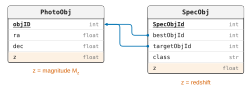
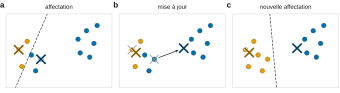
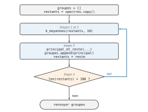
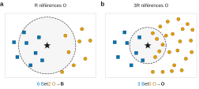
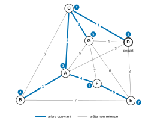
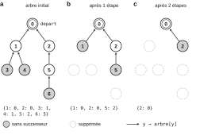

# CCINP PC — Informatique 2026 · Corrigé brut

*Corrigé rédigé par IA, non officiel. Signalez toute erreur.*

Épreuve PC5IN (mutualisée avec e3a-Polytech), 3 heures, calculatrice interdite. Python, sauf SQL pour les bases de données. Fonctions préimplémentées qui trivialisent une question (`min`, `max`, `.sort()`…) interdites, sauf mention contraire.

Les questions Q23, Q24 et Q28 s'appuient sur le Document Réponse (DR) : le graphe à sept sommets et le squelette de `recherche_distance_minimale` sont repris ci-dessous d'après le DR publié par le concours pour l'épreuve PSI, dont le sujet est identique au code d'épreuve près.

## Partie I — Interrogation d'une base de données astronomiques

### I.1 — Observation du ciel et poids des données

### Q1

Avec $n$ bits on code $2^n$ valeurs. Il faut $2^n \geqslant 256 = 2^8$, donc $n \geqslant 8$ :

$$\boxed{8 \text{ bits, soit 1 octet par pixel}}$$

Une photographie compte $2048 \times 1489$ pixels d'un octet chacun. Sans calculatrice :

$$\begin{aligned}
2048 \times 1489 &= 2 \times 1024 \times 1489 \\
&= 2978 \times 1024 \\
&= 3\,049\,472 \text{ octets.}
\end{aligned}$$

$$\boxed{3\,049\,472 \text{ octets} \approx 3 \text{ Mo}}$$

(soit $\approx 2{,}9$ Mio en unités binaires ; l'arrondi au mégaoctet donne 3 dans les deux conventions).

### Q2

On compte les longueurs d'onde échantillonnées de 380 à 920 nm par pas de 0,1 nm, bornes comprises :

$$\begin{aligned}
\frac{920 - 380}{0{,}1} &= 5400 \text{ intervalles,} \\
5400 + 1 &= 5401 \text{ longueurs d'onde.}
\end{aligned}$$

Chaque intensité est un flottant de 64 bits, soit 8 octets. On ne stocke que les intensités (la grille des longueurs d'onde est implicite) :

$$5401 \times 8 = 43\,208 \text{ octets}$$

$$\boxed{\text{un spectre occupe environ } 43 \text{ ko}}$$

Avec 5400 valeurs, on trouverait 43 200 octets, même arrondi.

### I.2 — Interrogation de la base en SQL

### Q3

Les deux identifiants sont dans `SpecObj` : pas de jointure.

```sql
SELECT COUNT(*)
FROM SpecObj
WHERE bestObjId = targetObjId;
```

### Q4

On regroupe les spectres par meilleure observation photographique, on filtre sur l'agrégat avec `HAVING`, on trie par effectif décroissant.

```sql
SELECT p.objID, COUNT(*) AS nb_spectres
FROM PhotoObj AS p
JOIN SpecObj AS s ON s.bestObjId = p.objID
GROUP BY p.objID
HAVING COUNT(*) >= 2
ORDER BY nb_spectres DESC;
```

La jointure garantit que l'identifiant renvoyé est bien celui d'un objet de `PhotoObj`.

### Q5

Identifiant, ascension droite et déclinaison viennent de la meilleure observation photographique (`PhotoObj`, jointure sur `bestObjId`), le redshift vient du spectre. L'attribut `z` existe dans les deux tables : magnitude dans `PhotoObj`, redshift dans `SpecObj`, il faut le qualifier.

```sql
SELECT p.objID, p.ra, p.dec, s.z
FROM PhotoObj AS p
JOIN SpecObj AS s ON s.bestObjId = p.objID
WHERE s.class = 'GALAXY'
  AND p.z < 17
  AND p.ra >= 100 AND p.ra <= 250;
```



## Partie II — Classification de spectres de galaxies

### II.1 — Justification de l'approche

### Q6

L'algorithme des $k$-moyennes est un **algorithme de classification non supervisée** : il partitionne des données non étiquetées en groupes de données proches au sens d'une distance, sans référence dont la classe serait connue.

1. On choisit $k$ centroïdes initiaux (par exemple $k$ données tirées au hasard).
2. On affecte chaque donnée au centroïde le plus proche, ce qui définit une partition en $k$ groupes.
3. On remplace chaque centroïde par le barycentre des données de son groupe.
4. On répète 2 et 3 jusqu'à ce que la partition ne change plus.



Le résultat dépend de l'initialisation et n'est en général qu'un optimum local de l'inertie intra-classe (somme des carrés des distances aux centroïdes).

**Le paramètre $k$ est le nombre de groupes (de centroïdes) recherchés, fixé à l'avance par l'utilisateur** ; l'algorithme ne le détermine pas.

### II.2 — Distance entre deux spectres

### Q7

```python
def distance(S1, S2):
    # S1, S2 : listes de N flottants ; renvoie sqrt( (1/N) * somme (S1[i]-S2[i])^2 )
    N = len(S1)
    somme = 0
    for i in range(N):
        somme = somme + (S1[i] - S2[i]) ** 2
    return (somme / N) ** 0.5
```

Coût $\Theta(N)$. La division par $N$ est faite sous la racine.

### Q8

```python
def positions_a_rejeter(S1, S2):
    # indices i ou S1[i] ou S2[i] vaut None (ou inclusif), dans l'ordre croissant
    rejet = []
    for i in range(len(S1)):
        if S1[i] == None or S2[i] == None:
            rejet.append(i)
    return rejet
```

La liste renvoyée est croissante et sans doublon (chaque indice est examiné une fois). Coût $\Theta(N)$.

### Q9

```python
def est_absent(element, L):
    for v in L:
        if v == element:
            return False   # element trouve
    return True            # parcours complet sans le trouver
```

Le pire cas est celui où `element` est absent : les $r$ éléments sont comparés, chaque comparaison étant en temps constant.

$$\boxed{\text{complexité dans le pire des cas : } \Theta(r)}$$

### Q10

Notons $A$ l'ensemble des indices de `a_rejeter`. Invariant de la boucle `for` de `distance2` :

$$\boxed{\text{au début de l'itération d'indice } i, \quad d = \sum_{\substack{0 \leqslant j < i \\ j \notin A}} \left(S_1[j] - S_2[j]\right)^2}$$

- Il est vrai pour $i = 0$ : la somme est vide.
- Il est conservé : le terme d'indice $i$ est ajouté si et seulement si `est_absent(i, a_rejeter)`.
- En sortie, pour $i = N$, $d$ est la somme sur les $m = N - r$ positions valides, car les indices de `a_rejeter` sont distincts et dans $[\![0, N-1]\!]$.

La valeur renvoyée est donc $\sqrt{d/m}$.

### Q11

Soit $N$ = `len(S1)` et $r$ = `len(a_rejeter)`, avec `a_rejeter` croissante (Q8).

**`distance2`** : $N$ tours de boucle, chacun appelant `est_absent(i, a_rejeter)`, de coût au plus $r$ (Q9). Plus précisément :
- pour les $N - r$ indices conservés, `i` est absent : $r$ comparaisons chacun ;
- pour un indice rejeté de rang $t$ dans `a_rejeter`, la recherche s'arrête après $t$ comparaisons.

Le nombre total de comparaisons vaut :

$$\begin{aligned}
c(N, r) &= (N - r)\,r + (1 + 2 + \dots + r) \\
&= (N - r)\,r + \frac{r(r+1)}{2}.
\end{aligned}$$

Pour $r \geqslant 1$, ce nombre est encadré :

$$\begin{aligned}
c(N, r) &\geqslant \frac{Nr}{2}, \\
c(N, r) &\leqslant Nr.
\end{aligned}$$

Avec le coût propre de la boucle :

$$\boxed{C_2(N, r) = \Theta(N + N r)}$$

On conclut : `distance2` est en $O(N r)$ dès que $r \geqslant 1$, donc quadratique si $r$ est proportionnel à $N$.

**`distance3`** : deux copies de listes de longueur $N$ en $\Theta(N)$, une boucle de $r$ tours en temps constant, une boucle de $N$ tours en temps constant. Comme $r \leqslant N$ :

$$\begin{aligned}
C_3(N, r) &= \Theta(N + r) \\
&= \Theta(N).
\end{aligned}$$

$$\boxed{\texttt{distance3} \text{ est en } O(N)}$$

`distance3` est linéaire mais utilise $\Theta(N)$ mémoire supplémentaire pour les copies.

### II.3 — Implémentation des $k$-moyennes

### Q12

```python
def produit_partition(spectres, centroides):
    # partitionnement[i] = indice du centroide le plus proche de spectres[i]
    partitionnement = []
    for S in spectres:
        partitionnement.append(trouve_centroide_le_plus_proche(S, centroides))
    return partitionnement
```

Sur l'exemple : $C_1, C_2, C_3$ ont les indices $0, 1, 2$, d'où `[1, 2, 1, 1, 0]`.

### Q13

```python
def k_moyennes(spectres, k):
    # suppose k <= len(spectres)
    centroides = initialise(k, spectres)
    partitionnement = produit_partition(spectres, centroides)
    ancien = []                       # differe de toute partition de p >= 1 elements
    while ancien != partitionnement:
        ancien = partitionnement
        centroides = calcule_centroides(ancien, spectres)          # mise a jour
        partitionnement = produit_partition(spectres, centroides)  # affectation
    return centroides, partitionnement
```

À la sortie, `partitionnement == ancien` : les centroïdes renvoyés sont les barycentres des groupes de la partition renvoyée et chaque spectre est affecté au plus proche d'entre eux. Les deux résultats sont donc cohérents. La boucle termine (non exigé) : si `trouve_centroide_le_plus_proche` ne change l'affectation d'un spectre que pour un centroïde strictement plus proche, l'inertie décroît strictement à chaque changement de partition, et il y a un nombre fini de partitions.

### II.4 — Détermination automatique du nombre de groupes

### Q14

Le test de l'étape 4 a lieu après un premier passage : boucle « faire… tant que ».



```python
def groupes_de_spectres(spectres):
    groupes = []
    restants = spectres.copy()        # la liste recue n'est pas modifiee
    continuer = True
    while continuer:
        # etapes 1 et 2 : k-moyennes avec k = 10 sur les spectres restants
        centroides, partitionnement = k_moyennes(restants, 10)
        # etape 3 : on extrait le groupe le plus peuple
        principal, reste = principal_et_reste(partitionnement, restants)
        groupes.append(principal)
        restants = reste
        # etape 4 : on recommence s'il reste plus de 100 spectres
        continuer = len(restants) > 100
    return groupes
```

Le groupe majoritaire est non vide, donc `len(restants)` décroît strictement : la boucle termine. Les au plus 100 spectres restants à l'arrêt ne sont dans aucun groupe, comme le veut l'énoncé. On suppose qu'il y a au moins 10 spectres au départ.

## Partie III — Classification de spectres stellaires

### Q15

L'algorithme des $k$ plus proches voisins est un **algorithme de classification supervisée** : on dispose de données de référence étiquetées (ici $7R$ spectres dont le type est connu). Pour classer un nouveau spectre $S$ :

1. on calcule la distance de $S$ à chaque référence ;
2. on retient les $k$ références les plus proches ;
3. on attribue à $S$ le type majoritaire parmi ces $k$ voisins (vote majoritaire).

**Ici $k$ est le nombre de voisins qui votent** (et non un nombre de groupes comme en partie II). Un $k$ petit rend la décision sensible au bruit, un $k$ grand fait voter des références éloignées.

### Q16

Le vote compte les voisins **en nombre**. Une classe plus représentée parmi les références occupe plus densément l'espace des spectres et apparaît plus souvent parmi les $k$ plus proches de n'importe quel point : elle est favorisée indépendamment de la ressemblance réelle. Prendre le même nombre $R$ de références par classe évite ce biais.

Si les références O étaient trois fois plus nombreuses que les B, alors que ces deux types sont spectralement proches, le voisinage d'une étoile B contiendrait souvent plus de références O que de références B : **beaucoup d'étoiles B, surtout près de la frontière entre les deux types, seraient classées O**. L'erreur est systématique, toujours dans le même sens.



De plus, le code fourni suppose des blocs de taille égale : `R = len(references) // len(types_spectraux)` (ligne 5) et `j = i // R` (ligne 17) attribueraient des références au mauvais type si les effectifs étaient inégaux.

### Q17

$$\boxed{k = 8}$$

On le voit à la ligne 26 : `type_spectral = mystere(S, 8)`. Le paramètre `k` reçoit cette valeur à l'appel ; il est ensuite utilisé à la ligne 13.

### Q18

- **Lignes 1 à 5** : chargement des $7R$ spectres de référence, liste des sept types dans l'ordre, et calcul du nombre $R$ de références par type.
- **Lignes 8 à 11** : calcul des distances du spectre `S` à chacune des références.
- **Lignes 12 à 18** : sélection des $k$ références les plus proches de `S` (distance strictement inférieure à la $(k+1)$-ième plus petite) et décompte de ces voisins par type spectral.
- **Lignes 19 à 22** : vote majoritaire : renvoi du type ayant le plus de voisins (le premier dans l'ordre O, B, A… en cas d'égalité).
- **Lignes 24 à 27** : classification de tous les spectres d'étoiles à classer, avec $k = 8$, et stockage des types obtenus.

### Q19

```text
mystere(S : list[float], k : int) -> str
```

- **Entrées** : `S` est le spectre à classer, liste de $N$ flottants échantillonnée comme les références ; `k` est un entier tel que $1 \leqslant k < 7R$ = `len(references)` (l'accès `copie_L[k]` l'exige).
- **Variables globales lues** : `references` (les $7R$ références rangées par blocs de $R$ dans l'ordre de `types_spectraux`), `R` et la liste des types (ainsi que les fonctions `distance` et `copie_ordonnee`).
- **Sortie** : une chaîne de `types_spectraux` (`"O"`, `"B"`, …, `"M"`), le type majoritaire parmi les $k$ références les plus proches de `S` ; en cas d'égalité, le premier type dans l'ordre de la liste.

### Q20

Un défaut est ici un cas où le script ne respecte pas sa spécification (renvoyer le type majoritaire parmi les $k$ plus proches voisins), non une complexité perfectible.

**Défaut 1 — lignes 13 et 16 (ex æquo au seuil)** : le seuil est la $(k+1)$-ième plus petite distance et le test est strict.
- Si la $k$-ième et la $(k+1)$-ième plus petites distances sont égales, moins de $k$ voisins sont retenus.
- Si les $k+1$ plus petites distances sont égales, aucun voisin n'est retenu. Alors `resultats` est nul, $M = 0$ et la fonction renvoie `"O"` sans rien signaler.

**Défaut 2 — lignes 19 à 22 (égalité du vote)** : si plusieurs types obtiennent le même nombre maximal de voisins, la boucle renvoie le premier dans l'ordre de `types_spectraux`, sans le signaler. Le résultat dépend alors de l'ordre arbitraire de la liste et non des données ; avec 8 voisins pour 7 types, ces égalités ne sont pas rares.

**Erreur de nom — ligne 14** : `resultats = [0] * len(type_spectraux)` utilise le nom `type_spectraux`, alors que la liste définie ligne 3 s'appelle `types_spectraux`. L'exécution s'arrête sur une erreur `NameError` au premier appel de `mystere` (ligne 26). Correction : `len(types_spectraux)`.

Autres défauts acceptables : `copie_L[k]` lève une erreur si $k \geqslant 7R$ (ligne 13) ; dépendance aux variables globales `references` et `R` (lignes 9, 15, 17) ; lignes 5 et 17 valides seulement si les références sont rangées par blocs égaux.

### Q21

On renvoie, avec le type, la proportion des voisins retenus qui ont voté pour lui (ligne 14 corrigée, maximum calculé sans `max`) :

```python
def mystere(S, k):
    # renvoie (type_spectral, confiance), confiance dans [0, 1]
    L = []
    for Sref in references:
        L.append(distance(S, Sref))
    copie_L = copie_ordonnee(L)
    seuil = copie_L[k]
    resultats = [0] * len(types_spectraux)
    total = 0                                  # nombre de voisins retenus
    for i in range(len(references)):
        if L[i] < seuil:
            j = i // R
            resultats[j] = resultats[j] + 1
            total = total + 1
    if total == 0:                             # cas degenere (ex aequo)
        return types_spectraux[0], 0.0
    imax = 0                                   # recherche du maximum
    for i in range(len(resultats)):
        if resultats[i] > resultats[imax]:
            imax = i
    return types_spectraux[imax], resultats[imax] / total
```

La confiance vaut 1 si les voisins sont unanimes et diminue quand ils se dispersent entre plusieurs types ; une valeur faible signale une étoile à la frontière entre deux types ou un spectre atypique. Si les $k = 8$ voisins sont bien retenus, elle vaut au moins $2/8$ (huit votes pour sept types). Variante : pondérer les votes par l'inverse de la distance.

### Q22

**Définition.** Pour un classifieur à $c$ classes, la matrice de confusion est une matrice $M$ de taille $c \times c$. Son coefficient $M_{ij}$ est le nombre de données de classe **réelle** $i$ auxquelles le classifieur attribue la classe **prédite** $j$.

La diagonale compte les bonnes classifications, les coefficients hors diagonale les confusions. Le taux de réussite est :

$$\tau = \frac{\sum_i M_{ii}}{\sum_{i,j} M_{ij}}$$

**Algorithme (langage naturel)** pour les $7R$ spectres de référence :

1. Créer une matrice $7 \times 7$ remplie de zéros (types dans l'ordre O, B, A, F, G, K, M).
2. Pour chaque indice $i$ de 0 à $7R - 1$ :
   - le type réel de `references[i]` est celui d'indice $i \,//\, R$ ;
   - classer `references[i]` par les $k$ plus proches voisins **en excluant la référence d'indice $i$ elle-même** des références (sinon elle serait son propre plus proche voisin, à distance nulle, et la matrice serait trop optimiste) ;
   - ajouter 1 au coefficient (type réel, type prédit).
3. Renvoyer la matrice.

## Partie IV — Reconnaissance des filaments galactiques

### IV.1 — Exemple pour comprendre le concept

Graphe du DR (sept sommets, quatorze arêtes) :

| Arête | CD | AB | AC | AD | CG | DG | AF | AG | EF | BC | EG | BE | FG | DE |
|---|---|---|---|---|---|---|---|---|---|---|---|---|---|---|
| Poids | 1 | 1 | 2 | 3 | 3 | 4 | 4 | 5 | 5 | 6 | 6 | 7 | 7 | 8 |

### Q23

Tableau de l'algorithme glouton depuis D : pour chaque sommet hors de l'arbre, plus petit poids d'une arête le reliant à l'arbre (entre parenthèses, l'extrémité dans l'arbre) ; on ajoute à chaque étape le sommet de valeur minimale, puis on met la ligne à jour avec les arêtes du sommet ajouté.

| Arbre | A | B | C | E | F | G | Ajout |
|---|---|---|---|---|---|---|---|
| D | 3 (D) | $\infty$ | **1 (D)** | 8 (D) | $\infty$ | 4 (D) | C par DC = 1 |
| D, C | **2 (C)** | 6 (C) | — | 8 (D) | $\infty$ | 3 (C) | A par CA = 2 |
| D, C, A | — | **1 (A)** | — | 8 (D) | 4 (A) | 3 (C) | B par AB = 1 |
| D, C, A, B | — | — | — | 7 (B) | 4 (A) | **3 (C)** | G par CG = 3 |
| D, C, A, B, G | — | — | — | 6 (G) | **4 (A)** | — | F par AF = 4 |
| D, C, A, B, G, F | — | — | — | **5 (F)** | — | — | E par FE = 5 |

$$\boxed{\text{Ordre d'ajout : D, C, A, B, G, F, E}}$$

Arbre couvrant (à tracer sur le graphe vierge du DR) : arêtes **DC (1), CA (2), AB (1), CG (3), AF (4), FE (5)**, soit $6 = 7 - 1$ arêtes (schéma ci-dessous).

$$1 + 2 + 1 + 3 + 4 + 5 = 16$$

$$\boxed{\text{Somme des pondérations} = 16}$$



### Q24

Depuis F :

| Arbre | A | B | C | D | E | G | Ajout |
|---|---|---|---|---|---|---|---|
| F | **4 (F)** | $\infty$ | $\infty$ | $\infty$ | 5 (F) | 7 (F) | A par FA = 4 |
| F, A | — | **1 (A)** | 2 (A) | 3 (A) | 5 (F) | 5 (A) | B par AB = 1 |
| F, A, B | — | — | **2 (A)** | 3 (A) | 5 (F) | 5 (A) | C par AC = 2 |
| F, A, B, C | — | — | — | **1 (C)** | 5 (F) | 3 (C) | D par CD = 1 |
| F, A, B, C, D | — | — | — | — | 5 (F) | **3 (C)** | G par CG = 3 |
| F, A, B, C, D, G | — | — | — | — | **5 (F)** | — | E par FE = 5 |

$$\boxed{\text{Ordre d'ajout : F, A, B, C, D, G, E}}$$

Arêtes retenues : FA (4), AB (1), AC (2), CD (1), CG (3), FE (5), poids total $16$.

**Commentaire.** L'ordre d'ajout change avec le sommet de départ, mais on obtient **le même arbre** (les mêmes six arêtes) et donc le même poids $16$.

- Le **poids total** ne peut pas dépendre du départ : l'algorithme fournit toujours un arbre couvrant de poids **minimal**, et ce minimum est une propriété du graphe.
- Les **arêtes**, en revanche, pourraient différer : le graphe a des poids répétés (1, 3, 4, 5, 6 et 7 apparaissent deux fois) et, en général, deux départs peuvent alors donner deux arbres différents de même poids (cas extrême cité par l'énoncé : toutes les arêtes de même poids).
- Ici l'arbre minimal est **unique** : chaque arête non retenue est strictement plus lourde que toutes les arêtes du cycle qu'elle fermerait avec l'arbre (AD = 3 ferme D–C–A de poids 1 et 2 ; DG = 4 ferme D–C–G de poids 1 et 3 ; AG = 5 ferme A–C–G de poids 2 et 3 ; BC = 6 ferme B–A–C de poids 1 et 2 ; EG = 6 ferme E–F–A–C–G de poids au plus 5 ; BE = 7, FG = 7 et DE = 8 de même). Tout arbre couvrant minimal coïncide donc avec celui-ci.

Des poids deux à deux distincts suffisent à garantir l'unicité, sans être nécessaires, comme le montre cet exemple.

Preuve de la condition suffisante. Soient $T_1 \neq T_2$ deux arbres couvrants minimaux. Soit $e$ l'arête de plus petit poids appartenant à un seul des deux, disons $e \in T_1 \setminus T_2$.

Le graphe $T_2 + e$ contient un cycle, qui n'est pas inclus dans $T_1$. Ce cycle contient donc une arête $f \in T_2 \setminus T_1$, et $w(f) > w(e)$ par poids distincts et minimalité de $e$.

Alors $T_2 + e - f$ est un arbre couvrant de poids strictement inférieur à celui de $T_2$ : contradiction.

### IV.2 — Application à la distribution de galaxies : initialisation du graphe

### Q25

```python
def poids(coords, i, j):
    # carre de la distance euclidienne entre les galaxies i et j
    xi, yi, zi = coords[i]
    xj, yj, zj = coords[j]
    return (xi - xj) ** 2 + (yi - yj) ** 2 + (zi - zj) ** 2
```

Sur l'exemple : $(0-3)^2 + (1-2)^2 + (5-5)^2 = 9 + 1 + 0 = 10$.

### Q26

```python
def matrice_adjacence(coords):
    # M[i][j] = poids(coords, i, j) ; graphe complet
    n = len(coords)
    M = []
    for i in range(n):
        ligne = []
        for j in range(n):
            ligne.append(poids(coords, i, j))
        M.append(ligne)
    return M
```

La matrice est symétrique, de diagonale nulle ; coût $\Theta(N^2)$ en temps et en mémoire. (On évite `[[0] * n] * n`, qui partagerait la même ligne $n$ fois.)

### IV.3 — Algorithme de construction de l'arbre

### Q27

```python
def initialisation_distance(G, depart):
    dist = {}
    for i in range(len(G)):
        dist[i] = float('inf')
    dist[depart] = 0
    return dist
```

Toutes les galaxies sont clefs ; `depart`, à distance nulle, sera choisie la première.

### Q28

Squelette du DR complété :

```python
def recherche_distance_minimale(dist):
    mindist = float('inf')
    candidat = None
    for gal in dist:
        if dist[gal] < mindist:
            mindist = dist[gal]
            candidat = gal
    del dist[candidat] # Suppression de la clef candidate du dictionnaire
    return candidat    # et renvoi du candidat
```

La boucle maintient dans `mindist` la plus petite distance rencontrée et dans `candidat` la galaxie qui la réalise ; la galaxie de `dist` la plus proche de l'arbre est retirée de `dist` (modification visible depuis l'appelant), puis renvoyée. Cette suppression, fournie par le squelette, est indispensable : `mise_a_jour` ne traite que les galaxies encore dans `dist`, et la boucle `while len(dist) != 0` ne terminerait pas sinon. Ici le graphe est complet à poids finis : au premier appel `dist[depart]` vaut $0$, ensuite toutes les valeurs restantes sont finies, donc `candidat` n'est jamais `None`. Sur un graphe où toutes les valeurs restantes vaudraient `float('inf')`, il faudrait écrire `if candidat is None or dist[gal] < mindist:`. Coût $\Theta(|\texttt{dist}|)$.

### Q29

Variant : $V = $ `len(dist)`.

- $V$ est un entier naturel.
- À chaque tour, `recherche_distance_minimale` retire exactement une clef ($V$ diminue de 1) et `mise_a_jour` n'ajoute ni ne retire aucune clef (elle ne modifie `dist[y]` que si `y in dist`). Donc $V$ décroît strictement de 1 par tour.

Une suite d'entiers naturels strictement décroissante est finie : **la boucle termine**, après exactement $N$ tours puisque $V = N$ au départ (Q27).

### Q30

Soit $N$ = `len(G)`.

- `initialisation_distance` : $N$ insertions en $O(1)$, soit $\Theta(N)$.
- `recherche_distance_minimale` : parcours des clefs restantes, $\Theta(|\text{dist}|)$ ; au $t$-ième tour il reste $N - t + 1$ clefs.
- `mise_a_jour` : boucle de $N$ tours, chacun avec un test d'appartenance à un dictionnaire en $O(1)$ (hypothèse de l'annexe), un accès `G[x][y]` et au plus deux affectations en $O(1)$, soit $\Theta(N)$.
- Boucle principale : $N$ tours (Q29), chacun avec un appel à `recherche_distance_minimale` et un appel à `mise_a_jour`.

En sommant sur les $N$ tours, sans oublier l'initialisation :

$$\begin{aligned}
C(N) &= \Theta(N) + \sum_{t=1}^{N} (N - t + 1) + N \cdot \Theta(N) \\
&= \Theta(N) + \frac{N(N+1)}{2} + \Theta(N^2).
\end{aligned}$$

$$\boxed{C(N) = O(N^2), \text{ et même } \Theta(N^2)}$$

### IV.4 — Élagage de l'arbre couvrant de poids minimal

### Q31

Un seul parcours : chaque clef `y` apporte un successeur à son prédécesseur `x = arbre[y]`.

```python
def dico_galaxies_avec_successeurs(arbre):
    nb_succ = {}
    for y in arbre:
        x = arbre[y]                 # y est un successeur de x
        if x in nb_succ:
            nb_succ[x] = nb_succ[x] + 1
        else:
            nb_succ[x] = 1
    return nb_succ
```

Une galaxie est clef de `nb_succ` si et seulement si elle est la valeur d'au moins une clef, c'est-à-dire si elle a au moins un successeur (la racine `depart`, qui n'est pas clef de `arbre`, y figure si elle a un successeur). Coût $\Theta(n)$ avec $n$ = `len(arbre)` (opérations sur dictionnaire en $O(1)$).

### Q32

À chaque étape, `elagage` recalcule les galaxies ayant au moins un successeur et ne conserve que les clefs qui en font partie : elle **supprime toutes les feuilles** de l'arbre (galaxies dont aucune autre n'est le successeur). Les feuilles supprimées en créent de nouvelles, donc en répétant `nb_etapes` fois, toute branche latérale de longueur au plus `nb_etapes` disparaît entièrement, et les extrémités des longues branches reculent de `nb_etapes` sommets. Le dictionnaire passé en argument n'est pas modifié (on en construit un nouveau à chaque étape).



Intérêt : l'arbre couvrant minimal relie toutes les galaxies, ce qui crée de nombreuses petites ramifications (« radicules » de la figure 5(a) de l'énoncé, en particulier dans les amas). **L'élagage les supprime et ne laisse que le squelette formé par les longues chaînes, c'est-à-dire le filament galactique** (figure 5(b) de l'énoncé). `nb_etapes` règle la sévérité : trop petit, il reste des radicules ; trop grand, le filament est rogné par ses extrémités.

### IV.5 — Séparation des groupes sans filament

### Q33

La longueur d'une liaison $y \to x$ est la distance euclidienne $\sqrt{G[y][x]}$ (les coefficients de `G` sont des carrés de distances, Q25). On calcule d'abord la moyenne $\ell_m$ sur toutes les liaisons de l'arbre reçu, puis on construit un nouveau dictionnaire sans les liaisons trop longues.

```python
def separation(G, arbre, alpha):
    # renvoie un nouveau dictionnaire de predecesseurs ; G et arbre non modifies
    n = len(arbre)
    if n == 0:
        return {}
    total = 0
    for y in arbre:                              # longueur moyenne des liaisons
        total = total + G[y][arbre[y]] ** 0.5
    lm = total / n
    resultat = {}
    for y in arbre:                              # on ne garde que les liaisons courtes
        if G[y][arbre[y]] ** 0.5 <= alpha * lm:
            resultat[y] = arbre[y]
    return resultat
```

Les sommets dont la distance au prédécesseur dépasse $\alpha \ell_m$ perdent leur liaison : l'arbre se scinde en plusieurs composantes connexes (amas isolé séparé du filament, figure 3 de l'énoncé). Coût $\Theta(n)$. Comme $\alpha$ est choisi empiriquement, travailler directement sur les carrés `G[y][arbre[y]]` (moyenne et seuil) est une variante acceptable, à condition d'être cohérent aux deux endroits.

**FIN**
