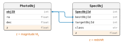
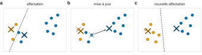
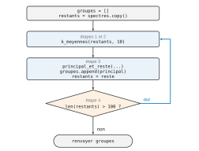
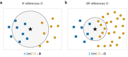
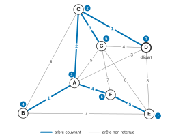
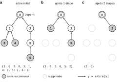

# CCINP PC — Informatique 2026 · Corrigé guidé

*Corrigé rédigé par IA, non officiel. Signalez toute erreur.*

## Présentation du sujet

**Thème.** « Autour de l'astro-informatique » : le sujet suit la chaîne de traitement des données du *Sloan Digital Sky Survey* (SDSS), des photographies et spectres bruts jusqu'à la détection des filaments galactiques. Épreuve PC5IN, mutualisée avec e3a-Polytech, 3 heures, **calculatrice interdite**, Python (SQL pour les bases de données), réponses sur un Document Réponse (DR) de 12 pages qui fournit les signatures typées attendues, le graphe de Q23–Q24 et le squelette de Q28.

**Découpage en quatre parties indépendantes, 33 questions.**

- **Partie I (Q1–Q5) — Base de données astronomiques.** Deux calculs de taille mémoire (bits, octets, ordre de grandeur sans calculatrice), puis trois requêtes SQL sur deux tables `PhotoObj` et `SpecObj` reliées par deux clefs étrangères. Piège central : l'attribut `z` désigne une magnitude dans une table et un redshift dans l'autre.
- **Partie II (Q6–Q14) — $k$-moyennes sur des spectres de galaxies.** Cours sur l'algorithme, distance entre spectres, gestion des valeurs manquantes (`None`), invariant de boucle et complexités comparées, puis assemblage de fonctions fournies pour écrire les $k$-moyennes et un algorithme itératif de « pelage » des groupes.
- **Partie III (Q15–Q22) — $k$ plus proches voisins sur des spectres d'étoiles.** Cours, biais dû aux effectifs déséquilibrés, puis **lecture critique d'un script fourni** (valeur de $k$, rôle des blocs, signature, défauts, ajout d'un niveau de confiance) et matrice de confusion.
- **Partie IV (Q23–Q33) — Arbre couvrant de poids minimal.** Algorithme de Prim à la main sur le graphe-jouet à sept sommets du DR, construction de la matrice d'adjacence, fonctions auxiliaires de Prim, variant de boucle, complexité, puis élagage et séparation de l'arbre.

**Notions du programme mobilisées.** Représentation des nombres et taille des données ; SQL (jointure, agrégats, `GROUP BY`/`HAVING`, `ORDER BY`) ; parcours de listes et de dictionnaires ; invariant et variant de boucle ; complexité dans le pire des cas ; apprentissage non supervisé ($k$-moyennes) et supervisé ($k$ plus proches voisins, matrice de confusion) ; graphes pondérés, matrice d'adjacence, arbre couvrant, algorithme glouton.

**Difficulté et longueur.** Sujet long mais sans question très difficile. Les points se gagnent sur la précision : compter juste (Q2, Q11, Q30), respecter la contrainte de l'annexe (pas de `min`, `max`, `.sort()`, pas de test `in` sur une liste), lire attentivement le code fourni (Q17–Q20, Q32).

**Questions à ne pas laisser passer.** Q1, Q2, Q3, Q5, Q7, Q8, Q9, Q12, Q17, Q25, Q26, Q27, Q28 : courtes et quasi mécaniques. Les questions de cours Q6 et Q15 aussi, à condition de répondre à la sous-question sur $k$. Q23–Q24 : un tableau bien tenu suffit.

**Ce que dit le rapport 2026.** Q7 a été tentée par 99 % des copies et réussie par environ 90 % d'entre elles ; Q17 est la question la plus réussie du sujet. Les questions discriminantes sont ailleurs :
- les questions de cours Q6 et Q15 : plus de la moitié des copies qui ont tenté Q6 n'y ont eu aucun point, souvent par confusion entre $k$-moyennes et $k$ plus proches voisins ;
- Q4 (un tiers seulement de requêtes sans erreur) et Q10 (moins de 10 % d'invariants corrects) ;
- Q13–Q14, traitées par à peine plus de la moitié des copies ;
- Q21 (30 % de tentatives, une sur trois aboutie), Q22 (matrice de confusion le plus souvent inconnue), Q31 (un tiers des copies) et Q33, la moins traitée.

Le jury prévient aussi que le barème privilégie la programmation : ne pas se contenter des questions de commentaire.

**Gestion du temps.** Les parties étant indépendantes, on peut commencer par la partie I (rapide) et la partie III (beaucoup de lecture, peu de code), puis la II et la IV, la plus longue (11 questions).

**Document Réponse.** Le graphe de Q23–Q24 et le squelette de Q28 sont repris d'après le DR publié par le concours pour l'épreuve PSI, dont le sujet est identique au code d'épreuve près.

## Partie I — Interrogation d'une base de données astronomiques

On commence par des ordres de grandeur sur la taille des données (codage binaire, octets), puis on interroge une base relationnelle à deux tables. Outils : puissances de 2, conversion bits/octets, requêtes SQL avec jointure et agrégats.

### Question 1

> [!INDICATION]
> Combien de valeurs distinctes peut-on coder avec $n$ bits ? Comparer à 256.

> [!INDICATION]
> Pour le produit sans calculatrice, faire apparaître 1024 dans 2048.

#### Solution

Avec $n$ bits on code $2^n$ valeurs. Il faut $2^n \geqslant 256 = 2^8$, donc $n \geqslant 8$ :

$$\boxed{8 \text{ bits, soit 1 octet par pixel}}$$

La photographie compte $2048 \times 1489$ pixels d'un octet chacun :

$$\begin{aligned}
2048 \times 1489 &= 2 \times 1024 \times 1489 \\
&= 2978 \times 1024 \\
&= 3\,049\,472 \text{ octets.}
\end{aligned}$$

$$\boxed{\text{environ } 3 \text{ Mo}}$$

En unités binaires, cela fait 2978 Kio, soit environ 2,9 Mio : l'arrondi au mégaoctet donne 3 dans les deux conventions.

> [!PIEGE]
> Les entiers de 0 à 255 sont au nombre de 256, pas 255 : $2^8 = 256$ convient exactement, et 9 bits serait faux. Ne pas oublier non plus de passer des bits aux octets (facteur 8) : selon le rapport 2026, l'égalité 8 bits = 1 octet semble souvent inconnue, et une réponse sur cinq était complètement fausse.

> [!METHODE]
> Contrôler l'ordre de grandeur : une photographie de quelques millions de pixels pèse quelques mégaoctets. Le jury relève des réponses aberrantes que ce simple contrôle aurait évitées.

### Question 2

> [!INDICATION]
> Compter le nombre de longueurs d'onde échantillonnées : nombre d'intervalles, puis nombre de points.

> [!INDICATION]
> Un flottant 64 bits occupe combien d'octets ?

#### Solution

De 380 à 920 nm par pas de 0,1 nm, les deux bornes étant mesurées :

$$\begin{aligned}
\frac{920 - 380}{0{,}1} &= 5400 \text{ intervalles,} \\
5400 + 1 &= 5401 \text{ longueurs d'onde.}
\end{aligned}$$

On ne stocke que les intensités, chacune sur 64 bits, soit 8 octets :

$$5401 \times 8 = 43\,208 \text{ octets}$$

$$\boxed{\text{environ } 43 \text{ ko par spectre}}$$

Compter 5400 valeurs donnerait 43 200 octets, même arrondi. Un spectre est environ 70 fois plus léger qu'une photographie.

> [!JURY]
> Le rapport 2026 rappelle que l'énoncé dit « déterminer » et non « donner » : « on attendait donc au moins de voir le calcul posé pour expliquer la démarche ». Les pertes de points viennent surtout d'erreurs de calcul et de la confusion bit/octet.

> [!METHODE]
> Sur une subdivision régulière de $[a, b]$ de pas $h$, il y a $(b-a)/h$ intervalles et $(b-a)/h + 1$ points. Dire explicitement ce que l'on compte évite l'erreur « du poteau de clôture ».

### Question 3

> [!INDICATION]
> Les deux attributs à comparer sont-ils dans la même table ? Une jointure est-elle utile ?

#### Solution

`bestObjId` et `targetObjId` sont tous deux dans `SpecObj` : une sélection puis un comptage suffisent.

```sql
SELECT COUNT(*)
FROM SpecObj
WHERE bestObjId = targetObjId;
```

> [!PIEGE]
> Une jointure avec `PhotoObj` est inutile, et un `DISTINCT` aussi : chaque ligne de `SpecObj` est un spectre distinct (clef primaire `SpecObjId`).

### Question 4

> [!INDICATION]
> On compte des spectres par objet photographique : quel regroupement ?

> [!INDICATION]
> Le filtre « au moins deux spectres » porte sur un agrégat : quelle clause s'applique après le regroupement ?

#### Solution

On associe à chaque objet de `PhotoObj` les spectres dont il est la meilleure observation, on regroupe par objet, on garde les groupes d'au moins deux spectres et on trie :

```sql
SELECT p.objID, COUNT(*) AS nb_spectres
FROM PhotoObj AS p
JOIN SpecObj AS s ON s.bestObjId = p.objID
GROUP BY p.objID
HAVING COUNT(*) >= 2
ORDER BY nb_spectres DESC;
```

Une version sans jointure (`SELECT bestObjId, COUNT(*) FROM SpecObj GROUP BY bestObjId …`) donne les mêmes identifiants si la base est cohérente ; la jointure garantit qu'ils figurent dans `PhotoObj`.

> [!PIEGE]
> `WHERE COUNT(*) >= 2` est une erreur : `WHERE` filtre les lignes avant le regroupement, `HAVING` filtre les groupes après. « Au moins deux » se traduit par `>= 2`. Autre faute relevée par le jury : `ORDER BY DESC` sans l'attribut de tri.

> [!JURY]
> Selon le rapport 2026, « seulement un tiers des candidats arrivent à mettre tous les éléments en place sans erreur » : le `GROUP BY` est oublié la plupart du temps, `HAVING` et `WHERE` sont confondus, l'ordre des clauses est mal respecté. Le jury conseille d'écrire une clause par ligne, comme ci-dessus, et de qualifier les attributs sous la forme `Table.attribut` (et non l'inverse).

### Question 5

> [!INDICATION]
> Les quatre colonnes demandées viennent-elles toutes de la même table ? La fin de l'énoncé impose la clef de jointure.

> [!INDICATION]
> Relire la description des deux attributs nommés `z`.

#### Solution

Identifiant, ascension droite et déclinaison sont dans `PhotoObj`, le redshift et la classe dans `SpecObj`. On joint par la meilleure observation photographique, `bestObjId`, et on qualifie chaque `z` :

```sql
SELECT p.objID, p.ra, p.dec, s.z
FROM PhotoObj AS p
JOIN SpecObj AS s ON s.bestObjId = p.objID
WHERE s.class = 'GALAXY'
  AND p.z < 17
  AND p.ra >= 100 AND p.ra <= 250;
```

`p.z` est la magnitude infrarouge (comparée à 17), `s.z` le redshift (affiché).



> [!PIEGE]
> Un `z` non qualifié est ambigu (rejeté par le moteur SQL) ou, pire, désigne la mauvaise grandeur. L'énoncé le signale lui-même (« à ne surtout pas confondre avec `PhotoObj.z` »). Le rapport 2026 relève aussi l'oubli de certains des critères demandés : classe, magnitude, intervalle d'ascension droite.

> [!JURY]
> Le rapport 2026 accepte deux façons de distinguer les deux `z` : préfixer par la table, ou une requête imbriquée avec alias. Il ajoute que les questions de SQL ne sont pas rangées par difficulté croissante : « il était donc déconseillé de sauter Q5 sous prétexte que Q4 semblait déjà difficile ».

## Partie II — Classification de spectres de galaxies

On classe des spectres sans étiquette par les $k$-moyennes. On écrit d'abord une distance robuste aux valeurs manquantes (avec invariant et complexité), puis on assemble des fonctions fournies pour programmer l'algorithme et une variante qui détermine le nombre de groupes.

### Question 6

> [!INDICATION]
> Situer l'algorithme : supervisé ou non supervisé ? Les données sont-elles étiquetées ?

> [!INDICATION]
> Décrire la boucle en deux temps (affectation, mise à jour), son critère d'arrêt, puis répondre explicitement sur $k$.

#### Solution

L'algorithme des $k$-moyennes est un **algorithme de classification non supervisée** : il partitionne des données non étiquetées en groupes de données proches au sens d'une distance, sans référence dont la classe serait connue.

1. Initialisation : choisir $k$ centroïdes (par exemple $k$ données tirées au hasard).
2. Affectation : rattacher chaque donnée au centroïde le plus proche (partition en $k$ groupes).
3. Mise à jour : remplacer chaque centroïde par le barycentre de son groupe.
4. Recommencer 2 et 3 jusqu'à ce que la partition ne change plus.



Le résultat dépend de l'initialisation et n'est en général qu'un minimum local de l'inertie intra-classe.

**$k$ est le nombre de groupes (de centroïdes) recherchés, fixé à l'avance par l'utilisateur.**

> [!PIEGE]
> Ne pas confondre avec le $k$ des $k$ plus proches voisins (partie III), qui est un nombre de voisins. Et l'algorithme ne « trouve » pas le bon nombre de groupes : c'est justement l'objet de la sous-partie II.4.

> [!JURY]
> Question discriminante : selon le rapport 2026, sur les 75 % de copies qui l'ont tentée, plus de la moitié n'a eu aucun point, très souvent par confusion avec les $k$ plus proches voisins. Le jury note aussi : « Le fait qu’il s’agisse d’un algorithme de classification a été très peu mis en évidence. » Le dire dès la première phrase.

### Question 7

> [!INDICATION]
> Traduire la formule par une accumulation dans une boucle indexée.

> [!INDICATION]
> Pour la racine carrée sans module, l'énoncé lui-même utilise un exposant.

#### Solution

```python
def distance(S1, S2):
    # S1, S2 : listes de N flottants ; renvoie sqrt( (1/N) * somme (S1[i]-S2[i])^2 )
    N = len(S1)
    somme = 0
    for i in range(N):
        somme = somme + (S1[i] - S2[i]) ** 2
    return (somme / N) ** 0.5
```

Coût $\Theta(N)$.

> [!PIEGE]
> La division par $N$ est sous la racine. Et `^` n'est pas la puissance en Python (c'est le « ou exclusif » bit à bit) : on écrit `** 2`.

> [!JURY]
> Question réussie par environ 90 % des copies selon le rapport 2026. Les fautes relevées : bornes du `range`, cumul oublié dans la somme, et surtout l'écrasement des arguments par un `S1 = []` en début de fonction (« il ne faut surtout pas écraser les arguments donnés à la fonction »). Un nom de variable ne peut pas contenir de parenthèses : `d(S1, S2) = …` n'a pas de sens en Python.

### Question 8

> [!INDICATION]
> On renvoie des indices : parcourir les positions, pas les valeurs.

> [!INDICATION]
> « Soit S1[i], soit S2[i] » : un ou inclusif, avec deux tests complets.

#### Solution

```python
def positions_a_rejeter(S1, S2):
    rejet = []
    for i in range(len(S1)):
        if S1[i] == None or S2[i] == None:
            rejet.append(i)
    return rejet
```

La liste obtenue est croissante et sans doublon, propriété utilisée en Q10 et Q11. Coût $\Theta(N)$.

> [!PIEGE]
> `if S1[i] or S2[i] == None` est faux : le premier membre teste la valeur de vérité de `S1[i]`. Toute intensité non nulle de `S1` ferait rejeter l'indice, et un `None` dans `S1` ne serait pas détecté. Il faut comparer chaque valeur à `None`.

> [!PIEGE]
> Erreur relevée par le rapport 2026 : deux `if` successifs (un pour `S1`, un pour `S2`) ajoutent deux fois l'indice quand `S1[i]` et `S2[i]` valent tous deux `None`. Une condition composée par `or` (ou un `if`/`elif`) l'évite.

### Question 9

> [!INDICATION]
> Recherche séquentielle avec sortie anticipée. Le test `element in L` sur une liste trivialiserait la question.

> [!INDICATION]
> Pour la complexité, identifier précisément le pire cas.

#### Solution

```python
def est_absent(element, L):
    for v in L:
        if v == element:
            return False   # trouve : on conclut tout de suite
    return True            # parcours complet sans le trouver
```

Le pire cas est celui où `element` est absent de `L` : on effectue les $r$ comparaisons, chacune en temps constant.

$$\boxed{\text{complexité dans le pire des cas } \Theta(r)}$$

> [!PIEGE]
> Mettre `return True` dans un `else` du `if` fait conclure dès le premier élément examiné. Le `return True` se place après la boucle. Autre erreur typique relevée par le rapport 2026 : inverser `True` et `False`, alors que le nom `est_absent` dit ce que l'on renvoie.

> [!JURY]
> Le rapport 2026 indique que la réponse `return not(element in L)` a été sanctionnée : on attendait un vrai parcours de la liste, en distinguant l'élément de sa position. Il rappelle aussi qu'un `if` n'appelle pas forcément de `else`.

### Question 10

> [!INDICATION]
> Un invariant utile exprime la valeur de l'accumulateur `d` en fonction de l'indice de boucle.

> [!INDICATION]
> Vérifier que, spécialisé en fin de boucle, il donne exactement ce que la fonction doit calculer.

#### Solution

Soit $A$ l'ensemble des indices de `a_rejeter`. Invariant :

$$\boxed{\text{au début de l'itération d'indice } i, \quad d = \sum_{\substack{0 \leqslant j < i \\ j \notin A}} \left(S_1[j] - S_2[j]\right)^2}$$

- Il est vrai pour $i = 0$ : la somme est vide.
- Il est conservé : le terme d'indice $i$ est ajouté si et seulement si $i \notin A$.
- Pour $i = N$, il donne la somme des carrés des écarts sur les $m = N - r$ positions valides.

La fonction renvoie donc bien $\sqrt{d/m}$.

> [!METHODE]
> Un bon invariant pour une boucle d'accumulation : « l'accumulateur contient le résultat partiel sur les indices déjà traités ». Préciser à quel moment il est évalué (début ou fin d'itération).

> [!PIEGE]
> Un invariant vrai mais inutile (« `d` est positif ») ne répond pas : l'énoncé demande un invariant « utile pour démontrer la correction ».

> [!JURY]
> Question la plus discriminante de la partie II, selon le rapport 2026 : « Moins de 10% des candidats ont su trouver un invariant. » Le jury se demande si la notion elle-même est comprise. Un invariant est une propriété qui relie les variables à l'indice de boucle et qui, en sortie, donne le résultat.

### Question 11

> [!INDICATION]
> Dans `distance2`, chaque tour de boucle appelle `est_absent` : quel est le coût de cet appel, selon que l'indice est rejeté ou non ?

> [!INDICATION]
> Pour un indice rejeté, la recherche s'arrête à son rang dans `a_rejeter` (liste croissante). Sommer ces rangs.

> [!INDICATION]
> Dans `distance3`, ne pas oublier le coût des copies.

#### Solution

Soit $N$ = `len(S1)`, $r$ = `len(a_rejeter)`, $0 \leqslant r \leqslant N$.

**`distance2`.** $N$ tours, chacun appelant `est_absent(i, a_rejeter)`, de coût au plus $r$ (Q9) :
- les $N - r$ indices conservés sont absents de `a_rejeter` : $r$ comparaisons chacun ;
- l'indice rejeté de rang $t$ est trouvé après $t$ comparaisons.

Nombre total de comparaisons :

$$\begin{aligned}
c(N, r) &= (N - r)\,r + (1 + 2 + \dots + r) \\
&= (N - r)\,r + \frac{r(r+1)}{2}.
\end{aligned}$$

Pour $r \geqslant 1$, ce nombre est encadré :

$$\begin{aligned}
c(N, r) &\geqslant \frac{Nr}{2}, \\
c(N, r) &\leqslant Nr.
\end{aligned}$$

Avec le coût de la boucle elle-même :

$$\boxed{C_2(N, r) = \Theta(N + Nr)}$$

Conclusion : `distance2` est en $O(Nr)$ dès que $r \geqslant 1$, donc quadratique si $r$ est proportionnel à $N$.

**`distance3`.** Deux copies en $\Theta(N)$, une boucle de $r$ tours et une boucle de $N$ tours, toutes deux à corps constant. Comme $r \leqslant N$ :

$$\begin{aligned}
C_3(N, r) &= \Theta(N + r) \\
&= \Theta(N).
\end{aligned}$$

$$\boxed{\texttt{distance3} \text{ est en } O(N)}$$

`distance3` est linéaire, au prix de $\Theta(N)$ mémoire supplémentaire.

> [!PIEGE]
> Compter la boucle de `distance2` pour $\Theta(N)$ en oubliant le coût de l'appel imbriqué. Autre piège plus fin : justifier $\Theta(Nr)$ par les seuls indices conservés ; si $r$ est proche de $N$, ce terme est petit et ce sont les indices rejetés qui coûtent.

> [!METHODE]
> Une complexité « en fonction de $N$ et de $r$ » signale presque toujours un appel imbriqué dont le coût dépend du second paramètre.

> [!JURY]
> Le rapport 2026 : « La réponse attendue pour une question de complexité est généralement sous forme d’un grand O. » Le calcul rapporte les points de justification, « mais il ne faut pas oublier de conclure ». Le défaut le plus fréquent ici : oublier le coût de la recherche dans `a_rejeter` pour `distance2`.

### Question 12

> [!INDICATION]
> Une des fonctions fournies fait déjà tout le travail pour un spectre.

#### Solution

```python
def produit_partition(spectres, centroides):
    partitionnement = []
    for S in spectres:
        partitionnement.append(trouve_centroide_le_plus_proche(S, centroides))
    return partitionnement
```

Sur l'exemple, $C_1, C_2, C_3$ ont les indices 0, 1, 2 : on obtient `[1, 2, 1, 1, 0]`.

> [!PIEGE]
> Confusion relevée par le rapport 2026 : en bouclant sur les indices, le spectre est `spectres[i]` ; en bouclant sur les spectres, c'est la variable de boucle elle-même. Mélanger les deux (`spectres[S]`, ou `i` passé comme spectre) est faux.

### Question 13

> [!INDICATION]
> Enchaîner initialisation, affectation (Q12) et mise à jour (`calcule_centroides`).

> [!INDICATION]
> Pour comparer deux partitions successives, il faut une « partition précédente » au premier tour ; la choisir pour que la boucle démarre.

#### Solution

```python
def k_moyennes(spectres, k):
    # suppose k <= len(spectres)
    centroides = initialise(k, spectres)
    partitionnement = produit_partition(spectres, centroides)
    ancien = []                       # differe de toute partition non vide
    while ancien != partitionnement:
        ancien = partitionnement
        centroides = calcule_centroides(ancien, spectres)
        partitionnement = produit_partition(spectres, centroides)
    return centroides, partitionnement
```

À l'arrêt, `partitionnement == ancien` : les centroïdes renvoyés sont les barycentres des groupes de la partition renvoyée, et chaque spectre est rattaché au plus proche d'entre eux. La comparaison de listes `!=` est autorisée par l'annexe. Terminaison (non demandée) : si un spectre ne change de groupe que pour un centroïde strictement plus proche, l'inertie décroît strictement à chaque changement de partition, et les partitions sont en nombre fini.

> [!PIEGE]
> Recalculer les centroïdes après le test d'arrêt peut renvoyer des centroïdes qui ne correspondent plus à la partition renvoyée. L'ordre « mise à jour puis affectation, puis test » garantit la cohérence des deux sorties.

> [!PIEGE]
> Erreur fréquente selon le rapport 2026 : se servir de `initialise` pour remplacer les spectres. Elle ne fournit que les $k$ centroïdes de départ, nécessaires au premier appel de `produit_partition` ; les spectres, bien plus nombreux, restent tous à classer.

### Question 14

> [!INDICATION]
> Repérer où se situe le test d'arrêt dans la description : avant ou après le premier passage ?

> [!INDICATION]
> `k_moyennes` renvoie deux listes ; `principal_et_reste` en renvoie deux aussi. Penser au dépaquetage.

#### Solution

L'étape 4 teste après un premier passage : boucle « faire… tant que », simulée avec un booléen.



```python
def groupes_de_spectres(spectres):
    groupes = []
    restants = spectres.copy()
    continuer = True
    while continuer:
        centroides, partitionnement = k_moyennes(restants, 10)          # etapes 1-2
        principal, reste = principal_et_reste(partitionnement, restants)  # etape 3
        groupes.append(principal)
        restants = reste
        continuer = len(restants) > 100                                   # etape 4
    return groupes
```

Le groupe majoritaire n'est jamais vide, donc `len(restants)` décroît strictement : la boucle termine. Les au plus 100 spectres restants sont « perdus ». On suppose au moins 10 spectres au départ.

> [!METHODE]
> Pour traduire un algorithme décrit en étapes, repérer d'abord la structure de contrôle (où est le test ? qu'est-ce qui change d'un tour à l'autre ?) avant d'écrire la moindre ligne.

> [!PIEGE]
> Erreurs relevées par le rapport 2026 : reconstruire le reste à partir du groupe principal, alors que `principal_et_reste` le renvoie déjà ; mal placer la condition d'arrêt ; ajouter à la fin les spectres restants, que l'énoncé demande explicitement de laisser de côté.

> [!JURY]
> Q13 et Q14 ont été traitées par à peine plus de la moitié des copies, et seule la moitié de celles-ci a proposé quelque chose d'intéressant (rapport 2026). Elles demandaient de connaître le cours sur les $k$-moyennes : c'est là que se fait l'écart dans la partie II.

## Partie III — Classification de spectres stellaires

On passe à l'apprentissage supervisé : les références sont étiquetées. L'essentiel de la partie est la lecture critique d'un script de $k$ plus proches voisins, puis l'évaluation du classifieur par une matrice de confusion.

### Question 15

> [!INDICATION]
> Trois temps : distances aux références, sélection, vote.

> [!INDICATION]
> Distinguer clairement ce $k$ de celui de la partie II.

#### Solution

L'algorithme des $k$ plus proches voisins est un **algorithme de classification supervisée** : on dispose de références étiquetées (les $7R$ spectres de type connu). Pour classer un spectre $S$ :

1. calculer la distance de $S$ à chaque référence ;
2. retenir les $k$ références les plus proches ;
3. attribuer à $S$ le type majoritaire parmi ces $k$ voisins (vote majoritaire).

**$k$ est le nombre de voisins pris en compte dans le vote.** Petit, la décision est sensible au bruit ; grand, des références éloignées votent et les frontières entre classes s'estompent.

> [!PIEGE]
> S'arrêter à l'étape 2 : trouver les $k$ plus proches voisins n'est pas l'algorithme, c'est le vote qui classe. Le rapport 2026 relève cette réponse incomplète dans un nombre « bien trop important » de copies.

> [!JURY]
> Le rapport 2026 : « La notion de vote majoritaire suffisait en général pour distinguer les candidats qui ont passé un peu de temps à apprendre leur cours de deuxième année. » Comme en Q6, dire qu'il s'agit d'un algorithme de classification.

### Question 16

> [!INDICATION]
> Le vote compte des voisins en nombre absolu : que se passe-t-il si une classe a beaucoup plus de représentants ?

> [!INDICATION]
> Appliquer au voisinage d'une étoile de type B quand O et B sont proches.

#### Solution

Le vote ne corrige pas les effectifs : une classe sur-représentée parmi les références peuple plus densément l'espace et apparaît plus souvent parmi les $k$ plus proches de n'importe quel spectre. Des effectifs égaux $R$ rendent le vote équitable.

Si les références O étaient trois fois plus nombreuses que les B, deux types proches, le voisinage d'une étoile B contiendrait souvent davantage de références O : **de nombreuses étoiles B, surtout près de la frontière O/B, seraient classées O**. Le biais est systématique.



En outre, le script suppose des blocs égaux : `R = len(references) // len(types_spectraux)` (ligne 5) et `j = i // R` (ligne 17) attribueraient des références au mauvais type avec des effectifs inégaux.

> [!METHODE]
> Face à « que se passerait-il si… », conclure par un effet concret et orienté (ici : B classées O), pas par « le résultat serait moins bon ».

> [!JURY]
> Question mal traitée faute de connaître l'algorithme, selon le rapport 2026, qui ajoute : « Un petit schéma permettait d’expliquer la notion rapidement et avec élégance. » Le schéma ci-dessus en est un exemple.

### Question 17

> [!INDICATION]
> `k` est un paramètre de `mystere` : où la fonction est-elle appelée ?

#### Solution

$$\boxed{k = 8}$$

On le voit à la ligne 26 : `type_spectral = mystere(S, 8)`. La ligne 13 utilise `k` mais ne fixe pas sa valeur.

> [!PIEGE]
> Question la plus réussie du sujet selon le rapport 2026, mais quelques copies ont confondu $k$ (nombre de voisins) et $R$ (nombre de références par type, ligne 5).

### Question 18

> [!INDICATION]
> Pour chaque bloc, dire sa fonction dans l'algorithme des $k$ plus proches voisins (préparer, mesurer, sélectionner, voter, appliquer), pas reformuler les instructions.

#### Solution

- **Lignes 1 à 5** : chargement des $7R$ références, liste ordonnée des sept types, calcul du nombre $R$ de références par type.
- **Lignes 8 à 11** : calcul des distances de `S` à toutes les références.
- **Lignes 12 à 18** : sélection des $k$ références les plus proches (distance strictement inférieure à la $(k+1)$-ième plus petite) et décompte de ces voisins par type.
- **Lignes 19 à 22** : vote majoritaire, renvoi du type le plus représenté (le premier dans l'ordre en cas d'égalité).
- **Lignes 24 à 27** : classification de toutes les étoiles à classer avec $k = 8$ et stockage des résultats.

> [!PIEGE]
> « On trie `L` dans `copie_L` puis on prend `copie_L[k]` » est une paraphrase. La fonction de ce passage est de **sélectionner les $k$ plus proches voisins**.

> [!JURY]
> Le rapport 2026 relève beaucoup de paraphrases et attendait les étapes de l'algorithme ; les meilleures copies ont tenu une ligne par bloc. En particulier, « faire apparaitre la notion de vote majoritaire pour les lignes 19 à 22 était largement suffisant ».

### Question 19

> [!INDICATION]
> Une signature complète : types des paramètres et du résultat, plus les conditions sur les entrées.

> [!INDICATION]
> Regarder quels accès à une liste pourraient échouer, et quelles variables la fonction utilise sans les recevoir en paramètre.

#### Solution

```text
mystere(S : list[float], k : int) -> str
```

- **Entrées** : `S`, spectre à classer, liste de $N$ flottants échantillonnée comme les références ; `k`, entier avec $1 \leqslant k < 7R$ = `len(references)` (sinon `copie_L[k]` échoue).
- **Données globales utilisées** : `references` (rangées par blocs de $R$ dans l'ordre des types), `R`, la liste des types, les fonctions `distance` et `copie_ordonnee`.
- **Sortie** : un type de `types_spectraux` (`"O"`, …, `"M"`) : le type majoritaire parmi les $k$ plus proches références de `S`, le premier dans l'ordre de la liste en cas d'égalité.

> [!JURY]
> Pour le spectre, le rapport 2026 précise qu'« il était attendu de préciser que c’était une liste de flottants et pas juste une liste ». Reprendre la nomenclature du sujet pour les spécifications était jugé valable et efficace.

### Question 20

> [!INDICATION]
> Un défaut, ici, est un cas où le script ne fait pas ce qu'il prétend faire. Que se passe-t-il au test de la ligne 16 si plusieurs distances sont égales au seuil ?

> [!INDICATION]
> Même question pour le vote des lignes 19 à 22 : que renvoie la boucle si deux types font jeu égal ? Comparer aussi les noms de variables entre leur définition et leur utilisation.

#### Solution

Un défaut est ici un cas où le script ne respecte pas sa spécification (renvoyer le type majoritaire parmi les $k$ plus proches voisins), non une complexité perfectible.

**Défaut 1 — lignes 13 et 16 (ex æquo au seuil).** Le seuil est la $(k+1)$-ième plus petite distance et le test `L[i] < seuil` est strict.
- En cas d'ex æquo autour du seuil, moins de $k$ voisins sont retenus.
- Si les $k+1$ plus petites distances sont égales, aucun ne l'est. Alors `resultats` reste nul, $M = 0$ et la fonction renvoie `"O"` arbitrairement, sans signaler le problème.

**Défaut 2 — lignes 19 à 22 (égalité du vote).** Si plusieurs types obtiennent le même nombre maximal de voisins, la boucle renvoie le premier dans l'ordre de `types_spectraux`, sans le signaler. Le résultat dépend alors de l'ordre arbitraire de la liste et non des données ; avec 8 voisins pour 7 types, ces égalités ne sont pas rares.

**Erreur de nom — ligne 14.** `len(type_spectraux)` : la liste définie ligne 3 s'appelle `types_spectraux`. Le nom `type_spectraux` n'existe pas : erreur `NameError` au premier appel (ligne 26), le script ne s'exécute pas. Correction : `len(types_spectraux)`.

Autres défauts recevables : erreur d'indice ligne 13 si $k \geqslant 7R$ ; dépendance aux variables globales (lignes 9, 15, 17) ; lignes 5 et 17 valides seulement pour des blocs de références de même taille.

> [!METHODE]
> Pour critiquer un code, chercher deux sortes de défauts : ceux qui empêchent l'exécution (nom, indice, type) et ceux qui produisent silencieusement un résultat faux (cas limites, égalités). Toujours citer le numéro de ligne.

> [!PIEGE]
> Signaler une complexité non optimale (tri complet pour trouver $k$ voisins, par exemple) : c'est une amélioration possible, pas un défaut au sens de la question.

> [!JURY]
> Le rapport 2026 écarte les remarques de complexité : « Ce sont donc de vrais défauts algorithmiques qui étaient attendus ». Les deux défauts attendus sont l'égalité au seuil (nombre de voisins différent de $k$, voire nul) et l'égalité du vote (premier type renvoyé). La faute de frappe `type_spectraux`, non voulue par les auteurs, a été comptée comme un défaut majeur quand elle était signalée.

### Question 21

> [!INDICATION]
> Le tableau `resultats` contient déjà toute l'information du vote. Quelle proportion mesure l'accord des voisins ?

> [!INDICATION]
> Diviser par le nombre de voisins réellement retenus, et écrire la recherche du maximum sans `max`.

#### Solution

On renvoie le couple (type, confiance), la confiance étant la proportion des voisins retenus qui ont voté pour le type choisi :

```python
def mystere(S, k):
    L = []
    for Sref in references:
        L.append(distance(S, Sref))
    copie_L = copie_ordonnee(L)
    seuil = copie_L[k]
    resultats = [0] * len(types_spectraux)     # ligne 14 corrigee
    total = 0                                  # voisins effectivement retenus
    for i in range(len(references)):
        if L[i] < seuil:
            j = i // R
            resultats[j] = resultats[j] + 1
            total = total + 1
    if total == 0:                             # cas degenere : ex aequo
        return types_spectraux[0], 0.0
    imax = 0
    for i in range(len(resultats)):
        if resultats[i] > resultats[imax]:
            imax = i
    return types_spectraux[imax], resultats[imax] / total
```

La confiance vaut 1 si les voisins sont unanimes et baisse quand le vote se disperse ; une valeur faible signale une étoile à la frontière entre deux types ou un spectre atypique, à faire vérifier. Si les 8 voisins sont bien retenus, elle vaut au moins $2/8$. Variante : pondérer chaque vote par l'inverse de la distance.

> [!PIEGE]
> Diviser par `k` au lieu du nombre de voisins retenus : à cause des ex æquo (Q20), les deux peuvent différer.

> [!JURY]
> Selon le rapport 2026, 30 % des copies ont tenté cette question et une tentative sur trois seulement aboutissait : il fallait un peu de recul sur l'algorithme vu en cours. Une proposition simple, codée et justifiée, rapporte déjà des points.

### Question 22

> [!INDICATION]
> Une matrice carrée indexée par les classes : préciser ce que représentent lignes et colonnes.

> [!INDICATION]
> Pour l'algorithme, se demander ce qui se passe si l'on classe une référence alors qu'elle figure elle-même parmi les références.

#### Solution

**Définition.** Pour un classifieur à $c$ classes, la matrice de confusion $M$ est une matrice $c \times c$. Son coefficient $M_{ij}$ est le nombre de données de classe **réelle** $i$ classées dans la classe **prédite** $j$.

La diagonale compte les réussites, les autres coefficients les confusions. Le taux de réussite vaut :

$$\tau = \frac{\sum_i M_{ii}}{\sum_{i,j} M_{ij}}$$

**Algorithme en langage naturel.**

1. Créer une matrice $7 \times 7$ de zéros (types dans l'ordre O, B, A, F, G, K, M).
2. Pour chaque référence d'indice $i$ (de 0 à $7R - 1$) :
   - son type réel est le type d'indice $i \,//\, R$ ;
   - la classer par les $k$ plus proches voisins **en retirant la référence $i$ elle-même** de l'ensemble des références ;
   - ajouter 1 au coefficient (ligne du type réel, colonne du type prédit).
3. Renvoyer la matrice.

> [!PIEGE]
> Sans exclure la référence testée, elle est à distance nulle d'elle-même et vote toujours pour son propre type : la matrice est artificiellement bonne. Exclure par l'indice, pas par la distance nulle (deux références pourraient être identiques).

> [!JURY]
> D'après le rapport 2026, la définition d'une matrice de confusion semble inconnue de la plupart des candidats qui ont abordé la question : c'est une notion de cours de deuxième année, à connaître.

## Partie IV — Reconnaissance des filaments galactiques

On représente les galaxies par un graphe complet pondéré (carré des distances), on en extrait un arbre couvrant de poids minimal par l'algorithme de Prim, puis on l'élague et on le découpe pour faire apparaître les filaments. Outils : graphes, matrice d'adjacence, dictionnaires, variant, complexité.

Graphe du DR (sept sommets, quatorze arêtes) :

| Arête | CD | AB | AC | AD | CG | DG | AF | AG | EF | BC | EG | BE | FG | DE |
|---|---|---|---|---|---|---|---|---|---|---|---|---|---|---|
| Poids | 1 | 1 | 2 | 3 | 3 | 4 | 4 | 5 | 5 | 6 | 6 | 7 | 7 | 8 |

### Question 23

> [!INDICATION]
> À chaque étape, ne considérer que les arêtes qui relient un sommet déjà dans l'arbre à un sommet extérieur.

> [!INDICATION]
> Tenir un tableau : pour chaque sommet extérieur, sa distance actuelle à l'arbre, mise à jour après chaque ajout. Le minimum se prend sur **toute** la ligne, pas seulement parmi les arêtes du dernier sommet ajouté.

#### Solution

Entre parenthèses, l'extrémité dans l'arbre de l'arête la plus légère.

| Arbre | A | B | C | E | F | G | Ajout |
|---|---|---|---|---|---|---|---|
| D | 3 (D) | $\infty$ | **1 (D)** | 8 (D) | $\infty$ | 4 (D) | C par DC = 1 |
| D, C | **2 (C)** | 6 (C) | — | 8 (D) | $\infty$ | 3 (C) | A par CA = 2 |
| D, C, A | — | **1 (A)** | — | 8 (D) | 4 (A) | 3 (C) | B par AB = 1 |
| D, C, A, B | — | — | — | 7 (B) | 4 (A) | **3 (C)** | G par CG = 3 |
| D, C, A, B, G | — | — | — | 6 (G) | **4 (A)** | — | F par AF = 4 |
| D, C, A, B, G, F | — | — | — | **5 (F)** | — | — | E par FE = 5 |

$$\boxed{\text{Ordre d'ajout : D, C, A, B, G, F, E}}$$

Arbre à tracer sur le graphe vierge du DR : **DC (1), CA (2), AB (1), CG (3), AF (4), FE (5)**, six arêtes pour sept sommets (schéma ci-dessous).

$$1 + 2 + 1 + 3 + 4 + 5 = 16$$

$$\boxed{\text{Somme des pondérations} = 16}$$



> [!PIEGE]
> Choisir l'arête la plus légère du graphe entier (c'est un autre algorithme, qui peut former des morceaux séparés en cours de route) ou seulement parmi celles du dernier sommet ajouté. Après l'ajout de B, la seule arête issue de B vers l'extérieur est BE = 7, mais le bon choix est G par CG = 3, arête issue d'un sommet ajouté plus tôt.

> [!PIEGE]
> Le rapport 2026 : « Beaucoup de copies ont cherché à obtenir un chemin plutôt qu’un arbre, aboutissant à un résultat faux. » Ici C est relié à trois sommets (D, A et G) : l'arbre n'est pas un chemin, et le prolonger toujours depuis le dernier sommet ajouté donne un mauvais résultat.

> [!METHODE]
> Le tableau des distances à l'arbre est exactement le dictionnaire `dist` de la sous-partie IV.3 : le dérouler à la main prépare les questions Q27 à Q30.

### Question 24

> [!INDICATION]
> Même tableau depuis F. Comparer ensuite trois choses : l'ordre d'ajout, l'ensemble des arêtes, le poids total.

> [!INDICATION]
> L'algorithme renvoie toujours un arbre couvrant de poids minimal : qu'est-ce qui, alors, ne peut pas changer ? Pour les arêtes, s'appuyer sur le paragraphe de l'énoncé qui suit la question : quand l'arbre minimal est-il unique ?

#### Solution

| Arbre | A | B | C | D | E | G | Ajout |
|---|---|---|---|---|---|---|---|
| F | **4 (F)** | $\infty$ | $\infty$ | $\infty$ | 5 (F) | 7 (F) | A par FA = 4 |
| F, A | — | **1 (A)** | 2 (A) | 3 (A) | 5 (F) | 5 (A) | B par AB = 1 |
| F, A, B | — | — | **2 (A)** | 3 (A) | 5 (F) | 5 (A) | C par AC = 2 |
| F, A, B, C | — | — | — | **1 (C)** | 5 (F) | 3 (C) | D par CD = 1 |
| F, A, B, C, D | — | — | — | — | 5 (F) | **3 (C)** | G par CG = 3 |
| F, A, B, C, D, G | — | — | — | — | **5 (F)** | — | E par FE = 5 |

$$\boxed{\text{Ordre d'ajout : F, A, B, C, D, G, E}}$$

Arêtes : FA (4), AB (1), AC (2), CD (1), CG (3), FE (5), poids $16$.

**Commentaire.** L'ordre d'ajout dépend du départ, mais on retrouve **le même arbre** et le même poids $16$.

- Le **poids** est forcément le même : l'algorithme donne un arbre couvrant de poids minimal quel que soit le départ.
- Les **arêtes**, elles, pourraient différer : le graphe a des poids répétés et, en général, deux départs peuvent alors donner deux arbres différents de même poids.
- Ici l'arbre minimal est unique, car chaque arête non retenue est strictement plus lourde que toutes celles du cycle qu'elle fermerait (AD = 3 ferme D–C–A de poids 1 et 2 ; AG = 5 ferme A–C–G de poids 2 et 3 ; EG = 6 ferme E–F–A–C–G de poids au plus 5 ; de même pour DG, BC, BE, FG, DE).

Des poids distincts suffisent à l'unicité, sans être nécessaires (cet exemple le montre).

Preuve de la condition suffisante. Soient $T_1 \neq T_2$ deux arbres couvrants minimaux. Soit $e$ l'arête de plus petit poids qui n'appartient qu'à l'un d'eux, disons $e \in T_1 \setminus T_2$.

Le graphe $T_2 + e$ contient un cycle, non inclus dans l'arbre $T_1$. Ce cycle contient donc une arête $f \in T_2 \setminus T_1$, avec $w(f) > w(e)$.

Alors $T_2 + e - f$ est un arbre couvrant dont le poids vérifie :

$$w(T_2) + w(e) - w(f) < w(T_2)$$

C'est une contradiction avec la minimalité de $T_2$.

> [!PIEGE]
> Conclure que « le départ n'a jamais d'influence sur l'arbre » : c'est faux en général quand des poids sont égaux (l'énoncé cite le graphe dont toutes les arêtes ont le même poids). Ce qui ne dépend jamais du départ, c'est le **poids total**.

### Question 25

> [!INDICATION]
> Récupérer les trois coordonnées de chaque galaxie (dépaquetage de tuple) et appliquer la formule de $p_{ij}$, sans racine.

#### Solution

```python
def poids(coords, i, j):
    xi, yi, zi = coords[i]
    xj, yj, zj = coords[j]
    return (xi - xj) ** 2 + (yi - yj) ** 2 + (zi - zj) ** 2
```

Exemple : $(0-3)^2 + (1-2)^2 + (5-5)^2 = 10$.

> [!PIEGE]
> Ajouter une racine carrée par réflexe : le poids est le carré de la distance. L'arbre minimal n'en est pas changé (le carré préserve l'ordre des longueurs), mais la fonction doit respecter la définition.

> [!PIEGE]
> Erreur principale relevée par le rapport 2026 : utiliser des variables `x`, `y`, `z` qui ne sont pas définies dans les arguments. Les coordonnées se lisent dans `coords[i]` et `coords[j]` ; une boucle sur les trois coordonnées n'est pas nécessaire.

### Question 26

> [!INDICATION]
> Deux boucles imbriquées ; construire chaque ligne séparément.

#### Solution

```python
def matrice_adjacence(coords):
    n = len(coords)
    M = []
    for i in range(n):
        ligne = []
        for j in range(n):
            ligne.append(poids(coords, i, j))
        M.append(ligne)
    return M
```

Matrice symétrique, de diagonale nulle. Coût $\Theta(N^2)$ en temps et en mémoire : pour des dizaines de milliers de galaxies, cela fait des centaines de millions de coefficients, ce qui limite la méthode en pratique.

> [!PIEGE]
> `M = [[0] * n] * n` crée $n$ références vers la même ligne : modifier `M[0][1]` modifierait toute la colonne 1. Le rapport 2026 relève cette erreur, ainsi que `[[] * n]` (une liste contenant une seule liste vide) et l'accès à `M[i][j]` dans une liste vide.

> [!JURY]
> Le rapport 2026 précise que certaines copies ont exploité la symétrie de la matrice, « mais ne pas le faire n’était pas pénalisé ».

### Question 27

> [!INDICATION]
> Remplir toutes les clefs avec l'infini, puis traiter le cas du départ.

#### Solution

```python
def initialisation_distance(G, depart):
    dist = {}
    for i in range(len(G)):
        dist[i] = float('inf')
    dist[depart] = 0
    return dist
```

La valeur 0 garantit que `depart` sera la première galaxie choisie par Q28.

> [!PIEGE]
> Erreurs relevées par le rapport 2026 : `dist['depart']` (la chaîne de caractères) au lieu de `dist[depart]` (la variable) ; `G[i]` ou `G[i][j]` pris comme clefs au lieu de l'indice `i` ; départ traité avant la boucle puis écrasé par l'infini ; boucle commençant à 1 ou ne parcourant pas toutes les galaxies de 0 à `len(G) - 1`, alors que le départ peut être n'importe quelle galaxie. Remplir tout à l'infini puis corriger le départ, comme ci-dessus, évite tout cela.

### Question 28

> [!INDICATION]
> Le squelette du DR maintient le minimum courant `mindist` et la galaxie qui le réalise `candidat`. À quelle condition faut-il les mettre à jour, et que faut-il y ranger ?

> [!INDICATION]
> La boucle principale s'arrête quand `dist` est vide : vérifier que le squelette retire bien la galaxie trouvée.

#### Solution

Squelette du DR complété :

```python
def recherche_distance_minimale(dist):
    mindist = float('inf')
    candidat = None
    for gal in dist:
        if dist[gal] < mindist:
            mindist = dist[gal]
            candidat = gal
    del dist[candidat] # Suppression de la clef candidate du dictionnaire
    return candidat    # et renvoi du candidat
```

À la fin de la boucle, `candidat` est la galaxie de `dist` de distance minimale à l'arbre ; elle est retirée de `dist` (modification visible depuis l'appelant) puis renvoyée. Dans notre graphe complet à poids finis, `candidat` n'est jamais `None` : au premier appel `dist[depart] = 0`, ensuite toutes les valeurs restantes sont finies. Sur un graphe non connexe, où toutes les valeurs restantes pourraient valoir l'infini, il faudrait écrire `if candidat is None or dist[gal] < mindist:`. Coût $\Theta(|\texttt{dist}|)$.

> [!PIEGE]
> Mettre à jour `mindist` sans `candidat` (ou l'inverse) : les deux variables doivent changer ensemble. Sans la suppression de la clef, fournie par le squelette, la même galaxie serait choisie indéfiniment et `while len(dist) != 0` ne terminerait jamais. Comme en Q27, le rapport 2026 relève la confusion entre chaîne et variable : `dist['gal']` au lieu de `dist[gal]`.

> [!METHODE]
> Recherche du minimum sans `min` : une valeur courante initialisée à l'infini (ou au premier élément), un test strict, la mise à jour simultanée de la valeur et de l'élément qui la réalise.

### Question 29

> [!INDICATION]
> Chercher une quantité entière positive qui diminue à chaque tour de la boucle `while`. La condition de boucle la suggère.

> [!INDICATION]
> Vérifier les deux fonctions appelées dans le corps : l'une retire, l'autre ajoute-t-elle quelque chose ?

#### Solution

Variant : $V = $ `len(dist)`.

- $V$ est un entier naturel.
- Dans un tour, `recherche_distance_minimale` retire exactement une clef ; `mise_a_jour` ne modifie que des valeurs de clefs existantes (garde `if y in dist`) et n'ajoute ni ne retire de clef. $V$ diminue donc de 1 à chaque tour.

Une suite d'entiers naturels strictement décroissante est finie : la boucle termine, après exactement $N$ tours puisque $V = N$ au départ.

> [!METHODE]
> Justifier un variant, c'est vérifier les trois points : valeur entière, minorée, strictement décroissante à chaque tour, en examinant **toutes** les instructions du corps de boucle.

> [!JURY]
> Le rapport 2026 : « Attention néanmoins à bien définir ce qu’est un variant et à justifier correctement sa décroissance stricte. » Rappeler la définition avant de l'appliquer.

### Question 30

> [!INDICATION]
> Évaluer séparément chaque fonction, puis multiplier par le nombre de tours obtenu en Q29.

> [!INDICATION]
> L'annexe du sujet précise le coût du test d'appartenance à un dictionnaire.

#### Solution

Soit $N$ = `len(G)`.

- `initialisation_distance` : $N$ insertions en $O(1)$, $\Theta(N)$.
- `recherche_distance_minimale` : parcours des clefs restantes, $\Theta(|\text{dist}|)$, soit $N - t + 1$ au $t$-ième tour.
- `mise_a_jour` : $N$ tours, chacun avec un test `y in dist` en $O(1)$ (annexe), un accès `G[x][y]` et au plus deux affectations : $\Theta(N)$.
- Boucle principale : $N$ tours (Q29), chacun avec un appel à `recherche_distance_minimale` et un appel à `mise_a_jour`.

En sommant sur les $N$ tours, sans oublier l'initialisation :

$$\begin{aligned}
C(N) &= \Theta(N) + \sum_{t=1}^{N}(N - t + 1) + N \cdot \Theta(N) \\
&= \Theta(N) + \frac{N(N+1)}{2} + \Theta(N^2) \\
&= \Theta(N^2).
\end{aligned}$$

$$\boxed{C(N) = O(N^2) \text{ dans le pire des cas}}$$

Ce coût est du même ordre que la construction de la matrice d'adjacence (Q26), ce qui est inévitable pour un graphe complet à $N(N-1)/2$ arêtes.

> [!JURY]
> Abordée par la moitié des copies seulement, avec, selon le rapport 2026, « souvent des erreurs dans les combinaisons de complexités même si celles des fonctions de base sont souvent bien évaluées ». Le point délicat est la composition : un coût par tour, multiplié (ou sommé) sur les $N$ tours de la boucle principale.

### Question 31

> [!INDICATION]
> Plutôt que de chercher, pour chaque galaxie, combien de clefs la désignent (double boucle), parcourir une seule fois `arbre`.

> [!INDICATION]
> Chaque clef `y` apporte un successeur à une galaxie bien précise : laquelle ?

#### Solution

```python
def dico_galaxies_avec_successeurs(arbre):
    nb_succ = {}
    for y in arbre:
        x = arbre[y]              # y est un successeur de x
        if x in nb_succ:
            nb_succ[x] = nb_succ[x] + 1
        else:
            nb_succ[x] = 1
    return nb_succ
```

`x` est clef du résultat si et seulement si elle est valeur d'au moins une clef de `arbre`, c'est-à-dire si elle a au moins un successeur ; sa valeur est le nombre de tels `y`. Les galaxies sans successeur ne sont jamais insérées, et la racine `depart` (qui n'est pas clef de `arbre`) apparaît bien dès qu'elle a un successeur. Un seul parcours avec des opérations en $O(1)$ : $\Theta(n)$.

> [!METHODE]
> Compter des occurrences en $O(n)$ : un parcours unique et un dictionnaire de compteurs, initialisés à la première rencontre.

> [!JURY]
> Traitée par un tiers des copies. Le rapport 2026 : « La racine a souvent été oubliée malgré la dernière phrase de la question dans l’énoncé. » Les solutions qui parcourent les valeurs du dictionnaire (ici `arbre[y]` pour chaque clef `y`) n'ont pas ce problème et sont linéaires sans effort.

### Question 32

> [!INDICATION]
> Qu'est-ce qu'une galaxie qui n'est pas dans `nb_succ` ? Que devient-elle dans `arbre_elague` ?

> [!INDICATION]
> Que se passe-t-il à l'étape suivante pour une galaxie dont tous les successeurs viennent d'être supprimés ?

#### Solution

Une étape ne garde que les clefs ayant au moins un successeur : elle **supprime toutes les feuilles** de l'arbre. Or supprimer des feuilles en crée de nouvelles (les galaxies dont tous les successeurs ont disparu). Après `nb_etapes` étapes, toute branche latérale d'au plus `nb_etapes` sommets a disparu, et les extrémités des longues chaînes ont reculé d'autant. La racine, qui n'est pas clef, n'est jamais supprimée ; le dictionnaire reçu n'est pas modifié.



Intérêt : l'arbre couvrant minimal rattache **toutes** les galaxies, d'où une multitude de petites ramifications (« radicules ») le long du filament et dans les amas (figure 5(a) de l'énoncé). **L'élagage les supprime et ne laisse que le squelette des longues chaînes, c'est-à-dire le filament galactique** (figure 5(b) de l'énoncé). Trop peu d'étapes laissent des radicules, trop d'étapes rongent le filament par ses bouts.

> [!PIEGE]
> Confondre « sans successeur » (feuille, jamais valeur du dictionnaire) et « sans prédécesseur » (la racine). Et oublier l'effet cumulatif des étapes, qui explique la figure 5 de l'énoncé.

> [!JURY]
> Le rapport 2026 demande de s'appuyer sur ce que fait réellement le code. Le retrait des galaxies sans successeur est souvent cité, mais « celui de la répétition itérative de ce retrait l’a très rarement été ». Un schéma sur un petit arbre inventé, comme ci-dessus, a été très apprécié.

### Question 33

> [!INDICATION]
> Deux parcours : un pour la moyenne des longueurs de liaison, un pour le filtrage. Chaque clef `y` décrit une liaison vers `arbre[y]`.

> [!INDICATION]
> Les coefficients de `G` sont des carrés de distances (Q25) : que faut-il prendre pour une « longueur » ?

> [!INDICATION]
> « Les arguments ne doivent pas être modifiés » : construire un nouveau dictionnaire.

#### Solution

```python
def separation(G, arbre, alpha):
    n = len(arbre)
    if n == 0:
        return {}
    total = 0
    for y in arbre:                                   # longueur moyenne
        total = total + G[y][arbre[y]] ** 0.5
    lm = total / n
    resultat = {}
    for y in arbre:                                   # filtrage
        if G[y][arbre[y]] ** 0.5 <= alpha * lm:
            resultat[y] = arbre[y]
    return resultat
```

La moyenne est calculée sur toutes les liaisons de l'arbre reçu avant tout filtrage ; les sommets dont la distance au prédécesseur dépasse $\alpha \ell_m$ perdent leur liaison et l'arbre se scinde en composantes connexes (amas isolé détaché du filament, figure 3 de l'énoncé). Coût $\Theta(n)$. Comme $\alpha$ est empirique, raisonner directement sur les carrés `G[y][arbre[y]]` est une variante défendable, à condition de l'appliquer à la fois à la moyenne et au seuil.

> [!PIEGE]
> Supprimer des clefs de `arbre` (interdit par l'énoncé), ou calculer la moyenne au fil du filtrage : le seuil dépendrait alors de l'ordre de parcours.

> [!PIEGE]
> Erreur fréquente selon le rapport 2026 (question la moins traitée du sujet) : calculer la moyenne des distances sur toute la matrice `G`, c'est-à-dire sur toutes les paires de galaxies, au lieu des seules liaisons de l'arbre.

## Bilan

**Méthodes à retenir.**

- Taille des données : $n$ bits codent $2^n$ valeurs ; compter les points d'une subdivision ($+1$) ; convertir bits/octets.
- SQL : qualifier les attributs homonymes, `HAVING` pour filtrer sur un agrégat, jointure sur la clef imposée par l'énoncé.
- Programmation sous contrainte d'annexe : minimum, maximum et appartenance écrits à la main ; comptage par dictionnaire en un seul parcours.
- Preuve d'algorithme : invariant d'accumulation (« résultat partiel sur les indices traités »), variant = cardinal d'une structure qui perd un élément à chaque tour.
- Complexité : repérer les appels imbriqués et leur coût, sommer précisément quand le coût varie d'un tour à l'autre (Q11, Q30).
- Apprentissage : $k$-moyennes (non supervisé, $k$ = nombre de groupes) contre $k$ plus proches voisins (supervisé, $k$ = nombre de voisins) ; effectifs équilibrés ; matrice de confusion avec exclusion de la donnée testée.
- Graphes : algorithme de Prim déroulé avec un tableau des distances à l'arbre ; poids total d'un arbre couvrant minimal indépendant du départ ; unicité si les poids sont distincts.

**Ce qui a départagé les candidats (rapport 2026).** Le cours de deuxième année sur l'apprentissage : définitions des $k$-moyennes (Q6) et des $k$ plus proches voisins (Q15, le vote majoritaire), matrice de confusion (Q22). Les preuves : invariant (Q10, moins de 10 % de réussite), variant bien défini (Q29). La programmation des questions longues (Q13, Q14, Q31, Q33), que le barème privilégie face aux questions de commentaire. En SQL, Q4 (`GROUP BY`, `HAVING`, `ORDER BY … DESC`) et la distinction des deux `z` en Q5.

**Prérequis à revoir.** Annexe Python du programme (ce qui est autorisé), dictionnaires (parcours, `items`, test d'appartenance), copies de listes et leur caractère superficiel, jointures et agrégats SQL.

**Questions classiques transposables.** Recherche séquentielle et sa complexité (Q9), invariant d'une somme (Q10), $k$-moyennes et $k$ plus proches voisins (Q6, Q13, Q15), matrice de confusion (Q22), Prim avec matrice d'adjacence en $\Theta(N^2)$ (Q27–Q30), comptage des successeurs dans un arbre décrit par ses prédécesseurs (Q31), élagage itératif des feuilles (Q32).
