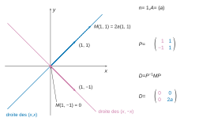
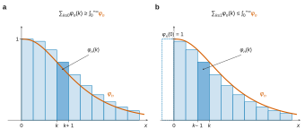

# CCINP PC — Mathématiques 2026 · Corrigé brut

*Corrigé rédigé par IA, non officiel. Signalez toute erreur.*

Épreuve PC1M, durée 4 heures, calculatrices interdites. Trois exercices indépendants, 37 questions.

Convention : pour $B\in\mathcal M_p(\mathbb R)$, on pose $\chi_B(X)=\det(XI_p-B)$. C'est la convention compatible avec la formule de la Q6. $\mathrm{Sp}(B)$ désigne l'ensemble des valeurs propres de $B$.

---

# Exercice 1 — Réduction de matrices par blocs

## Partie I - Étude d'une première forme

Ici $M=\begin{pmatrix}A&A\\A&A\end{pmatrix}$.

### I.1 - Étude d'un exemple

$n=2$, $A=\mathrm{diag}(1,2)$, donc
$$M=\begin{pmatrix}1&0&1&0\\0&2&0&2\\1&0&1&0\\0&2&0&2\end{pmatrix}.$$

**Q1.** $A$ est diagonale, donc symétrique. Par blocs,
$$M^\top=\begin{pmatrix}A^\top&A^\top\\A^\top&A^\top\end{pmatrix}=M.$$
La matrice $M$ est symétrique réelle ; d'après le théorème spectral, elle est diagonalisable (dans une base orthonormée).
$$\boxed{M\text{ est diagonalisable.}}$$

**Q2.** Pour $x,y\in\mathbb R^2$, on a par blocs
$$M\begin{pmatrix}x\\y\end{pmatrix}=\begin{pmatrix}A(x+y)\\A(x+y)\end{pmatrix}.$$

- Pour $y=-x$, on obtient $0$. Le sous-espace $G=\{(x,-x)\,;\,x\in\mathbb R^2\}$, de dimension $2$, est donc inclus dans $\ker M$.
  Les colonnes 1 et 3 de $M$ sont égales, de même que les colonnes 2 et 4, et les colonnes 1 et 2 sont libres. Donc $\mathrm{rg}\,M=2$.
  Par le théorème du rang, $\dim\ker M=2$, d'où $\ker M=G$.
- Pour $y=x$, on obtient $M(x,x)=(2Ax,2Ax)$. Posons $u_1=(1,0,1,0)$ et $u_2=(0,1,0,1)$. Alors $Mu_1=2u_1$ et $Mu_2=4u_2$.

La somme des dimensions des sous-espaces propres trouvés vaut $2+1+1=4$ : ce sont tous les sous-espaces propres.
$$\boxed{\mathrm{Sp}(M)=\{0,2,4\}}$$
avec $\dim E_0(M)=2$ et $\dim E_2(M)=\dim E_4(M)=1$. C'est cohérent avec la Q6 :
$$\begin{aligned}
\chi_M(\lambda)&=\lambda^2\cdot4\left(\tfrac\lambda2-1\right)\left(\tfrac\lambda2-2\right)\\
&=\lambda^2(\lambda-2)(\lambda-4).
\end{aligned}$$

**Q3.** $M$ est symétrique (Q1). Soit $X=\begin{pmatrix}x\\y\end{pmatrix}\in\mathbb R^4$. Posons $z=x+y=(z_1,z_2)$ et utilisons $A^\top=A$ :
$$\begin{aligned}
X^\top MX&=x^\top A(x+y)+y^\top A(x+y)\\
&=z^\top Az\\
&=z_1^2+2z_2^2\\
&\ge0 .
\end{aligned}$$
Donc $M\in\mathcal S_4^+(\mathbb R)$. Elle n'est pas définie positive : pour $X_0=(1,0,-1,0)\neq0$, on a $z=0$, donc $X_0^\top MX_0=0$. De façon équivalente, $0\in\mathrm{Sp}(M)$.
$$\boxed{M\text{ est symétrique positive, mais pas définie positive.}}$$

### I.2 - Réduction de la matrice $M$

**Q4.** Posons $Q=\frac12\begin{pmatrix}I_n&-I_n\\I_n&I_n\end{pmatrix}$. Le produit par blocs (les blocs sont des matrices de $\mathcal M_n(\mathbb R)$, multipliées comme telles) donne
$$\begin{aligned}
PQ&=\frac12\begin{pmatrix}I_n+I_n&-I_n+I_n\\-I_n+I_n&I_n+I_n\end{pmatrix}\\
&=I_{2n}.
\end{aligned}$$
En dimension finie, une matrice carrée qui admet un inverse à droite est inversible, d'inverse celui-ci. Donc $P$ est inversible et
$$\boxed{P^{-1}=\frac12\begin{pmatrix}I_n&-I_n\\I_n&I_n\end{pmatrix}.}$$
(Le calcul de $QP$ donne aussi $I_{2n}$.)

**Q5.** On calcule par blocs :
$$\begin{aligned}
MP&=\begin{pmatrix}A&A\\A&A\end{pmatrix}\begin{pmatrix}I_n&I_n\\-I_n&I_n\end{pmatrix}\\
&=\begin{pmatrix}O_n&2A\\O_n&2A\end{pmatrix},
\end{aligned}$$
puis
$$\begin{aligned}
P^{-1}MP&=\frac12\begin{pmatrix}I_n&-I_n\\I_n&I_n\end{pmatrix}\begin{pmatrix}O_n&2A\\O_n&2A\end{pmatrix}\\
&=\frac12\begin{pmatrix}O_n&O_n\\O_n&4A\end{pmatrix}\\
&=D.
\end{aligned}$$
$$\boxed{P^{-1}MP=D=\begin{pmatrix}O_n&O_n\\O_n&2A\end{pmatrix},\ \text{donc } M \text{ est semblable à } D.}$$

**Q6.** Deux matrices semblables ont le même polynôme caractéristique, donc $\chi_M=\chi_D$ (Q5). Soit $\lambda\in\mathbb R$ :
$$\lambda I_{2n}-D=\begin{pmatrix}\lambda I_n&O_n\\O_n&\lambda I_n-2A\end{pmatrix}.$$
La première colonne a pour seul coefficient éventuellement non nul $\lambda$, en position $(1,1)$. En développant $n$ fois de suite selon la première colonne, puis par homogénéité du déterminant sur $\mathcal M_n(\mathbb R)$ :
$$\begin{aligned}
\det(\lambda I_{2n}-D)&=\lambda^n\det(\lambda I_n-2A)\\
&=\lambda^n\,2^n\det\!\left(\tfrac\lambda2I_n-A\right).
\end{aligned}$$
D'où, pour tout $\lambda\in\mathbb R$,
$$\boxed{\chi_M(\lambda)=\lambda^n\,2^n\,\chi_A\!\left(\frac\lambda2\right).}$$
Puisque $2^n\ne0$, on a $\chi_M(\lambda)=0$ si et seulement si $\lambda=0$ ou $\lambda/2\in\mathrm{Sp}(A)$.

Comme $n\ge1$, le réel $0$ est toujours valeur propre de $M$. Les autres valeurs propres sont les **doubles** de celles de $A$ :
$$\boxed{\mathrm{Sp}(M)=\{0\}\cup\{2\mu\,;\,\mu\in\mathrm{Sp}(A)\}.}$$

**Q7.** Par récurrence immédiate, pour $k\ge1$,
$$D^k=\begin{pmatrix}O_n&O_n\\O_n&(2A)^k\end{pmatrix},$$
et $D^0=I_{2n}$. Pour $R=\sum_k r_kX^k\in\mathbb R[X]$, on en déduit
$$R(D)=\begin{pmatrix}R(0)I_n&O_n\\O_n&R(2A)\end{pmatrix}.$$
Prenons $R=Q\!\left(\frac X2\right)=\sum_{k=0}^dq_k2^{-k}X^k$. Alors $R(0)=Q(0)$, et
$$\begin{aligned}
R(2A)&=\sum_{k=0}^dq_k2^{-k}2^kA^k\\
&=Q(A).
\end{aligned}$$
Donc
$$Q\!\left(\tfrac X2\right)(D)=\begin{pmatrix}Q(0)I_n&O_n\\O_n&Q(A)\end{pmatrix}.$$
Cette matrice est nulle si et seulement si ses deux blocs diagonaux le sont. Puisque $n\ge1$, cela équivaut à $Q(0)=0$ et $Q(A)=O_n$.
$$\boxed{\text{(i)}\iff\text{(ii)}.}$$

**Q8.** $M$ et $D$ sont semblables (Q5), donc $M$ est diagonalisable si et seulement si $D$ l'est. On utilise la caractérisation : une matrice est diagonalisable si et seulement si elle admet un polynôme annulateur scindé à racines simples.

*Si $A$ est diagonalisable.* Soit $\pi$ un polynôme annulateur de $A$ scindé à racines simples, par exemple $\pi=\prod_{\mu\in\mathrm{Sp}(A)}(X-\mu)$.

On pose $Q=\pi$ si $\pi(0)=0$, et $Q=X\pi$ sinon.

Le polynôme $Q$ est scindé à racines simples : dans le second cas, la racine $0$ ajoutée n'était pas racine de $\pi$.

De plus, $Q(A)=O_n$ et $Q(0)=0$. Par la Q7, $Q(X/2)$ annule $D$.

Si $Q=c\prod_i(X-\alpha_i)$ avec des $\alpha_i$ distincts, alors
$$Q\!\left(\tfrac X2\right)=c\,2^{-\deg Q}\prod_i(X-2\alpha_i),$$
qui est scindé à racines simples. Donc $D$ est diagonalisable.

*Si $D$ est diagonalisable.* Soit $R$ un polynôme annulateur de $D$ scindé à racines simples : $R=c\prod_j(X-\nu_j)$, avec des $\nu_j$ distincts. On pose
$$Q=R(2X)=c\,2^{\deg R}\prod_j\left(X-\tfrac{\nu_j}2\right).$$
Il est scindé à racines simples, et $Q(X/2)=R$ annule $D$. Par la Q7, $Q(A)=O_n$. Donc $A$ est diagonalisable.
$$\boxed{M\text{ est diagonalisable}\iff A\text{ est diagonalisable.}}$$

## Partie II - Étude d'une seconde forme

Ici $M=\begin{pmatrix}A&A\\O_n&A\end{pmatrix}$.

**Q9.** Récurrence sur $k$.

- Initialisation, $k=0$ : $M^0=I_{2n}=\begin{pmatrix}I_n&0\cdot I_n\\O_n&I_n\end{pmatrix}$, et $A^0=I_n$.
- Hérédité : si $M^k=\begin{pmatrix}A^k&kA^k\\O_n&A^k\end{pmatrix}$, alors

$$\begin{aligned}
M^{k+1}&=M^kM\\
&=\begin{pmatrix}A^k&kA^k\\O_n&A^k\end{pmatrix}\begin{pmatrix}A&A\\O_n&A\end{pmatrix}\\
&=\begin{pmatrix}A^{k+1}&A^{k+1}+kA^{k+1}\\O_n&A^{k+1}\end{pmatrix}\\
&=\begin{pmatrix}A^{k+1}&(k+1)A^{k+1}\\O_n&A^{k+1}\end{pmatrix}.
\end{aligned}$$
$$\boxed{\forall k\in\mathbb N,\quad M^k=\begin{pmatrix}A^k&kA^k\\O_n&A^k\end{pmatrix}.}$$

**Q10.** Soit $Q=\sum_{k=0}^dq_kX^k$. Par linéarité et d'après la Q9 :
$$Q(M)=\sum_{k=0}^dq_kM^k=\begin{pmatrix}\sum_kq_kA^k&\sum_{k\ge1}kq_kA^k\\O_n&\sum_kq_kA^k\end{pmatrix}.$$
Or
$$\begin{aligned}
AQ'(A)&=A\sum_{k\ge1}kq_kA^{k-1}\\
&=\sum_{k\ge1}kq_kA^k,
\end{aligned}$$
d'où
$$\boxed{Q(M)=\begin{pmatrix}Q(A)&AQ'(A)\\O_n&Q(A)\end{pmatrix}.}$$

**Q11.** On a $S(M)=O_{2n}$. Par la Q10, bloc par bloc :
$$\begin{cases}S(A)=O_n,\\ AS'(A)=O_n.\end{cases}\qquad(\dagger)$$
$S$ est un polynôme annulateur de $A$ scindé à racines simples : par le cours, $A$ est diagonalisable.

Écrivons $A=P\Delta P^{-1}$ avec $\Delta=\mathrm{diag}(\mu_1,\dots,\mu_n)$, où les $\mu_i$ sont les valeurs propres de $A$ répétées.

Alors $A^k=P\Delta^kP^{-1}$ pour tout $k$, et par linéarité
$$S'(A)=P\,\mathrm{diag}\big(S'(\mu_1),\dots,S'(\mu_n)\big)\,P^{-1}.$$
$$\boxed{S'(A)\text{ est diagonalisable et }\mathrm{Sp}(S'(A))=\{S'(\mu)\,;\,\mu\in\mathrm{Sp}(A)\}.}$$

**Q12.** Soit $\mu\in\mathrm{Sp}(A)$ et $x\ne0$ un vecteur propre associé. De $0=S(A)x=S(\mu)x$, on tire $S(\mu)=0$ : les valeurs propres de $A$ sont des racines de $S$.

Écrivons $S=c\prod_{i=1}^r(X-\alpha_i)$, avec $c\neq0$ et des $\alpha_i$ distincts. Alors
$$S'(\alpha_j)=c\prod_{i\ne j}(\alpha_j-\alpha_i)\ne0 .$$
Ainsi $S'$ ne s'annule en aucune racine de $S$, donc $S'(\mu)\ne0$ pour tout $\mu\in\mathrm{Sp}(A)$. Par la Q11, $0\notin\mathrm{Sp}(S'(A))$.
$$\boxed{S'(A)\text{ est inversible.}}$$
En multipliant la seconde relation de $(\dagger)$ à droite par $S'(A)^{-1}$, on obtient $A=O_n$. Réciproquement, si $A=O_n$, alors $M=O_{2n}$ est diagonale.
$$\boxed{M\text{ est diagonalisable}\iff A=O_n.}$$

---

# Exercice 2 — Autour de la loi géométrique

$X_k\hookrightarrow\mathcal G(p)$ : $X_k(\Omega)=\mathbb N^*$ et $P(X_k=j)=pq^{j-1}$.

## Partie I - Étude de la variable aléatoire $S_n$

**Q13.** Les $X_k$ sont à valeurs dans $\mathbb N^*$, donc $S_n$ est à valeurs entières et $S_n\ge n$. Réciproquement, soit $k\ge n$. Par indépendance,
$$\begin{aligned}
P(S_n=k)&\ge P\big((X_1=k-n+1)\cap(X_2=1)\cap\dots\cap(X_n=1)\big)\\
&=pq^{k-n}\,p^{n-1}\\
&>0.
\end{aligned}$$
$$\boxed{S_n(\Omega)=[\![n,+\infty[\![ .}$$

**Q14.** On a $E(X_1)=\frac1p$ et $V(X_1)=\frac q{p^2}$. L'espérance est linéaire. Les $X_k$ sont indépendantes, donc la variance de leur somme est la somme des variances :
$$\boxed{\begin{aligned}E(S_n)&=\frac np,\\ V(S_n)&=\frac{nq}{p^2}.\end{aligned}}$$

**Q15.** Par définition, le rayon de convergence $R$ est la borne supérieure des $r\ge0$ tels que la suite $(P(Y=k)\,r^k)_k$ soit bornée.

Pour $r=1$, on a $0\le P(Y=k)\le1$ pour tout $k$ : la suite $(P(Y=k)\,1^k)$ est bornée. Donc $\boxed{R\ge1}$.

(On peut aussi dire que la série converge en $t=1$, de somme $1$, ce qui donne $R\ge1$ par le lemme d'Abel.)

**Q16.** Les $X_k$ sont mutuellement indépendantes. Par le lemme des coalitions, $S_{m-1}$ et $X_m$ sont indépendantes pour $2\le m\le n$.

Soient $U,V$ deux variables indépendantes à valeurs dans $\mathbb N$, et $t\in\,]-1,1[$. Les variables $t^U$ et $t^V$ sont indépendantes et bornées, donc $G_{U+V}(t)=G_U(t)G_V(t)$.

Ces fonctions sont définies sur $]-1,1[$ par la Q15. Par récurrence sur $m$, pour $t\in\,]-1,1[$ :
$$G_{S_n}(t)=\prod_{k=1}^nG_{X_k}(t).$$
Les $X_k$ ont toutes la loi de $X_1$, d'où $G_{S_n}(t)=G_{X_1}(t)^n$. Comme $|qt|<1$, la série géométrique converge et
$$\begin{aligned}
G_{X_1}(t)&=\sum_{k\ge1}pq^{k-1}t^k\\
&=pt\sum_{j\ge0}(qt)^j\\
&=\frac{pt}{1-qt}.
\end{aligned}$$
$$\boxed{\forall t\in\,]-1,1[,\quad G_{S_n}(t)=\left(\frac{pt}{1-qt}\right)^n.}$$

**Q17.** Pour $|x|<1$ et $\alpha\in\mathbb R$, on a le développement du cours
$$(1+x)^{\alpha}=\sum_{j\ge0}\frac{\alpha(\alpha-1)\cdots(\alpha-j+1)}{j!}x^j .$$
On l'applique avec $\alpha=-n$ et $x=-qt$, où $|qt|<1$. Le coefficient de $t^j$ vaut
$$\begin{aligned}
\frac{(-n)(-n-1)\cdots(-n-j+1)}{j!}(-q)^j&=\frac{n(n+1)\cdots(n+j-1)}{j!}q^j\\
&=\binom{n+j-1}{j}q^j .
\end{aligned}$$
Donc, pour $t\in\,]-1,1[$, en posant $k=n+j$ :
$$\boxed{\begin{aligned}(pt)^n(1-qt)^{-n}&=\sum_{j=0}^{+\infty}\binom{n+j-1}{j}p^nq^j\,t^{n+j}\\&=\sum_{k=n}^{+\infty}\binom{k-1}{n-1}p^nq^{k-n}t^k.\end{aligned}}$$
Par ailleurs, $G_{S_n}(t)=\sum_kP(S_n=k)t^k$ sur $]-1,1[$ (Q15). Ces deux séries entières ont la même somme sur $]-1,1[$. Par unicité des coefficients d'une série entière de rayon non nul, pour tout entier $k\ge n$ :
$$\boxed{P(S_n=k)=\binom{k-1}{n-1}p^nq^{k-n}.}$$

## Partie II - Loi de la variable aléatoire $V_n$

**Q18.** Soit $k\in\mathbb N^*$. L'événement $(X_1>k)$ est la réunion disjointe des $(X_1=j)$ pour $j\ge k+1$. Par $\sigma$-additivité, et parce que $0<q<1$ assure la convergence de la série géométrique :
$$\begin{aligned}
P(X_1>k)&=\sum_{j=k+1}^{+\infty}pq^{j-1}\\
&=pq^k\sum_{i\ge0}q^i\\
&=\frac{pq^k}{1-q}\\
&=q^k .
\end{aligned}$$
$$\boxed{P(X_1>k)=q^k.}$$

**Q19.** On a $(V_n\le k)=\bigcap_{i=1}^n(X_i\le k)$. Les $X_i$ sont mutuellement indépendantes et ont même loi ; on utilise la Q18 :
$$\begin{aligned}
P(V_n\le k)&=\prod_{i=1}^nP(X_i\le k)\\
&=\big(1-P(X_1>k)\big)^n\\
&=(1-q^k)^n .
\end{aligned}$$
$$\boxed{P(V_n\le k)=(1-q^k)^n.}$$
La formule vaut aussi pour $k=0$, car $P(V_n\le0)=0=(1-q^0)^n$.

**Q20.** Pour $k\in\mathbb N$, posons $u_k=1-(1-q^k)^n$. Par la Q19, $u_k=P(V_n>k)$.

Pour $v\in[0,1]$,
$$\begin{aligned}
1-v^n&=(1-v)\sum_{j=0}^{n-1}v^j\\
&\le n(1-v).
\end{aligned}$$
Avec $v=1-q^k$, on obtient $0\le u_k\le nq^k$, donc la série $\sum u_k$ converge.

Pour $N\ge1$, en écrivant $k=\sum_{j=0}^{k-1}1$ et en intervertissant deux sommes finies :
$$\begin{aligned}
\sum_{k=1}^NkP(V_n=k)&=\sum_{j=0}^{N-1}\sum_{k=j+1}^NP(V_n=k)\\
&=\sum_{j=0}^{N-1}\big(u_j-u_N\big)\\
&=\sum_{j=0}^{N-1}u_j-Nu_N .
\end{aligned}$$
Le membre de droite est majoré par $\sum_{j\ge0}u_j$. La série à termes positifs $\sum kP(V_n=k)$ a donc ses sommes partielles bornées : elle converge, et $V_n$ est d'espérance finie.

Enfin $0\le Nu_N\le nNq^N\to0$. Le passage à la limite donne
$$\boxed{E(V_n)=\sum_{k=0}^{+\infty}\Big(1-\big(1-q^k\big)^n\Big).}$$

**Q21.** Soit $k\in\mathbb N^*$. L'événement $(V_n\le k)$ est la réunion disjointe de $(V_n\le k-1)$ et de $(V_n=k)$.

Par additivité, $P(V_n=k)$ est donc la différence de $P(V_n\le k)$ et de $P(V_n\le k-1)$.
Par la Q19, valable aussi pour $k-1=0$, on obtient pour tout $k\in\mathbb N^*$ :
$$\boxed{P(V_n=k)=(1-q^k)^n-(1-q^{k-1})^n .}$$
Ces probabilités sont strictement positives : $P(V_n=1)=p^n$, et $1-q^{k-1}<1-q^k$. Comme $V_n\ge1$, on a $V_n(\Omega)=\mathbb N^*$.

## Partie III - Équivalent de l'espérance de $V_n$

**Q22.** $\varphi_n$ est de classe $\mathcal C^1$ sur $[0,+\infty[$, car $x\mapsto q^x=e^{x\ln q}$ l'est. La dérivée de $x\mapsto q^x$ est $x\mapsto\ln(q)\,q^x$, donc
$$\begin{aligned}
\varphi_n'(x)&=-n(1-q^x)^{n-1}\cdot\big(-\ln(q)\,q^x\big)\\
&=n\ln(q)\,q^x(1-q^x)^{n-1}\\
&\le0,
\end{aligned}$$
car $\ln q<0$ et $0\le1-q^x<1$. **$\varphi_n$ est décroissante.**

Elle est continue et positive. Comme en Q20, $0\le\varphi_n(x)\le nq^x=ne^{x\ln q}$. Or $x\mapsto e^{x\ln q}$ est intégrable sur $[0,+\infty[$, car $\ln q<0$. Par comparaison de fonctions positives, **$\varphi_n$ est intégrable sur $[0,+\infty[$.**

**Q23.** $\varphi_n$ est décroissante. Pour $k\ge0$, on a $\int_k^{k+1}\varphi_n\le\varphi_n(k)$. Pour $k\ge1$, on a $\varphi_n(k)\le\int_{k-1}^k\varphi_n$.

On somme, puis on passe à la limite : la série $\sum\varphi_n(k)$ converge (Q20) et $\varphi_n$ est intégrable sur $[0,+\infty[$ (Q22). On obtient
$$\int_0^{+\infty}\varphi_n\le\sum_{k\ge0}\varphi_n(k)$$
et
$$\sum_{k\ge1}\varphi_n(k)\le\int_0^{+\infty}\varphi_n .$$
Comme $E(V_n)=\sum_{k\ge0}\varphi_n(k)$ (Q20) et $\varphi_n(0)=1$ :
$$\boxed{\int_0^{+\infty}\varphi_n(x)\,\mathrm dx\le E(V_n)\le1+\int_0^{+\infty}\varphi_n(x)\,\mathrm dx.}$$

**Q24.** *Changement de variable.* La fonction $\psi:x\mapsto1-q^x$ est de classe $\mathcal C^1$ sur $[0,+\infty[$, avec
$$\psi'(x)=-\ln(q)\,q^x=-\ln(q)\big(1-\psi(x)\big)>0 .$$
Elle est donc strictement croissante. Comme $\psi(0)=0$ et $\psi(x)\to1$ en $+\infty$, elle réalise une bijection de $[0,+\infty[$ sur $[0,1[$.

La fonction $g:u\mapsto\frac{1-u^n}{1-u}$ est continue sur $[0,1[$. Pour $x\ge0$, en posant $u=\psi(x)$ :
$$\begin{aligned}
g(\psi(x))\,\psi'(x)&=\frac{1-\psi(x)^n}{1-\psi(x)}\cdot\big(-\ln(q)\big)\big(1-\psi(x)\big)\\
&=-\ln(q)\,\varphi_n(x).
\end{aligned}$$
Par le théorème de changement de variable dans les intégrales généralisées, $\int_0^1g$ et $\int_0^{+\infty}g(\psi(x))\psi'(x)\,\mathrm dx$ sont de même nature, et égales en cas de convergence. La seconde converge, car $\varphi_n$ est intégrable (Q22). Donc $\int_0^1\frac{1-u^n}{1-u}\,\mathrm du$ converge et
$$\boxed{\int_0^1\frac{1-u^n}{1-u}\,\mathrm du=-\ln(q)\int_0^{+\infty}\varphi_n(x)\,\mathrm dx.}$$

*Valeur.* Pour $u\in[0,1[$, $\frac{1-u^n}{1-u}=\sum_{j=0}^{n-1}u^j$, donc
$$\begin{aligned}
\int_0^1\frac{1-u^n}{1-u}\,\mathrm du&=\sum_{j=0}^{n-1}\frac1{j+1}\\
&=\sum_{k=1}^n\frac1k .
\end{aligned}$$
Ainsi
$$\int_0^{+\infty}\varphi_n=\frac{1}{-\ln q}\sum_{k=1}^n\frac1k .$$

**Q25.** Posons $H_n=\sum_{k=1}^n\frac1k$ et $I_n=\int_0^{+\infty}\varphi_n$. Par la Q24, $I_n=\frac{H_n}{-\ln q}$. Comme $H_n\sim\ln n$ (résultat admis), on a
$$I_n\underset{n\to+\infty}{\sim}\frac{\ln n}{-\ln q}.$$
En particulier $I_n>0$ et $I_n\to+\infty$. En divisant l'encadrement de la Q23 par $I_n$ :
$$1\le\frac{E(V_n)}{I_n}\le1+\frac1{I_n}\xrightarrow[n\to+\infty]{}1 .$$
Par encadrement, $E(V_n)\sim I_n$, et
$$\boxed{E(V_n)\underset{n\to+\infty}{\sim}\frac{\ln n}{\ln(1/q)}.}$$

---

# Exercice 3 — Résolution d'une équation différentielle non ordinaire

## Partie I - Généralités

**Q26.** Par définition, $S_\lambda\subset\mathcal D(\mathbb R,\mathbb R)$, et la fonction nulle appartient à $S_\lambda$. Soient $f,g\in S_\lambda$ et $\alpha,\beta\in\mathbb R$. La fonction $h=\alpha f+\beta g$ est dérivable et, pour tout $x$,
$$\begin{aligned}
h'(x)&=\alpha f(\lambda x)+\beta g(\lambda x)\\
&=h(\lambda x).
\end{aligned}$$
**$S_\lambda$ est un sous-espace vectoriel de $\mathcal D(\mathbb R,\mathbb R)$.**

**Q27.** $(E_1)$ s'écrit $f'=f$ : c'est une équation différentielle linéaire homogène d'ordre 1 à coefficient constant. Par le cours, ses solutions sur $\mathbb R$ sont les $x\mapsto Ce^x$, avec $C\in\mathbb R$ quelconque.
$$\boxed{S_1=\{x\mapsto Ce^x\,;\,C\in\mathbb R\}=\mathrm{Vect}(\exp).}$$

**Q28.** *Analyse.* Si $f$ vérifie $(E_0)$, alors $f'(x)=f(0)$ pour tout $x$ ; notons $c=f(0)$.

La fonction $x\mapsto f(x)-cx$ a une dérivée nulle sur l'intervalle $\mathbb R$, donc elle est constante. Il existe donc $b$ tel que $f(x)=cx+b$ pour tout $x$ : $f$ est affine.

De plus $b=f(0)=c$, donc $f(x)=c(x+1)$.

*Synthèse.* Pour $c\in\mathbb R$, la fonction $x\mapsto c(x+1)$ est dérivable, de dérivée $c$, et sa valeur en $0$ vaut $c$ : elle vérifie $(E_0)$.
$$\boxed{S_0=\mathrm{Vect}(x\mapsto x+1).}$$

**Q29.** *Analyse.* Si $f$ vérifie $(E_{-1})$, alors $f'=g$ avec $g:x\mapsto f(-x)$, qui est dérivable. Donc $f$ est deux fois dérivable.

En appliquant $(E_{-1})$ au point $-x$ :
$$\begin{aligned}
f''(x)&=-f'(-x)\\
&=-f(x).
\end{aligned}$$
Ainsi $f''+f=0$, d'où $f=\alpha\cos+\beta\sin$ avec $\alpha,\beta$ réels. On a alors
$$\begin{aligned}
f'(x)&=-\alpha\sin x+\beta\cos x,\\
f(-x)&=\alpha\cos x-\beta\sin x.
\end{aligned}$$
Donc $f'(x)=f(-x)$ pour tout $x$ équivaut à $(\beta-\alpha)(\cos x+\sin x)=0$ pour tout $x$. En $x=0$, cela impose $\beta=\alpha$.

*Synthèse.* Pour $f=\alpha(\cos+\sin)$, on a $f'(x)=\alpha(\cos x-\sin x)=f(-x)$.
$$\boxed{S_{-1}=\mathrm{Vect}(\cos+\sin).}$$

## Partie II - Solutions développables en série entière

Dans cette partie, $\lambda\ne0$.

**Q30.** Posons $c_n=\frac{\lambda^{n(n-1)/2}}{n!}$, non nul car $\lambda\ne0$. Avec les valeurs absolues, et puisque $|\lambda|\le1$ :
$$\begin{aligned}
\left|\frac{c_{n+1}}{c_n}\right|&=\frac{|\lambda|^{n}}{n+1}\\
&\le\frac1{n+1}.
\end{aligned}$$
Ce quotient tend vers $0$. Par la règle de d'Alembert, $\boxed{R=+\infty}$. (On peut aussi majorer $|c_nx^n|\le|x|^n/n!$.)

**Q31.** La série entière définissant $\varphi$ a un rayon infini (Q30). Par le théorème de dérivation terme à terme d'une série entière sur son intervalle ouvert de convergence, $\varphi$ est dérivable sur $\mathbb R$ et, pour tout $x$,
$$\begin{aligned}
\varphi'(x)&=\sum_{n\ge1}\lambda^{\frac{n(n-1)}2}\frac{x^{n-1}}{(n-1)!}\\
&=\sum_{m\ge0}\lambda^{\frac{m(m+1)}2}\frac{x^m}{m!}.
\end{aligned}$$
Le rayon étant infini, la série en $\lambda x$ converge aussi :
$$\varphi(\lambda x)=\sum_{m\ge0}\lambda^{\frac{m(m-1)}2+m}\frac{x^m}{m!}.$$
Comme $\frac{m(m-1)}2+m=\frac{m(m+1)}2$, on a $\varphi'(x)=\varphi(\lambda x)$ pour tout $x$ : $\boxed{\varphi\in S_\lambda}$.

**Q32.** La série $\sum a_nx^n$ a un rayon infini. Par dérivation terme à terme, $f$ est dérivable sur $\mathbb R$ et
$$f'(x)=\sum_{n\ge0}(n+1)a_{n+1}x^n .$$
Par ailleurs, la série $\sum a_n(\lambda x)^n$ converge pour tout $x$, donc
$$f(\lambda x)=\sum_{n\ge0}\lambda^na_nx^n .$$
Ces deux séries entières sont de rayon infini. Si $f'(x)=f(\lambda x)$ pour tout $x$, l'unicité du développement en série entière donne
$$\boxed{\forall n\in\mathbb N,\quad(n+1)a_{n+1}=\lambda^na_n.}$$

**Q33.** *Sens direct.* Supposons $f$ solution. Montrons par récurrence sur $n$, à l'aide de la Q32, que
$$a_n=a_0\frac{\lambda^{n(n-1)/2}}{n!}.$$
C'est vrai pour $n=0$. Si c'est vrai au rang $n$, alors
$$\begin{aligned}
a_{n+1}&=\frac{\lambda^n}{n+1}a_n\\
&=a_0\frac{\lambda^{n(n+1)/2}}{(n+1)!}.
\end{aligned}$$
Donc $f=a_0\varphi\in\mathrm{Vect}(\varphi)$, où $a_0=f(0)$ est un réel quelconque.

*Réciproque.* $\varphi\in S_\lambda$ (Q31) et $S_\lambda$ est un sous-espace vectoriel (Q26), donc $\mathrm{Vect}(\varphi)\subset S_\lambda$.
$$\boxed{f\text{ est solution de }(E_\lambda)\iff f\in\mathrm{Vect}(\varphi).}$$

## Partie III - Détermination de toutes les solutions

Ici $\lambda\ne0$, $|\lambda|\le1$ et $f\in S_\lambda$.

**Q34.** Notons $\mathcal P(n)$ : « $f$ est de classe $\mathcal C^n$ sur $\mathbb R$ et $f^{(n)}(t)=\lambda^{n(n-1)/2}f(\lambda^nt)$ pour tout $t$ ».

- Initialisation, $n=0$ : $f$ est dérivable, donc continue, et $f^{(0)}(t)=f(t)=\lambda^0f(\lambda^0t)$.
- Hérédité : supposons $\mathcal P(n)$. La fonction $f$ est dérivable, donc $t\mapsto f(\lambda^nt)$ l'est, de dérivée $t\mapsto\lambda^nf'(\lambda^nt)$.
  Par $(E_\lambda)$ au point $\lambda^nt$, on a $f'(\lambda^nt)=f(\lambda^{n+1}t)$. Donc $f^{(n)}$ est dérivable et

$$\begin{aligned}
f^{(n+1)}(t)&=\lambda^{\frac{n(n-1)}2+n}f(\lambda^{n+1}t)\\
&=\lambda^{\frac{(n+1)n}2}f(\lambda^{n+1}t).
\end{aligned}$$
Cette fonction est continue, car $f$ l'est. Ainsi $f^{(n)}$ est de classe $\mathcal C^1$, donc $f$ est de classe $\mathcal C^{n+1}$ : $\mathcal P(n+1)$ est vraie.
$$\boxed{\forall n\in\mathbb N,\ f\in\mathcal C^n(\mathbb R)\text{ et }f^{(n)}(t)=\lambda^{\frac{n(n-1)}2}f(\lambda^nt).}$$
En particulier, $f$ est de classe $\mathcal C^\infty$.

**Q35.** $f$ est continue sur le segment $[-a,a]$, donc bornée : posons $M_a=\sup_{[-a,a]}|f|$.

Soit $t\in[-a,a]$. Comme $|\lambda|\le1$, on a $|\lambda^{n+1}t|\le|t|\le a$ et $|\lambda|^{n(n+1)/2}\le1$. Par la Q34, $|f^{(n+1)}(t)|\le M_a$.

Comme $|x-t|\le2a$, on obtient, pour tout $n$ :
$$\sup_{t\in[-a,a]}|g_n(t)|\le\frac{(2a)^n}{n!}M_a .$$
Le majorant ne dépend pas de $t$ et tend vers $0$ quand $n\to+\infty$ (croissances comparées).

**$(g_n)$ converge uniformément vers $0$ sur $[-a,a]$.**

**Q36.** $f$ est de classe $\mathcal C^\infty$ (Q34). Fixons $x\in\mathbb R$ et prenons $a=|x|+1$, de sorte que $x\in[-a,a]$.

Tout $t$ entre $0$ et $x$ est dans $[-a,a]$. Par la formule de Taylor admise, puis par la Q35 :
$$\begin{aligned}
\left|f(x)-\sum_{k=0}^n\frac{f^{(k)}(0)}{k!}x^k\right|&=\left|\int_0^xg_n(t)\,\mathrm dt\right|\\
&\le|x|\sup_{[-a,a]}|g_n|.
\end{aligned}$$
Le majorant tend vers $0$ quand $n\to+\infty$. Ainsi, pour tout réel $x$,
$$f(x)=\sum_{k=0}^{+\infty}\frac{f^{(k)}(0)}{k!}x^k .$$
La série entière converge sur $\mathbb R$, donc son rayon est infini.
$$\boxed{f\text{ est développable en série entière sur }\mathbb R.}$$
(Par la Q34 en $t=0$, $f^{(k)}(0)=\lambda^{k(k-1)/2}f(0)$, donc $f=f(0)\varphi$.)

**Q37.** *Cas $\lambda\ne0$.* Toute $f\in S_\lambda$ est la somme d'une série entière de rayon infini (Q36), donc $f\in\mathrm{Vect}(\varphi)$ (Q33). Réciproquement, $\mathrm{Vect}(\varphi)\subset S_\lambda$.

Ainsi $S_\lambda=\mathrm{Vect}(\varphi)$, avec $\varphi(0)=1$, donc $\varphi\ne0$ et la famille $(\varphi)$ est libre.

*Cas $\lambda=0$.* $S_0=\mathrm{Vect}(x\mapsto x+1)$ (Q28).
$$\boxed{\forall\lambda\in[-1,1],\quad\dim S_\lambda=1.}$$

**FIN**
