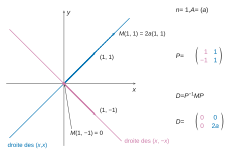
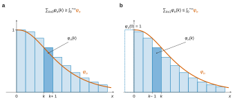

# CCINP PC — Mathématiques 2026 · Corrigé guidé

*Corrigé rédigé par IA, non officiel. Signalez toute erreur.*

## Présentation du sujet

L'épreuve (PC1M, 4 heures, sans calculatrice) comporte **trois exercices indépendants** de longueur comparable, pour 37 questions au total. Le sujet est classique, très guidé, et couvre trois grands blocs du programme de PC : réduction, probabilités, séries entières.

- **Exercice 1 — Réduction de matrices par blocs (Q1 à Q12).** La partie I étudie $M=\begin{pmatrix}A&A\\A&A\end{pmatrix}$. Elle commence par un exemple $4\times4$ : théorème spectral, valeurs propres, matrice positive.
  Elle réduit ensuite $M$, dans le cas général, à $D=\mathrm{diag}(O_n,2A)$ par une conjugaison explicite. On en tire le polynôme caractéristique de $M$, puis l'équivalence « $M$ diagonalisable si et seulement si $A$ l'est », par les polynômes annulateurs.
  La partie II étudie $M=\begin{pmatrix}A&A\\O_n&A\end{pmatrix}$. Un calcul de puissances donne $Q(M)$ pour tout polynôme $Q$, et on montre que $M$ n'est diagonalisable que si $A=O_n$.
  Notions : calcul par blocs, similitude, polynôme caractéristique, polynôme annulateur scindé à racines simples, théorème spectral, matrices symétriques positives.
- **Exercice 2 — Autour de la loi géométrique (Q13 à Q25).** La partie I obtient la loi de la somme $S_n$ de $n$ variables géométriques indépendantes (loi de Pascal). Elle passe par la fonction génératrice et le développement en série entière de $(1-x)^{-n}$.
  La partie II donne la loi du maximum $V_n$ par sa fonction de répartition, ainsi que la formule $E(V_n)=\sum P(V_n>k)$.
  La partie III donne l'équivalent $E(V_n)\sim\ln n/\ln(1/q)$, par comparaison série-intégrale et changement de variable.
  Notions : loi géométrique, indépendance, fonction génératrice, série entière, $\sigma$-additivité, intégrales impropres.
- **Exercice 3 — L'équation $f'(x)=f(\lambda x)$ (Q26 à Q37).** La partie I traite les cas $\lambda\in\{1,0,-1\}$ par des équations différentielles usuelles. La partie II détermine les solutions développables en série entière : ce sont les multiples d'une série $\varphi$ explicite.
  La partie III montre, par la formule de Taylor avec reste intégral, que toute solution est développable en série entière. Conclusion : $\dim S_\lambda=1$.

**Difficulté.** Elle est modérée et régulière. Les questions les plus délicates sont Q8 (bien manier les polynômes annulateurs), Q12, Q20 (justifier la formule de l'espérance) et Q35-Q36 (majoration uniforme, puis reste de Taylor).

**Ce qu'en dit le rapport 2026.** Le jury juge le sujet « d'une longueur raisonnable afin de donner une réelle possibilité aux candidats de traiter l'ensemble des questions ». Il constate pourtant que beaucoup de questions de cours ont été mal réussies, et que « les questions nécessitant une prise d'initiative ont été peu abordées ».

- Questions **discriminantes** selon le rapport : Q14, qui « a permis de distinguer les candidats connaissant leur cours des autres » ; Q13 et Q17, très rarement justes ; Q35, « très rarement traitée correctement » ; Q37, réussie par ceux qui savent rassembler les résultats précédents.
- Questions **peu abordées** : Q8, Q11, Q12 et Q25. Ce sont des points faciles à gagner pour qui va jusqu'au bout de chaque exercice.
- Points de rédaction pénalisés partout : les **réciproques** oubliées (Q28, Q29, Q33), les **hypothèses** des théorèmes non vérifiées (Q24, Q31, Q32), et les résultats des questions précédentes utilisés sans en citer le numéro.

**À ne pas laisser passer** : Q1, Q4, Q5, Q9, Q10, Q13, Q14, Q15, Q18, Q19, Q21, Q26 à Q28, Q30 et Q31 sont presque des questions de cours ou de calcul direct.

**Gestion du temps** : environ 1 h 15 par exercice, et un quart d'heure de relecture. Les exercices sont indépendants, et l'énoncé précise les dépendances internes : Q37 utilise les parties II et III de l'exercice 3, et la partie III de l'exercice 2 peut admettre la partie II. Une question bloquante peut donc être admise.

Convention utilisée partout : $\chi_B(X)=\det(XI_p-B)$.

## Exercice 1, Partie I — Étude d'une première forme

On commence par un exemple numérique où tout se calcule, puis on dégage le mécanisme général : $M$ agit comme $2A$ sur les vecteurs $(x,x)$ et comme $0$ sur les vecteurs $(x,-x)$. La matrice $P$ de la sous-partie I.2 n'est rien d'autre que le changement de base correspondant.

### Question 1
> [!INDICATION]
> On ne demande pas les valeurs propres : y a-t-il un théorème qui donne la diagonalisabilité sans aucun calcul ?

> [!INDICATION]
> Regarder la transposée de $M$, en raisonnant par blocs.

#### Solution
$A=\mathrm{diag}(1,2)$ est symétrique, donc
$$\begin{aligned}
M^\top&=\begin{pmatrix}A^\top&A^\top\\A^\top&A^\top\end{pmatrix}\\
&=\begin{pmatrix}A&A\\A&A\end{pmatrix}\\
&=M.
\end{aligned}$$
$M$ est une matrice symétrique **réelle** ; par le théorème spectral, elle est diagonalisable (et même dans une base orthonormée).
$$\boxed{M\text{ est diagonalisable.}}$$

> [!PIEGE]
> Le théorème spectral concerne les matrices symétriques **réelles**. Une matrice symétrique à coefficients complexes n'est pas forcément diagonalisable : il faut écrire « réelle ».

> [!JURY]
> Rapport 2026 : certains candidats ont confondu $A$ et $M$, et « D'autres n'ont pas remarqué que la matrice M était symétrique réelle. » La diagonalisabilité se lit ici sans aucun calcul.

### Question 2
> [!INDICATION]
> Écrire un vecteur de $\mathbb R^4$ sous la forme $(x,y)$ avec $x,y\in\mathbb R^2$, et calculer $M(x,y)$ par blocs.

> [!INDICATION]
> Deux familles de vecteurs se comportent très simplement : celles où $y=x$ et celles où $y=-x$. Penser à vérifier à la fin que les dimensions des sous-espaces propres trouvés font bien $4$.

#### Solution
Explicitement,
$$M=\begin{pmatrix}1&0&1&0\\0&2&0&2\\1&0&1&0\\0&2&0&2\end{pmatrix},$$
et, par blocs,
$$M\begin{pmatrix}x\\y\end{pmatrix}=\begin{pmatrix}A(x+y)\\A(x+y)\end{pmatrix}.$$

- Les vecteurs $(x,-x)$ forment un plan contenu dans $\ker M$. Les colonnes 1 et 3 sont égales, de même que les colonnes 2 et 4, et les colonnes 1 et 2 sont libres.
  Donc $\mathrm{rg}\,M=2$, et $\ker M$ est exactement ce plan, de dimension 2.
- Pour $y=x$, on a $M(x,x)=(2Ax,2Ax)$. Avec $u_1=(1,0,1,0)$ et $u_2=(0,1,0,1)$, on obtient $Mu_1=2u_1$ et $Mu_2=4u_2$.

La somme des dimensions vaut $2+1+1=4$, donc il n'y a pas d'autre valeur propre.
$$\boxed{\mathrm{Sp}(M)=\{0,2,4\}}$$
avec $\dim E_0=2$ et $\dim E_2=\dim E_4=1$.

> [!METHODE]
> Pour une matrice par blocs répétitifs, chercher des vecteurs « symétriques » et « antisymétriques » $(x,\pm x)$ avant de développer un polynôme caractéristique $4\times4$. Clore toujours par le décompte des dimensions, qui garantit qu'on a trouvé tout le spectre.

> [!PIEGE]
> Les valeurs propres non nulles sont $2$ et $4$, pas $1$ et $2$.
>
> En effet, sur les vecteurs $(x,x)$, $M$ agit comme $2A$.
>
> Confondre $A$ et $M$ est l'erreur que relève le rapport 2026 sur Q1 et Q2.

> [!JURY]
> Si l'on préfère le polynôme caractéristique, le rapport 2026 conseille : « Afin d'éviter des calculs inutilement longs, il était préférable d'effectuer des opérations élémentaires sur les lignes ou les colonnes avant de développer le déterminant. »

### Question 3
> [!INDICATION]
> Calculer $X^\top MX$ par blocs pour $X=(x,y)$ : une seule variable combinée apparaît.

> [!INDICATION]
> Pour « non défini », il suffit d'exhiber un vecteur non nul qui annule la forme quadratique. La question 2 en fournit.

#### Solution
$M$ est symétrique (Q1). Pour $X=(x,y)$, avec $z=x+y$ :
$$\begin{aligned}
X^\top MX&=x^\top Az+y^\top Az\\
&=z^\top Az\\
&=z_1^2+2z_2^2\\
&\ge0 .
\end{aligned}$$
Donc $M$ est symétrique positive.

Pour $X_0=(1,0,-1,0)\ne0$, on a $z=0$, donc $X_0^\top MX_0=0$ : $M$ n'est pas définie positive.
$$\boxed{M\in\mathcal S_4^+(\mathbb R)\setminus\mathcal S_4^{++}(\mathbb R).}$$

> [!METHODE]
> Deux routes équivalentes pour une matrice symétrique réelle : le signe de la forme quadratique, ou le spectre. Elle est positive si et seulement si $\mathrm{Sp}\subset\mathbb R_+$, définie positive si et seulement si $\mathrm{Sp}\subset\mathbb R_+^*$. Avec la Q2, $0\in\mathrm{Sp}(M)$ conclut immédiatement.

> [!PIEGE]
> « Positive » ne signifie pas « à coefficients positifs ».

### Question 4
> [!INDICATION]
> On connaît le candidat pour l'inverse : il suffit de faire un produit, par blocs.

#### Solution
Posons $Q=\frac12\begin{pmatrix}I_n&-I_n\\I_n&I_n\end{pmatrix}$. Le produit par blocs donne
$$\begin{aligned}
PQ&=\frac12\begin{pmatrix}I_n+I_n&-I_n+I_n\\-I_n+I_n&I_n+I_n\end{pmatrix}\\
&=I_{2n}.
\end{aligned}$$
Une matrice carrée qui admet un inverse à droite est inversible, d'inverse celui-ci :
$$\boxed{P^{-1}=\frac12\begin{pmatrix}I_n&-I_n\\I_n&I_n\end{pmatrix}.}$$

> [!PIEGE]
> Les blocs sont des matrices de $\mathcal M_n(\mathbb R)$, pas des nombres. Écrire « $\det P=1\cdot1-(-1)\cdot1=2$ » mélange un scalaire et des blocs : c'est faux en général, et le produit par blocs suffit.

> [!JURY]
> Rapport 2026 : « Une part importante des candidats traite les blocs de la matrice comme des scalaires, ce qui les conduit à écrire des égalités entre des objets de nature différente. »

### Question 5
> [!INDICATION]
> Il s'agit de calculer $P^{-1}MP$. Commencer par $MP$.

#### Solution
$$\begin{aligned}
MP&=\begin{pmatrix}A-A&A+A\\A-A&A+A\end{pmatrix}\\
&=\begin{pmatrix}O_n&2A\\O_n&2A\end{pmatrix},
\end{aligned}$$
puis
$$\begin{aligned}
P^{-1}MP&=\frac12\begin{pmatrix}O_n&2A-2A\\O_n&2A+2A\end{pmatrix}\\
&=\begin{pmatrix}O_n&O_n\\O_n&2A\end{pmatrix}.
\end{aligned}$$
$$\boxed{P^{-1}MP=D,\ \text{donc } M \text{ et } D \text{ sont semblables.}}$$

> [!METHODE]
> Les $n$ premières colonnes de $P$ engendrent les vecteurs $(x,-x)$, qui sont dans le noyau.
>
> Les $n$ dernières engendrent les vecteurs $(x,x)$, sur lesquels $M$ agit comme $2A$. Lire une matrice de passage comme une base adaptée aide à retrouver les calculs.

> [!PIEGE]
> Ne pas confondre $P^{-1}MP$ et $PMP^{-1}$ : avec ce $P$, seul le premier vaut $D$.

### Question 6
> [!INDICATION]
> Des matrices semblables ont le même polynôme caractéristique : calculer celui de $D$.

> [!INDICATION]
> $\lambda I_{2n}-D$ est diagonale par blocs. Pour faire sortir $2^n$, utiliser l'homogénéité du déterminant.

#### Solution
$\chi_M=\chi_D$ (Q5). Pour $\lambda\in\mathbb R$,
$$\lambda I_{2n}-D=\begin{pmatrix}\lambda I_n&O_n\\O_n&\lambda I_n-2A\end{pmatrix}.$$
Le seul coefficient éventuellement non nul de la première colonne est $\lambda$, en position $(1,1)$. En développant $n$ fois selon la première colonne,
$$\begin{aligned}
\chi_M(\lambda)&=\lambda^n\det(\lambda I_n-2A)\\
&=\lambda^n\,2^n\det\!\left(\tfrac\lambda2I_n-A\right).
\end{aligned}$$
$$\boxed{\chi_M(\lambda)=\lambda^n2^n\chi_A\!\left(\tfrac\lambda2\right).}$$
Le réel $0$ est toujours racine, puisque $n\ge1$. Les autres racines sont les $\lambda$ tels que $\lambda/2\in\mathrm{Sp}(A)$, c'est-à-dire les doubles des valeurs propres de $A$ :
$$\boxed{\mathrm{Sp}(M)=\{0\}\cup\{2\mu\,;\,\mu\in\mathrm{Sp}(A)\}.}$$

> [!PIEGE]
> Trois erreurs classiques. D'abord $\det(2B)=2^n\det B$ pour $B\in\mathcal M_n(\mathbb R)$, et non $2\det B$.
>
> Ensuite, $0$ est dans le spectre de $M$ même quand $A$ est inversible.
>
> Enfin, on **multiplie** les valeurs propres de $A$ par $2$ : $\chi_A(\lambda/2)=0$ signifie $\lambda/2=\mu$, donc $\lambda=2\mu$.

> [!JURY]
> Rapport 2026 : la formule était bien établie, mais pour le spectre « certains candidats ont oublié la valeur propre 0, tandis que d'autres ont divisé les valeurs propres de A par 2 au lieu de les multiplier. » Annoncer aussi la convention $\chi_A=\det(XI_n-A)$ : avec $\det(A-XI_n)$, la formule demandée serait fausse d'un signe $(-1)^n$.

### Question 7
> [!INDICATION]
> Calculer $R(D)$ pour un polynôme $R$ quelconque, en traitant à part le terme constant ($D^0=I_{2n}$).

> [!INDICATION]
> Appliquer ce calcul à $R=Q(X/2)$ et identifier ce que deviennent $R(0)$ et $R(2A)$.

#### Solution
Pour $k\ge1$, on a
$$D^k=\begin{pmatrix}O_n&O_n\\O_n&(2A)^k\end{pmatrix},$$
et $D^0=I_{2n}$. Pour $R=\sum r_kX^k$, on en déduit
$$R(D)=\begin{pmatrix}R(0)I_n&O_n\\O_n&R(2A)\end{pmatrix}.$$
Prenons $R=Q(X/2)=\sum_kq_k2^{-k}X^k$. Alors $R(0)=Q(0)$ et $R(2A)=\sum q_kA^k=Q(A)$. Donc
$$Q\!\left(\tfrac X2\right)(D)=\begin{pmatrix}Q(0)I_n&O_n\\O_n&Q(A)\end{pmatrix}.$$
Cette matrice est nulle si et seulement si $Q(0)=0$ et $Q(A)=O_n$.
$$\boxed{\text{(i)}\iff\text{(ii)}.}$$

> [!PIEGE]
> Si l'on oublie que $D^0=I_{2n}$, et non $\mathrm{diag}(O_n,I_n)$, la condition $Q(0)=0$ disparaît et l'équivalence devient fausse. C'est par le bloc $Q(0)I_n$ que l'hypothèse $Q(0)=0$ intervient.

> [!JURY]
> Rapport 2026 : « Beaucoup de candidats se sont trompés en écrivant Q(D/2) comme une matrice par blocs. L'hypothèse Q(0) = 0 était souvent mal utilisée. » Le calcul de $D^k$, puis de $R(D)$ terme à terme, évite ces deux erreurs.

### Question 8
> [!INDICATION]
> Utiliser la caractérisation : une matrice est diagonalisable si et seulement si elle admet un polynôme annulateur scindé à racines simples. Comme $M$ et $D$ sont semblables, travailler avec $D$.

> [!INDICATION]
> Sens « $A$ diagonalisable » : la Q7 exige $Q(0)=0$. Que faire si le polynôme annulateur de $A$ ne s'annule pas en $0$ ?

> [!INDICATION]
> Sens réciproque : partir d'un polynôme $R$ annulateur de $D$ et poser $Q=R(2X)$. Vérifier que le caractère « scindé à racines simples » est conservé.

#### Solution
$M$ est diagonalisable si et seulement si $D$ l'est (Q5).

*Si $A$ est diagonalisable*, elle admet un polynôme annulateur $\pi$ scindé à racines simples. On pose $Q=\pi$ si $\pi(0)=0$, et $Q=X\pi$ sinon.

Le polynôme $Q$ est scindé à racines simples, annule $A$ et vérifie $Q(0)=0$. Par la Q7, $Q(X/2)$ annule $D$.

Si $Q=c\prod(X-\alpha_i)$ avec des $\alpha_i$ distincts, alors
$$Q\!\left(\tfrac X2\right)=c\,2^{-\deg Q}\prod(X-2\alpha_i)$$
est scindé à racines simples. Donc $D$ est diagonalisable.

*Si $D$ est diagonalisable*, soit $R=c\prod(X-\nu_j)$ un polynôme annulateur de $D$ à racines distinctes. Alors
$$Q=R(2X)=c\,2^{\deg R}\prod\left(X-\tfrac{\nu_j}2\right)$$
est scindé à racines simples, et $Q(X/2)=R$ annule $D$. Par la Q7, $Q(A)=O_n$. Donc $A$ est diagonalisable.
$$\boxed{M\text{ diagonalisable}\iff A\text{ diagonalisable}.}$$

> [!METHODE]
> Une autre voie, directe : une matrice diagonale par blocs est diagonalisable si et seulement si chaque bloc l'est, et $2A$ est diagonalisable si et seulement si $A$ l'est. Mais « En déduire » renvoie à la Q7 : mieux vaut suivre la voie polynomiale et ne citer l'autre qu'en remarque.

> [!PIEGE]
> Multiplier $\pi$ par $X$ alors que $0$ est déjà racine de $\pi$ crée une racine double : il faut distinguer les deux cas.

> [!JURY]
> Le rapport 2026 signale une question « peu abordée ». Elle ne demande pourtant que la Q7 et la caractérisation par les polynômes annulateurs : c'est un point accessible.

## Exercice 1, Partie II — Étude d'une seconde forme

La matrice est maintenant triangulaire par blocs. Ses puissances font apparaître un facteur $k$, et donc une dérivée dans $Q(M)$. Cette dérivée empêche la diagonalisabilité, sauf dans le cas trivial $A=O_n$.

### Question 9
> [!INDICATION]
> Récurrence sur $k$, avec l'initialisation $k=0$ ($A^0=I_n$).

#### Solution
*Initialisation.* Pour $k=0$, on a $M^0=I_{2n}$, et la formule donne $\begin{pmatrix}I_n&0\cdot I_n\\O_n&I_n\end{pmatrix}=I_{2n}$.

*Hérédité.* Si la formule est vraie au rang $k$,
$$\begin{aligned}
M^{k+1}&=M^kM\\
&=\begin{pmatrix}A^k&kA^k\\O_n&A^k\end{pmatrix}\begin{pmatrix}A&A\\O_n&A\end{pmatrix}\\
&=\begin{pmatrix}A^{k+1}&(k+1)A^{k+1}\\O_n&A^{k+1}\end{pmatrix}.
\end{aligned}$$
$$\boxed{\forall k\in\mathbb N,\ M^k=\begin{pmatrix}A^k&kA^k\\O_n&A^k\end{pmatrix}.}$$

> [!JURY]
> Rapport 2026 : « Il ne fallait pas bâcler la rédaction de cette récurrence élémentaire. Attention à bien initialiser la récurrence à l'indice k=0. »

### Question 10
> [!INDICATION]
> Combiner linéairement les formules de la Q9 avec les coefficients de $Q$. Reconnaître ensuite $\sum kq_kA^k$.

#### Solution
Pour $Q=\sum_{k=0}^dq_kX^k$, par linéarité et par la Q9 :
$$Q(M)=\begin{pmatrix}\sum q_kA^k&\sum kq_kA^k\\O_n&\sum q_kA^k\end{pmatrix}.$$
Or
$$\begin{aligned}
\sum_{k\ge1}kq_kA^k&=A\sum_{k\ge1}kq_kA^{k-1}\\
&=AQ'(A).
\end{aligned}$$
$$\boxed{Q(M)=\begin{pmatrix}Q(A)&AQ'(A)\\O_n&Q(A)\end{pmatrix}.}$$

> [!METHODE]
> C'est la version matricielle de $(a+\varepsilon)^k=a^k+ka^{k-1}\varepsilon$ avec $\varepsilon^2=0$ : une perturbation nilpotente fait apparaître la dérivée.

### Question 11
> [!INDICATION]
> Appliquer la Q10 à $S$ et lire l'égalité $S(M)=O_{2n}$ bloc par bloc : on obtient deux relations.

> [!INDICATION]
> L'une d'elles montre que $A$ est diagonalisable. Écrire alors $A=P\Delta P^{-1}$ et calculer $S'(A)$.

#### Solution
$S(M)=O_{2n}$ donne, par la Q10 :
$$\begin{cases}S(A)=O_n,\\ AS'(A)=O_n.\end{cases}\qquad(\dagger)$$
Le polynôme $S$, scindé à racines simples, annule $A$ : par le cours, $A$ est diagonalisable.

Écrivons $A=P\Delta P^{-1}$ avec $\Delta=\mathrm{diag}(\mu_1,\dots,\mu_n)$. Pour tout polynôme $T$, on a $T(A)=P\,T(\Delta)\,P^{-1}$, d'où
$$S'(A)=P\,\mathrm{diag}\big(S'(\mu_1),\dots,S'(\mu_n)\big)P^{-1}.$$
$$\boxed{S'(A)\text{ est diagonalisable, de spectre }\{S'(\mu)\,;\,\mu\in\mathrm{Sp}(A)\}.}$$

> [!PIEGE]
> L'inclusion $T(\mathrm{Sp}(A))\subset\mathrm{Sp}(T(A))$ est toujours vraie. L'inclusion réciproque, elle, peut tomber en défaut sur $\mathbb R$ sans hypothèse. Pour la rotation d'angle $\pi/2$, $\mathrm{Sp}_{\mathbb R}(A)=\emptyset$, mais $\mathrm{Sp}(A^2)=\{-1\}$. Ici, c'est la diagonalisation explicite qui donne l'égalité.

> [!JURY]
> Rapport 2026 : « Peu de candidats sont parvenus à justifier que A est diagonalisable, alors qu'il s'agissait d'une application directe du cours. » Il suffit de lire le bloc diagonal de $S(M)=O_{2n}$ et de citer la caractérisation par un polynôme annulateur scindé à racines simples.

### Question 12
> [!INDICATION]
> Montrer d'abord que toute valeur propre de $A$ est racine de $S$.

> [!INDICATION]
> Que vaut la dérivée d'un polynôme en une racine **simple** ? Conclure avec la relation $AS'(A)=O_n$.

#### Solution
Si $Ax=\mu x$ avec $x\ne0$, alors $0=S(A)x=S(\mu)x$, donc $S(\mu)=0$.

Écrivons $S=c\prod_i(X-\alpha_i)$ avec des $\alpha_i$ distincts. Alors
$$S'(\alpha_j)=c\prod_{i\ne j}(\alpha_j-\alpha_i)\ne0 .$$
Ainsi $S'(\mu)\ne0$ pour tout $\mu\in\mathrm{Sp}(A)$, et $0\notin\mathrm{Sp}(S'(A))$ (Q11). La matrice $S'(A)$ est diagonalisable sans valeur propre nulle, donc **inversible**.

En multipliant $AS'(A)=O_n$ à droite par $S'(A)^{-1}$, on obtient $A=O_n$. Réciproquement, $A=O_n$ donne $M=O_{2n}$, qui est diagonale.
$$\boxed{M\text{ diagonalisable}\iff A=O_n.}$$

> [!METHODE]
> Contrôle sur le cas $n=1$, $A=(1)$ : $M=\begin{pmatrix}1&1\\0&1\end{pmatrix}$ a pour seule valeur propre $1$ et n'est pas égale à $I_2$, donc elle n'est pas diagonalisable. C'est cohérent.

> [!JURY]
> Une condition nécessaire et suffisante demande les deux sens : la réciproque, même immédiate, doit être écrite. Le rapport 2026 note une question « peu abordée ».

## Exercice 2, Partie I — Étude de la variable aléatoire $S_n$

On calcule la loi de la somme de $n$ variables géométriques indépendantes par la fonction génératrice : on transforme la somme en produit, puis on développe en série entière et on identifie les coefficients.

Convention : $P(X_k=j)=pq^{j-1}$ pour $j\in\mathbb N^*$.

### Question 13
> [!INDICATION]
> Minorer $S_n$, puis montrer que chaque valeur possible est effectivement atteinte avec une probabilité non nulle.

#### Solution
On a $X_k\ge1$, donc $S_n\ge n$ et $S_n$ est entière.

Soit $k\ge n$. L'événement $(X_1=k-n+1)\cap(X_2=1)\cap\dots\cap(X_n=1)$ est inclus dans $(S_n=k)$. Par indépendance, sa probabilité vaut $p^nq^{k-n}>0$.
$$\boxed{S_n(\Omega)=[\![n,+\infty[\![ .}$$

> [!PIEGE]
> La loi géométrique du programme est à valeurs dans $\mathbb N^*$, pas dans $\mathbb N$ : $S_n$ ne prend pas les valeurs $0,\dots,n-1$.

> [!JURY]
> Rapport 2026 : « Peu de candidats ont donné une réponse correcte, alors qu'il s'agit essentiellement d'une application directe du cours et d'une bonne compréhension de l'énoncé. »

### Question 14
> [!INDICATION]
> Résultats de cours pour la loi géométrique. Pour $S_n$ : linéarité de l'espérance, et quelle hypothèse pour la variance ?

#### Solution
On a $E(X_1)=\frac1p$ et $V(X_1)=\frac q{p^2}$. L'espérance est linéaire, et la variance d'une somme de variables indépendantes est la somme des variances :
$$\boxed{\begin{aligned}E(S_n)&=\frac np,\\ V(S_n)&=\frac{nq}{p^2}.\end{aligned}}$$

> [!PIEGE]
> L'indépendance (deux à deux suffit) est indispensable pour la variance, inutile pour l'espérance. Il faut la citer au bon endroit.

> [!JURY]
> Question discriminante : selon le rapport 2026, elle « a permis de distinguer les candidats connaissant leur cours des autres ».

### Question 15
> [!INDICATION]
> Que vaut la série en $t=1$ ? On peut aussi utiliser la caractérisation du rayon par les suites $(a_kr^k)$ bornées.

#### Solution
Le rayon $R$ est la borne supérieure des $r\ge0$ tels que $(P(Y=k)\,r^k)_k$ soit bornée.

Pour $r=1$, on a $0\le P(Y=k)\le1$ : la suite $(P(Y=k)\cdot1^k)$ est bornée. Donc $\boxed{R\ge1}$.

(On peut aussi dire que $\sum P(Y=k)$ converge, de somme $1$.)

> [!PIEGE]
> On ne peut pas conclure $R=1$ : pour une variable bornée, $R=+\infty$.

> [!JURY]
> Rapport 2026 : beaucoup ont compris l'idée, « mais le raisonnement était imprécis ou incomplet dans la majorité des cas ». Citer la définition du rayon (ou le lemme d'Abel) et dire pour quel $r$ la suite est bornée.

### Question 16
> [!INDICATION]
> Fonction génératrice d'une somme de variables indépendantes : passer de deux variables à $n$ variables avec le lemme des coalitions.

> [!INDICATION]
> $G_{X_1}$ est la somme d'une série géométrique : vérifier que sa raison est de module $<1$.

#### Solution
Par le lemme des coalitions, $S_{m-1}$ et $X_m$ sont indépendantes. Pour des variables indépendantes $U,V$ à valeurs dans $\mathbb N$, on a $G_{U+V}=G_UG_V$ sur $]-1,1[$.

Une récurrence donne alors, sur $]-1,1[$ :
$$\begin{aligned}
G_{S_n}&=\prod_{k=1}^nG_{X_k}\\
&=G_{X_1}^n,
\end{aligned}$$
la dernière égalité parce que les $X_k$ ont même loi. Pour $|t|<1$, on a $|qt|<1$ et
$$\begin{aligned}
G_{X_1}(t)&=\sum_{k\ge1}pq^{k-1}t^k\\
&=\frac{pt}{1-qt}.
\end{aligned}$$
$$\boxed{G_{S_n}(t)=\left(\frac{pt}{1-qt}\right)^n.}$$

> [!METHODE]
> Contrôle immédiat : $G_{S_n}(1)=1$.

> [!JURY]
> Rapport 2026 : « il manquait régulièrement des éléments de justification ». Les trois à écrire : indépendance (lemme des coalitions), même loi, et $|qt|<1$ pour la série géométrique.

### Question 17
> [!INDICATION]
> Utiliser le développement de $(1+x)^\alpha$ avec un exposant entier négatif.

> [!INDICATION]
> Simplifier le coefficient en un coefficient binomial, décaler l'indice pour tenir compte du facteur $t^n$, puis invoquer l'unicité du développement en série entière.

#### Solution
Avec $\alpha=-n$ et $x=-qt$, le coefficient de $t^j$ dans $(1-qt)^{-n}$ vaut
$$\frac{(-n)(-n-1)\cdots(-n-j+1)}{j!}(-q)^j=\binom{n+j-1}{j}q^j .$$
Donc, pour $|t|<1$, en posant $k=n+j$ :
$$\begin{aligned}
(pt)^n(1-qt)^{-n}&=\sum_{j\ge0}\binom{n+j-1}{j}p^nq^jt^{n+j}\\
&=\sum_{k\ge n}\binom{k-1}{n-1}p^nq^{k-n}t^k.
\end{aligned}$$
Cette fonction est égale à $G_{S_n}(t)=\sum P(S_n=k)t^k$ sur $]-1,1[$. Par unicité des coefficients, pour tout entier $k\ge n$ :
$$\boxed{P(S_n=k)=\binom{k-1}{n-1}p^nq^{k-n}.}$$

> [!METHODE]
> Contrôle pour $n=1$ : on retrouve $pq^{k-1}$.
>
> Interprétation : $S_n$ est le rang du $n$-ième succès (loi de Pascal).
>
> L'événement $(S_n=k)$ demande $n-1$ succès parmi les $k-1$ premières épreuves, puis un succès à la $k$-ième.

> [!PIEGE]
> Le coefficient est $\binom{k-1}{n-1}$ et non $\binom{k}{n}$ : le décalage d'indice $k=n+j$ est l'endroit où l'on se trompe.

> [!JURY]
> Rapport 2026 : « Le développement en série entière demandé était très rarement correct », et une expression juste de la loi de $S_n$ était très rare. Question discriminante.

## Exercice 2, Partie II — Loi de la variable aléatoire $V_n$

Pour un maximum, on passe toujours par $P(V_n\le k)$, qui est une intersection. On en déduit l'espérance (formule des queues) et la loi.

### Question 18
> [!INDICATION]
> Écrire $(X_1>k)$ comme une réunion disjointe d'événements $(X_1=j)$.

#### Solution
$(X_1>k)$ est la réunion disjointe des $(X_1=j)$, $j\ge k+1$. Par $\sigma$-additivité, et parce que $0<q<1$ :
$$\begin{aligned}
P(X_1>k)&=\sum_{j\ge k+1}pq^{j-1}\\
&=pq^k\sum_{i\ge0}q^i\\
&=\frac{pq^k}{1-q}\\
&=q^k .
\end{aligned}$$
$$\boxed{P(X_1>k)=q^k.}$$
(Interprétation : les $k$ premières épreuves sont des échecs.)

> [!JURY]
> Rapport 2026, sur Q18 et Q19 : « Il est incontournable de donner toutes les justifications des différentes étapes du calcul pour aboutir au résultat demandé. » Ici : réunion disjointe, $\sigma$-additivité, convergence de la série géométrique.

### Question 19
> [!INDICATION]
> Le maximum est inférieur ou égal à $k$ si et seulement si...

#### Solution
On a $(V_n\le k)=\bigcap_{i=1}^n(X_i\le k)$. Par indépendance mutuelle, parce que les $X_i$ ont même loi, et par la Q18 :
$$\begin{aligned}
P(V_n\le k)&=\prod_{i=1}^nP(X_i\le k)\\
&=\big(1-P(X_1>k)\big)^n\\
&=(1-q^k)^n.
\end{aligned}$$
$$\boxed{P(V_n\le k)=(1-q^k)^n.}$$
La formule reste vraie pour $k=0$.

> [!PIEGE]
> L'événement $(V_n\ge k)$ n'est pas une intersection : c'est $(V_n\le k)$ qui se factorise.

### Question 20
> [!INDICATION]
> Majorer $1-(1-q^k)^n$ par un terme géométrique : factoriser $1-v^n$.

> [!INDICATION]
> Pour relier $E(V_n)$ à la somme des $P(V_n>k)$, écrire $k=\sum_{j=0}^{k-1}1$ et intervertir des **sommes finies** jusqu'au rang $N$, puis faire tendre $N$ vers l'infini.

#### Solution
Notons $u_k=P(V_n>k)=1-(1-q^k)^n$. Sur $[0,1]$,
$$\begin{aligned}
1-v^n&=(1-v)(1+v+\dots+v^{n-1})\\
&\le n(1-v).
\end{aligned}$$
On en tire $0\le u_k\le nq^k$, donc $\sum u_k$ converge.

Pour $N\ge1$,
$$\begin{aligned}
\sum_{k=1}^NkP(V_n=k)&=\sum_{j=0}^{N-1}\sum_{k=j+1}^NP(V_n=k)\\
&=\sum_{j=0}^{N-1}u_j-Nu_N\\
&\le\sum_{j\ge0}u_j .
\end{aligned}$$
La série à termes positifs $\sum kP(V_n=k)$ a ses sommes partielles bornées : $V_n$ est d'espérance finie. De plus $0\le Nu_N\le nNq^N\to0$, donc
$$\boxed{E(V_n)=\sum_{k=0}^{+\infty}\Big(1-(1-q^k)^n\Big).}$$

> [!METHODE]
> La formule $E(X)=\sum_{k\ge0}P(X>k)$ pour $X$ à valeurs dans $\mathbb N$ resservira souvent. Savoir la redémontrer par sommes finies évite toute discussion sur l'interversion.

> [!METHODE]
> Pour la seule finitude de l'espérance, le rapport 2026 salue une idée plus rapide : comparer $V_n$ et $S_n$. Les $X_k$ sont positives, donc $0\le V_n\le S_n$, et $S_n$ est d'espérance finie (Q14). Par comparaison, $V_n$ est d'espérance finie.

> [!PIEGE]
> Le terme $k=0$ vaut $1$ (et non $0$) : la somme commence bien à $k=0$.

### Question 21
> [!INDICATION]
> Suivre la piste de l'énoncé : $(V_n\le k)$ se découpe en deux événements disjoints.

#### Solution
Pour $k\in\mathbb N^*$, l'événement $(V_n\le k)$ est la réunion disjointe de $(V_n\le k-1)$ et de $(V_n=k)$. Par additivité et par la Q19 :
$$\boxed{P(V_n=k)=(1-q^k)^n-(1-q^{k-1})^n.}$$
Ces nombres sont strictement positifs : $P(V_n=1)=p^n$, et $1-q^{k-1}<1-q^k$. Donc $V_n(\Omega)=\mathbb N^*$.

Contrôle par télescopage : $\sum_{k=1}^KP(V_n=k)=(1-q^K)^n\to1$.

> [!PIEGE]
> $(V_n=k)$ n'est pas l'intersection des $(X_i=k)$ : il suffit qu'**un** des $X_i$ vaille $k$ et que tous soient $\le k$. Passer par la différence de deux fonctions de répartition évite ce piège.

> [!JURY]
> Rapport 2026 : « Question souvent abordée, mais les manipulations d'évènements ont donné lieu à de nombreuses erreurs. »

## Exercice 2, Partie III — Équivalent de l'espérance de $V_n$

On remplace la série $\sum\varphi_n(k)$ par une intégrale, que l'on calcule exactement par changement de variable : on obtient la série harmonique.

### Question 22
> [!INDICATION]
> Dériver, ou voir $\varphi_n$ comme une composée de fonctions monotones. Pour l'intégrabilité, réutiliser la majoration de la Q20.

#### Solution
La dérivée de $x\mapsto q^x=e^{x\ln q}$ est $x\mapsto\ln(q)\,q^x$. Donc
$$\begin{aligned}
\varphi_n'(x)&=-n(1-q^x)^{n-1}\cdot\big(-\ln(q)\,q^x\big)\\
&=n\ln(q)\,q^x(1-q^x)^{n-1}\\
&\le0,
\end{aligned}$$
car $\ln q<0$. Ainsi **$\varphi_n$ est décroissante**.

Elle est continue, et $0\le\varphi_n(x)\le nq^x=ne^{x\ln q}$, fonction intégrable sur $[0,+\infty[$. Par comparaison, **$\varphi_n$ est intégrable**.

> [!PIEGE]
> La majoration $\varphi_n\le1$ ne suffit pas pour l'intégrabilité sur un intervalle non borné.

> [!PIEGE]
> Deux erreurs relevées par le rapport 2026 : la dérivée et l'équivalent en $+\infty$.
>
> La dérivée de $q^x$ est $\ln(q)\,q^x$, et non $xq^{x-1}$.
>
> Pour l'équivalent, $h=q^x\to0$ et $1-(1-h)^n\sim nh$, donc $\varphi_n(x)\sim nq^x$ en $+\infty$ : c'est une autre façon de conclure à l'intégrabilité.

### Question 23
> [!INDICATION]
> Pour une fonction décroissante, comparer $\varphi_n(k)$ aux intégrales sur $[k,k+1]$ et sur $[k-1,k]$.

> [!INDICATION]
> Isoler le terme $k=0$ : c'est lui qui produit le « $1+$ ».

#### Solution
Par décroissance, $\int_k^{k+1}\varphi_n\le\varphi_n(k)$ pour $k\ge0$, et $\varphi_n(k)\le\int_{k-1}^k\varphi_n$ pour $k\ge1$.

On somme, puis on passe à la limite. Tout converge : la série par la Q20, l'intégrale par la Q22. Avec $E(V_n)=\sum_{k\ge0}\varphi_n(k)$ et $\varphi_n(0)=1$ :
$$\boxed{\int_0^{+\infty}\varphi_n\le E(V_n)\le1+\int_0^{+\infty}\varphi_n .}$$

> [!METHODE]
> Faire le dessin de la figure 2 : c'est le premier rectangle, de hauteur $\varphi_n(0)=1$, laissé dehors après décalage, qui produit le « $1+$ ».

> [!JURY]
> Rapport 2026 : « La partie de la question concernant la convergence des objets en jeu a souvent été éludée ». Avant de passer à la limite dans les sommes partielles, citer Q20 (série) et Q22 (intégrale).

### Question 24
> [!INDICATION]
> Vérifier les hypothèses du théorème de changement de variable dans une intégrale généralisée : régularité, stricte monotonie, intervalles mis en bijection.

> [!INDICATION]
> Exprimer $\mathrm du$ en fonction de $1-u$ : l'intégrande devient exactement $\varphi_n$, à une constante près.

#### Solution
*Hypothèses.* $\psi:x\mapsto1-q^x$ est de classe $\mathcal C^1$ sur $[0,+\infty[$, avec
$$\psi'(x)=-\ln(q)\,q^x>0 .$$
Elle est strictement croissante, avec $\psi(0)=0$ et $\psi(x)\to1$ en $+\infty$ : c'est une bijection de $[0,+\infty[$ sur $[0,1[$.

Enfin $g:u\mapsto\frac{1-u^n}{1-u}$ est continue sur $[0,1[$.

*Calcul.* Comme $q^x=1-\psi(x)$, on a $\psi'(x)=-\ln(q)\big(1-\psi(x)\big)$, donc
$$g(\psi(x))\,\psi'(x)=-\ln(q)\big(1-\psi(x)^n\big)=-\ln(q)\,\varphi_n(x).$$

*Conclusion.* Par le théorème, $\int_0^1g$ et $\int_0^{+\infty}-\ln(q)\,\varphi_n$ sont de même nature, et égales en cas de convergence. La seconde converge (Q22), donc la première aussi :
$$\boxed{\int_0^1\frac{1-u^n}{1-u}\,\mathrm du=-\ln(q)\int_0^{+\infty}\varphi_n.}$$
Comme $\frac{1-u^n}{1-u}=\sum_{j=0}^{n-1}u^j$, cette intégrale vaut $H_n=\sum_{k=1}^n\frac1k$. Ainsi
$$\int_0^{+\infty}\varphi_n=\frac{H_n}{-\ln q}.$$

> [!METHODE]
> Variante sans le théorème sur les intégrales généralisées : faire le changement de variable sur un segment $[0,T]$, puis faire tendre $T$ vers $+\infty$. La convergence de $\int_0^1$ se voit aussi directement, l'intégrande se prolongeant par continuité en $1$.

> [!PIEGE]
> Signe : $-\ln q>0$. Une intégrale d'une fonction positive qui sortirait négative trahit une erreur.

> [!JURY]
> Rapport 2026 : « Toutes les hypothèses du théorème du changement de variable sont très rarement vérifiées. La convergence de l'intégrale découle directement de l'application de ce théorème. »

### Question 25
> [!INDICATION]
> Diviser l'encadrement de la Q23 par l'intégrale. Que faut-il savoir sur son comportement pour conclure ?

#### Solution
Posons $I_n=\frac{H_n}{-\ln q}$ (Q24). Par le résultat admis, $I_n\sim\frac{\ln n}{-\ln q}$, donc $I_n\to+\infty$.

De $I_n\le E(V_n)\le1+I_n$ (Q23), on tire
$$1\le\frac{E(V_n)}{I_n}\le1+\frac1{I_n}.$$
Le majorant tend vers $1$, donc $E(V_n)\sim I_n$ :
$$\boxed{E(V_n)\underset{n\to+\infty}{\sim}\frac{\ln n}{\ln(1/q)}.}$$

> [!PIEGE]
> Deux suites dont la différence est bornée ne sont pas forcément équivalentes (penser à $1$ et $2$). C'est parce que $I_n\to+\infty$ que l'écart borné devient négligeable, et il faut l'écrire.

> [!METHODE]
> Contrôle numérique pour $p=0{,}3$ et $n=3$ : $I_3=\frac{11/6}{-\ln0{,}7}\approx5{,}14$ et $E(V_3)\approx5{,}64$, bien dans $[I_3,I_3+1]$.
>
> Le maximum croît comme $\ln n$, alors que la somme croît comme $n$.

> [!JURY]
> Question « assez peu abordée » selon le rapport 2026 : elle ne demande pourtant qu'un encadrement et le résultat admis, même si Q23 et Q24 n'ont pas été faites.

## Exercice 3, Partie I — Généralités

L'équation $f'(x)=f(\lambda x)$ relie la dérivée en $x$ à la valeur en un autre point. Les cas $\lambda=1,0,-1$ se ramènent à des équations différentielles du cours.

### Question 26
> [!INDICATION]
> Caractérisation des sous-espaces vectoriels : contenir le vecteur nul et être stable par combinaison linéaire.

#### Solution
$S_\lambda\subset\mathcal D(\mathbb R,\mathbb R)$, et la fonction nulle est dans $S_\lambda$.

Pour $f,g\in S_\lambda$ et $\alpha,\beta$ réels, $h=\alpha f+\beta g$ est dérivable et
$$\begin{aligned}
h'(x)&=\alpha f(\lambda x)+\beta g(\lambda x)\\
&=h(\lambda x).
\end{aligned}$$
**$S_\lambda$ est un sous-espace vectoriel.**

### Question 27
> [!INDICATION]
> Pour $\lambda=1$, c'est une équation différentielle du cours.

#### Solution
$(E_1)$ s'écrit $f'=f$. Par le cours, ses solutions sont les $x\mapsto Ce^x$, $C\in\mathbb R$.
$$\boxed{S_1=\mathrm{Vect}(\exp).}$$

> [!JURY]
> Rapport 2026 : « Une partie des candidats a oublié la constante et n'a donné qu'une unique solution. » On attend un ensemble de solutions, ici une droite vectorielle.

### Question 28
> [!INDICATION]
> Pour $\lambda=0$, le membre de droite ne dépend plus de $x$.

> [!INDICATION]
> Une fois $f$ affine, la condition $f'(x)=f(0)$ impose une relation entre ses deux coefficients. Ne pas oublier la synthèse.

#### Solution
*Analyse.* On a $f'(x)=f(0)=c$ pour tout $x$. Sur l'intervalle $\mathbb R$, on en déduit $f(x)=cx+b$ : $f$ est affine. Puis $b=f(0)=c$.

*Synthèse.* $x\mapsto c(x+1)$ a pour dérivée $c$, qui est sa valeur en $0$ : elle convient.
$$\boxed{S_0=\mathrm{Vect}(x\mapsto x+1).}$$

> [!PIEGE]
> $S_0$ n'est pas l'ensemble de toutes les fonctions affines : la contrainte $b=c$ retire une dimension.

> [!JURY]
> Rapport 2026 : « De nombreux candidats ont montré que les solutions avaient une certaine forme, mais presque aucun n'a pensé à étudier la réciproque. » La même remarque vaut pour Q29.

### Question 29
> [!INDICATION]
> Le membre de droite $x\mapsto f(-x)$ est dérivable : que peut-on en déduire pour $f'$ ?

> [!INDICATION]
> Après avoir résolu $f''+f=0$, reporter la solution générale dans $(E_{-1})$ : toutes ne conviennent pas.

#### Solution
*Analyse.* $f'=g$ avec $g(x)=f(-x)$, qui est dérivable. Donc $f$ est deux fois dérivable. Par $(E_{-1})$ au point $-x$ :
$$\begin{aligned}
f''(x)&=-f'(-x)\\
&=-f(x).
\end{aligned}$$
Ainsi $f=\alpha\cos+\beta\sin$. La condition $f'(x)=f(-x)$ s'écrit $(\beta-\alpha)(\cos x+\sin x)=0$ pour tout $x$, soit $\beta=\alpha$ (prendre $x=0$).

*Synthèse.* Pour $f=\alpha(\cos+\sin)$, on vérifie $f'(x)=\alpha(\cos x-\sin x)=f(-x)$.
$$\boxed{S_{-1}=\mathrm{Vect}(\cos+\sin).}$$

> [!PIEGE]
> $f''+f=0$ n'est qu'une condition nécessaire. Sans la synthèse, on trouve un espace de dimension 2, ce qui est faux.

## Exercice 3, Partie II — Solutions développables en série entière

On cherche $f=\sum a_nx^n$. L'équation se traduit par une récurrence sur les coefficients, qui détermine tout à partir de $a_0$.

### Question 30
> [!INDICATION]
> Les coefficients sont non nuls (car $\lambda\ne0$) : la règle de d'Alembert s'applique. Simplifier l'exposant de $\lambda$ dans le quotient.

#### Solution
Posons $c_n=\frac{\lambda^{n(n-1)/2}}{n!}\ne0$. Comme $\frac{(n+1)n}2-\frac{n(n-1)}2=n$ et $|\lambda|\le1$ :
$$\begin{aligned}
\left|\frac{c_{n+1}}{c_n}\right|&=\frac{|\lambda|^n}{n+1}\\
&\le\frac1{n+1}.
\end{aligned}$$
Ce quotient tend vers $0$, donc $\boxed{R=+\infty}$. (Variante : $|c_nx^n|\le|x|^n/n!$, car $|\lambda|\le1$.)

> [!PIEGE]
> Avec $\lambda<0$, le quotient $\frac{c_{n+1}}{c_n}$ change de signe : la règle de d'Alembert porte sur son **module**.

> [!JURY]
> Rapport 2026 : « Les valeurs absolues sont souvent oubliées lors de l'application de la règle de d'Alembert. »

### Question 31
> [!INDICATION]
> Justifier d'abord la dérivabilité de $\varphi$ par un théorème du cours sur les séries entières.

> [!INDICATION]
> Dériver terme à terme, décaler l'indice, et comparer avec la série de $\varphi(\lambda x)$.

#### Solution
La série entière qui définit $\varphi$ a un rayon infini (Q30). Une série entière se dérive terme à terme sur son intervalle ouvert de convergence : $\varphi$ est dérivable sur $\mathbb R$, et
$$\varphi'(x)=\sum_{m\ge0}\lambda^{\frac{(m+1)m}2}\frac{x^m}{m!}.$$
Le rayon étant infini, la série en $\lambda x$ converge, et
$$\varphi(\lambda x)=\sum_{m\ge0}\lambda^{\frac{m(m-1)}2+m}\frac{x^m}{m!}.$$
Comme $\frac{m(m-1)}2+m=\frac{m(m+1)}2$, les deux séries coïncident : $\boxed{\varphi\in S_\lambda}$.

> [!METHODE]
> L'identité $\frac{m(m-1)}2+m=\frac{m(m+1)}2$ explique le choix de l'exposant : chaque dérivation multiplie l'argument par $\lambda$ une fois de plus.

> [!JURY]
> Rapport 2026 : « Question globalement bien traitée, mais la justification de la dérivabilité était souvent omise. » Une phrase suffit : rayon infini, donc dérivation terme à terme sur $\mathbb R$.

### Question 32
> [!INDICATION]
> Écrire $f'$ et $x\mapsto f(\lambda x)$ comme des séries entières de rayon infini, puis identifier les coefficients.

#### Solution
Le rayon de $\sum a_nx^n$ est infini, donc $f$ se dérive terme à terme sur $\mathbb R$ :
$$f'(x)=\sum_n(n+1)a_{n+1}x^n .$$
Par ailleurs $\sum a_n(\lambda x)^n$ converge pour tout $x$, donc
$$f(\lambda x)=\sum_n\lambda^na_nx^n .$$
Ces deux séries entières ont un rayon infini et la même somme sur $\mathbb R$. Par unicité du développement en série entière :
$$\boxed{(n+1)a_{n+1}=\lambda^na_n\quad(n\in\mathbb N).}$$

> [!JURY]
> Rapport 2026 : même remarque qu'en Q31 sur la dérivabilité, et « Il était indispensable de citer l'unicité du développement en série entière pour conclure. »

### Question 33
> [!INDICATION]
> Résoudre la récurrence de la Q32 en exprimant $a_n$ en fonction de $a_0$. Pour la réciproque, utiliser les Q26 et Q31.

#### Solution
*Sens direct.* Par récurrence, à l'aide de la Q32 et de $\frac{n(n-1)}2+n=\frac{n(n+1)}2$ :
$$a_n=a_0\frac{\lambda^{n(n-1)/2}}{n!}.$$
Donc $f=a_0\varphi$, où $a_0=f(0)$ est un réel quelconque.

*Réciproque.* $\mathrm{Vect}(\varphi)\subset S_\lambda$, par les Q26 et Q31.
$$\boxed{f\in S_\lambda\iff f\in\mathrm{Vect}(\varphi).}$$

> [!PIEGE]
> Rien n'impose $a_0=1$ : c'est $\varphi$ qui vérifie $\varphi(0)=1$, pas $f$. On obtient $f=a_0\varphi$, avec $a_0$ quelconque.

> [!JURY]
> Rapport 2026 : une part importante des candidats a supposé $a_0=1$, « ce qui n'est pas le cas en général. Il ne fallait pas oublier d'étudier la réciproque. »

> [!METHODE]
> Contrôles : pour $\lambda=1$, $\varphi=\exp$. Pour $\lambda=-1$, les signes $(-1)^{n(n-1)/2}$ suivent le motif $+,+,-,-$, et $\varphi=\cos+\sin$. On retrouve la partie I.

## Exercice 3, Partie III — Détermination de toutes les solutions

Il reste à montrer qu'il n'y a pas d'autre solution que les séries entières : $f$ est de classe $\mathcal C^\infty$, ses dérivées sont uniformément bornées sur tout segment, et le reste de Taylor tend vers $0$.

### Question 34
> [!INDICATION]
> Récurrence sur $n$, avec un prédicat qui contient à la fois la régularité et la formule.

> [!INDICATION]
> Pour l'hérédité, dériver $t\mapsto f(\lambda^nt)$ et appliquer $(E_\lambda)$ au point $\lambda^nt$.

#### Solution
Notons $\mathcal P(n)$ : « $f\in\mathcal C^n(\mathbb R)$ et $f^{(n)}(t)=\lambda^{n(n-1)/2}f(\lambda^nt)$ pour tout $t$ ».

*Initialisation.* $\mathcal P(0)$ est vraie : $f$ est dérivable, donc continue, et $f^{(0)}=f$.

*Hérédité.* Supposons $\mathcal P(n)$. La fonction $t\mapsto\lambda^{n(n-1)/2}f(\lambda^nt)$ est dérivable, car $f$ l'est. Par $(E_\lambda)$ au point $\lambda^nt$, sa dérivée vaut
$$\begin{aligned}
\lambda^{\frac{n(n-1)}2}\lambda^nf'(\lambda^nt)&=\lambda^{\frac{n(n-1)}2+n}f(\lambda^{n+1}t)\\
&=\lambda^{\frac{n(n+1)}2}f(\lambda^{n+1}t).
\end{aligned}$$
Cette dérivée est continue, car $f$ l'est. Donc $f^{(n)}$ est de classe $\mathcal C^1$, $f\in\mathcal C^{n+1}$, et la formule est vraie au rang $n+1$.
$$\boxed{f\in\mathcal C^n(\mathbb R)\ \text{et}\ f^{(n)}(t)=\lambda^{\frac{n(n-1)}2}f(\lambda^nt)\ \text{pour tout } n.}$$

> [!PIEGE]
> Oublier la régularité dans le prédicat : c'est elle qui permet d'appliquer ensuite la formule de Taylor, valable pour une fonction $\mathcal C^\infty$.

> [!JURY]
> Rapport 2026 : dans l'hérédité, le caractère $\mathcal C^1$ de $f^{(n)}$ est rarement justifié. « Attention également à bien initialiser la propriété au rang n = 0. »

### Question 35
> [!INDICATION]
> Majorer $|f^{(n+1)}(t)|$ indépendamment de $n$ et de $t$ grâce à la Q34. Où se trouve $\lambda^{n+1}t$ quand $t\in[-a,a]$ ?

> [!INDICATION]
> Il reste $\frac{(2a)^n}{n!}$ : quelle est sa limite ?

#### Solution
$f$ est continue sur le segment $[-a,a]$, donc bornée : notons $M_a=\sup_{[-a,a]}|f|$.

Soit $t\in[-a,a]$. Comme $|\lambda|\le1$, on a $\lambda^{n+1}t\in[-a,a]$ et $|\lambda|^{n(n+1)/2}\le1$. Par la Q34, $|f^{(n+1)}(t)|\le M_a$. Avec $|x-t|\le2a$ :
$$\sup_{[-a,a]}|g_n|\le\frac{(2a)^n}{n!}M_a .$$
Ce majorant ne dépend pas de $t$ et tend vers $0$ (croissances comparées).

**Convergence uniforme de $(g_n)$ vers $0$ sur $[-a,a]$.**

> [!METHODE]
> L'hypothèse $|\lambda|\le1$ sert exactement ici : elle confine $\lambda^{n+1}t$ dans le segment où $f$ est bornée. Pour $|\lambda|>1$, cet argument ne fonctionne plus.

> [!JURY]
> Rapport 2026 : « Question technique très rarement traitée correctement. » L'essentiel est un majorant **indépendant de $t$** qui tend vers $0$ : c'est la définition de la convergence uniforme.

### Question 36
> [!INDICATION]
> Écrire la formule de Taylor admise au point $x$ et majorer le reste intégral à l'aide de la Q35, avec un $a$ choisi en fonction de $x$.

#### Solution
Soit $x\in\mathbb R$ ; prenons $a=|x|+1$. Tout $t$ entre $0$ et $x$ est dans $[-a,a]$. Par la formule de Taylor admise, puis par la Q35 :
$$\begin{aligned}
\left|f(x)-\sum_{k=0}^n\frac{f^{(k)}(0)}{k!}x^k\right|&=\left|\int_0^xg_n\right|\\
&\le|x|\sup_{[-a,a]}|g_n|.
\end{aligned}$$
Ce majorant tend vers $0$ quand $n\to+\infty$. La série de Taylor de $f$ converge donc vers $f(x)$ pour tout réel $x$.

**$f$ est développable en série entière sur $\mathbb R$**, avec un rayon infini. (Et $f=f(0)\varphi$, par la Q34 en $0$.)

> [!PIEGE]
> Il ne suffit pas que la série de Taylor converge : il faut qu'elle converge **vers $f$**. C'est exactement ce que donne la limite nulle du reste.

> [!JURY]
> Rapport 2026 : « la rédaction pour justifier la convergence de l'intégrale vers 0 est souvent insuffisante. » Écrire la majoration de l'intégrale par la longueur $|x|$ fois le sup de $|g_n|$, puis invoquer la Q35.

### Question 37
> [!INDICATION]
> Combiner les parties II et III. Ne pas oublier le cas $\lambda=0$, exclu de ces parties.

#### Solution
*Cas $\lambda\ne0$.* Toute $f\in S_\lambda$ est somme d'une série entière de rayon infini (Q36), donc $f\in\mathrm{Vect}(\varphi)$ (Q33). Réciproquement, $\mathrm{Vect}(\varphi)\subset S_\lambda$.

Ainsi $S_\lambda=\mathrm{Vect}(\varphi)$, avec $\varphi(0)=1$, donc $\varphi\ne0$.

*Cas $\lambda=0$.* $S_0=\mathrm{Vect}(x\mapsto1+x)$ (Q28).
$$\boxed{\dim S_\lambda=1\ \text{pour tout }\lambda\in[-1,1].}$$

> [!JURY]
> Rapport 2026 : « Question bien traitée par les candidats capables de rassembler l'ensemble des résultats précédents. » Citer chaque question utilisée, et justifier $\varphi\ne0$ : c'est ce qui distingue la dimension $1$ de la dimension $0$.

## Bilan

**Méthodes à retenir**

- Pour une matrice par blocs répétitifs, chercher une base adaptée (vecteurs $(x,\pm x)$) ou une conjugaison explicite. Des matrices semblables ont même polynôme caractéristique et la même diagonalisabilité.
- Une matrice est diagonalisable si et seulement s'il existe un polynôme annulateur scindé à racines simples. Savoir transporter un tel polynôme par $X\mapsto X/2$ et contrôler le caractère « racines simples ». En une racine simple, la dérivée ne s'annule pas.
- $Q\begin{pmatrix}A&A\\O&A\end{pmatrix}$ fait apparaître $AQ'(A)$ : c'est la signature d'une partie nilpotente, qui empêche la diagonalisabilité.
- Loi d'une somme de variables indépendantes : fonction génératrice, produit, développement en série entière, unicité des coefficients.
- Loi d'un maximum : passer par $P(\max\le k)=\prod P(X_i\le k)$.
- $E(X)=\sum_{k\ge0}P(X>k)$ pour $X$ à valeurs entières, démontrée par sommes finies.
- Comparaison série-intégrale pour une fonction décroissante, et équivalent par encadrement quand l'intégrale tend vers l'infini.
- Équation fonctionnelle : solutions développables en série entière par récurrence sur les coefficients, puis majoration du reste de Taylor pour montrer qu'il n'y en a pas d'autres.

**Leçons de rédaction du rapport 2026**

- Respecter la nature des objets : pas de matrice comme valeur propre ou comme déterminant, pas de bloc traité comme un scalaire (Q4, Q7).
- Une question qui demande l'ensemble des solutions appelle une analyse **et** une synthèse (Q28, Q29, Q33).
- Citer le théorème et en vérifier les hypothèses : changement de variable (Q24), dérivation terme à terme (Q31, Q32), unicité du développement (Q32).
- Citer le numéro de la question dont on utilise le résultat.

**Prérequis à revoir** : calcul par blocs, déterminant et homogénéité, théorème spectral et matrices positives, lemme des coalitions, série du binôme $(1+x)^\alpha$, changement de variable dans une intégrale impropre, dérivation terme à terme, formule de Taylor avec reste intégral.

**Questions transposables** : le spectre de $\begin{pmatrix}A&A\\A&A\end{pmatrix}$ et ses variantes $\begin{pmatrix}\alpha A&\beta A\\\gamma A&\delta A\end{pmatrix}$, que l'on réduit en diagonalisant la petite matrice $\begin{pmatrix}\alpha&\beta\\\gamma&\delta\end{pmatrix}$. Aussi : la loi de Pascal par fonction génératrice, l'équivalent $\ln n/\ln(1/q)$ du maximum de lois géométriques, et l'équation $f'(x)=f(\lambda x)$ (fonction « exponentielle déformée »).
