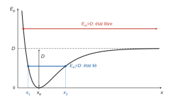
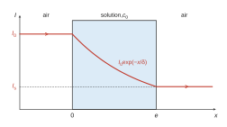
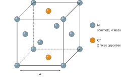
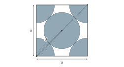
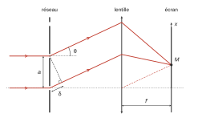
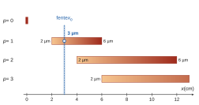

# CCINP PC — Modélisation de systèmes physiques ou chimiques 2026 · Corrigé brut

*Corrigé rédigé par IA, non officiel. Signalez toute erreur.*

Épreuve PC7MO (mutualisée avec e3a-Polytech), 4 heures, calculatrices interdites. Sujet : *Étude d'un spectrophotomètre infrarouge*, 56 questions, deux parties indépendantes.

Remarque de notation : l'énoncé réutilise plusieurs lettres ($\alpha$, $\mu$, $L$, $a$, $\delta$, $\varphi$) pour des objets différents d'une sous-partie à l'autre. On garde ses notations dans chaque sous-partie.

## Partie I — Absorption vibrationnelle

### I.1 — Modèle classique de la vibration d'une molécule diatomique

#### I.1.1 — Potentiel de Morse

**Q1.** L'argument $-\alpha(x-x_e)$ d'une exponentielle est sans dimension, et l'exponentielle elle-même est sans dimension.

On soustrait $x_e$ à la longueur $x$ : $x_e$ est donc une longueur. Le produit $\alpha(x-x_e)$ étant sans dimension, $\alpha$ est l'inverse d'une longueur.

Le facteur $\left(1-e^{-\alpha(x-x_e)}\right)^2$ est sans dimension. Donc $D$ a la dimension de $E_p$, une énergie, et s'exprime en joules, soit en unités de base kg·m²·s⁻² :
$$\boxed{\begin{aligned}
D&\ \text{en J}=\text{kg·m}^2\text{·s}^{-2}\\
\alpha&\ \text{en m}^{-1}\\
x_e&\ \text{en m}
\end{aligned}}$$

**Q2.** Pour un système conservatif à un degré de liberté, une position d'équilibre est un point où la force $-\mathrm dE_p/\mathrm dx$ est nulle, c'est-à-dire où la tangente à la courbe $E_p(x)$ est horizontale. L'équilibre est stable si $E_p$ y présente un minimum.

La courbe de la figure 3 n'a qu'une tangente horizontale, au minimum situé en $x=x_e$. **Le système possède une unique position d'équilibre, $x=x_e$, et elle est stable** : tout écart à $x_e$ augmente $E_p$, si bien que la force ramène le système vers $x_e$.

**Q3.** On a $E_p(x_e)=D(1-1)^2=0$ et $\lim_{x\to+\infty}E_p(x)=D$.

Allure de la courbe : branche répulsive très raide à courte distance, minimum nul en $x_e$, puis **asymptote horizontale** $E_p=D$ quand $x\to+\infty$.



**$D$ est la profondeur du puits**, c'est-à-dire l'écart entre le minimum ($0$) et l'asymptote. C'est l'énergie de dissociation de la liaison.

Le mouvement n'a lieu que là où $E_m\ge E_p(x)$ :

- si $E_m>D$ : $E_p(x)<E_m$ pour tout $x>x_e$, il n'y a pas de point de rebroussement à droite et $x$ peut tendre vers $+\infty$. **État libre** : la molécule se dissocie. Le mouvement reste limité à gauche par la branche répulsive ;
- si $E_m<D$ : l'équation $E_p(x)=E_m$ a deux solutions $x_1<x_e<x_2$ et le mouvement est confiné à $[x_1,x_2]$. **État lié** : la molécule vibre.

#### I.1.2 — Modèle élastique

**Q4.** Le développement limité à l'ordre 2 de l'annexe, écrit en $a=x_e$, s'écrit
$$E_p(x)\approx E_p(x_e)+(x-x_e)E_p'(x_e)+\frac12(x-x_e)^2E_p''(x_e).$$
Posons $u=x-x_e$ et $g(u)=D(1-e^{-\alpha u})^2$, de sorte que $E_p(x)=g(u)$. On dérive deux fois :
$$\begin{aligned}
g'(u)&=2D\alpha e^{-\alpha u}(1-e^{-\alpha u})\\
g''(u)&=2D\alpha^2e^{-2\alpha u}-2D\alpha^2e^{-\alpha u}(1-e^{-\alpha u})
\end{aligned}$$
En $u=0$, on a $e^{0}=1$, donc :
$$\begin{aligned}
g(0)&=D(1-1)^2=0\\
g'(0)&=2D\alpha(1-1)=0\\
g''(0)&=2D\alpha^2
\end{aligned}$$
Les deux premiers termes du développement sont nuls : le terme constant parce que le minimum de $E_p$ vaut zéro, le terme du premier ordre parce que $x_e$ est une position d'équilibre. Il reste
$$\boxed{E_p(x)\approx D\alpha^2(x-x_e)^2}$$

**Q5.** Par identification avec $\tfrac12k(x-x_e)^2$ :
$$\boxed{k=2D\alpha^2}$$
avec $D>0$, donc **$k>0$**, ce qui est cohérent avec le minimum stable trouvé en Q2.

**Q6.** Système : l'atome $A$, point matériel de masse $m_A$. Référentiel d'étude, supposé galiléen.

Bilan des forces : la molécule est isolée, la seule force est celle de la liaison. Elle est modélisée par un ressort de raideur $k$, de longueur $x=x_B-x_A$ et de longueur à vide $x_e$.

Si $x>x_e$, le ressort étiré tire $A$ vers $B$, c'est-à-dire vers les $x$ croissants. La force vaut donc $+k(x-x_e)\vec u_x$, expression qui reste valable pour $x<x_e$.

La deuxième loi de Newton, projetée sur $\vec u_x$, donne la relation (1) :
$$\boxed{m_A\ddot x_A=k(x-x_e)}$$

**Q7.** Système $\{B\}$, même référentiel galiléen, même bilan des forces. Le ressort étiré tire $B$ vers $A$, donc vers les $x$ décroissants : la force vaut $-k(x-x_e)\vec u_x$. On obtient la relation (2) :
$$\boxed{m_B\ddot x_B=-k(x-x_e)}$$
On vérifie que $m_A\ddot x_A+m_B\ddot x_B=0$ : le centre de masse d'un système isolé n'accélère pas.

**Q8.** On divise (1) par $m_A$ et (2) par $m_B$, puis on retranche, puisque $\ddot x=\ddot x_B-\ddot x_A$ :
$$\begin{aligned}
\ddot x&=\ddot x_B-\ddot x_A\\
&=-\frac{k(x-x_e)}{m_B}-\frac{k(x-x_e)}{m_A}\\
&=-k(x-x_e)\left(\frac1{m_A}+\frac1{m_B}\right)\\
&=-\frac k\mu(x-x_e)
\end{aligned}$$
où l'on a posé $\dfrac1\mu=\dfrac1{m_A}+\dfrac1{m_B}$. En multipliant par $\mu$ :
$$\boxed{\mu\ddot x+kx=kx_e}$$
$$\boxed{\mu=\frac{m_Am_B}{m_A+m_B}}$$

**Q9.** Avec $X=x-x_e$, l'équation devient $\ddot X+\dfrac k\mu X=0$.

C'est l'équation de l'oscillateur harmonique : on reconnaît le système masse-ressort de masse $\mu$ et de raideur $k$. Sa pulsation propre vaut $\omega_0=\sqrt{k/\mu}$, réelle puisque $k>0$, et la fréquence vaut $f_0=\omega_0/(2\pi)$ :
$$\boxed{f_0=\frac1{2\pi}\sqrt{\frac k\mu}}$$
Homogénéité : $k/\mu$ est en N·m⁻¹·kg⁻¹, soit s⁻², et $f_0$ est bien en s⁻¹.

**Q10.** Dans le vide, $\lambda_0=c/f_0$. Donc
$$\boxed{\sigma_0=\frac{f_0}{c}=\frac1{2\pi c}\sqrt{\frac k\mu}}$$

#### I.1.3 — Validité de la loi de Hooke sur la multiplicité de la liaison

**Q11.** Les deux ressorts, de même longueur à vide $x_e$, sont fixés au même support et au même point matériel. Ils ont donc à chaque instant la même longueur $\ell$, donc le même allongement $\ell-x_e$, et leurs forces s'ajoutent :
$$\vec F=-k(\ell-x_e)\vec u_x-k(\ell-x_e)\vec u_x=-2k(\ell-x_e)\vec u_x .$$
C'est la force d'un ressort unique de longueur à vide $x_e$ et de raideur
$$\boxed{k_{eq}=2k}$$

**Q12.** Les trois ressorts en parallèle ont encore le même allongement $\ell-x_e$, et leurs trois forces $-k(\ell-x_e)\vec u_x$ s'ajoutent :
$$\boxed{k_{eq}=3k}$$

**Q13.** Les masses, donc $\mu$, ne changent pas. On remplace $k$ par $k_{eq}$ dans la Q10 :

a) double liaison :
$$\boxed{\sigma_0=\frac1{2\pi c}\sqrt{\frac{2k}{\mu}}=\sqrt2\,\sigma_{0,\text{simple}}}$$
b) triple liaison :
$$\boxed{\sigma_0=\frac1{2\pi c}\sqrt{\frac{3k}{\mu}}=\sqrt3\,\sigma_{0,\text{simple}}}$$

**Conclusion** : à atomes donnés, le nombre d'onde d'absorption croît avec la multiplicité de la liaison, comme $\sqrt p$ (rapports $1:\sqrt2:\sqrt3\simeq1:1{,}4:1{,}7$).

**Q14.** Les trois liaisons relient les mêmes atomes C et N : $\mu$ et $k$ sont communs, et $\sigma_0$ croît avec la multiplicité. En classant $1\,300<1\,650<2\,200$ :
$$\boxed{\mathrm{C{-}N}:1\,300\ \mathrm{cm^{-1}},\qquad \mathrm{C{\equiv}N}:2\,200\ \mathrm{cm^{-1}},\qquad \mathrm{C{=}N}:1\,650\ \mathrm{cm^{-1}}}$$
Les liaisons sont données ici dans l'ordre de l'énoncé : simple, triple, double. Contrôle : $2\,200/1\,300\simeq1{,}69$, proche de $\sqrt3\simeq1{,}73$, et $1\,650/1\,300\simeq1{,}27$, à comparer à $\sqrt2\simeq1{,}41$. Le modèle donne le bon ordre et le bon ordre de grandeur, sans être quantitativement exact : une double liaison n'est pas rigoureusement deux fois plus raide qu'une simple.

### I.2 — Le modèle quantique

**Q15.** Avec $\psi=\varphi(x)e^{-iEt/\hbar}$, on calcule les deux dérivées :
$$\begin{aligned}
\frac{\partial\psi}{\partial t}&=-\frac{iE}{\hbar}\varphi(x)e^{-iEt/\hbar}\\
\frac{\partial^2\psi}{\partial x^2}&=\varphi''(x)e^{-iEt/\hbar}
\end{aligned}$$
En injectant dans l'équation de Schrödinger, le membre de gauche devient $i\hbar\times(-iE/\hbar)\psi=E\psi$. On simplifie par $e^{-iEt/\hbar}\neq0$ :
$$E\varphi=-\frac{\hbar^2}{2\mu}\varphi''+\frac12\mu\omega_0^2x^2\varphi .$$
En multipliant par $2\mu/\hbar^2$ :
$$\boxed{\frac{\mathrm d^2\varphi}{\mathrm dx^2}+\frac{\mu}{\hbar^2}\left(2E-\mu\omega_0^2x^2\right)\varphi=0}$$

**Q16.** On applique le développement de l'annexe en $a=x$, avec un écart $\pm\mathrm dx$. Il s'agit d'un développement au second ordre **en $\mathrm dx$** : l'énoncé écrit « par rapport à $x$ », ce qui est une coquille.
$$\boxed{\varphi(x+\mathrm dx)\approx\varphi(x)+\mathrm dx\,\varphi'(x)+\frac{\mathrm dx^2}2\varphi''(x)}$$
$$\boxed{\varphi(x-\mathrm dx)\approx\varphi(x)-\mathrm dx\,\varphi'(x)+\frac{\mathrm dx^2}2\varphi''(x)}$$
Ce sont des égalités approchées, à des termes d'ordre $\mathrm dx^3$ près.

**Q17.** On additionne les deux développements : les termes en $\varphi'$ se compensent, et il reste $\varphi(x+\mathrm dx)+\varphi(x-\mathrm dx)\approx2\varphi(x)+\mathrm dx^2\varphi''(x)$. On isole $\varphi''$ :
$$\boxed{\frac{\mathrm d^2\varphi}{\mathrm dx^2}(x)\approx\frac{\varphi(x+\mathrm dx)+\varphi(x-\mathrm dx)-2\varphi(x)}{\mathrm dx^2}}$$

**Q18.** On écrit la Q17 au point $x=x_i$. Les points de discrétisation sont régulièrement espacés, donc $x_{i+1}=x_i+\mathrm dx$ et $x_{i-1}=x_i-\mathrm dx$, d'où $\varphi(x_i\pm\mathrm dx)=\varphi_{i\pm1}$ :
$$\boxed{\varphi_{i+1}+\varphi_{i-1}-2\varphi_i=\mathrm dx^2\,\frac{\mathrm d^2\varphi}{\mathrm dx^2}(x_i)}$$

**Q19.** La Q15 donne, en $x_i$, $\varphi''(x_i)=\dfrac{\mu}{\hbar^2}\left(\mu\omega_0^2x_i^2-2E\right)\varphi_i$. On reporte dans la Q18 :
$$\varphi_{i+1}=\left(2+\frac{\mu\,\mathrm dx^2}{\hbar^2}\left(\mu\omega_0^2x_i^2-2E\right)\right)\varphi_i-\varphi_{i-1}.$$
Avec $E=\hbar\omega_0(v+\tfrac12)$, on a $\mu\omega_0^2x_i^2-2E=2\omega_0\left(\tfrac12\mu\omega_0x_i^2-\hbar(v+\tfrac12)\right)$, d'où
$$\boxed{\varphi_{i+1}=\left(2+\frac{2\mu\omega_0}{\hbar^2}\mathrm dx^2\left(\frac12\mu\omega_0x_i^2-\hbar\left(v+\frac12\right)\right)\right)\varphi_i-\varphi_{i-1}}$$

**Q20.** $L$ est l'abscisse positive où la parabole $V(x)$ coupe le niveau $v=5$, d'énergie $E_5=\hbar\omega_0(5+\tfrac12)=\tfrac{11}2\hbar\omega_0$ :
$$\begin{aligned}
\frac12\mu\omega_0^2L^2&=\frac{11}2\hbar\omega_0\\
L&=\sqrt{\frac{11\hbar}{\mu\omega_0}}\simeq3{,}4\cdot10^{-10}\ \text{m}
\end{aligned}$$

```python
L = np.sqrt(11*hbar/(mu*omega0))          # instruction 1.1
```

**Q21.**
```python
X = np.linspace(-L, L, N)                 # instruction 1.2
```

**Q22.**
```python
dx = X[1] - X[0]                          # instruction 1.3, vaut 2L/(N-1)
```

**Q23.** On impose $\varphi_0=0$ et $\varphi_1=1$, puis on applique la récurrence de la Q19 pour $i=1,\dots,N-2$.

```python
    phi = np.zeros(N)                     # instructions 2 (phi[0] = 0)
    phi[1] = 1
    for i in range(1, N-1):
        c = 2 + 2*mu*omega0/hbar**2*dx**2*(0.5*mu*omega0*X[i]**2 - hbar*(v + 1/2))
        phi[i+1] = c*phi[i] - phi[i-1]
```

Le programme, exécuté, donne au centre les fonctions attendues : 0, 1 et 2 zéros pour $v=0,1,2$.

Après normalisation, $\max|\varphi_0|\simeq7{,}4\cdot10^4$ m$^{-1/2}$, qui est la valeur exacte $(\mu\omega_0/\pi\hbar)^{1/4}$. On observe une légère divergence près de $x=+L$, qui croît avec $v$. Elle vient de la condition $\varphi(-L)=0$ imposée à distance finie.

**Q24.** La méthode des rectangles à gauche utilise les points $x_0$ à $x_{N-2}$ :
```python
    norm = np.sum(phi[:-1]**2)*dx         # instruction 3.1
```

**Q25.**
```python
    phi = phi/np.sqrt(norm)               # instruction 3.2
```

**Q26.** On trace les trois courbes, puis on fait un seul `show`, hors de la boucle :
```python
for v in [0, 1, 2]:                       # instructions 4
    plt.plot(X, fonction_onde(v))
plt.xlabel('x')
plt.ylabel('phi(x)')
plt.show()
```

### I.3 — Le modèle ondulatoire : absorption d'une onde électromagnétique par une solution chimique

**Q27.** On prend le rotationnel de l'équation de Maxwell-Faraday. D'un côté, l'identité de l'annexe et Maxwell-Gauss ($\mathrm{div}\,\underline{\vec E}=0$) donnent
$$\begin{aligned}
\overrightarrow{\mathrm{rot}}\,\overrightarrow{\mathrm{rot}}\,\underline{\vec E}&=\overrightarrow{\mathrm{grad}}\left(\mathrm{div}\,\underline{\vec E}\right)-\Delta\underline{\vec E}\\
&=-\Delta\underline{\vec E}
\end{aligned}$$
De l'autre, on permute les dérivations en espace et en temps, puis on utilise Maxwell-Ampère :
$$\begin{aligned}
\overrightarrow{\mathrm{rot}}\left(-\frac{\partial\underline{\vec B}}{\partial t}\right)&=-\frac{\partial}{\partial t}\overrightarrow{\mathrm{rot}}\,\underline{\vec B}\\
&=-\underline\varepsilon\mu_0\frac{\partial^2\underline{\vec E}}{\partial t^2}
\end{aligned}$$
En égalant les deux expressions :
$$\boxed{\Delta\underline{\vec E}-\underline\varepsilon\,\mu_0\frac{\partial^2\underline{\vec E}}{\partial t^2}=\vec0}$$
Le milieu n'étant pas le vide, on n'introduit pas de célérité $c$ : le coefficient est $\underline\varepsilon\mu_0$.

**Q28.** On injecte $\underline{\vec E}=E_0e^{j(\omega t-\underline kx)}\vec u_y$. Dériver par rapport à $x$ revient à multiplier par $-j\underline k$, et dériver par rapport à $t$ à multiplier par $j\omega$ :
$$\begin{aligned}
\Delta\underline{\vec E}&=(-j\underline k)^2\underline{\vec E}=-\underline k^2\underline{\vec E}\\
\frac{\partial^2\underline{\vec E}}{\partial t^2}&=(j\omega)^2\underline{\vec E}=-\omega^2\underline{\vec E}
\end{aligned}$$
L'équation de propagation devient
$$\left(-\underline k^2+\underline\varepsilon\mu_0\omega^2\right)\underline{\vec E}=\vec0 .$$
Une onde non nulle impose
$$\boxed{\underline k^2=\mu_0\omega^2(\varepsilon_r-j\varepsilon_i)}$$

**Q29.** On factorise par $\varepsilon_r$ :
$$\underline k^2=\mu_0\varepsilon_r\omega^2\left(1-j\frac{\varepsilon_i}{\varepsilon_r}\right).$$
Comme $\varepsilon_i/\varepsilon_r\ll1$, on fait un développement limité à l'ordre 1, $\sqrt{1+u}\approx1+u/2$ pour $|u|\ll1$ :
$$\underline k\approx\pm\omega\sqrt{\mu_0\varepsilon_r}\left(1-\frac j2\frac{\varepsilon_i}{\varepsilon_r}\right).$$
On ne peut pas annuler la partie imaginaire : c'est elle qui décrit l'absorption. Pour une onde qui se propage vers les $x$ croissants en s'atténuant ($k'>0$, $k''>0$), on prend le signe $+$ :
$$\boxed{\begin{aligned}
k'&=\omega\sqrt{\mu_0\varepsilon_r}\\
k''&=\frac{\omega\,\varepsilon_i}{2}\sqrt{\frac{\mu_0}{\varepsilon_r}}
\end{aligned}}$$
avec $k''\ll k'$.

**Q30.** On sépare l'exponentielle : $e^{-j\underline kx}=e^{-j(k'-jk'')x}=e^{-k''x}e^{-jk'x}$. Donc $\underline{\vec E}=E_0e^{-k''x}e^{j(\omega t-k'x)}\vec u_y$, et le champ réel en est la partie réelle. Avec $E_0$ réel :
$$\boxed{\vec E(x,t)=E_0e^{-k''x}\cos(\omega t-k'x)\,\vec u_y}$$
**Le milieu est absorbant** : l'amplitude $E_0e^{-k''x}$ décroît exponentiellement au cours de la propagation, car $k''>0$, et l'onde cède de l'énergie au milieu.

**Q31.** La vitesse de phase se calcule avec la partie réelle $k'=\mathrm{Re}(\underline k)$ : la phase $\omega t-k'x$ est constante pour $\mathrm dx/\mathrm dt=\omega/k'$. Ce n'est pas la vitesse de groupe $\mathrm d\omega/\mathrm dk'$.
$$\boxed{v_\varphi=\frac{\omega}{k'}=\frac1{\sqrt{\mu_0\varepsilon_r}}}$$
$v_\varphi$ ne dépend pas de $\omega$ tant que $\varepsilon_r$ est traitée comme une constante : **dans ce modèle, le milieu n'est pas dispersif**. Dans un milieu réel, $\varepsilon_r$ dépend de $\omega$ au voisinage des bandes d'absorption, et le milieu est alors dispersif.

**Q32.** L'onde est une pseudo-onde plane progressive harmonique, de vecteur d'onde complexe $\underline k\,\vec u_x$. On applique Maxwell-Faraday en notation complexe :
$$\begin{aligned}
\overrightarrow{\mathrm{rot}}\,\underline{\vec E}&=\frac{\partial\underline E_y}{\partial x}\vec u_z=-j\underline k\,\underline E_y\vec u_z\\
-\frac{\partial\underline{\vec B}}{\partial t}&=-j\omega\underline{\vec B}
\end{aligned}$$
En égalant, $\underline{\vec B}=\dfrac{\underline k}{\omega}\underline E_y\vec u_z$, soit $\underline{\vec B}=\dfrac{\underline k\,\vec u_x\wedge\underline{\vec E}}{\omega}$. En détaillant $\underline k=k'-jk''$ :
$$\boxed{\underline{\vec B}(x,t)=\frac{k'-jk''}{\omega}E_0e^{-k''x}e^{j(\omega t-k'x)}\,\vec u_z}$$

**Q33.** Le conjugué change $j$ en $-j$ dans chaque facteur complexe, et laisse inchangé le facteur réel $e^{-k''x}$ :
$$\underline{\vec B}^*=\frac{k'+jk''}{\omega}E_0e^{-k''x}e^{-j(\omega t-k'x)}\vec u_z .$$
Avec $\vec u_y\wedge\vec u_z=\vec u_x$, les facteurs de phase se compensent dans le produit $\underline{\vec E}\wedge\underline{\vec B}^*$. La formule de l'annexe donne
$$\begin{aligned}
\langle\vec\Pi\rangle&=\frac1{2\mu_0}\mathcal Re\left(\frac{k'+jk''}{\omega}\right)E_0^2e^{-2k''x}\vec u_x\\
&=\frac{k'E_0^2}{2\mu_0\omega}e^{-2k''x}\vec u_x
\end{aligned}$$
Donc $I=\|\langle\vec\Pi\rangle\|=I_0e^{-x/\delta}$ avec
$$\boxed{\begin{aligned}
I_0&=\frac{k'E_0^2}{2\mu_0\omega}\\
\delta&=\frac1{2k''}
\end{aligned}}$$

**Q34.** La sortie de la cuve est en $x=e$. On reporte $x=e$ et $1/\delta=\alpha c_0$ dans $I=I_0\exp(-x/\delta)$ :
$$\boxed{I_s=I_0\exp(-\alpha c_0e)}$$



**Q35.** D'après la Q34, $I_0/I_s=\exp(\alpha c_0e)$, donc $\ln(I_0/I_s)=\alpha c_0e$. L'annexe donne $\log x=\ln x/\ln10$ :
$$\boxed{\begin{aligned}
A&=\log\frac{I_0}{I_s}=\frac{\alpha c_0e}{\ln10}\\
T&=\frac{I_s}{I_0}=\exp(-\alpha c_0e)
\end{aligned}}$$
On a bien $T=10^{-A}$.

**Q36.** Avec $\epsilon_{em}=\alpha/\ln10$ :
$$\boxed{A=\epsilon_{em}\,c_0\,e}$$
C'est la **loi de Beer-Lambert** : l'absorbance est proportionnelle à la concentration et à la longueur traversée.

## Partie II — Principe de fonctionnement d'un spectrophotomètre infrarouge

### II.1 — Étude de la source infrarouge

#### II.1.1 — Étude cristalline de la source infrarouge

**Q37.** On remplit selon la règle de Klechkowski pour $Z=28$ :
$$\boxed{\mathrm{Ni}:\ 1s^2\,2s^2\,2p^6\,3s^2\,3p^6\,4s^2\,3d^8}$$
La couche $n=4$ est la plus élevée occupée, donc le nickel est en **4e ligne**. C'est un élément du bloc $d$ avec $2+8=10$ électrons de valence : **10e colonne**.

**Q38.** Un atome situé à un sommet est partagé entre 8 mailles et compte pour $1/8$. Un atome au centre d'une face est partagé entre 2 mailles et compte pour $1/2$. Les 8 sommets et 4 faces portent du nickel, les 2 autres faces du chrome :
$$\begin{aligned}
N(\mathrm{Ni})&=8\times\tfrac18+4\times\tfrac12=3\\
N(\mathrm{Cr})&=2\times\tfrac12=1
\end{aligned}$$
**3 atomes de nickel et 1 atome de chrome par maille** (4 au total, comme pour toute maille CFC), d'où la formule Ni₃Cr.



**Q39.** La maille contient 3 atomes de nickel et 1 de chrome (Q38). Sa masse est donc $(3M(\mathrm{Ni})+M(\mathrm{Cr}))/N_A$, où $N_A$ est le nombre d'Avogadro. Son volume est celui d'un cube d'arête $a$, soit $a^3$. La masse volumique vaut
$$\mu(\mathrm{NiCr})=\frac{3M(\mathrm{Ni})+M(\mathrm{Cr})}{N_Aa^3},$$
d'où
$$\boxed{a=\left(\frac{3M(\mathrm{Ni})+M(\mathrm{Cr})}{N_A\,\mu(\mathrm{NiCr})}\right)^{1/3}}$$

**Q40.** L'énoncé demande la distance entre voisins dans un modèle d'atomes identiques : on ne distingue pas Ni et Cr. Dans une structure CFC, les plus proches voisins sont un sommet et le centre d'une face qui le contient. Ils sont sur une diagonale de face, de longueur $a\sqrt2$, qui contient deux distances $d$. On a donc $d=a\sqrt2/2=a/\sqrt2$ :



$$\boxed{d=\frac{350}{1{,}4}\ \mathrm{pm}\simeq250\ \mathrm{pm}=2{,}5\cdot10^{-10}\ \mathrm m}$$

#### II.1.2 — Évaluation de la température ambiante autour de la source infrarouge

**Q41.** Système : la tige, conducteur ohmique de résistance $R$ parcouru par le courant $i$. La puissance électrique reçue, dissipée par effet Joule, vaut $Ri^2$ :
$$\boxed{P_{\text{élec}}=Ri^2=\frac{L\,i^2}{\gamma\pi a^2}}$$

**Q42.** On néglige les bases du cylindre ($L\gg a$) : la surface d'échange est la surface latérale $S=2\pi aL$. La tige, corps noir à $T_s$, émet $\sigma T_s^4S$ d'après la loi de Stefan. Elle reçoit $\sigma T_a^4S$ du gaz, corps noir à $T_a$ qui l'entoure. La puissance nette perdue par la tige, cédée au gaz, est
$$\boxed{P_{ray}=2\pi aL\,\sigma\left(T_s^4-T_a^4\right)}$$

**Q43.** La loi de Newton s'applique sur la même surface $S=2\pi aL$. La tige est plus chaude que le gaz ($T_s>T_a$) : elle perd de l'énergie par conducto-convection, et la puissance qu'elle cède au gaz est positive. On peut donc enlever la valeur absolue :
$$\boxed{P_{cc}=2\pi aL\,H\,(T_s-T_a)}$$

**Q44.** Système : la tige. On lui applique le premier principe de la thermodynamique, sous forme de bilan de puissance : la variation de son énergie interne est la somme des puissances reçues. Elle reçoit $P_{\text{élec}}$ et perd $P_{ray}$ et $P_{cc}$.

En régime stationnaire, toutes les grandeurs sont indépendantes du temps, donc $\mathrm dU/\mathrm dt=0$ :
$$\begin{aligned}
P_{\text{élec}}-P_{ray}-P_{cc}&=0\\
\frac{Li^2}{\gamma\pi a^2}&=2\pi aL\left[\sigma(T_s^4-T_a^4)+H(T_s-T_a)\right]
\end{aligned}$$
En divisant par $2\pi aL$ :
$$\boxed{\sigma T_a^4+HT_a=\sigma T_s^4+HT_s-\frac{i^2}{2\pi^2\gamma a^3}}$$

#### II.1.3 — Détermination de la température $T_a$ par dichotomie

**Q45.** La dichotomie cherche un zéro : on écrit l'équation de la Q44 sous la forme $f(T_a)=0$, en passant tous les termes dans le premier membre :
$$f(x)=\sigma x^4+Hx-\sigma T_s^4-HT_s+\frac{i^2}{2\pi^2\gamma a^3}.$$
Le programme 2 n'importe pas numpy : on utilise `math.pi`.
```python
from math import pi
def f(x):                                 # instruction 4
    return sigma*x**4 + H*x - sigma*Ts**4 - H*Ts + i**2/(2*pi**2*gamma*a**3)
```

**Q46.** On suit le principe de l'énoncé : on garde la moitié où $f$ change de signe jusqu'à ce que l'intervalle soit plus étroit que $p$.
```python
def dichotomie(f, b, c, p):               # instructions 5
    while c - b > p:
        m = (b + c)/2
        if f(b)*f(m) > 0:                 # même signe : racine dans [m, c]
            b = m
        else:                             # racine dans [b, m]
            c = m
    return (b + c)/2
```
La boucle s'arrête quand la largeur de l'intervalle passe sous la précision $p$, et la fonction renvoie le milieu par `return`.

$f$ est continue et strictement croissante, car $f'(x)=4\sigma x^3+H>0$. Elle change de signe sur $[298,1\,000]$ :
$$\begin{aligned}
f(298)&\simeq-5{,}4\cdot10^4\\
f(1\,000)&=\frac{i^2}{2\pi^2\gamma a^3}\simeq+3{,}2\cdot10^3
\end{aligned}$$
Il faut 10 itérations pour descendre sous 1 K. L'énoncé contient deux coquilles : l'appel final écrit `Dichotomie`, avec une majuscule, et `print(f "…")` contient une espace interdite entre `f` et la chaîne. Il faut lire `print(f"… {dichotomie(f,298,1000,1):.0f} K")`.

**Q47.** On trouve $T_a\simeq986$ K. Cette valeur est **inférieure à $T_s$**, ce qui est cohérent avec le fait que la tige cède de la chaleur au gaz.

L'écart est faible, 14 K. Le terme Joule $i^2/(2\pi^2\gamma a^3)\simeq3{,}2\cdot10^3$ W·m⁻² ne représente que 5,6 % de $\sigma T_s^4\simeq5{,}7\cdot10^4$ W·m⁻², et le terme radiatif varie très vite avec la température. En linéarisant :
$$\Delta T\simeq\frac{3{,}2\cdot10^3}{4\sigma T_s^3+H}\simeq\frac{3{,}2\cdot10^3}{228}\simeq14\ \text{K}$$

Une température « ambiante » de 986 K (713 °C) est en revanche **physiquement irréaliste**, et cela révèle les limites du modèle. Le gaz est traité comme un corps noir alors que N₂ et O₂ sont transparents dans l'IR : le rayonnement est absorbé par les parois, bien plus froides. $H=1$ W·m⁻²·K⁻¹ est très faible (la convection naturelle de l'air donne plutôt 5 à 25). Les pertes par les supports et les extrémités sont négligées.

### II.2 — Monochromateur à réseau

**Q48.** Le réseau est éclairé sous incidence normale : le plan du réseau est une surface d'onde de l'onde incidente, et deux fentes consécutives $F_1$ et $F_2$, distantes de $a=1/n$, vibrent en phase. La différence de marche en $M$ est
$$\delta=(F_2M)-(F_1M).$$
Les rayons diffractés sous l'angle $\theta$ convergent en $M$. D'après le principe du retour inverse de la lumière, $M$ peut être vu comme une source ponctuelle dans le plan focal image. Les rayons issus de $M$ ressortent de la lentille parallèles, inclinés de $\theta$. D'après le théorème de Malus, le plan perpendiculaire à ces rayons est une surface d'onde : tous ses points sont à même chemin optique de $M$.

Soit $H$ le pied de la perpendiculaire menée de $F_1$ au rayon issu de $F_2$. Les points $F_1$ et $H$ sont sur la même surface d'onde, donc $(HM)=(F_1M)$.

Il reste $\delta=F_2H$. C'est un côté du triangle rectangle en $H$ d'hypoténuse $F_1F_2=a$, opposé à l'angle $\theta$ :
$$\boxed{\delta=a\sin\theta}$$



L'écran est dans le plan focal image de la lentille. Le rayon passant par le centre optique n'est pas dévié, donc $M$ a pour ordonnée $x=f'\tan\theta$. Dans les conditions de Gauss (rayons peu inclinés sur l'axe), $\sin\theta\approx\tan\theta\approx\theta$, donc $\sin\theta\approx x/f'$ et $\delta\approx x/(nf')$. Le déphasage vaut
$$\boxed{\varphi=\frac{2\pi\delta}{\lambda_0}=\frac{2\pi x}{\lambda_0\,n\,f'}}$$

**Q49.**
```python
import numpy as np
def phi(x, lamda):                        # instruction 6
    return 2*np.pi*x/(lamda*n*f)
```

**Q50.** On prend $A_0=1$ : la fonction renvoie $I/I_0$, la grandeur des figures 10 et 11.
```python
def intensite(x, lamda):                  # instructions 7
    p = np.linspace(0, N-1, N)            # indices des N traits
    A = np.sum(np.exp(-1j*p*phi(x, lamda)))
    return (A*A.conjugate()).real         # réel, donc comparable à un seuil
```
Contrôle : en $x=0$, les $N$ ondes sont en phase et `intensite(0, lamda)` vaut $N^2=10^6$, comme sur la figure 10.

**Q51.**
```python
    x_min = x0 - b/2                      # instructions 8.1
    x_max = x0 + b/2
```

**Q52.**
```python
    X_list = np.linspace(x_min, x_max, 1000)        # instructions 8.2
    Lambda_list = np.linspace(2e-6, 6e-6, 1000)
```

**Q53.** L'intensité maximale est le maximum de `intensite(x, lamda)` sur tous les couples de la grille : il faut parcourir les deux listes, par une double boucle, puis appliquer `max`.
```python
    I_tout = []                           # instruction 8.3
    for lamda in Lambda_list:
        for x in X_list:
            I_tout.append(intensite(x, lamda))
    I_seuil = 0.1*max(I_tout)
```
Contrôle : le maximum vaut $N^2=10^6$ quand les $N$ ondes sont en phase (figure 10). Sur la grille de la fente centrée en 3 cm, on obtient $0{,}99999\cdot10^6$, car un couple $(x,\lambda)$ tombe presque exactement sur l'ordre 1. Écrire directement `I_seuil = 0.1*N**2` donne donc le même résultat ici.

**Q54.**
```python
    longueur_onde = []                    # instructions 8.4
    for lamda in Lambda_list:
        for x in X_list:
            if intensite(x, lamda) > I_seuil:
                longueur_onde.append(lamda)
```
Une même longueur d'onde peut apparaître plusieurs fois, ce qui ne change ni le maximum ni le minimum.

**Q55.**
```python
    return max(longueur_onde) - min(longueur_onde)  # instruction 8.5
```

**Q56.** Les maxima principaux correspondent à $\varphi=2\pi p$, avec $p$ entier, soit $\lambda=\dfrac{x}{p\,nf'}$ où $nf'=5\cdot10^4\times0{,}2=10^4$.

Pour $x_0=3$ cm, l'ordre $p=1$ donne $\lambda_0=3$ µm, qui appartient au spectre $[2\,;6]$ µm. L'ordre 2 donnerait 1,5 µm, hors spectre. **Seul l'ordre 1 traverse la fente**, et le monochromateur sélectionne une bande centrée sur 3 µm.



La largeur $\Delta\lambda=1{,}2\cdot10^{-8}$ m a deux origines :

- la largeur de la fente : $\Delta\lambda_{\text{fente}}=\dfrac{b}{nf'}=\dfrac{10^{-4}}{10^4}=1{,}0\cdot10^{-8}$ m ;
- la largeur propre d'un pic, finie car $N=1\,000$ : environ $4\cdot10^{-9}$ m mesurée au dixième du maximum (environ $\lambda_0/N=3\cdot10^{-9}$ m en ordre de grandeur).

Leur somme, environ $1{,}4\cdot10^{-8}$ m, n'est résolue qu'au pas de `Lambda_list`, $4\cdot10^{-6}/999\simeq4\cdot10^{-9}$ m. Quatre valeurs sont retenues, d'où $\Delta\lambda=3\times4\cdot10^{-9}=1{,}2\cdot10^{-8}$ m.
$$\boxed{\begin{aligned}
\frac{\Delta\lambda}{\lambda_0}&=\frac{1{,}2\cdot10^{-8}}{3\cdot10^{-6}}=4\cdot10^{-3}\\
\frac{\lambda_0}{\Delta\lambda}&\simeq250
\end{aligned}}$$
La bande transmise est environ 300 fois plus étroite que le spectre de la source : le faisceau est quasi monochromatique. En nombre d'onde, $\sigma_0\simeq3\,333$ cm⁻¹ et $\Delta\sigma=\Delta\lambda/\lambda_0^2\simeq13$ cm⁻¹, ce qui est très inférieur aux écarts entre les bandes de la Q14 (350 cm⁻¹ et plus) : la résolution suffit à les séparer. Elle est limitée par la fente, plus que par le réseau. Rétrécir la fente améliorerait la résolution, au prix d'une perte de flux lumineux.

**FIN**
