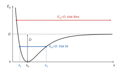
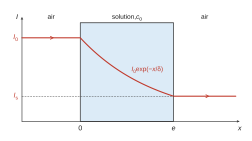
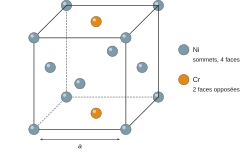
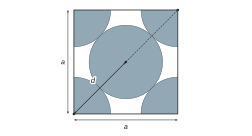
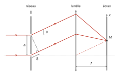
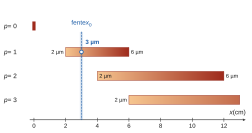

# CCINP PC — Modélisation de systèmes physiques ou chimiques 2026 · Corrigé guidé

*Corrigé rédigé par IA, non officiel. Signalez toute erreur.*

## Présentation du sujet

L'épreuve (PC7MO, mutualisée avec e3a-Polytech, 4 heures, **calculatrices interdites**) a pour fil conducteur un **spectrophotomètre infrarouge**. Elle comporte 56 questions réparties en deux parties indépendantes, et une annexe qui donne les commandes Python autorisées, quelques formules (rotationnel du rotationnel, vecteur de Poynting moyen, développement limité) et une aide aux calculs.

- **Partie I — Absorption vibrationnelle (Q1 à Q36).** Trois modèles du même phénomène, de plus en plus fins.
  - *I.1 (Q1-Q14), modèle classique* : potentiel de Morse, approximation harmonique, deux lois de Newton combinées en une équation pour la masse réduite, fréquence propre et nombre d'onde, puis modèle « ressorts en parallèle » de la multiplicité des liaisons, confronté à trois bandes IR de C–N, C=N et C≡N.
  - *I.2 (Q15-Q26), modèle quantique* : équation de Schrödinger stationnaire de l'oscillateur harmonique, discrétisée par différences finies, puis résolue en Python par une récurrence à deux termes (méthode du tir), avec une normalisation par la méthode des rectangles et un tracé.
  - *I.3 (Q27-Q36), modèle ondulatoire* : propagation d'une onde plane dans un milieu de permittivité complexe, relation de dispersion, onde atténuée, vecteur de Poynting, puis loi de Beer-Lambert.
- **Partie II — Le spectrophotomètre (Q37 à Q56).**
  - *II.1 (Q37-Q47), la source* : configuration électronique du nickel, maille CFC de l'alliage Ni₃Cr, bilan thermique d'une tige chauffée par effet Joule (rayonnement et conducto-convection), puis résolution par dichotomie en Python.
  - *II.2 (Q48-Q56), le monochromateur* : déphasage entre deux traits d'un réseau en conditions de Gauss, puis calcul en Python de l'intensité à $N$ ondes et de la bande spectrale transmise par une fente.

**Notions mobilisées** : mécanique du point et énergie potentielle (PCSI), oscillateur harmonique, équation de Schrödinger (PC), équations de Maxwell et ondes dans les milieux (PC), interférences et lentilles (PCSI-PC), architecture de la matière et cristallographie (PCSI), bilans thermiques et rayonnement (PC), et la partie « outils numériques » du programme : récurrences, intégration, dichotomie, numpy et matplotlib.

**Difficulté et longueur.** Le sujet est long, mais très guidé et régulier. Près de 20 questions sont des compléments de code courts. Le rapport 2026 juge sa longueur adaptée : la majorité des candidats a abordé l'essentiel des questions, et la diversité des niveaux de difficulté a permis un bon classement. Il ne donne pas de statistiques par question.

**Questions discriminantes selon le rapport 2026.** Q4-Q5 (développement limité jugé « Très confus »), Q8 (combinaison linéaire, très souvent fausse), toute la sous-partie I.3 de Q29 à Q33 (calcul en complexes, souvent absente ou inaboutie), Q40 (énoncé mal lu), Q41-Q44 (bilan thermique sans premier principe), Q46 (dichotomie), Q48 (différence de marche, question de cours « mal traitée et confuse ») et les codes de Q51 à Q56, abordés surtout dans les bonnes copies.

**À ne pas laisser passer** : Q1, Q2, Q5, Q9-Q12, Q20-Q22, Q25, Q34-Q38, Q41, Q51-Q53, Q55. Ce sont des questions de cours ou de lecture directe. Le jury note que des candidats découragés par un blocage ont laissé de côté beaucoup de questions accessibles : les parties sont indépendantes, il faut en profiter.

**Rédaction attendue.** Le rapport 2026 regrette les résultats « parachutés » et recommande de « citer explicitement les définitions, théorèmes, lois ou relations utilisés ». Pour le code, il conseille de préparer le raisonnement au brouillon et de « tester mentalement son code sur des cas simples » : bornes, borne incluse ou exclue, initialisation.

**Gestion du temps** : environ 2 h 15 pour la partie I et 1 h 30 pour la partie II, plus 15 minutes de relecture. Les blocs de code ne demandent presque jamais la physique qui précède, car la formule est rappelée dans l'énoncé : en cas de blocage sur un calcul, on peut passer directement au code.

**Notations.** L'énoncé réutilise $\alpha$, $\mu$, $L$, $a$, $\delta$ et $\varphi$ pour des objets différents selon les sous-parties. On garde ses notations et on précise le sens quand il y a un risque de confusion.

## Partie I — Absorption vibrationnelle

### I.1 — Modèle classique de la vibration d'une molécule diatomique

On part d'un potentiel réaliste (Morse), on le linéarise près de l'équilibre et on obtient un oscillateur harmonique. Les outils sont l'analyse dimensionnelle, la lecture d'un profil d'énergie potentielle, les développements limités et la deuxième loi de Newton.

### Question 1
> [!INDICATION]
> Que peut-on dire de l'argument d'une exponentielle ? Et de la dimension d'une énergie potentielle ?

#### Solution
L'argument $-\alpha(x-x_e)$ de l'exponentielle est sans dimension, et l'exponentielle elle-même aussi.

On soustrait $x_e$ à la longueur $x$ : $x_e$ est une longueur. Le produit $\alpha(x-x_e)$ étant sans dimension, $\alpha$ est l'inverse d'une longueur.

Le facteur $(1-e^{-\alpha(x-x_e)})^2$ est sans dimension, donc $D$ a la dimension de $E_p$, une énergie :
$$\boxed{\begin{aligned}
D&\ \text{en J}=\text{kg·m}^2\text{·s}^{-2}\\
\alpha&\ \text{en m}^{-1}\\
x_e&\ \text{en m}
\end{aligned}}$$

> [!PIEGE]
> L'énoncé demande le Système international : $D$ s'exprime en joules, pas en électronvolts, même si l'ordre de grandeur usuel est de quelques eV. Il faut aussi distinguer deux arguments : l'argument de l'exponentielle est sans dimension, et l'exponentielle l'est donc aussi.

> [!JURY]
> Le rapport 2026 note que « D est trop souvent restée en J » : le jury attendait visiblement l'expression en unités de base, kg·m²·s⁻². Donner les deux formes ne coûte rien.

### Question 2
> [!INDICATION]
> Quelle caractérisation graphique des positions d'équilibre connaît-on pour un système conservatif à un degré de liberté ?

#### Solution
Une position d'équilibre est un point où la force $-\mathrm dE_p/\mathrm dx$ est nulle : la tangente à la courbe y est horizontale. L'équilibre est stable si $E_p$ y présente un minimum.

La figure 3 n'a qu'une tangente horizontale, au minimum situé en $x_e$. **Le système a une unique position d'équilibre, $x=x_e$, et elle est stable** : un écart à $x_e$ augmente $E_p$, si bien que la force ramène vers $x_e$.

> [!PIEGE]
> Un équilibre se caractérise par $\mathrm dE_p/\mathrm dx=0$, pas par $E_p=0$ : ici, les deux coïncident en $x_e$ par hasard du choix de l'origine des énergies. Et un maximum de $E_p$ est aussi un équilibre, mais instable.

> [!JURY]
> Le rapport 2026 constate que « La grande partie des candidats ne font pas la différence entre équilibre et stabilité de l'équilibre ». Il faut deux critères distincts : tangente horizontale pour l'équilibre, minimum pour la stabilité. L'énoncé impose une phrase, sans dériver $E_p$.

### Question 3
> [!INDICATION]
> Calculer $E_p$ en deux points remarquables : au fond du puits et pour une distance infinie.

> [!INDICATION]
> Pour la nature de l'état, tracer l'horizontale $E_m$ et chercher les points où $E_m=E_p(x)$.

#### Solution
On a $E_p(x_e)=0$ et $E_p(x)\to D$ quand $x\to+\infty$. Sur le tracé, la branche répulsive est très raide pour $x<x_e$, le minimum vaut zéro en $x_e$, et l'asymptote horizontale est $E_p=D$.



**$D$ est la profondeur du puits**, l'écart entre le minimum et l'asymptote : c'est l'énergie de dissociation.

Le mouvement n'a lieu que là où $E_m\ge E_p(x)$ :

- si $E_m>D$, il n'y a pas de point de rebroussement à droite et $x$ peut tendre vers l'infini : c'est un **état libre**, la molécule se dissocie ;
- si $E_m<D$, il y a deux points de rebroussement $x_1<x_e<x_2$ et le mouvement est borné : c'est un **état lié**, la molécule vibre.

> [!PIEGE]
> Placer $D$ comme l'ordonnée du minimum est faux, car celle-ci vaut zéro. $D$ se lit comme une hauteur entre le fond du puits et l'asymptote.

> [!JURY]
> Question bien traitée selon le rapport 2026, « mais la notion d'asymptote apparaît rarement ». C'est pourtant elle qui justifie la place de $D$ : nommer l'asymptote horizontale $E_p=D$ sur le tracé.

### Question 4
> [!INDICATION]
> Appliquer le développement de l'annexe en $a=x_e$. Que valent $E_p(x_e)$ et $E_p'(x_e)$ ?

> [!INDICATION]
> Poser $u=x-x_e$ et dériver deux fois $D(1-e^{-\alpha u})^2$, ou bien développer $1-e^{-\alpha u}$ à l'ordre 1 avant d'élever au carré.

#### Solution
On écrit d'abord le développement de l'annexe en $a=x_e$ :
$$E_p(x)\approx E_p(x_e)+(x-x_e)E_p'(x_e)+\frac12(x-x_e)^2E_p''(x_e).$$
Avec $u=x-x_e$ et $g(u)=D(1-e^{-\alpha u})^2$, on dérive deux fois :
$$\begin{aligned}
g'(u)&=2D\alpha e^{-\alpha u}(1-e^{-\alpha u})\\
g''(u)&=2D\alpha^2e^{-2\alpha u}-2D\alpha^2e^{-\alpha u}(1-e^{-\alpha u})
\end{aligned}$$
En $u=0$ :
$$\begin{aligned}
g(0)&=0\\
g'(0)&=0\\
g''(0)&=2D\alpha^2
\end{aligned}$$
Le terme constant est nul car le minimum vaut zéro, le terme d'ordre 1 car $x_e$ est une position d'équilibre. Il vient
$$\boxed{E_p(x)\approx D\alpha^2(x-x_e)^2}$$

> [!METHODE]
> Près d'un minimum, toute énergie potentielle régulière s'écrit $E_p(x)\approx E_p(x_e)+\tfrac12E_p''(x_e)(x-x_e)^2$. La raideur équivalente vaut donc $E_p''(x_e)$, et ce réflexe sert dans tous les problèmes de petites oscillations.

> [!JURY]
> Le rapport 2026 juge Q4-Q5 « Très confus » : « Le DL est trop souvent non explicitement donné » et « Le calcul des dérivées premières et secondes est très souvent absent des copies ». Écrire la formule du DL, puis les dérivées, puis leurs valeurs en $x_e$, en justifiant la disparition des deux premiers termes.

> [!PIEGE]
> Le jury relève des erreurs dans la dérivée seconde. Dériver $e^{-\alpha u}(1-e^{-\alpha u})$ comme un produit, ou plus sûrement développer d'abord $g'(u)=2D\alpha(e^{-\alpha u}-e^{-2\alpha u})$.

### Question 5
> [!INDICATION]
> Identifier terme à terme avec $\tfrac12k(x-x_e)^2$.

#### Solution
$$\boxed{k=2D\alpha^2}$$
Comme $D>0$, **$k>0$**, ce qui est cohérent avec le minimum stable de la Q2.

### Question 6
> [!INDICATION]
> Faire un bilan des forces sur $A$ seul. Quel est l'allongement du ressort qui modélise la liaison ?

> [!INDICATION]
> Raisonner sur un cas : si $x>x_e$, le ressort est étiré. Dans quel sens tire-t-il $A$, qui est à gauche de $B$ sur la figure 2 ?

#### Solution
Système : l'atome $A$. Référentiel d'étude, supposé galiléen.

Bilan des forces : la molécule est isolée, la seule force est celle de la liaison. Le ressort a la longueur $x=x_B-x_A$ et la longueur à vide $x_e$.

Étiré, il tire $A$ vers $B$, c'est-à-dire vers les $x$ croissants, d'où la force $+k(x-x_e)\vec u_x$. La deuxième loi de Newton projetée sur $\vec u_x$ donne la relation (1) :
$$\boxed{m_A\ddot x_A=k(x-x_e)}$$

> [!PIEGE]
> Écrire $-k(x-x_e)$ par réflexe conduit en Q8 à $\mu\ddot x=+k(x-x_e)$, qui n'a pas de solution oscillante. Le signe dépend de la position de l'atome par rapport à l'autre extrémité du ressort. Autre erreur relevée par le jury : écrire l'allongement avec $x_A$ ou $x_B$ seul, au lieu de $x-x_e$.

> [!JURY]
> Sur Q6-Q7, le rapport 2026 note qu'« Un grand nombre ne font pas l'effort de citer le référentiel et de faire le bilan des forces ». Ces deux lignes font partie de la réponse attendue.

### Question 7
> [!INDICATION]
> Même démarche pour $B$, ou bien utiliser le principe des actions réciproques.

#### Solution
Le ressort étiré tire $B$ vers les $x$ décroissants. La relation (2) s'écrit
$$\boxed{m_B\ddot x_B=-k(x-x_e)}$$
Contrôle : $m_A\ddot x_A+m_B\ddot x_B=0$, puisque le centre de masse d'un système isolé a une accélération nulle.

### Question 8
> [!INDICATION]
> Exprimer $\ddot x_A$ et $\ddot x_B$, puis former $\ddot x=\ddot x_B-\ddot x_A$.

#### Solution
On divise (1) par $m_A$ et (2) par $m_B$, puis on retranche :
$$\begin{aligned}
\ddot x&=\ddot x_B-\ddot x_A\\
&=-\frac{k(x-x_e)}{m_B}-\frac{k(x-x_e)}{m_A}\\
&=-k(x-x_e)\left(\frac1{m_A}+\frac1{m_B}\right)\\
&=-\frac k\mu(x-x_e)
\end{aligned}$$
où l'on a posé $\dfrac1\mu=\dfrac1{m_A}+\dfrac1{m_B}$. D'où
$$\boxed{\mu\ddot x+kx=kx_e}$$
$$\boxed{\mu=\frac{m_Am_B}{m_A+m_B}}$$

> [!METHODE]
> Le problème à deux corps isolés se ramène à une seule particule fictive de masse $\mu$, soumise à la force d'interaction. Limite de contrôle : si $m_B\to\infty$, alors $\mu\to m_A$.

> [!JURY]
> Le rapport 2026 trouve Q8 « Très souvent fausse » même avec Q6 et Q7 justes, « les candidats n'étant pas à l'aise avec le calcul de combinaison linéaire ». Écrire la combinaison étape par étape, comme ci-dessus, évite les erreurs de signe.

### Question 9
> [!INDICATION]
> Changer de variable pour faire disparaître le second membre constant.

#### Solution
Avec $X=x-x_e$, on obtient $\ddot X+\dfrac k\mu X=0$. C'est l'équation de l'oscillateur harmonique masse-ressort, de masse $\mu$ et de raideur $k$, de pulsation propre $\omega_0=\sqrt{k/\mu}$. Comme $f_0=\omega_0/(2\pi)$ :
$$\boxed{f_0=\frac1{2\pi}\sqrt{\frac k\mu}}$$

> [!PIEGE]
> On demande une fréquence, pas une pulsation : le facteur $1/(2\pi)$ est indispensable. Contrôle d'homogénéité : $k/\mu$ est en s⁻², pas $\mu/k$.

> [!JURY]
> Selon le rapport 2026, « Peu de candidats citent l'analogie avec l'oscillateur harmonique », et certains ignorent le lien entre pulsation et fréquence ou font des erreurs d'homogénéité. Le jury cite justement la fréquence propre de l'oscillateur masse-ressort parmi les erreurs d'homogénéité évitables.

### Question 10
> [!INDICATION]
> Relier longueur d'onde dans le vide et fréquence.

#### Solution
On a $\lambda_0=c/f_0$, donc
$$\boxed{\sigma_0=\frac{f_0}c=\frac1{2\pi c}\sqrt{\frac k\mu}}$$

> [!PIEGE]
> Le nombre d'onde $\sigma=1/\lambda$ n'est pas le vecteur d'onde $2\pi/\lambda$. Les spectroscopistes l'expriment en cm⁻¹, ce qui fait un facteur 100 par rapport aux m⁻¹.

### Question 11
> [!INDICATION]
> Deux ressorts en parallèle : qu'ont-ils en commun, la force ou l'allongement ?

#### Solution
Les deux ressorts relient le même support au même point matériel et ont la même longueur à vide $x_e$. Ils ont donc à chaque instant la même longueur $\ell$, donc le même allongement, et leurs forces s'ajoutent :
$$\vec F=-k(\ell-x_e)\vec u_x-k(\ell-x_e)\vec u_x=-2k(\ell-x_e)\vec u_x .$$
C'est la force d'un ressort unique de longueur à vide $x_e$ et de raideur
$$\boxed{k_{eq}=2k}$$

> [!PIEGE]
> Pour des ressorts en série, ce sont les inverses des raideurs qui s'ajoutent. Ici, deux ressorts côte à côte rendent le système plus raide, donc $k_{eq}>k$. Le jury signale que l'analogie électrique avec des inductances a mené certains candidats à un résultat faux : mieux vaut sommer les forces.

### Question 12
> [!INDICATION]
> Généraliser sans refaire le calcul.

#### Solution
Les trois ressorts ont encore le même allongement, et leurs trois forces s'ajoutent :
$$\boxed{k_{eq}=3k}$$
Plus généralement, $k_{eq}=pk$ pour $p$ ressorts identiques en parallèle.

> [!JURY]
> L'énoncé dit « Sans démonstration », mais le rapport 2026 regrette que le cas des trois ressorts soit « souvent parachuté sans explication ». Une phrase qui reprend l'argument de la Q11 suffit.

### Question 13
> [!INDICATION]
> Qu'est-ce qui change avec la multiplicité de la liaison : la masse réduite, la raideur, ou les deux ?

#### Solution
$\mu$ ne change pas, puisque ce sont les mêmes atomes. On remplace $k$ par $k_{eq}$ dans la Q10 :

a) double liaison :
$$\boxed{\sigma_0=\frac1{2\pi c}\sqrt{\frac{2k}\mu}=\sqrt2\,\sigma_{0,\text{simple}}}$$

b) triple liaison :
$$\boxed{\sigma_0=\frac1{2\pi c}\sqrt{\frac{3k}\mu}=\sqrt3\,\sigma_{0,\text{simple}}}$$

**Conclusion** : à atomes donnés, le nombre d'onde croît avec la multiplicité, comme $\sqrt p$, donc dans les rapports $1:1{,}4:1{,}7$.

> [!METHODE]
> « Conclure » appelle une phrase quantitative (la loi en $\sqrt p$ et les rapports), pas seulement « $\sigma_0$ augmente ».

### Question 14
> [!INDICATION]
> Les trois liaisons relient les mêmes atomes : seule la multiplicité change. Lire attentivement l'ordre dans lequel l'énoncé les dessine.

> [!INDICATION]
> Classer les trois valeurs, puis vérifier les rapports à l'aide de $\sqrt2$ et $\sqrt3$.

#### Solution
$\mu$ et $k$ sont communs et $\sigma_0$ croît avec la multiplicité. Avec $1\,300<1\,650<2\,200$ :
$$\boxed{\mathrm{C{-}N}:1\,300\ \mathrm{cm^{-1}},\qquad \mathrm{C{\equiv}N}:2\,200\ \mathrm{cm^{-1}},\qquad \mathrm{C{=}N}:1\,650\ \mathrm{cm^{-1}}}$$
Contrôle : $2\,200/1\,300\simeq1{,}69$, proche de $\sqrt3\simeq1{,}73$, et $1\,650/1\,300\simeq1{,}27$, à comparer à $\sqrt2\simeq1{,}41$. Le modèle rend compte de l'ordre et de l'ordre de grandeur, sans être exact : une liaison double n'est pas rigoureusement deux fois plus raide qu'une simple.

> [!PIEGE]
> L'énoncé dessine les liaisons dans l'ordre simple, triple, double. Recopier les valeurs dans l'ordre croissant sans lire les traits de liaison mène à une attribution fausse.

### I.2 — Le modèle quantique

On obtient l'équation de Schrödinger stationnaire, on la discrétise par différences finies et on programme la récurrence obtenue (méthode du tir). Les outils sont la séparation des variables, la formule de Taylor, les tableaux numpy, la méthode des rectangles et matplotlib.

### Question 15
> [!INDICATION]
> Injecter la forme proposée, dériver une fois en temps et deux fois en espace.

> [!INDICATION]
> Simplifier par le facteur temporel, en justifiant qu'il ne s'annule jamais.

#### Solution
On calcule les deux dérivées :
$$\begin{aligned}
\frac{\partial\psi}{\partial t}&=-\frac{iE}\hbar\varphi(x)e^{-iEt/\hbar}\\
\frac{\partial^2\psi}{\partial x^2}&=\varphi''(x)e^{-iEt/\hbar}
\end{aligned}$$
En injectant dans l'équation de Schrödinger, on simplifie par $e^{-iEt/\hbar}$, de module 1 :
$$E\varphi=-\frac{\hbar^2}{2\mu}\varphi''+\frac12\mu\omega_0^2x^2\varphi .$$
En multipliant par $2\mu/\hbar^2$ :
$$\boxed{\frac{\mathrm d^2\varphi}{\mathrm dx^2}+\frac\mu{\hbar^2}(2E-\mu\omega_0^2x^2)\varphi=0}$$

> [!PIEGE]
> On a $i\hbar\times(-iE/\hbar)=+E$. Une erreur de signe ici inverse le rôle de $E$ et de $V$.

> [!JURY]
> Le rapport 2026 demande des dérivées explicites et des calculs détaillés ; il juge bienvenu d'introduire le calcul par « en injectant, on trouve... ». Il note aussi que les candidats qui ont séparé les fonctions temporelle et spatiale ont souvent produit un calcul peu clair : l'injection directe de la forme donnée est plus sûre.

### Question 16
> [!INDICATION]
> Appliquer la formule de l'annexe autour de $a=x$, avec des écarts $+\mathrm dx$ puis $-\mathrm dx$.

#### Solution
Le développement est au second ordre **en $\mathrm dx$**. L'énoncé écrit « par rapport à $x$ », ce qui est une coquille à signaler.
$$\boxed{\varphi(x+\mathrm dx)\approx\varphi(x)+\mathrm dx\,\varphi'(x)+\frac{\mathrm dx^2}2\varphi''(x)}$$
$$\boxed{\varphi(x-\mathrm dx)\approx\varphi(x)-\mathrm dx\,\varphi'(x)+\frac{\mathrm dx^2}2\varphi''(x)}$$

> [!JURY]
> Le rapport 2026 juge la question globalement réussie, « mais l'emploi de ≈ pratiquement tout le temps absent ». Un développement limité tronqué est une égalité approchée : le signe $\approx$ fait partie de la réponse.

### Question 17
> [!INDICATION]
> Quelle combinaison des deux développements élimine $\varphi'$ ?

#### Solution
On additionne les deux développements : les termes en $\varphi'$ se compensent, et il reste $\varphi(x+\mathrm dx)+\varphi(x-\mathrm dx)\approx2\varphi(x)+\mathrm dx^2\varphi''(x)$. On isole $\varphi''$ :
$$\boxed{\frac{\mathrm d^2\varphi}{\mathrm dx^2}(x)\approx\frac{\varphi(x+\mathrm dx)+\varphi(x-\mathrm dx)-2\varphi(x)}{\mathrm dx^2}}$$

> [!METHODE]
> Le schéma centré à trois points pour la dérivée seconde est un classique. Le contrôle d'homogénéité impose $\mathrm dx^2$ au dénominateur.

### Question 18
> [!INDICATION]
> Traduire $x\pm\mathrm dx$ en indices.

#### Solution
On écrit la Q17 en $x=x_i$. Les points sont régulièrement espacés, donc $x_{i\pm1}=x_i\pm\mathrm dx$ et $\varphi(x_i\pm\mathrm dx)=\varphi_{i\pm1}$ :
$$\boxed{\varphi_{i+1}+\varphi_{i-1}-2\varphi_i=\mathrm dx^2\,\frac{\mathrm d^2\varphi}{\mathrm dx^2}(x_i)}$$

> [!JURY]
> Sur Q17-Q18, le rapport 2026 note que « la démarche est rarement expliquée » : dire quelle combinaison on forme et pourquoi elle élimine $\varphi'$, puis comment on passe aux indices.

### Question 19
> [!INDICATION]
> Écrire la Q15 au point $x_i$ pour exprimer $\varphi''(x_i)$, puis égaler avec la Q18.

> [!INDICATION]
> Pour retrouver exactement la forme imposée, remplacer $E$ par sa valeur quantifiée et factoriser par $2\omega_0$.

#### Solution
$\varphi''(x_i)=\dfrac\mu{\hbar^2}(\mu\omega_0^2x_i^2-2E)\varphi_i$, donc
$$\varphi_{i+1}=\left(2+\frac{\mu\,\mathrm dx^2}{\hbar^2}(\mu\omega_0^2x_i^2-2E)\right)\varphi_i-\varphi_{i-1}.$$
Avec $E=\hbar\omega_0(v+\tfrac12)$, on a $\mu\omega_0^2x_i^2-2E=2\omega_0\big(\tfrac12\mu\omega_0x_i^2-\hbar(v+\tfrac12)\big)$. Il vient
$$\boxed{\varphi_{i+1}=\left(2+\frac{2\mu\omega_0}{\hbar^2}\mathrm dx^2\left(\frac12\mu\omega_0x_i^2-\hbar\left(v+\frac12\right)\right)\right)\varphi_i-\varphi_{i-1}}$$

> [!METHODE]
> Pour un résultat imposé, la note porte sur le chemin. Les deux étapes doivent apparaître : l'élimination de $\varphi''$, puis la substitution de $E$ et la factorisation.

### Question 20
> [!INDICATION]
> $L$ est le point où la parabole $V(x)$ coupe le niveau $v=5$. Écrire cette égalité.

#### Solution
On écrit $V(L)=E_5$, avec $E_5=\hbar\omega_0(5+\tfrac12)$ :
$$\begin{aligned}
\frac12\mu\omega_0^2L^2&=\frac{11}2\hbar\omega_0\\
L&=\sqrt{\frac{11\hbar}{\mu\omega_0}}\simeq3{,}4\cdot10^{-10}\ \text{m}
\end{aligned}$$
```python
L = np.sqrt(11*hbar/(mu*omega0))          # instruction 1.1
```

> [!PIEGE]
> La figure 5 numérote les niveaux $E_1$ à $E_5$, mais l'énoncé impose $v=5$, soit $E=\tfrac{11}2\hbar\omega_0$. Ne pas oublier le $\tfrac12$ de l'énergie de point zéro.

> [!JURY]
> Le rapport 2026 regrette que « Des candidats n'ont pas détaillé comment ils avaient trouvé cette expression », et que d'autres n'aient pas respecté $v=5$. L'égalité $V(L)=E_5$ doit être écrite avant le code.

### Question 21
> [!INDICATION]
> L'annexe donne une fonction qui fabrique exactement ce tableau.

#### Solution
```python
X = np.linspace(-L, L, N)                 # instruction 1.2
```

> [!PIEGE]
> Le jury constate que les candidats qui n'ont pas utilisé `linspace` ont souvent écrit des codes faux, par erreur de `range` ou de pas. La fonction de l'annexe inclut les deux bornes et produit exactement $N$ points.

### Question 22
> [!INDICATION]
> L'écart entre deux éléments consécutifs.

#### Solution
```python
dx = X[1] - X[0]                          # instruction 1.3
```

> [!PIEGE]
> `linspace` produit $N$ points, donc $N-1$ intervalles : le pas vaut $2L/(N-1)$, et non $2L/N$. C'est la confusion entre piquets et intervalles que relève le rapport 2026 : les codes réussis calculent l'écart entre deux éléments successifs, comme l'énoncé le suggère (« à partir du vecteur $X$ »).

### Question 23
> [!INDICATION]
> Deux valeurs initiales sont fixées. À partir de quel indice la récurrence peut-elle démarrer ?

> [!INDICATION]
> La récurrence calcule `phi[i+1]` à partir de `phi[i]` et `phi[i-1]` : en déduire les bornes de la boucle.

#### Solution
```python
    phi = np.zeros(N)                     # instructions 2 : phi[0] = 0
    phi[1] = 1
    for i in range(1, N-1):
        c = 2 + 2*mu*omega0/hbar**2*dx**2*(0.5*mu*omega0*X[i]**2 - hbar*(v + 1/2))
        phi[i+1] = c*phi[i] - phi[i-1]
```
Le programme complet, exécuté, donne bien 0, 1 et 2 zéros pour $v=0,1,2$.

Après normalisation, $\max|\varphi_0|\simeq7{,}4\cdot10^4$ m$^{-1/2}$, la valeur théorique $(\mu\omega_0/\pi\hbar)^{1/4}$. Près de $x=+L$, on observe une légère divergence, qui croît avec $v$ : la condition $\varphi(-L)=0$ n'est qu'approchée, et la zone classiquement interdite amplifie les erreurs.

> [!PIEGE]
> Démarrer la boucle à 0 ferait lire `phi[-1]`, qui en Python désigne silencieusement le dernier élément : il n'y a pas d'erreur, mais le résultat est faux. Le rapport 2026 relève de nombreuses erreurs de `range` et d'indices dans la récurrence, et des confusions entre listes et tableaux : `phi` est ici un tableau numpy de taille fixe, rempli par indice, sans `append`.

> [!JURY]
> Le conseil général du rapport 2026 s'applique ici : tester mentalement la boucle sur les premiers indices ($i=1$ calcule `phi[2]` à partir de `phi[1]` et `phi[0]`) et sur le dernier ($i=N-2$ calcule `phi[N-1]`).

### Question 24
> [!INDICATION]
> Sur $[x_i,x_{i+1}]$, la méthode utilise $f(x_i)$. Quels indices interviennent donc ?

#### Solution
Les points $x_0$ à $x_{N-2}$ :
```python
    norm = np.sum(phi[:-1]**2)*dx         # instruction 3.1
```

> [!PIEGE]
> On intègre $\varphi^2$, pas $\varphi$ : le rapport 2026 note que « Beaucoup de candidats ont intégré phi au lieu de phi² ». Une boucle est acceptée, mais `np.sum` de l'annexe évite les erreurs de bornes et les sommes oubliées que le jury a relevées.

### Question 25
> [!INDICATION]
> Une opération vectorielle suffit.

#### Solution
```python
    phi = phi/np.sqrt(norm)               # instruction 3.2
```

> [!PIEGE]
> On divise par la **racine** de l'intégrale, puisque c'est $\int\varphi^2$ qui doit valoir 1. C'est l'oubli que signale le rapport 2026 sur cette question. La division d'un tableau numpy par un nombre agit élément par élément : pas besoin de boucle.

### Question 26
> [!INDICATION]
> Où placer `plt.show()` pour obtenir un seul graphique ?

#### Solution
```python
for v in [0, 1, 2]:                       # instructions 4
    plt.plot(X, fonction_onde(v))
plt.xlabel('x')
plt.ylabel('phi(x)')
plt.show()
```

> [!METHODE]
> Superposer des courbes avec matplotlib : plusieurs `plt.plot` successifs, puis un seul `plt.show()` à la fin. Selon le rapport 2026, « Peu ont pensé à faire une boucle » sur les valeurs de $v$ : c'est pourtant le plus court.

### I.3 — Le modèle ondulatoire : absorption d'une onde électromagnétique par une solution chimique

On mène l'étude classique d'une onde dans un milieu absorbant : équation de propagation, relation de dispersion avec un vecteur d'onde complexe, atténuation, puis bilan énergétique, qui conduit à la loi de Beer-Lambert. Tout se fait en notation complexe, avec la convention $e^{j(\omega t-kx)}$ de l'énoncé.

### Question 27
> [!INDICATION]
> Prendre le rotationnel de Maxwell-Faraday et utiliser l'identité de l'annexe.

> [!INDICATION]
> Que vaut le terme en gradient de la divergence ? Utiliser ensuite Maxwell-Ampère.

#### Solution
On prend le rotationnel de Maxwell-Faraday. D'un côté, avec Maxwell-Gauss ($\mathrm{div}\,\underline{\vec E}=0$) :
$$\begin{aligned}
\overrightarrow{\mathrm{rot}}\,\overrightarrow{\mathrm{rot}}\,\underline{\vec E}&=\overrightarrow{\mathrm{grad}}(\mathrm{div}\,\underline{\vec E})-\Delta\underline{\vec E}\\
&=-\Delta\underline{\vec E}
\end{aligned}$$
De l'autre, avec Maxwell-Ampère :
$$\begin{aligned}
\overrightarrow{\mathrm{rot}}\left(-\frac{\partial\underline{\vec B}}{\partial t}\right)&=-\frac{\partial}{\partial t}\overrightarrow{\mathrm{rot}}\,\underline{\vec B}\\
&=-\underline\varepsilon\mu_0\frac{\partial^2\underline{\vec E}}{\partial t^2}
\end{aligned}$$
D'où
$$\boxed{\Delta\underline{\vec E}-\underline\varepsilon\mu_0\frac{\partial^2\underline{\vec E}}{\partial t^2}=\vec0}$$

> [!METHODE]
> Il faut dire explicitement pourquoi le terme $\overrightarrow{\mathrm{grad}}(\mathrm{div}\,\vec E)$ disparaît, et ne pas se contenter de l'omettre.

> [!PIEGE]
> Le milieu n'est pas le vide : le coefficient de l'équation est $\underline\varepsilon\mu_0$, complexe. Le rapport 2026 note que « certains ont voulu à tout prix introduire une célérité de l'onde », ce qui les a fait échouer aux questions suivantes.

### Question 28
> [!INDICATION]
> En notation complexe, comment agissent $\partial/\partial t$ et $\partial/\partial x$ sur la forme proposée ?

#### Solution
Dériver par rapport à $x$ revient à multiplier par $-j\underline k$, et par rapport à $t$ à multiplier par $j\omega$ :
$$\begin{aligned}
\Delta\underline{\vec E}&=-\underline k^2\underline{\vec E}\\
\frac{\partial^2\underline{\vec E}}{\partial t^2}&=-\omega^2\underline{\vec E}
\end{aligned}$$
Donc $(-\underline k^2+\underline\varepsilon\mu_0\omega^2)\underline{\vec E}=\vec0$. Pour une onde non nulle :
$$\boxed{\underline k^2=\mu_0\omega^2(\varepsilon_r-j\varepsilon_i)}$$

> [!PIEGE]
> Le rapport 2026 signale « Des erreurs dans les signes au passage aux complexes ». $(-j\underline k)^2=-\underline k^2$ et $(j\omega)^2=-\omega^2$ : les deux signes moins se compensent dans la relation finale.

### Question 29
> [!INDICATION]
> Factoriser $\varepsilon_r$ et utiliser un développement limité de $\sqrt{1+u}$ pour $|u|\ll1$.

> [!INDICATION]
> Une racine carrée complexe a deux déterminations : laquelle correspond à une onde qui avance vers les $x$ croissants et qui s'atténue ?

#### Solution
On factorise par $\varepsilon_r$ :
$$\underline k^2=\mu_0\varepsilon_r\omega^2\left(1-j\frac{\varepsilon_i}{\varepsilon_r}\right).$$
Comme $\varepsilon_i/\varepsilon_r\ll1$, le développement limité $\sqrt{1+u}\approx1+u/2$ donne
$$\underline k\approx\pm\omega\sqrt{\mu_0\varepsilon_r}\left(1-\frac j2\frac{\varepsilon_i}{\varepsilon_r}\right).$$
Le signe $+$ donne $k'>0$ (propagation vers les $x$ croissants) et $k''>0$ (atténuation) :
$$\boxed{\begin{aligned}
k'&=\omega\sqrt{\mu_0\varepsilon_r}\\
k''&=\frac{\omega\varepsilon_i}2\sqrt{\frac{\mu_0}{\varepsilon_r}}
\end{aligned}}$$
On a bien $k''\ll k'$.

> [!PIEGE]
> Avec la convention $e^{j(\omega t-kx)}$, une atténuation correspond à $\underline k=k'-jk''$ avec $k''>0$. Avec la convention $e^{i(kx-\omega t)}$, les signes s'inversent : il faut s'en tenir à celle de l'énoncé.

> [!PIEGE]
> Erreurs relevées par le rapport 2026 : annuler purement la partie imaginaire parce que $\varepsilon_i$ est petit (elle porte toute l'absorption), mal factoriser, ou écrire que $\sqrt{a+b}=\sqrt a+\sqrt b$.

> [!JURY]
> Question discriminante : selon le rapport 2026, elle « a posé beaucoup de difficultés » et ceux qui ont abouti n'ont pas toujours dit qu'ils faisaient un développement limité. Nommer le DL et son domaine de validité ($|u|\ll1$).

### Question 30
> [!INDICATION]
> Séparer dans $e^{-j\underline kx}$ un facteur réel et un facteur de phase, puis prendre la partie réelle.

#### Solution
On sépare l'exponentielle : $e^{-j\underline kx}=e^{-k''x}e^{-jk'x}$. Donc $\underline{\vec E}=E_0e^{-k''x}e^{j(\omega t-k'x)}\vec u_y$, et le champ réel en est la partie réelle (avec $E_0$ réel) :
$$\boxed{\vec E(x,t)=E_0e^{-k''x}\cos(\omega t-k'x)\vec u_y}$$
**Le milieu est absorbant** : l'amplitude décroît exponentiellement avec $x$, car $k''>0$. L'onde cède de l'énergie au milieu sur une distance caractéristique $1/k''$.

> [!JURY]
> Le rapport 2026 constate que « Passer de la forme complexe à la forme réelle n'est pas une évidence pour tous ». Il ajoute qu'une forme réelle correcte a toujours conduit à la bonne conclusion sur l'absorption : c'est l'étape qui rapporte.

### Question 31
> [!INDICATION]
> La vitesse de phase se lit sur la partie réelle du vecteur d'onde. Le caractère dispersif se juge sur la dépendance en $\omega$.

#### Solution
$$\boxed{v_\varphi=\frac\omega{k'}=\frac1{\sqrt{\mu_0\varepsilon_r}}}$$
Si $\varepsilon_r$ est une constante du milieu, $v_\varphi$ ne dépend pas de $\omega$ : **le milieu n'est pas dispersif dans ce modèle**. En réalité, $\varepsilon_r$ dépend de $\omega$ au voisinage des bandes d'absorption, et le milieu est alors dispersif.

> [!PIEGE]
> « Absorbant » et « dispersif » sont deux notions distinctes. Un $\underline k$ complexe signale une absorption, pas une dispersion.

> [!PIEGE]
> Le rapport 2026 relève « Des confusions entre vitesse de phase et vitesse de groupe » et des calculs menés avec $\underline k$ au lieu de $\mathrm{Re}(\underline k)$. La vitesse de phase est $\omega/k'$, avec la seule partie réelle.

### Question 32
> [!INDICATION]
> Utiliser Maxwell-Faraday en notation complexe : à quoi se ramènent le rotationnel et la dérivée temporelle ?

#### Solution
L'onde est une pseudo-onde plane progressive harmonique. On applique Maxwell-Faraday en notation complexe :
$$\begin{aligned}
\overrightarrow{\mathrm{rot}}\,\underline{\vec E}&=\frac{\partial\underline E_y}{\partial x}\vec u_z=-j\underline k\,\underline E_y\vec u_z\\
-\frac{\partial\underline{\vec B}}{\partial t}&=-j\omega\underline{\vec B}
\end{aligned}$$
Donc $\underline{\vec B}=\dfrac{\underline k}\omega\underline E_y\vec u_z$, et en détaillant $\underline k=k'-jk''$ :
$$\boxed{\underline{\vec B}(x,t)=\frac{k'-jk''}\omega E_0e^{-k''x}e^{j(\omega t-k'x)}\vec u_z}$$

> [!METHODE]
> Pour une onde plane en notation complexe, $\underline{\vec B}=\dfrac{\underline k\,\vec u_x\wedge\underline{\vec E}}{\omega}$. Le facteur $\underline k/\omega$ complexe traduit un léger déphasage entre $\vec B$ et $\vec E$, qui n'existe pas dans le vide.

> [!JURY]
> Le rapport 2026 note que la structure de pseudo-onde plane est peu souvent citée et, surtout, que le résultat reste évasif quand $\underline k$ n'est pas détaillé, alors que c'était important pour traiter la question suivante. Écrire $k'-jk''$ explicitement.

### Question 33
> [!INDICATION]
> Appliquer la formule de l'annexe avec le **conjugué** de $\underline{\vec B}$. Que deviennent les facteurs de phase ? Et les facteurs d'atténuation ?

> [!INDICATION]
> Seule la partie réelle de $(k'+jk'')/\omega$ subsiste.

#### Solution
Le conjugué change $j$ en $-j$ et laisse le facteur réel $e^{-k''x}$ inchangé :
$$\underline{\vec B}^*=\frac{k'+jk''}\omega E_0e^{-k''x}e^{-j(\omega t-k'x)}\vec u_z .$$
Avec $\vec u_y\wedge\vec u_z=\vec u_x$, les facteurs de phase se compensent, et la formule de l'annexe donne
$$\begin{aligned}
\langle\vec\Pi\rangle&=\frac1{2\mu_0}\mathcal Re\left(\frac{k'+jk''}{\omega}\right)E_0^2e^{-2k''x}\vec u_x\\
&=\frac{k'E_0^2}{2\mu_0\omega}e^{-2k''x}\vec u_x
\end{aligned}$$
Donc $I=I_0e^{-x/\delta}$ avec
$$\boxed{\begin{aligned}
I_0&=\frac{k'E_0^2}{2\mu_0\omega}\\
\delta&=\frac1{2k''}
\end{aligned}}$$

> [!PIEGE]
> L'amplitude décroît en $e^{-k''x}$, mais l'intensité, quadratique, décroît en $e^{-2k''x}$. Écrire $\delta=1/k''$ est faux.

> [!PIEGE]
> Le conjugué de $e^{-k''x}$ est lui-même : seul le facteur $e^{j(\omega t-k'x)}$ et le coefficient $k'-jk''$ changent. Le rapport 2026 note que très peu de candidats ont su écrire correctement le conjugué de $\underline{\vec B}$, et que ceux qui ont calculé le vecteur de Poynting directement l'ont souvent fait avec les grandeurs complexes, ce qui est faux : un produit de champs se calcule en réels.

> [!JURY]
> Question « souvent non aboutie » selon le rapport 2026, avec des résultats parachutés « très souvent faux ». Le jury ajoute que ceux qui sont passés aux champs réels sont toujours arrivés au bon résultat : c'est une alternative sûre à la formule de l'annexe.

### Question 34
> [!INDICATION]
> Où se trouve la sortie de la cuve ?

#### Solution
La sortie est en $x=e$. On reporte $x=e$ et $1/\delta=\alpha c_0$ dans $I=I_0\exp(-x/\delta)$ :
$$\boxed{I_s=I_0\exp(-\alpha c_0e)}$$



Ici, $e$ désigne l'épaisseur de la cuve et $\alpha$ le coefficient défini par $\delta=1/(\alpha c_0)$, à ne pas confondre avec la constante de Morse.

> [!JURY]
> Question bien traitée selon le rapport 2026, « même si l'expression apparaît souvent sans explication ». Une ligne suffit : dire où est la sortie et ce que l'on substitue.

### Question 35
> [!INDICATION]
> Passer du logarithme népérien au logarithme décimal avec l'annexe.

#### Solution
D'après la Q34, $\ln(I_0/I_s)=\alpha c_0e$. L'annexe donne $\log x=\ln x/\ln10$ :
$$\boxed{\begin{aligned}
A&=\frac{\alpha c_0e}{\ln10}\\
T&=\exp(-\alpha c_0e)
\end{aligned}}$$
On vérifie que $T=10^{-A}$.

> [!PIEGE]
> Le rapport 2026 signale des lectures erronées des définitions de $A$ et $T$, et des « confusions de calculs entre log et ln pour l'appliquer à l'exponentielle ». Seul $\ln$ simplifie une exponentielle : on calcule d'abord $\ln(I_0/I_s)$, puis on divise par $\ln10$.

### Question 36
> [!INDICATION]
> Substitution directe, puis nommer la loi de chimie analytique ainsi obtenue.

#### Solution
$$\boxed{A=\epsilon_{em}c_0e}$$
C'est la **loi de Beer-Lambert**.

> [!METHODE]
> Le modèle montre l'origine de la loi : une décroissance exponentielle de l'intensité, valable pour une solution homogène, une lumière monochromatique et des réflexions négligées, dont le taux est proportionnel à la concentration.

## Partie II — Principe de fonctionnement d'un spectrophotomètre infrarouge

### II.1 — Étude de la source infrarouge

On étudie la structure de l'alliage (chimie de PCSI), puis un bilan de puissance sur la tige en régime permanent, résolu numériquement par dichotomie.

### Question 37
> [!INDICATION]
> Appliquer la règle de Klechkowski. Le nickel fait-il partie des exceptions usuelles ?

> [!INDICATION]
> Pour un élément du bloc $d$, la colonne se lit sur le total des électrons $ns$ et $(n-1)d$.

#### Solution
$$\boxed{\mathrm{Ni}:\ 1s^2\,2s^2\,2p^6\,3s^2\,3p^6\,4s^2\,3d^8}$$
La couche $n=4$ est la plus élevée occupée : **4e ligne**. Il y a $2+8=10$ électrons de valence : **10e colonne**.

> [!PIEGE]
> Le chrome ($4s^1\,3d^5$) et le cuivre sont des exceptions à la règle de Klechkowski, pas le nickel. Compter seulement les 8 électrons $3d$ donnerait la colonne 8, ce qui est faux.

> [!JURY]
> Les erreurs ont surtout porté sur la colonne, et le rapport 2026 rappelle qu'« un étudiant de filière PC devrait se poser des questions quand il positionne le Ni par exemple dans la colonne des halogènes ». Contrôle de vraisemblance : le nickel est un métal de transition, donc dans le bloc $d$ (colonnes 3 à 12).

### Question 38
> [!INDICATION]
> Quelle fraction d'un atome placé à un sommet, ou au centre d'une face, appartient à la maille ?

#### Solution
Un atome à un sommet est partagé entre 8 mailles, un atome au centre d'une face entre 2 mailles :
$$\begin{aligned}
N(\mathrm{Ni})&=8\times\tfrac18+4\times\tfrac12=3\\
N(\mathrm{Cr})&=2\times\tfrac12=1
\end{aligned}$$
**3 Ni et 1 Cr par maille**, d'où la formule Ni₃Cr.



> [!METHODE]
> Une maille CFC contient toujours 4 sites. La somme des atomes doit donc valoir 4, ce qui permet de contrôler le décompte.

### Question 39
> [!INDICATION]
> Masse volumique : masse d'une maille divisée par son volume. Passer des masses molaires aux masses d'atomes.

#### Solution
La maille contient 3 Ni et 1 Cr, de masse totale $(3M(\mathrm{Ni})+M(\mathrm{Cr}))/N_A$, dans un volume $a^3$ :
$$\mu(\mathrm{NiCr})=\frac{3M(\mathrm{Ni})+M(\mathrm{Cr})}{N_Aa^3},$$
donc
$$\boxed{a=\left(\frac{3M(\mathrm{Ni})+M(\mathrm{Cr})}{N_A\,\mu(\mathrm{NiCr})}\right)^{1/3}}$$
Ici, $\mu$ désigne une masse volumique, sans lien avec la masse réduite de la partie I.

> [!PIEGE]
> Le rapport 2026 énumère les erreurs : « volume de la maille, absence du nombre d'Avogadro, absence de la population propre des atomes, erreur de calcul pour extraire a ». Chaque espèce compte avec sa propre population (3 et 1), et on extrait $a$ par une racine cubique.

### Question 40
> [!INDICATION]
> Dans une structure CFC, sur quelle droite se trouvent deux plus proches voisins ?

> [!INDICATION]
> Utiliser l'aide aux calculs avec $\sqrt2\simeq1{,}4$.

#### Solution
L'énoncé impose un modèle d'atomes identiques : on ne distingue pas Ni et Cr. Un sommet et le centre d'une face qui le contient sont alignés sur la diagonale de face, de longueur $a\sqrt2$, qui contient deux distances entre voisins. Donc $d=a/\sqrt2$ :



$$\boxed{d\simeq\frac{350}{1{,}4}=250\ \mathrm{pm}}$$

> [!PIEGE]
> La grande diagonale du cube ($a\sqrt3$) est la direction de contact de la structure cubique centrée, pas de la CFC. Le quotient $350/1{,}7$ de l'aide aux calculs ne sert donc pas ici.

> [!JURY]
> Question souvent fausse ou absente selon le rapport 2026 : « Beaucoup de candidats ont apparemment mal lu l'énoncé et se sont lancés dans des calculs de plus proche voisin entre Ni/Cr ». Les autres erreurs portent sur le lieu de tangence et sur la diagonale de face.

### Question 41
> [!INDICATION]
> Puissance dissipée par effet Joule dans une résistance.

#### Solution
Système : la tige, conducteur ohmique de résistance $R$. La puissance électrique reçue, dissipée par effet Joule, vaut
$$\boxed{P_{\text{élec}}=Ri^2=\frac{Li^2}{\gamma\pi a^2}}$$

> [!JURY]
> Sur Q41 à Q44, le rapport 2026 écrit : « Une réponse globale est souvent parachutée sans explication ». Il regrette une présentation brouillonne, beaucoup de candidats ayant « bricolé » pour retrouver la Q44. Il précise ce qu'il attendait : « On aurait aimé avoir une analyse d'échange thermique : quel est le système, application du premier principe de la thermodynamique, le transfert thermique est-il gagné ou perdu par le système ? »

### Question 42
> [!INDICATION]
> La tige émet selon la loi de Stefan, mais elle reçoit aussi le rayonnement du gaz, considéré comme un corps noir.

> [!INDICATION]
> Quelle surface retenir pour une tige longue et fine ?

#### Solution
On néglige les bases ($L\gg a$) : la surface d'échange est $S=2\pi aL$. La tige émet $\sigma T_s^4S$ (loi de Stefan) et reçoit $\sigma T_a^4S$ du gaz, corps noir à $T_a$. La puissance nette perdue par la tige, cédée au gaz, est
$$\boxed{P_{ray}=2\pi aL\,\sigma(T_s^4-T_a^4)}$$
C'est cohérent avec l'équation imposée en Q44, où seul $2\pi aL$ se simplifie.

> [!PIEGE]
> Oublier le rayonnement reçu, c'est-à-dire écrire $2\pi aL\sigma T_s^4$, rend la Q44 impossible.

### Question 43
> [!INDICATION]
> Loi de Newton sur la même surface. Choisir le signe en fonction du sens de l'échange.

#### Solution
$$\boxed{P_{cc}=2\pi aL\,H(T_s-T_a)}$$
C'est une puissance perdue par la tige et cédée au gaz, positive puisque $T_s>T_a$ : on peut enlever la valeur absolue de la loi de Newton.

> [!JURY]
> Le rapport 2026 le demande explicitement : « Enlever la valeur absolue à Q43 ». Cela suppose de dire dans quel sens va le transfert, ici de la tige chaude vers le gaz.

### Question 44
> [!INDICATION]
> En régime permanent, que dire de l'énergie interne de la tige ?

#### Solution
Système : la tige. On lui applique le premier principe de la thermodynamique en puissance : elle reçoit $P_{\text{élec}}$ et perd $P_{ray}$ et $P_{cc}$. En régime stationnaire, son énergie interne ne varie pas, $\mathrm dU/\mathrm dt=0$, donc :
$$P_{\text{élec}}-P_{ray}-P_{cc}=0 .$$
On remplace les trois puissances et on divise par $2\pi aL$ :
$$\frac{i^2}{2\pi^2\gamma a^3}=\sigma(T_s^4-T_a^4)+H(T_s-T_a).$$
En regroupant les termes en $T_a$ à gauche :
$$\boxed{\sigma T_a^4+HT_a=\sigma T_s^4+HT_s-\frac{i^2}{2\pi^2\gamma a^3}}$$
Contrôle : pour $i=0$, on retrouve $T_a=T_s$.

> [!JURY]
> Le rapport 2026 est sévère : « Pratiquement aucun candidat n'a suggéré l'application du 1er principe, ni expliquer ce qu'impliquait le régime stationnaire ». Annoncer le système, nommer le premier principe, en déduire $\mathrm dU/\mathrm dt=0$ et fixer le sens de chaque transfert.

### Question 45
> [!INDICATION]
> La dichotomie cherche un zéro : tout ramener dans un seul membre.

#### Solution
La dichotomie cherche un zéro : on écrit l'équation de la Q44 sous la forme $f(T_a)=0$, en passant tous les termes dans le premier membre :
$$f(x)=\sigma x^4+Hx-\sigma T_s^4-HT_s+\frac{i^2}{2\pi^2\gamma a^3}.$$
Le programme 2 n'importe pas numpy : on importe $\pi$ depuis `math`.
```python
from math import pi
def f(x):                                 # instruction 4
    return sigma*x**4 + H*x - sigma*Ts**4 - H*Ts + i**2/(2*pi**2*gamma*a**3)
```

> [!PIEGE]
> Le terme Joule change de signe en passant à gauche. Avec le mauvais signe, on trouve $T_a\simeq1\,014$ K, plus chaud que la tige, ce qui est absurde. Par ailleurs, `i` désigne ici l'intensité : il ne faut pas l'utiliser comme indice de boucle.

> [!JURY]
> « Très rare sont les candidats qui ont pris la peine d'expliquer qu'il fallait mettre sous la forme f(x) = 0 », note le rapport 2026. Il relève aussi des fonctions qui codent l'équation de la Q44 telle quelle, sans tout passer dans le premier membre, et des `return` oubliés.

### Question 46
> [!INDICATION]
> Traduire le principe de l'énoncé : une boucle qui s'arrête quand l'intervalle est assez étroit.

> [!INDICATION]
> Comment tester que $f(b)$ et $f(m)$ sont de même signe, sans supposer $f$ croissante ?

#### Solution
```python
def dichotomie(f, b, c, p):               # instructions 5
    while c - b > p:
        m = (b + c)/2
        if f(b)*f(m) > 0:                 # même signe : racine dans [m, c]
            b = m
        else:
            c = m
    return (b + c)/2
```
$f$ est continue et strictement croissante. Elle change de signe sur l'intervalle :
$$\begin{aligned}
f(298)&\simeq-5{,}4\cdot10^4<0\\
f(1\,000)&\simeq+3{,}2\cdot10^3>0
\end{aligned}$$
La racine est unique, et 10 itérations suffisent pour $p=1$ K. L'énoncé contient deux coquilles : `Dichotomie` avec une majuscule dans l'appel, et l'espace dans `print(f "…")`, qui est une erreur de syntaxe.

> [!METHODE]
> La dichotomie se code avec trois éléments : un critère d'arrêt sur la largeur de l'intervalle, un test de signe par produit, et une valeur renvoyée par `return`, pas affichée.

> [!PIEGE]
> Ce sont exactement les trois manques relevés par le rapport 2026 : « la condition d'arrêt liée à la précision p est souvent absente », les conditions sur les intervalles et la réaffectation de $m$ sont souvent fausses, et $m$ n'est pas renvoyé. Tester mentalement deux tours de boucle avant de rendre.

### Question 47
> [!INDICATION]
> Comparer $T_a$ à $T_s$ : le sens de l'écart est-il cohérent ? Pourquoi l'écart est-il si faible ?

> [!INDICATION]
> Comparer le terme Joule à $\sigma T_s^4$, puis se demander si 986 K est une température « ambiante » vraisemblable.

#### Solution
On a $T_a\simeq986$ K $<T_s$, ce qui est cohérent avec le fait que la tige cède de la chaleur.

L'écart n'est que de 14 K, parce que le terme Joule ($\simeq3{,}2\cdot10^3$ W·m⁻²) ne représente que 5,6 % de $\sigma T_s^4\simeq5{,}7\cdot10^4$ W·m⁻². En linéarisant :
$$\Delta T\simeq\frac{3{,}2\cdot10^3}{4\sigma T_s^3+H}\simeq14\ \mathrm K .$$
Une température ambiante de 713 °C est cependant irréaliste, ce qui révèle les limites du modèle. L'air (N₂, O₂) n'est pas un corps noir : il est transparent dans l'IR, et le rayonnement est absorbé par des parois plus froides. $H=1$ W·m⁻²·K⁻¹ est faible pour de l'air (plutôt 5 à 25). Les pertes par les supports et les extrémités sont négligées.

> [!JURY]
> Le rapport 2026 relève « Beaucoup de commentaires sans que les candidats ne sachent vraiment à quoi rattacher cette valeur ». Il faut des points de comparaison précis : $T_s$ (sens de l'écart), l'ordre de grandeur d'une température ambiante, et les hypothèses du modèle.

### II.2 — Monochromateur à réseau

On établit le déphasage entre deux traits du réseau, puis on simule le filtrage par une fente. Les outils sont la différence de marche, le rôle d'une lentille, les conditions de Gauss, les nombres complexes en Python et les boucles imbriquées.

### Question 48
> [!INDICATION]
> Sous incidence normale, les traits vibrent en phase. Projeter l'écart $a$ entre deux traits sur la direction des rayons émergents.

> [!INDICATION]
> La lentille ajoute-t-elle une différence de marche entre des rayons parallèles qui convergent en $M$ ? Où convergent les rayons inclinés de $\theta$ ?

#### Solution
Sous incidence normale, le plan du réseau est une surface d'onde : deux fentes consécutives $F_1$ et $F_2$ vibrent en phase, et $\delta=(F_2M)-(F_1M)$.

Par retour inverse de la lumière, $M$ est vu comme une source dans le plan focal image : les rayons qui en sont issus ressortent de la lentille parallèles, inclinés de $\theta$. D'après le théorème de Malus, le plan perpendiculaire à ces rayons est une surface d'onde, à chemin optique constant jusqu'à $M$.

Soit $H$ le projeté de $F_1$ sur le rayon issu de $F_2$. Comme $(HM)=(F_1M)$, il reste $\delta=F_2H$.

C'est un côté du triangle rectangle en $H$, d'hypoténuse $a$, opposé à l'angle $\theta$ :
$$\delta=a\sin\theta .$$



L'écran est dans le plan focal image, et le rayon passant par le centre optique n'est pas dévié : $x=f'\tan\theta$. Dans les conditions de Gauss, $\sin\theta\approx\tan\theta\approx x/f'$. Avec $a=1/n$ :
$$\boxed{\delta\approx\frac x{nf'}}$$
$$\boxed{\varphi=\frac{2\pi\delta}{\lambda_0}=\frac{2\pi x}{\lambda_0nf'}}$$

> [!PIEGE]
> $n$ est un nombre de traits **par unité de longueur** : il est au dénominateur, car $a=1/n$. On vérifie que $nf'$ est sans dimension.

> [!PIEGE]
> Deux triangles rectangles interviennent : celui du réseau donne $\delta=a\sin\theta$, celui de la lentille donne $\tan\theta=x/f'$. Le rapport 2026 cite des copies où on lit « sinθ = ax/f′ », signe de la confusion entre les deux, et note que la surface d'onde est souvent mal placée sur le schéma.

> [!JURY]
> Question de cours « mal traitée et confuse » selon le rapport 2026 : beaucoup récitent le résultat sans les étapes. Le jury attend l'expression de la différence de chemin optique, le théorème de Malus et le retour inverse associés aux notions de surface d'onde et d'invariance du chemin optique, et la mention des conditions de Gauss : « Peu citent les conditions de Gauss pour l'approximation des petits angles ».

### Question 49
> [!INDICATION]
> Traduction directe de la Q48. Attention au nom du paramètre.

#### Solution
```python
import numpy as np
def phi(x, lamda):                        # instruction 6
    return 2*np.pi*x/(lamda*n*f)
```
`lambda` est un mot-clé réservé de Python, d'où le nom `lamda` imposé.

> [!PIEGE]
> Le rapport 2026 relève l'absence du `return` dans une partie des copies : une fonction qui calcule sans renvoyer ne peut pas être appelée par `intensite`.

### Question 50
> [!INDICATION]
> Sommer les $N$ exponentielles complexes, puis multiplier par le conjugué.

> [!INDICATION]
> Le résultat sera comparé à un seuil en Q54 : quel type doit-il avoir ?

#### Solution
On prend $A_0=1$, de sorte que la fonction renvoie $I/I_0$.
```python
def intensite(x, lamda):                  # instructions 7
    p = np.linspace(0, N-1, N)            # indices 0..N-1
    A = np.sum(np.exp(-1j*p*phi(x, lamda)))
    return (A*A.conjugate()).real
```
Contrôle : en $x=0$, on obtient $N^2=10^6$, comme sur la figure 10.

> [!PIEGE]
> En Python, l'unité imaginaire s'écrit `1j`. Sans `.real`, le résultat reste de type complexe, et la comparaison avec un seuil lève une erreur.

> [!PIEGE]
> Le rapport 2026 note que « Certains oublient de mettre l'incrément dans leurs expressions ou de faire la somme » : chaque terme porte son propre indice $p$, et c'est la somme $\underline A$ qu'on multiplie par son conjugué, pas chaque terme.

### Question 51
> [!INDICATION]
> La fente a une largeur $b$ et elle est centrée en $x_0$.

#### Solution
```python
    x_min = x0 - b/2                      # instructions 8.1
    x_max = x0 + b/2
```

> [!PIEGE]
> $b$ est la largeur totale de la fente (figure 12), d'où $\pm b/2$ autour de $x_0$. Le rapport 2026 signale que « Les erreurs ont porté sur la largeur de la fente (2b au lieu de b) », et que certains ont codé une recherche de maximum et de minimum dans une liste alors qu'il s'agissait d'une simple lecture de figure.

### Question 52
> [!INDICATION]
> Deux appels à la même fonction de l'annexe.

#### Solution
```python
    X_list = np.linspace(x_min, x_max, 1000)        # instructions 8.2
    Lambda_list = np.linspace(2e-6, 6e-6, 1000)
```
Le pas en longueur d'onde vaut $4\cdot10^{-6}/999\simeq4\cdot10^{-9}$ m : il interviendra en Q56.

> [!JURY]
> Le rapport 2026 note que « Ceux qui ont utilisé linspace ont la plupart du temps proposé le code correct », alors que les boucles maison ne respectaient pas le cahier des charges (1 000 éléments, bornes incluses).

### Question 53
> [!INDICATION]
> L'intensité maximale est le maximum de `intensite(x, lamda)` sur la grille : comment parcourir tous les couples $(x,\lambda)$ ?

> [!INDICATION]
> L'annexe fournit `max`. Pour contrôler la valeur obtenue, lire l'ordonnée des pics sur la figure 10.

#### Solution
On calcule l'intensité pour tous les couples de la grille, par une double boucle, puis on prend le maximum :
```python
    I_tout = []                           # instruction 8.3
    for lamda in Lambda_list:
        for x in X_list:
            I_tout.append(intensite(x, lamda))
    I_seuil = 0.1*max(I_tout)
```
Contrôle : le maximum vaut $N^2=10^6$ quand les $N$ ondes sont en phase (figure 10). Sur la grille de la fente centrée en 3 cm, on obtient $0{,}99999\cdot10^6$ : écrire `I_seuil = 0.1*N**2` donne ici le même résultat.

> [!JURY]
> Le rapport 2026 indique que, à part ceux qui ont écrit seulement `0,1*I`, « l'erreur la plus courante a été de ne pas faire une double boucle », et que les candidats ont rarement utilisé `max`. La réponse attendue calcule donc le maximum sur la grille.

### Question 54
> [!INDICATION]
> Deux boucles imbriquées, dans l'ordre indiqué par l'énoncé, et une liste remplie par `append`.

#### Solution
```python
    longueur_onde = []                    # instructions 8.4
    for lamda in Lambda_list:
        for x in X_list:
            if intensite(x, lamda) > I_seuil:
                longueur_onde.append(lamda)
```
Les doublons sont sans conséquence pour la suite.

> [!PIEGE]
> Une seule boucle ne suffit pas : il faut tester chaque longueur d'onde pour chaque abscisse de la fente. C'est à nouveau l'erreur la plus courante selon le rapport 2026, qui note aussi que les candidats sont « beaucoup plus à l'aise avec l'utilisation des listes que celle des tableaux numpy ». Ici, une liste et `append` conviennent.

### Question 55
> [!INDICATION]
> L'annexe fournit `max` et `min`.

#### Solution
```python
    return max(longueur_onde) - min(longueur_onde)  # instruction 8.5
```

### Question 56
> [!INDICATION]
> Commencer par identifier la longueur d'onde transmise : quel ordre d'interférence tombe en $x_0=3$ cm ?

> [!INDICATION]
> Comparer $\Delta\lambda$ à la largeur imposée par la fente, à $\lambda_0$ et à l'étendue du spectre de la source. Penser aussi au pas de `Lambda_list`.

> [!INDICATION]
> Pour faire le lien avec la partie I, convertir la résolution en nombre d'onde.

#### Solution
Les maxima principaux vérifient $\varphi=2\pi p$, soit $\lambda=x/(p\,nf')$ avec $nf'=10^4$.

En $x_0=3$ cm, l'ordre 1 donne $\lambda_0=3$ µm, qui est dans le spectre. L'ordre 2 donnerait 1,5 µm, hors spectre. **Seul l'ordre 1 est transmis, autour de 3 µm.**



La largeur obtenue a deux origines. La fente donne $\Delta\lambda_{\text{fente}}=b/(nf')=10^{-8}$ m. La largeur propre d'un pic, finie car $N=1\,000$, vaut environ $4\cdot10^{-9}$ m au dixième du maximum.

La somme, environ $1{,}4\cdot10^{-8}$ m, est échantillonnée au pas de $4\cdot10^{-9}$ m de `Lambda_list` : quatre valeurs sont retenues, d'où $\Delta\lambda=1{,}2\cdot10^{-8}$ m.
$$\boxed{\begin{aligned}
\frac{\Delta\lambda}{\lambda_0}&=4\cdot10^{-3}\\
\frac{\lambda_0}{\Delta\lambda}&\simeq250
\end{aligned}}$$
La bande transmise est environ 300 fois plus étroite que le spectre de la source : le faisceau est quasi monochromatique. En nombre d'onde, $\Delta\sigma=\Delta\lambda/\lambda_0^2\simeq13$ cm⁻¹, très inférieur aux écarts entre les bandes de la Q14 (350 cm⁻¹ et plus) : l'appareil sépare sans peine les liaisons simple, double et triple. C'est la fente qui limite la résolution. La rétrécir l'améliorerait, au prix d'une perte de flux lumineux.

> [!METHODE]
> Pour commenter une résolution spectrale, on la rapporte à $\lambda_0$ (pouvoir de résolution), à l'étendue du spectre et aux grandeurs que l'on veut séparer. On identifie aussi le facteur limitant : la fente, le réseau ou la discrétisation numérique.

> [!JURY]
> Pour cette question de fin de sujet, le rapport 2026 écrit : « Les candidats ne savent pas à quoi comparer cette valeur. Très peu abordent la notion de sélectivité ou filtre. » Le commentaire attendu dit que le dispositif est un filtre sélectif et chiffre cette sélectivité par des comparaisons.

## Bilan

**Méthodes à retenir**

- Lire un profil d'énergie potentielle : équilibre et stabilité, état lié ou libre, énergie de dissociation (Q2-Q3). Linéariser au voisinage d'un minimum pour obtenir $k=E_p''(x_e)$ (Q4-Q5).
- Ramener un problème à deux corps à une masse réduite (Q6-Q8). Associer des ressorts en parallèle : même allongement, les raideurs s'ajoutent (Q11).
- Séparer les variables dans l'équation de Schrödinger (Q15). Utiliser le schéma centré de la dérivée seconde et une récurrence à deux termes en Python (Q16-Q23).
- Onde dans un milieu de permittivité complexe : relation de dispersion, choix de la racine, atténuation de l'amplitude en $e^{-k''x}$ et de l'intensité en $e^{-2k''x}$ (Q27-Q33). On aboutit à la loi de Beer-Lambert (Q34-Q36).
- Décompter les atomes d'une maille, relier masse volumique et paramètre de maille, trouver la direction de contact en CFC (Q38-Q40).
- Bilan de puissance en régime permanent avec rayonnement et conducto-convection (Q41-Q44). Programmer une dichotomie (Q46).
- Réseau en conditions de Gauss : $\varphi=2\pi x/(\lambda nf')$ (Q48). Calculer une intensité à $N$ ondes en Python et estimer une résolution spectrale (Q50-Q56).

**Ce qui a fait la différence en 2026** (rapport du jury) : le développement limité écrit en entier (Q4-Q5, Q29), la combinaison linéaire de Q8, le calcul en complexes de Q29 à Q33, le bilan thermique fondé sur le premier principe (Q41-Q44), la dichotomie complète (Q46), la démonstration de Q48 et les codes à double boucle de Q53-Q54. Partout, le jury sanctionne les résultats parachutés et récompense les étapes nommées.

**Prérequis à revoir** : la règle de Klechkowski et ses exceptions, les identités d'analyse vectorielle, la notation complexe et la convention de signe, le vecteur de Poynting moyen, les fonctions numpy `linspace`, `zeros`, `sum` et les indices négatifs de Python.

**Questions classiques transposables** : potentiel de Morse ou de Lennard-Jones (Q1-Q5), masse réduite (Q8), effet de peau ou absorption dans un milieu conducteur (Q27-Q33), maille CFC (Q38-Q40), fil chauffé par effet Joule (Q41-Q44), pouvoir de résolution d'un réseau (Q56). Dans chacun de ces exercices, il faut chiffrer le résultat puis le confronter à la réalité physique.
