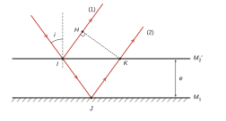
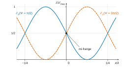
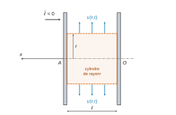
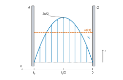
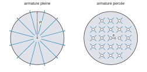
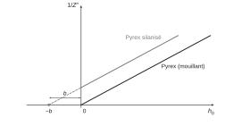

# CCINP PC — Physique 2026 · Corrigé brut

*Corrigé rédigé par IA, non officiel. Signalez toute erreur.*

Épreuve PC2P, 4 heures, calculatrices interdites. *Nanorhéologie par appareil à force dynamique de surface.* Applications numériques à un chiffre significatif, comme l'impose l'énoncé.

## Partie I — Mesure de la force s'exerçant sur le plan

### I.1 — Mesure interférométrique du déplacement du plan par rapport au bâti fixe

**Q1.** On remplace le miroir $M_2$ par son image $M_2'$ à travers la séparatrice. Le Michelson réglé en lame d'air équivaut alors à une lame d'air d'épaisseur $e$ comprise entre $M_1$ et $M_2'$, parallèles. Le miroir à 45° du bras 1 ne fait que replier ce bras.

La source $S$ est ponctuelle (au foyer du condenseur), et le point d'observation $M$ est à l'infini dans la direction $i$ : il est au foyer image de $(\mathcal L)$.

Un rayon issu de $S$ arrive sur la lame sous l'incidence $i$ et se divise en $I$.

Le rayon (1) se réfléchit en $I$ sur $M_2'$. Le rayon (2) se réfléchit en $J$ sur $M_1$ et ressort en $K$. Les deux rayons émergents sont parallèles.

Par définition, la différence de marche en $M$ est la différence des chemins optiques de $S$ à $M$ le long des deux rayons :
$$\delta=(SM)_2-(SM)_1 .$$
Les deux chemins sont communs de $S$ à $I$. Soit $H$ le projeté orthogonal de $K$ sur le rayon (1).

Par le principe de retour inverse, on peut considérer $M$ comme une source à l'infini, qui émet une onde plane dans la direction des rayons émergents. D'après le théorème de Malus, les plans d'onde de cette onde sont orthogonaux aux rayons : le plan $KH$ en est un, et $(HM)=(KM)$. Avec $n=1$ et sans déphasage de réflexion, il reste
$$\delta=(IJ+JK)-IH .$$
La géométrie de la lame donne :
$$\begin{aligned}
IJ&=JK=\frac{e}{\cos i}\\
IK&=2e\tan i\\
IH&=IK\sin i=\frac{2e\sin^2 i}{\cos i}
\end{aligned}$$
D'où :
$$\begin{aligned}
\delta&=\frac{2e}{\cos i}\left(1-\sin^2 i\right)\\
&=2e\cos i
\end{aligned}$$
$$\boxed{\delta=2e\cos i}$$

**Q2.** À $e$ fixé, $\delta=2e\cos i$ ne dépend que de l'inclinaison $i$ du rayon. Tous les rayons de même inclinaison ont le même état d'interférence, quel que soit leur point d'incidence : ce sont des **franges d'égale inclinaison**.

Le système est invariant par rotation autour de la normale aux miroirs, donc les rayons d'inclinaison $i$ forment un cône. La lentille envoie la direction $i$ sur le cercle de rayon $f'\tan i$ centré sur le foyer image, d'où des anneaux.

Sans condenseur, le faisceau laser est parallèle et arrive en incidence normale : il n'y a qu'une seule inclinaison, $i=0$. La lentille le concentre au foyer image. On observe **une seule tache lumineuse**, dont l'éclairement dépend de $2e/\lambda$ : c'est l'interférence pour $i=0$. On ne voit aucun anneau.

**Q3.** L'ordre d'interférence vaut $p(i)=\dfrac{2e\cos i}{\lambda}$. Il est maximal au centre, où il vaut $p_0=2e/\lambda$.

Un anneau donné est un lieu d'ordre $p$ constant, défini par
$$\cos i=\frac{p\lambda}{2e} .$$
Quand on se rapproche du contact optique, $e$ diminue. À $p$ fixé, $\cos i$ augmente, donc $i$ diminue, ainsi que le rayon $f'\tan i$ de l'anneau sur l'écran.

Les anneaux **rentrent** vers le centre et y disparaissent un à un : $p_0$ diminue d'une unité chaque fois que $e$ diminue de $\lambda/2$.

**Il faut donc diminuer le rayon des anneaux, c'est-à-dire les faire rentrer**, en translatant $M_1$. Au contact optique ($e=0$), l'éclairement de l'écran est uniforme (teinte plate).

Remarque : les anneaux restants sont de moins en moins nombreux et de plus en plus espacés. Aux petits angles, le $k$-ième anneau brillant compté depuis le centre a pour rayon
$$\rho_k\simeq f'\sqrt{\frac{(k-\varepsilon)\lambda}{e}} ,$$
où $\varepsilon\in[0,1[$ est l'excédent fractionnaire. Ce rayon croît comme $e^{-1/2}$ : c'est l'écart entre anneaux qui augmente, pas le rayon d'un anneau donné.

**Q4.** Le contact optique correspond à des bras de même longueur optique depuis la séparatrice. Le bras 1 mesure $d+d_1$ (séparatrice, puis miroir à 45°, puis $M_1$) et le bras 2 mesure $d_2$ (pour $x=0$) :
$$\boxed{d+d_1=d_2}$$

**Q5.** En coin d'air éclairé en incidence quasi normale, les franges sont localisées au voisinage des miroirs. Pour les observer, l'écran doit donc être le conjugué du plan des miroirs par $(\mathcal L')$.

La relation de conjugaison de Descartes s'écrit, avec $\overline{OA}=-D$ et $\overline{OA'}=D'$ :
$$\frac{1}{\overline{OA'}}-\frac{1}{\overline{OA}}=\frac{1}{f'} .$$
Elle donne
$$\frac1{D'}=\frac1{f'}-\frac1D ,$$
soit
$$\boxed{D'=\frac{D\,f'}{D-f'}}$$
L'image n'est réelle que si $D>f'$, d'où le choix d'une lentille de courte focale.

**Q6.** Pour $\alpha$ petit, $e_0(y)=\alpha y$ et $\delta=2\alpha y$. L'éclairement ne dépend que de $y$ : les franges sont des **droites parallèles à l'arête du coin** (perpendiculaires à $y$), appelées **franges d'égale épaisseur**.

Sur les miroirs, deux franges brillantes consécutives vérifient $2\alpha\,\Delta y=\lambda$, soit $\Delta y=\lambda/(2\alpha)$. Le grandissement transversal de la lentille vaut $\gamma=\overline{OA'}/\overline{OA}=-D'/D$. L'interfrange sur l'écran est donc
$$\boxed{i_e=\frac{D'}{D}\,\frac{\lambda}{2\alpha}}$$

**Q7.** On prend $\delta=\mathcal L_1-\mathcal L_2$, où $\mathcal L_1$ et $\mathcal L_2$ sont les chemins optiques par $M_1$ et par $M_2$.

Le déplacement $x$ ne modifie que le bras 2, dont la longueur passe de $d_2$ à $d_2-x$, parcourue à l'aller et au retour.

$\mathcal L_2$ diminue donc de $2x$ et, au même point des miroirs,
$$\boxed{\delta(x)=\delta_0+2x}$$
Avec la convention opposée, on aurait $\delta=\delta_0-2x$, et seul le signe de $\Psi$ changerait en Q8.

**Q8.** Les deux rayons qui interfèrent en un point de l'écran sont issus d'un même rayon de la source (division d'amplitude) : ils sont cohérents et ont la même pulsation $\omega$. On écrit leurs vibrations lumineuses en ce point :
$$\begin{aligned}
s_1(t)&=A_0\cos(\omega t-\varphi_1)\\
s_2(t)&=A_0\cos(\omega t-\varphi_2)
\end{aligned}$$
avec $\varphi_2-\varphi_1=2\pi\delta/\lambda$. Les amplitudes sont égales, comme l'indique l'énoncé.

L'éclairement est $\mathcal E=K\langle s^2\rangle$, où $s=s_1+s_2$ et $\langle\cdot\rangle$ est la moyenne temporelle sur la durée de réponse du détecteur. Chaque rayon seul donne
$$\mathcal E_0=K\langle s_1^2\rangle=\frac{KA_0^2}{2} .$$
Le terme croisé vaut :
$$\begin{aligned}
2K\langle s_1s_2\rangle&=KA_0^2\left\langle\cos(2\omega t-\varphi_1-\varphi_2)+\cos(\varphi_2-\varphi_1)\right\rangle\\
&=KA_0^2\cos(\varphi_2-\varphi_1)
\end{aligned}$$
car le premier cosinus est de moyenne nulle. On obtient la formule de Fresnel :
$$\boxed{\mathcal E=2\mathcal E_0\left[1+\cos\frac{2\pi\delta(x)}{\lambda}\right]}$$
Avec $\delta(x)=\delta_0+2x$ :
$$\mathcal E=2\mathcal E_0\left[1+\cos\left(\frac{4\pi x}{\lambda}+\frac{2\pi\delta_0}{\lambda}\right)\right] .$$
C'est la forme demandée, avec :
$$\begin{aligned}
\mathcal E_{max}&=4\mathcal E_0\\
\Psi&=\frac{2\pi\delta_0}{\lambda}
\end{aligned}$$

**Q9.** On dérive :
$$\boxed{S=\left|\frac{\mathrm d\mathcal E}{\mathrm dx}\right|=\frac{2\pi\mathcal E_{max}}{\lambda}\left|\sin\left(\frac{4\pi x}{\lambda}+\Psi\right)\right|}$$
Au voisinage de $x=0$, $S\simeq\dfrac{2\pi\mathcal E_{max}}{\lambda}|\sin\Psi|$. Cette sensibilité est maximale pour $|\sin\Psi|=1$ :
$$\boxed{\Psi=\frac{\pi}{2}+n\pi,\ n\in\mathbb Z}$$
Ces points sont à mi-frange ($\mathcal E=\mathcal E_{max}/2$), là où la pente est la plus forte.

**Q10.** Deux valeurs successives sont $\Psi_1=\pi/2$ et $\Psi_2=3\pi/2$. On pose $u=4\pi x/\lambda$. Les formules trigonométriques donnent :
$$\begin{aligned}
\cos\left(u+\frac\pi2\right)&=-\sin u\\
\cos\left(u+\frac{3\pi}2\right)&=\sin u
\end{aligned}$$
Pour $x\ll\lambda$, on a $u\ll1$ et $\sin u\simeq u$. D'où :
$$\boxed{\begin{aligned}
\mathcal E_1&=\frac{\mathcal E_{max}}{2}\left(1-\frac{4\pi x}{\lambda}\right)\\
\mathcal E_2&=\frac{\mathcal E_{max}}{2}\left(1+\frac{4\pi x}{\lambda}\right)
\end{aligned}}$$

**Q11.** La résistance $R_1$ relie la sortie à l'entrée inverseuse : il y a une boucle de rétroaction sur la borne inverseuse, ce qui justifie un fonctionnement en régime linéaire (on le suppose stable).

L'ALI idéal en régime linéaire impose alors $V_+=V_-$. L'entrée non inverseuse est reliée à la masse, donc $V_+=0$ et $V_-=0$. La photodiode est branchée entre l'entrée inverseuse et la masse : la tension à ses bornes est nulle. **La photodiode est en court-circuit** et débite $I_{cc}=\beta\mathcal E$.

**Q12.** L'ALI est idéal : ses courants d'entrée sont nuls, en particulier $i_-=0$. Avec le sens de $I_{cc}$ de la figure 4 (de la photodiode vers la masse), le courant $I_{cc}$ quitte le nœud inverseur par la photodiode. La loi des nœuds impose qu'il y arrive par $R_1$, depuis la sortie. La loi d'Ohm donne $U_s-V_-=R_1I_{cc}$, avec $V_-=0$ (Q11) :
$$\boxed{U_s=R_1\beta\,\mathcal E}$$

**Q13.** On a $U_i=\beta R_1\mathcal E_i$. Avec Q10 :
$$\begin{aligned}
U_2-U_1&=\beta R_1\mathcal E_{max}\,\frac{4\pi x}{\lambda}\\
U_1+U_2&=\beta R_1\mathcal E_{max}
\end{aligned}$$
Il vient
$$\boxed{U_{opt}=\frac{4\pi K}{\lambda}\,x}$$
Cette relation ne dépend ni de $\beta$, ni de $R_1$, ni de la puissance du laser. Le déplacement minimal détectable vaut :
$$\begin{aligned}
x_{min}&=\frac{\lambda\,U_{opt,min}}{4\pi K}\\
&=\frac{633\cdot10^{-9}\times2\cdot10^{-4}}{4\pi\times10}\ \text{m}\\
&\simeq\frac{1{,}3\cdot10^{-10}}{1{,}3\cdot10^{2}}\ \text{m}
\end{aligned}$$
$$\boxed{x_{min}\simeq1\cdot10^{-12}\ \text{m}}$$
C'est environ cent fois moins que la taille d'un atome. On vérifie a posteriori que $x\ll\lambda$.

### I.2 — Réponse mécanique du cantilever

**Q14.** $\vec F_r$ traduit l'**élasticité du cantilever** $L_2$ : la lame déformée en flexion exerce une force de rappel, linéaire pour de petites déformations (loi de Hooke). $\vec f_v$ traduit la **dissipation** : frottement fluide de l'air sur le porte-plan en mouvement et frottements internes du matériau de la lame. À faible vitesse, ce frottement est proportionnel à la vitesse.

**Q15.** Les signaux complexes sont :
$$\begin{aligned}
\underline F(t)&=\underline{F_1}\,e^{j\omega t}\\
\underline x(t)&=\underline{x_1}\,e^{j\omega t}
\end{aligned}$$
avec $F(t)=\mathrm{Re}\,\underline F(t)$ et $x(t)=\mathrm{Re}\,\underline x(t)$. Les amplitudes complexes valent :
$$\boxed{\begin{aligned}
\underline{F_1}&=F_1e^{j\psi}\\
\underline{x_1}&=x_1e^{j\varphi}
\end{aligned}}$$

**Q16.** On applique le principe fondamental de la dynamique au solide de masse $m$, dans le référentiel galiléen du bâti, projeté sur $\vec u_x$. Le poids et la réaction verticale n'interviennent pas. On obtient
$$m\ddot x=-kx-\mu\dot x+F(t) .$$
En régime sinusoïdal forcé, $(k-m\omega^2+j\mu\omega)\underline{x_1}=\underline{F_1}$, d'où
$$\underline H_m=\frac{k\underline{x_1}}{\underline{F_1}}=\frac{1}{1+j\dfrac{\mu\omega}{k}-\dfrac{m\omega^2}{k}} .$$
On identifie avec la forme proposée :
$$\boxed{\begin{aligned}
\omega_0&=\sqrt{\frac km}\\
Q&=\frac{k}{\mu\omega_0}=\frac{\sqrt{km}}{\mu}
\end{aligned}}$$
$\omega_0$ est la pulsation propre : c'est la pulsation des oscillations libres du système non amorti. $Q$ est le facteur de qualité. Il est d'autant plus grand que l'amortissement est faible et donne l'ordre du nombre d'oscillations visibles en régime libre. Il fixe aussi l'acuité de la résonance : largeur relative $\simeq1/Q$ et $|\underline H_m|(\omega_0)=Q$.

**Q17.** Avec $\xi=\omega/\omega_0$, $\underline H_m=\dfrac{1}{1-\xi^2+j\xi/Q}$. Le module d'un quotient est le quotient des modules :
$$\boxed{|\underline H_m|=\frac{1}{\sqrt{(1-\xi^2)^2+\xi^2/Q^2}}}$$

**Q18.** $|\underline H_m|$ est maximal quand le dénominateur est minimal. On pose $X=\xi^2\ge0$ et
$$D(X)=(1-X)^2+\frac{X}{Q^2} .$$
Sa dérivée $D'(X)=-2(1-X)+1/Q^2$ s'annule en $X_r=1-\dfrac{1}{2Q^2}$, où $D$ est minimal car $D''=2>0$. Il y a résonance, c'est-à-dire un maximum de $|\underline H_m|$ pour une pulsation non nulle, si et seulement si $X_r>0$ :
$$\boxed{Q>\frac1{\sqrt2}}$$
$$\boxed{\omega_r=\omega_0\sqrt{1-\frac{1}{2Q^2}}}$$
Pour $Q\le1/\sqrt2$, $D$ est croissante sur $\mathbb R_+$ et il n'y a pas de résonance.

On a $\omega_r\simeq\omega_0$ dès que $\dfrac{1}{2Q^2}\ll1$, c'est-à-dire $\boxed{Q\gg1}$. L'écart relatif vaut alors $\simeq1/(4Q^2)$, soit 1 % dès $Q=5$.

**Q19.** La figure 6 présente un plateau $|\underline H_m|\simeq1$ à basse fréquence (conforme à Q17) et un pic très fin à $f_r\simeq35$ Hz. On assimile provisoirement $f_0$ à $f_r$ :
$$\omega_0\simeq2\pi\times35\ \text{rad·s}^{-1}\simeq2{,}2\cdot10^2\ \text{rad·s}^{-1}$$
$$\boxed{\omega_0\simeq2\cdot10^2\ \text{rad·s}^{-1}}$$
Au maximum, $|\underline H_m|_{max}=\dfrac{2Q^2}{\sqrt{4Q^2-1}}\simeq Q$ pour $Q\gg1$. Le sommet se lit vers 90, rapporté au plateau égal à 1 :
$$\boxed{Q\simeq1\cdot10^2}$$
Justification a posteriori : avec $Q\simeq10^2$, Q18 donne $\omega_r/\omega_0-1\simeq-1/(4Q^2)\simeq-3\cdot10^{-5}$. Prendre $\omega_r=\omega_0$ est donc légitime.

**Q20.** Avec la masse de lestage, le système a pour masse $m+m_a$ et la même raideur $k$. Donc $\omega_0^2=\dfrac{k}{m+m_a}$, et
$$\frac1{\omega_0^2}=\frac mk+\frac{m_a}{k} .$$
La figure 7 montre bien une droite en fonction de $m_a$, de pente $1/k$. Elle passe par $(0\,;\,19{,}2\cdot10^{-6}\ \text{s}^2)$ et environ $(4{,}1\cdot10^{-3}\ \text{kg}\,;\,20{,}65\cdot10^{-6}\ \text{s}^2)$, d'où la pente :
$$\frac1k\simeq\frac{1{,}45\cdot10^{-6}}{4{,}1\cdot10^{-3}}\ \text{s}^2\text{·kg}^{-1}\simeq3{,}5\cdot10^{-4}\ \text{s}^2\text{·kg}^{-1}$$
$$\boxed{k\simeq3\cdot10^3\ \text{N·m}^{-1}}$$
L'ordonnée à l'origine $m/k$ donne aussi **la masse $m$ du plan et du porte-plan** :
$$m\simeq2{,}9\cdot10^3\times1{,}92\cdot10^{-5}\ \text{kg}$$
$$\boxed{m\simeq6\cdot10^{-2}\ \text{kg}}$$
La valeur est comprise entre 5 et $6\cdot10^{-2}$ kg selon la lecture. Contrôle : $1/\sqrt{19{,}2\cdot10^{-6}}\simeq2{,}3\cdot10^2$ rad/s, soit $f_0\simeq36$ Hz, en accord avec Q19.

**Q21.** En module, $F_1=\dfrac{kx_1}{|\underline H_m|}$, donc
$$k=\frac{F_1\,|\underline H_m|(40\ \text{Hz})}{x_1} .$$
Sur la figure 6, juste au-dessus de la résonance, on lit $|\underline H_m|(40\ \text{Hz})\simeq3$ :
$$k\simeq\frac{2\cdot10^{-6}\times3}{2\cdot10^{-9}}\ \text{N·m}^{-1}$$
$$\boxed{k\simeq3\cdot10^3\ \text{N·m}^{-1}}$$
Commentaire : on retrouve la valeur mesurée par la méthode de Cleveland (Q20), ce qui confirme la cohérence de l'étalonnage. À 40 Hz, si près de $f_0$, on ne peut pas utiliser la relation statique $F_1=kx_1$, qui donnerait $10^3$ N/m.

La lecture de $|\underline H_m|$ est toutefois sensible à la position exacte du pic : le modèle donne de 3 à 5. Le résultat n'est donc fiable qu'à un facteur 1,5 près.

## Partie II — Mesure du déplacement relatif entre la sphère et le plan

### II.1 — Fonctionnement du capteur capacitif

**Q22.** On a $\ell/R\simeq5\cdot10^{-5}/3\cdot10^{-2}\simeq2\cdot10^{-3}\ll1$. Les effets de bord ne concernent qu'une couronne de largeur de l'ordre de $\ell$ au bord des disques. Partout ailleurs, les armatures se comportent comme deux plans infinis uniformément chargés.

Sous cette hypothèse, on étudie d'abord la cause, la distribution de charges. En un point $M$ entre les armatures, les plans $(M,\vec u_r,\vec u_x)$ et $(M,\vec u_\theta,\vec u_x)$ sont des plans de symétrie de cette distribution. Le champ $\vec E(M)$, qui en est la conséquence, appartient à ces deux plans, donc à leur intersection, la droite $(M,\vec u_x)$ :
$$\vec E=E\,\vec u_x .$$
La distribution de charges est invariante par rotation autour de $(Ox)$ et par toute translation parallèle aux armatures. $E$ ne dépend donc ni de $\theta$ ni de $r$ :
$$\boxed{\vec E=E(x)\,\vec u_x}$$

**Q23.** Il n'y a pas de charge entre les armatures (les charges sont surfaciques) : la densité volumique de charge y est nulle. L'équation de Maxwell-Gauss y donne $\mathrm{div}\,\vec E=0$.

Avec la forme $\vec E=E(x)\,\vec u_x$ obtenue en Q22, le formulaire donne $\mathrm{div}\,\vec E=\dfrac{\mathrm dE}{\mathrm dx}$.

Donc $E$ est indépendant de $x$, comme de $r$ et $\theta$ : **$\vec E$ est uniforme** dans le condensateur.

**Q24.** En régime statique, l'équation de Maxwell-Faraday donne $\overrightarrow{\mathrm{rot}}\,\vec E=-\partial\vec B/\partial t=\vec 0$. Un champ de rotationnel nul dérive d'un potentiel :
$$\boxed{\vec E=-\overrightarrow{\mathrm{grad}}\,V}$$
Comme $\vec E=E\,\vec u_x$, les dérivées de $V$ par rapport à $r$ et $\theta$ sont nulles : $V$ ne dépend que de $x$, et
$$\frac{\mathrm dV}{\mathrm dx}=-E .$$
$E$ est une constante (Q23). On intègre de l'armature $O$ ($x=0$, potentiel $V_O$) jusqu'à l'abscisse $x$ :
$$V(x)=V_O-Ex$$
pour $0\le x\le\ell$.
En $x=\ell$ (armature $A$), $V_A=V_O-E\ell$, donc $E=(V_O-V_A)/\ell=U/\ell$ :
$$\boxed{\vec E=\frac{U}{\ell}\,\vec u_x}$$
Le champ est dirigé de $O$ (chargée $+Q$) vers $A$.

**Q25.** $u_e$ est uniforme dans le volume $\pi R^2\ell$ du cylindre compris entre les armatures :
$$\begin{aligned}
E_e&=\frac{\varepsilon_0}{2}\frac{U^2}{\ell^2}\,\pi R^2\ell\\
&=\frac{\varepsilon_0\pi R^2U^2}{2\ell}
\end{aligned}$$
$$\boxed{E_e=\frac{\varepsilon_0\pi R^2U^2}{2\ell}}$$

**Q26.** $E_e=\dfrac12CU^2$. On identifie avec Q25 pour tout $U$ :
$$\boxed{C=\frac{\varepsilon_0\pi R^2}{\ell}}$$
Numériquement, $C\simeq5\cdot10^{-10}$ F pour $\ell=50\ \mu$m.

**Q27.** Conventions (schéma de la figure 9) : on note $G$ et $D$ les nœuds de gauche et de droite, communs au condensateur et à la bobine. D'après la flèche de la figure, $u_c=V_G-V_D$.

On oriente le courant $i$ dans la bobine de $G$ vers $D$ : la bobine est en convention récepteur pour la tension $u_c$, donc
$$u_c=L\frac{\mathrm di}{\mathrm dt} .$$
Le courant $i$ revient de $D$ vers $G$ à travers le condensateur.

Dans le condensateur, le courant orienté de $G$ vers $D$ (convention récepteur pour $u_c$) vaut donc $-i$ :
$$-i=C\frac{\mathrm du_c}{\mathrm dt} .$$
En dérivant cette relation et en reportant dans la première :
$$\boxed{\frac{\mathrm d^2u_c}{\mathrm dt^2}+\frac{1}{LC}u_c=0}$$
C'est l'équation d'un oscillateur harmonique de pulsation $1/\sqrt{LC}$ :
$$\boxed{f_{LC}=\frac{1}{2\pi\sqrt{LC}}}$$

**Q28.** On reporte $C$ de Q26 :
$$\begin{aligned}
f_{LC}^2&=\frac{1}{4\pi^2LC}\\
&=\frac{\ell}{4\pi^3\varepsilon_0R^2L}
\end{aligned}$$
$$\boxed{\ell=4\pi^3\varepsilon_0R^2L\,f_{LC}^2}$$
Seule $f_{LC}$ varie : sa mesure donne $\ell$.

**Q29.** On différentie (la dérivée de $f_{LC}^2$ est $2f_{LC}$) :
$$\boxed{\mathrm d\ell=8\pi^3\varepsilon_0R^2L\,f_{LC}\,\mathrm df}$$
soit encore $\dfrac{\mathrm d\ell}{\ell}=2\dfrac{\mathrm df}{f_{LC}}$.

On prend $8\pi^3\simeq2{,}5\cdot10^2$, $\varepsilon_0=9\cdot10^{-12}$ F/m, $R^2=9\cdot10^{-4}$ m² et $L=2\cdot10^{-6}$ H. Avec $f_{LC}=10^7$ Hz et $\mathrm df=0{,}2$ Hz :
$$\begin{aligned}
\mathrm d\ell&\simeq2{,}5\times9\times9\times2\times0{,}2\cdot10^{2-12-4-6+7}\ \text{m}\\
&\simeq81\cdot10^{-13}\ \text{m}
\end{aligned}$$
$$\boxed{\mathrm d\ell_{min}\simeq8\cdot10^{-12}\ \text{m}}$$
Remarque : les données ne sont pas tout à fait cohérentes. Pour $\ell=50\ \mu$m, Q28 donne $f_{LC}\simeq5$ MHz, et $\mathrm d\ell=2\ell\,\mathrm df/f$ donnerait alors $2\cdot10^{-12}$ m. Dans les deux cas, la résolution est **picométrique**, comparable à celle du capteur interférométrique.

### II.2 — Perturbation liée à l'écoulement de l'air entre les armatures

**Q30.** Système : le volume ouvert et fixe compris entre $x$ et $x+\mathrm dx$, de section $S$, traversé par l'écoulement $\vec v=v(x,t)\,\vec u_x$. On fait un bilan de masse entre $t$ et $t+\mathrm dt$.

Terme de variation temporelle : la masse contenue vaut $\rho(x,t)S\,\mathrm dx$ à l'instant $t$, donc
$$\begin{aligned}
m(t+\mathrm dt)-m(t)&=\left[\rho(x,t+\mathrm dt)-\rho(x,t)\right]S\,\mathrm dx\\
&=\frac{\partial\rho}{\partial t}\,S\,\mathrm dx\,\mathrm dt
\end{aligned}$$
Terme d'échange : le débit massique à travers la section d'abscisse $x$ vaut $\rho(x,t)v(x,t)S$. La masse entrée en $x$ moins la masse sortie en $x+\mathrm dx$ vaut donc :
$$\begin{aligned}
\delta m_e-\delta m_s&=\left[\rho(x,t)v(x,t)-\rho(x+\mathrm dx,t)v(x+\mathrm dx,t)\right]S\,\mathrm dt\\
&=-\frac{\partial(\rho v)}{\partial x}\,S\,\mathrm dx\,\mathrm dt
\end{aligned}$$
Il n'y a ni création ni destruction de masse, donc $m(t+\mathrm dt)-m(t)=\delta m_e-\delta m_s$ :
$$\boxed{\frac{\partial\rho}{\partial t}+\frac{\partial(\rho v)}{\partial x}=0}$$

**Q31.** La dérivée particulaire de la masse volumique est
$$\boxed{\frac{\mathrm D\rho}{\mathrm Dt}=\frac{\partial\rho}{\partial t}+\left(\vec v\cdot\overrightarrow{\mathrm{grad}}\right)\rho}$$
D'après le formulaire, $\mathrm{div}(\rho\vec v)=\rho\,\mathrm{div}\,\vec v+\vec v\cdot\overrightarrow{\mathrm{grad}}\,\rho$. L'équation de conservation devient donc
$$\frac{\mathrm D\rho}{\mathrm Dt}+\rho\,\mathrm{div}\,\vec v=0 .$$
L'écoulement est incompressible si la masse volumique de chaque particule de fluide se conserve au cours de son mouvement, c'est-à-dire $\mathrm D\rho/\mathrm Dt=0$. Comme $\rho\neq0$, cela équivaut à
$$\boxed{\mathrm{div}\,\vec v=0}$$

**Q32.** Soit $\Sigma$ une surface fermée fixe qui délimite un volume $\mathcal V$. Par définition, le débit volumique sortant est le flux de $\vec v$ à travers $\Sigma$. Le théorème de Green-Ostrogradski le transforme en intégrale de volume :
$$\begin{aligned}
D_V&=\oint_\Sigma\vec v\cdot\mathrm d\vec S\\
&=\iiint_{\mathcal V}\mathrm{div}\,\vec v\,\mathrm d\tau
\end{aligned}$$
L'écoulement est incompressible, donc $\mathrm{div}\,\vec v=0$ en tout point (Q31) :
$$\boxed{D_V=0}$$

**Q33.** Le fluide visqueux a la même vitesse normale que les parois (condition d'imperméabilité, incluse dans l'adhérence). On se place dans le référentiel de l'armature $O$. L'armature $O$, en $x=0$, est fixe :
$$\boxed{v_x(r,0,t)=0}$$
L'armature $A$, en $x=\ell(t)$, est mobile, de vitesse $\dot\ell\,\vec u_x$ :
$$\boxed{v_x(r,\ell,t)=\dot\ell(t)}$$

**Q34.** À l'instant $t$, on applique Q32 à la surface fermée fixe qui coïncide avec le cylindre de rayon $r$ et de hauteur $\ell$. Les flux sortants sont :

- à travers le disque $x=0$ : nul, puisque $v_x=0$ ;
- à travers le disque $x=\ell$ : $\pi r^2\dot\ell$ ;
- à travers la surface latérale : $2\pi r\ell\,u(r,t)$, par définition de $u$.

Leur somme est nulle, et $\ell\simeq\ell_0$ au premier ordre en $\ell_1/\ell_0$ :
$$2\pi r\ell_0\,u+\pi r^2\dot\ell=0$$
$$\boxed{u(r,t)\simeq-\frac{r\,\dot\ell(t)}{2\ell_0}}$$

Ordre de grandeur : $|\dot\ell|\sim\ell_1\omega$, avec $\ell_1\sim10^{-9}$ m et $\omega\sim2\cdot10^2$ rad/s, d'où $|\dot\ell|\sim2\cdot10^{-7}$ m/s. Alors :
$$|u(R)|\sim\frac{3\cdot10^{-2}\times2\cdot10^{-7}}{2\times5\cdot10^{-5}}\ \text{m/s}\sim6\cdot10^{-5}\ \text{m/s}$$
$$\boxed{|u(R)|\sim10^{-4}\ \text{m·s}^{-1}}$$

**Q35.** Échelles caractéristiques : vitesse $U\sim10^{-4}$ m/s (Q34) et longueur $\ell_0$, comme l'impose l'énoncé. Le terme convectif est d'ordre $\rho_aU^2/\ell_0$ et le terme visqueux d'ordre $\eta_aU/\ell_0^2$. Leur rapport est le nombre de Reynolds :
$$\mathrm{Re}=\frac{\rho_aU\ell_0}{\eta_a}\sim\frac{1\times10^{-4}\times5\cdot10^{-5}}{2\cdot10^{-5}}$$
$$\boxed{\mathrm{Re}\sim10^{-4}}$$
**Le terme convectif $\rho_a(\vec v\cdot\overrightarrow{\mathrm{grad}})\vec v$ est négligeable** devant le terme visqueux.

**Q36.** L'échelle de temps est imposée par l'excitation sinusoïdale : c'est $1/\omega$. L'échelle d'espace du laplacien est $\ell_0$. Alors $\rho_a|\partial\vec v/\partial t|\sim\rho_aU\omega$ et $\eta_a|\Delta\vec v|\sim\eta_aU/\ell_0^2$, d'où :
$$\begin{aligned}
\frac{\rho_a|\partial\vec v/\partial t|}{\eta_a|\Delta\vec v|}&\sim\frac{\rho_a\omega\ell_0^2}{\eta_a}\\
&\sim\frac{1\times2\cdot10^2\times2{,}5\cdot10^{-9}}{2\cdot10^{-5}}
\end{aligned}$$
$$\boxed{\frac{\rho_a|\partial\vec v/\partial t|}{\eta_a|\Delta\vec v|}\sim10^{-2}\ll1}$$
**Le terme instationnaire est négligeable.** Il reste l'équation de Stokes quasi statique :
$$\vec 0=-\overrightarrow{\mathrm{grad}}\,P+\eta_a\Delta\vec v .$$

**Q37.** On lit le formulaire en deux étapes. Pour $\vec v=v_r(r,x,t)\vec u_r$, on a $v_\theta=v_x=0$ et rien ne dépend de $\theta$. Le laplacien vectoriel se réduit à
$$\Delta\vec v=\left(\Delta v_r-\frac{v_r}{r^2}\right)\vec u_r ,$$
et le laplacien scalaire de $v_r$ vaut
$$\Delta v_r=\frac1r\frac{\partial}{\partial r}\left(r\frac{\partial v_r}{\partial r}\right)+\frac{\partial^2v_r}{\partial x^2} .$$

- Projection sur $\vec u_x$ : $(\Delta\vec v)_x=0$, donc $\dfrac{\partial P}{\partial x}=0$. **$P=P(r,t)$ ne dépend pas de $x$**.
- Projection sur $\vec u_r$ :

$$\frac{\partial P}{\partial r}=\eta_a\left[\frac1r\frac{\partial}{\partial r}\left(r\frac{\partial v_r}{\partial r}\right)-\frac{v_r}{r^2}+\frac{\partial^2v_r}{\partial x^2}\right]$$

$v_r$ varie sur la distance $R$ selon $r$ et sur $\ell_0$ selon $x$.

Les deux premiers termes du crochet sont donc d'ordre $U/R^2$ et le dernier d'ordre $U/\ell_0^2$. Leur rapport vaut $(\ell_0/R)^2\sim3\cdot10^{-6}$. On néglige les deux premiers :
$$\boxed{\eta_a\frac{\partial^2v_r}{\partial x^2}=\frac{\partial P}{\partial r}}$$

**Q38.** D'après Q37, $P$ ne dépend pas de $x$ : le second membre $\partial P/\partial r$ ne dépend que de $(r,t)$.

À $r$ et $t$ fixés, $\partial^2v_r/\partial x^2$ est donc une constante. On intègre deux fois par rapport à $x$, les constantes d'intégration étant des fonctions de $(r,t)$ :
$$\boxed{v_r=a(r,t)x^2+b(r,t)x+c(r,t)}$$
avec
$$a=\frac{1}{2\eta_a}\frac{\partial P}{\partial r} .$$

**Q39.** La vitesse moyenne est une moyenne spatiale de $v_r$ sur la surface latérale $\Sigma_\ell$ du cylindre, d'aire $2\pi r\ell_0$ :
$$u(r,t)=\frac{1}{2\pi r\ell_0}\iint_{\Sigma_\ell}v_r\,\mathrm dS .$$
$v_r$ ne dépend pas de $\theta$, donc cette moyenne se réduit à une moyenne sur la hauteur :
$$\boxed{u(r,t)=\frac1{\ell_0}\int_0^{\ell_0}v_r(r,x,t)\,\mathrm dx}$$
Les deux armatures n'ont pas de vitesse radiale. Le non-glissement impose donc :

- $v_r(r,0,t)=0$, soit $c=0$ ;
- $v_r(r,\ell_0,t)=0$, soit $b=-a\ell_0$.

Alors $v_r=-a\,x(\ell_0-x)$, et
$$\begin{aligned}
u&=-\frac{a}{\ell_0}\int_0^{\ell_0}x(\ell_0-x)\,\mathrm dx\\
&=-\frac{a}{\ell_0}\cdot\frac{\ell_0^3}{6}\\
&=-\frac{a\ell_0^2}{6}
\end{aligned}$$
d'où $a=-6u/\ell_0^2$ et
$$\boxed{v_r(r,x,t)=\frac{6u(r,t)}{\ell_0}\,x\left(1-\frac{x}{\ell_0}\right)}$$

**Q40.** D'après Q37 et Q39, puis Q34 :
$$\begin{aligned}
\frac{\partial P}{\partial r}&=\eta_a\frac{\partial^2v_r}{\partial x^2}\\
&=2\eta_aa\\
&=-\frac{12\eta_au}{\ell_0^2}\\
&=\frac{6\eta_a\dot\ell}{\ell_0^3}\,r
\end{aligned}$$
La pression est continue au bord du film : $P(R,t)=P_0$. On intègre de $r$ à $R$ :
$$P_0-P(r,t)=\frac{6\eta_a\dot\ell}{\ell_0^3}\cdot\frac{R^2-r^2}{2}$$
$$\boxed{P(r,t)=P_0-\frac{3\eta_a\dot\ell(t)}{\ell_0^3}\left(R^2-r^2\right)}$$
Quand les armatures se rapprochent ($\dot\ell<0$), il y a surpression au centre.

**Q41.** L'air du film est du côté $x>0$ de l'armature $O$. Il exerce sur sa face intérieure la force $-\left(\int_0^RP\,2\pi r\,\mathrm dr\right)\vec u_x$. La face extérieure, soumise à $P_0$, reçoit $+P_0\pi R^2\vec u_x$.

La résultante nette fait donc intervenir $P-P_0$. On calcule l'intégrale :
$$\int_0^R(R^2-r^2)\,2\pi r\,\mathrm dr=\frac{\pi R^4}{2} .$$
La résultante des forces de pression vaut :
$$\boxed{\vec F_v=\frac{3\pi\eta_aR^4}{2\ell_0^3}\,\dot\ell(t)\,\vec u_x}$$
Si l'on ne compte que la face intérieure, il s'y ajoute $-P_0\pi R^2\vec u_x$. Cette force est proportionnelle à $\dot\ell$ : c'est un amortissement visqueux dû au film écrasé. L'armature $A$, solidaire du plan, subit $-\vec F_v$.

Ordre de grandeur, avec $|\dot\ell|\sim2\cdot10^{-7}$ m/s :
$$F_v\sim\frac{3\pi\times2\cdot10^{-5}\times8\cdot10^{-7}}{2\times1{,}25\cdot10^{-13}}\times2\cdot10^{-7}\ \text{N}\sim10^{-4}\ \text{N} ,$$
du même ordre que les « plusieurs dizaines de µN » annoncées par l'énoncé.

**Q42.** La force parasite $F_v\propto R^4/\ell_0^3$ est très sensible à la distance que l'air doit parcourir pour sortir du film. Les trous percés dans les armatures laissent l'air s'échapper localement : la distance de drainage passe de $R$ à la demi-distance $a$ entre trous.

Découpons l'armature en $N\sim R^2/a^2$ cellules, chacune donnant une force $\propto a^4/\ell_0^3$. La force totale est alors $\propto R^2a^2/\ell_0^3$, soit une réduction d'un facteur $(a/R)^2$, de l'ordre de $10^{-3}$ pour $a\sim1$ mm. **Le perçage supprime l'essentiel de la surpression et donc de la force parasite qui perturberait le capteur de force**, au prix d'une légère baisse de la capacité.

## Partie III — Application à la nanorhéologie

**Q43.** $h=h_0-h_1(t)$ donne $\dot h=-\dot h_1$. La force de Reynolds s'écrit donc
$$\vec F=\frac{6\pi\eta R_0^2}{h_0}\,\dot h_1\,\vec u_x .$$
En complexes, $\dot{\underline h}_1=j\omega\underline{h_1}e^{j\omega t}$, d'où
$$\underline{F_1}=j\,\frac{6\pi\eta\omega R_0^2}{h_0}\,\underline{h_1} .$$
$$\boxed{\underline Z=j\,\frac{6\pi\eta\omega R_0^2}{h_0}}$$
$$\boxed{\begin{aligned}
Z'&=0\\
Z''&=\frac{6\pi\eta\omega R_0^2}{h_0}
\end{aligned}}$$
L'impédance est purement imaginaire : la force est en phase avec la vitesse, la réponse est purement visqueuse (dissipative), sans composante élastique.

**Q44.** Le modèle prévoit $Z'=0$ et
$$\frac1{Z''}=\frac{h_0}{6\pi\eta\omega R_0^2} ,$$
c'est-à-dire une droite passant par l'origine.

- Figure 12 : $Z''$ décroît en $1/h_0$ et $Z'$ reste très petit devant $Z''$ (quelques µN/nm au plus, contre 50 à 250 µN/nm aux faibles distances).
- Figure 13 : $1/Z''$ est une droite passant par l'origine, de pente $\simeq0{,}27/800\simeq3\cdot10^{-4}$ (nm/µN)/nm, et la force statique est nulle.

**Le modèle de Reynolds est validé de quelques nanomètres (environ 10 nm) jusqu'à 800 nm.**

Il est mis en défaut quand $h_0\to0$ ($h_0\lesssim$ quelques nm). $1/Z''$ ne tend plus vers zéro : $Z''$ cesse de diverger. En même temps, $Z'$ n'est plus négligeable et la force statique croît brutalement.

Interprétation : les surfaces entrent en contact ou presque. La surpression du film, qui varie comme $1/h_0^2$, devient énorme. Les surfaces de Pyrex se déforment alors élastiquement, ce qui donne une composante élastique $Z'\neq0$ et limite la dissipation. La rugosité nanométrique des surfaces et la taille finie des molécules (quelques Å) rendent aussi caduques, à cette échelle, la description continue et la notion même de distance $h_0$.

**Q45.** Avec une longueur de glissement $b$, tout se passe comme si l'entrefer valait $h_0+b$. Donc
$$\frac{1}{Z''}=\frac{h_0+b}{6\pi\eta\omega R_0^2} :$$
c'est une droite de même pente, translatée de $-b$ selon $h_0$.

Sur la figure 14, les points noirs (Pyrex mouillant) passent par l'origine, donc $b\simeq0$. Les points gris (Pyrex silanisé) suivent une droite parallèle dont l'extrapolation coupe l'axe en $h_0\simeq-20$ nm :
$$\boxed{b\simeq2\cdot10^{-8}\ \text{m}}$$

La correction relative vaut $b/h_0$, puisque
$$\frac{Z''_{\text{glissement}}}{Z''_{\text{adhérence}}}=\frac{1}{1+b/h_0} .$$
Pour un écoulement macroscopique ($h_0\sim1$ mm), $b/h_0\sim10^{-5}$ et le glissement est indétectable : la condition d'adhérence est alors excellente. En nanorhéologie ($h_0\sim10$ à 100 nm), $b/h_0$ vaut de 0,2 à 2. Le glissement modifie la force d'un facteur allant jusqu'à 3 et ne peut plus être négligé.

**FIN**
