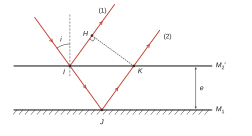
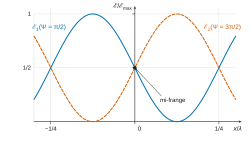
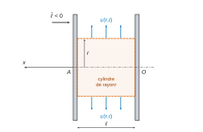
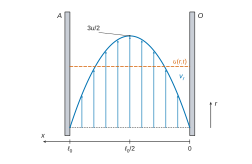
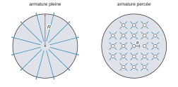
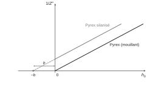

# CCINP PC — Physique 2026 · Corrigé guidé

*Corrigé rédigé par IA, non officiel. Signalez toute erreur.*

## Présentation du sujet

L'épreuve (PC2P, 4 heures, **calculatrice interdite**) porte sur un **appareil à force dynamique de surface** (dSFA). Une sphère oscille à quelques dizaines de hertz, à une distance de quelques nanomètres à quelques centaines de nanomètres d'un plan. On mesure la force que le film de liquide confiné exerce sur le plan. Le sujet comporte 45 questions, en trois parties indépendantes qui suivent la chaîne de mesure.

- **Partie I — Le capteur de force (Q1 à Q21).** La sous-partie I.1 traite de l'interférométrie : un Michelson en lame d'air (différence de marche, anneaux, contact optique), puis en coin d'air (localisation, franges d'égale épaisseur). On établit ensuite la formule de Fresnel, on choisit le point de fonctionnement à sensibilité maximale et on étudie la détection par deux photodiodes et un convertisseur courant-tension à ALI. La sous-partie I.2 modélise le cantilever comme un oscillateur forcé amorti : fonction de transfert du second ordre, résonance, puis exploitation de deux graphes expérimentaux (lecture de $\omega_0$ et $Q$, méthode de Cleveland).
- **Partie II — Le capteur de déplacement (Q22 à Q42).** La sous-partie II.1 traite du condensateur plan (symétries, invariances, équations de Maxwell, énergie, capacité) et du circuit $LC$, dont la fréquence mesure la distance entre armatures. La sous-partie II.2 est de la mécanique des fluides : conservation de la masse, incompressibilité, puis écoulement d'air écrasé entre les armatures. On y fait des ordres de grandeur (Reynolds, terme instationnaire), on simplifie l'équation de Navier-Stokes, on obtient un profil de Poiseuille, le champ de pression et enfin la force parasite.
- **Partie III — La nanorhéologie (Q43 à Q45).** On définit l'impédance hydrodynamique à partir de la force de Reynolds, puis on confronte le modèle à des données réelles et on mesure une longueur de glissement.

**Notions mobilisées** : interférences à deux ondes par division d'amplitude, lentilles minces, ALI idéal, oscillateur forcé et notation complexe, électrostatique (symétries, Maxwell-Gauss et Maxwell-Faraday, énergie), circuit $LC$, bilans de masse, dérivée particulaire, Navier-Stokes, nombre de Reynolds, analyse en ordres de grandeur.

**Difficulté.** Elle est progressive. Beaucoup de questions sont des questions de cours bien posées : Q1, Q2, Q8, Q11, Q16 à Q18, Q22 à Q27, Q30 à Q32. Les points délicats sont les lectures graphiques (Q19 à Q21, Q44, Q45), les signes (Q7, Q12, Q41, Q43) et les raisonnements en échelles de la sous-partie II.2 (Q35 à Q37).

**Ce que le rapport 2026 a observé.** La partie I, faite de questions de cours ou proches du cours, « a permis de discriminer les candidats les plus sérieux, rigoureux et soigneux dans la rédaction ». Le Michelson (Q1 à Q8) et la résonance (Q17 à Q19) y sont mal maîtrisés : Q17 n'a que 63 % de réussite et Q18 est « très peu réussie ». La mécanique des fluides de la sous-partie II.2 monte en difficulté ; selon le rapport, « Ces dernières questions ont affiné le classement des candidats les plus solides du concours ». Q34 n'a été abordée que par les meilleurs, et seul un tiers des candidats a tenté Q39. La partie III a été nettement moins traitée, mais elle a permis à certains de montrer leurs capacités d'interprétation de graphiques (Q44, Q45).

**Applications numériques.** Elles se font de tête, avec **un seul chiffre significatif**, selon les règles de la première page de l'énoncé : il faut arrondir tôt ($\pi\simeq3$) et compter les puissances de dix à part. Le barème est tolérant sur la mantisse : selon le rapport 2026, « un écart de plus ou moins une unité par rapport au résultat fourni par une calculatrice (voire plus si le calcul est difficile) étant considéré comme juste ».

**À ne pas laisser passer** : Q1, Q4, Q8, Q11, Q12, Q15 à Q17, Q22 à Q28, Q30 à Q33, Q38, Q43.

**Gestion du temps** : environ 1 h 30 pour la partie I (21 questions, dont plusieurs lectures de graphes), 1 h 45 pour la partie II, 30 min pour la partie III, et un quart d'heure de relecture. Les parties sont indépendantes. Les résultats intermédiaires sont presque tous donnés (Q8, Q10, Q16, Q28, Q34, Q37, Q39, Q40, force de Reynolds), ce qui permet de repartir à tout moment. Quand un résultat est donné, c'est la démonstration qui est notée : une étape fausse qui « tombe » sur le résultat ne rapporte rien.

## Partie I — Mesure de la force s'exerçant sur le plan

La sous-partie I.1 convertit un déplacement de quelques picomètres en tension. On passe d'abord en lame d'air pour régler le contact optique, puis en coin d'air pour travailler à mi-frange avec deux photodiodes. La sous-partie I.2 relie ce déplacement à la force par la fonction de transfert de l'oscillateur, qu'il faut étalonner.

### Question 1
> [!INDICATION]
> Commencer par le modèle équivalent du Michelson : remplacer l'un des miroirs par son image à travers la séparatrice.

> [!INDICATION]
> Écrire d'abord la différence de marche comme une différence de chemins optiques entre la source et le point d'observation à l'infini. Les deux rayons émergents sont parallèles : un plan d'onde commun permet de comparer leurs chemins.

#### Solution
On remplace $M_2$ par son image $M_2'$ par la séparatrice. Le miroir à 45° ne fait que replier le bras 1. L'interféromètre équivaut alors à une **lame d'air** d'épaisseur $e$, limitée par $M_1$ et $M_2'$ parallèles.

Ce schéma est à reproduire sur la copie. La source $S$ est ponctuelle, au foyer du condenseur. Le point d'observation $M$ est à l'infini dans la direction $i$, au foyer image de $(\mathcal L)$.

Un rayon issu de $S$ se divise en $I$.

Le rayon (1) se réfléchit en $I$ sur $M_2'$. Le rayon (2) se réfléchit en $J$ sur $M_1$ et ressort en $K$.

Par définition :
$$\delta=(SM)_2-(SM)_1 .$$
Les deux chemins sont communs de $S$ à $I$. Soit $H$ le pied de la perpendiculaire abaissée de $K$ sur le rayon (1).

Par le principe de retour inverse, on traite $M$ comme une source à l'infini, qui émet une onde plane. D'après le théorème de Malus, ses plans d'onde sont orthogonaux aux rayons : le plan $KH$ en est un, et $(HM)=(KM)$. Avec $n=1$ et sans déphasage de réflexion, il reste
$$\delta=(IJ+JK)-IH .$$
La géométrie de la lame donne :
$$\begin{aligned}
IJ&=JK=\frac{e}{\cos i}\\
IK&=2e\tan i\\
IH&=IK\sin i=\frac{2e\sin^2 i}{\cos i}
\end{aligned}$$
D'où :
$$\begin{aligned}
\delta&=\frac{2e}{\cos i}(1-\sin^2 i)\\
&=2e\cos i
\end{aligned}$$
$$\boxed{\delta=2e\cos i}$$

> [!METHODE]
> Les sources images allègent le calcul. Les images $S_1$ et $S_2$ de la source par les deux miroirs sont distantes de $2e$ sur la normale à la lame. Leur différence de marche à l'infini dans la direction $i$ est la projection de $\overrightarrow{S_1S_2}$ sur cette direction, soit directement $2e\cos i$.

> [!PIEGE]
> Oublier le segment $IH$ donne $2e/\cos i$, qui croît avec $i$. Contrôle : on doit trouver une différence de marche maximale en incidence normale, puisque l'ordre d'interférence est maximal au centre des anneaux.

> [!JURY]
> Le rapport 2026 détaille le barème de cette question de cours. Le calcul de $2e\cos i$ ne valait qu'un tiers des points : « Or ce calcul n'était récompensé qu'à hauteur d'un tiers du barème. » Un autre tiers allait au schéma de la lame d'air équivalente, au tracé des rayons, à la source et au point d'observation à l'infini. Le dernier tiers valorisait l'écriture initiale de $\delta$ comme différence de chemins optiques de la source au point d'observation, et la mention du théorème de Malus combiné au principe de retour inverse. Cette mention est jugée rare. Le rapport ajoute : « Le passage par les sources miroirs allège notablement le calcul de la différence de marche. »

### Question 2
> [!INDICATION]
> De quelle variable dépend $\delta$ à épaisseur fixée ?

> [!INDICATION]
> Une lentille associe un point de son plan focal image à chaque direction de rayons. Que reste-t-il si le faisceau ne contient qu'une seule direction ?

#### Solution
À $e$ fixé, $\delta=2e\cos i$ ne dépend que de l'inclinaison $i$. Tous les rayons de même inclinaison ont le même état d'interférence : ce sont des **franges d'égale inclinaison**.

Le système est invariant par rotation autour de la normale aux miroirs, donc les rayons de même inclinaison forment un cône d'axe cette normale. La lentille les fait converger sur le cercle de rayon $f'\tan i$ centré au foyer, d'où des anneaux concentriques.

Sans condenseur, le faisceau laser est parallèle et n'éclaire les miroirs que sous l'incidence $i\simeq0$. La lentille concentre tout au foyer image. On n'observe **qu'une tache lumineuse**, dont l'éclairement dépend de $2e/\lambda$ : c'est l'interférence pour $i=0$. Il n'y a aucun anneau. Le condenseur fournit la diversité d'incidences qui permet de voir les anneaux.

> [!PIEGE]
> Sans condenseur, il y a toujours interférence : seulement, elle ne concerne qu'une seule incidence et donne une tache, pas une figure d'interférence plus petite. Et le condenseur est une lentille, pas un condensateur.

> [!JURY]
> Le rapport 2026 regrette « Des réponses souvent vagues et à rallonge » et note que « Le terme « égale inclinaison » est rarement expliqué de façon concise et convaincante. » Une phrase suffit : $\delta$ ne dépend que de $i$. Il relève aussi que « le « condenseur » est souvent renommé « condensateur » ! »

### Question 3
> [!INDICATION]
> Un anneau donné est un lieu d'ordre d'interférence constant. Écrire cet ordre en fonction de $e$ et de $i$.

> [!INDICATION]
> À ordre fixé, comment varie l'inclinaison $i$ quand $e$ diminue ? Distinguer le rayon d'un anneau donné et l'écart entre anneaux.

#### Solution
Au contact optique, $e=0$. L'ordre d'interférence vaut
$$p(i)=\frac{2e\cos i}{\lambda} .$$
Il est maximal au centre, où il vaut $p_0=2e/\lambda$.

Un anneau donné est défini par un ordre $p$ constant :
$$\cos i=\frac{p\lambda}{2e} .$$
Quand $e$ diminue, $\cos i$ doit augmenter, donc $i$ diminue, ainsi que le rayon $f'\tan i$ de l'anneau. **Les anneaux rentrent vers le centre et y disparaissent**, un à chaque diminution de $e$ de $\lambda/2$.

**Pour atteindre le contact optique, il faut diminuer le rayon des anneaux, c'est-à-dire les faire rentrer.** À la limite, l'écran est uniformément éclairé (teinte plate).

Les anneaux qui restent sont de moins en moins nombreux et de plus en plus espacés. Aux petits angles, le $k$-ième anneau brillant compté depuis le centre a pour rayon
$$\rho_k\simeq f'\sqrt{\frac{(k-\varepsilon)\lambda}{e}}\propto e^{-1/2} ,$$
où $\varepsilon\in[0,1[$ est fixé par $p_0$. C'est l'écart entre anneaux qui augmente, pas le rayon d'un anneau donné.

> [!PIEGE]
> « Les anneaux grossissent » ne veut pas dire « le rayon des anneaux augmente ». Quand $e$ diminue, chaque anneau rentre vers le centre, tandis que l'écart entre anneaux voisins augmente. Raisonner sur l'apparence plutôt que sur l'ordre conduit à la conclusion inverse.

> [!METHODE]
> En lame d'air, on se repère toujours par l'ordre au centre $p_0=2e/\lambda$ : chaque fois qu'un anneau disparaît au centre, $e$ a diminué de $\lambda/2$.

> [!JURY]
> Le rapport 2026 attendait la justification du fait que « faire rentrer les anneaux » rapproche du contact optique. Certains candidats ont conclu à l'inverse en se fiant à l'aspect plus « gros » des anneaux. Le jury insiste : « Quelle que soit la réponse retenue, il fallait la justifier ». Il suffisait d'exploiter l'ordre d'interférence en fonction de $e$ et $i$, constant pour un anneau.

### Question 4
> [!INDICATION]
> Écrire la longueur de chaque bras depuis la séparatrice en lisant la figure 2.

#### Solution
Le contact optique correspond à des bras de même longueur optique. Le bras 1 mesure $d$ (de la séparatrice au miroir à 45°) plus $d_1$ (jusqu'à $M_1$). Le bras 2 mesure $d_2$ (pour $x=0$) :
$$\boxed{d+d_1=d_2}$$

> [!PIEGE]
> Le bras 1 est replié par le miroir à 45° : sa longueur est $d+d_1$, pas $d_1$. Le rapport 2026 signale des réponses du type $d=d_1=d_2$, qui ont surpris les correcteurs.

### Question 5
> [!INDICATION]
> Où sont localisées les franges d'un coin d'air éclairé sous incidence quasi normale ?

> [!INDICATION]
> L'écran doit recevoir l'image de ce lieu de localisation : relation de conjugaison de Descartes, en faisant attention aux signes.

#### Solution
En coin d'air, les franges sont **localisées sur les miroirs** (au voisinage de $M_2$, à la distance $D$ de la lentille). L'écran doit être conjugué de ce plan par $(\mathcal L')$.

On pose $\overline{OA}=-D$ et $\overline{OA'}=D'$. La relation de Descartes s'écrit
$$\frac{1}{\overline{OA'}}-\frac1{\overline{OA}}=\frac1{f'} ,$$
soit
$$\frac1{D'}+\frac1D=\frac1{f'} .$$
$$\boxed{D'=\frac{Df'}{D-f'}}$$
L'image est réelle si $D>f'$, ce que permet une lentille de courte focale.

> [!PIEGE]
> Placer l'écran dans le plan focal image, c'est le réglage de la lame d'air (franges à l'infini), pas celui du coin d'air. Répondre $D'\ge4f'$ est un autre réflexe hors sujet : cette condition concerne la projection d'un objet sur un écran à distance fixée, pas la question posée.

> [!JURY]
> Pour le rapport 2026, « La majorité des candidats n'a tout bonnement pas compris qu'il s'agissait ici d'appliquer la relation de conjugaison de Descartes entre les miroirs et l'écran. » Il ajoute : « Pour ceux qui l'écrivent, les erreurs de signe sont fréquentes. » Écrire les mesures algébriques $\overline{OA}=-D$ et $\overline{OA'}=D'$ avant de calculer évite ces erreurs.

### Question 6
> [!INDICATION]
> Exprimer l'épaisseur locale $e_0(y)$ pour un petit angle, puis chercher les lieux d'égale différence de marche.

> [!INDICATION]
> L'interfrange demandé est celui de l'écran : penser au grandissement de la lentille.

#### Solution
Pour $\alpha$ petit, $e_0(y)\simeq\alpha y$, donc $\delta=2\alpha y$ ne dépend que de $y$. Les franges sont **rectilignes, parallèles à l'arête du coin** : ce sont des **franges d'égale épaisseur**.

Sur les miroirs, deux franges brillantes consécutives sont séparées de $\Delta y=\lambda/(2\alpha)$. Le grandissement de la lentille vaut $\gamma=-D'/D$, donc l'interfrange sur l'écran est
$$\boxed{i_e=\frac{D'}{D}\cdot\frac{\lambda}{2\alpha}}$$

> [!PIEGE]
> Répondre $\lambda/(2\alpha)$, c'est donner l'interfrange sur les miroirs. L'énoncé fournit $D$ et $D'$ justement pour qu'on applique le grandissement.

> [!JURY]
> Le rapport 2026 note que « Le vocabulaire de « franges d'égale épaisseur » n'est pas assez connu. » L'interfrange est mieux calculé, « même si l'effet de grandissement n'est pas pris en compte ».

### Question 7
> [!INDICATION]
> Seul le bras 2 change. De combien varie son chemin optique, sachant qu'il est parcouru à l'aller et au retour ?

> [!INDICATION]
> Fixer une convention pour $\delta$ (bras 1 moins bras 2, par exemple) et s'y tenir. La forme imposée en Q8 permet de contrôler le résultat.

#### Solution
On pose $\delta=\mathcal L_1-\mathcal L_2$. La longueur du bras 2 passe de $d_2$ à $d_2-x$, et ce bras est parcouru deux fois : $\mathcal L_2$ diminue de $2x$.

Ni le bras 1, ni l'inclinaison $\alpha$, ni la position $y$ du point ne changent. Donc
$$\boxed{\delta(x)=\delta_0+2x}$$
Avec la convention $\delta=\mathcal L_2-\mathcal L_1$, on aurait $\delta=\delta_0-2x$ : seul le signe de $\Psi$ changerait en Q8.

### Question 8
> [!INDICATION]
> Définir les notations : écrire les deux vibrations lumineuses au point d'observation, avec leur dépendance temporelle.

> [!INDICATION]
> L'éclairement est proportionnel à la moyenne temporelle du carré de la vibration totale. Particulariser à deux ondes de même éclairement, puis identifier terme à terme avec la forme donnée.

#### Solution
Les deux rayons sont issus d'un même rayon de la source (division d'amplitude) : ils sont cohérents et ont **la même pulsation** $\omega$. Leurs vibrations au point d'observation s'écrivent :
$$\begin{aligned}
s_1(t)&=A_0\cos(\omega t-\varphi_1)\\
s_2(t)&=A_0\cos(\omega t-\varphi_2)
\end{aligned}$$
avec $\varphi_2-\varphi_1=2\pi\delta/\lambda$.

L'éclairement est $\mathcal E=K\langle(s_1+s_2)^2\rangle$, où $\langle\cdot\rangle$ est la moyenne temporelle. Chaque onde seule donne $\mathcal E_0=KA_0^2/2$. Le terme croisé vaut :
$$\begin{aligned}
2K\langle s_1s_2\rangle&=KA_0^2\left\langle\cos(2\omega t-\varphi_1-\varphi_2)+\cos(\varphi_2-\varphi_1)\right\rangle\\
&=KA_0^2\cos(\varphi_2-\varphi_1)
\end{aligned}$$
On obtient la **formule de Fresnel** pour deux ondes de même éclairement :
$$\mathcal E=2\mathcal E_0\left[1+\cos\frac{2\pi\delta}{\lambda}\right] .$$
Avec $\delta=\delta_0+2x$ :
$$\mathcal E=2\mathcal E_0\left[1+\cos\left(\frac{4\pi x}{\lambda}+\frac{2\pi\delta_0}{\lambda}\right)\right] .$$
Par identification :
$$\boxed{\begin{aligned}
\mathcal E_{max}&=4\mathcal E_0\\
\Psi&=\frac{2\pi\delta_0}{\lambda}
\end{aligned}}$$

> [!PIEGE]
> $\mathcal E_{max}=4\mathcal E_0$ et non $2\mathcal E_0$ : en interférence constructive, l'amplitude double, donc l'éclairement quadruple.

> [!PIEGE]
> Écrire les vibrations sans dépendance temporelle, ou avec deux pulsations différentes, rend le calcul de la moyenne faux. Ce sont les deux erreurs les plus fréquentes relevées par le rapport 2026.

> [!JURY]
> Le rapport 2026 rappelle qu'il fallait définir les notations pour aboutir au résultat. « Beaucoup de candidats n'ont même pas essayé et se sont contentés d'admettre la formule de leur cours, ce qui n'a pas été valorisé. »

### Question 9
> [!INDICATION]
> Dériver par rapport à $x$, puis regarder le module en $x=0$ comme une fonction de $\Psi$.

#### Solution
$$\boxed{S=\left|\frac{\mathrm d\mathcal E}{\mathrm dx}\right|=\frac{2\pi\mathcal E_{max}}{\lambda}\left|\sin\left(\frac{4\pi x}{\lambda}+\Psi\right)\right|}$$
En $x=0$, $S=\dfrac{2\pi\mathcal E_{max}}{\lambda}|\sin\Psi|$, maximale pour
$$\boxed{\Psi=\frac\pi2+n\pi,\ n\in\mathbb Z}$$
Ce sont des points à mi-frange ($\mathcal E=\mathcal E_{max}/2$), là où la sinusoïde a la plus forte pente.

> [!METHODE]
> Pour mesurer finement une petite variation, on se place là où la réponse est la plus raide (mi-frange), pas là où le signal est le plus grand (frange brillante, où la sensibilité est nulle).

> [!JURY]
> Le rapport 2026 relève « De nombreux oublis de la valeur absolue ». Même si la suite est juste, « Dans ce cas, aucun point n'a été attribué. »

### Question 10
> [!INDICATION]
> Choisir deux valeurs consécutives de la famille trouvée en Q9, puis développer au premier ordre en $x/\lambda$.

#### Solution
On prend $\Psi_1=\pi/2$ et $\Psi_2=3\pi/2$, et on pose $u=4\pi x/\lambda$. Alors :
$$\begin{aligned}
\cos\left(u+\frac\pi2\right)&=-\sin u\\
\cos\left(u+\frac{3\pi}2\right)&=\sin u
\end{aligned}$$
Comme $x\ll\lambda$, $u\ll1$ et $\sin u\simeq u$ :
$$\boxed{\begin{aligned}
\mathcal E_1&=\frac{\mathcal E_{max}}{2}\left(1-\frac{4\pi x}{\lambda}\right)\\
\mathcal E_2&=\frac{\mathcal E_{max}}{2}\left(1+\frac{4\pi x}{\lambda}\right)
\end{aligned}}$$
Les deux points de l'écran sont distants d'une demi-interfrange.

> [!PIEGE]
> Le rapport 2026 signale des erreurs de signe sur les formules du type $\cos(\alpha\pm\pi/2)$. Contrôle rapide : en $u=0^+$, $\cos(u+\pi/2)$ part de 0 en décroissant.

### Question 11
> [!INDICATION]
> Sur quelle entrée de l'ALI la sortie est-elle rebouclée ?

> [!INDICATION]
> En régime linéaire, que vaut $V_+-V_-$ pour un ALI idéal, et à quels potentiels sont reliées les bornes de la photodiode ?

#### Solution
$R_1$ relie la sortie à l'entrée inverseuse : c'est une boucle de rétroaction sur la borne inverseuse, ce qui justifie le fonctionnement en régime linéaire.

L'ALI idéal impose alors $V_+=V_-$. L'entrée non inverseuse est reliée à la masse, donc $V_+=0$ et $V_-=0$ (masse virtuelle). La photodiode est branchée entre l'entrée inverseuse et la masse, deux points au même potentiel : la tension à ses bornes est nulle. **Elle est en court-circuit** et débite $I_{cc}=\beta\mathcal E$.

> [!PIEGE]
> $V_+=V_-=0$ vient de la connexion de $V_+$ à la masse, pas de l'idéalité de l'ALI. L'idéalité donne $i_+=i_-=0$, qui sert en Q12.

> [!JURY]
> Le rapport 2026 constate « De nombreuses confusions sur cette question ». Il précise : « C'est la présence d'une boucle de rétroaction sur la borne inverseuse qui justifie le régime linéaire, et non l'affirmation $v_- = v_+$ qui en est la conséquence et pas la cause. » La connexion de l'entrée non inverseuse à la masse doit aussi être mentionnée.

### Question 12
> [!INDICATION]
> Loi des nœuds à l'entrée inverseuse, avec des courants d'entrée nuls. Lire attentivement le sens de la flèche $I_{cc}$.

#### Solution
L'ALI est idéal : aucun courant n'y entre, en particulier $i_-=0$. Sur la figure 4, $I_{cc}$ circule de la photodiode vers la masse. Ce courant quitte le nœud inverseur à travers la photodiode : par la loi des nœuds, il y arrive par $R_1$ depuis la sortie.

La loi d'Ohm donne $U_s-V_-=R_1I_{cc}$, avec $V_-=0$ :
$$\boxed{U_s=\beta R_1\,\mathcal E}$$

> [!PIEGE]
> Recopier par réflexe le signe « $-$ » du montage inverseur usuel. Le signe se lit sur la figure, et il conditionne le signe de $U_{opt}$.

> [!JURY]
> D'après le rapport 2026, « Le plus souvent, le résultat est écrit sans aucune justification, pas même l'hypothèse d'ALI idéal impliquant $i_- = 0$. » Citer cette hypothèse, puis la loi des nœuds et la loi d'Ohm.

### Question 13
> [!INDICATION]
> Reporter $\mathcal E_1$ et $\mathcal E_2$ dans les tensions : quelles grandeurs disparaissent dans le rapport ?

> [!INDICATION]
> Pour l'application numérique, isoler la mantisse et les puissances de dix ; $4\pi\simeq13$.

#### Solution
Avec $U_i=\beta R_1\mathcal E_i$ et Q10 :
$$\begin{aligned}
U_2-U_1&=\beta R_1\mathcal E_{max}\,\frac{4\pi x}{\lambda}\\
U_1+U_2&=\beta R_1\mathcal E_{max}
\end{aligned}$$
D'où :
$$\boxed{U_{opt}=\frac{4\pi K}{\lambda}x}$$
La mesure est linéaire en $x$ et ne dépend ni de la puissance du laser, ni de $\beta$, ni de $R_1$. On en déduit :
$$\begin{aligned}
x_{min}&=\frac{\lambda U_{opt,min}}{4\pi K}\\
&=\frac{633\cdot10^{-9}\times2\cdot10^{-4}}{4\pi\times10}\ \text{m}\\
&\simeq\frac{1{,}3\cdot10^{-10}}{1{,}3\cdot10^2}\ \text{m}
\end{aligned}$$
$$\boxed{x_{min}\simeq1\cdot10^{-12}\ \text{m}}$$
C'est environ cent fois moins qu'un diamètre atomique. L'hypothèse $x\ll\lambda$ est très largement vérifiée.

> [!METHODE]
> Le rapport (différence)/(somme) de deux signaux en opposition est un montage différentiel classique : il double la sensibilité et élimine les fluctuations communes (puissance de la source, gain des détecteurs).

### Question 14
> [!INDICATION]
> Que représentent physiquement le ressort et l'amortisseur de la figure 5 dans le dispositif réel de la figure 1 ?

#### Solution
$\vec F_r$ traduit l'**élasticité du cantilever** $L_2$. La lame fléchie exerce une force de rappel, proportionnelle à la déformation tant que celle-ci reste petite (loi de Hooke).

$\vec f_v$ traduit la **dissipation d'énergie** : frottement fluide de l'air sur le porte-plan en mouvement et frottements internes de la lame. À faible vitesse, ces frottements sont proportionnels à la vitesse.

> [!JURY]
> Le rapport 2026 précise : « L'objectif de cette question était de faire le lien entre le dispositif réel et sa modélisation. » Répondre « la force de rappel du ressort » pour $\vec F_r$, c'est paraphraser le modèle : le jury l'a jugé hors sujet.

### Question 15
> [!INDICATION]
> Signal complexe = amplitude complexe $\times\,e^{j\omega t}$, et la grandeur physique en est la partie réelle.

#### Solution
$$\begin{aligned}
\underline F(t)&=\underline{F_1}e^{j\omega t}\\
\underline x(t)&=\underline{x_1}e^{j\omega t}
\end{aligned}$$
avec $F=\mathrm{Re}\,\underline F$ et $x=\mathrm{Re}\,\underline x$. Les amplitudes complexes valent :
$$\boxed{\begin{aligned}
\underline{F_1}&=F_1e^{j\psi}\\
\underline{x_1}&=x_1e^{j\varphi}
\end{aligned}}$$

> [!JURY]
> Question facile et bien réussie selon le rapport 2026, qui ajoute : « Mais près d'un candidat sur dix n'y obtient malgré tout aucun point ! »

### Question 16
> [!INDICATION]
> Principe fondamental de la dynamique pour le solide, dans le référentiel galiléen du bâti, projeté sur $\vec u_x$.

> [!INDICATION]
> En régime sinusoïdal forcé, dériver par rapport au temps revient à multiplier par $j\omega$. Diviser par $k$ et identifier.

#### Solution
Le poids et la réaction n'ont pas de composante selon $\vec u_x$, donc
$$m\ddot x=-kx-\mu\dot x+F(t) .$$
En complexes, $(k-m\omega^2+j\mu\omega)\underline{x_1}=\underline{F_1}$, donc
$$\underline H_m=\frac{k\underline{x_1}}{\underline{F_1}}=\frac{1}{1+j\dfrac{\mu\omega}{k}-\dfrac{m\omega^2}{k}} .$$
Par identification :
$$\boxed{\begin{aligned}
\omega_0&=\sqrt{\frac km}\\
Q&=\frac{k}{\mu\omega_0}=\frac{\sqrt{km}}{\mu}
\end{aligned}}$$
$\omega_0$ est la pulsation des oscillations libres non amorties. $Q$ mesure la faiblesse de l'amortissement : il donne l'ordre du nombre d'oscillations visibles en régime libre. Il fixe aussi l'acuité de la résonance : largeur relative $\simeq1/Q$ et $|\underline H_m(\omega_0)|=Q$.

> [!PIEGE]
> Vérifier l'homogénéité : $\sqrt{km}$ et $\mu$ s'expriment tous deux en kg·s⁻¹. Écrire $Q=\mu/\sqrt{km}$ (l'inverse) conduirait à un facteur de qualité absurde en Q19.

> [!JURY]
> Pour le rapport 2026, la fonction de transfert est en général obtenue, mais « la signification physique de $\omega_0$ et $Q$ a été rarement précisée ». C'est surtout vrai pour $\omega_0$, pulsation des oscillations non amorties.

### Question 17
> [!INDICATION]
> Module d'un quotient : $1/|\text{dénominateur}|$.

#### Solution
$$\boxed{|\underline H_m|=\frac{1}{\sqrt{(1-\xi^2)^2+\xi^2/Q^2}}}$$
Contrôles : $|\underline H_m|\to1$ quand $\xi\to0$ (régime quasi statique, $F_1=kx_1$) et $|\underline H_m|\sim1/\xi^2$ à haute fréquence.

> [!PIEGE]
> Multiplier par le conjugué est inutile ici : le module d'un quotient est le quotient des modules. Le rapport 2026 note que certains s'y engagent sans pouvoir en sortir.

> [!JURY]
> Le rapport 2026 donne « Seulement 63% de taux de réussite pour la prise de module d'un nombre complexe… » : une question à ne pas perdre.

### Question 18
> [!INDICATION]
> Maximiser $|\underline H_m|$ revient à minimiser le dénominateur. Poser $X=\xi^2$.

> [!INDICATION]
> Le point critique doit correspondre à une pulsation réelle non nulle : c'est de là que vient la condition sur $Q$.

#### Solution
On pose, pour $X\ge0$ :
$$D(X)=(1-X)^2+\frac{X}{Q^2} .$$
$D'(X)=-2(1-X)+1/Q^2$ s'annule en $X_r=1-\dfrac1{2Q^2}$. C'est un minimum car $D''=2>0$. La résonance existe si et seulement si $X_r>0$ :
$$\boxed{Q>\frac1{\sqrt2}}$$
$$\boxed{\omega_r=\omega_0\sqrt{1-\frac1{2Q^2}}}$$
Si $Q\le1/\sqrt2$, $D$ croît sur $\mathbb R_+$ et il n'y a pas de résonance.

On a $\omega_r\simeq\omega_0$ si $\boxed{Q\gg1}$ : l'écart relatif vaut $\simeq1/(4Q^2)$, soit 1 % pour $Q=5$.

> [!PIEGE]
> La résonance correspond au **minimum** du dénominateur, pas à son annulation : le dénominateur ne s'annule jamais tant qu'il y a de l'amortissement. Et ne pas confondre avec $Q>1/2$, condition du régime libre pseudo-périodique.

> [!JURY]
> Le rapport 2026 juge Q18 « Question très peu réussie », alors que la recherche d'une pulsation de résonance est une compétence importante de première année. Outre les erreurs de dérivation, il relève qu'« une fraction notable de candidats pense que la résonance s'obtient lorsque le dénominateur s'annule, et non lorsqu'il est minimal ».

### Question 19
> [!INDICATION]
> Repérer sur le graphe le plateau basse fréquence et la position du pic. Que valent-ils dans le modèle de Q17 et Q18 ?

> [!INDICATION]
> Pour $Q\gg1$, que vaut $|\underline H_m|$ au maximum ? Attention à l'échelle logarithmique de l'axe vertical, et à l'axe horizontal gradué en fréquence.

#### Solution
Le plateau vaut 1, conformément à Q17, ce qui valide la lecture. Le pic, très fin, se situe à $f_r\simeq35$ Hz. On assimile provisoirement $f_0$ à $f_r$ :
$$\omega_0\simeq2\pi\times35\ \text{rad·s}^{-1}\simeq2{,}2\cdot10^2\ \text{rad·s}^{-1}$$
$$\boxed{\omega_0\simeq2\cdot10^2\ \text{rad·s}^{-1}}$$
Au maximum, $|\underline H_m|_{max}=\dfrac{2Q^2}{\sqrt{4Q^2-1}}\simeq Q$ pour $Q\gg1$. Le sommet se lit vers 90, rapporté au plateau égal à 1, donc
$$\boxed{Q\simeq1\cdot10^2}$$
Justification a posteriori : avec $Q\simeq10^2$, Q18 donne un écart relatif entre $\omega_r$ et $\omega_0$ de l'ordre de $1/(4Q^2)\simeq3\cdot10^{-5}$. Prendre $\omega_r=\omega_0$ est donc légitime.

> [!PIEGE]
> Vouloir mesurer $Q$ par la largeur de la bande passante : elle vaut ici $f_0/Q\simeq0{,}4$ Hz, ce qui est illisible sur ce graphe. La hauteur du pic rapportée au plateau est la bonne méthode.

> [!PIEGE]
> Le graphe donne une fréquence en hertz : $\omega_0=2\pi f_0$, en rad·s⁻¹. Le rapport 2026 relève « De fréquentes confusions entre fréquence et pulsation », jusque dans les unités.

> [!JURY]
> Le rapport 2026 constate : « Très rares sont les candidats à avoir su mesurer graphiquement le facteur de qualité ». Plus rares encore sont ceux qui ont justifié a posteriori que l'on pouvait prendre $\omega_r=\omega_0$, vu la grande valeur de $Q$.

### Question 20
> [!INDICATION]
> Avant de lire le graphe, écrire $1/\omega_0^2$ en fonction de $m_a$ : quelle forme le modèle prévoit-il ?

> [!INDICATION]
> Identifier la pente et l'ordonnée à l'origine. Attention aux facteurs $10^{-6}$ et $10^{-3}$ portés par les axes, et à l'axe vertical qui ne part pas de zéro.

#### Solution
Avec la masse de lestage, la masse du système est $m+m_a$ et la raideur reste $k$. On a donc $\omega_0^2=k/(m+m_a)$, et
$$\frac1{\omega_0^2}=\frac mk+\frac{m_a}k :$$
c'est une droite de pente $1/k$ et d'ordonnée à l'origine $m/k$. Sur la figure 7, la droite passe par $(0\,;\,19{,}2\cdot10^{-6})$ et environ $(4{,}1\cdot10^{-3}\,;\,20{,}65\cdot10^{-6})$ :
$$\frac1k\simeq\frac{1{,}45\cdot10^{-6}}{4{,}1\cdot10^{-3}}\ \text{s}^2\text{·kg}^{-1}\simeq3{,}5\cdot10^{-4}\ \text{s}^2\text{·kg}^{-1}$$
$$\boxed{k\simeq3\cdot10^3\ \text{N·m}^{-1}}$$
L'ordonnée à l'origine donne la **masse $m$ du plan et du porte-plan** :
$$m=k\times19{,}2\cdot10^{-6}\ \text{s}^2$$
$$\boxed{m\simeq6\cdot10^{-2}\ \text{kg}}$$
La valeur est comprise entre 5 et $6\cdot10^{-2}$ kg selon la lecture. Contrôle : $1/\sqrt{19{,}2\cdot10^{-6}}\simeq2{,}3\cdot10^2$ rad/s, soit $f_0\simeq36$ Hz, en accord avec Q19.

> [!METHODE]
> Méthode de Cleveland : on linéarise une loi en $1/\sqrt{m}$ en traçant $1/\omega_0^2$ en fonction de la masse ajoutée. La pente donne la raideur, et l'ordonnée à l'origine donne la masse propre, inaccessible directement.

> [!PIEGE]
> Écrire $1/\omega_0^2=m/k$ en oubliant la masse de lestage $m_a$, qui est pourtant la variable du graphe. C'est l'erreur que relève le rapport 2026 : les candidats « n'analysent pas rigoureusement la situation décrite par l'énoncé ».

### Question 21
> [!INDICATION]
> La relation entre $F_1$ et $x_1$ fait intervenir $|\underline H_m|$ à la fréquence de travail. Est-on loin de la résonance à 40 Hz ?

> [!INDICATION]
> Lire $|\underline H_m|(40\text{ Hz})$ sur la figure 6, en déduire $k$ et comparer à Q20.

#### Solution
En module, $F_1=kx_1/|\underline H_m|$, donc
$$k=\frac{F_1\,|\underline H_m|(40\text{ Hz})}{x_1} .$$
La figure 6 donne $|\underline H_m|\simeq3$ à 40 Hz, juste au-dessus du pic :
$$k\simeq\frac{2\cdot10^{-6}\times3}{2\cdot10^{-9}}\ \text{N·m}^{-1}$$
$$\boxed{k\simeq3\cdot10^3\ \text{N·m}^{-1}}$$
**Commentaire** : cette valeur coïncide avec celle de la méthode de Cleveland (Q20), ce qui valide l'étalonnage du capteur. À 40 Hz, on est trop près de la résonance pour utiliser la relation statique $F_1=kx_1$, qui donnerait $10^3$ N/m, trois fois moins.

La pente de $|\underline H_m|$ est forte à cette fréquence : selon que $f_0$ vaut 35 ou 36 Hz, le modèle donne $|\underline H_m|$ entre 3 et 5. L'accord n'est donc garanti qu'à environ 50 % près.

> [!PIEGE]
> Lire $|\underline H_m|$ au sommet du pic (environ 100) au lieu de 40 Hz conduit à $k\sim10^5$ N/m, en contradiction flagrante avec Q20.

> [!JURY]
> Le rapport 2026 : « Les exploitations graphiques posent décidément de nombreux problèmes aux candidats. Rares sont ceux qui ont estimé $|\underline{H_m}|$ à 40 Hz sur la figure 6. »

## Partie II — Mesure du déplacement relatif entre la sphère et le plan

La sous-partie II.1 est de l'électrostatique de base : on obtient la capacité d'un condensateur plan, puis la sensibilité d'une mesure de distance par la fréquence d'un circuit $LC$. La sous-partie II.2 est le cœur du sujet. Un film d'air écrasé produit une force visqueuse. On l'obtient par une suite de simplifications en ordres de grandeur, qui préparent le modèle de Reynolds de la partie III.

### Question 22
> [!INDICATION]
> Comparer les deux longueurs du problème pour justifier l'approximation des armatures infinies.

> [!INDICATION]
> Plans de symétrie de la distribution de charges passant par $M$ pour la direction du champ, invariances de cette distribution pour ses variables.

#### Solution
On a $\ell/R\simeq5\cdot10^{-5}/3\cdot10^{-2}\simeq2\cdot10^{-3}\ll1$. Les effets de bord ne concernent qu'une couronne de largeur de l'ordre de $\ell$. Ailleurs, les armatures se comportent comme des plans infinis.

Sous cette hypothèse, on étudie la cause : la distribution de charges. En un point $M$ entre les armatures, les plans $(M,\vec u_r,\vec u_x)$ et $(M,\vec u_\theta,\vec u_x)$ sont des plans de symétrie de cette distribution. Le champ $\vec E(M)$ appartient à leur intersection, donc $\vec E=E\,\vec u_x$.

La distribution est invariante par rotation autour de $(Ox)$, donc $E$ ne dépend pas de $\theta$. Elle est aussi invariante par toute translation parallèle aux armatures, donc $E$ ne dépend pas de $r$ :
$$\boxed{\vec E=E(x)\,\vec u_x}$$

> [!PIEGE]
> Les plans de symétrie donnent la **direction** du champ, les invariances donnent les **variables** dont il dépend. Ne pas mélanger les deux arguments. Le plan médian $x=\ell/2$ est un plan d'antisymétrie (il échange $+Q$ et $-Q$), mais ce qu'il impose ne vaut qu'en ses points : on ne l'étend pas à tout l'espace, et il n'apporte rien de plus ici.

> [!JURY]
> Le rapport 2026 déplore que certaines erreurs perdurent : « pas de distinction entre les symétries et invariances des causes (ici la distribution de charges, qui doit être explicitement citée) et les conséquences sur le champ électrique ». Il ajoute : « Attention également à ne pas généraliser à tout l'espace les propriétés d'un plan d'antisymétrie particulier. »

### Question 23
> [!INDICATION]
> Quelle équation de Maxwell fait intervenir la densité volumique de charge ? Que vaut celle-ci entre les armatures ?

> [!INDICATION]
> La divergence nulle ne suffit pas : il faut aussi la forme du champ obtenue en Q22.

#### Solution
Les charges sont portées par les surfaces des armatures : entre elles, la densité volumique de charge est nulle. L'équation de Maxwell-Gauss y donne $\mathrm{div}\,\vec E=0$.

Avec $\vec E=E(x)\,\vec u_x$ (Q22), le formulaire donne $\mathrm{div}\,\vec E=\dfrac{\mathrm dE}{\mathrm dx}$. Donc $E$ ne dépend pas non plus de $x$. **Le champ est uniforme.**

> [!JURY]
> Le rapport 2026 est net : « Utiliser le théorème de Gauss dans cette question était non seulement hors sujet mais inutilement compliqué. » L'énoncé demande une équation de Maxwell, donc la forme locale. Il rappelle aussi que $\mathrm{div}\,\vec E=0$ n'implique pas en général que le champ est uniforme : c'est la forme $E(x)\,\vec u_x$ qui permet de conclure.

### Question 24
> [!INDICATION]
> Maxwell-Faraday en régime statique : que peut-on dire d'un champ de rotationnel nul ?

> [!INDICATION]
> Intégrer $E=-\mathrm dV/\mathrm dx$ entre les deux armatures, avec l'orientation de $(Ox)$ de la figure 8 (de $O$ vers $A$).

#### Solution
En statique, $\overrightarrow{\mathrm{rot}}\,\vec E=-\partial\vec B/\partial t=\vec0$, donc $\vec E$ dérive d'un potentiel :
$$\boxed{\vec E=-\overrightarrow{\mathrm{grad}}\,V}$$
Comme $\vec E=E\,\vec u_x$, les dérivées de $V$ par rapport à $r$ et $\theta$ sont nulles : $V$ ne dépend que de $x$, et
$$\frac{\mathrm dV}{\mathrm dx}=-E .$$
$E$ est constant (Q23). On intègre depuis l'armature $O$ ($x=0$, potentiel $V_O$) :
$$V(x)=V_O-Ex$$
pour $0\le x\le\ell$. En $x=\ell$, $V_A=V_O-E\ell$, donc $E=U/\ell$ :
$$\boxed{\vec E=\frac{U}{\ell}\vec u_x}$$
Le champ va de l'armature positive $O$ vers l'armature négative $A$.

> [!JURY]
> Le rapport 2026 indique que « les correcteurs ont été particulièrement attentifs à la rigueur dans l'intégration de la relation locale ». Écrire directement $E=\Delta V/\Delta x=U/\ell$ ne suffit pas : il faut dire que $V$ ne dépend que de $x$, que $E$ est constant, puis intégrer entre les armatures.

### Question 25
> [!INDICATION]
> La densité d'énergie est uniforme : l'intégrale se réduit à un produit par un volume.

#### Solution
Le volume entre les armatures est celui d'un cylindre, $\pi R^2\ell$ :
$$\begin{aligned}
E_e&=\frac{\varepsilon_0}{2}\left(\frac U\ell\right)^2\pi R^2\ell\\
&=\frac{\varepsilon_0\pi R^2U^2}{2\ell}
\end{aligned}$$
$$\boxed{E_e=\frac{\varepsilon_0\pi R^2U^2}{2\ell}}$$

### Question 26
> [!INDICATION]
> Identifier avec l'expression de cours de l'énergie d'un condensateur, valable pour tout $U$.

#### Solution
$E_e=\dfrac12CU^2$. L'identification pour tout $U$ donne
$$\boxed{C=\frac{\varepsilon_0\pi R^2}{\ell}}$$
Ordre de grandeur : $C\simeq\pi\times9\cdot10^{-12}\times9\cdot10^{-4}/5\cdot10^{-5}\simeq5\cdot10^{-10}$ F.

> [!PIEGE]
> Oublier le facteur $1/2$ de $E_e=\frac12CU^2$ double la capacité. Le rapport 2026 signale cet oubli.

### Question 27
> [!INDICATION]
> Faire le schéma du circuit et y porter les conventions choisies : tension $u_c$, sens du courant dans chaque dipôle.

> [!INDICATION]
> Relations courant-tension de $C$ et de $L$, chacune dans la convention indiquée sur le schéma.

#### Solution
Sur le schéma (figure 9), on note $G$ et $D$ les nœuds de gauche et de droite, communs aux deux dipôles. D'après la flèche, $u_c=V_G-V_D$.

On oriente le courant $i$ dans la bobine de $G$ vers $D$. La bobine est alors en convention récepteur pour $u_c$ :
$$u_c=L\frac{\mathrm di}{\mathrm dt} .$$
Le courant $i$ revient de $D$ vers $G$ à travers le condensateur. Le courant orienté de $G$ vers $D$ dans le condensateur vaut donc $-i$ :
$$-i=C\frac{\mathrm du_c}{\mathrm dt} .$$
En dérivant et en reportant :
$$\boxed{\ddot u_c+\frac1{LC}u_c=0}$$
C'est un oscillateur harmonique de pulsation $1/\sqrt{LC}$ :
$$\boxed{f_{LC}=\frac1{2\pi\sqrt{LC}}}$$

> [!PIEGE]
> Écrire $u_c=L\,\mathrm di/\mathrm dt$ et $i=C\,\mathrm du_c/\mathrm dt$ avec le même $i$ revient à prendre les deux dipôles en convention récepteur pour un même courant, ce qui est impossible en parallèle. On obtient $\ddot u_c=+u_c/(LC)$ et des solutions exponentielles : un résultat absurde qui doit alerter.

> [!JURY]
> Le rapport 2026 : « On attendait que le schéma du circuit figure sur la copie avec les conventions d'orientation choisies, afin de vérifier que les lois de l'électrocinétique écrites ensuite étaient correctes. » Il juge que la rigueur de rédaction n'a pas été au rendez-vous.

### Question 28
> [!INDICATION]
> Injecter $C(\ell)$ dans $f_{LC}$ et isoler $\ell$.

#### Solution
$$\begin{aligned}
f_{LC}^2&=\frac{1}{4\pi^2LC}\\
&=\frac{\ell}{4\pi^3\varepsilon_0R^2L}
\end{aligned}$$
$$\boxed{\ell=4\pi^3\varepsilon_0R^2L\,f_{LC}^2}$$
Tous les autres facteurs sont des constantes du montage : mesurer $f_{LC}$ revient à mesurer $\ell$.

### Question 29
> [!INDICATION]
> Différentier la relation de Q28 : la différentielle logarithmique est la plus rapide.

> [!INDICATION]
> Pour le calcul sans calculatrice, regrouper les mantisses d'un côté et les puissances de dix de l'autre ; $\pi^3\simeq31$.

#### Solution
$$\boxed{\mathrm d\ell=8\pi^3\varepsilon_0R^2L\,f_{LC}\,\mathrm df}$$
soit encore $\mathrm d\ell/\ell=2\,\mathrm df/f_{LC}$. Avec $8\pi^3\simeq2{,}5\cdot10^2$ :
$$\begin{aligned}
\mathrm d\ell&\simeq2{,}5\cdot10^2\times9\cdot10^{-12}\times9\cdot10^{-4}\times2\cdot10^{-6}\times10^7\times0{,}2\ \text{m}\\
&\simeq81\cdot10^{-13}\ \text{m}
\end{aligned}$$
$$\boxed{\mathrm d\ell_{min}\simeq8\cdot10^{-12}\ \text{m}}$$
Remarque de cohérence : avec $\ell=50\ \mu$m, la formule de Q28 donne $f_{LC}\simeq5$ MHz et non 10 MHz. La forme $2\ell\,\mathrm df/f$ donnerait alors $2\cdot10^{-12}$ m.

Les données de l'énoncé ne sont donc qu'approximativement cohérentes, mais la conclusion tient : le capteur capacitif a une **résolution picométrique**, comparable à celle de l'interféromètre.

> [!METHODE]
> Pour une loi de puissance $\ell\propto f^2$, la différentielle logarithmique $\mathrm d\ell/\ell=2\,\mathrm df/f$ donne immédiatement la sensibilité relative, sans calcul de dérivée.

> [!JURY]
> Le rapport 2026 signale des difficultés avec la différentiation de $f_{LC}^2$. L'application numérique « nécessitait de l'attention mais était bien rémunérée » : « Toute valeur entre 1 et 10 pm était comptée juste. »

### Question 30
> [!INDICATION]
> Faire un bilan de masse entre $t$ et $t+\mathrm dt$ sur une tranche fixe $[x,x+\mathrm dx]$ de section $S$.

> [!INDICATION]
> Écrire séparément le terme de variation temporelle (masse contenue à $t$ et à $t+\mathrm dt$) et le terme d'échange (masses entrée en $x$ et sortie en $x+\mathrm dx$).

#### Solution
Système : la tranche ouverte et fixe $[x,x+\mathrm dx]$ de section $S$, avec $\vec v=v(x,t)\vec u_x$. Bilan entre $t$ et $t+\mathrm dt$.

Terme de variation temporelle :
$$\begin{aligned}
m(t+\mathrm dt)-m(t)&=\left[\rho(x,t+\mathrm dt)-\rho(x,t)\right]S\,\mathrm dx\\
&=\frac{\partial\rho}{\partial t}\,S\,\mathrm dx\,\mathrm dt
\end{aligned}$$
Terme d'échange, avec le débit massique $\rho vS$ :
$$\begin{aligned}
\delta m_e-\delta m_s&=\left[\rho(x,t)v(x,t)-\rho(x+\mathrm dx,t)v(x+\mathrm dx,t)\right]S\,\mathrm dt\\
&=-\frac{\partial(\rho v)}{\partial x}\,S\,\mathrm dx\,\mathrm dt
\end{aligned}$$
La masse se conserve : les deux termes sont égaux, d'où
$$\boxed{\frac{\partial\rho}{\partial t}+\frac{\partial(\rho v)}{\partial x}=0}$$

> [!JURY]
> Question de cours bien traitée selon le rapport 2026. Les différences se sont faites sur la rigueur : il faut « faire apparaître clairement terme de variation temporelle et terme d'échange », ne pas se tromper sur les dépendances ($t$ ou $t+\mathrm dt$, $x$ ou $x+\mathrm dx$) et ne pas mélanger grandeurs scalaires et vectorielles.

### Question 31
> [!INDICATION]
> Développer $\mathrm{div}(\rho\vec v)$ avec l'identité du formulaire.

#### Solution
$$\boxed{\frac{\mathrm D\rho}{\mathrm Dt}=\frac{\partial\rho}{\partial t}+(\vec v\cdot\overrightarrow{\mathrm{grad}})\rho}$$
D'après le formulaire, $\mathrm{div}(\rho\vec v)=\rho\,\mathrm{div}\,\vec v+\vec v\cdot\overrightarrow{\mathrm{grad}}\,\rho$. L'équation de conservation s'écrit donc
$$\frac{\mathrm D\rho}{\mathrm Dt}+\rho\,\mathrm{div}\,\vec v=0 .$$
L'écoulement est incompressible si $\mathrm D\rho/\mathrm Dt=0$ : chaque particule de fluide garde sa masse volumique. Comme $\rho\ne0$, cela équivaut à
$$\boxed{\mathrm{div}\,\vec v=0}$$

> [!PIEGE]
> Ne pas confondre incompressible ($\mathrm D\rho/\mathrm Dt=0$), homogène ($\overrightarrow{\mathrm{grad}}\,\rho=\vec0$) et stationnaire ($\partial\rho/\partial t=0$). Le rapport 2026 note que la définition de la dérivée particulaire et celle d'un écoulement incompressible échappent à certains.

### Question 32
> [!INDICATION]
> Un théorème d'analyse vectorielle transforme un flux à travers une surface fermée en intégrale de volume.

#### Solution
Soit $\Sigma$ une surface fermée fixe délimitant $\mathcal V$. Le débit volumique sortant est le flux de $\vec v$ à travers $\Sigma$. Par le théorème de Green-Ostrogradski :
$$\begin{aligned}
D_V&=\oint_\Sigma\vec v\cdot\mathrm d\vec S\\
&=\iiint_{\mathcal V}\mathrm{div}\,\vec v\,\mathrm d\tau
\end{aligned}$$
Or $\mathrm{div}\,\vec v=0$ (Q31), donc
$$\boxed{D_V=0}$$

> [!JURY]
> Selon le rapport 2026, la question « nécessitait la mention explicite du théorème d'Ostrogradski. Invoquer un résultat de cours ne pouvait être admis ici. »

### Question 33
> [!INDICATION]
> Que vaut la vitesse normale du fluide au contact d'une paroi solide ? Les deux armatures n'ont pas la même vitesse dans le référentiel choisi.

#### Solution
Au contact d'une paroi, le fluide a la même vitesse normale que celle-ci. L'armature $O$ ($x=0$) est fixe :
$$\boxed{v_x(r,0,t)=0}$$
L'armature $A$ ($x=\ell(t)$) se déplace à la vitesse $\dot\ell\,\vec u_x$ :
$$\boxed{v_x(r,\ell,t)=\dot\ell(t)}$$

> [!PIEGE]
> La vitesse normale du fluide n'est nulle que sur une paroi immobile. Sur l'armature mobile, elle vaut la vitesse de la paroi. Le rapport 2026 : « De très nombreux candidats ont invoqué la nullité de la vitesse normale sur la paroi mobile. »

### Question 34
> [!INDICATION]
> Faire la liste des trois parties de la surface fermée (deux disques, une surface latérale) et calculer le flux sortant à travers chacune.

> [!INDICATION]
> L'une des faces bouge : appliquer Q32 à l'instant $t$ à la surface fixe qui coïncide avec le cylindre. Pour l'ordre de grandeur, l'amplitude de $\dot\ell$ vaut $\ell_1\omega$.

#### Solution
À l'instant $t$, on applique Q32 à la surface fixe qui coïncide avec le cylindre de rayon $r$ compris entre les armatures. Les flux sortants sont :

- à travers le disque $x=0$ : nul, puisque $v_x=0$ ;
- à travers le disque $x=\ell$ : $\pi r^2\dot\ell$ ;
- à travers la surface latérale : $2\pi r\ell\,u(r,t)$, par définition de $u$.

Leur somme est nulle. Avec $\ell\simeq\ell_0$ au premier ordre en $\ell_1/\ell_0$ :
$$\boxed{u(r,t)\simeq-\frac{r\dot\ell(t)}{2\ell_0}}$$
Quand les armatures se rapprochent ($\dot\ell<0$), $u>0$ : l'air est chassé vers l'extérieur.

Ordre de grandeur : avec $\ell_1\sim10^{-9}$ m et $\omega\sim2\cdot10^2$ rad/s, $|\dot\ell|\sim2\cdot10^{-7}$ m/s. Puis :
$$|u(R)|\sim\frac{3\cdot10^{-2}\times2\cdot10^{-7}}{10^{-4}}\ \text{m/s}\sim6\cdot10^{-5}\ \text{m/s}$$
$$\boxed{|u(R)|\sim10^{-4}\ \text{m·s}^{-1}}$$
Le facteur géométrique $R/(2\ell_0)\sim3\cdot10^2$ amplifie fortement la vitesse : c'est l'origine de la force parasite.

> [!JURY]
> Le rapport 2026 juge la question difficile : elle « n'a été abordée que par les meilleurs candidats ». L'application numérique pouvait se faire en admettant le résultat, « mais beaucoup ont fait des erreurs dans les puissances de 10 ».

### Question 35
> [!INDICATION]
> Le nombre de Reynolds compare le terme convectif au terme visqueux. Expliciter une vitesse caractéristique (en valeur) et la longueur $\ell_0$.

#### Solution
Échelles : vitesse $U\sim10^{-4}$ m/s (Q34) et longueur $\ell_0$ (imposée par l'énoncé). Le rapport du terme convectif au terme visqueux vaut :
$$\begin{aligned}
\frac{\rho_a|(\vec v\cdot\overrightarrow{\mathrm{grad}})\vec v|}{\eta_a|\Delta\vec v|}&\sim\frac{\rho_aU^2/\ell_0}{\eta_aU/\ell_0^2}\\
&=\frac{\rho_aU\ell_0}{\eta_a}
\end{aligned}$$
C'est le nombre de Reynolds :
$$\mathrm{Re}\sim\frac{1\times10^{-4}\times5\cdot10^{-5}}{2\cdot10^{-5}}$$
$$\boxed{\mathrm{Re}\sim10^{-4}}$$
**Le terme convectif est négligeable.**

> [!PIEGE]
> Oublier la masse volumique dans $\mathrm{Re}$ : la viscosité cinématique est $\eta/\rho$, pas $\eta$. Et $\mathrm{Re}\ll1$ ne dit rien du terme instationnaire : c'est l'objet de Q36.

> [!JURY]
> Le rapport 2026 relève l'« oubli de la masse volumique » et rappelle que « les échelles caractéristiques devaient être explicitées ». Il s'étonne de candidats qui, après une erreur de calcul, trouvent $\mathrm{Re}\gg1$ et concluent quand même que le terme convectif est négligeable : la conclusion doit découler du nombre trouvé.

### Question 36
> [!INDICATION]
> L'échelle de temps est imposée par l'excitation sinusoïdale. Quelle est l'échelle de longueur qui contrôle le laplacien ?

#### Solution
L'échelle de temps est $1/\omega$, l'échelle d'espace $\ell_0$ (c'est la plus petite, sur laquelle $v_r$ varie le plus vite) :
$$\begin{aligned}
\frac{\rho_a|\partial\vec v/\partial t|}{\eta_a|\Delta\vec v|}&\sim\frac{\rho_aU\omega}{\eta_aU/\ell_0^2}\\
&=\frac{\rho_a\omega\ell_0^2}{\eta_a}\\
&\sim\frac{1\times2\cdot10^2\times2{,}5\cdot10^{-9}}{2\cdot10^{-5}}
\end{aligned}$$
$$\boxed{\frac{\rho_a|\partial\vec v/\partial t|}{\eta_a|\Delta\vec v|}\sim10^{-2}}$$
**Le terme instationnaire est négligeable.** Il reste l'équation de Stokes quasi statique :
$$\vec0=-\overrightarrow{\mathrm{grad}}\,P+\eta_a\Delta\vec v .$$

> [!METHODE]
> Le rapport $\rho\omega\ell_0^2/\eta$ vaut $(\ell_0/\delta_v)^2$, où $\delta_v=\sqrt{\eta/(\rho\omega)}$ est la profondeur de pénétration visqueuse ($\simeq3\cdot10^{-4}$ m ici). Si l'entrefer est très inférieur à $\delta_v$, le profil de vitesse s'établit instantanément.

> [!PIEGE]
> Prendre pour échelle de temps $\ell_0/U$ : c'est le temps de convection, sans rapport avec l'excitation. Le temps caractéristique est la période imposée, d'où $1/\omega$.

> [!JURY]
> Le rapport 2026 : « Travailler en ordres de grandeur n'est pas synonyme d'absence de rigueur ! » Il cite des divisions par des vecteurs, des applications numériques fausses qui aboutissent au résultat voulu, et « des échelles temporelles qui se déduisent hardiment du rapport de l'échelle spatiale sur l'échelle de vitesse ». La réponse se devinait avec Q37 : seul un raisonnement irréprochable rapportait des points.

### Question 37
> [!INDICATION]
> Écrire le laplacien vectoriel de $v_r\vec u_r$ avec le formulaire, puis le laplacien scalaire de $v_r$ : quelles composantes sont nulles ?

> [!INDICATION]
> Selon $\vec u_r$, comparer les dérivées par rapport à $r$ (échelle $R$) à la dérivée seconde par rapport à $x$ (échelle $\ell_0$).

#### Solution
Le formulaire se lit en deux étapes. Pour $\vec v=v_r(r,x,t)\vec u_r$ (sans dépendance en $\theta$), le laplacien vectoriel se réduit à
$$\Delta\vec v=\left(\Delta v_r-\frac{v_r}{r^2}\right)\vec u_r ,$$
avec le laplacien scalaire
$$\Delta v_r=\frac1r\frac{\partial}{\partial r}\left(r\frac{\partial v_r}{\partial r}\right)+\frac{\partial^2v_r}{\partial x^2} .$$

- Selon $\vec u_x$ : $(\Delta\vec v)_x=0$, donc $\partial P/\partial x=0$, et **$P=P(r,t)$**.
- Selon $\vec u_r$ :

$$\frac{\partial P}{\partial r}=\eta_a\left[\frac1r\frac{\partial}{\partial r}\left(r\frac{\partial v_r}{\partial r}\right)-\frac{v_r}{r^2}+\frac{\partial^2v_r}{\partial x^2}\right]$$

Les deux premiers termes du crochet sont d'ordre $U/R^2$, le troisième d'ordre $U/\ell_0^2$. Leur rapport vaut $(\ell_0/R)^2\sim3\cdot10^{-6}$. Il reste
$$\boxed{\eta_a\frac{\partial^2v_r}{\partial x^2}=\frac{\partial P}{\partial r}}$$

> [!PIEGE]
> Ne pas oublier le terme $-v_r/r^2$ du laplacien vectoriel. Il disparaît ici pour la même raison que les dérivées radiales, mais il faut le dire.

> [!JURY]
> Le rapport 2026 voit deux difficultés : projeter Navier-Stokes, la lecture du formulaire se faisant en deux étapes, puis « justifier quels termes pouvaient être négligés dans le laplacien vectoriel ». Il encourage à s'exercer à l'analyse en ordres de grandeur, très fréquente en mécanique des fluides.

### Question 38
> [!INDICATION]
> De quelles variables dépend le second membre ? Intégrer en conséquence.

#### Solution
D'après Q37, $P$ ne dépend pas de $x$ : $\partial P/\partial r$ ne dépend que de $(r,t)$.

À $r$ et $t$ fixés, $\partial^2v_r/\partial x^2$ est donc constant. On intègre deux fois par rapport à $x$, les constantes d'intégration étant des fonctions de $(r,t)$ :
$$\boxed{v_r=a(r,t)x^2+b(r,t)x+c(r,t)}$$
avec
$$a=\frac1{2\eta_a}\frac{\partial P}{\partial r} .$$

> [!JURY]
> Le rapport 2026 note que les candidats ont compris la raison du profil parabolique, mais ne l'ont pas toujours justifiée en invoquant le fait que la pression ne dépend pas de $x$ (Q37). C'est l'argument qui rend le second membre constant à $r$ fixé.

### Question 39
> [!INDICATION]
> La moyenne est spatiale, sur la surface latérale : elle se ramène à une moyenne sur la seule variable $x$.

> [!INDICATION]
> Quelle est la vitesse **radiale** de chacune des deux armatures ? En déduire deux conditions aux limites, puis relier $a$ à $u$ par l'intégrale.

#### Solution
La vitesse moyenne est la moyenne spatiale de $v_r$ sur la surface latérale $\Sigma_\ell$, d'aire $2\pi r\ell_0$ :
$$u(r,t)=\frac{1}{2\pi r\ell_0}\iint_{\Sigma_\ell}v_r\,\mathrm dS .$$
$v_r$ ne dépend pas de $\theta$, donc
$$\boxed{u(r,t)=\frac1{\ell_0}\int_0^{\ell_0}v_r\,\mathrm dx}$$
Les armatures ne bougent que selon $\vec u_x$ : leur vitesse radiale est nulle. Le non-glissement impose donc :

- $v_r(r,0,t)=0$, d'où $c=0$ ;
- $v_r(r,\ell_0,t)=0$, d'où $b=-a\ell_0$.

Ainsi $v_r=-a\,x(\ell_0-x)$, et :
$$\begin{aligned}
u&=-\frac a{\ell_0}\int_0^{\ell_0}x(\ell_0-x)\,\mathrm dx\\
&=-\frac{a\ell_0^2}{6}
\end{aligned}$$
D'où $a=-6u/\ell_0^2$ et
$$\boxed{v_r=\frac{6u(r,t)}{\ell_0}x\left(1-\frac x{\ell_0}\right)}$$
La vitesse maximale, au milieu de l'entrefer, vaut $3u/2$ : c'est le profil de Poiseuille plan.

> [!PIEGE]
> Écrire $v_r(\ell_0)=\dot\ell$ : l'armature mobile a une vitesse selon $\vec u_x$, pas selon $\vec u_r$. Ce sont $v_x$ (Q33) et $v_r$ (Q39) qui obéissent chacune à leur propre condition.

> [!JURY]
> Selon le rapport 2026, « seul un tiers des candidats a tenté de proposer des réponses ». Il précise : « La définition de la vitesse moyenne était à comprendre au sens spatial et non au sens temporel. »

### Question 40
> [!INDICATION]
> Combiner Q37, Q38 et Q39 pour obtenir $\partial P/\partial r$ en fonction de $u$, puis utiliser Q34.

> [!INDICATION]
> La constante d'intégration est fixée par la pression au bord des armatures.

#### Solution
D'après Q37 et Q39, puis Q34 :
$$\begin{aligned}
\frac{\partial P}{\partial r}&=2\eta_aa\\
&=-\frac{12\eta_au}{\ell_0^2}\\
&=\frac{6\eta_a\dot\ell}{\ell_0^3}\,r
\end{aligned}$$
Par continuité de la pression à la sortie du film, $P(R,t)=P_0$. On intègre de $r$ à $R$ :
$$\boxed{P(r,t)=P_0-\frac{3\eta_a\dot\ell}{\ell_0^3}(R^2-r^2)}$$
Contrôle : pour $\dot\ell<0$ (rapprochement), $P>P_0$, l'air comprimé résiste au rapprochement.

> [!JURY]
> Le rapport 2026 note que des candidats ont su se relancer ici : Navier-Stokes simplifiée et le résultat donné en Q39 suffisent. Il prévient : « Bien évidemment, les escroqueries de signe ont été sanctionnées. » Le contrôle physique du signe (surpression au rapprochement) protège de cette erreur.

### Question 41
> [!INDICATION]
> Intégrer la force de pression élémentaire sur le disque, en orientant bien la normale. De quel côté de l'armature $O$ se trouve le film ?

> [!INDICATION]
> L'autre face de l'armature est elle aussi soumise à une pression.

#### Solution
Le film est du côté $x>0$ de l'armature $O$. Il exerce sur sa face intérieure $-\left(\int_0^RP\,2\pi r\,\mathrm dr\right)\vec u_x$. La face extérieure reçoit $+P_0\pi R^2\vec u_x$.

La résultante fait donc intervenir $P-P_0$, et l'on calcule :
$$\int_0^R(R^2-r^2)\,2\pi r\,\mathrm dr=\frac{\pi R^4}{2} .$$
$$\boxed{\vec F_v=\frac{3\pi\eta_aR^4}{2\ell_0^3}\,\dot\ell(t)\,\vec u_x}$$
Si l'on ne compte que la face intérieure, il faut y ajouter $-P_0\pi R^2\vec u_x$. Cette force est proportionnelle à la vitesse : c'est un amortissement par film écrasé (*squeeze film*). L'armature $A$, solidaire du plan, subit $-\vec F_v$, qui s'ajoute au bilan de I.2.

Ordre de grandeur, avec $|\dot\ell|\sim2\cdot10^{-7}$ m/s :
$$F_v\sim\frac{3\pi\times2\cdot10^{-5}\times8\cdot10^{-7}}{2\times1{,}25\cdot10^{-13}}\times2\cdot10^{-7}\ \text{N}\sim10^{-4}\ \text{N} ,$$
compatible avec les « plusieurs dizaines de µN » annoncées par l'énoncé.

> [!PIEGE]
> Oublier la pression $P_0$ sur la face extérieure : on trouve alors un terme $-P_0\pi R^2\vec u_x$ énorme, sans rapport avec l'écoulement. Seul l'écart $P-P_0$ crée une force nette.

> [!METHODE]
> La loi $F\propto\eta R^4\dot\ell/\ell_0^3$ est typique des films minces écrasés : la force croît très vite avec la taille latérale et lorsque l'entrefer diminue. La force de Reynolds de la partie III a la même origine.

> [!JURY]
> Le rapport 2026 relève, chez ceux qui ont abordé la question, « l'oubli presque systématique de la résultante des forces de pression sur la partie externe de l'armature ».

### Question 42
> [!INDICATION]
> D'après Q41, de quelle longueur la force dépend-elle le plus fortement ? Que change un trou dans l'armature pour une particule d'air du film ?

#### Solution
La force parasite $F_v\propto R^4/\ell_0^3$ est du même ordre que les forces à mesurer. Elle provient du chemin, de longueur $R$, que l'air doit parcourir pour s'échapper. Les trous offrent des sorties locales : le chemin de drainage tombe à la demi-distance $a$ entre trous.

Découpons l'armature en $N\sim(R/a)^2$ cellules donnant chacune une force $\propto a^4/\ell_0^3$. La force totale devient $\propto R^2a^2/\ell_0^3$, réduite d'un facteur $(a/R)^2\sim10^{-3}$ pour $a\sim1$ mm. **Percer les armatures supprime l'essentiel de la force visqueuse parasite**, au prix d'une légère baisse de la capacité.

## Partie III — Application à la nanorhéologie

On transpose le modèle de film écrasé à la géométrie sphère-plan (force de Reynolds). On l'écrit en complexes, puis on le confronte à deux séries de mesures : le glycérol, pour valider le modèle, et l'eau, pour mesurer un glissement à la paroi.

### Question 43
> [!INDICATION]
> Relier $\dot h$ à $\dot h_1$ en faisant attention au signe, puis passer en complexes.

#### Solution
$h=h_0-h_1(t)$ donne $\dot h=-\dot h_1$, donc
$$\vec F=\frac{6\pi\eta R_0^2}{h_0}\,\dot h_1\,\vec u_x .$$
En complexes, $\dot{\underline h}_1=j\omega\underline{h_1}e^{j\omega t}$ :
$$\boxed{\underline Z=j\frac{6\pi\eta\omega R_0^2}{h_0}}$$
$$\boxed{\begin{aligned}
Z'&=0\\
Z''&=\frac{6\pi\eta\omega R_0^2}{h_0}
\end{aligned}}$$
L'impédance est purement imaginaire : la force est en phase avec la vitesse. La réponse est purement visqueuse ($Z''$), sans composante élastique ($Z'$).

> [!PIEGE]
> Oublier le signe de $\dot h=-\dot h_1$ donne $Z''<0$, ce que contredisent les figures 12 et 13.

> [!JURY]
> Pour le rapport 2026, « Si ce n'est la subtilité sur son signe, l'expression à établir ne présentait pas de difficulté particulière. Mais la question a été très peu traitée. » Une question rentable en fin d'épreuve.

### Question 44
> [!INDICATION]
> Traduire Q43 en deux prédictions testables sur les graphes : que doivent valoir $Z'$ et $1/Z''$ en fonction de $h_0$ ?

> [!INDICATION]
> Regarder où ces prédictions cessent d'être vérifiées, en particulier quand $h_0$ tend vers 0, et utiliser aussi la courbe de force statique de la figure 13.

#### Solution
Le modèle prévoit $Z'=0$ et
$$\frac1{Z''}=\frac{h_0}{6\pi\eta\omega R_0^2} ,$$
une droite passant par l'origine.

- Figure 12 : $Z''$ décroît en $1/h_0$ et $Z'$ reste très petit devant $Z''$.
- Figure 13 : $1/Z''$ est une droite passant par l'origine, de pente $\simeq0{,}27/800\simeq3\cdot10^{-4}$ (nm/µN)/nm, et la force statique est nulle.

**Le modèle de Reynolds est validé de quelques nanomètres (environ 10 nm) jusqu'à 800 nm.**

Il est mis en défaut quand $h_0\to0$ ($h_0\lesssim$ quelques nm) : $1/Z''$ ne tend plus vers 0, $Z'$ devient non négligeable et la force statique croît brutalement.

Interprétation : les surfaces arrivent au contact. La surpression du film, qui varie comme $1/h_0^2$, devient énorme et déforme élastiquement le Pyrex : la réponse acquiert une composante élastique ($Z'\ne0$) et la dissipation est limitée. La rugosité nanométrique des surfaces et la taille finie des molécules font aussi perdre son sens à la description continue à cette échelle.

> [!METHODE]
> Pour tester un modèle sur des données, on transforme d'abord la loi en une relation linéaire (ici $1/Z''$ en fonction de $h_0$). Un écart à la droite se voit alors immédiatement, et l'on chiffre le domaine de validité avec les graduations du graphe.

> [!JURY]
> Le rapport 2026 : « Les quelques candidats ayant abordé cette question n'ont pas bien vu la remise en cause du modèle lorsque $h_0 \rightarrow 0$. » C'est la deuxième moitié de la question : le domaine où le modèle échoue et son interprétation.

### Question 45
> [!INDICATION]
> Si la surface de non-glissement est reportée de $b$ dans le plan, quelle est l'épaisseur effective du film ? Comment la droite de Q44 est-elle modifiée ?

> [!INDICATION]
> Pour la seconde question, raisonner sur le rapport sans dimension entre $b$ et l'épaisseur du film.

#### Solution
L'entrefer effectif devient $h_0+b$, donc
$$\frac1{Z''}=\frac{h_0+b}{6\pi\eta\omega R_0^2} :$$
c'est une droite de même pente, translatée de $-b$ selon $h_0$.

Sur la figure 14, les points noirs (Pyrex mouillant) passent par l'origine : $b\simeq0$. Les points gris (Pyrex silanisé) suivent une droite parallèle, dont l'extrapolation en tirets coupe l'axe des abscisses vers $h_0\simeq-20$ nm :
$$\boxed{b\simeq2\cdot10^{-8}\ \text{m}}$$

La correction relative vaut $b/h_0$, puisque
$$\frac{Z''_{\text{glissement}}}{Z''_{\text{adhérence}}}=\frac{1}{1+b/h_0} .$$
Pour un écoulement macroscopique ($h_0\sim1$ mm), $b/h_0\sim10^{-5}$ et le glissement est indétectable. En nanorhéologie ($h_0\sim10$ à 100 nm), $b/h_0$ vaut de 0,2 à 2 : la force change d'un facteur allant jusqu'à 3, et le glissement ne peut plus être négligé.

> [!PIEGE]
> Lire l'écart **vertical** entre les deux droites au lieu du décalage **horizontal**. C'est l'abscisse à l'origine de l'extrapolation qui donne $-b$.

> [!JURY]
> Une lecture graphique rare et valorisée. Le rapport 2026 : « Nous félicitons les rares candidats qui sont parvenus à déterminer graphiquement la longueur de glissement ! »

## Bilan

**Méthodes à retenir**

- Interféromètre de Michelson : modèle équivalent (lame d'air ou coin d'air), $\delta=2e\cos i$ établi par les chemins optiques, Malus et le retour inverse, localisation des franges (à l'infini ou sur les miroirs) et choix de l'écran en conséquence. Pour la sensibilité, se placer à mi-frange.
- ALI idéal : la rétroaction sur l'entrée inverseuse justifie le régime linéaire, qui donne $V_+=V_-$ ; l'idéalité donne $i_\pm=0$. Pour les signes, lire attentivement les flèches du schéma.
- Oscillateur forcé : mise sous forme canonique, condition de résonance $Q>1/\sqrt2$ par minimisation du dénominateur. Sur un graphe, lire $\omega_0$ et $Q$ par la position et la hauteur du pic, rapportées au plateau.
- Linéarisation des données (méthode de Cleveland, $1/Z''$ en fonction de $h_0$) : pente, ordonnée ou abscisse à l'origine.
- Électrostatique : symétries de la distribution de charges pour la direction, invariances pour les variables, puis Maxwell-Gauss en forme locale, Maxwell-Faraday et l'énergie pour obtenir la capacité.
- Mécanique des fluides des films minces : bilan de débit sur un cylindre, $\mathrm{Re}$ et terme instationnaire estimés avec des échelles explicites, Stokes, profil de Poiseuille, pression, force. On retiendra la loi en $R^4/\ell_0^3$.

**Prérequis à revoir** : relation de conjugaison et grandissement, formule de Fresnel, notation complexe, laplacien vectoriel en cylindriques (avec le terme $-v_r/r^2$), dérivée particulaire et incompressibilité, théorème d'Ostrogradski.

**Leçons de rédaction du rapport 2026** : une question de cours se démontre, elle ne se recopie pas (Q1, Q8, Q32). Un schéma avec ses conventions précède les lois de l'électrocinétique (Q27). Une hypothèse se cite au moment où elle sert : ALI idéal (Q12), $P$ indépendant de $x$ (Q38). En ordres de grandeur, les échelles se disent en valeur et la conclusion suit le nombre trouvé (Q35, Q36). Les questions les plus discriminantes ont été les questions de cours de la partie I et la fin de la sous-partie II.2 (Q34 à Q41).

**Questions classiques transposables** : différence de marche de la lame d'air (Q1), sensibilité d'un capteur interférométrique (Q9, Q10), convertisseur courant-tension (Q11, Q12), résonance du second ordre (Q18), condensateur plan par l'énergie (Q25, Q26), équation de conservation de la masse à une dimension (Q30), film écrasé (*squeeze film*) entre deux disques (Q34 à Q41), impédance mécanique complexe (Q43).
