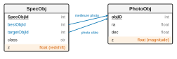
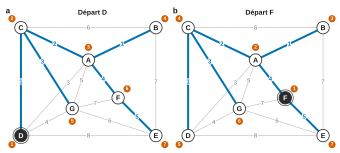
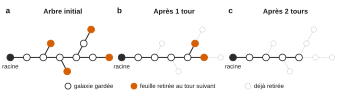

# CCINP PSI — Informatique 2026 · Corrigé brut

*Corrigé rédigé par IA, non officiel. Signalez toute erreur.*

Épreuve PSI5IN, mutualisée avec e3a-Polytech, durée 3 heures, calculatrice interdite. Python, sauf pour les bases de données (SQL). Sujet « Autour de l'astro-informatique » en quatre parties indépendantes, 33 questions. Les questions Q23, Q24 et Q28 s'appuient sur le Document Réponse (DR) : le graphe à sept sommets et le squelette de `recherche_distance_minimale` sont repris ci-dessous d'après le DR publié par le concours.

## Partie I — Interrogation d'une base de données astronomiques

### I.1 — Observation du ciel et poids des données

### Q1

Avec $n$ bits on code $2^n$ valeurs distinctes. Un pixel prend $256 = 2^8$ valeurs (entiers de 0 à 255).

Il faut donc $2^n \geqslant 2^8$ : 7 bits n'en coderaient que $128$, 8 bits en codent exactement $256$.

$$\boxed{8 \text{ bits, soit } 1 \text{ octet par pixel}}$$

Une photographie compte $2048 \times 1489$ pixels d'un octet chacun. Calcul posé, sans calculatrice :

$$\begin{aligned}
2048 \times 1489 &= 2 \times 1024 \times 1489 \\
&= 2978 \times 1024 \\
&= 3\,049\,472 \text{ octets.}
\end{aligned}$$

Avec $1\ \text{Mo} = 10^6$ octets, cela fait $3{,}05$ Mo.

Avec $1\ \text{Mio} = 2^{20}$ octets, cela fait $2978/1024 \approx 2{,}9$ Mio. Dans les deux conventions :

$$\boxed{\text{taille d'une photographie} \approx 3\ \text{Mo}}$$

### Q2

Les longueurs d'onde vont de 380 à 920 nm par pas de 0,1 nm, les deux bornes comprises :

$$\begin{aligned}
\frac{920 - 380}{0{,}1} &= 5400 \text{ pas,} \\
5400 + 1 &= 5401 \text{ longueurs d'onde.}
\end{aligned}$$

Chaque intensité est un flottant de 64 bits, soit 8 octets. On ne stocke pas les longueurs d'onde, qui se retrouvent par $\lambda_i = 380 + 0{,}1\,i$ nm.

$$5401 \times 8 = 43\,208 \text{ octets}$$

$$\boxed{\text{taille d'un spectre} \approx 43\ \text{ko}}$$

En unités binaires, $43\,208/1024 \approx 42{,}2$ Kio, soit 42 Kio. Compter 5400 valeurs donnerait 43 200 octets, même arrondi.

Un spectre est environ 70 fois plus léger qu'une photographie.

### I.2 — Interrogation de la base en SQL



### Q3

Les deux identifiants à comparer sont des attributs de la même ligne de `SpecObj` : aucune jointure n'est nécessaire.

```sql
SELECT COUNT(*)
FROM SpecObj
WHERE bestObjId = targetObjId;
```

### Q4

On associe chaque spectre à son objet photographique par `bestObjId`, on regroupe par objet, on filtre sur l'agrégat avec `HAVING` (le `WHERE` agit avant le regroupement) et on trie par nombre décroissant.

```sql
SELECT PhotoObj.objID, COUNT(*) AS nb_spectres
FROM PhotoObj
JOIN SpecObj ON PhotoObj.objID = SpecObj.bestObjId
GROUP BY PhotoObj.objID
HAVING COUNT(*) >= 2
ORDER BY nb_spectres DESC;
```

La jointure interne écarte d'elle-même les objets sans spectre, ce qui ne change rien puisqu'on en exige au moins deux. Une version sans jointure (`SELECT bestObjId, COUNT(*) FROM SpecObj GROUP BY bestObjId …`) renvoie les mêmes valeurs ; la jointure garantit que les identifiants renvoyés sont bien ceux de `PhotoObj`.

### Q5

La classe et le redshift sont dans `SpecObj`, les angles et la magnitude dans `PhotoObj` ; on joint par `bestObjId` (meilleure observation) et on préfixe les deux attributs homonymes `z`.

```sql
SELECT PhotoObj.objID, PhotoObj.ra, PhotoObj.dec, SpecObj.z
FROM PhotoObj
JOIN SpecObj ON PhotoObj.objID = SpecObj.bestObjId
WHERE SpecObj.class = 'GALAXY'
  AND PhotoObj.z < 17
  AND PhotoObj.ra >= 100 AND PhotoObj.ra <= 250;
```

`PhotoObj.z < 17` porte sur la magnitude absolue infrarouge et `SpecObj.z` est le redshift demandé. Un objet associé à plusieurs spectres donne une ligne par spectre, chacune avec son redshift.

## Partie II — Classification de spectres de galaxies

### II.1 — Justification de l'approche

### Q6

L'algorithme des $k$-moyennes est un **algorithme de classification non supervisée** (apprentissage non supervisé) : il partitionne des données non étiquetées (ici des spectres, vecteurs de $\mathbb{R}^N$ munis d'une distance) en $k$ groupes de données proches.

1. On choisit $k$ centroïdes initiaux, par exemple $k$ données tirées au hasard.
2. On affecte chaque donnée au centroïde le plus proche, ce qui définit une partition en $k$ groupes.
3. On remplace chaque centroïde par le barycentre (la moyenne) des données de son groupe.
4. On répète les étapes 2 et 3 jusqu'à ce que la partition ne change plus.

**Le paramètre $k$ est le nombre de groupes (classes) que l'on demande à l'algorithme de former** ; il est fixé à l'avance. Le résultat dépend de l'initialisation : l'algorithme converge vers une partition stable qui n'est en général qu'un optimum local.

### II.2 — Distance entre deux spectres

### Q7

```python
def distance(S1, S2):
    """S1, S2 : listes de N flottants. Renvoie d(S1, S2)."""
    N = len(S1)
    s = 0
    for i in range(N):
        s = s + (S1[i] - S2[i]) ** 2   # somme des carres des ecarts
    return (s / N) ** 0.5              # moyenne puis racine carree
```

Le parcours se fait en position, pour lire le même indice dans les deux listes. Coût $\Theta(N)$.

### Q8

```python
def positions_a_rejeter(S1, S2):
    """Renvoie la liste croissante des i tels que S1[i] ou S2[i] vaut None."""
    rejet = []
    for i in range(len(S1)):
        if S1[i] is None or S2[i] is None:
            rejet.append(i)
    return rejet
```

Un seul parcours : chaque indice apparaît au plus une fois et la liste est croissante. On teste `is None` (ou `== None`) et non la valeur de vérité de `S1[i]`, une intensité nulle étant une mesure valide.

### Q9

```python
def est_absent(element, L):
    """Renvoie True si element n'apparait pas dans L, False sinon."""
    for v in L:
        if v == element:
            return False     # trouve : on s'arrete
    return True              # parcours complet sans rencontre
```

Chaque itération coûte $O(1)$. Le pire des cas est celui où `element` est absent de `L` : les $r$ itérations sont toutes faites.

$$\boxed{C_{\text{pire}}(r) = \Theta(r)}$$

### Q10

Notons $A$ l'ensemble des indices contenus dans `a_rejeter`. Invariant de la boucle `for i in range(N)` de `distance2` :

> au début de l'itération d'indice $i$ (et, pour $i = N$, en sortie de boucle), $\displaystyle d = \sum_{\substack{0 \leqslant j < i \\ j \notin A}} (S_1[j] - S_2[j])^2$.

Il est vrai pour $i = 0$ (somme vide, $d = 0$). Pour $i = N$, il donne la somme des carrés sur les seules positions conservées.

Le résultat renvoyé $\sqrt{d/m}$, avec $m = N - |A|$, est donc la distance cherchée.

### Q11

Posons $N$ = `len(S1)` et $r$ = `len(a_rejeter)`, avec $0 \leqslant r \leqslant N$ et des éléments de `a_rejeter` distincts.

**`distance2`.** La boucle fait $N$ itérations, chacune appelant `est_absent(i, a_rejeter)`, dont le coût est au plus $r$ (Q9). Plus précisément :

- pour les $N - r$ indices conservés, la recherche échoue et coûte $r$ comparaisons ;
- les $r$ indices rejetés sont trouvés chacun à une position différente de `a_rejeter`, d'où $1 + 2 + \dots + r$ comparaisons au total.

Le nombre total de comparaisons vaut :

$$\begin{aligned}
c(N, r) &= (N - r)\,r + \frac{r(r+1)}{2} \\
&= Nr - \frac{r(r-1)}{2}.
\end{aligned}$$

Comme $r - 1 \leqslant N$, ce nombre est encadré :

$$\begin{aligned}
c(N, r) &\geqslant \frac{Nr}{2}, \\
c(N, r) &\leqslant Nr.
\end{aligned}$$

Il s'y ajoute $\Theta(N)$ pour le reste de la boucle :

$$\boxed{C_2(N, r) = \Theta(N + Nr)}$$

Conclusion : `distance2` est en $O(Nr)$ dès que $r \geqslant 1$. Si $r = 0$, elle est en $O(N)$.

Elle devient quadratique, en $O(N^2)$, si $r$ est proportionnel à $N$.

**`distance3`.** Deux copies en $\Theta(N)$, une boucle de $r$ itérations à coût constant, une boucle de $N$ itérations à coût constant. Comme $r \leqslant N$ :

$$\begin{aligned}
C_3(N, r) &= \Theta(N + r) \\
&= \Theta(N).
\end{aligned}$$

$$\boxed{\texttt{distance3} \text{ est en } O(N)}$$

`distance3` est linéaire au prix d'une mémoire supplémentaire $\Theta(N)$ (les deux copies). Elle est correcte car, aux positions rejetées, les deux composantes valent $0$ et la contribution $(0 - 0)^2$ est nulle.

### II.3 — Implémentation des $k$-moyennes

### Q12

```python
def produit_partition(spectres, centroides):
    """Renvoie la liste des p indices du centroide le plus proche
    de chaque spectre, dans l'ordre de spectres."""
    partitionnement = []
    for S in spectres:
        partitionnement.append(trouve_centroide_le_plus_proche(S, centroides))
    return partitionnement
```

Sur l'exemple : S1, S3, S4 donnent l'indice $1$ (C2), S2 l'indice $2$ (C3), S5 l'indice $0$ (C1), d'où `[1, 2, 1, 1, 0]`.

### Q13

```python
def k_moyennes(spectres, k):
    """Renvoie (centroides, partitionnement) apres convergence."""
    centroides = initialise(k, spectres)
    partitionnement = produit_partition(spectres, centroides)
    ancien = []                                  # aucune partition precedente
    while partitionnement != ancien:             # la partition a change
        ancien = partitionnement
        centroides = calcule_centroides(ancien, spectres)
        partitionnement = produit_partition(spectres, centroides)
    return centroides, partitionnement
```

`ancien = []` garantit au moins un passage dans la boucle (pour $p \geqslant 1$). En sortie, `partitionnement` est la partition associée aux centroïdes renvoyés, et ces centroïdes sont les barycentres de cette même partition. `produit_partition` renvoie une liste neuve à chaque appel, donc `ancien` n'est jamais modifiée par aliasing. La comparaison `!=` de deux listes est autorisée par l'annexe ; on compare les partitions (entiers) et non les centroïdes (flottants). Coût d'un tour : $\Theta(pkN)$.

### II.4 — Détermination automatique du nombre de groupes

### Q14

```python
def groupes_de_spectres(spectres):
    """Renvoie la liste des groupes successivement extraits ;
    les spectres restants (au plus 100) sont perdus."""
    groupes = []
    restants = spectres
    while len(restants) > 100:                        # etape 4
        centroides, partitionnement = k_moyennes(restants, 10)   # etapes 1 et 2
        principal, reste = principal_et_reste(partitionnement, restants)
        groupes.append(principal)                     # etape 3
        restants = reste
    return groupes
```

La liste `spectres` n'est pas modifiée (on réaffecte `restants`, on ne le modifie pas en place). Terminaison : tant que `len(restants)` $= n > 100$, le groupe majoritaire parmi $10$ groupes contient au moins $\lceil n/10 \rceil \geqslant 11$ spectres, donc `len(restants)` décroît strictement ; c'est un entier positif, la boucle termine. Le test placé en tête équivaut à l'algorithme de l'énoncé (test en fin d'étape 4) dès que la liste initiale contient plus de $100$ spectres. (Le DR nomme cette fonction `groupe_de_spectres`, sans « s » ; le nom est sans incidence.)

## Partie III — Classification de spectres stellaires

### Q15

L'algorithme des $k$ plus proches voisins est un **algorithme de classification supervisée** (apprentissage supervisé) : on dispose de données de référence dont la classe est connue (ici les $7R$ spectres étiquetés). Pour classer une nouvelle donnée $S$ :

1. on calcule la distance de $S$ à chaque référence ;
2. on retient les $k$ références les plus proches ;
3. on attribue à $S$ la classe majoritaire parmi ces $k$ voisins : c'est un **vote majoritaire**.

**$k$ est le nombre de voisins qui participent au vote.** Un $k$ petit rend la décision sensible au bruit ; un $k$ grand fait voter des références éloignées et brouille les frontières entre classes.

### Q16

La décision est un vote à la majorité des effectifs. Au voisinage de $S$, le nombre de références d'une classe est d'autant plus grand que cette classe est représentée parmi les références. Avec des effectifs différents, une classe sur-représentée l'emporte plus souvent, indépendamment de la ressemblance réelle : prendre le même $R$ pour toutes les classes évite ce biais.

Si les références O sont trois fois plus nombreuses que les B, alors que O et B sont spectralement proches, les deux types sont mêlés dans la zone frontière et l'on y trouve environ trois O pour un B. Avec $k = 8$, une étoile B y aura typiquement $6$ voisins O pour $2$ voisins B et sera **classée O à tort** : le classifieur est biaisé vers O.

De plus, le script fourni suppose des blocs de taille $R$ identique : la ligne 5 calcule `R = len(references) // len(types_spectraux)` et la ligne 17 retrouve le type par `j = i // R`. Avec des effectifs inégaux, ces lignes attribueraient des références au mauvais type.

### Q17

$$\boxed{k = 8}$$

valeur lue **ligne 26** : `type_spectral = mystere(S, 8)`. (La ligne 13, `seuil = copie_L[k]`, utilise $k$ sans fixer sa valeur.)

### Q18

- **Lignes 1 à 5** : chargement des $7R$ spectres de référence, liste des sept types spectraux et nombre $R$ de références par type.
- **Lignes 8 à 11** : calcul des distances de $S$ à toutes les références.
- **Lignes 12 à 18** : détermination des $k$ références les plus proches (distances strictement inférieures à la $(k+1)$-ième plus petite) et décompte de ces voisins par type spectral.
- **Lignes 19 à 22** : vote majoritaire, renvoi du type spectral le plus représenté parmi les voisins.
- **Lignes 24 à 27** : classification de tous les spectres à classer, résultats rangés dans `classification`.

### Q19

```python
def mystere(S: [float], k: int) -> str
```

- `S` : spectre à classer, liste de $N$ flottants échantillonnée comme les spectres de référence ;
- `k` : entier, nombre de voisins, avec $1 \leqslant k <$ `len(references)` (sinon `copie_L[k]` lève une erreur) ;
- valeur renvoyée : une chaîne de `types_spectraux` (`"O"`, `"B"`, …, `"M"`), le type majoritaire parmi les $k$ plus proches références de `S`.

La fonction lit les variables globales `references`, `types_spectraux` et `R` et ne modifie rien.

### Q20

Un défaut est ici un cas où le script ne respecte pas sa spécification (renvoyer le type majoritaire parmi les $k$ plus proches voisins), et non une complexité perfectible.

**Défaut 1 — lignes 13 et 16 : distances égales au seuil.** On ne retient que les distances strictement inférieures à `seuil = copie_L[k]`. Si plusieurs références sont à la distance `seuil`, elles sont toutes exclues et moins de $k$ voisins votent.

Cas extrême : si les $k+1$ plus petites distances sont égales (références identiques), aucun voisin n'est retenu. Alors `resultats` reste nul, $M = 0$ et la fonction renvoie `"O"` sans qu'aucun voisin n'ait voté.

**Défaut 2 — lignes 19 à 22 : égalité du vote.** Si plusieurs types obtiennent le même nombre maximal de voix (par exemple 4 contre 4 avec $k = 8$), la boucle renvoie le premier dans l'ordre de `types_spectraux`, sans signaler l'égalité. Le résultat dépend alors de l'ordre arbitraire de la liste et non des données.

**Erreur de nom — ligne 14.** `resultats = [0] * len(type_spectraux)` emploie le nom `type_spectraux`, alors que la variable définie ligne 3 s'appelle `types_spectraux` : l'appel de `mystere` lève une `NameError` et le script ne classe rien. Correction : `len(types_spectraux)`.

**Autres défauts recevables.** Lignes 5 et 17 : si `len(references)` n'est pas un multiple de 7, `R` est tronqué et des références sont attribuées au mauvais type. Ligne 13 : `copie_L[k]` lève une erreur si $k \geqslant 7R$. `mystere` dépend de variables globales. En revanche, recalculer et trier toutes les distances (lignes 9 à 12) est une question de complexité, pas un défaut au sens de la spécification.

### Q21

On renvoie, avec le type, la proportion des voix obtenues par le type gagnant parmi les voisins effectivement retenus.

```python
def mystere(S, k):
    """Renvoie (type, confiance), confiance = part des voisins retenus
    qui sont du type renvoye (entre 0 et 1)."""
    L = []
    for Sref in references:
        L.append(distance(S, Sref))
    copie_L = copie_ordonnee(L)
    seuil = copie_L[k]
    resultats = [0] * len(types_spectraux)
    nb_votants = 0
    for i in range(len(references)):
        if L[i] < seuil:
            j = i // R
            resultats[j] = resultats[j] + 1
            nb_votants = nb_votants + 1
    if nb_votants == 0:                      # aucun voisin retenu (cf. Q20)
        return None, 0.0
    imax = 0                                 # recherche du maximum sans max()
    for i in range(len(resultats)):
        if resultats[i] > resultats[imax]:
            imax = i
    return types_spectraux[imax], resultats[imax] / nb_votants
```

La confiance vaut $1$ si tous les voisins sont du même type. Avec $k = 8$ voisins effectivement retenus et 7 types, le type gagnant a au moins 2 voix.

La confiance est alors comprise entre $2/8 = 0{,}25$ et $1$. Un résultat comme `("B", 0.5)` signale une classification douteuse. L'appel ligne 26 devient `type_spectral, confiance = mystere(S, 8)`.

### Q22

**Définition.** On évalue un classifieur à $c$ classes sur des données dont la classe réelle est connue. La matrice de confusion $M$ est une matrice carrée d'ordre $c$, indexée par les classes. Son coefficient $M_{a,b}$ est le nombre de données de classe réelle $a$ classées dans la classe $b$.

La diagonale compte les bonnes classifications, les termes hors diagonale les confusions (par exemple $M_{B,O}$ : étoiles B prises pour des O). La trace divisée par le nombre total de données est le taux de réussite.

**Algorithme pour les spectres de référence.**

1. Créer une matrice $7 \times 7$ de zéros, lignes et colonnes rangées dans l'ordre de `types_spectraux`.
2. Pour chaque indice $i$ de `references` :
   - le type réel est $a = i \,/\!/\, R$ ;
   - classer `references[i]` par les $k$ plus proches voisins **parmi les autres références** (on exclut la référence d'indice $i$, qui est à distance nulle d'elle-même et voterait toujours pour sa vraie classe) ; soit $b$ l'indice du type obtenu ;
   - ajouter $1$ à $M_{a,b}$.
3. Renvoyer $M$.

Pour l'exclusion, on procède par indice (on saute $i$ dans le calcul des distances) : supprimer l'élément de la liste décalerait les indices et fausserait `j = i // R`. Sans cette exclusion, la matrice obtenue est trop optimiste.

## Partie IV — Reconnaissance des filaments galactiques

### IV.1 — Exemple pour comprendre le concept

Graphe du DR (sept sommets, quatorze arêtes) :

| Arête | CD | AB | AC | AD | CG | DG | AF | AG | EF | CB | EG | BE | FG | DE |
|---|---|---|---|---|---|---|---|---|---|---|---|---|---|---|
| Poids | 1 | 1 | 2 | 3 | 3 | 4 | 4 | 5 | 5 | 6 | 6 | 7 | 7 | 8 |

### Q23

Tableau de l'algorithme glouton depuis D : pour chaque sommet hors de l'arbre, plus petit poids d'une arête le reliant à l'arbre (entre parenthèses, l'extrémité dans l'arbre) ; on ajoute à chaque étape le sommet de valeur minimale.

| Arbre | A | B | C | E | F | G | Ajout |
|---|---|---|---|---|---|---|---|
| D | 3 (D) | $\infty$ | **1 (D)** | 8 (D) | $\infty$ | 4 (D) | C par DC = 1 |
| D, C | **2 (C)** | 6 (C) | — | 8 (D) | $\infty$ | 3 (C) | A par CA = 2 |
| D, C, A | — | **1 (A)** | — | 8 (D) | 4 (A) | 3 (C) | B par AB = 1 |
| D, C, A, B | — | — | — | 7 (B) | 4 (A) | **3 (C)** | G par CG = 3 |
| D, C, A, B, G | — | — | — | 6 (G) | **4 (A)** | — | F par AF = 4 |
| D, C, A, B, G, F | — | — | — | **5 (F)** | — | — | E par FE = 5 |

$$\boxed{\text{Ordre d'ajout : D, C, A, B, G, F, E}}$$

Arbre couvrant (à tracer sur le graphe vierge, figure 2) : arêtes **DC (1), CA (2), AB (1), CG (3), AF (4), FE (5)**, soit $6 = 7 - 1$ arêtes.



$$\boxed{\text{Poids total} = 1 + 2 + 1 + 3 + 4 + 5 = 16}$$

### Q24

Depuis F :

| Arbre | A | B | C | D | E | G | Ajout |
|---|---|---|---|---|---|---|---|
| F | **4 (F)** | $\infty$ | $\infty$ | $\infty$ | 5 (F) | 7 (F) | A par FA = 4 |
| F, A | — | **1 (A)** | 2 (A) | 3 (A) | 5 (F) | 5 (A) | B par AB = 1 |
| F, A, B | — | — | **2 (A)** | 3 (A) | 5 (F) | 5 (A) | C par AC = 2 |
| F, A, B, C | — | — | — | **1 (C)** | 5 (F) | 3 (C) | D par CD = 1 |
| F, A, B, C, D | — | — | — | — | 5 (F) | **3 (C)** | G par CG = 3 |
| F, A, B, C, D, G | — | — | — | — | **5 (F)** | — | E par FE = 5 |

$$\boxed{\text{Ordre d'ajout : F, A, B, C, D, G, E}}$$

Arêtes retenues : FA (4), AB (1), AC (2), CD (1), CG (3), FE (5), poids total $16$.

**Commentaire.** L'ordre d'ajout change avec le sommet de départ, mais on obtient **le même arbre** (les mêmes six arêtes) et donc le même poids 16. Le poids total est toujours le même, puisque l'algorithme fournit un arbre couvrant de poids minimal quel que soit le départ.

L'identité des arêtes n'est en revanche pas automatique : le graphe a des poids répétés (1, 3, 4, 5, 6 et 7 apparaissent deux fois) et, en général, deux départs peuvent donner deux arbres différents de même poids.

Ici l'arbre minimal est unique : pour chaque arête non retenue, toutes les arêtes du cycle qu'elle formerait avec l'arbre sont strictement plus légères qu'elle (par exemple AD = 3 ferme le cycle D–C–A de poids 1 et 2 ; AG = 5 ferme A–C–G de poids 2 et 3 ; EG = 6 ferme E–F–A–C–G de poids au plus 5). Des poids deux à deux distincts suffisent à garantir l'unicité, sans être nécessaires, comme le montre cet exemple.

### IV.2 — Application à la distribution de galaxies : initialisation du graphe

### Q25

```python
def poids(coords, i, j):
    """Carre de la distance euclidienne entre les galaxies i et j."""
    p = 0
    for c in range(3):                       # composantes x, y, z
        p = p + (coords[i][c] - coords[j][c]) ** 2
    return p
```

Exemple : $(0-3)^2 + (1-2)^2 + (5-5)^2 = 10$. Pas de racine : le poids est le carré de la distance. Coût $O(1)$.

### Q26

```python
def matrice_adjacence(coords):
    """Matrice N x N des poids du graphe complet des galaxies."""
    N = len(coords)
    M = []
    for i in range(N):
        ligne = []
        for j in range(N):
            ligne.append(poids(coords, i, j))
        M.append(ligne)
    return M
```

$M$ est symétrique, de diagonale nulle. Coût $\Theta(N^2)$ en temps et en mémoire. On évite `[[0] * N] * N`, qui ferait partager la même liste à toutes les lignes.

### IV.3 — Algorithme de construction de l'arbre

### Q27

```python
def initialisation_distance(G, depart):
    """dist[i] = inf pour toute galaxie i, sauf dist[depart] = 0."""
    dist = {}
    for i in range(len(G)):
        dist[i] = float('inf')
    dist[depart] = 0
    return dist
```

`depart` reste une clef de `dist`, de valeur $0$ : c'est donc lui que la première recherche extrait. Coût $\Theta(N)$.

### Q28

Squelette du DR complété :

```python
def recherche_distance_minimale(dist):
    mindist = float('inf')
    candidat = None
    for gal in dist:
        if dist[gal] < mindist:
            mindist = dist[gal]
            candidat = gal
    del dist[candidat] # Suppression de la clef candidate du dictionnaire
    return candidat    # et renvoi du candidat
```

La boucle maintient dans `mindist` la plus petite distance rencontrée et dans `candidat` la galaxie correspondante ; on renvoie la galaxie de `dist` la plus proche de l'arbre, après l'avoir retirée de `dist` (modification visible depuis l'appelant). Ici le graphe est complet à poids finis : après le premier tour, toutes les valeurs de `dist` sont finies, et au premier tour `depart` vaut $0$, donc `candidat` n'est jamais `None`. Sur un graphe où toutes les valeurs restantes vaudraient `float('inf')`, il faudrait écrire `if candidat is None or dist[gal] < mindist:`. Coût $O(|\texttt{dist}|)$.

### Q29

Un variant est une quantité entière, positive, qui décroît strictement à chaque tour de boucle.

**Variant : $V$ = `len(dist)`.**

- $V$ est un entier naturel.
- À chaque itération, `recherche_distance_minimale` supprime exactement une clef de `dist` (`del dist[candidat]`), et `mise_a_jour` n'en ajoute aucune : elle ne modifie `dist[y]` que si `y in dist`, c'est-à-dire pour une clef déjà présente ; ses ajouts portent sur `pred`. Donc $V$ diminue exactement de $1$ par itération.

Une suite d'entiers naturels strictement décroissante est finie : la boucle `while len(dist) != 0` s'arrête. Comme $V = N$ au départ, elle fait exactement $N$ itérations : **`arbre_couvrant_minimal` termine**.

### Q30

Soit $N$ = `len(G)`.

- `initialisation_distance` : $N$ insertions en $O(1)$, soit $\Theta(N)$.
- `recherche_distance_minimale` : parcours des clefs de `dist`, puis suppression en $O(1)$. À l'itération $t$, avec $0 \leqslant t \leqslant N-1$, `dist` contient $N - t$ clefs. Coût : $\Theta(N - t)$.
- `mise_a_jour` : $N$ itérations, chacune avec un test `y in dist` en $O(1)$ (dictionnaire, d'après l'annexe), une lecture `G[x][y]` et au plus deux affectations en $O(1)$, soit $\Theta(N)$.
- Boucle principale : $N$ itérations (Q29).

On somme le coût de l'initialisation et ceux des $N$ tours :

$$\begin{aligned}
C(N) &= \Theta(N) + \sum_{t=0}^{N-1} \big( \Theta(N - t) + \Theta(N) \big) \\
&= \Theta(N) + \Theta\!\left(\frac{N(N+1)}{2}\right) + \Theta(N^2).
\end{aligned}$$

$$\boxed{C(N) = \Theta(N^2)}$$

La fonction `arbre_couvrant_minimal` est donc en $O(N^2)$ dans le pire des cas.

### IV.4 — Élagage de l'arbre couvrant de poids minimal

### Q31

On parcourt une seule fois les couples (galaxie, prédécesseur) et l'on incrémente le compteur du prédécesseur.

```python
def dico_galaxies_avec_successeurs(arbre):
    """Renvoie {x : nombre de y tels que arbre[y] == x}, pour les x
    ayant au moins un successeur."""
    nb_succ = {}
    for y in arbre:
        x = arbre[y]                 # y est un successeur de x
        if x in nb_succ:
            nb_succ[x] = nb_succ[x] + 1
        else:
            nb_succ[x] = 1
    return nb_succ
```

Une galaxie sans successeur n'est jamais créée comme clef ; la racine, qui n'est pas clef de `arbre`, apparaît dès qu'elle est valeur. $n$ itérations à opérations de dictionnaire en $O(1)$ :

$$\boxed{\Theta(n)}$$

### Q32

À chaque tour de boucle, `elagage` calcule les galaxies ayant au moins un successeur, puis ne conserve dans l'arbre que les clefs qui en font partie : **un tour supprime toutes les feuilles** (galaxies sans successeur) et l'arête qui les relie à leur prédécesseur. Une galaxie dont tous les successeurs viennent d'être supprimés devient feuille à son tour. Après `nb_etapes` tours, on a retiré `nb_etapes` couches successives de feuilles : toutes les branches de longueur au plus `nb_etapes` ont disparu.



Intérêt : l'arbre couvrant minimal relie toutes les galaxies, y compris les petites ramifications (les « radicules » de la figure 5(a)) qui ne sont pas des structures physiques. Ces branches courtes disparaissent en quelques tours, alors que le filament, long, ne perd qu'un sommet par tour à chacune de ses extrémités libres (la racine `depart`, qui n'est pas une clef, n'est jamais retirée tant qu'elle a un successeur). On obtient le squelette du filament de la figure 5(b), plus lisible pour un astronome. Le coût est $O(n)$ par tour.

### IV.5 — Séparation des groupes sans filament

### Q33

Les coefficients de `G` sont des carrés de distances (Q25) ; la distance d'une galaxie `y` à son prédécesseur `arbre[y]` est donc `G[y][arbre[y]] ** 0.5`. On calcule d'abord la longueur moyenne $\ell_m$ sur toutes les liaisons de l'arbre reçu, puis on construit un nouveau dictionnaire ne gardant que les liaisons de longueur au plus $\alpha \ell_m$.

```python
def separation(G, arbre, alpha):
    """Nouveau dictionnaire de predecesseurs sans les liaisons de longueur
    > alpha * lm ; G, arbre et alpha ne sont pas modifies."""
    if len(arbre) == 0:
        return {}
    somme = 0
    for y in arbre:                              # longueur moyenne lm
        somme = somme + G[y][arbre[y]] ** 0.5
    lm = somme / len(arbre)
    nouvel_arbre = {}
    for y in arbre:                              # filtrage
        if G[y][arbre[y]] ** 0.5 <= alpha * lm:
            nouvel_arbre[y] = arbre[y]
    return nouvel_arbre
```

Retirer la clef `y` coupe la liaison `y`–`arbre[y]` : `y` devient la racine d'une nouvelle composante connexe. Ainsi l'amas isolé, rattaché au filament par une seule liaison anormalement longue, en est séparé. La moyenne est calculée sur toutes les liaisons avant le filtrage, et l'on divise par le nombre de liaisons `len(arbre)` (pas par le nombre de galaxies). Coût $\Theta(n)$ avec $n$ = `len(arbre)`. Variante acceptable, puisque $\alpha$ est choisi empiriquement : raisonner directement sur les coefficients `G[y][arbre[y]]` (carrés des longueurs), à condition de le dire.

**FIN**
