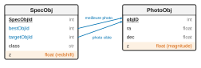
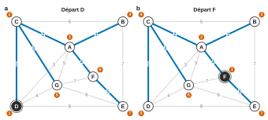
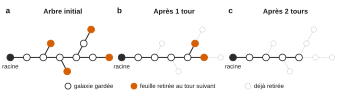

# CCINP PSI — Informatique 2026 · Corrigé guidé

*Corrigé rédigé par IA, non officiel. Signalez toute erreur.*

## Présentation du sujet

**Thème.** « Autour de l'astro-informatique » : le sujet suit la chaîne de traitement des données du *Sloan Digital Sky Survey* (SDSS), des octets bruts d'une photographie jusqu'à la détection des filaments galactiques. Épreuve PSI5IN, mutualisée avec e3a-Polytech, **3 heures, calculatrice interdite**. Tout se rédige en Python, sauf les requêtes en SQL, sur un Document Réponse (DR) de 12 pages qui fournit les signatures typées attendues (par exemple `distance(S1:[float], S2:[float]) -> float`), le graphe de Q23–Q24 et le squelette de Q28.

**Quatre parties indépendantes, 33 questions.**

- **Partie I (Q1–Q5) — Base de données astronomiques.** Deux calculs de taille mémoire sans calculatrice, puis trois requêtes SQL sur deux tables `PhotoObj` et `SpecObj` reliées par deux clefs étrangères (`bestObjId`, `targetObjId`). Piège central : l'attribut `z` désigne une magnitude dans une table et un redshift dans l'autre.
- **Partie II (Q6–Q14) — $k$-moyennes sur des spectres de galaxies.** Cours, distance entre spectres, valeurs manquantes `None`, invariant de boucle et comparaison de deux complexités, puis assemblage de fonctions fournies pour écrire les $k$-moyennes et un algorithme qui extrait les groupes un par un.
- **Partie III (Q15–Q22) — $k$ plus proches voisins sur des spectres d'étoiles.** Cours, biais dû à des effectifs déséquilibrés, puis **lecture critique d'un script fourni** (valeur de $k$, rôle des blocs, signature, défauts, niveau de confiance) et matrice de confusion.
- **Partie IV (Q23–Q33) — Arbre couvrant de poids minimal.** Algorithme glouton (Prim) à la main sur le graphe à sept sommets du DR, matrice d'adjacence, fonctions auxiliaires de Prim, variant, complexité, puis élagage et découpage de l'arbre.

**Notions du programme mobilisées.** Représentation des entiers et des flottants, taille des données ; SQL (jointure, `COUNT`, `GROUP BY`, `HAVING`, `ORDER BY`) ; listes et dictionnaires ; invariant et variant de boucle ; complexité dans le pire des cas ; apprentissage non supervisé ($k$-moyennes) et supervisé ($k$ plus proches voisins, matrice de confusion) ; graphes pondérés, matrice d'adjacence, arbre couvrant, algorithme glouton.

**Difficulté et longueur.** Sujet long, sans question très difficile. Les points se gagnent sur la précision : compter juste (Q2, Q11, Q30), respecter l'annexe (pas de `min`, `max`, `.sort()` ni de test `in` sur une liste qui trivialiserait la question), lire attentivement le code fourni (Q17–Q20, Q29, Q32).

**Questions à ne pas laisser passer.** Q1, Q2, Q3, Q7, Q8, Q9, Q12, Q17, Q25, Q26, Q27, Q28 : courtes et presque mécaniques. Les questions de cours Q6 et Q15, à condition de répondre explicitement sur le sens de $k$. Q23–Q24 : un tableau bien tenu suffit.

**Ce qu'en dit le jury (rapport 2026).** Le SQL a été abordé par 80 à 90 % des copies et a rapporté beaucoup de points ; Q7, première question de programmation, a été tentée par 99 % des copies et réussie à près de 90 %. Les questions les plus discriminantes sont les questions de cours et de recul :

- Q6 et Q15 (définition des deux algorithmes, souvent confondus) ;
- Q10 (moins de 10 % d'invariants corrects) ;
- Q13–Q14 (à peine plus de la moitié des copies) ;
- Q21 (30 % de tentatives, une sur trois aboutie) et Q22 (matrice de confusion mal connue) ;
- en fin de sujet, Q30, Q31 et Q33, traitées par la moitié, le tiers, puis très peu de copies.

Le jury prévient aussi que « le barème a tendance à privilégier les candidats montrant leur maîtrise du langage au programme des CPGE » : les questions de commentaire ne remplacent pas le code.

**Gestion du temps.** Les parties sont indépendantes : on peut commencer par la I (rapide), puis la IV, la plus longue (11 questions) mais très guidée, et garder pour la fin les questions de rédaction de la III. Compter environ 25 min pour la I, 50 min pour la II, 40 min pour la III et 60 min pour la IV.

## Partie I — Interrogation d'une base de données astronomiques

Deux ordres de grandeur sur la taille des données, puis trois requêtes sur une base à deux tables. Outils : puissances de 2, conversion bits/octets, requêtes SQL avec jointure et agrégats.

### Question 1

> [!INDICATION]
> Combien de valeurs distinctes peut-on coder avec $n$ bits ? Comparer à $256$.

> [!INDICATION]
> Pour le produit sans calculatrice, faire apparaître $1024$ dans $2048$.

#### Solution

Avec $n$ bits on code $2^n$ valeurs. Il faut $2^n \geqslant 256$, et $256 = 2^8$, donc $n \geqslant 8$. Ainsi 8 bits suffisent exactement.

$$\boxed{8 \text{ bits, soit } 1 \text{ octet par pixel}}$$

La photographie compte $2048 \times 1489$ pixels d'un octet. Calcul posé, sans calculatrice :

$$\begin{aligned}
2048 \times 1489 &= 2 \times 1024 \times 1489 \\
&= 2978 \times 1024 \\
&= 3\,049\,472 \text{ octets.}
\end{aligned}$$

Soit $3{,}05 \times 10^6$ octets, ou $2978/1024 \approx 2{,}9$ Mio en unités binaires. Arrondi au mégaoctet :

$$\boxed{\text{environ } 3 \text{ Mo}}$$

> [!PIEGE]
> Les entiers de 0 à 255 sont au nombre de 256 et non 255 : 8 bits conviennent, 9 serait faux. Ne pas confondre non plus « 256 valeurs » et « 256 bits ». Le rapport 2026 note que la majorité trouve 8 bits, mais que « 8 bits = 1 octet semble être souvent inconnu » ; une réponse sur cinq était complètement fausse.

> [!JURY]
> Des réponses aberrantes ont été relevées (jusqu'à $8^{256}$ bits pour un pixel). Le rapport 2026 : « Quelques ordres de grandeur sur les tailles des images usuelles auraient pu guider ces copies vers les erreurs de raisonnement y ayant mené. » Une photographie de quelques millions de pixels pèse quelques mégaoctets.

### Question 2

> [!INDICATION]
> Compter les longueurs d'onde échantillonnées : combien d'intervalles de $0{,}1$ nm, puis combien de points ?

> [!INDICATION]
> Un flottant de $64$ bits occupe combien d'octets ?

#### Solution

On compte les longueurs d'onde de 380 à 920 nm par pas de 0,1 nm, bornes comprises :

$$\begin{aligned}
\frac{920 - 380}{0{,}1} &= 5400 \text{ pas,} \\
5400 + 1 &= 5401 \text{ longueurs d'onde.}
\end{aligned}$$

Chaque intensité est un flottant de 64 bits, soit 8 octets. Les longueurs d'onde ne sont pas stockées : elles se retrouvent par $\lambda_i = 380 + 0{,}1\, i$ nm.

$$5401 \times 8 = 43\,208 \text{ octets}$$

$$\boxed{\text{environ } 43 \text{ ko}}$$

En kibioctets : $43\,208 / 1024 \approx 42{,}2$, soit 42 Kio. Un spectre est environ 70 fois plus léger qu'une photographie.

> [!PIEGE]
> L'erreur « piquets et intervalles » : 5400 intervalles mais 5401 points. Ici l'arrondi au ko ne change pas, mais le décompte doit être justifié.

> [!JURY]
> Le rapport 2026 relève surtout des erreurs de calcul et la confusion bit/octet. L'énoncé dit « déterminer » et non « donner » : « on attendait donc au moins de voir le calcul posé pour expliquer la démarche ».

### Question 3

> [!INDICATION]
> Les deux attributs à comparer sont-ils dans la même table ?

#### Solution

`bestObjId` et `targetObjId` sont deux attributs de la même ligne de `SpecObj` : un filtre d'égalité et un comptage suffisent, sans jointure.



```sql
SELECT COUNT(*)
FROM SpecObj
WHERE bestObjId = targetObjId;
```

> [!METHODE]
> Avant d'écrire une jointure, repérer dans quelles tables se trouvent les attributs utilisés dans `SELECT` et `WHERE`. Si tout est dans une table, on n'en joint pas d'autre.

> [!JURY]
> Question traitée par 95 % des candidats selon le rapport 2026 ; certains oublient ou ne connaissent pas le mot clé `COUNT`.

### Question 4

> [!INDICATION]
> On veut un nombre par objet photographique : quelle clause regroupe les lignes ?

> [!INDICATION]
> La condition « au moins deux spectres » porte sur un agrégat : `WHERE` ou `HAVING` ?

#### Solution

On relie chaque spectre à son objet photographique par `bestObjId`, on regroupe par objet, on filtre après agrégation et on trie.

```sql
SELECT PhotoObj.objID, COUNT(*) AS nb_spectres
FROM PhotoObj
JOIN SpecObj ON PhotoObj.objID = SpecObj.bestObjId
GROUP BY PhotoObj.objID
HAVING COUNT(*) >= 2
ORDER BY nb_spectres DESC;
```

La jointure interne écarte les objets sans spectre, ce qui est sans effet puisqu'on en exige deux. Grouper directement `SpecObj` sur `bestObjId` donne les mêmes valeurs ; la jointure garantit que les identifiants sont ceux « stockés dans la table `PhotoObj` ».

> [!PIEGE]
> `WHERE COUNT(*) >= 2` est une erreur : `WHERE` filtre les lignes avant le regroupement, quand l'agrégat n'existe pas encore. Le filtre sur un agrégat se met dans `HAVING`. Autres fautes relevées par le rapport 2026 : `GROUP BY` oublié (la plupart du temps), `ORDER BY DESC` sans l'attribut de tri, clauses dans le désordre.

> [!JURY]
> Selon le rapport 2026, « seulement un tiers des candidats arrivent à mettre tous les éléments en place sans erreur ». Le jury conseille une ligne par mot clé, comme ci-dessus, et la forme `Table.Attribut` (et non `Attribut.Table`).

### Question 5

> [!INDICATION]
> Dresser la liste des attributs utilisés et la table de chacun : il en faut des deux tables.

> [!INDICATION]
> Deux attributs s'appellent `z` : lequel est la magnitude, lequel le redshift ?

#### Solution

Classe et redshift viennent de `SpecObj`, angles et magnitude de `PhotoObj` ; on joint par `bestObjId`, puisque l'énoncé impose la meilleure observation photographique.

```sql
SELECT PhotoObj.objID, PhotoObj.ra, PhotoObj.dec, SpecObj.z
FROM PhotoObj
JOIN SpecObj ON PhotoObj.objID = SpecObj.bestObjId
WHERE SpecObj.class = 'GALAXY'
  AND PhotoObj.z < 17
  AND PhotoObj.ra >= 100 AND PhotoObj.ra <= 250;
```

`PhotoObj.z < 17` est la contrainte de magnitude, `SpecObj.z` le redshift demandé. Un objet ayant plusieurs spectres apparaît une fois par spectre, avec chaque fois le redshift de ce spectre.

> [!PIEGE]
> Écrire `z` sans préfixe : la requête est ambiguë et, si elle passe, elle filtre peut-être le redshift au lieu de la magnitude. Joindre sur `targetObjId` ne respecte pas la consigne de la meilleure observation. Le rapport 2026 relève aussi l'oubli de certains critères (classe, magnitude, intervalle d'ascension droite).

> [!JURY]
> Le rapport 2026 accepte deux façons de distinguer les deux `z` : préciser la table, ou une requête imbriquée avec alias. Il rappelle que les questions de SQL ne sont pas rangées par difficulté croissante : « il était donc déconseillé de sauter Q5 sous prétexte que Q4 semblait déjà difficile ».

## Partie II — Classification de spectres de galaxies

On classe automatiquement des spectres de galaxies par les $k$-moyennes, puis on automatise le choix du nombre de groupes. Outils : parcours de listes, invariant, complexité, assemblage de fonctions données.

### Question 6

> [!INDICATION]
> Rappeler les deux étapes qui alternent dans la boucle et le critère d'arrêt.

> [!INDICATION]
> Supervisé ou non supervisé ? Le $k$ est-il une donnée ou un résultat ?

#### Solution

Les $k$-moyennes sont un **algorithme de classification non supervisée** (apprentissage non supervisé) : on regroupe des données sans étiquette (ici des spectres de $\mathbb{R}^N$ munis d'une distance) en $k$ groupes de données proches.

1. Initialisation : choisir $k$ centroïdes, par exemple $k$ données tirées au hasard.
2. Affectation : rattacher chaque donnée au centroïde le plus proche, d'où une partition en $k$ groupes.
3. Mise à jour : remplacer chaque centroïde par le barycentre des données de son groupe.
4. Recommencer 2 et 3 jusqu'à ce que la partition ne change plus.

**$k$ est le nombre de groupes que l'on impose**, fixé à l'avance. Le résultat dépend de l'initialisation : on obtient une partition stable qui n'est en général qu'un optimum local.

> [!PIEGE]
> Confondre le $k$ des $k$-moyennes (nombre de groupes) avec celui des $k$ plus proches voisins de la partie III (nombre de voisins qui votent).

> [!JURY]
> Question discriminante : selon le rapport 2026, sur les 75 % de copies qui l'ont tentée, plus de la moitié n'a eu aucun point, très souvent par confusion avec les $k$ plus proches voisins. Le jury ajoute : « Le fait qu'il s'agisse d'un algorithme de classification a été très peu mis en évidence. » Le dire dès la première phrase.

### Question 7

> [!INDICATION]
> Un accumulateur, un parcours, puis la division et la racine dans le bon ordre.

> [!INDICATION]
> Faut-il parcourir en valeur ou en position pour lire les deux listes en même temps ?

#### Solution

```python
def distance(S1, S2):
    """S1, S2 : listes de N flottants. Renvoie d(S1, S2)."""
    N = len(S1)
    s = 0
    for i in range(N):
        s = s + (S1[i] - S2[i]) ** 2   # somme des carres des ecarts
    return (s / N) ** 0.5              # moyenne, puis racine
```

Coût $\Theta(N)$. La racine s'écrit `** 0.5`, comme dans le code de l'énoncé.

> [!PIEGE]
> Oublier la division par $N$ ou la racine. Ici tous les spectres ont la même longueur, donc l'ordre des distances ne changerait pas, mais la fonction ne calculerait pas la grandeur définie par l'énoncé.

> [!JURY]
> Tentée par 99 % des copies et réussie à près de 90 % selon le rapport 2026. Fautes relevées : bornes du `range`, cumul oublié, et l'écrasement des arguments par un `S1 = []` en tête de fonction (« il ne faut surtout pas écraser les arguments donnés à la fonction »). Un nom de variable ne peut pas contenir de parenthèses : `d(S1, S2) = …` n'a pas de sens en Python.

### Question 8

> [!INDICATION]
> Un seul parcours des indices, une condition à deux membres.

> [!INDICATION]
> Comment tester qu'une valeur est `None` sans confondre avec une intensité nulle ?

#### Solution

```python
def positions_a_rejeter(S1, S2):
    """Liste croissante des i tels que S1[i] ou S2[i] vaut None."""
    rejet = []
    for i in range(len(S1)):
        if S1[i] is None or S2[i] is None:
            rejet.append(i)
    return rejet
```

La liste est croissante et sans doublon. Coût $\Theta(N)$.

> [!PIEGE]
> `if not S1[i]` rejetterait aussi les intensités nulles, qui sont des mesures valides. Et `if S1[i] or S2[i] is None` ne teste pas ce qu'on croit : la priorité de `is` fait lire `S1[i] or (S2[i] is None)`. Deux boucles séparées sur `S1` puis `S2` produiraient des doublons, ce qui fausserait `m = N - len(a_rejeter)`.

> [!PIEGE]
> Erreur relevée par le rapport 2026 : deux `if` successifs (un pour `S1`, un pour `S2`) ajoutent deux fois l'indice quand `S1[i]` et `S2[i]` valent tous deux `None`. Il faut une condition composée par `or`, ou un `if`/`elif`.

### Question 9

> [!INDICATION]
> Recherche séquentielle avec sortie anticipée ; quel est le cas où la boucle va jusqu'au bout ?

#### Solution

```python
def est_absent(element, L):
    """True si element n'apparait pas dans L, False sinon."""
    for v in L:
        if v == element:
            return False      # trouve
    return True               # aucune occurrence
```

Chaque tour coûte $O(1)$. Le pire des cas est celui où `element` est absent : on fait les $r$ tours.

$$\boxed{C_{\text{pire}}(r) = \Theta(r)}$$

> [!PIEGE]
> Mettre `else: return True` dans la boucle : la fonction répondrait après le premier élément. Autre erreur typique selon le rapport 2026 : inverser `True` et `False`, alors que le nom `est_absent` dit ce que l'on renvoie.

> [!JURY]
> Le rapport 2026 indique que `return not(element in L)` a été sanctionné : on attendait un vrai parcours, en distinguant l'élément de sa position. Il rappelle aussi qu'« une instruction conditionnelle n'a pas forcément d'instruction else associée ».

### Question 10

> [!INDICATION]
> Seule la variable `d` évolue dans la boucle : que vaut-elle après avoir traité les indices $0$ à $i-1$ ?

> [!INDICATION]
> L'invariant doit faire apparaître explicitement l'exclusion des indices rejetés.

#### Solution

Notons $A$ l'ensemble des indices de `a_rejeter`. Au début de l'itération d'indice $i$ (et pour $i = N$ en sortie de boucle) :

$$d = \sum_{\substack{0 \leqslant j < i \\ j \notin A}} \big(S_1[j] - S_2[j]\big)^2$$

Pour $i = 0$, la somme est vide et $d = 0$. Pour $i = N$, on obtient la somme sur toutes les positions conservées.

La valeur renvoyée $\sqrt{d/m}$, avec $m = N - |A|$, est donc la distance cherchée.

> [!METHODE]
> Un bon invariant est **quantifié par le compteur de boucle** : il dit « jusqu'où » le travail est fait. « $d$ contient la somme des carrés » sans borne n'est ni vérifiable ni utilisable.

> [!JURY]
> Question la plus discriminante de la partie II. Le rapport 2026 : « Moins de 10% des candidats ont su trouver un invariant. » Le jury se demande si la notion même est comprise : une propriété liant les variables à l'indice de boucle, qui donne le résultat en sortie.

### Question 11

> [!INDICATION]
> Dans `distance2`, quel est le coût de l'appel placé dans la boucle ? Distinguer les indices rejetés des autres.

> [!INDICATION]
> Pour un indice rejeté, la recherche s'arrête à la position où il se trouve dans `a_rejeter` ; sommer ces positions.

> [!INDICATION]
> Dans `distance3`, il n'y a que des boucles à corps constant et deux copies.

#### Solution

On note $N$ = `len(S1)`, $r$ = `len(a_rejeter)` ($0 \leqslant r \leqslant N$, indices distincts).

**`distance2`.** $N$ itérations, chacune avec un appel `est_absent(i, a_rejeter)`, de coût au plus $r$ (Q9) :

- les $N - r$ indices conservés coûtent $r$ comparaisons chacun ;
- les $r$ indices rejetés sont trouvés aux positions $1, 2, \dots, r$ de la liste.

Le nombre total de comparaisons vaut :

$$\begin{aligned}
c(N, r) &= (N - r)\,r + \frac{r(r+1)}{2} \\
&= Nr - \frac{r(r-1)}{2}.
\end{aligned}$$

Il est compris entre $Nr/2$ et $Nr$, car $r - 1 \leqslant N$. Il s'y ajoute $\Theta(N)$ pour le reste de la boucle :

$$\boxed{C_2 = \Theta(N + Nr)}$$

On conclut : `distance2` est en $O(Nr)$ pour $r \geqslant 1$. Elle est en $O(N^2)$ si $r$ est proportionnel à $N$.

**`distance3`.** Deux copies en $\Theta(N)$, $r$ tours à coût constant, $N$ tours à coût constant :

$$\begin{aligned}
C_3 &= \Theta(N + r) \\
&= \Theta(N).
\end{aligned}$$

$$\boxed{\texttt{distance3} \text{ est en } O(N)}$$

`distance3` est linéaire, au prix de deux copies ($\Theta(N)$ en mémoire). Mettre à $0$ les **deux** composantes d'une position rejetée annule sa contribution ; les copies évitent de modifier les spectres de l'appelant.

> [!METHODE]
> Pour un appel de fonction dans une boucle, multiplier le nombre de tours par le coût de l'appel, puis vérifier que le majorant est atteint. Ici le décompte exact donne un encadrement entre $Nr/2$ et $Nr$.

> [!PIEGE]
> Répondre $O(N^2)$ pour `distance2` sans faire apparaître $r$ : le résultat est demandé en fonction des **deux** paramètres. Ou compter $\Theta(N)$ en oubliant le coût de l'appel à `est_absent` dans la boucle, défaut que le rapport 2026 dit trop fréquent.

> [!JURY]
> Le rapport 2026 : « La réponse attendue pour une question de complexité est généralement sous forme d'un grand O. » Le calcul bien expliqué rapporte les points de justification, « mais il ne faut pas oublier de conclure ».

### Question 12

> [!INDICATION]
> Une fonction fournie fait déjà tout le travail pour un spectre.

#### Solution

```python
def produit_partition(spectres, centroides):
    """Indices des centroides les plus proches, dans l'ordre de spectres."""
    partitionnement = []
    for S in spectres:
        partitionnement.append(trouve_centroide_le_plus_proche(S, centroides))
    return partitionnement
```

Sur l'exemple, S1, S3 et S4 donnent $1$ (C2), S2 donne $2$ (C3) et S5 donne $0$ (C1) : on obtient `[1, 2, 1, 1, 0]`. Coût $\Theta(pkN)$.

> [!PIEGE]
> L'énoncé impose d'utiliser au moins une fonction fournie : réécrire la recherche du plus proche centroïde n'est pas dans la consigne. Les indices renvoyés commencent à $0$ (C2 donne $1$). Confusion relevée par le rapport 2026 : en bouclant sur les indices, le spectre est `spectres[i]` ; en bouclant sur les spectres, c'est la variable de boucle elle-même.

### Question 13

> [!INDICATION]
> Initialiser, puis alterner affectation et recalcul des barycentres.

> [!INDICATION]
> Le critère d'arrêt compare deux partitions successives : il faut garder la précédente. Quelle valeur initiale lui donner pour entrer dans la boucle ?

#### Solution

```python
def k_moyennes(spectres, k):
    """Renvoie (centroides, partitionnement) apres convergence."""
    centroides = initialise(k, spectres)
    partitionnement = produit_partition(spectres, centroides)
    ancien = []                                  # pas encore de partition precedente
    while partitionnement != ancien:
        ancien = partitionnement
        centroides = calcule_centroides(ancien, spectres)
        partitionnement = produit_partition(spectres, centroides)
    return centroides, partitionnement
```

`ancien = []` fait entrer au moins une fois dans la boucle. En sortie, les deux partitions successives sont égales : `centroides` est la liste des barycentres de `partitionnement`, et `partitionnement` est la partition associée à `centroides`. Chaque appel à `produit_partition` construit une liste neuve, donc `ancien` n'est jamais modifiée par aliasing. Coût d'un tour : $\Theta(pkN)$.

> [!METHODE]
> Pour une boucle « jusqu'à stabilisation », garder la valeur précédente dans une variable et comparer en tête de `while`. Comparer des entiers (les partitions) plutôt que des flottants (les centroïdes) évite les tests d'égalité entre flottants.

> [!PIEGE]
> Erreur fréquente selon le rapport 2026 : se servir de `initialise` pour remplacer les spectres. Elle ne fournit que les $k$ centroïdes de départ, nécessaires au premier appel de `produit_partition` ; les spectres, bien plus nombreux, restent tous à classer.

### Question 14

> [!INDICATION]
> Transcrire les quatre étapes : quelle variable représente les spectres encore à classer ?

> [!INDICATION]
> `k_moyennes` renvoie deux valeurs ; laquelle sert à `principal_et_reste` ?

> [!INDICATION]
> Pour justifier la terminaison : le groupe majoritaire parmi $10$ groupes a au moins quelle taille ?

#### Solution

```python
def groupes_de_spectres(spectres):
    """Liste des groupes extraits ; les derniers spectres (au plus 100) sont perdus."""
    groupes = []
    restants = spectres
    while len(restants) > 100:                                   # etape 4
        centroides, partitionnement = k_moyennes(restants, 10)   # etapes 1 et 2
        principal, reste = principal_et_reste(partitionnement, restants)
        groupes.append(principal)                                # etape 3
        restants = reste
    return groupes
```

On réaffecte `restants` sans le modifier en place, donc `spectres` est préservée. Si `len(restants)` $= n > 100$, le plus gros des $10$ groupes contient au moins $\lceil n/10 \rceil \geqslant 11$ spectres : `len(restants)` décroît strictement et la boucle termine. Le test en tête de boucle équivaut à l'algorithme de l'énoncé dès que la liste de départ contient plus de $100$ spectres, ce qui est le cas.

> [!PIEGE]
> Ajouter le `reste` au lieu du groupe `principal` : l'exemple de l'énoncé (`[S1, S3, S4], [S2, S5]`) indique l'ordre des deux valeurs renvoyées. Autres erreurs relevées par le rapport 2026 : reconstruire le reste à partir du groupe principal, alors que `principal_et_reste` le renvoie déjà ; mal gérer la condition d'arrêt ; renvoyer à la fin les spectres restants, que l'énoncé demande de laisser de côté.

> [!JURY]
> Selon le rapport 2026, Q13 et Q14 ont été traitées par à peine plus de 50 % des copies, et seule la moitié de celles-ci a tenté des choses intéressantes. Elles demandaient de se souvenir du cours sur les $k$-moyennes : c'est là que se fait l'écart dans la partie II.

## Partie III — Classification de spectres stellaires

On classe les étoiles par les $k$ plus proches voisins, puis on analyse de manière critique un script fourni. Outils : lecture de code, spécification d'une fonction, évaluation d'un classifieur.

### Question 15

> [!INDICATION]
> Ici les références sont étiquetées : quel type d'apprentissage ? Décrire les trois temps du classement d'une nouvelle donnée.

#### Solution

L'algorithme des $k$ plus proches voisins est un **algorithme de classification supervisée** (apprentissage supervisé) : on dispose de références dont la classe est connue (les $7R$ spectres étiquetés). Pour classer une donnée $S$ :

1. calculer la distance de $S$ à chaque référence ;
2. retenir les $k$ références les plus proches ;
3. attribuer à $S$ la classe majoritaire parmi ces $k$ voisins : c'est un **vote majoritaire**.

**$k$ est le nombre de voisins qui votent.** Trop petit, la décision est sensible au bruit ; trop grand, des références éloignées votent et les frontières entre classes s'effacent.

> [!METHODE]
> Pour les deux algorithmes d'apprentissage du programme, toujours préciser : supervisé ou non, rôle de $k$, ce qui est calculé à chaque étape.

> [!PIEGE]
> S'arrêter à l'étape 2 : trouver les $k$ plus proches voisins n'est pas l'algorithme, c'est le vote qui classe. Le rapport 2026 relève cette réponse incomplète dans un nombre « bien trop important » de copies.

> [!JURY]
> Le rapport 2026 : « La notion de vote majoritaire suffisait en général pour distinguer les candidats qui ont passé un peu de temps à apprendre leur cours de deuxième année. » Comme en Q6, dire qu'il s'agit d'un algorithme de classification.

### Question 16

> [!INDICATION]
> La décision est un vote par effectifs : que se passe-t-il dans une zone où deux classes se mélangent ?

> [!INDICATION]
> Chiffrer l'exemple : sur $8$ voisins dans la zone frontière, combien de O et de B en moyenne ?

#### Solution

Le vote compte les voisins de chaque classe. Au voisinage d'une donnée, une classe a d'autant plus de représentants qu'elle est nombreuse parmi les références. Avec des effectifs inégaux, la classe la plus fournie gagne plus souvent, même quand la ressemblance réelle ne le justifie pas. Un même $R$ pour toutes les classes supprime ce biais.

Si les références O sont trois fois plus nombreuses que les B et que les deux types sont proches, on trouve environ trois O pour un B dans la zone où ils se mélangent. Avec $k = 8$, une étoile B y a typiquement 6 voisins O pour 2 B : elle est **classée O à tort**. Le classifieur est biaisé vers O, justement là où la décision est la plus délicate.

```text
Zone frontiere O/B, etoile B a classer (x), k = 8 voisins les plus proches :

      o     b     o
   o     o     o
      o     x     b
   o     o

   o : reference O (3 fois plus nombreuses)    b : reference B
   vote des 8 voisins : 6 O, 2 B  ->  etoile classee O (a tort)
```

De plus, le script suppose des blocs de taille $R$ identique (ligne 5 `R = len(references) // len(types_spectraux)`, ligne 17 `j = i // R`) : avec des effectifs inégaux, ces lignes attribueraient des références au mauvais type.

> [!PIEGE]
> Se contenter de « cela favorise O » paraphrase la question. Il faut expliquer le mécanisme (vote par effectifs) et donner l'effet sur une étoile B.

> [!JURY]
> Question mal traitée faute de connaître l'algorithme, selon le rapport 2026, qui ajoute : « Un petit schéma permettait d'expliquer la notion rapidement et avec élégance. » Le schéma ci-dessus suffit.

### Question 17

> [!INDICATION]
> $k$ est un paramètre formel de `mystere` : où reçoit-il sa valeur ?

#### Solution

$$\boxed{k = 8}$$

visible **ligne 26** : `type_spectral = mystere(S, 8)`.

> [!PIEGE]
> La ligne 13 (`seuil = copie_L[k]`) utilise $k$ mais n'en fixe pas la valeur. Question la plus réussie du sujet selon le rapport 2026, mais quelques copies ont confondu $k$ (nombre de voisins) et $R$ (nombre de références par type, ligne 5).

### Question 18

> [!INDICATION]
> Pour chaque bloc, dire à quoi il sert dans l'algorithme, pas ce que fait chaque instruction.

#### Solution

- **Lignes 1 à 5** : chargement des $7R$ références, liste des types spectraux et nombre $R$ de références par type.
- **Lignes 8 à 11** : calcul des distances de $S$ à toutes les références.
- **Lignes 12 à 18** : sélection des $k$ références les plus proches (distances strictement inférieures à la $(k+1)$-ième plus petite) et décompte de ces voisins par type.
- **Lignes 19 à 22** : vote majoritaire, renvoi du type le plus représenté parmi les voisins.
- **Lignes 24 à 27** : classification de tous les spectres à classer.

> [!METHODE]
> « Sans paraphraser » : nommer l'étape de l'algorithme (distances, sélection des voisins, vote, application), pas les instructions.

> [!JURY]
> Le rapport 2026 relève beaucoup de paraphrases ; les meilleures copies ont respecté la consigne d'une ligne par bloc. En particulier, « faire apparaitre la notion de vote majoritaire pour les lignes 19 à 22 était largement suffisant ».

### Question 19

> [!INDICATION]
> Le DR utilise la notation `nom(param:type, …) -> type`. Ajouter les contraintes sur les paramètres et le sens de la valeur renvoyée.

#### Solution

```python
def mystere(S: [float], k: int) -> str
```

- `S` : spectre à classer, liste de $N$ flottants, échantillonnée comme les références ;
- `k` : nombre de voisins, entier avec $1 \leqslant k <$ `len(references)` (sinon `copie_L[k]` lève une erreur) ;
- renvoie une chaîne de `types_spectraux` (`"O"`, `"B"`, …, `"M"`) : le type majoritaire parmi les $k$ plus proches références de `S`.

La fonction lit les variables globales `references`, `types_spectraux` et `R` et ne modifie rien.

> [!JURY]
> Pour le spectre, le rapport 2026 précise qu'« il était attendu de préciser que c'était une liste de flottants et pas juste une liste ». Utiliser la nomenclature du sujet pour les spécifications était jugé « tout à fait valable (et efficace) ».

### Question 20

> [!INDICATION]
> Un défaut est un cas où le script ne fait pas ce que promet sa spécification, pas une lenteur. Chercher les cas d'égalité.

> [!INDICATION]
> Que se passe-t-il si plusieurs références sont exactement à la distance `seuil` ? Et si deux types obtiennent le même nombre de voix ? Relire aussi les noms de variables d'une ligne à l'autre.

#### Solution

Un défaut est ici un cas où le script ne respecte pas sa spécification (renvoyer le type majoritaire parmi les $k$ plus proches voisins), et non une complexité perfectible.

**Défaut 1 — lignes 13 et 16 : distances égales au seuil.** Les voisins retenus sont ceux dont la distance est strictement inférieure à `seuil = copie_L[k]`. Des références à égalité avec `seuil` sont toutes exclues, et moins de $k$ voisins votent.

Si les $k+1$ plus petites distances sont égales (références identiques), aucun voisin n'est retenu. Alors $M = 0$ et la fonction renvoie `"O"` sans vote.

**Défaut 2 — lignes 19 à 22 : égalité du vote.** Si plusieurs types obtiennent le même nombre maximal de voix (4 contre 4 avec $k = 8$), la boucle renvoie le premier dans l'ordre de `types_spectraux`, sans signaler l'égalité. Le résultat dépend alors de l'ordre de la liste, non des données.

**Erreur de nom — ligne 14.** `resultats = [0] * len(type_spectraux)` emploie le nom `type_spectraux`, alors que la variable définie ligne 3 s'appelle `types_spectraux` : l'appel lève une `NameError` et aucun spectre n'est classé. On corrige en `len(types_spectraux)`.

**Autres défauts.** Lignes 5 et 17 : si `len(references)` n'est pas un multiple de 7, `R` est tronqué et des références changent de type. Les variables globales rendent la fonction peu réutilisable.

> [!METHODE]
> Un défaut se décrit par la ligne en cause, le cas qui le déclenche et la conséquence observable. Un exemple concret (deux références identiques) vaut mieux que « il peut y avoir des problèmes d'égalité ».

> [!PIEGE]
> Signaler une complexité non optimale (toutes les distances recalculées et triées alors que seules les $k+1$ plus petites servent) : c'est une amélioration possible, pas un défaut au sens de la question.

> [!JURY]
> Le rapport 2026 écarte les remarques de complexité : « Ce sont donc de vrais défauts algorithmiques qui étaient attendus ». Les deux défauts attendus sont l'égalité au seuil (nombre de voisins différent de $k$, voire nul) et l'égalité du vote (premier type renvoyé). La faute `type_spectraux`, non voulue par les auteurs, a été comptée comme un défaut majeur quand elle était signalée.

### Question 21

> [!INDICATION]
> Une mesure naturelle : la part des voix obtenue par le type gagnant.

> [!INDICATION]
> Par quoi diviser : par $k$, ou par le nombre de voisins effectivement retenus ? Penser au défaut 2.

#### Solution

On renvoie le type et la proportion de voix qu'il a obtenues parmi les voisins retenus.

```python
def mystere(S, k):
    """Renvoie (type, confiance), confiance = part des voisins retenus
    qui sont du type renvoye (entre 0 et 1)."""
    L = []
    for Sref in references:
        L.append(distance(S, Sref))
    copie_L = copie_ordonnee(L)
    seuil = copie_L[k]
    resultats = [0] * len(types_spectraux)
    nb_votants = 0
    for i in range(len(references)):
        if L[i] < seuil:
            j = i // R
            resultats[j] = resultats[j] + 1
            nb_votants = nb_votants + 1
    if nb_votants == 0:                      # aucun voisin retenu
        return None, 0.0
    imax = 0                                 # maximum sans max()
    for i in range(len(resultats)):
        if resultats[i] > resultats[imax]:
            imax = i
    return types_spectraux[imax], resultats[imax] / nb_votants
```

La confiance vaut $1$ quand tous les voisins sont du même type. Avec 8 voisins retenus et 7 types, le gagnant a au moins 2 voix, donc la confiance est comprise entre $0{,}25$ et $1$. Un résultat comme `("B", 0.5)` signale un spectre à vérifier. L'appel ligne 26 devient `type_spectral, confiance = mystere(S, 8)`.

> [!PIEGE]
> Renvoyer une « confiance » sans dire ce qu'elle mesure ni entre quelles bornes elle varie. La distance au plus proche voisin, seule, dépend de l'échelle des intensités et ne se compare pas d'un spectre à l'autre.

> [!JURY]
> Selon le rapport 2026, 30 % des copies ont tenté cette question et une tentative sur trois seulement aboutissait : il fallait un peu de recul sur l'algorithme vu en cours. Une proposition simple, codée et justifiée, rapporte déjà des points.

### Question 22

> [!INDICATION]
> Une matrice carrée indexée par les classes : que compte la case de la ligne $a$ et de la colonne $b$ ?

> [!INDICATION]
> Pour les références, la classe réelle est connue par la position dans la liste. Que se passe-t-il si une référence vote pour elle-même ?

#### Solution

**Définition.** On teste un classifieur à $c$ classes sur des données de classe connue. La matrice de confusion $M$ est une matrice carrée d'ordre $c$, indexée par les classes. Son coefficient $M_{a,b}$ compte les données de classe réelle $a$ classées en $b$.

La diagonale contient les bonnes classifications, les termes hors diagonale les confusions ; la trace divisée par le total donne le taux de réussite.

**Algorithme.**

1. Créer une matrice $7 \times 7$ de zéros, dans l'ordre de `types_spectraux`.
2. Pour chaque indice $i$ de `references` :
   - type réel : $a = i \,/\!/\, R$ ;
   - classer `references[i]` par les $k$ plus proches voisins **parmi les autres références**, en sautant l'indice $i$ dans le calcul des distances ; soit $b$ l'indice du type obtenu ;
   - ajouter $1$ à $M_{a,b}$.
3. Renvoyer $M$.

On exclut la référence testée car elle est à distance nulle d'elle-même et voterait toujours pour sa classe : la matrice serait trop optimiste. On l'exclut par son indice, sans la supprimer de la liste, pour ne pas décaler `j = i // R`.

> [!METHODE]
> Évaluer un classifieur sur des données qu'il ne connaît pas. Ici, faute d'un jeu de test séparé, on retire à tour de rôle chaque référence.

> [!JURY]
> D'après le rapport 2026, la définition d'une matrice de confusion semble inconnue de la plupart des candidats qui ont abordé la question : c'est une notion du cours de deuxième année, à connaître.

## Partie IV — Reconnaissance des filaments galactiques

On fait apparaître les filaments en construisant un arbre couvrant de poids minimal par l'algorithme de Prim, puis en l'élaguant et en le découpant. Outils : graphes pondérés, dictionnaires, variant, complexité.

Graphe du DR (sept sommets, quatorze arêtes) :

| Arête | CD | AB | AC | AD | CG | DG | AF | AG | EF | CB | EG | BE | FG | DE |
|---|---|---|---|---|---|---|---|---|---|---|---|---|---|---|
| Poids | 1 | 1 | 2 | 3 | 3 | 4 | 4 | 5 | 5 | 6 | 6 | 7 | 7 | 8 |

### Question 23

> [!INDICATION]
> Tenir un tableau : pour chaque sommet hors de l'arbre, le plus petit poids d'une arête qui le relie à l'arbre.

> [!INDICATION]
> À chaque étape, prendre le minimum de **toute** la ligne, pas seulement parmi les arêtes issues du dernier sommet ajouté. Mettre ensuite la ligne à jour avec les arêtes du sommet ajouté.

#### Solution

Entre parenthèses, l'extrémité dans l'arbre de l'arête la plus légère.

| Arbre | A | B | C | E | F | G | Ajout |
|---|---|---|---|---|---|---|---|
| D | 3 (D) | $\infty$ | **1 (D)** | 8 (D) | $\infty$ | 4 (D) | C par DC = 1 |
| D, C | **2 (C)** | 6 (C) | — | 8 (D) | $\infty$ | 3 (C) | A par CA = 2 |
| D, C, A | — | **1 (A)** | — | 8 (D) | 4 (A) | 3 (C) | B par AB = 1 |
| D, C, A, B | — | — | — | 7 (B) | 4 (A) | **3 (C)** | G par CG = 3 |
| D, C, A, B, G | — | — | — | 6 (G) | **4 (A)** | — | F par AF = 4 |
| D, C, A, B, G, F | — | — | — | **5 (F)** | — | — | E par FE = 5 |

$$\boxed{\text{Ordre d'ajout : D, C, A, B, G, F, E}}$$

Arbre à tracer : **DC (1), CA (2), AB (1), CG (3), AF (4), FE (5)**, six arêtes pour sept sommets (figure 2, panneau a ; le panneau b sert à la question 24).



$$\boxed{\text{Poids total} = 16}$$

> [!PIEGE]
> Choisir l'arête la plus légère du graphe entier (c'est l'algorithme de Kruskal, pas celui de l'énoncé) ou seulement parmi celles du dernier sommet ajouté. Après l'ajout de B, la seule arête issue de B vers l'extérieur est BE = 7, mais le bon choix est G par CG = 3, arête issue d'un sommet ajouté plus tôt.

> [!PIEGE]
> Le rapport 2026 : « Beaucoup de copies ont cherché à obtenir un chemin plutôt qu'un arbre, aboutissant à un résultat faux. » Ici C est relié à trois sommets (D, A et G) : l'arbre n'est pas un chemin.

### Question 24

> [!INDICATION]
> Même tableau depuis F. Comparer ensuite trois choses : l'ordre d'ajout, l'ensemble des arêtes, le poids total.

> [!INDICATION]
> Pour le commentaire, s'appuyer sur le paragraphe de l'énoncé qui suit la question : quand l'arbre minimal est-il unique ?

#### Solution

| Arbre | A | B | C | D | E | G | Ajout |
|---|---|---|---|---|---|---|---|
| F | **4 (F)** | $\infty$ | $\infty$ | $\infty$ | 5 (F) | 7 (F) | A par FA = 4 |
| F, A | — | **1 (A)** | 2 (A) | 3 (A) | 5 (F) | 5 (A) | B par AB = 1 |
| F, A, B | — | — | **2 (A)** | 3 (A) | 5 (F) | 5 (A) | C par AC = 2 |
| F, A, B, C | — | — | — | **1 (C)** | 5 (F) | 3 (C) | D par CD = 1 |
| F, A, B, C, D | — | — | — | — | 5 (F) | **3 (C)** | G par CG = 3 |
| F, A, B, C, D, G | — | — | — | — | **5 (F)** | — | E par FE = 5 |

$$\boxed{\text{Ordre d'ajout : F, A, B, C, D, G, E}}$$

Arêtes : FA (4), AB (1), AC (2), CD (1), CG (3), FE (5), poids $16$.

**Commentaire.** L'ordre d'ajout dépend du départ, mais on retrouve **le même arbre** et le même poids 16. Le poids est forcément le même, puisque l'algorithme donne un arbre couvrant de poids minimal quel que soit le départ.

Les arêtes, elles, pourraient différer : le graphe a des poids répétés et, en général, deux départs peuvent donner deux arbres différents de même poids. Ici l'arbre minimal est unique, car chaque arête non retenue est strictement plus lourde que toutes celles du cycle qu'elle fermerait (AD = 3 ferme D–C–A de poids 1 et 2 ; AG = 5 ferme A–C–G de poids 2 et 3 ; EG = 6 ferme E–F–A–C–G de poids au plus 5…). Des poids distincts suffisent à l'unicité, sans être nécessaires.

> [!PIEGE]
> Conclure que « le départ n'a jamais d'influence sur l'arbre » : c'est faux en général quand des poids sont égaux. Ce qui ne dépend jamais du départ, c'est le **poids total**.

### Question 25

> [!INDICATION]
> Le poids est-il la distance ou son carré ? Vérifier sur l'exemple donné.

#### Solution

```python
def poids(coords, i, j):
    """Carre de la distance euclidienne entre les galaxies i et j."""
    p = 0
    for c in range(3):                      # x, y, z
        p = p + (coords[i][c] - coords[j][c]) ** 2
    return p
```

Sur l'exemple : $(0-3)^2 + (1-2)^2 + (5-5)^2 = 9 + 1 + 0 = 10$. Coût $O(1)$.

> [!PIEGE]
> Prendre la racine : l'exemple attend $10$ et non $\sqrt{10}$. La fonction reçoit des **indices** `i`, `j`, pas des triplets. Erreur principale relevée par le rapport 2026 : utiliser des variables `x`, `y`, `z` qui ne sont pas définies dans les arguments ; les coordonnées se lisent dans `coords[i]` et `coords[j]`. Une boucle n'est pas nécessaire, le nombre de coordonnées étant fixé.

### Question 26

> [!INDICATION]
> Deux boucles imbriquées ; construire chaque ligne par `append`.

#### Solution

```python
def matrice_adjacence(coords):
    """Matrice N x N des poids du graphe complet des galaxies."""
    N = len(coords)
    M = []
    for i in range(N):
        ligne = []
        for j in range(N):
            ligne.append(poids(coords, i, j))
        M.append(ligne)
    return M
```

$M$ est symétrique ($p_{ij} = p_{ji}$), de diagonale nulle ; coût $\Theta(N^2)$ en temps et en mémoire.

> [!PIEGE]
> `M = [[0] * N] * N` crée $N$ références vers **la même** ligne : modifier `M[0][j]` modifierait toutes les lignes. Remettre `ligne = []` à chaque tour de la boucle extérieure. Le rapport 2026 relève aussi `[[]*N]` (une liste contenant une seule liste vide) et l'accès à `M[i][j]` dans une liste vide.

> [!JURY]
> Le rapport 2026 note que certains ont exploité la symétrie de la matrice, « mais ne pas le faire n'était pas pénalisé ».

### Question 27

> [!INDICATION]
> Toutes les galaxies sont des clefs ; une seule n'a pas la valeur infinie. Dans quel ordre écrire les affectations ?

#### Solution

```python
def initialisation_distance(G, depart):
    """dist[i] = inf pour tout i, sauf dist[depart] = 0."""
    dist = {}
    for i in range(len(G)):
        dist[i] = float('inf')
    dist[depart] = 0
    return dist
```

`depart` reste une clef de valeur $0$, donc la première recherche l'extrait et le place dans l'arbre. Coût $\Theta(N)$.

> [!PIEGE]
> Exclure `depart` du dictionnaire : la boucle de `arbre_couvrant_minimal` ne le traiterait jamais et ses voisins ne seraient pas mis à jour au premier tour.

> [!PIEGE]
> Erreurs relevées par le rapport 2026 : `dist['depart']` (une chaîne) au lieu de `dist[depart]` (la variable) ; `G[i]` ou `G[i][j]` pris comme clefs au lieu de l'indice `i` ; départ traité avant la boucle puis écrasé par l'infini ; boucle commençant à 1 ou terminant à `len(G) - 1`, ce qui oublie une galaxie, alors que le départ peut être n'importe quelle galaxie. Tout remplir à l'infini puis corriger le départ, comme ci-dessus, évite ces écueils.

### Question 28

> [!INDICATION]
> Le squelette du DR maintient le minimum courant `mindist` et la galaxie qui le réalise `candidat`. À quelle condition faut-il les mettre à jour ?

#### Solution

Squelette du DR complété :

```python
def recherche_distance_minimale(dist):
    mindist = float('inf')
    candidat = None
    for gal in dist:
        if dist[gal] < mindist:
            mindist = dist[gal]
            candidat = gal
    del dist[candidat] # Suppression de la clef candidate du dictionnaire
    return candidat    # et renvoi du candidat
```

À la fin de la boucle, `candidat` est la galaxie de `dist` de distance minimale à l'arbre ; elle est retirée de `dist` (modification visible depuis l'appelant) puis renvoyée. Dans notre graphe complet à poids finis, `candidat` n'est jamais `None` : au premier tour `dist[depart] = 0`, ensuite toutes les valeurs restantes sont finies. Sur un graphe non connexe, où toutes les valeurs restantes pourraient valoir l'infini, il faudrait écrire `if candidat is None or dist[gal] < mindist:`. Coût $O(|\texttt{dist}|)$.

> [!METHODE]
> Recherche du minimum sans `min` : une valeur courante initialisée à l'infini (ou au premier élément), un test strict, la mise à jour simultanée de la valeur et de l'élément qui la réalise.

> [!PIEGE]
> Comme en Q27, le rapport 2026 relève la confusion entre chaîne et variable : `dist['gal']` au lieu de `dist[gal]`. Question bien traitée, selon lui, par les 70 % de candidats arrivés jusque-là.

### Question 29

> [!INDICATION]
> Que devient `len(dist)` à chaque tour de la boucle `while` ? Examiner les deux fonctions appelées.

> [!INDICATION]
> `mise_a_jour` peut-elle ajouter une clef à `dist` ? Regarder la condition qui protège l'affectation.

#### Solution

Un variant est une quantité entière, positive, qui décroît strictement à chaque tour de boucle.

**Variant : $V$ = `len(dist)`.**

- $V$ est un entier naturel.
- `recherche_distance_minimale` retire exactement une clef (`del dist[candidat]`). `mise_a_jour` n'écrit `dist[y]` que si `y in dist` : elle modifie des valeurs existantes sans ajouter de clef (ses ajouts portent sur `pred`). Donc $V$ diminue de $1$ à chaque tour.

Une suite d'entiers naturels strictement décroissante est finie : la condition `len(dist) != 0` devient fausse et la fonction **termine**, après exactement $N$ tours puisque $V = N$ au départ.

> [!METHODE]
> Prouver qu'une quantité est un variant, c'est vérifier deux points : elle est entière et positive, et **tout** le corps de boucle la fait décroître strictement, y compris les fonctions appelées.

> [!JURY]
> Le rapport 2026 : « Attention néanmoins à bien définir ce qu'est un variant et à justifier correctement sa décroissance stricte. »

### Question 30

> [!INDICATION]
> Donner d'abord le coût de chaque fonction auxiliaire, puis le nombre de tours de boucle (Q29).

> [!INDICATION]
> Le test `y in dist` sur un dictionnaire : quel coût d'après l'annexe ?

#### Solution

Soit $N$ = `len(G)`.

- `initialisation_distance` : $N$ insertions en $O(1)$, donc $\Theta(N)$.
- `recherche_distance_minimale` : au tour $t$, avec $0 \leqslant t \leqslant N-1$, `dist` a $N - t$ clefs. Parcours en $\Theta(N - t)$, suppression en $O(1)$.
- `mise_a_jour` : $N$ tours avec un test `y in dist` en $O(1)$ (dictionnaire), une lecture `G[x][y]` et au plus deux affectations, donc $\Theta(N)$.
- Boucle principale : $N$ tours (Q29).

On somme le coût de l'initialisation et ceux des $N$ tours :

$$\begin{aligned}
C(N) &= \Theta(N) + \sum_{t=0}^{N-1} \big( \Theta(N - t) + \Theta(N) \big) \\
&= \Theta(N) + \Theta\!\left(\frac{N(N+1)}{2}\right) + \Theta(N^2).
\end{aligned}$$

$$\boxed{C(N) = \Theta(N^2)}$$

La fonction est donc en $O(N^2)$ dans le pire des cas. Ce coût est du même ordre que la taille de la matrice d'adjacence, qu'il faut de toute façon construire.

> [!PIEGE]
> Annoncer $\Theta(N^2)$ sans les trois coûts intermédiaires, que la question demande expressément. Le même test `y in dist` sur une liste coûterait $O(N)$ et ferait passer le total à $O(N^3)$.

> [!JURY]
> Abordée par la moitié des copies seulement, avec, selon le rapport 2026, « souvent des erreurs dans les combinaisons de complexités même si celles des fonctions de base sont souvent bien évaluées ». Le point délicat est la composition : un coût par tour, sommé sur les $N$ tours de la boucle principale.

### Question 31

Dans le dictionnaire `arbre`, la clef est le successeur et la valeur le prédécesseur, point à garder en tête pour les trois dernières questions.

> [!INDICATION]
> Plutôt que de compter, pour chaque $x$, les $y$ tels que `arbre[y] == x` (deux boucles), faire « déclarer » chaque liaison à son prédécesseur.

> [!INDICATION]
> Un seul parcours des clefs $y$ ; un compteur par prédécesseur dans un dictionnaire.

#### Solution

```python
def dico_galaxies_avec_successeurs(arbre):
    """{x : nombre de y tels que arbre[y] == x}, pour les x ayant un successeur."""
    nb_succ = {}
    for y in arbre:
        x = arbre[y]                 # y est un successeur de x
        if x in nb_succ:
            nb_succ[x] = nb_succ[x] + 1
        else:
            nb_succ[x] = 1
    return nb_succ
```

Une galaxie sans successeur n'est jamais créée comme clef ; la racine (`depart`, absente des clefs de `arbre`) est créée dès qu'elle apparaît comme valeur. Coût $\Theta(n)$, chaque opération de dictionnaire étant en $O(1)$.

> [!METHODE]
> Le comptage par dictionnaire (un compteur par clef, créé à la première rencontre) transforme un double parcours en $O(n^2)$ en un parcours unique en $O(n)$.

> [!JURY]
> Traitée par un tiers des copies. Le rapport 2026 : « La racine a souvent été oubliée malgré la dernière phrase de la question dans l'énoncé. » Les solutions qui parcourent les valeurs du dictionnaire, comme celle-ci, n'ont pas ce problème et sont linéaires sans effort.

### Question 32

> [!INDICATION]
> Quelles galaxies un tour de la boucle conserve-t-il ? Traduire « sans successeur » en vocabulaire d'arbre.

> [!INDICATION]
> Que devient une galaxie dont tous les successeurs viennent d'être supprimés ? Comparer l'effet sur une branche courte et sur le long filament.

#### Solution

Un tour calcule les galaxies ayant au moins un successeur et ne garde que ces clefs : **il supprime toutes les feuilles** de l'arbre (galaxies sans successeur) avec la liaison vers leur prédécesseur. Une galaxie dont tous les successeurs ont disparu devient feuille au tour suivant. Après `nb_etapes` tours, `nb_etapes` couches de feuilles ont été retirées : les branches de longueur au plus `nb_etapes` ont disparu.



Intérêt : l'arbre couvrant relie toutes les galaxies, y compris les petites ramifications (« radicules » de la figure 5(a)) sans signification physique. Elles disparaissent en quelques tours, tandis que le filament, long, ne perd qu'un sommet par tour à ses extrémités libres (la racine, qui n'est pas une clef, n'est pas retirée tant qu'elle a un successeur). Il reste le squelette de la figure 5(b), plus lisible pour l'astronome. Coût $O(n)$ par tour.

> [!PIEGE]
> Dire qu'on supprime les galaxies sans **prédécesseur** : les clefs de `arbre` ont toutes un prédécesseur ; c'est l'absence de successeur qui provoque la suppression. Remarquer aussi que l'élagage ne tient aucun compte des distances : il ne coupe pas la longue liaison vers l'amas isolé, d'où la question suivante.

> [!JURY]
> Le rapport 2026 attend une description appuyée sur ce que fait réellement le code. Le retrait des galaxies sans successeur est souvent cité, mais « celui de la répétition itérative de ce retrait l'a très rarement été ». Les schémas sur un petit arbre inventé, comme celui ci-dessus, ont été très appréciés.

### Question 33

> [!INDICATION]
> Deux parcours : un pour la longueur moyenne $\ell_m$, un pour filtrer. Pourquoi ne peut-on pas tout faire en un seul ?

> [!INDICATION]
> Les coefficients de `G` sont des carrés de distances. Comment obtenir la longueur d'une liaison ? Et comment ne pas modifier `arbre` ?

#### Solution

La longueur de la liaison de `y` vers son prédécesseur est `G[y][arbre[y]] ** 0.5`, puisque `G` contient des carrés de distances. On calcule $\ell_m$ sur toutes les liaisons de l'arbre reçu, puis on construit un nouveau dictionnaire.

```python
def separation(G, arbre, alpha):
    """Nouveau dictionnaire de predecesseurs sans les liaisons de longueur
    > alpha * lm ; G, arbre et alpha ne sont pas modifies."""
    if len(arbre) == 0:
        return {}
    somme = 0
    for y in arbre:                              # longueur moyenne lm
        somme = somme + G[y][arbre[y]] ** 0.5
    lm = somme / len(arbre)
    nouvel_arbre = {}
    for y in arbre:                              # filtrage
        if G[y][arbre[y]] ** 0.5 <= alpha * lm:
            nouvel_arbre[y] = arbre[y]
    return nouvel_arbre
```

Retirer la clef `y` coupe la liaison `y`–`arbre[y]` : `y` devient la racine d'une nouvelle composante connexe. L'amas isolé, rattaché au filament par une seule liaison très longue, en est séparé. On divise par le nombre de liaisons `len(arbre)`, pas par le nombre de galaxies. Coût $\Theta(n)$. On peut aussi travailler directement sur les carrés `G[y][arbre[y]]`, puisque $\alpha$ est empirique, à condition de le dire.

> [!PIEGE]
> Supprimer des clefs de `arbre` par `del` : l'énoncé interdit de modifier les arguments, et supprimer pendant le parcours d'un dictionnaire provoque une erreur. Filtrer en même temps que l'on calcule la moyenne comparerait chaque liaison à une moyenne partielle.

> [!PIEGE]
> Erreur fréquente selon le rapport 2026, pour cette question la moins traitée du sujet : calculer la moyenne des distances sur toute la matrice `G`, c'est-à-dire sur toutes les paires de galaxies, au lieu des seules liaisons de l'arbre restant.

## Bilan

**Méthodes à retenir.**

- Taille des données : $\lceil \log_2 v \rceil$ bits pour $v$ valeurs, « piquets et intervalles » pour un échantillonnage, conversions octets/ko/Mo dans une convention annoncée.
- SQL : repérer la table de chaque attribut avant de joindre, préfixer les homonymes, `HAVING` pour un filtre sur un agrégat.
- Invariant de boucle quantifié par le compteur ; variant entier strictement décroissant en examinant tout le corps de boucle, fonctions appelées comprises.
- Complexité d'un appel dans une boucle : nombre de tours fois coût de l'appel, puis vérifier que le majorant est atteint ; coût $O(1)$ des opérations de dictionnaire.
- Comptage par dictionnaire pour passer de $O(n^2)$ à $O(n)$.
- Recherche de minimum sans `min`, avec mise à jour simultanée de la valeur et de l'élément.

**Questions discriminantes (rapport 2026).** Les définitions de cours (Q6, Q15, Q22), l'invariant (Q10), les $k$-moyennes à assembler (Q13–Q14), le niveau de confiance (Q21) et les questions de fin de sujet (Q30, Q31, Q33). Le jury insiste : seule une pratique régulière sur machine installe les automatismes, et le code doit rester lisible (indentation nette, noms clairs, une clause SQL par ligne).

**Prérequis à revoir.** Les deux algorithmes d'apprentissage du programme ($k$-moyennes, $k$ plus proches voisins) et la matrice de confusion ; les dictionnaires Python (`in`, `del`, parcours des clefs) ; l'algorithme de Prim et sa parenté avec Dijkstra.

**Questions classiques transposables.** Calcul de taille mémoire d'une image ou d'un signal ; requêtes avec `GROUP BY … HAVING` ; recherche séquentielle et sa complexité ; comparaison de deux implémentations d'un même calcul ; $k$-moyennes avec critère d'arrêt sur la partition ; critique d'un script de $k$ plus proches voisins (égalités, effectifs) ; Prim à la main par tableau ; variant d'une boucle qui vide une structure ; élagage des feuilles d'un arbre représenté par ses prédécesseurs.
