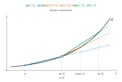
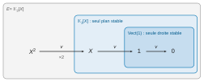
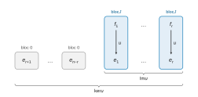

# CCINP PSI — Mathématiques 2026 · Corrigé guidé

*Corrigé rédigé par IA, non officiel. Signalez toute erreur.*

## Présentation du sujet

L'épreuve (PSI1M, 4 heures, calculatrices interdites) comporte **deux exercices et un problème indépendants**, pour 43 questions. Le sujet est très guidé, de difficulté progressive à l'intérieur de chaque bloc. Il couvre trois grands chapitres de PSI : probabilités et séries entières, intégrales à paramètre, réduction des endomorphismes.

- **Exercice 1 — Un jeu de pile ou face (Q1 à Q7).** Les préliminaires établissent la dérivée $k$-ième de $\frac1{1-x}$ et son développement en série entière. Dans le jeu, un joueur lance une pièce jusqu'au premier Pile ($X$ suit une loi géométrique). Un second joueur lance ensuite autant de fois et compte ses Pile ($Y$). La formule des probabilités totales et le préliminaire donnent la loi de $Y$. Notions : lois géométrique et binomiale, probabilités conditionnelles, système quasi-complet d'événements, dérivation terme à terme d'une série entière.
- **Exercice 2 — Une caractérisation de la fonction Gamma (Q8 à Q20).** C'est le théorème de Bohr-Mollerup : $\Gamma$ est la seule fonction $f:\mathbb R_+^*\to\mathbb R_+^*$ vérifiant le système $(S)$. L'**existence** (Q8-Q14) mobilise les intégrales impropres, la régularité $\mathcal C^2$ d'une intégrale à paramètre et l'inégalité de Cauchy-Schwarz. L'**unicité** (Q15-Q20) utilise l'inégalité des pentes (Lemme 1, admis) pour enfermer $\ln f(x)$ entre deux suites. On obtient la formule de Gauss, qui détermine $f$.
- **Problème — Étude d'une classe d'endomorphismes (Q21 à Q43).** $\mathcal D$ est l'ensemble des endomorphismes « diagonalisables par blocs de taille 1 ou 2 ». La **partie I** étudie deux exemples sur $\mathbb K_2[X]$ : l'un est dans $\mathcal D$, l'autre (la dérivation) n'y est pas, ce qui montre que $\mathcal D$ n'est pas un sous-espace vectoriel. La **partie II** montre que les nilpotents de $\mathcal D$ sont exactement ceux de carré nul. La **partie III** prouve que tout endomorphisme annulé par un polynôme scindé à racines simples ou doubles est dans $\mathcal D$. C'est l'analogue « par blocs » du critère de diagonalisabilité du cours, démontré par l'identité polynomiale de Q37 puis une base de polynômes.

**Ce qu'en dit le rapport 2026.** Le jury juge l'énoncé progressif : il permet aux candidats moyens de marquer des points au début et opère un tri sur la fin. Le niveau global est qualifié de médiocre à moyen. Les questions discriminantes signalées sont :

- Q11, « Point le plus discriminant de l’analyse » (intégrabilité en $0$) ;
- Q19, jugée « très sélective », et Q20 ;
- Q28, « Polarisante » ;
- Q34, aux « Réponses soit excellentes, soit complètement fausses » ;
- Q37, dont le jury écrit : « Aucun candidat n’a traité correctement l’intégralité de la question » ;
- Q38 à Q43 : « les questions Q40 à Q43 ont été abordées par une infime minorité (de l’ordre d’une copie sur deux cents) ».

**Difficulté.** Moyenne pour les deux exercices, réelle pour la fin du problème. Les points délicats sont Q11 et Q12 (intégrabilité en $0$, domination sur tout segment), Q14 (Cauchy-Schwarz sur un segment puis passage à la limite), Q18 et Q19, Q25 et Q26 (unicité des sous-espaces stables), et la partie III.

**À ne pas laisser passer** : Q1, Q3 à Q6, Q8, Q9, Q13, Q15, Q16, Q21, Q22, Q24, Q29, Q31 et Q33. Le jury qualifie Q33 de « bon gisement de points ». Il rappelle aussi que les lois de l'exercice 1 doivent être justifiées : le barème pénalise une loi reconnue sans argument.

**Gestion du temps** : environ 50 minutes pour l'exercice 1, 1 h 15 pour l'exercice 2, 1 h 40 pour le problème, et un quart d'heure de relecture. Les trois blocs sont indépendants. Dans le problème, les parties II et III peuvent être abordées en admettant les résultats précédents (Q43 n'utilise que Q36 et Q42).

## Exercice 1 — Préliminaires

On calcule les dérivées successives de $x\mapsto\frac1{1-x}$ de deux façons : directement, puis par la série géométrique. La comparaison donne une formule de sommation qui servira en Q7.

### Question 1
> [!INDICATION]
> Séparer les deux demandes : la régularité vient de la nature de $f$, la formule d'une récurrence.

> [!INDICATION]
> Pour l'hérédité, dériver $x\mapsto(1-x)^{-(k+1)}$ comme une composée, sans oublier la dérivée de $1-x$.

#### Solution
La fonction $x\mapsto1-x$ est polynomiale et ne s'annule pas sur $]-1,1[$.

Le quotient $f$ de deux fonctions $\mathcal C^\infty$ à dénominateur non nul est donc de classe $\mathcal C^\infty$, en particulier $\mathcal C^k$ pour tout $k$.

Récurrence sur $k$. Pour $k=0$, on a bien $f^{(0)}(x)=\frac{0!}{(1-x)^1}$. Supposons $f^{(k)}(x)=k!(1-x)^{-(k+1)}$. Alors :

$$\begin{aligned}
f^{(k+1)}(x)&=k!\cdot\big(-(k+1)\big)(1-x)^{-(k+2)}\cdot(-1)\\
&=\frac{(k+1)!}{(1-x)^{k+2}}.
\end{aligned}$$

$$\boxed{\forall k\in\mathbb N,\ \forall x\in\,]-1,1[,\ \ f^{(k)}(x)=\frac{k!}{(1-x)^{k+1}}.}$$

> [!PIEGE]
> Oublier le facteur $-1$ venant de la dérivée de $1-x$ produit un signe alterné $(-1)^k$, qui fausse toute la suite de l'exercice. Passer par la dérivée d'un quotient est une autre source d'erreurs : on dérive directement la puissance $(1-x)^{-(k+1)}$.

> [!JURY]
> Le rapport 2026 relève deux travers opposés. Certains invoquent une « récurrence immédiate » sans la rédiger, parfois en ne traitant que $k=0,1,2$. D'autres perdent du temps à justifier longuement le caractère $\mathcal C^k$. Le jury note aussi qu'environ la moitié des candidats ne sait pas dériver directement une puissance de ce type et passe par la dérivée d'un quotient.

### Question 2
> [!INDICATION]
> Reconnaître le membre de gauche : c'est la dérivée $k$-ième, terme à terme, d'une série entière très simple.

> [!INDICATION]
> Quel théorème du cours permet de dériver une série entière terme à terme, et sur quel intervalle ?

#### Solution
La série entière $\sum x^n$ a pour rayon de convergence $1$ et pour somme $f$ sur $]-1,1[$.

D'après le théorème de dérivation terme à terme, la somme d'une série entière est $\mathcal C^\infty$ sur l'intervalle ouvert de convergence, et ses dérivées s'obtiennent terme à terme.

La dérivée $k$-ième de $x^n$ est nulle si $n<k$. Si $n\ge k$, elle vaut $n(n-1)\cdots(n-k+1)x^{n-k}=\frac{n!}{(n-k)!}x^{n-k}$. Avec Q1 :

$$\boxed{\forall k\in\mathbb N,\ \forall x\in\,]-1,1[,\ \ \sum_{n=k}^{+\infty}\frac{n!}{(n-k)!}x^{n-k}=\frac{k!}{(1-x)^{k+1}}.}$$

En divisant par $k!$, on obtient la relation $(\star)$ :

$$\sum_{n=k}^{+\infty}\binom nkx^{n-k}=\frac1{(1-x)^{k+1}}.$$

> [!METHODE]
> Pour une série entière, on cite le théorème de dérivation terme à terme **sur l'intervalle ouvert de convergence** : aucune convergence uniforme à vérifier. La forme $(\star)$, avec un coefficient binomial, est celle qui servira en probabilités.

> [!JURY]
> Le rapport 2026 trouve la partie calculatoire généralement correcte, mais la justification lacunaire : « le rayon de convergence n’est presque jamais précisé et le théorème de dérivation terme à terme rarement cité ». Il signale aussi l'usage injustifié du binôme de Newton ou de la formule de Taylor.

## Exercice 1 — Étude d'un jeu de Pile ou Face

$X$ est un temps d'attente, $Y$ un nombre de succès conditionnellement à $X$. La loi de $Y$ s'obtient par la formule des probabilités totales, et c'est la série de Q2 qui permet de la sommer.

### Question 3
> [!INDICATION]
> $X$ est le rang du premier succès dans une suite d'épreuves de Bernoulli indépendantes : quelle loi du cours ?

#### Solution
Les lancers sont indépendants, chacun donne Pile avec probabilité $p\in\,]0,1[$, et $X$ est fini presque sûrement (énoncé).

Pour $n\ge1$, l'événement $\{X=n\}$ signifie : Face aux $n-1$ premiers lancers, puis Pile au $n$-ième. Par indépendance, $P(X=n)=(1-p)^{n-1}p$.

$$\boxed{X\sim\mathcal G(p),\ \text{ de support }\mathbb N^*.}$$

$$\boxed{\forall n\in\mathbb N^*,\ \ P(X=n)=p(1-p)^{n-1}.}$$

Toutes ces probabilités sont strictement positives, puisque $0<p<1$.

> [!JURY]
> « Préciser la loi » demande le nom de la loi, son support, les probabilités élémentaires et l'argument qui y conduit (rang du premier succès dans des épreuves de Bernoulli indépendantes). Le rapport 2026 juge la question correcte en général, avec une « justification précise dans environ trois quarts des copies ».

### Question 4
> [!INDICATION]
> Sachant $\{X=n\}$, que fait exactement le joueur 2 ? Quelle loi compte le nombre de succès dans $n$ épreuves indépendantes ?

> [!INDICATION]
> Ne pas oublier les valeurs de $k$ que $Y$ ne peut pas atteindre.

#### Solution
$P(X=n)>0$, donc la probabilité conditionnelle est définie.

Sachant $\{X=n\}$, le joueur 2 effectue $n$ lancers indépendants de paramètre $p$, et $Y$ compte les Pile. La loi conditionnelle de $Y$ est donc $\mathcal B(n,p)$ :

$$\boxed{P(Y=k\mid X=n)=\begin{cases}\dbinom nkp^k(1-p)^{n-k} & \text{si } 0\le k\le n,\\[2mm] 0 & \text{si } k>n.\end{cases}}$$

> [!PIEGE]
> Le cas $k>n$ n'est pas un détail : c'est lui qui fera démarrer la somme à $n=k$ en Q7. Autre erreur relevée par le jury : confondre loi géométrique et loi binomiale.

> [!JURY]
> Le rapport 2026 constate des résultats « beaucoup plus inégaux » qu'en Q3 : « Beaucoup oublient le coefficient binomial », et « le choix de la loi est rarement justifié ». Il faut dire pourquoi la loi conditionnelle est binomiale : $n$ épreuves de Bernoulli indépendantes, de même paramètre $p$.

### Question 5
> [!INDICATION]
> Quelle famille d'événements, liée à $X$, permet d'appliquer la formule des probabilités totales ? Vérifier ses propriétés.

#### Solution
Les événements $\{X=n\}$, $n\in\mathbb N^*$, sont deux à deux incompatibles et de probabilités non nulles (Q3). Leur réunion $\{X\in\mathbb N^*\}$ est de probabilité $1$ (énoncé).

C'est un système quasi-complet d'événements. La formule des probabilités totales donne, pour tout $k\in\mathbb N$, avec Q3 :

$$\boxed{\begin{aligned}
P(Y=k)&=\sum_{n=1}^{+\infty}P(Y=k\mid X=n)\,P(X=n)\\
&=\sum_{n=1}^{+\infty}P(Y=k\mid X=n)\,p(1-p)^{n-1}.
\end{aligned}}$$

> [!PIEGE]
> La somme porte sur $n\ge1$ : $X$ ne prend pas la valeur $0$.

> [!JURY]
> Selon le rapport 2026, la formule est « souvent appliquée mais fréquemment incomplète, parachutée, voire fausse ; le système complet d’événements n’est pas toujours explicité ». On nomme le système (quasi-)complet utilisé et on vérifie ses propriétés avant d'écrire la formule.

### Question 6
> [!INDICATION]
> Appliquer Q5 avec $k=0$ et Q4 : quelle série reconnaît-on ?

> [!INDICATION]
> Regrouper les puissances de $1-p$ : la raison de la série géométrique est un carré.

#### Solution
Q4 donne $P(Y=0\mid X=n)=(1-p)^n$. La raison $(1-p)^2$ appartient à $]0,1[$, donc la série géométrique converge :

$$\begin{aligned}
P(Y=0)&=\sum_{n=1}^{+\infty}p(1-p)^{2n-1}\\
&=\frac p{1-p}\sum_{n=1}^{+\infty}\big((1-p)^2\big)^n\\
&=\frac p{1-p}\cdot\frac{(1-p)^2}{1-(1-p)^2}.
\end{aligned}$$

Comme $1-(1-p)^2=p(2-p)$ :

$$\boxed{P(Y=0)=\frac{1-p}{2-p}.}$$

> [!METHODE]
> Contrôle de vraisemblance : si $p\to1$, le joueur 1 s'arrête au premier lancer et le joueur 2 fait presque sûrement Pile, donc $P(Y=0)\to0$. C'est bien le cas.

> [!JURY]
> Le rapport 2026 note que la question, moins abordée, est plutôt bien réussie, mais que « La somme géométrique et sa condition de convergence ne sont pas toujours explicitées ». La condition $(1-p)^2\in\,]0,1[$ doit figurer sur la copie.

### Question 7
> [!INDICATION]
> Même démarche qu'en Q6 ; seuls les termes $n\ge k$ subsistent.

> [!INDICATION]
> Faire apparaître $\binom nk x^{n-k}$ avec un $x$ bien choisi, pour utiliser la forme $(\star)$ de Q2. Vérifier que $x\in\,]-1,1[$.

#### Solution
Soit $k\ge1$. Par Q4, $P(Y=k\mid X=n)=0$ pour $n<k$. On écrit $(n-k)+(n-1)=2(n-k)+(k-1)$ :

$$\begin{aligned}
P(Y=k)&=\sum_{n=k}^{+\infty}\binom nkp^k(1-p)^{n-k}\,p(1-p)^{n-1}\\
&=p^{k+1}(1-p)^{k-1}\sum_{n=k}^{+\infty}\binom nk\big((1-p)^2\big)^{n-k}.
\end{aligned}$$

Le réel $x=(1-p)^2$ appartient à $]0,1[$, donc à l'intervalle ouvert de convergence $]-1,1[$. Par $(\star)$, la somme vaut $\big(1-(1-p)^2\big)^{-(k+1)}$, c'est-à-dire $\big(p(2-p)\big)^{-(k+1)}$ :

$$\boxed{\forall k\ge1,\ \ P(Y=k)=\frac{(1-p)^{k-1}}{(2-p)^{k+1}}.}$$

Contrôle : la somme des probabilités vaut $1$.

$$\begin{aligned}
\sum_{k\ge0}P(Y=k)&=\frac{1-p}{2-p}+\frac1{(2-p)^2}\sum_{k\ge1}\Big(\frac{1-p}{2-p}\Big)^{k-1}\\
&=\frac{1-p}{2-p}+\frac1{2-p}\\
&=1.
\end{aligned}$$

Pour $p=\frac12$, on trouve $P(Y=0)=\frac13$, $P(Y=1)=\frac49$ et $P(Y=2)=\frac4{27}$ ; chaque probabilité suivante est le tiers de la précédente.

> [!PIEGE]
> La formule ne vaut pas pour $k=0$ : elle donnerait $\frac1{(1-p)(2-p)}$, qui n'est pas le résultat de Q6. C'est pourquoi l'énoncé sépare les deux cas. Autre confusion fréquente : $\binom nk$ et $\frac{n!}{(n-k)!}$ diffèrent d'un facteur $k!$.

> [!JURY]
> Le rapport 2026 : « Ceux qui font le lien avec les deux premières questions s’en tirent bien. » Il ajoute que l'appartenance du paramètre (ici $(1-p)^2$) au disque ouvert de convergence est rarement vérifiée.

## Exercice 2 — Existence : la fonction $\Gamma$ vérifie $(S)$

On montre que $\Gamma$ est bien définie, vérifie l'équation fonctionnelle et est de classe $\mathcal C^2$. On montre ensuite que $\ln\circ\Gamma$ est convexe grâce à Cauchy-Schwarz. La convexité est prise au sens de la définition usuelle : $g(\lambda x+(1-\lambda)y)\le\lambda g(x)+(1-\lambda)g(y)$.

### Question 8
> [!INDICATION]
> L'intégrale est impropre aux deux bornes : étudier séparément $]0,1]$ et $[1,+\infty[$, après avoir noté la continuité de l'intégrande.

> [!INDICATION]
> En $0$, un équivalent suffit ; en $+\infty$, comparer à $\frac1{t^2}$. Pour la stricte positivité, minorer par une intégrale sur un segment.

#### Solution
Soit $x>0$ et $h_x(t)=t^{x-1}e^{-t}$, continue et strictement positive sur $\mathbb R_+^*$.

- En $0^+$ : $h_x(t)\sim\frac1{t^{1-x}}$ avec $1-x<1$. Par comparaison à une intégrale de Riemann (fonctions positives), $h_x$ est intégrable sur $]0,1]$.
- En $+\infty$ : $t^2h_x(t)=t^{x+1}e^{-t}\to0$, donc $h_x(t)=o(1/t^2)$, intégrable sur $[1,+\infty[$.

Enfin $\Gamma(x)\ge\int_1^2h_x$, et cette intégrale est strictement positive : $h_x$ est continue, positive et non nulle sur le segment $[1,2]$.

$$\boxed{\Gamma\text{ est définie sur }\mathbb R_+^*\text{ et à valeurs dans }\mathbb R_+^*.}$$

> [!PIEGE]
> La majoration $t^{x-1}e^{-t}\le e^{-t}$ est fausse près de $0$ lorsque $x<1$, précisément le cas difficile. Pour la stricte positivité, la seule positivité de l'intégrale ne suffit pas : il faut la continuité et la non-nullité de l'intégrande.

> [!JURY]
> Le rapport 2026 relève que la continuité de l'intégrande est souvent passée sous silence (dans environ la moitié des copies), que le problème en $0$ n'est pas toujours repéré, et que, pour $\Gamma(x)>0$, « le bon argument de stricte positivité n’est cité qu’exceptionnellement ».

### Question 9
> [!INDICATION]
> Intégration par parties, mais sur un segment $[\varepsilon,A]$ de $\mathbb R_+^*$.

#### Solution
Les fonctions $t\mapsto t^x$ et $t\mapsto-e^{-t}$ sont de classe $\mathcal C^1$ sur $[\varepsilon,A]$, pour $0<\varepsilon<A$ :

$$\int_\varepsilon^At^xe^{-t}\,\mathrm dt=\big[-t^xe^{-t}\big]_\varepsilon^A+x\int_\varepsilon^At^{x-1}e^{-t}\,\mathrm dt.$$

Le crochet tend vers $0$ quand $\varepsilon\to0^+$ (car $x>0$) et quand $A\to+\infty$ (croissances comparées). Les deux intégrales convergent par Q8. À la limite :

$$\boxed{\Gamma(x+1)=x\,\Gamma(x).}$$

De plus $\Gamma(1)=\int_0^{+\infty}e^{-t}\,\mathrm dt=1$, ce qui servira en Q14.

> [!METHODE]
> Pour une intégrale impropre, on intègre par parties sur un segment puis on passe à la limite, en vérifiant que le crochet a une limite finie.

> [!JURY]
> Question bien réussie selon le rapport 2026, mais l'IPP a des hypothèses : « ses hypothèses d’utilisation et la convergence du crochet sont souvent justifiées trop succinctement ou les arguments sont donnés dans le désordre ». On énonce la régularité, puis la limite du crochet, puis la convergence des intégrales.

### Question 10
> [!INDICATION]
> Selon que $t\le1$ ou $t>1$, la fonction $s\mapsto t^s$ n'a pas le même sens de variation.

> [!INDICATION]
> Écrire $t^{x-1}=e^{(x-1)\ln t}$ et regarder le signe de $\ln t$.

#### Solution
- Si $0<t\le1$ : $\ln t\le0$ et $x-1\ge a-1$, donc $(x-1)\ln t\le(a-1)\ln t$, soit $t^{x-1}\le t^{a-1}$.

  Avec $e^{-t}\le1$, on obtient $t^{x-1}e^{-t}\le\varphi(t)$.
- Si $t>1$ : $\ln t>0$ et $x-1\le b-1$, donc $t^{x-1}\le t^{b-1}$, et $t^{x-1}e^{-t}\le t^{b-1}e^{-t}=\varphi(t)$.

$$\boxed{\forall(x,t)\in[a,b]\times\mathbb R_+^*,\ \ t^{x-1}e^{-t}\le\varphi(t).}$$

> [!PIEGE]
> On garde le facteur $e^{-t}$ sur $]1,+\infty[$ : le majorer par $1$ détruirait l'intégrabilité en $+\infty$.

> [!JURY]
> Le rapport 2026 signale qu'il manque parfois la justification des variations de $x\mapsto t^{x-1}$ selon que $t\in\,]0,1[$ ou $t>1$, « variation qui dépend de t, non de x (erreur fréquente) ».

### Question 11
> [!INDICATION]
> Même plan qu'en Q8, mais le facteur $|\ln t|^k$ empêche d'utiliser un simple équivalent en $0$.

> [!INDICATION]
> En $0$, multiplier par $t^s$ avec $s<1$ bien choisi pour absorber le logarithme par croissances comparées.

#### Solution
$\psi_k$ est positive, continue sur $]0,1]$ et sur $]1,+\infty[$, avec des limites finies en $1$ : elle est continue par morceaux.

Pour $k=0$, elle saute de $1$ à $e^{-1}$ en $t=1$. Pour $k\ge1$, elle est continue en $1$, car le logarithme s'y annule.

- Sur $]0,1]$ : posons $s=1-\frac a2\in\,]0,1[$. Alors $t^s\psi_k(t)=|\ln t|^kt^{a/2}\to0$, donc $\psi_k(t)=o(t^{-s})$. Par comparaison à une intégrale de Riemann, $\psi_k$ est intégrable.
- Sur $[1,+\infty[$ : $t^2\psi_k(t)=(\ln t)^kt^{b+1}e^{-t}\to0$, donc $\psi_k(t)=o(1/t^2)$, intégrable.

$$\boxed{\psi_0,\ \psi_1,\ \psi_2\text{ sont intégrables sur }\mathbb R_+^*.}$$

> [!METHODE]
> Pour absorber un logarithme en $0$, on « paie » une petite puissance. On choisit $s$ strictement entre $1-a$ et $1$ : alors $t^s\psi_k(t)\to0$, tout en gardant $s<1$.
>
> Le même argument vaut pour les trois valeurs de $k$.

> [!PIEGE]
> Le rapport cite des justifications fantaisistes en $0$. La limite $|\ln t|^kt^{a-1}\to0$ est fausse : cette quantité tend vers $+\infty$, car $a<1$. La majoration $|\ln t|\le t$ est fausse aussi près de $0$. Et une limite nulle de l'intégrande ne prouverait de toute façon pas l'intégrabilité.

> [!JURY]
> Le rapport 2026 en fait le « Point le plus discriminant de l’analyse » : l'intégrabilité en $+\infty$ est bien traitée, « celle en 0 très rarement justifiée correctement. Peu savent comparer à une intégrale de Riemann au voisinage de 0. » Il ajoute : « Certains traitent séparément k = 0, 1, 2 sans voir que l’argument est commun. »

### Question 12
> [!INDICATION]
> Théorème de régularité $\mathcal C^k$ d'une intégrale à paramètre : lister ses hypothèses une à une. On dérive par rapport à $x$.

> [!INDICATION]
> La domination ne peut pas valoir sur $\mathbb R_+^*$ tout entier : la chercher sur tout segment $[c,d]$, en l'incluant dans un $[a,b]$ avec $0<a<1<b$.

#### Solution
Soit $F(x,t)=t^{x-1}e^{-t}=e^{(x-1)\ln t}e^{-t}$.

- Pour tout $t>0$, $x\mapsto F(x,t)$ est $\mathcal C^2$, avec $\partial_xF=\ln t\;t^{x-1}e^{-t}$ et $\partial_x^2F=(\ln t)^2t^{x-1}e^{-t}$.
- Pour tout $x>0$, ces trois fonctions de $t$ sont continues sur $\mathbb R_+^*$.
- Pour $[c,d]\subset\mathbb R_+^*$, on pose $a=\min(c,\frac12)$ et $b=\max(d,2)$. Pour $x\in[c,d]$ et $j\le2$, Q10 donne la domination, avec un majorant intégrable par Q11 et indépendant de $x$ :

$$|\partial_x^jF(x,t)|=|\ln t|^j\,t^{x-1}e^{-t}\le\psi_j(t).$$

Ainsi $F(x,\cdot)$ et $\partial_xF(x,\cdot)$ sont intégrables, et $\partial_x^2F$ est dominée sur tout segment. Le théorème s'applique :

$$\boxed{\Gamma\in\mathcal C^2(\mathbb R_+^*)}$$

$$\boxed{\Gamma'(x)=\int_0^{+\infty}\ln t\;t^{x-1}e^{-t}\,\mathrm dt}$$

$$\boxed{\Gamma''(x)=\int_0^{+\infty}(\ln t)^2\,t^{x-1}e^{-t}\,\mathrm dt}$$

> [!PIEGE]
> Erreurs relevées par le jury : dériver par rapport à $t$ au lieu de $x$, et laisser des valeurs absolues parasites dans les dérivées partielles, qui se retrouvent dans $\Gamma'$ et $\Gamma''$.
>
> La valeur absolue sert à la domination, pas à l'expression de la dérivée : $\Gamma'(x)$ contient $\ln t$, et non $|\ln t|$.

> [!JURY]
> Le rapport 2026 parle de « Figure imposée » : « le théorème est cité mais ses hypothèses (en particulier la domination) ne sont pas vraiment justifiées, malgré la Q11 qui y invitait ». Il juge la dérivation par rapport à $t$ « rédhibitoire pour la suite ».

### Question 13
> [!INDICATION]
> Vérifier les quatre propriétés ; seule l'une d'elles demande un vrai argument.

#### Solution
Pour $u,v$ continues sur $[\alpha,\beta]$, $uv$ est continue, donc intégrable sur le segment.

- La forme est symétrique, car $uv=vu$.
- Elle est linéaire à gauche (linéarité de l'intégrale), donc bilinéaire par symétrie.
- Elle est positive : $\int_\alpha^\beta u^2\ge0$ car $\alpha<\beta$.
- Elle est définie : si $\int_\alpha^\beta u^2=0$, la fonction $u^2$ est continue, positive, d'intégrale nulle sur un segment non réduit à un point. Elle est donc nulle, et $u=0$.

$$\boxed{\langle\cdot,\cdot\rangle\text{ est un produit scalaire sur }\mathcal C^0([\alpha,\beta]).}$$

> [!PIEGE]
> Le caractère défini repose sur la **continuité** : pour des fonctions continues par morceaux, la forme ne serait plus définie. Le jury relève aussi une confusion de définition : le caractère défini signifie $\langle u,u\rangle=0\Rightarrow u=0$. Il ne s'agit pas de montrer que $\langle u,v\rangle=0$ entraîne $u=0$ ou $v=0$, ce qui est faux.

> [!JURY]
> Le rapport 2026 : « le caractère défini positif n’est justifié précisément que dans environ la moitié des copies, et la continuité de la fonction y est souvent oubliée ». Il regrette aussi des théorèmes non nommés.

### Question 14
> [!INDICATION]
> Chercher deux fonctions $u,v$ sur $[\alpha,\beta]$ dont les produits scalaires sont les intégrales de $\Gamma$, $\Gamma'$, $\Gamma''$ tronquées.

> [!INDICATION]
> Partager l'intégrande $t^{x-1}e^{-t}$ en deux racines carrées. Après Cauchy-Schwarz, faire tendre $\alpha\to0$ et $\beta\to+\infty$.

> [!INDICATION]
> Pour la convexité, calculer $(\ln\circ\Gamma)''$, puis comparer les deux intégrales de $G'$ de part et d'autre du point $\lambda x+(1-\lambda)y$.

#### Solution
*Inégalité.* Pour $x>0$ et $0<\alpha<\beta$, soient $u(t)=t^{\frac{x-1}2}e^{-t/2}$ et $v(t)=\ln t\;u(t)$, continues sur $[\alpha,\beta]$. Alors :

$$\langle u,u\rangle=\int_\alpha^\beta t^{x-1}e^{-t}\,\mathrm dt$$

$$\langle u,v\rangle=\int_\alpha^\beta\ln t\;t^{x-1}e^{-t}\,\mathrm dt$$

$$\langle v,v\rangle=\int_\alpha^\beta(\ln t)^2\,t^{x-1}e^{-t}\,\mathrm dt$$

Cauchy-Schwarz donne $\langle u,v\rangle^2\le\langle u,u\rangle\langle v,v\rangle$.

On prend $\alpha=\frac1m$ et $\beta=m$, avec $m\to+\infty$. Les intégrandes sont intégrables sur $\mathbb R_+^*$ (Q8 et Q12).

Les trois intégrales tendent donc vers $\Gamma(x)$, $\Gamma'(x)$ et $\Gamma''(x)$, et l'inégalité large passe à la limite :

$$\boxed{\Gamma'(x)^2\le\Gamma(x)\,\Gamma''(x).}$$

*Convexité.* $G=\ln\circ\Gamma$ est $\mathcal C^2$ car $\Gamma>0$, et :

$$G''=\frac{\Gamma''\Gamma-\Gamma'^2}{\Gamma^2}\ge0.$$

Donc $G'$ est croissante. Soient $x<y$, $\lambda\in\,]0,1[$ et $z=\lambda x+(1-\lambda)y$.

On a $z-x=(1-\lambda)(y-x)$ et $y-z=\lambda(y-x)$. Par croissance de $G'$ :

$$G(z)-G(x)=\int_x^zG'\le(z-x)\,G'(z)$$

$$G(y)-G(z)=\int_z^yG'\ge(y-z)\,G'(z)$$

D'où :

$$\begin{aligned}
\lambda G(x)+(1-\lambda)G(y)-G(z)&=(1-\lambda)\big(G(y)-G(z)\big)-\lambda\big(G(z)-G(x)\big)\\
&\ge(1-\lambda)(y-z)\,G'(z)-\lambda(z-x)\,G'(z)\\
&=\big[(1-\lambda)\lambda-\lambda(1-\lambda)\big](y-x)\,G'(z)\\
&=0.
\end{aligned}$$

Les cas $\lambda\in\{0,1\}$ et $x=y$ sont immédiats : $\ln\circ\Gamma$ est convexe.

*Conclusion.* Avec Q8 ($\Gamma>0$) et Q9 ($\Gamma(x+1)=x\Gamma(x)$ et $\Gamma(1)=1$) :

$$\boxed{\Gamma\text{ vérifie }(S).}$$

> [!PIEGE]
> Cauchy-Schwarz s'applique à un produit scalaire, donc ici sur un **segment** : on ne peut pas l'écrire directement sur $]0,+\infty[$ sans passer par Q13 et une limite. Le jury cite aussi la tentative erronée « intégrale du produit = produit des intégrales ».

> [!METHODE]
> L'implication « $G''\ge0\Rightarrow G$ convexe » n'est pas forcément au cours selon la classe d'origine. La preuve ci-dessus, à partir de la seule croissance de $G'$, évite d'en dépendre ; si elle est connue, on peut la citer.

> [!JURY]
> Le rapport 2026 juge la question peu réussie : Cauchy-Schwarz est mal appliqué, le passage du segment $[\alpha,\beta]$ à $\mathbb R_+^*$ est passé sous silence, et peu de candidats donnent la bonne expression de la dérivée seconde de $\ln\circ\Gamma$. Il note que « La convexité est mieux traitée que la majoration », et que la synthèse finale (récapitulatif de $(S)$) rapporte des points.

## Exercice 2 — Unicité

On fixe une solution $f$ de $(S)$ et on montre qu'elle est déterminée sur $]0,1]$ par une formule qui ne dépend pas de $f$. On propage ensuite par l'équation fonctionnelle.

### Question 15
> [!INDICATION]
> Récurrence sur $n$, à $x$ fixé, avec la convention du produit vide pour $n=0$.

#### Solution
Pour $n=0$, l'égalité s'écrit $f(x)=f(x)$.

Supposons $f(x+n)=x(x+1)\cdots(x+n-1)f(x)$. La relation $(S)$ s'applique au réel $x+n>0$ :

$$\begin{aligned}
f(x+n+1)&=(x+n)\,f(x+n)\\
&=x(x+1)\cdots(x+n)\,f(x).
\end{aligned}$$

$$\boxed{f(x+n)=x(x+1)\cdots(x+n-1)\,f(x).}$$

Pour $x=1$ et avec $f(1)=1$, puis en passant au logarithme :

$$\boxed{f(n+1)=n!}$$

$$\boxed{g(n+1)=\ln(n!)}$$

> [!PIEGE]
> Le rapport 2026 signale une « Erreur notable : oubli du logarithme dans la propriété de morphisme », qui conduit à $g(n+1)=\frac{n(n+1)}2$. Le logarithme transforme le produit $n!$ en la somme $\ln1+\cdots+\ln n$, et non en $1+\cdots+n$.

> [!JURY]
> Récurrence « assez facile, en général bien traitée » selon le rapport 2026, malgré des « récurrences immédiates » non rédigées et des initialisations bâclées. Une récurrence se rédige : propriété, initialisation, hérédité.

### Question 16
> [!INDICATION]
> Appliquer Q15 au bon rang, puis passer au logarithme en justifiant la positivité.

#### Solution
Q15 au rang $n+1$ donne $f(x+n+1)=x(x+1)\cdots(x+n)f(x)$.

Tous les facteurs sont strictement positifs ($x>0$ et $f$ à valeurs dans $\mathbb R_+^*$). On peut donc appliquer $\ln(ab)=\ln a+\ln b$, valable pour $a,b>0$ :

$$\boxed{g(x+n+1)=g(x)+\ln\big(x(x+1)\cdots(x+n)\big).}$$

> [!JURY]
> Le rapport 2026 : « Certains relancent une récurrence inutile au lieu d’adapter la question Q15. » Il note aussi que la validité de $\ln(ab)=\ln a+\ln b$ pour $a,b>0$ n'est presque jamais mentionnée.

### Question 17
> [!INDICATION]
> Le quotient central est la pente d'une corde issue du point d'abscisse $n+1$ : c'est le point $a$ du Lemme 1.

> [!INDICATION]
> Appliquer le lemme deux fois, en comparant la corde $[n+1,\,x+n+1]$ avec une corde à gauche, puis avec une corde à droite. Vérifier l'ordre des points.

#### Solution
$g$ est convexe sur $\mathbb R_+^*$ par $(S)$. On prend $a=n+1$ dans le Lemme 1.

- Avec les points $n<x+n+1$, tous deux dans $\mathbb R_+^*$ (car $n\ge1$) et distincts de $n+1$ :

$$\frac{g(n)-g(n+1)}{-1}\le\frac{g(x+n+1)-g(n+1)}{x}.$$

Le membre de gauche vaut $g(n+1)-g(n)$.

- Avec les points $x+n+1\le n+2$ (car $x\le1$) :

$$\frac{g(x+n+1)-g(n+1)}{x}\le\frac{g(n+2)-g(n+1)}{1}.$$

$$\boxed{g(n+1)-g(n)\le\frac{g(x+n+1)-g(n+1)}{x}\le g(n+2)-g(n+1).}$$

> [!METHODE]
> Pour une fonction convexe, les pentes des cordes issues d'un point fixe croissent avec l'autre extrémité. Les trois cordes issues de $(n+1,g(n+1))$, vers $n$, $n+1+x$ et $n+2$, donnent l'encadrement (figure 1).

> [!JURY]
> Le rapport 2026 : le principe du lemme est compris, mais « l’une des deux inégalités est obtenue correctement, l’autre rarement (hypothèses non vérifiées, mauvais choix de paramètre). La convexité de g est tantôt citée, tantôt oubliée. » On cite la convexité de $g$, le point $a$, et l'ordre des deux points à chaque application.

### Question 18
> [!INDICATION]
> Calculer les deux membres extrêmes avec Q15, et le membre central avec Q16.

> [!INDICATION]
> Isoler $g(x)$ : on obtient un encadrement de la forme $\ln u_n\le g(x)\le\ln u_n+\varepsilon_n$ avec $\varepsilon_n\to0$.

#### Solution
Par Q15, $g(n+1)-g(n)=\ln n$ et $g(n+2)-g(n+1)=\ln(n+1)$. Par Q16 :

$$g(x+n+1)-g(n+1)=g(x)+\ln\big(x(x+1)\cdots(x+n)\big)-\ln(n!).$$

En multipliant Q17 par $x>0$ :

$$x\ln n\le g(x)+\ln\frac{x(x+1)\cdots(x+n)}{n!}\le x\ln(n+1).$$

Avec $u_n(x)=\frac{n^xn!}{x(x+1)\cdots(x+n)}$, cela s'écrit :

$$\begin{aligned}
0&\le g(x)-\ln u_n(x)\\
&\le x\ln\Big(1+\frac1n\Big)\\
&\le\ln\Big(1+\frac1n\Big).
\end{aligned}$$

Le majorant tend vers $0$. Par encadrement, $\ln u_n(x)\to g(x)$, et par continuité de l'exponentielle :

$$\boxed{\forall x\in\,]0,1],\ \ f(x)=\lim_{n\to+\infty}\frac{n^xn!}{x(x+1)\cdots(x+n)}.}$$

> [!PIEGE]
> Multiplier par $x$ conserve le sens des inégalités parce que $x>0$. On conclut d'abord sur $\ln u_n(x)$, puis on revient à $u_n(x)$ par continuité de $\exp$.

> [!JURY]
> Question peu traitée selon le rapport 2026 : « Encadrement parfois obtenu mais conclusion rarement probante ». Le passage à la limite (théorème d'encadrement, puis continuité de l'exponentielle) doit être écrit.

### Question 19
> [!INDICATION]
> Quelles hypothèses sur $f$ ont réellement servi de Q15 à Q18 ? $\Gamma$ les vérifie-t-elle ?

#### Solution
Les questions Q15 à Q18 n'utilisent que deux faits : $f$ va de $\mathbb R_+^*$ dans $\mathbb R_+^*$, et $f$ vérifie $(S)$.

Par Q14, $\Gamma$ vérifie ces hypothèses, donc $\Gamma(x)=\lim u_n(x)$ pour $x\in\,]0,1]$. La suite $(u_n(x))$ ne dépend que de $x$ ; par unicité de la limite :

$$\boxed{\forall x\in\,]0,1],\ \ f(x)=\Gamma(x).}$$

> [!JURY]
> Le rapport 2026 regroupe Q19 et Q20 : « Très peu abordées et rarement réussies (Q19 très sélective, Q20 un peu moins). L’idée d’unicité est parfois comprise sans être rédigée rigoureusement. » Il faut dire explicitement que Q18 s'applique à $\Gamma$, parce que $\Gamma$ vérifie $(S)$ (Q14).

### Question 20
> [!INDICATION]
> Tout réel strictement positif est un réel de $]0,1]$ translaté d'un entier.

#### Solution
Soit $x>0$. Les intervalles $]n,n+1]$, $n\in\mathbb N$, recouvrent $\mathbb R_+^*$ : il existe $n\in\mathbb N$ tel que $y=x-n\in\,]0,1]$.

Par Q15 (pour $f$ et pour $\Gamma$) et Q19 :

$$\begin{aligned}
f(x)&=y(y+1)\cdots(y+n-1)\,f(y)\\
&=y(y+1)\cdots(y+n-1)\,\Gamma(y)\\
&=\Gamma(x).
\end{aligned}$$

$$\boxed{f=\Gamma.}$$

Avec Q14, $\Gamma$ est donc l'unique solution de $(S)$ : c'est le théorème de Bohr-Mollerup.

> [!METHODE]
> Schéma « existence puis unicité » : une formule de représentation, ici la formule de Gauss, montre que toute solution est déterminée. Sans Q14, on saurait seulement que $(S)$ a au plus une solution.

## Problème, Partie I — Deux exemples

On travaille sur $E=\mathbb K_2[X]$, de base canonique $\mathcal B_0=(1,X,X^2)$.

L'endomorphisme $u$ n'est pas diagonalisable mais il est dans $\mathcal D$. La dérivation $v$ n'est pas dans $\mathcal D$, car ses sous-espaces stables sont emboîtés. On en déduit que $\mathcal D$ n'est pas un sous-espace vectoriel.

### Question 21
> [!INDICATION]
> Calculer les images de $1$, $X$, $X^2$ et les ranger en colonnes. La matrice obtenue est triangulaire.

> [!INDICATION]
> Comparer la multiplicité de la valeur propre $0$ et la dimension de $\ker u$.

#### Solution
On a $u(1)=0$, $u(X)=1$ et $u(X^2)=2X^2+2X$ :

$$\boxed{A=\begin{pmatrix}0&1&0\\0&0&2\\0&0&2\end{pmatrix}.}$$

$A$ est triangulaire, donc $\chi_u=X^2(X-2)$ : $0$ est valeur propre double, $2$ valeur propre simple.

Pour $P=a+bX+cX^2$, on a $u(P)=b+2cX+2cX^2$. Donc $\ker u=\mathrm{Vect}(1)$ est de dimension $1$, alors que $0$ est valeur propre double.

$$\boxed{u\text{ n'est pas diagonalisable.}}$$

> [!PIEGE]
> Arguments faux relevés par le jury : « pas scindé à racines simples » (ce critère est suffisant, pas nécessaire), « non inversible », « triangulaire donc diagonalisable ». Ici $\chi_u$ est scindé : il faut comparer dimension et multiplicité, ou vérifier que $\dim\ker u+\dim\ker(u-2\mathrm{Id})=2<3$.

> [!JURY]
> Le rapport 2026 : matrice majoritairement bien établie (quelques matrices écrites à l'envers), mais « La conclusion de non-diagonalisabilité concentre les fautes », avec « Énormément d’arguments faux ». Parmi les erreurs de raisonnement générales, il cite comme « le grand classique » : « polynôme caractéristique non scindé à racines simples ⇒ non diagonalisable ».

### Question 22
> [!INDICATION]
> Appliquer $u$ deux fois à un polynôme générique.

> [!INDICATION]
> Pour la stabilité, utiliser que $u$ commute avec $u^2$.

#### Solution
Pour $P=a+bX+cX^2$ :

$$u^2(P)=u(b+2cX+2cX^2)=2c+4cX+4cX^2.$$

Ce polynôme est nul si et seulement si $c=0$ :

$$\boxed{\ker u^2=\mathbb K_1[X].}$$

C'est un sous-espace vectoriel. Si $u^2(P)=0$, alors $u^2(u(P))=u(u^2(P))=0$ : il est stable par $u$.

> [!METHODE]
> Le noyau (et l'image) d'un polynôme en $u$ est toujours stable par $u$. Cet argument revient en Q40, Q42 et Q43.

> [!PIEGE]
> Le résultat est un ensemble de **polynômes** : $\ker u^2=\mathrm{Vect}(1,X)$, et non un ensemble de vecteurs colonnes. Le jury donne l'exemple du « vecteur (1, 2, 2) » écrit au lieu du polynôme $1+2X+2X^2$.

> [!JURY]
> Le rapport 2026 : « Question d’apparence facile mais piégeuse », avec des calculs faux et des arguments de stabilité flous, alors qu'« il suffisait de constater que $u$ et $u^2$ commutent ».

### Question 23
> [!INDICATION]
> Lire la matrice colonne par colonne : quelles relations doivent vérifier $u(e_1)$, $u(e_2)$, $u(e_3)$ ?

> [!INDICATION]
> $e_1$ est un vecteur propre pour la valeur propre $2$ ; $e_2$ et $e_3$ se trouvent dans $\ker u^2$.

#### Solution
On veut $u(e_1)=2e_1$, $u(e_2)=0$ et $u(e_3)=e_2$.

Pour $e_1=a+bX+cX^2$, l'équation $u(e_1)=2e_1$ donne $b=2a$ et $2c=2b$. On prend $e_1=1+2X+2X^2$.

On prend ensuite $e_2=1$ et $e_3=X$.

La matrice des coordonnées $\begin{pmatrix}1&1&0\\2&0&1\\2&0&0\end{pmatrix}$ a pour déterminant $2\neq0$. Donc $\mathcal B=(1+2X+2X^2,1,X)$ est une base, et :

$$\boxed{\mathrm{Mat}_{\mathcal B}(u)=\begin{pmatrix}2&0&0\\0&0&1\\0&0&0\end{pmatrix}.}$$

Elle est diagonale par blocs, avec un bloc $(2)$ et un bloc $\begin{pmatrix}0&1\\0&0\end{pmatrix}$. Ici $p=q=1$ et $p+2q=3$ :

$$\boxed{u\in\mathcal D.}$$

> [!PIEGE]
> La troisième colonne $(0,1,0)$ signifie $u(e_3)=e_2$, et non $u(e_2)=e_3$ : la matrice se lit en colonnes.

> [!JURY]
> Globalement bien traitée selon le rapport 2026, mais certains n'écrivent pas la matrice en colonnes pour les images, et « Résoudre une équation aux éléments propres reste une réelle difficulté pour beaucoup ». Vérifier $u(e_1)=2e_1$ sur la copie évite les erreurs de calcul.

### Question 24
> [!INDICATION]
> Calcul direct. Penser ensuite à lire le spectre sur la matrice.

#### Solution
On a $v(1)=0$, $v(X)=1$ et $v(X^2)=2X$ :

$$\boxed{\mathrm{Mat}_{\mathcal B_0}(v)=\begin{pmatrix}0&1&0\\0&0&2\\0&0&0\end{pmatrix}.}$$

La matrice est triangulaire à diagonale nulle : $\chi_v=X^3$, et $0$ est la seule valeur propre. De plus $v^3=0$ et $v^2\neq0$ : $v$ est nilpotent d'indice $3$.

> [!JURY]
> Le rapport 2026 : matrice « Très majoritairement bien établie ; peu de candidats pensent à la valeur propre 0 ». Cette remarque prépare Q25, où les droites stables sont les droites propres.

### Question 25
> [!INDICATION]
> Une droite est stable si et seulement si un vecteur directeur est vecteur propre.

> [!INDICATION]
> Pour résoudre $P'=\lambda P$, comparer les degrés, ou utiliser le spectre trouvé en Q24.

#### Solution
Soit $P\neq0$. La droite $\mathrm{Vect}(P)$ est stable si et seulement si $v(P)\in\mathrm{Vect}(P)$, c'est-à-dire s'il existe $\lambda$ tel que $P'=\lambda P$ : $P$ est alors un vecteur propre.

Par Q24, la seule valeur propre est $0$, de sous-espace propre $\ker v=\mathrm{Vect}(1)$.

Directement : si $\lambda\neq0$, on a $\deg P'<\deg P$ quand $P$ n'est pas constant, et $P'=0$ quand il l'est. Dans les deux cas $P=0$, ce qui est exclu.

Donc $\lambda=0$ et $P$ est une constante non nulle. Réciproquement, $\mathrm{Vect}(1)$ est stable.

$$\boxed{\text{Seule droite stable : }\mathrm{Vect}(1).}$$

> [!PIEGE]
> Montrer que $\mathbb K_1[X]$ est stable ne répond pas à la question, qui porte sur la dimension $1$. Et trouver une droite stable ne suffit pas : il faut prouver qu'il n'y en a pas d'autre.

> [!JURY]
> Le rapport 2026 : « Une très faible proportion comprend qu’un sous-espace vectoriel stable de dimension 1 est nécessairement une droite propre ». Le lien avec les sous-espaces propres est rarement fait, et « l’unicité n’est qu’exceptionnellement démontrée ».

### Question 26
> [!INDICATION]
> Montrer d'abord que $\mathbb K_1[X]$ convient. Pour l'unicité, se demander ce qui se passe si un plan stable contient un polynôme de degré $2$.

> [!INDICATION]
> Un sous-espace stable contenant $P$ contient aussi $v(P)$ et $v^2(P)$.

#### Solution
$\mathbb K_1[X]$ est un plan, et il est stable, car $v(a+bX)=b$.

Soit $F$ un plan stable. S'il contenait un polynôme $P$ de degré $2$, il contiendrait aussi $P'$, de degré $1$, et $P''$, constante non nulle.

Cette famille est échelonnée en degrés, donc libre : $\dim F\ge3$, ce qui est absurde. Donc $F\subset\mathbb K_1[X]$, et l'égalité des dimensions donne $F=\mathbb K_1[X]$.

$$\boxed{\mathbb K_1[X]\text{ est le seul plan stable par }v.}$$

> [!METHODE]
> Pour un sous-espace stable, l'orbite $P,v(P),v^2(P),\dots$ d'un de ses vecteurs y reste. Si cette orbite est libre et trop longue, la dimension est contredite.

> [!PIEGE]
> Erreur de fond très répandue selon le jury : croire que les seuls plans de $\mathbb K_2[X]$ sont $\mathrm{Vect}(1,X)$, $\mathrm{Vect}(1,X^2)$ et $\mathrm{Vect}(X,X^2)$. Il y en a une infinité, par exemple $\mathrm{Vect}(1+X^2,X)$ : on raisonne sur un plan quelconque.

> [!JURY]
> Le rapport 2026 : « l’unicité est ratée par la quasi-totalité des candidats ». Il conclut : « affirmer l’unicité n’est pas la démontrer ».

### Question 27
> [!INDICATION]
> Lister les couples $(p,q)$ avec $p+2q=3$, puis confronter chaque cas à Q25 et Q26.

#### Solution
Si $v\in\mathcal D$, alors $(p,q)\in\{(3,0),(1,1)\}$.

- $(3,0)$ : il faudrait trois droites stables distinctes, or il n'y en a qu'une (Q25).
- $(1,1)$ : $D_1=\mathrm{Vect}(1)$ et $P_1=\mathbb K_1[X]$ (Q25, Q26). Mais $1\in\mathbb K_1[X]$ : la somme n'est pas directe.

$$\boxed{v\notin\mathcal D.}$$

> [!PIEGE]
> Dans le cas $(1,1)$, les deux sous-espaces existent bien : c'est leur intersection non nulle qui fait échouer la somme directe.

> [!JURY]
> Le rapport 2026 : « Ceux qui ont vu qu’il s’agissait d’une synthèse des questions précédentes s’en sortent. »

### Question 28
> [!INDICATION]
> Pour réfuter, il suffit d'exhiber deux éléments de $\mathcal D$ dont une combinaison linéaire n'est pas dans $\mathcal D$. On connaît déjà un élément hors de $\mathcal D$.

> [!INDICATION]
> Que vaut $u-v$ ?

#### Solution
L'endomorphisme $w=u-v$ est $P\mapsto X^2P''$. Il vérifie $w(1)=w(X)=0$ et $w(X^2)=2X^2$.

Il est donc diagonal dans $\mathcal B_0$, et $w\in\mathcal D$.

Alors $v=u-w$, avec $u\in\mathcal D$ (Q23) et $w\in\mathcal D$, mais $v\notin\mathcal D$ (Q27).

$$\boxed{\mathcal D\text{ n'est pas un sous-espace vectoriel de }\mathcal L(E).}$$

> [!METHODE]
> Pour montrer qu'une partie n'est pas un sous-espace, on décompose en éléments de la partie un élément dont on sait qu'il n'y est pas. Autre décomposition possible : $v=a+b$, avec $a(X)=1$, $b(X^2)=2X$ et les autres images nulles ; $a$ et $b$ sont de carré nul, donc dans $\mathcal D$ par la partie II.

> [!JURY]
> Le rapport 2026 qualifie la question de « Polarisante, moyennement réussie et peu justifiée ». Il regrette que « Peu de candidats voient que les cas étudiés permettaient de construire un contre-exemple ».

## Problème, Partie II — Le cas des endomorphismes nilpotents

On montre que les nilpotents de $\mathcal D$ sont exactement ceux de carré nul : d'abord en petite dimension (Q29-Q31), puis en général, par une base adaptée construite à partir de $\mathrm{Im}\,u\subset\ker u$.

### Question 29
> [!INDICATION]
> En dimension $1$, tout endomorphisme est une homothétie : le justifier à partir d'une base.

#### Solution
Soit $(e)$ une base de $E$. Comme $u(e)\in\mathrm{Vect}(e)$, il existe $\lambda\in\mathbb K$ tel que $u(e)=\lambda e$, et par linéarité $u=\lambda\mathrm{Id}_E$.

Alors $u^k=\lambda^k\mathrm{Id}_E=0$ donne $\lambda^k=0$, donc $\lambda=0$.

$$\boxed{u=0.}$$

> [!JURY]
> Question de cours vue par la plupart, mais le rapport 2026 note une « réponse souvent donnée sans justification » et des arguments parfois flous, voire faux.

### Question 30
> [!INDICATION]
> Partir d'une combinaison linéaire nulle et appliquer une puissance de $u$ qui ne laisse subsister qu'un terme.

> [!INDICATION]
> Choisir l'exposant à partir du plus petit indice de coefficient non nul.

#### Solution
$x$ existe car $u^{k-1}\neq0$ (minimalité de $k$).

Supposons $\sum_{i=0}^{k-1}\lambda_iu^i(x)=0$ avec des $\lambda_i$ non tous nuls, et soit $i_0$ le plus petit indice tel que $\lambda_{i_0}\neq0$.

En appliquant $u^{k-1-i_0}$, les termes d'indice $i>i_0$ font apparaître $u^m$ avec $m\ge k$, donc s'annulent. Il reste $\lambda_{i_0}u^{k-1}(x)=0$, d'où $\lambda_{i_0}=0$ : contradiction.

$$\boxed{(u^{k-1}(x),\dots,u(x),x)\text{ est libre.}}$$

> [!PIEGE]
> Appliquer $u^{k-1}$ directement ne conclut que sur $\lambda_0$ ; il faut soit une récurrence, soit l'argument du plus petit indice. Le jury juge « hors propos » l'argument de « polynômes échelonnés en degré » : $E$ n'est pas un espace de polynômes.

> [!JURY]
> Démonstration globalement réussie selon le rapport 2026, avec un travers : des preuves trop rapides, faites de compositions successives par $u$ et de conclusions instantanées. Chaque application de $u$ et chaque coefficient annulé doivent être écrits.

### Question 31
> [!INDICATION]
> Combien d'éléments compte la famille de Q30, et dans quel espace vit-elle ?

#### Solution
La famille libre de Q30 a $k$ éléments dans un espace de dimension $2$ : son cardinal est au plus la dimension, donc $k\le2$.

Comme $u\neq0$, on a $k\ne1$, donc $k\ge2$.

$$\boxed{k=2\ \text{ et }\ u^2=0,\ \text{ donc }\ u\in\mathcal N_2.}$$

> [!PIEGE]
> Une famille libre a un cardinal **au plus** égal à la dimension, pas égal : on obtient $k\le2$, et c'est l'hypothèse $u\neq0$ qui donne $k\ge2$.

> [!JURY]
> Le rapport 2026 : « l’inégalité $k\ge2$ n’est clairement justifiée que dans une moitié de copies. Beaucoup concluent à tort que le cardinal de la famille libre vaut directement la dimension de l’espace. »

### Question 32
> [!INDICATION]
> Restreindre $u$ à chaque sous-espace de la décomposition (i) : quelle dimension, quelle propriété ?

> [!INDICATION]
> Appliquer Q29 ou Q31 à ces restrictions, puis recoller grâce à la somme directe.

#### Solution
Soit $u\in\mathcal D\cap\mathcal N$ et $E=\bigoplus D_i\oplus\bigoplus P_j$ comme en (i).

Pour chaque facteur $F$, l'endomorphisme induit $u_F$ est nilpotent, car $u_F^k=(u^k)_F=0$.

- Si $\dim F=1$, Q29 donne $u_F=0$.
- Si $\dim F=2$, ou bien $u_F=0$, ou bien Q31 appliquée à $u_F$ donne $u_F^2=0$.

Pour $x=\sum_Fx_F$, on obtient $u^2(x)=\sum_Fu_F^2(x_F)=0$.

$$\boxed{\mathcal D\cap\mathcal N\subset\mathcal N_2.}$$

> [!PIEGE]
> Q31 suppose l'endomorphisme non nul : le cas $u_F=0$ en dimension $2$ se traite à part.

> [!JURY]
> Peu traitée et le plus souvent non comprise selon le rapport 2026, car elle « nécessite une bonne lecture de l’énoncé » : les cas $n=1$ et $n=2$ s'appliquent aux endomorphismes induits sur les blocs de la décomposition (i).

### Question 33
> [!INDICATION]
> Traduire $u^2=0$, puis utiliser le théorème du rang.

#### Solution
Pour tout $x$, $u(u(x))=0$, donc $\mathrm{Im}\,u\subset\ker u$.

Par le théorème du rang, $\dim\ker u=n-r$, d'où $r\le n-r$.

$$\boxed{\mathrm{Im}\,u\subset\ker u\ \text{ et }\ r\le n-r.}$$

> [!JURY]
> Question « plutôt facile, très bien réussie par la grande majorité de ceux qui l’atteignent ; bon gisement de points » (rapport 2026).

### Question 34
> [!INDICATION]
> La famille a $n$ éléments : il suffit de prouver qu'elle est libre.

> [!INDICATION]
> Appliquer $u$ à une combinaison nulle : que deviennent les $e_i$ et les $f_j$ ?

#### Solution
La construction est possible car $\mathrm{Im}\,u\subset\ker u$ (Q33), et les $f_i$ existent car $e_i\in\mathrm{Im}\,u$ pour $i\le r$.

Soit $\sum\lambda_ie_i+\sum\mu_jf_j=0$. En appliquant $u$, on obtient $\sum_{j=1}^r\mu_je_j=0$, donc $\mu_j=0$ pour tout $j$.

Il reste $\sum\lambda_ie_i=0$, donc $\lambda_i=0$ pour tout $i$. La famille est libre, de cardinal $n$.

$$\boxed{(e_1,\dots,e_{n-r},f_1,\dots,f_r)\text{ est une base de }E.}$$

> [!PIEGE]
> Erreurs typiques relevées par le jury : invoquer à tort le théorème de la base incomplète, ou supposer que $\ker u$ et $\mathrm{Im}\,u$ sont supplémentaires, alors que Q33 donne $\mathrm{Im}\,u\subset\ker u$.

> [!JURY]
> Le rapport 2026 : « Réponses soit excellentes, soit complètement fausses. » La question est « Mieux réussie quand on commence par établir la liberté. »

### Question 35
> [!INDICATION]
> Réordonner la base de Q34 pour que chaque $f_i$ suive immédiatement $e_i$.

> [!INDICATION]
> Placer d'abord les vecteurs de $\ker u$ qui ne sont pas des $e_i$ avec $i\le r$.

#### Solution
On pose $\mathcal B=(e_{r+1},\dots,e_{n-r},e_1,f_1,\dots,e_r,f_r)$.

On a $u(e_i)=0$ pour tout $i$ et $u(f_i)=e_i$. Les $n-2r$ premières colonnes sont donc nulles.

Chaque plan $\mathrm{Vect}(e_i,f_i)$ est stable, avec la matrice $J$ dans la base $(e_i,f_i)$ :

$$\boxed{\mathrm{Mat}_{\mathcal B}(u)=\mathrm{diag}(0_{n-2r},J,\dots,J)\quad(r\text{ blocs }J).}$$

> [!PIEGE]
> Pour que le $1$ soit en haut à droite du bloc, $e_i$ doit précéder $f_i$ : c'est $u(f_i)=e_i$ qui donne la deuxième colonne $(1,0)$.

> [!JURY]
> Le rapport 2026 : « Très mal / peu traitée ». Ceux qui ont réussi Q34 voient comment construire la base, « mais beaucoup utilisent la base de Q34 sans réordonner les vecteurs dans le bon ordre ».

### Question 36
> [!INDICATION]
> Double inclusion : un sens est déjà fait.

#### Solution
L'inclusion $\mathcal D\cap\mathcal N\subset\mathcal N_2$ est Q32.

Si $u\in\mathcal N_2$, $u$ est nilpotent, puisque $u^2=0$.

Q35 fournit une matrice diagonale par blocs avec $p=n-2r$ blocs de taille $1$ et $q=r$ blocs de taille $2$. Comme $p+2q=n$, on a $u\in\mathcal D$.

$$\boxed{\mathcal N_2=\mathcal D\cap\mathcal N.}$$

> [!JURY]
> Peu abordée mais bien traitée, selon le rapport 2026, par ceux qui s'appuient sur les résultats précédents, démontrés ou non. Citer Q32 et Q35 suffit, à condition de vérifier $p+2q=n$.

## Problème, Partie III — Un critère d'appartenance à $\mathcal D$

On veut montrer que si $u$ annule $P=\prod(X-\alpha_i)\prod(X-\beta_j)^2$, alors $E$ se décompose en noyaux $\ker(u-\alpha_i\mathrm{Id})$ et $\ker(u-\beta_j\mathrm{Id})^2$, sur lesquels la partie II s'applique. La somme directe s'obtient par la relation $(X-a)^2A+(X-b)^2B=1$ (Q37-Q40), et la somme totale par une base de polynômes (Q41-Q42). Cette démarche guidée n'utilise pas le lemme de décomposition des noyaux.

Selon le rapport 2026, cette partie est « très rarement traitée et jamais de façon complète et juste » : chaque point correctement rédigé y fait la différence.

### Question 37
> [!INDICATION]
> Commencer par la linéarité, puis comparer les dimensions de départ et d'arrivée : l'injectivité suffit.

> [!INDICATION]
> Si $(X-a)^2A=-(X-b)^2B$, évaluer en $a$ cette égalité et sa dérivée : que dire de $B$, sachant que $\deg B\le1$ ?

#### Solution
*Linéarité.* Pour deux couples $(A,B)$, $(A_1,B_1)$ et un scalaire $\lambda$, la distributivité du produit donne :

$$\varphi\big((A,B)+\lambda(A_1,B_1)\big)=\varphi(A,B)+\lambda\,\varphi(A_1,B_1).$$

L'application $\varphi$ est linéaire, à valeurs dans $\mathbb K_3[X]$. De plus $\dim\mathbb K_1[X]^2=4=\dim\mathbb K_3[X]$ : il suffit de montrer l'injectivité.

*Injectivité.* Supposons $\varphi(A,B)=0$.

- L'évaluation en $a$ donne $(a-b)^2B(a)=0$, donc $B(a)=0$.
- La dérivée évaluée en $a$ donne $2(a-b)B(a)+(a-b)^2B'(a)=0$, donc $B'(a)=0$.

Comme $\deg B\le1$, on a $B=B(a)+B'(a)(X-a)=0$, puis $(X-a)^2A=0$ et $A=0$. $\varphi$ est injective, donc bijective par égalité des dimensions.

$$\boxed{\varphi\text{ est un isomorphisme.}}$$

Par surjectivité, $1$ a un antécédent :

$$\boxed{\exists(A,B)\in\mathbb K_1[X]^2,\ \ (X-a)^2A+(X-b)^2B=1.}$$

Exemple : pour $a=0$ et $b=1$, on a $X^2(3-2X)+(X-1)^2(1+2X)=1$.

> [!METHODE]
> Un isomorphisme entre espaces de même dimension finie s'obtient par l'injectivité seule. Les évaluations (et dérivées) aux racines remplacent ici l'arithmétique des polynômes.

> [!PIEGE]
> $\varphi$ est une application linéaire du **couple** $(A,B)$ : il n'y a pas de bilinéarité à démontrer. Et l'injectivité seule ne donne la bijectivité qu'avec l'argument de dimension, qu'il faut écrire.

> [!JURY]
> Le rapport 2026 juge la question « Très mal réussie, y compris la linéarité », certains croyant devoir prouver une bilinéarité. « L’injectivité n’est pratiquement jamais correctement traitée », et l'argument de dimension (injective équivaut à bijective) est oublié. « Aucun candidat n’a traité correctement l’intégralité de la question. »

### Question 38
> [!INDICATION]
> Évaluer en $u$ la relation de Q37, puis l'appliquer à un vecteur de l'intersection.

#### Solution
$P\mapsto P(u)$ est linéaire et vérifie $(PQ)(u)=P(u)\circ Q(u)$ ; en particulier, deux polynômes en $u$ commutent :

$$\mathrm{Id}_E=A(u)\circ(u-a\mathrm{Id}_E)^2+B(u)\circ(u-b\mathrm{Id}_E)^2.$$

Pour $x$ dans l'intersection, on obtient $x=A(u)(0)+B(u)(0)=0$.

$$\boxed{\ker(u-a\mathrm{Id}_E)^2\cap\ker(u-b\mathrm{Id}_E)^2=\{0\}.}$$

> [!PIEGE]
> Il faut placer $A(u)$ **à gauche** de $(u-a\mathrm{Id}_E)^2$ pour que l'annulation se produise : c'est la commutation des polynômes en $u$ qui l'autorise. Et $(u-a\mathrm{Id}_E)^2$ est une composée d'endomorphismes : le jury rappelle que les « puissances d’un vecteur » n'ont en général pas de sens, et que $(u(x)-ax)^2=0\Rightarrow u(x)-ax=0$ est une erreur.

### Question 39
> [!INDICATION]
> C'est un résultat du cours sur les sous-espaces propres ; en redonner la preuve, car elle sert de modèle à Q40.

> [!INDICATION]
> Récurrence sur $p$ : appliquer $u-\alpha_p\mathrm{Id}_E$ à une décomposition de $0$.

#### Solution
Pour $p\le1$, il n'y a rien à montrer. Soit $\sum_{i=1}^px_i=0$ avec $u(x_i)=\alpha_ix_i$. En appliquant $u-\alpha_p\mathrm{Id}_E$ :

$$\sum_{i<p}(\alpha_i-\alpha_p)\,x_i=0.$$

Par hypothèse de récurrence, $(\alpha_i-\alpha_p)x_i=0$, donc $x_i=0$ pour $i<p$, puis $x_p=0$.

$$\boxed{\text{La somme des }\ker(u-\alpha_i\mathrm{Id}_E)\text{ est directe.}}$$

Certains de ces noyaux peuvent être réduits à $\{0\}$, ce qui ne gêne pas.

### Question 40
> [!INDICATION]
> Formuler l'hypothèse de récurrence « pour tout $p$ et toutes familles », pour pouvoir l'appliquer à une famille de $\beta$ tronquée.

> [!INDICATION]
> Appliquer $(u-\beta_{q+1}\mathrm{Id}_E)^2$ à une décomposition de $0$ : il tue le dernier terme et laisse stables les autres noyaux.

> [!INDICATION]
> Une fois l'hypothèse de récurrence appliquée, les termes $y_j$ restants sont dans deux noyaux à la fois : penser à Q38.

#### Solution
On note $\mathcal H_q$ : pour tout $p$ et tous scalaires deux à deux distincts, la somme est directe. $\mathcal H_0$ est Q39.

Supposons $\mathcal H_q$. Soit $\sum_ix_i+\sum_{j=1}^{q+1}y_j=0$, avec $x_i\in\ker(u-\alpha_i\mathrm{Id})$ et $y_j\in\ker(u-\beta_j\mathrm{Id})^2$. Soit $w=(u-\beta_{q+1}\mathrm{Id})^2$.

- $w(y_{q+1})=0$.
- $w(x_i)=(\alpha_i-\beta_{q+1})^2x_i$.
- Pour $j\le q$, $w(y_j)\in\ker(u-\beta_j\mathrm{Id})^2$, par commutation.

Donc :

$$\sum_i(\alpha_i-\beta_{q+1})^2x_i+\sum_{j\le q}w(y_j)=0.$$

$\mathcal H_q$ donne la nullité de chaque terme. D'abord $x_i=0$. Ensuite $y_j\in\ker(u-\beta_{q+1}\mathrm{Id})^2\cap\ker(u-\beta_j\mathrm{Id})^2$, réduit à $\{0\}$ par Q38. Enfin $y_{q+1}=0$.

$$\boxed{\bigoplus_{i=1}^p\ker(u-\alpha_i\mathrm{Id}_E)\oplus\bigoplus_{j=1}^q\ker(u-\beta_j\mathrm{Id}_E)^2\text{ est directe.}}$$

> [!METHODE]
> Pour prouver qu'une somme est directe, on montre que toute décomposition de $0$ est triviale, en appliquant un polynôme en $u$ qui tue un terme et préserve les autres.

> [!PIEGE]
> Erreur de fond signalée par le rapport 2026 : « retenir l’intersection deux à deux nulle comme caractérisation d’une somme directe y compris pour plus de deux sous-espaces (condition insuffisante) ». Q38 seule ne suffit donc pas : il faut la récurrence.

### Question 41
> [!INDICATION]
> Compter les éléments et vérifier les degrés : la liberté suffit.

> [!INDICATION]
> Évaluer une combinaison nulle en $\alpha_i$, puis en $\beta_j$. Quels polynômes ne s'annulent pas en ces points ?

> [!INDICATION]
> Les $Q_j$ s'annulent tous en chaque $\beta_l$ : pour eux, dériver avant d'évaluer.

#### Solution
Soit $N=p+2q\ge1$. Les $P_i$, $Q_j$ sont de degré $N-1$ et les $R_j$ de degré $N-2$.

La famille est donc dans $\mathbb K_{N-1}[X]$, et son cardinal est $N=\dim\mathbb K_{N-1}[X]$.

Soit $\sum\lambda_iP_i+\sum(\mu_jQ_j+\nu_jR_j)=0$.

- En $\alpha_{i_0}$ : seul $P_{i_0}$ ne s'annule pas, et $P_{i_0}(\alpha_{i_0})\neq0$ car les racines sont distinctes. Donc $\lambda_{i_0}=0$.
- En $\beta_{j_0}$ : $Q_j$ et $R_j$ ($j\neq j_0$) contiennent $(X-\beta_{j_0})^2$, et $Q_{j_0}=(X-\beta_{j_0})R_{j_0}$ s'annule.

  Il reste $\nu_{j_0}R_{j_0}(\beta_{j_0})=0$, avec $R_{j_0}(\beta_{j_0})\neq0$, donc $\nu_{j_0}=0$.
- Il reste $\sum\mu_jQ_j=0$. On dérive et on évalue en $\beta_{j_0}$ : $Q_j'(\beta_{j_0})=0$ pour $j\neq j_0$ (facteur double), et $Q_{j_0}'(\beta_{j_0})=R_{j_0}(\beta_{j_0})\neq0$. Donc $\mu_{j_0}=0$.

$$\boxed{\mathcal B\text{ est une base de }\mathbb K_{p+2q-1}[X].}$$

> [!PIEGE]
> $Q_j(\beta_j)=0$ : on ne peut pas isoler $\mu_j$ par simple évaluation. L'ordre (les $\lambda$, puis les $\nu$, puis les $\mu$ par dérivation) est imposé par les annulations.

### Question 42
> [!INDICATION]
> Écrire $1$ dans la base $\mathcal B$, évaluer en $u$ et appliquer à un vecteur $x$.

> [!INDICATION]
> Pour placer chaque morceau dans le bon noyau, calculer $(X-\alpha_i)P_i$, $(X-\beta_j)^2Q_j$ et $(X-\beta_j)^2R_j$ en fonction de $P$.

#### Solution
Comme $N\ge1$, le polynôme $1$ est dans $\mathbb K_{N-1}[X]$ et s'écrit :

$$1=\sum_i\lambda_iP_i+\sum_j\big(\mu_jQ_j+\nu_jR_j\big).$$

Pour $x\in E$, on a donc $x=\sum_ix_i+\sum_jy_j$, avec $x_i=\lambda_iP_i(u)(x)$ et $y_j=(\mu_jQ_j+\nu_jR_j)(u)(x)$.

On utilise $P(u)=0$ et les relations $(X-\alpha_i)P_i=P$, $(X-\beta_j)^2Q_j=(X-\beta_j)P$ et $(X-\beta_j)^2R_j=P$ :

$$(u-\alpha_i\mathrm{Id})(x_i)=\lambda_i\,P(u)(x)=0$$

$$\begin{aligned}
(u-\beta_j\mathrm{Id})^2(y_j)&=\mu_j(u-\beta_j\mathrm{Id})\big(P(u)(x)\big)+\nu_jP(u)(x)\\
&=0.
\end{aligned}$$

Donc $E$ est la somme de ces noyaux, et cette somme est directe (Q40) :

$$\boxed{\begin{aligned}
E&=\bigoplus_{i=1}^p\ker(u-\alpha_i\mathrm{Id}_E)\\
&\qquad\oplus\bigoplus_{j=1}^q\ker(u-\beta_j\mathrm{Id}_E)^2.
\end{aligned}}$$

> [!JURY]
> Une égalité « $E=\bigoplus\dots$ » demande deux choses : que la somme soit $E$ (ici par la décomposition de $1$) et qu'elle soit directe (ici par Q40). Il faut citer les deux. Le rapport 2026 rappelle que, dans cette partie, une copie sur deux cents environ a abordé Q40 à Q43.

### Question 43
> [!INDICATION]
> Sur chaque $\ker(u-\alpha_i\mathrm{Id})$, $u$ est une homothétie. Sur chaque $\ker(u-\beta_j\mathrm{Id})^2$, quel endomorphisme est de carré nul ?

> [!INDICATION]
> Appliquer Q36 non pas à $u$, mais à l'endomorphisme induit par $u-\beta_j\mathrm{Id}$ sur ce noyau, vu comme un espace vectoriel à part entière.

> [!INDICATION]
> Vérifier qu'un sous-espace stable par $u-\beta_j\mathrm{Id}$ est stable par $u$, puis recoller les décompositions.

#### Solution
Les sous-espaces $E_i=\ker(u-\alpha_i\mathrm{Id})$ et $F_j=\ker(u-\beta_j\mathrm{Id})^2$ sont stables par $u$, et $E=\bigoplus E_i\oplus\bigoplus F_j$ (Q42).

- Sur $E_i\neq\{0\}$, $u$ induit $\alpha_i\mathrm{Id}$ : une base de $E_i$ le découpe en droites stables.
- Sur $F_j\neq\{0\}$, l'endomorphisme $\theta_j$ induit par $u-\beta_j\mathrm{Id}$ est de carré nul. Par Q36 appliquée à l'espace $F_j$, celui-ci est somme directe de droites et de plans stables par $\theta_j$.
- Ces sous-espaces sont stables par $u$, qui vaut $\theta_j+\beta_j\mathrm{Id}$ sur $F_j$.

En réunissant, $E$ est somme directe de $p'$ droites et $q'$ plans stables par $u$, avec $p'+2q'=n$.

Dans une base adaptée, la matrice de $u$ a des blocs $(\alpha_i)$, $(\beta_j)$ et $\begin{pmatrix}\beta_j&1\\0&\beta_j\end{pmatrix}$.

$$\boxed{u\in\mathcal D.}$$

Tout polynôme annulateur scindé à racines simples ou doubles peut être rendu unitaire, donc mis sous la forme (2), avec $(p,q)\neq(0,0)$ puisque $E\neq\{0\}$ : le critère est démontré.

> [!PIEGE]
> $u$ restreint à $F_j$ n'est nilpotent que si $\beta_j=0$ : c'est à $\theta_j=u-\beta_j\mathrm{Id}$ qu'on applique la partie II.

> [!METHODE]
> C'est l'analogue « par blocs » du critère du cours : $u$ est diagonalisable si et seulement s'il annule un polynôme scindé à racines simples. Autoriser des racines doubles ajoute des blocs $\beta I_2+J$.

## Bilan

**Méthodes à retenir.**
- Dérivation terme à terme d'une série entière sur l'intervalle ouvert de convergence, en citant le rayon et le théorème, pour sommer des séries du type $\sum\binom nkx^{n-k}$.
- Formule des probabilités totales avec un système quasi-complet $\{X=n\}$ : vérifier l'incompatibilité, la probabilité totale égale à $1$, et le support de la somme. Toute loi reconnue se justifie.
- Intégrabilité en $0$ par comparaison à une intégrale de Riemann, en absorbant un logarithme par une petite puissance.
- Intégrales à paramètre : domination **sur tout segment**, en exploitant la monotonie de $s\mapsto t^s$ selon que $t\le1$ ou $t\ge1$.
- Cauchy-Schwarz sur un segment, puis passage à la limite dans une inégalité large.
- Convexité et pentes des cordes : encadrer une quantité entre deux pentes connues pour obtenir une limite.
- Réduction : droites stables = droites propres ; noyaux de polynômes en $u$ stables ; sommes directes par décomposition de $0$ ; bases adaptées à $\mathrm{Im}\,u\subset\ker u$ ; relation $(X-a)^2A+(X-b)^2B=1$ obtenue par isomorphisme de dimensions.

**Questions discriminantes (rapport 2026).** Q11 dans l'analyse ; Q19 ; Q25 et Q26 (unicité des sous-espaces stables, « ratée par la quasi-totalité des candidats » en Q26) ; Q28 ; Q34 et Q35 ; Q37 et toute la partie III. Le jury insiste sur trois défauts : les résultats parachutés, les hypothèses de théorèmes approximatives, et la confusion sur la nature des objets (vecteurs colonnes au lieu de polynômes).

**Prérequis à revoir.** Loi géométrique et loi binomiale ; théorème de régularité $\mathcal C^k$ des intégrales à paramètre ; définition d'un produit scalaire ; critères de diagonalisabilité (multiplicité et dimension des sous-espaces propres) ; sous-espaces stables et endomorphismes induits ; nilpotence ; théorème du rang ; polynômes d'endomorphismes ; caractérisation des sommes directes de plus de deux sous-espaces.

**Questions classiques transposables.** Liberté de $(x,u(x),\dots,u^{k-1}(x))$ pour un nilpotent (Q30) ; forme réduite d'un endomorphisme de carré nul (Q35) ; somme directe de sous-espaces propres (Q39) ; log-convexité de $\Gamma$ et formule de Gauss (Q14, Q18) ; loi d'un nombre de succès dont le nombre d'essais est aléatoire (Q7).
