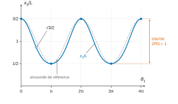
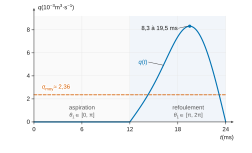
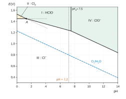
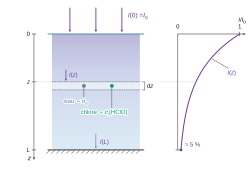
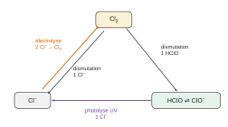

# CCINP PSI — Modélisation et ingénierie numérique 2026 · Corrigé

*Corrigé rédigé par IA, non officiel. Signalez toute erreur.*

Épreuve PSI3MO, 4 heures, calculatrice interdite. « Modélisation de l'entretien automatisé d'une piscine privée ». Deux parties indépendantes.

## Partie I — Régulation du débit de la pompe de circulation

### Q1

Le volume du bassin doit passer dans la pompe en $\Delta t=8\ \text{h}=2{,}88\cdot10^4$ s. Le débit vaut donc $q=V/\Delta t$ :

$$\begin{aligned}
q_{\min}&=\frac{30}{2{,}88\cdot10^4}\\
&\simeq1{,}04\cdot10^{-3}\ \mathrm{m^3\cdot s^{-1}}\\
q_{\max}&=\frac{120}{2{,}88\cdot10^4}\\
&\simeq4{,}17\cdot10^{-3}\ \mathrm{m^3\cdot s^{-1}}
\end{aligned}$$

$$\boxed{\begin{aligned}q_{\min}&\simeq1{,}0\ \mathrm{L\cdot s^{-1}}\\ q_{\max}&\simeq4{,}2\ \mathrm{L\cdot s^{-1}}\end{aligned}}$$

La vitesse $v=1{,}5\ \mathrm{m\cdot s^{-1}}$ est uniforme sur une section circulaire. Donc $q=v\,\pi d^2/4$, d'où $d=\sqrt{4q/(\pi v)}$ :

$$\begin{aligned}
d_{\min}&=\sqrt{\frac{4\times1{,}04\cdot10^{-3}}{\pi\times1{,}5}}\\
&\simeq\sqrt{8{,}8\cdot10^{-4}}\\
&\simeq2{,}97\cdot10^{-2}\ \text{m}\\
d_{\max}&=\sqrt{\frac{q_{\max}}{q_{\min}}}\,d_{\min}\\
&=2\,d_{\min}
\end{aligned}$$

$$\boxed{\begin{aligned}d_{\min}&\simeq30\ \text{mm}\\ d_{\max}&\simeq59\ \text{mm}\end{aligned}}$$

Ces diamètres, de 3 à 6 cm, sont ceux des canalisations usuelles d'une piscine : les ordres de grandeur sont cohérents.

### I.1 — Modélisation mécanique du système d'aspiration de la pompe

### Q2

Fermeture géométrique : $\overrightarrow{OA}+\overrightarrow{AB}=\overrightarrow{OB}$, soit $R\,\vec x_1+L\,\vec x_2=x_3\,\vec x_0$. On projette sur $\vec x_0$ et $\vec y_0$ :

$$\left\{\begin{aligned}R\cos\theta_1+L\cos\theta_2&=x_3\\ R\sin\theta_1+L\sin\theta_2&=0\end{aligned}\right.$$

La seconde équation donne $\sin\theta_2=-\frac{R}{L}\sin\theta_1$. On en tire $L\cos\theta_2=\pm\sqrt{L^2-R^2\sin^2\theta_1}$. Mathématiquement, il existe donc deux solutions :

$$x_3=R\cos\theta_1\pm\sqrt{L^2-(R\sin\theta_1)^2}$$

**Choix du signe.**

- Comme $R<L$, on a $|\sin\theta_2|\le R/L<1$ : $\cos\theta_2$ ne s'annule jamais.
- Fonction continue du temps qui ne s'annule pas, $\cos\theta_2$ garde un signe constant (théorème des valeurs intermédiaires).
- À l'instant initial, $\theta_1=0$ et la figure 2 place B à droite de A. Donc $\theta_2=0$ et $\cos\theta_2=1>0$.
- Ainsi $\cos\theta_2>0$ à chaque instant, et seul le signe $+$ convient.

L'autre racine se ramène à la première. En notant $x_3^{+}$ la racine retenue, qui est au moins égale à $L-R$ :

$$\begin{aligned}
R\cos\theta_1-\sqrt{L^2-R^2\sin^2\theta_1}&=-x_3^{+}(\pi-\theta_1)\\
&\le-(L-R)\\
&<0
\end{aligned}$$

Elle placerait B à gauche de O. C'est l'autre montage du mécanisme, symétrique par rapport à $(O,\vec y_0)$, incompatible avec la figure 2.

$$\boxed{x_3=R\cos\theta_1+\sqrt{L^2-(R\sin\theta_1)^2}}$$

### Q3

$$\boxed{\frac{x_3}{L}=\frac{R}{L}\cos\theta_1+\sqrt{1-\Big(\frac{R}{L}\Big)^2\sin^2\theta_1}}$$

Pour $R/L=1/2$, on obtient une fonction $2\pi$-périodique et paire :

$$\frac{x_3}{L}=\frac12\cos\theta_1+\sqrt{1-\frac14\sin^2\theta_1}$$

- $\theta_1=0$ (et $2\pi$, $4\pi$) : $\boxed{x_3/L=3/2}$, maximum (O, A, B alignés, bielle dans le prolongement de la manivelle) ;
- $\theta_1=\pi$ (et $3\pi$) : $\boxed{x_3/L=1/2}$, minimum (manivelle repliée sur la bielle) ;
- valeurs intermédiaires : $x_3/L\simeq0{,}87$ en $\pi/2$ et $x_3/L\simeq0{,}58$ en $3\pi/4$.

Allure sur $[0,4\pi]$ (figure 1) : deux périodes entre 0,5 et 1,5, de valeur moyenne voisine de 0,93. Ce n'est pas une sinusoïde : les maxima (en 0, 2π, 4π) sont plus pointus et les minima (en π, 3π) plus aplatis.



| θ₁ | 0 | π/2 | 3π/4 | π | 3π/2 | 2π | 3π | 4π |
|---|---|---|---|---|---|---|---|---|
| x₃/L | 1,5 | 0,87 | 0,58 | 0,5 | 0,87 | 1,5 | 0,5 | 1,5 |

### Q4

D'après Q3, $x_3$ atteint ses extrema aux points morts : $x_3(0)=L+R$ et $x_3(\pi)=L-R$. La course est la distance parcourue par le piston entre ces deux positions, soit $2R$.

La section du piston est un disque d'aire $S_p=\pi d_p^2/4$. Le volume balayé sur un tour vaut :

$$\begin{aligned}
C&=2R\cdot\frac{\pi d_p^2}{4}\\
&=\frac{\pi R\,d_p^2}{2}
\end{aligned}$$

$$\boxed{C=\frac{\pi R\,d_p^2}{2}}$$

### Q5

Le piston est en translation de direction $\vec x_0$. Avec $\theta_1=\Omega_mt$, la dérivée composée donne $v_3=\dot x_3=\Omega_m\,\dfrac{\mathrm dx_3}{\mathrm d\theta_1}$.

Le radicande vérifie $L^2-R^2\sin^2\theta_1\ge L^2-R^2>0$ : la racine est dérivable, et

$$\frac{\mathrm dx_3}{\mathrm d\theta_1}=-R\sin\theta_1-\frac{R^2\sin\theta_1\cos\theta_1}{\sqrt{L^2-R^2\sin^2\theta_1}}$$

$$\boxed{v_3=-R\,\Omega_m\sin\theta_1\left(1+\frac{R\cos\theta_1}{\sqrt{L^2-(R\sin\theta_1)^2}}\right)}$$

Le facteur entre parenthèses est strictement positif. En effet, $R^2\cos^2\theta_1<L^2-R^2\sin^2\theta_1$ équivaut à $R^2<L^2$, vrai puisque $R<L$.

Donc $v_3$ a le signe de $-\sin\theta_1$ : $v_3\le0$ pour $\theta_1\in[0,\pi]$, et $v_3\ge0$ pour $\theta_1\in[\pi,2\pi]$.

### Q6

Pendant $\mathrm dt$, le piston de section $S_p=\pi d_p^2/4$ chasse le volume $S_p\,v_3\,\mathrm dt$. Sur $[\pi,2\pi]$, on a $v_3\ge0$ (Q5), donc le débit refoulé est positif :

$$\boxed{q=\begin{cases}0&\text{pour }\theta_1\in[0,\pi]\\[4pt] \dfrac{\pi d_p^2}{4}\,v_3&\text{pour }\theta_1\in[\pi,2\pi]\end{cases}}$$

Soit, sur $[\pi,2\pi]$ :

$$q=-\frac{\pi d_p^2}{4}R\,\Omega_m\sin\theta_1\left(1+\frac{R\cos\theta_1}{\sqrt{L^2-R^2\sin^2\theta_1}}\right)$$

### Q7

Sur une période $T=2\pi/\Omega_m$, le débit n'est non nul que pendant le refoulement, où $q\,\mathrm dt=S_p\,\mathrm dx_3$ :

$$\begin{aligned}
q_{moy}&=\frac1T\int_0^Tq\,\mathrm dt\\
&=\frac{1}{T}\,\frac{\pi d_p^2}{4}\big[x_3(2\pi)-x_3(\pi)\big]\\
&=\frac{1}{T}\,\frac{\pi d_p^2}{4}\,2R\\
&=\frac{C\,\Omega_m}{2\pi}
\end{aligned}$$

$$\boxed{q_{moy}=\frac{R\,d_p^2\,\Omega_m}{4}}\qquad(\mathrm{m^3\cdot s^{-1}},\ \Omega_m\ \text{en rad}\cdot\text{s}^{-1})$$

### Q8

Les mesures sont prises à pas de temps constant sur une période entière (figure 3 : de 0 à 24 ms, soit $T=60/2500$ s). La moyenne temporelle est donc la moyenne arithmétique des échantillons.

```python
def moyenne(q):
    """Débit moyen (m3/s) d'une liste de débits relevés à pas de temps constant."""
    s = 0.0
    for qi in q:
        s = s + qi
    return s / len(q)
```

L'opérateur `/` est la division flottante ; la division euclidienne `//` donnerait un résultat faux.

### Q9

On convertit d'abord la vitesse de rotation :

$$\Omega_m=2500\times\frac{2\pi}{60}\simeq2{,}62\cdot10^2\ \mathrm{rad\cdot s^{-1}}$$

$$\begin{aligned}
q_{moy}&=\frac{0{,}04\times(0{,}03)^2\times262}{4}\\
&=\frac{3{,}6\cdot10^{-5}\times262}{4}\\
&\simeq2{,}36\cdot10^{-3}\ \mathrm{m^3\cdot s^{-1}}
\end{aligned}$$

$$\boxed{q_{moy}\simeq2{,}36\cdot10^{-3}\ \mathrm{m^3\cdot s^{-1}}}$$

Écart relatif à la mesure :

$$\frac{2{,}4-2{,}36}{2{,}4}\simeq2\ \%$$

C'est du même ordre que la précision de la valeur expérimentale, donnée avec deux chiffres significatifs. La forme de la courbe confirme l'accord : débit nul pendant la première demi-période, puis maximum modélisé de $8{,}3\cdot10^{-3}\ \mathrm{m^3\cdot s^{-1}}$ vers $t\simeq19{,}5$ ms, comme sur la figure 3.

**Le modèle cinématique (piston étanche, fluide incompressible, clapets parfaits) est validé pour le calcul du débit moyen.** Ce débit appartient d'ailleurs à $[q_{\min};q_{\max}]$.



### I.2 — Modélisation de la régulation sous la forme d'un schéma-bloc

### Q10

D'après le schéma-bloc :

$$\begin{aligned}
\varepsilon&=U_c-U_{mes}\\
&=K_aQ_c-K_qQ_s
\end{aligned}$$

Pour que $\varepsilon=0$ corresponde exactement à $Q_s=Q_c$, il faut $(K_a-K_q)\,Q_c=0$ pour toute consigne :

$$\boxed{K_a=K_q=1\ \mathrm{V\cdot s\cdot m^{-3}}}$$

### Q11

On note $G(p)=C(p)K_vH(p)K_{pom}$, c'est-à-dire :

$$G(p)=\frac{C(p)K_vK_mK_{pom}}{1+\tau_mp}$$

Le schéma-bloc donne deux relations, la perturbation étant retranchée au sommateur de sortie :

$$\begin{aligned}
Q_s&=G\varepsilon-Q_{pc}\\
\varepsilon&=K_aQ_c-K_qQ_s
\end{aligned}$$

D'où $Q_s(1+K_qG)=K_aGQ_c-Q_{pc}$, puis :

$$\begin{aligned}
H_1&=\frac{K_aG}{1+K_qG}\\
H_2&=\frac{-1}{1+K_qG}
\end{aligned}$$

Avec $C(p)=1$, on pose $K=K_qK_vK_mK_{pom}$, sans dimension :

$$\begin{aligned}
K&=1\times10\times10\times9\cdot10^{-6}\\
&=9\cdot10^{-4}
\end{aligned}$$

En remplaçant $H(p)$ par son expression et en mettant sous forme canonique :

$$\boxed{\begin{aligned}H_1(p)&=\frac{\dfrac{K_aK_vK_mK_{pom}}{1+K}}{1+\dfrac{\tau_m}{1+K}\,p}\\[6pt] H_2(p)&=-\frac{1}{1+K}\cdot\frac{1+\tau_mp}{1+\dfrac{\tau_m}{1+K}\,p}\end{aligned}}$$

Numériquement, $H_1(p)\simeq\dfrac{9\cdot10^{-4}}{1+p}$, sans dimension puisque $K_a=K_q$, et $H_2(p)\simeq-1$.

### Q12

On interprète « non asservi » comme « sans correction » ($C(p)=1$). L'écart s'écrit :

$$\varepsilon(p)=\frac{K_aQ_c(p)+K_qQ_{pc}(p)}{1+K_qG(p)}$$

Le système bouclé est stable (pôle $-(1+K)/\tau_m<0$) : le théorème de la valeur finale s'applique. Pour des échelons $Q_{c0}/p$ et $Q_{pc0}/p$, les deux écarts sont :

$$\begin{aligned}
\varepsilon_s&=\frac{K_aQ_{c0}}{1+K}\\
&\simeq K_aQ_{c0}\neq0\\
\varepsilon_{pert}&=\frac{K_qQ_{pc0}}{1+K}\\
&\simeq K_qQ_{pc0}\neq0
\end{aligned}$$

Ces écarts sont des tensions : l'écart vaut presque toute la consigne convertie, et presque toute la perturbation convertie. La boucle ouverte $K/(1+\tau_mp)$ est de classe 0 et de gain statique très faible. Le débit obtenu ne vaut que $H_1(0)\,Q_{c0}\simeq9\cdot10^{-4}\,Q_{c0}$.

**Les exigences de précision ne sont pas respectées, ni en poursuite ni en régulation.** En boucle ouverte au sens strict, la conclusion est la même : rien ne corrige l'écart ni la perturbation.

### I.3 — Mise en place d'un correcteur

### Q13

Avec $C(p)=K_p\dfrac{1+T_ip}{T_ip}$, la fonction de transfert en boucle ouverte est :

$$\mathrm{FTBO}(p)=\frac{K_pK_qK_vK_mK_{pom}}{T_i}\cdot\frac{1+T_ip}{p(1+\tau_mp)}$$

Elle est de classe 1, grâce à l'intégrateur du correcteur. Cet intégrateur est placé en amont du point d'entrée de la perturbation $Q_{pc}$ : il annule donc aussi l'écart dû à celle-ci. Si le système corrigé est stable (vérifié en Q15–Q16), pour des échelons :

$$\begin{aligned}
\varepsilon_s&=\lim_{p\to0}\frac{K_aQ_{c0}}{1+\mathrm{FTBO}(p)}\\
&=0\\
\varepsilon_{pert}&=\lim_{p\to0}\frac{K_qQ_{pc0}}{1+\mathrm{FTBO}(p)}\\
&=0
\end{aligned}$$

**Le correcteur PI respecte les deux exigences de précision.**

### Q14

Hors intégrateur, la boucle ouverte n'a qu'un pôle, $-1/\tau_m$ : c'est le pôle dominant. On place le zéro du correcteur dessus :

$$\boxed{T_i=\tau_m=1\ \text{s}}$$

La boucle ouverte devient un intégrateur pur :

$$\boxed{\begin{aligned}H_{BO}(p)&=\frac{K_{BO}}{p}\\ K_{BO}&=\frac{K_pK_qK_vK_mK_{pom}}{T_i}\\ &=9\cdot10^{-4}K_p\ \ (\mathrm{s^{-1}})\end{aligned}}$$

### Q15

La marge de gain s'évalue à la pulsation $\omega_{180}$ où $\arg H_{BO}=-180^\circ$. La marge de phase s'évalue à la pulsation $\omega_{0\,\text{dB}}$ où $|H_{BO}|=1$ :

$$\begin{aligned}
MG&=-20\log|H_{BO}(j\omega_{180})|\\
MP&=180^\circ+\arg H_{BO}(j\omega_{0\,\text{dB}})
\end{aligned}$$

Ici $H_{BO}(j\omega)=K_{BO}/(j\omega)$ a une phase constante de $-90^\circ$, qui n'atteint jamais $-180^\circ$. D'où $\boxed{MG=+\infty>10\ \text{dB}}$.

Le gain coupe 0 dB en $\omega_{0\,\text{dB}}=K_{BO}$, d'où $\boxed{MP=90^\circ>45^\circ}$. Les critères de stabilité sont respectés quel que soit $K_p>0$.

### Q16

Avec $Q_{pc}=0$, $K_qG=H_{BO}$ et $K_a=K_q$ :

$$\begin{aligned}
H_{BF}(p)&=\frac{K_a}{K_q}\cdot\frac{H_{BO}}{1+H_{BO}}\\
&=\frac{K_{BO}}{p+K_{BO}}\\
&=\frac{1}{1+\dfrac{p}{K_{BO}}}
\end{aligned}$$

$$\boxed{\begin{aligned}H_{BF}(p)&=\frac{1}{1+\tau_{BF}\,p}\\ \tau_{BF}&=\frac{1}{K_{BO}}\end{aligned}}$$

C'est un premier ordre de gain statique unitaire. Sa réponse indicielle $Q_{c0}\big(1-e^{-t/\tau_{BF}}\big)$ est strictement croissante, donc **sans dépassement**. Le critère d'amortissement est respecté pour tout $K_p>0$.

### Q17

Pour un premier ordre, $t_{r5\%}=\tau_{BF}\ln20\simeq3\tau_{BF}=3/K_{BO}$. L'exigence $t_{r5\%}<1$ s donne donc :

$$\begin{aligned}
K_{BO}&>3\ \mathrm{s^{-1}}\\
9\cdot10^{-4}K_p&>3
\end{aligned}$$

$$\boxed{K_{p,\min}=\frac{3}{9\cdot10^{-4}}\simeq3{,}3\cdot10^3}$$

Les marges (Q15), l'absence de dépassement (Q16) et la précision (Q13) ne dépendent pas de $K_p$. Le cahier des charges est donc entièrement respecté pour $K_p>3{,}3\cdot10^3$.

## Partie II — Régulation des paramètres physico-chimiques de l'eau

### Q18

$M(\mathrm{NaCl})=23{,}0+35{,}5=58{,}5\ \mathrm{g\cdot mol^{-1}}$. La dissolution $\mathrm{NaCl(s)}\to\mathrm{Na^+}+\mathrm{Cl^-}$ est totale et libère une mole d'ions chlorure par mole de sel. La concentration en ions $\mathrm{Cl^-}$ est donc égale à la concentration apportée en sel :

$$\begin{aligned}
c_0&=\frac{c_m}{M(\mathrm{NaCl})}\\
&=\frac{5{,}0}{58{,}5}\ \mathrm{mol\cdot L^{-1}}
\end{aligned}$$

$$\boxed{c_0\simeq8{,}5\cdot10^{-2}\ \mathrm{mol\cdot L^{-1}}}$$

### Q19

L'eau contient $5\ \mathrm{g\cdot L^{-1}}$ de chlorure de sodium dissous, c'est-à-dire des ions $\mathrm{Na^+}$ et $\mathrm{Cl^-}$ : c'est le sel de l'eau de mer. Le goût salé vient de ce sel, et non du seul chlore actif ou du seul sodium. La salinité de l'eau de mer est d'environ $35\ \mathrm{g\cdot L^{-1}}$, sept fois plus : **le goût salé est perceptible mais léger**.

### Q20

Demi-équations :

- anode (oxydation) : $2\,\mathrm{Cl^-}=\mathrm{Cl_2}+2e^-$ ;
- cathode (réduction de l'eau) : $2\,\mathrm{H_2O}+2e^-=\mathrm{H_2}+2\,\mathrm{HO^-}$.

Équation-bilan de l'électrolyse :

$$\boxed{2\,\mathrm{Cl^-}+2\,\mathrm{H_2O}\longrightarrow\mathrm{Cl_2}+\mathrm{H_2}+2\,\mathrm{HO^-}}$$

Intensité d'électrolyse :

$$\begin{aligned}
I&=jS\\
&=4{,}0\cdot10^3\times20\cdot10^{-4}\ \text{A}\\
&=8{,}0\ \text{A}
\end{aligned}$$

Il faut deux électrons par molécule de $\mathrm{Cl_2}$ :

$$\begin{aligned}
v(\mathrm{Cl_2})&=\frac{I}{2F}\\
&=\frac{8{,}0}{1{,}93\cdot10^5}\ \mathrm{mol\cdot s^{-1}}
\end{aligned}$$

$$\boxed{v(\mathrm{Cl_2})\simeq4{,}1\cdot10^{-5}\ \mathrm{mol\cdot s^{-1}}}$$

soit $0{,}15\ \mathrm{mol\cdot h^{-1}}$.

### Q21

Nombres d'oxydation du chlore : −I dans $\mathrm{Cl^-}$, 0 dans $\mathrm{Cl_2}$, +I dans $\mathrm{HClO}$ et $\mathrm{ClO^-}$. Le nombre d'oxydation croît vers les potentiels élevés.

- **III = $\mathrm{Cl^-}$** : domaine le plus bas.
- **I = $\mathrm{HClO}$** et **IV = $\mathrm{ClO^-}$** : domaines supérieurs séparés par une frontière verticale (acido-basique, sans échange d'électron), la forme acide à pH faible.
- **II = $\mathrm{Cl_2}$** : petit domaine de degré intermédiaire, entre $\mathrm{Cl^-}$ et $\mathrm{HClO}$, en milieu très acide.

Les pentes le confirment : une frontière vaut $-0{,}06\,m/n$ V par unité de pH, pour $m$ protons et $n$ électrons.

- II/III, $\mathrm{Cl_2}+2e^-=2\,\mathrm{Cl^-}$ : horizontale vers 1,45 V.
- I/II, $2\,\mathrm{HClO}+2\,\mathrm{H^+}+2e^-=\mathrm{Cl_2}+2\,\mathrm{H_2O}$ : pente $-0{,}06$ V, de 1,53 à 1,45 V entre pH 0 et 1,3.
- I/III, $\mathrm{HClO}+\mathrm{H^+}+2e^-=\mathrm{Cl^-}+\mathrm{H_2O}$ : pente $-0{,}03$ V, de 1,45 à 1,23 V entre pH 1,3 et 7,5.
- IV/III, $\mathrm{ClO^-}+2\,\mathrm{H^+}+2e^-=\mathrm{Cl^-}+\mathrm{H_2O}$ : pente $-0{,}06$ V, de 1,23 à 0,84 V entre pH 7,5 et 14.



### Q22

La frontière verticale I/IV est la droite $\mathrm{pH}=\mathrm pK_a$, où les deux formes ont la même concentration. Elle se situe aux sept huitièmes de l'intervalle $[4;8]$ :

$$\boxed{\mathrm pK_a(\mathrm{HClO/ClO^-})\simeq7{,}5}$$

### Q23

La frontière du couple $\mathrm{O_2/H_2O}$ est la droite $E=1{,}23-0{,}06\,\mathrm{pH}$. Les domaines de $\mathrm{HClO}$ et $\mathrm{ClO^-}$ sont entièrement au-dessus :

- à pH 7,2, $\mathrm{HClO}$ n'existe qu'au-dessus de 1,24 V, et l'eau n'est stable comme réducteur qu'en dessous de 0,80 V ;
- à pH 14, la frontière $\mathrm{ClO^-}/\mathrm{Cl^-}$ est à 0,84 V, contre 0,39 V pour l'eau.

Les domaines sont disjoints : **$\mathrm{HClO}$ et $\mathrm{ClO^-}$ oxydent thermodynamiquement l'eau**.

$$2\,\mathrm{HClO}\longrightarrow2\,\mathrm{Cl^-}+\mathrm{O_2}+2\,\mathrm{H^+}$$

$$2\,\mathrm{ClO^-}\longrightarrow2\,\mathrm{Cl^-}+\mathrm{O_2}$$

On peut néanmoins négliger ces réactions parce qu'elles sont **cinétiquement bloquées**. L'oxydation de l'eau en dioxygène est très lente (fort surpotentiel d'oxydation de l'eau en $\mathrm{O_2}$, système lent). Ces espèces sont donc métastables à l'échelle de la journée, comme l'eau de Javel, qui se conserve plusieurs mois.

### Q24

$\mathrm{Cl_2}$ n'existe que s'il est à la fois au-dessus de la frontière $\mathrm{Cl_2/Cl^-}$ (1,45 V) et en dessous de la frontière $\mathrm{HClO/Cl_2}$, d'équation $E\simeq1{,}53-0{,}06\,\mathrm{pH}$. Ces conditions sont incompatibles pour $\mathrm{pH}>1{,}3$ (point A).

À pH 7,2, la seconde frontière est à $1{,}53-0{,}06\times7{,}2\simeq1{,}10$ V, sous 1,45 V. **Le dichlore n'est pas stable : il se dismute** en $\mathrm{HClO}$ ($+\mathrm I$) et $\mathrm{Cl^-}$ ($-\mathrm I$), dont les domaines ont une partie commune :

$$\boxed{\mathrm{Cl_2}+\mathrm{H_2O}\longrightarrow\mathrm{HClO}+\mathrm{Cl^-}+\mathrm{H^+}}$$

À pH $7{,}2<\mathrm pK_a$, l'espèce de degré $+\mathrm I$ majoritaire est bien $\mathrm{HClO}$.

### Q25

Le rapport des deux formes ne dépend que de l'écart au $\mathrm pK_a$ :

$$\frac{[\mathrm{ClO^-}]}{[\mathrm{HClO}]}=10^{\mathrm{pH}-\mathrm pK_a}$$

Avec $c_t=[\mathrm{HClO}]+[\mathrm{ClO^-}]$, on exprime d'abord le résultat littéral, puis on fait l'application numérique :

$$\begin{aligned}
[\mathrm{HClO}]&=\frac{c_t}{1+10^{\mathrm{pH}-\mathrm pK_a}}\\
&=\frac{60}{1+10^{-0,3}}\ \mu\mathrm{mol\cdot L^{-1}}\\
&=\frac{60}{1{,}5}\ \mu\mathrm{mol\cdot L^{-1}}
\end{aligned}$$

$$\boxed{[\mathrm{HClO}]=40\ \mu\mathrm{mol\cdot L^{-1}}}$$

**L'eau est bien désinfectée**, mais à la limite haute de la plage $[10;40]\ \mu\mathrm{mol\cdot L^{-1}}$.

### Q26

La tension mesurée est $U=E_{\mathrm{Pt}}-E_{ref}$. Demi-équation du couple, écrite en milieu acide (c'est à elle que se rapporte $E^\circ=1{,}49$ V) :

$$\mathrm{HClO}+\mathrm{H^+}+2e^-=\mathrm{Cl^-}+\mathrm{H_2O}$$

Formule de Nernst à 25 °C, concentrations rapportées à $c^\circ=1\ \mathrm{mol\cdot L^{-1}}$ :

$$E_{\mathrm{Pt}}=E^\circ+\frac{0{,}06}{2}\log\frac{[\mathrm{HClO}][\mathrm{H^+}]}{[\mathrm{Cl^-}]}$$

Avec $[\mathrm{Cl^-}]=c_0$ constant (Q43) :

$$\boxed{U=E^\circ-E_{ref}-0{,}03\,\mathrm{pH}+0{,}03\log\frac{[\mathrm{HClO}]}{c_0}}$$

Numériquement, pour pH 7,2 et $[\mathrm{HClO}]$ entre 10 et $40\ \mu\mathrm{mol\cdot L^{-1}}$, on trouve $957\ \text{mV}<U<975\ \text{mV}$.

**Signalement d'une erreur d'énoncé.** L'intervalle annoncé, de 633 à 669 mV, s'obtient (634 et 670 mV) avec le coefficient $0{,}059$ au lieu de $0{,}059/2$, c'est-à-dire en comptant un seul électron. Or $n=2$, comme le confirme la pente $-0{,}03$ V/pH de la frontière I/III (Q21). On garde l'expression littérale ci-dessus. On utilise l'intervalle de l'énoncé pour la comparaison de Q42, la figure 11 ayant été construite avec la même convention.

### Q27

La production de dichlore s'accompagne de sa dismutation (Q24), qui libère un ion $\mathrm{H^+}$ par molécule de $\mathrm{Cl_2}$ :

$$\mathrm{Cl_2}+\mathrm{H_2O}\longrightarrow\mathrm{HClO}+\mathrm{Cl^-}+\mathrm{H^+}$$

**La production de dichlore acidifie l'eau : le pH diminue.**

Conséquence : le pH sort de la plage $[7{,}0;7{,}4]$ fixée pour le confort des baigneurs. La répartition entre $\mathrm{HClO}$ et $\mathrm{ClO^-}$ change aussi (Q25), donc l'efficacité de la désinfection. Il faut **mesurer le pH en continu et injecter un correcteur de pH** avec la pompe péristaltique : c'est le rôle de la chaîne de mesure étudiée ensuite.

Remarque : la réaction cathodique produit deux ions $\mathrm{HO^-}$ par $\mathrm{Cl_2}$. Le bilan global de l'électrolyseur, $\mathrm{Cl^-}+2\,\mathrm{H_2O}\to\mathrm{HClO}+\mathrm{H_2}+\mathrm{HO^-}$, est donc basique, et les électrolyseurs au sel font plutôt monter le pH en pratique. La conséquence reste la même : le pH dérive et doit être régulé.

### Q28

Il faut distinguer la nature du signal de son unité.

- Entrée du capteur : le pH, grandeur physico-chimique, sans unité.
- Sortie : la tension $U$, en volts. C'est un signal électrique **analogique**, continu en temps et en amplitude.

Le boîtier de contrôle est un calculateur **numérique** (affichage, commande de la pompe) : il ne traite que des nombres binaires. La fonction du **CAN** est de convertir le signal analogique en un nombre $N$ codé sur 12 bits, par échantillonnage puis quantification.

Chaque gain est le rapport des étendues de sortie et d'entrée :

$$\boxed{\begin{aligned}K_{cap}&=\frac{10}{14}\simeq0{,}71\ \text{V par unité de pH}\\ K_{CAN}&=\frac{2^{12}}{10}\simeq4{,}1\cdot10^2\ \mathrm{V^{-1}}\end{aligned}}$$

La convention $(2^{12}-1)/10=409{,}5\ \mathrm{V^{-1}}$ est équivalente à 0,02 % près.

### Q29

La plus petite variation mesurable fait changer $N$ d'une unité. Le quantum du CAN, ramené au pH par le gain du capteur, donne :

$$\begin{aligned}
q_U&=\frac{10}{4096}\ \text{V}\simeq2{,}4\ \text{mV}\\
\Delta\mathrm{pH}_{\min}&=\frac{q_U}{K_{cap}}\\
&=\frac{14}{4096}
\end{aligned}$$

$$\boxed{\Delta\mathrm{pH}_{\min}\simeq3{,}4\cdot10^{-3}}$$

C'est environ 30 fois plus fin que la précision requise (0,1). **La numérisation n'est pas le maillon limitant : la chaîne de mesure est pertinente.** Une résolution plus fine que nécessaire n'est pas un défaut : elle laisse de la marge aux autres sources d'erreur. La précision réelle dépend surtout de l'électrode (étalonnage, dérive).

### Q30

Pour une solution diluée traversée sur une longueur $\ell$ par un rayonnement monochromatique, les absorbances des espèces s'ajoutent :

$$\boxed{A=\log\frac{I_0}{I}=\sum_i\varepsilon_i\,\ell\,c_i}$$

- $A$ : absorbance, sans unité ;
- $I_0$, $I$ : intensités incidente et transmise, en $\mathrm{W\cdot m^{-2}}$ ;
- $\varepsilon_i$ : coefficient d'absorption molaire de l'espèce $i$, en $\mathrm{L\cdot mol^{-1}\cdot cm^{-1}}$ ;
- $\ell$ : longueur traversée, en cm ;
- $c_i$ : concentration, en $\mathrm{mol\cdot L^{-1}}$.

### Q31

À 290 nm, sur la figure 7 :

$$\boxed{\begin{aligned}\varepsilon_{\mathrm{ClO^-}}&\simeq3{,}8\cdot10^2\ \mathrm{L\cdot mol^{-1}\cdot cm^{-1}}\\ \varepsilon_{\mathrm{HClO}}&\simeq35\ \mathrm{L\cdot mol^{-1}\cdot cm^{-1}}\end{aligned}}$$

### Q32

Par additivité des absorbances :

$$A=\big(\varepsilon_{\mathrm{HClO}}[\mathrm{HClO}]+\varepsilon_{\mathrm{ClO^-}}[\mathrm{ClO^-}]\big)z$$

La constante d'acidité donne $[\mathrm{ClO^-}]=\dfrac{K_a}{[\mathrm{H^+}]}[\mathrm{HClO}]$. D'où $A=\alpha_t[\mathrm{HClO}]\,z$ avec :

$$\boxed{\alpha_t=\varepsilon_{\mathrm{HClO}}+\varepsilon_{\mathrm{ClO^-}}\frac{K_a}{[\mathrm{H^+}]}}$$

Contrôle à pH 7,2, où $K_a/[\mathrm{H^+}]=0{,}5$ :

$$\begin{aligned}
\alpha_t&\simeq35+380\times0{,}5\ \mathrm{L\cdot mol^{-1}\cdot cm^{-1}}\\
&\simeq2{,}2\cdot10^2\ \mathrm{L\cdot mol^{-1}\cdot cm^{-1}}\\
&=2{,}2\cdot10^4\ \mathrm{L\cdot mol^{-1}\cdot m^{-1}}
\end{aligned}$$

C'est en accord avec la valeur $2{,}3\cdot10^4$ de l'énoncé.

### Q33

Sur la figure 8, à 290 nm, la courbe est sur sa partie décroissante entre 200 et 500 nm. On lit $\alpha_e\simeq0{,}1$ à $0{,}2\ \mathrm{m^{-1}}$ ; le programme retient `alpha_e = 0.1`.

On compare $\alpha_e$ au terme de même unité dû au chlore, $\alpha_t[\mathrm{HClO}]$, sur la plage de désinfection :

$$\begin{aligned}
\alpha_t\times10\ \mu\mathrm{mol\cdot L^{-1}}&\simeq0{,}23\ \mathrm{m^{-1}}\\
\alpha_t\times40\ \mu\mathrm{mol\cdot L^{-1}}&\simeq0{,}92\ \mathrm{m^{-1}}
\end{aligned}$$

Le terme de l'eau est du même ordre de grandeur : il représente de 10 % à près de 50 % de l'absorption totale. **On ne peut pas négliger l'absorption des UV par l'eau.**

### Q34

Les absorptions de l'eau et du chlore s'ajoutent, avec $[\mathrm{HClO}]$ uniforme :

$$\log\frac{I(0)}{I(z)}=\big(\alpha_e+\alpha_t[\mathrm{HClO}]\big)z$$

$$\boxed{I(z)=I_0\,10^{-(\alpha_e+\alpha_t[\mathrm{HClO}])\,z}}$$

### Q35

$$\boxed{E=h\nu=\frac{hc}{\lambda}}$$

$E$ énergie d'un photon (J), $h$ constante de Planck (J·s), $\nu$ fréquence (Hz), $c$ célérité de la lumière dans le vide ($\mathrm{m\cdot s^{-1}}$), $\lambda$ longueur d'onde (m).

À 300 nm, $E\simeq6{,}6\cdot10^{-19}$ J, environ 4 eV.

### Q36

Sur une tranche $\mathrm dz$, les probabilités d'absorption d'un photon par l'eau et par le chlore libre sont proportionnelles à $\alpha_e$ et à $\alpha_t[\mathrm{HClO}]$, avec le même facteur. La proportion de photons absorbés par le chlore est donc :

$$\boxed{\tau=\frac{\alpha_t[\mathrm{HClO}]}{\alpha_e+\alpha_t[\mathrm{HClO}]}}$$

Elle est indépendante de $z$ puisque le milieu est uniforme.



### Q37

La puissance absorbée dans la colonne d'eau de section $S_e$ vaut $S_e\big(I(0)-I(L)\big)$, dont la part $\tau$ par le chlore. Chaque photon porte l'énergie $hc/\lambda$. Le rendement photochimique vaut 1 : chaque photon absorbé par le chlore détruit une molécule. On divise enfin par $\mathcal N_A$ :

$$\begin{aligned}
v_d&=\frac{\tau\,S_e\big(I(0)-I(L)\big)\lambda}{h\,c\,\mathcal N_A}\\
&=\tau K_d\big(I(0)-I(L)\big)
\end{aligned}$$

$$\boxed{K_d=\frac{S_e\,\lambda}{h\,c\,\mathcal N_A}}$$

$K_d$ s'exprime en $\mathrm{mol\cdot m^2\cdot J^{-1}}$, donc $K_dI$ en $\mathrm{mol\cdot s^{-1}}$. Avec $\lambda=300$ nm (valeur du programme) :

$$\begin{aligned}
K_d&=\frac{28\times3\cdot10^{-7}}{6{,}63\cdot10^{-34}\times3\cdot10^8\times6{,}02\cdot10^{23}}\\
&\simeq7{,}0\cdot10^{-5}\ \mathrm{mol\cdot m^2\cdot J^{-1}}
\end{aligned}$$

C'est ce que code la ligne 12, multiplié par 3600 pour un temps en heures.

### Q38

L'électrolyseur produit $\mathrm{Cl_2}$ à la vitesse $I/(2F)$ (Q20). Chaque molécule de $\mathrm{Cl_2}$ se dismute en un $\mathrm{HClO}$ (Q24) :

$$\boxed{v_p=\frac{I}{2F}=\frac{jS}{2F}}$$

Soit $v_p\simeq4{,}1\cdot10^{-5}\ \mathrm{mol\cdot s^{-1}}$, ou $0{,}15\ \mathrm{mol\cdot h^{-1}}$ (ligne 7 du programme).

### Q39

Bilan de matière sur le bassin, de volume $V$ constant et de composition uniforme. On note $e(t)\in\{0,1\}$ l'état de l'électrolyseur (figure 12) :

$$\mathrm d(cV)=e(t)\,v_p\,\mathrm dt-v_d\,\mathrm dt$$

On reporte $\tau$ (Q36), $v_d$ (Q37) et $I(L)$ (Q34) :

$$\boxed{V\frac{\mathrm dc}{\mathrm dt}=e(t)\frac{I}{2F}-\frac{\alpha_t\,c}{\alpha_e+\alpha_t\,c}\,K_d\,I_0(t)\left[1-10^{-(\alpha_e+\alpha_t c)L}\right]}\qquad(1)$$

C'est une équation différentielle du premier ordre, non linéaire et non autonome, à résoudre numériquement. Le modèle de l'énoncé fait porter production et disparition sur $c=[\mathrm{HClO}]$.

### Q40

L'intensité UV est nulle la nuit (avant 6 h environ et après 22 h), puis suit une cloche maximale vers 14 h, à $1{,}3\ \mathrm{W\cdot m^{-2}}$. L'éclairement d'une surface horizontale croît avec la hauteur du Soleil. Plus le Soleil est bas, plus le trajet dans l'atmosphère est long (absorption de l'UV par l'ozone, diffusion). Le maximum est au midi solaire, vers 14 h en heure légale d'été (UTC+2).

**Phénomène non pris en compte : la couverture nuageuse** (variabilité météorologique). La courbe lisse décrit un ciel clair idéal.

### Q41

Schéma d'Euler explicite $c_{k+1}=c_k+\Delta t\,F(t_k,c_k)$, avec $F$ tirée de (1) :

```python
for k in range(0, len(T)-1) :

    c += [c[k] + dt*(electrolyseur(T[k])*v_p
                     - K_d*phi(T[k])*alpha_t*c[k]/(alpha_e + alpha_t*c[k])
                       *(1 - 10**(-(alpha_e + alpha_t*c[k])*L)))/V]
```

`c += [x]` ajoute l'élément `x` à la liste.

**Signalement.** `V = 1.5*S_eau` est en m³, alors que `c` est en $\mathrm{mol\cdot L^{-1}}$ (`alpha_t*c` doit être en m⁻¹). Il faut diviser par `V*1000`, le volume en litres. Sans cette correction, $c$ varie mille fois trop vite. Avec elle, la simulation sur une journée donne des concentrations de l'ordre de $2\cdot10^{-5}$ à $4\cdot10^{-5}\ \mathrm{mol\cdot L^{-1}}$. Elles restent dans la plage de désinfection, ce qui est cohérent avec la figure 11.

### Q42

Les valeurs de la figure 11 vont de 0,634 à 0,666 : les graduations sont en volts, malgré la légende « mV ». On a donc $634\ \text{mV}\le U\le666\ \text{mV}$, intervalle contenu dans celui annoncé après Q26 :

$$\boxed{[634;666]\ \text{mV}\subset[633;669]\ \text{mV}}$$

**Les valeurs sont conformes.** La concentration en $\mathrm{HClO}$ reste dans la plage de désinfection toute la journée, en la balayant presque entièrement : minimum vers 17–18 h après la journée de photolyse, maximum la nuit.

Le modèle suit bien les mesures. Il est un peu au-dessus des points l'après-midi (de 13 h à 22 h) : il sous-estime légèrement la disparition du chlore (consommation par les matières organiques, non modélisée). Avec l'expression correcte de Q26 ($n=2$), l'intervalle serait $[957;975]$ mV. La comparaison n'a de sens qu'avec la convention commune à l'intervalle annoncé et à la figure 11.

### Q43

Dans le modèle, l'élément chlore suit un cycle fermé :

- l'électrolyse consomme deux $\mathrm{Cl^-}$ par $\mathrm{Cl_2}$, et la dismutation en restitue un, soit un $\mathrm{Cl^-}$ consommé par $\mathrm{HClO}$ formé ;
- la photolyse de $\mathrm{HClO}$ ou de $\mathrm{ClO^-}$ restitue un $\mathrm{Cl^-}$.

La somme $[\mathrm{Cl^-}]+[\mathrm{HClO}]+[\mathrm{ClO^-}]$ est donc constante. La variation de $[\mathrm{Cl^-}]$ est au plus de l'ordre de $c_t\sim6\cdot10^{-5}\ \mathrm{mol\cdot L^{-1}}$, négligeable devant $c_0=8{,}5\cdot10^{-2}\ \mathrm{mol\cdot L^{-1}}$ (moins de 0,1 %). **$[\mathrm{Cl^-}]$ est constante.**



En réalité, le bassin n'est pas fermé. Le sel part avec l'eau (lavages du filtre à contre-courant, éclaboussures, baigneurs, débordements par temps de pluie, vidanges partielles), et une partie du chlore sort du cycle (chloramines avec les matières azotées, chlorates formés à l'anode). Les appoints d'eau douce diluent le sel. D'où un contrôle au moins une fois par saison et un ajout de sel si nécessaire.

### Q44

Sur la figure 12, l'électrolyseur fonctionne de 0 h à 2 h et de 11 h à 24 h :

$$\begin{aligned}
\Delta t_{on}&=2+13\ \text{h}\\
&=15\ \text{h}
\end{aligned}$$

$$\boxed{\Delta t_{on}=15\ \text{h}}$$

### Q45

À l'anode, la vague $\mathrm{Cl^-}\to\mathrm{Cl_2}$ (à partir de 1,4 V) précède celle de l'oxydation de l'eau (à partir de 1,7 V) : c'est le dichlore qui se forme. À la cathode, l'eau est réduite (à partir de $-0{,}8$ V) bien avant $\mathrm{Na^+}$ (vers $-2{,}7$ V).

Le même courant traverse les deux électrodes, de même surface : on lit les deux potentiels à la même densité de courant, en valeur absolue. Un carreau vaut 0,2 V et $1\ \mathrm{kA\cdot m^{-2}}$. À $|j|=4{,}0\ \mathrm{kA\cdot m^{-2}}$, on lit $E_a\simeq+1{,}6$ V et $E_c\simeq-1{,}3$ V. Sans chute ohmique :

$$\begin{aligned}
U&=E_a-E_c\\
&\simeq1{,}6-(-1{,}3)\ \text{V}
\end{aligned}$$

$$\boxed{U\simeq2{,}9\ \text{V}}$$

Puissance pendant le fonctionnement, puis énergie consommée sur une journée (15 h, Q44) :

$$\begin{aligned}
P&=UI\\
&\simeq2{,}9\times8{,}0\ \text{W}\\
&\simeq23\ \text{W}\\
W&=P\,\Delta t_{on}\\
&\simeq23\times15\ \text{Wh}\\
&\simeq3{,}5\cdot10^2\ \text{Wh}
\end{aligned}$$

$$\boxed{W\simeq0{,}35\ \text{kWh}}$$

Le kWh est une unité d'énergie : c'est l'énergie consommée sur la journée qui est demandée.

### Q46

Le volet occulte la surface : $I_0\simeq0$, donc $v_d\simeq0$. **La photodégradation du chlore libre par les UV est supprimée.** Le chlore actif se maintient sans production : la durée de fonctionnement de l'électrolyseur diminue, donc sa consommation électrique (Q45) et l'usure des électrodes. Effets secondaires : le volet limite l'évaporation et les pertes thermiques, et empêche l'entrée de débris qui consomment du chlore.

**FIN**
