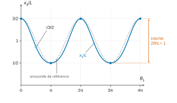
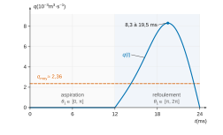
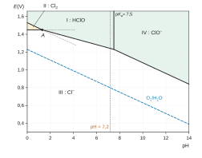
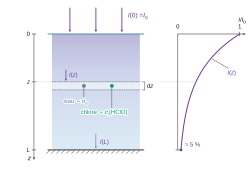
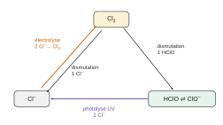

# CCINP PSI — Modélisation et ingénierie numérique 2026 · Corrigé guidé

*Corrigé rédigé par IA, non officiel. Signalez toute erreur.*

## Présentation du sujet

**Thème.** « Modélisation de l'entretien automatisé d'une piscine privée ». Épreuve PSI3MO, **4 heures, calculatrice interdite**, 14 pages, 46 questions en **deux parties indépendantes**. Le sujet suit l'eau du bassin : une pompe la fait circuler (partie I), puis un électrolyseur au sel, une sonde redox et un pH-mètre en contrôlent la qualité chimique (partie II). La même démarche revient deux fois : on construit un modèle, on en tire une prédiction chiffrée et on la compare à un relevé expérimental (figure 3 pour le débit, figure 11 pour le potentiel).

**Partie I — Régulation du débit de la pompe de circulation (Q1–Q17), sciences industrielles.**

- Q1 : dimensionnement du débit et du diamètre des conduites à partir du cahier des charges.
- I.1 (Q2–Q9) : système bielle-manivelle. Loi entrée-sortie par fermeture géométrique, tracé, cylindrée, vitesse du piston, débit instantané puis moyen, fonction Python `moyenne`, validation du modèle sur un relevé.
- I.2 (Q10–Q12) : schéma-bloc avec perturbation (pertes de charge). Réglage de l'adaptateur, fonctions de transfert en poursuite et en régulation, précision du système non corrigé.
- I.3 (Q13–Q17) : correcteur proportionnel intégral réglé par compensation du pôle dominant. Précision, marges, amortissement, rapidité.

**Partie II — Régulation des paramètres physico-chimiques de l'eau (Q18–Q46), physique-chimie et ingénierie numérique.**

- Q18–Q27 : électrolyse du chlorure de sodium, diagramme potentiel-pH du chlore, dismutation, répartition entre acide hypochloreux et ion hypochlorite, sonde redox (Nernst), effet sur le pH.
- Q28–Q29 : chaîne de mesure du pH (capteur et convertisseur analogique-numérique 12 bits).
- Q30–Q37 : photolyse du chlore par les UV. Beer-Lambert, lecture de spectres, absorption par l'eau, Planck-Einstein, vitesse de disparition.
- Q38–Q44 : modèle différentiel de la concentration en acide hypochloreux, résolution par la méthode d'Euler (une ligne de Python à compléter), confrontation à la mesure, durée de fonctionnement de l'électrolyseur.
- Q45–Q46 : tension d'électrolyse sur des courbes intensité-potentiel, énergie consommée, intérêt du volet roulant.

**Notions mobilisées.** Fermeture géométrique, dérivation composée, moyenne temporelle ; schémas-blocs, théorème de la valeur finale, classe d'un système, correcteur PI, marges de gain et de phase, premier ordre ; titres massique et molaire, loi de Faraday ; diagrammes E-pH, dismutation, stabilité dans l'eau, blocage cinétique ; relation de Nernst ; quantification d'un CAN ; loi de Beer-Lambert, photon ; bilan de matière, schéma d'Euler ; courbes intensité-potentiel.

**Difficulté et longueur.** Sujet long (46 questions en 4 heures, soit environ 5 minutes par question), sans question vraiment difficile. On gagne des points sur la rigueur des justifications et la propreté des calculs à la main. **Deux anomalies d'énoncé** sont à signaler sur la copie, comme le demande la consigne : l'intervalle de potentiel donné après Q26 (calculé avec un seul électron) et l'unité du volume dans le programme de Q41.

**Ce que dit le rapport 2026.** Le jury juge la qualité des copies satisfaisante, mais insiste sur trois points. D'abord : « Même si plusieurs questions du sujet ne demandaient pas de grandes justifications, il est nécessaire d'argumenter les réponses. » Ensuite, les applications numériques et les unités : « Un résultat donné sans unité est incorrect. » Enfin, le temps : « Pour beaucoup de candidats, une mauvaise gestion du temps n'a pas permis d'aborder la dernière partie de manière posée et réfléchie. »

**Questions discriminantes (rapport 2026).** Le jury signale comme mal réussies ou rarement justifiées : Q2 (unicité de la solution), Q15 (définitions des marges), Q20 (équation-bilan, souvent sautée), Q23 (blocage cinétique), Q24 (équation de dismutation), Q27 (effet sur le pH), Q28 (nature du signal, rôle du CAN), Q33 (comparaison chiffrée), Q41 (ligne d'Euler) et Q45 (lecture de la tension). Q9, Q17, Q32 et Q36 à Q39 ont été peu traitées alors qu'elles sont accessibles.

**Questions à ne pas laisser passer.** Q1, Q4, Q10, Q14, Q17, Q18, Q19, Q22, Q25, Q29, Q30, Q35, Q44 : courtes, presque mécaniques. Q21 et Q24 se traitent vite si le diagramme E-pH est maîtrisé.

**Gestion du temps.** Environ 1 h 30 pour la partie I et 2 h 30 pour la partie II, qui est plus longue mais faite de questions courtes. Les blocs de la partie II sont assez indépendants : en cas de blocage sur Beer-Lambert, on peut passer à Q42–Q46, qui demandent surtout des lectures de figures.

## Partie I — Régulation du débit de la pompe de circulation

On part du cahier des charges (renouveler l'eau en 8 heures) pour dimensionner l'installation, puis on modélise la pompe à piston et son asservissement de débit. Outils : cinématique plane, calcul intégral, schémas-blocs et correcteurs.

### Question 1

> [!INDICATION]
> Un débit volumique est un volume divisé par une durée, et c'est aussi une vitesse multipliée par une section.

> [!INDICATION]
> Le diamètre varie comme la racine carrée du débit : inutile de refaire le calcul pour le second diamètre.

#### Solution

Le volume du bassin doit passer dans la pompe en $\Delta t=8\ \text{h}=2{,}88\cdot10^4$ s. Le débit vaut donc $q=V/\Delta t$ :

$$\begin{aligned}
q_{\min}&=\frac{30}{2{,}88\cdot10^4}\\
&\simeq1{,}04\cdot10^{-3}\ \mathrm{m^3\cdot s^{-1}}\\
q_{\max}&=\frac{120}{2{,}88\cdot10^4}\\
&\simeq4{,}17\cdot10^{-3}\ \mathrm{m^3\cdot s^{-1}}
\end{aligned}$$

$$\boxed{\begin{aligned}q_{\min}&\simeq1{,}0\ \mathrm{L\cdot s^{-1}}\\ q_{\max}&\simeq4{,}2\ \mathrm{L\cdot s^{-1}}\end{aligned}}$$

La vitesse $v=1{,}5\ \mathrm{m\cdot s^{-1}}$ est uniforme sur une section circulaire. Donc $q=v\,\pi d^2/4$, d'où $d=\sqrt{4q/(\pi v)}$ :

$$\begin{aligned}
d_{\min}&=\sqrt{\frac{4\times1{,}04\cdot10^{-3}}{\pi\times1{,}5}}\\
&\simeq\sqrt{8{,}8\cdot10^{-4}}\\
&\simeq2{,}97\cdot10^{-2}\ \text{m}\\
d_{\max}&=\sqrt{\frac{q_{\max}}{q_{\min}}}\,d_{\min}\\
&=2\,d_{\min}
\end{aligned}$$

$$\boxed{\begin{aligned}d_{\min}&\simeq30\ \text{mm}\\ d_{\max}&\simeq59\ \text{mm}\end{aligned}}$$

Ces diamètres, de 3 à 6 cm, sont ceux des canalisations usuelles d'une piscine : les ordres de grandeur sont cohérents.

> [!PIEGE]
> Le débit se calcule sur les 8 heures de fonctionnement, pas sur 24 heures. Et l'énoncé impose les unités : L·s⁻¹ et mm. Un résultat en m³·s⁻¹ ne répond pas complètement.

> [!JURY]
> Le rapport 2026 relève des candidats qui « donnent un résultat non abouti sous forme de fraction », et d'autres qui « obtiennent des ordres de grandeurs très aberrants mais ne font aucune remarque sur la pertinence de leurs résultats ». Une valeur décimale avec son unité, puis une phrase de contrôle de l'ordre de grandeur, règlent les deux défauts.

### I.1 — Modélisation mécanique du système d'aspiration de la pompe

Système bielle-manivelle à une seule boucle : on en tire la loi entrée-sortie, puis le débit, qu'on confronte à la mesure.

### Question 2

> [!INDICATION]
> Écrire la fermeture géométrique de la boucle $O\to A\to B\to O$ et la projeter sur $\vec x_0$ et $\vec y_0$.

> [!INDICATION]
> La projection sur $\vec y_0$ élimine $x_3$ et donne $\sin\theta_2$. Il reste une ambiguïté de signe sur $\cos\theta_2$ : examiner si $\cos\theta_2$ peut s'annuler au cours du mouvement.

> [!INDICATION]
> Une fonction continue qui ne s'annule jamais garde un signe constant : il suffit de la connaître à $t=0$.

#### Solution

Fermeture géométrique : $\overrightarrow{OA}+\overrightarrow{AB}=\overrightarrow{OB}$, soit $R\,\vec x_1+L\,\vec x_2=x_3\,\vec x_0$. On projette sur $\vec x_0$ et $\vec y_0$ :

$$\left\{\begin{aligned}R\cos\theta_1+L\cos\theta_2&=x_3\\ R\sin\theta_1+L\sin\theta_2&=0\end{aligned}\right.$$

La seconde équation donne $\sin\theta_2=-\frac{R}{L}\sin\theta_1$. On en tire $L\cos\theta_2=\pm\sqrt{L^2-R^2\sin^2\theta_1}$. Mathématiquement, il existe donc deux solutions :

$$x_3=R\cos\theta_1\pm\sqrt{L^2-(R\sin\theta_1)^2}$$

**Choix du signe.**

- Comme $R<L$, on a $|\sin\theta_2|\le R/L<1$ : $\cos\theta_2$ ne s'annule jamais.
- Fonction continue du temps qui ne s'annule pas, $\cos\theta_2$ garde un signe constant (théorème des valeurs intermédiaires).
- À l'instant initial, $\theta_1=0$ et la figure 2 place B à droite de A. Donc $\theta_2=0$ et $\cos\theta_2=1>0$.
- Ainsi $\cos\theta_2>0$ à chaque instant, et seul le signe $+$ convient.

$$\boxed{x_3=R\cos\theta_1+\sqrt{L^2-(R\sin\theta_1)^2}}$$

La racine écartée se ramène à la première. En notant $x_3^{+}$ la racine retenue, qui est au moins égale à $L-R$ :

$$\begin{aligned}
R\cos\theta_1-\sqrt{L^2-R^2\sin^2\theta_1}&=-x_3^{+}(\pi-\theta_1)\\
&\le-(L-R)\\
&<0
\end{aligned}$$

Elle placerait B à gauche de O. C'est l'autre montage du mécanisme, symétrique par rapport à $(O,\vec y_0)$, incompatible avec la figure 2.

> [!METHODE]
> Pour lever une ambiguïté de signe dans une loi entrée-sortie : montrer que la quantité concernée ne s'annule jamais (ici grâce à $R<L$), puis lire son signe sur la configuration de la figure. C'est l'argument de continuité, qui vaut pour tous les mécanismes à une boucle.

> [!JURY]
> D'après le rapport 2026, la plupart des candidats trouvent le résultat, mais « très peu montrent l'existence mathématique de deux solutions et montrent rigoureusement qu'une seule des deux est possible pour ce système ». Les deux étapes sont attendues : écrire le $\pm$, puis l'argument qui élimine le signe $-$.

### Question 3

> [!INDICATION]
> Diviser par $L$ : seul le rapport $R/L$ reste comme paramètre.

> [!INDICATION]
> Chercher la période, la parité et les valeurs en $0$, $\pi/2$, $\pi$. L'inégalité triangulaire dans le triangle $OAB$ encadre $OB$.

#### Solution

$$\boxed{\frac{x_3}{L}=\frac{R}{L}\cos\theta_1+\sqrt{1-\Big(\frac{R}{L}\Big)^2\sin^2\theta_1}}$$

Pour $R/L=1/2$, on obtient une fonction $2\pi$-périodique et paire :

$$\frac{x_3}{L}=\frac12\cos\theta_1+\sqrt{1-\frac14\sin^2\theta_1}$$

Par l'inégalité triangulaire, $L-R\le OB\le L+R$, avec égalité quand O, A et B sont alignés :

- $\theta_1=0$, $2\pi$, $4\pi$ : $\boxed{x_3/L=3/2}$ (maximum) ;
- $\theta_1=\pi$, $3\pi$ : $\boxed{x_3/L=1/2}$ (minimum) ;
- valeurs intermédiaires : $x_3/L\simeq0{,}87$ en $\pi/2$ et $x_3/L\simeq0{,}58$ en $3\pi/4$.

| θ₁ | 0 | π/2 | 3π/4 | π | 3π/2 | 2π | 3π | 4π |
|---|---|---|---|---|---|---|---|---|
| x₃/L | 1,5 | 0,87 | 0,58 | 0,5 | 0,87 | 1,5 | 0,5 | 1,5 |

Allure (figure 1) : deux oscillations entre 0,5 et 1,5 sur $[0,4\pi]$. Ce n'est pas une sinusoïde : les maxima sont plus pointus et les minima plus aplatis, parce que le terme en racine déforme la courbe.



> [!PIEGE]
> Tracer une sinusoïde « propre » n'est acceptable que si $R/L\ll1$. Ici $R/L=1/2$ : la dissymétrie se voit et doit apparaître, avec les valeurs 3/2 et 1/2 portées sur le graphe.

### Question 4

> [!INDICATION]
> Volume balayé = course × section. La course se lit sur les extrema de Q3.

#### Solution

D'après Q3, $x_3$ atteint ses extrema aux points morts : $x_3(0)=L+R$ et $x_3(\pi)=L-R$. La course est la distance parcourue par le piston entre ces deux positions, soit $2R$.

La section du piston est un disque d'aire $S_p=\pi d_p^2/4$. Le volume balayé sur un tour vaut :

$$\begin{aligned}
C&=2R\cdot\frac{\pi d_p^2}{4}\\
&=\frac{\pi R\,d_p^2}{2}
\end{aligned}$$

$$\boxed{C=\frac{\pi R\,d_p^2}{2}}$$

La longueur $L$ de la bielle n'intervient pas, ce que l'énoncé laissait prévoir.

> [!PIEGE]
> Le rapport 2026 note que « L'évaluation de la course est souvent mal comprise. » La course est la différence entre les positions extrêmes, $2R$ : ni $R$, ni $L+R$. Et la section d'un piston de diamètre $d_p$ est $\pi d_p^2/4$, pas $\pi d_p^2$.

### Question 5

> [!INDICATION]
> Le piston est en translation : sa vitesse est la dérivée de $x_3$ par rapport au temps.

> [!INDICATION]
> Dériver par rapport à $\theta_1$ puis multiplier par $\dot\theta_1=\Omega_m$. Vérifier que le radicande ne s'annule pas.

#### Solution

Le piston est en translation de direction $\vec x_0$. Avec $\theta_1=\Omega_mt$, la dérivée composée donne $v_3=\dot x_3=\Omega_m\,\dfrac{\mathrm dx_3}{\mathrm d\theta_1}$.

Le radicande vérifie $L^2-R^2\sin^2\theta_1\ge L^2-R^2>0$ : la racine est dérivable, et

$$\frac{\mathrm dx_3}{\mathrm d\theta_1}=-R\sin\theta_1-\frac{R^2\sin\theta_1\cos\theta_1}{\sqrt{L^2-R^2\sin^2\theta_1}}$$

$$\boxed{v_3=-R\,\Omega_m\sin\theta_1\left(1+\frac{R\cos\theta_1}{\sqrt{L^2-(R\sin\theta_1)^2}}\right)}$$

Contrôle : $v_3$ s'annule aux points morts, en 0 et en π. Le facteur entre parenthèses est strictement positif : $R^2\cos^2\theta_1<L^2-R^2\sin^2\theta_1$ équivaut à $R^2<L^2$, vrai puisque $R<L$.

Donc $v_3$ a le signe de $-\sin\theta_1$ : $v_3\le0$ pour $\theta_1\in[0,\pi]$, et $v_3\ge0$ pour $\theta_1\in[\pi,2\pi]$.

> [!PIEGE]
> Le rapport 2026 signale « De nombreuses erreurs dans le calcul de la dérivée. » Dériver la racine comme une fonction composée : $\big(\sqrt u\big)'=u'/(2\sqrt u)$, avec $u'=-2R^2\sin\theta_1\cos\theta_1$. Et ne pas donner $\mathrm dx_3/\mathrm d\theta_1$ comme vitesse : il manque le facteur $\Omega_m$.

### Question 6

> [!INDICATION]
> Pendant $\mathrm dt$, le piston chasse un cylindre de section $\pi d_p^2/4$ et de longueur $v_3\,\mathrm dt$.

> [!INDICATION]
> Vérifier le signe de $v_3$ sur l'intervalle de refoulement, pour savoir s'il faut un signe moins ou une valeur absolue.

#### Solution

Pendant $\mathrm dt$, le piston de section $S_p=\pi d_p^2/4$ chasse le volume $S_p\,v_3\,\mathrm dt$. Sur $[\pi,2\pi]$, on a $v_3\ge0$ (Q5), donc le débit refoulé est positif :

$$\boxed{q=\begin{cases}0&\text{pour }\theta_1\in[0,\pi]\\[4pt] \dfrac{\pi d_p^2}{4}\,v_3&\text{pour }\theta_1\in[\pi,2\pi]\end{cases}}$$

Avec les données numériques, le maximum vaut $8{,}3\cdot10^{-3}\ \mathrm{m^3\cdot s^{-1}}$ vers $\theta_1\simeq292^\circ$. Cela correspond à $t\simeq19{,}5$ ms, comme sur la figure 3.

### Question 7

> [!INDICATION]
> Inutile d'intégrer l'expression de $q$ : $q\,\mathrm dt$ est un volume élémentaire balayé.

> [!INDICATION]
> L'intégrale du débit sur un tour est la cylindrée. Il reste à diviser par la bonne durée.

#### Solution

Sur une période $T=2\pi/\Omega_m$, le débit n'est non nul que pendant le refoulement, où $q\,\mathrm dt=S_p\,\mathrm dx_3$ :

$$\begin{aligned}
q_{moy}&=\frac1T\int_0^Tq\,\mathrm dt\\
&=\frac1T\,\frac{\pi d_p^2}{4}\big[x_3(2\pi)-x_3(\pi)\big]\\
&=\frac{C}{T}\\
&=\frac{\pi R d_p^2}{2}\cdot\frac{\Omega_m}{2\pi}
\end{aligned}$$

$$\boxed{q_{moy}=\frac{R\,d_p^2\,\Omega_m}{4}}$$

> [!METHODE]
> Reconnaître une dérivée exacte sous l'intégrale ($q=S_p\,\dot x_3$) transforme un calcul pénible en une différence de valeurs aux bornes.

> [!PIEGE]
> La moyenne se prend sur la période entière $T$, pas sur la demi-période de refoulement : diviser par $T/2$ double le résultat. Le rapport 2026 note que beaucoup de candidats abordent le calcul sans aboutir à l'expression finale : le changement de variable évite justement d'intégrer l'expression de Q6.

### Question 8

> [!INDICATION]
> Avec un pas de temps constant, la moyenne temporelle sur une période est la moyenne arithmétique des échantillons.

#### Solution

Le relevé de la figure 3 couvre une période ($T=60/2500=24$ ms), échantillonnée à pas constant $\Delta t$. Sur $N$ échantillons, la somme de Riemann se simplifie :

$$\frac{1}{N\Delta t}\sum_k q_k\,\Delta t=\frac1N\sum_k q_k$$

```python
def moyenne(q):
    """Débit moyen (m3/s) d'une liste de débits relevés à pas de temps constant."""
    s = 0.0
    for qi in q:
        s = s + qi
    return s / len(q)
```

`sum(q)/len(q)` convient aussi.

> [!PIEGE]
> Le rapport 2026 met en garde contre la division euclidienne `//`, vue dans quelques copies : elle tronque le résultat. La moyenne s'obtient avec `/`. Le `return` doit être hors de la boucle, et on divise par `len(q)`, pas par une constante écrite en dur.

### Question 9

> [!INDICATION]
> Convertir $\Omega_m$ en rad·s⁻¹ avant tout calcul.

> [!INDICATION]
> Sans calculatrice : séparer mantisses et puissances de dix, puis comparer l'écart relatif à la précision du relevé.

#### Solution

On convertit d'abord la vitesse de rotation :

$$\Omega_m=2500\times\frac{2\pi}{60}\simeq262\ \mathrm{rad\cdot s^{-1}}$$

$$\begin{aligned}
q_{moy}&=\frac{0{,}04\times9\cdot10^{-4}\times262}{4}\\
&=\frac{3{,}6\cdot10^{-5}\times262}{4}\\
&\simeq2{,}36\cdot10^{-3}\ \mathrm{m^3\cdot s^{-1}}
\end{aligned}$$

$$\boxed{q_{moy}\simeq2{,}36\cdot10^{-3}\ \mathrm{m^3\cdot s^{-1}}}$$

L'écart relatif avec la mesure, $2{,}4\cdot10^{-3}\ \mathrm{m^3\cdot s^{-1}}$, est d'environ 2 %. C'est du même ordre que la précision de la valeur mesurée, donnée avec deux chiffres significatifs. La forme du débit modélisé (nul puis en cloche, maximum vers $8{,}3\cdot10^{-3}\ \mathrm{m^3\cdot s^{-1}}$) correspond aussi à la figure 3.

**Le modèle (piston étanche, fluide incompressible, clapets parfaits) est validé.** Ce débit appartient à $[q_{\min};q_{\max}]$.



> [!PIEGE]
> Oublier la conversion tr·min⁻¹ → rad·s⁻¹ fausse le résultat d'un facteur $2\pi/60\simeq0{,}1$.

> [!JURY]
> Rapport 2026 : « Peu traitée. L'application numérique n'a pas toujours été bien réalisée. » La question est pourtant rapide une fois Q7 obtenue. « Conclure quant à la validité » demande une phrase argumentée : un écart relatif chiffré, comparé à la précision des données, et le rappel des hypothèses validées.

### I.2 — Modélisation de la régulation sous la forme d'un schéma-bloc

Schéma-bloc classique avec une perturbation additive en sortie. On établit les deux fonctions de transfert, puis on constate que le système sans correcteur est inutilisable.

### Question 10

> [!INDICATION]
> Écrire $\varepsilon$ en fonction de $Q_c$ et $Q_s$, puis exiger $\varepsilon=0$ lorsque $Q_s=Q_c$.

#### Solution

D'après le schéma-bloc :

$$\begin{aligned}
\varepsilon&=U_c-U_{mes}\\
&=K_aQ_c-K_qQ_s
\end{aligned}$$

Pour que $\varepsilon=0$ équivaille à $Q_s=Q_c$, il faut $(K_a-K_q)\,Q_c=0$ quelle que soit la consigne :

$$\boxed{K_a=K_q=1\ \mathrm{V\cdot s\cdot m^{-3}}}$$

> [!PIEGE]
> $K_a$ a une unité : il convertit un débit en tension. Et ce réglage garantit seulement que $\varepsilon=0$ signifie $Q_s=Q_c$. Que $\varepsilon$ tende vers 0 dépend de la classe de la boucle (Q12–Q13).

### Question 11

> [!INDICATION]
> Système linéaire : écrire l'équation de boucle, ou superposer les deux entrées.

> [!INDICATION]
> Lire attentivement le signe de $Q_{pc}$ au sommateur de sortie. « Forme canonique » : 1 comme terme constant au dénominateur.

#### Solution

On note $G(p)=C(p)K_vH(p)K_{pom}$, c'est-à-dire :

$$G(p)=\frac{C(p)K_vK_mK_{pom}}{1+\tau_mp}$$

Le schéma-bloc donne deux relations, la perturbation étant retranchée au sommateur de sortie :

$$\begin{aligned}
Q_s&=G\varepsilon-Q_{pc}\\
\varepsilon&=K_aQ_c-K_qQ_s
\end{aligned}$$

D'où $Q_s(1+K_qG)=K_aGQ_c-Q_{pc}$. Avec $C=1$, on pose $K=K_qK_vK_mK_{pom}$, sans dimension, qui vaut $9\cdot10^{-4}$. En remplaçant $H(p)$ par son expression :

$$\boxed{\begin{aligned}H_1(p)&=\frac{\dfrac{K_aK_vK_mK_{pom}}{1+K}}{1+\dfrac{\tau_m}{1+K}\,p}\\[6pt] H_2(p)&=-\frac{1}{1+K}\cdot\frac{1+\tau_mp}{1+\dfrac{\tau_m}{1+K}\,p}\end{aligned}}$$

Numériquement, $H_1(p)\simeq\dfrac{9\cdot10^{-4}}{1+p}$ et $H_2(p)\simeq-1$.

> [!PIEGE]
> Le « $-$ » sur $Q_{pc}$ traduit la « diminution du débit » annoncée : $H_2$ est négative. Écrire $H_1=9\cdot10^{-4}/(1{,}0009+p)$ n'est pas une forme canonique.

> [!JURY]
> Le rapport 2026 juge la question bien réussie, « mais quelques candidats laissent H(p) sans remplacer par son expression et ne donnent pas les résultats sous forme canonique ». Les deux étapes sont exigées : expliciter $H(p)$, puis mettre gain statique et constante de temps en évidence.

### Question 12

> [!INDICATION]
> Exprimer $\varepsilon(p)$ en fonction des deux entrées, puis appliquer le théorème de la valeur finale à des échelons.

> [!INDICATION]
> Vérifier d'abord la stabilité. Penser à la classe de la boucle ouverte.

#### Solution

On lit « non asservi » comme « sans correction » ($C=1$). Alors :

$$\varepsilon(p)=\frac{K_aQ_c(p)+K_qQ_{pc}(p)}{1+K_qG(p)}$$

Le pôle $-(1+K)/\tau_m$ est négatif : le système est stable et le théorème de la valeur finale s'applique. Pour des échelons $Q_{c0}/p$ et $Q_{pc0}/p$ :

$$\begin{aligned}
\varepsilon_s&=\frac{K_aQ_{c0}}{1+K}\\
&\simeq K_aQ_{c0}\neq0\\
\varepsilon_{pert}&=\frac{K_qQ_{pc0}}{1+K}\\
&\simeq K_qQ_{pc0}\neq0
\end{aligned}$$

Ces écarts sont des tensions : ils valent presque toute la consigne convertie, et presque toute la perturbation convertie. **Les exigences de précision ne sont pas respectées.**

La boucle ouverte est de classe 0 et son gain $K=9\cdot10^{-4}$ est si faible que le débit obtenu vaut environ $9\cdot10^{-4}\,Q_{c0}$. Si l'on comprend « non asservi » au sens de boucle ouverte, la conclusion est la même : rien ne corrige la perturbation.

> [!PIEGE]
> Le rapport 2026 note que « De nombreux candidats confondent BO et BF. » Le théorème de la valeur finale s'applique à l'écart du système bouclé, pas à la boucle ouverte. Et $1/(1+K)\simeq1$ ne veut pas dire « écart nul » : l'écart vaut presque toute la consigne.

> [!JURY]
> Rapport 2026 : « Attention à bien justifier pour les deux erreurs. » Il faut conclure séparément sur l'écart en poursuite et sur l'écart dû à la perturbation, chacun avec son calcul.

### I.3 — Mise en place d'un correcteur

Un correcteur PI apporte l'intégrateur qui manquait. Son zéro, placé sur le pôle du moteur, ramène la boucle ouverte à un intégrateur pur : tout le réglage en découle.

### Question 13

> [!INDICATION]
> Que devient la classe de la boucle ouverte ? Où l'intégrateur est-il placé par rapport à l'entrée de la perturbation ?

#### Solution

La fonction de transfert en boucle ouverte est :

$$\mathrm{FTBO}(p)=\frac{K_pK_qK_vK_mK_{pom}}{T_i}\cdot\frac{1+T_ip}{p(1+\tau_mp)}$$

Elle est de classe 1, et l'intégrateur est **en amont** du point d'entrée de $Q_{pc}$. Si le système corrigé est stable (vérifié en Q15–Q16), le théorème de la valeur finale donne, pour des échelons :

$$\begin{aligned}
\varepsilon_s&=\lim_{p\to0}\frac{K_aQ_{c0}}{1+\mathrm{FTBO}(p)}\\
&=0\\
\varepsilon_{pert}&=\lim_{p\to0}\frac{K_qQ_{pc0}}{1+\mathrm{FTBO}(p)}\\
&=0
\end{aligned}$$

**L'exigence de précision est respectée.**

> [!METHODE]
> Pour annuler l'écart dû à une perturbation en échelon, il faut un intégrateur **entre le comparateur et le point d'entrée de la perturbation**. La classe de la boucle ouverte ne suffit pas à elle seule.

> [!JURY]
> Le rapport 2026 regrette que « l'argument de la classe est souvent oublié » et ajoute : « De nombreux candidats ne précisent pas que le correcteur doit être placé en amont de la perturbation. » Dire « un PI améliore la précision » ne suffit pas : il faut les deux arguments.

### Question 14

> [!INDICATION]
> Hors intégrateur, combien de pôles a la boucle ouverte ? Placer le zéro du correcteur pour qu'il simplifie l'un d'eux.

#### Solution

Le seul pôle non nul, $-1/\tau_m$, est le pôle dominant. On le compense :

$$\boxed{T_i=\tau_m=1\ \text{s}}$$

La boucle ouverte devient un intégrateur pur :

$$\boxed{\begin{aligned}H_{BO}(p)&=\frac{K_{BO}}{p}\\ K_{BO}&=\frac{K_pK_qK_vK_mK_{pom}}{T_i}\\ &=9\cdot10^{-4}K_p\ \ (\mathrm{s^{-1}})\end{aligned}}$$

C'est bien la valeur que l'énoncé donne à la question Q17.

> [!PIEGE]
> La compensation est une simplification exacte du modèle. En pratique, $\tau_m$ n'est connu qu'approximativement et la simplification reste imparfaite.

### Question 15

> [!INDICATION]
> Rappeler les définitions avec les pulsations où elles s'évaluent. Quelle est la phase d'un intégrateur pur ?

#### Solution

La marge de gain s'évalue à la pulsation $\omega_{180}$ où $\arg H_{BO}=-180^\circ$. La marge de phase s'évalue à la pulsation $\omega_{0\,\text{dB}}$ où $|H_{BO}|=1$ :

$$\begin{aligned}
MG&=-20\log|H_{BO}(j\omega_{180})|\\
MP&=180^\circ+\arg H_{BO}(j\omega_{0\,\text{dB}})
\end{aligned}$$

Pour $H_{BO}=K_{BO}/p$, la phase vaut $-90^\circ$ à toute pulsation et n'atteint jamais $-180^\circ$. Donc $\boxed{MG=+\infty>10\ \text{dB}}$.

Le gain coupe 0 dB en $\omega_{0\,\text{dB}}=K_{BO}$, donc $\boxed{MP=90^\circ>45^\circ}$. Les deux critères sont respectés, quel que soit $K_p>0$.

> [!PIEGE]
> « La marge de gain n'existe pas » ne veut pas dire « critère non respecté » : la phase n'atteignant jamais $-180^\circ$, la marge est infinie.

> [!JURY]
> Rapport 2026 : « La plupart des candidats ne connaissent pas les définitions des marges de gain et de phase. » C'est une question de cours discriminante : écrire les deux définitions, avec la pulsation où chacune s'évalue, avant de les appliquer.

### Question 16

> [!INDICATION]
> Le retour n'est pas unitaire : partir de $H_1=K_aG/(1+K_qG)$ et utiliser le réglage de Q10.

> [!INDICATION]
> Quel est l'ordre du système bouclé ? Un tel système peut-il présenter un dépassement ?

#### Solution

Avec $K_qG=H_{BO}$ et $K_a=K_q$ :

$$\begin{aligned}
H_{BF}(p)&=\frac{K_a}{K_q}\cdot\frac{K_{BO}/p}{1+K_{BO}/p}\\
&=\frac{K_{BO}}{p+K_{BO}}\\
&=\frac{1}{1+\dfrac{p}{K_{BO}}}
\end{aligned}$$

$$\boxed{\begin{aligned}H_{BF}(p)&=\frac{1}{1+\tau_{BF}\,p}\\ \tau_{BF}&=\frac{1}{K_{BO}}\end{aligned}}$$

Premier ordre de gain statique 1 : la réponse indicielle $Q_{c0}\big(1-e^{-t/\tau_{BF}}\big)$ est strictement croissante, donc **sans dépassement**. Le critère d'amortissement est respecté.

> [!METHODE]
> Un intégrateur pur bouclé par un retour proportionnel donne toujours un premier ordre : stable, sans dépassement, de constante de temps $1/K_{BO}$.

> [!JURY]
> Rapport 2026 : « Attention à bien identifier l'expression du gain. » Sous forme canonique, le gain statique vaut 1 (grâce à $K_a=K_q$) et la constante de temps vaut $1/K_{BO}$ : ne pas confondre $K_{BO}$ avec le gain de la boucle fermée.

### Question 17

> [!INDICATION]
> Temps de réponse à 5 % d'un premier ordre : combien de constantes de temps ?

#### Solution

Pour un premier ordre, $t_{r5\%}=\tau_{BF}\ln20\simeq3/K_{BO}$. L'exigence $t_{r5\%}<1$ s donne donc :

$$\begin{aligned}
K_{BO}&>3\ \mathrm{s^{-1}}\\
9\cdot10^{-4}K_p&>3
\end{aligned}$$

$$\boxed{K_{p,\min}=\frac{3}{9\cdot10^{-4}}\simeq3{,}3\cdot10^3}$$

Les marges, l'absence de dépassement et la précision ne dépendent pas de $K_p$ : toutes les exigences sont satisfaites dès que $K_p>3{,}3\cdot10^3$.

> [!PIEGE]
> $t_{r5\%}$ diminue quand $K_{BO}$ augmente : l'exigence donne une borne **inférieure** sur $K_p$. Et la question demande une valeur : il faut conclure par un nombre.

> [!JURY]
> Rapport 2026 : « Peu traitée mais bien réussie par les candidats ayant abordé la question. » Deux lignes de calcul suffisent : c'est un point à prendre même en fin de partie.

## Partie II — Régulation des paramètres physico-chimiques de l'eau

On suit l'élément chlore : produit par électrolyse, il se dismute en acide hypochloreux désinfectant, qui est détruit par les UV. On le mesure par une sonde redox et on modélise sa concentration au cours de la journée. Outils : oxydoréduction, E-pH, Beer-Lambert, bilan de matière, Euler.

### Question 18

> [!INDICATION]
> Écrire la dissolution du sel pour justifier la stœchiométrie, puis diviser le titre massique par la bonne masse molaire.

#### Solution

$M(\mathrm{NaCl})=23{,}0+35{,}5=58{,}5\ \mathrm{g\cdot mol^{-1}}$. La dissolution $\mathrm{NaCl(s)}\to\mathrm{Na^+}+\mathrm{Cl^-}$ est totale et libère une mole d'ions chlorure par mole de sel. La concentration en ions $\mathrm{Cl^-}$ est donc égale à la concentration apportée en sel :

$$\begin{aligned}
c_0&=\frac{c_m}{M(\mathrm{NaCl})}\\
&=\frac{5{,}0}{58{,}5}\ \mathrm{mol\cdot L^{-1}}
\end{aligned}$$

$$\boxed{c_0\simeq8{,}5\cdot10^{-2}\ \mathrm{mol\cdot L^{-1}}}$$

> [!PIEGE]
> Le rapport 2026 relève « Des confusions entre concentration apportée en soluté et concentration molaire en ions. » Ici elles sont égales, mais il faut le justifier par la stœchiométrie de la dissolution. Diviser par $M(\mathrm{Cl})=35{,}5$ seule surestime $c_0$ de 65 % : la masse dissoute est celle du sel.

> [!JURY]
> Le jury reproche une « Application numérique souvent trop arrondie témoignant d'un certain manque de rigueur » (rapport 2026). On garde deux chiffres significatifs, comme la donnée : 5,0/58,5 ≈ 0,085, et non 0,1.

### Question 19

> [!INDICATION]
> Comparer à la salinité de l'eau de mer, que l'on connaît à peu près.

#### Solution

L'eau contient $5\ \mathrm{g\cdot L^{-1}}$ de chlorure de sodium dissous, c'est-à-dire des ions $\mathrm{Na^+}$ et $\mathrm{Cl^-}$ : c'est le sel de l'eau de mer. La salinité de la mer est d'environ $35\ \mathrm{g\cdot L^{-1}}$. Sept fois moins salée que la mer, l'eau a un **goût salé perceptible mais léger**.

> [!PIEGE]
> D'après le rapport 2026, de nombreux candidats attribuent le goût salé au seul chlore ou au seul sodium. C'est le sel dissous, l'ensemble des ions sodium et chlorure, qui donne ce goût, et non le chlore actif.

### Question 20

> [!INDICATION]
> Identifier l'oxydation à l'anode et la réduction à la cathode (l'eau ou les ions sodium ?).

> [!INDICATION]
> Relier l'intensité au débit d'électrons avec $F$, puis appliquer la stœchiométrie de la demi-équation.

#### Solution

Demi-équations :

- anode (oxydation) : $2\,\mathrm{Cl^-}=\mathrm{Cl_2}+2e^-$ ;
- cathode (réduction de l'eau) : $2\,\mathrm{H_2O}+2e^-=\mathrm{H_2}+2\,\mathrm{HO^-}$.

Équation-bilan, sans électron :

$$\boxed{2\,\mathrm{Cl^-}+2\,\mathrm{H_2O}\longrightarrow\mathrm{Cl_2}+\mathrm{H_2}+2\,\mathrm{HO^-}}$$

Intensité d'électrolyse :

$$\begin{aligned}
I&=jS\\
&=4{,}0\cdot10^3\times20\cdot10^{-4}\ \text{A}\\
&=8{,}0\ \text{A}
\end{aligned}$$

Il faut deux électrons par molécule de $\mathrm{Cl_2}$ :

$$\begin{aligned}
v(\mathrm{Cl_2})&=\frac{I}{2F}\\
&=\frac{8{,}0}{1{,}93\cdot10^5}\ \mathrm{mol\cdot s^{-1}}
\end{aligned}$$

$$\boxed{v(\mathrm{Cl_2})\simeq4{,}1\cdot10^{-5}\ \mathrm{mol\cdot s^{-1}}}$$

soit $0{,}15\ \mathrm{mol\cdot h^{-1}}$.

> [!PIEGE]
> $20\ \mathrm{cm^2}=20\cdot10^{-4}\ \mathrm m^2$, pas $20\cdot10^{-2}$. On retrouve $I=8$ A à la ligne 1 du programme de la figure 10 : bon contrôle.

> [!JURY]
> Rapport 2026 : « Question mal réussie, régulièrement sautée. De nombreux candidats confondent équation-bilan et demi-équation d'oxydoréduction. » Écrire les deux demi-équations, puis leur somme sans électron : c'est cette somme qui est l'équation-bilan demandée.

### Question 21

> [!INDICATION]
> Calculer le nombre d'oxydation du chlore dans chaque espèce : plus il est grand, plus le domaine est haut.

> [!INDICATION]
> Une frontière verticale ne fait intervenir aucun électron. Les pentes des autres frontières permettent de vérifier l'attribution.

#### Solution

Nombres d'oxydation du chlore : −I dans $\mathrm{Cl^-}$, 0 dans $\mathrm{Cl_2}$, +I dans $\mathrm{HClO}$ et $\mathrm{ClO^-}$.

- **III = $\mathrm{Cl^-}$** : domaine le plus bas.
- **I = $\mathrm{HClO}$**, **IV = $\mathrm{ClO^-}$** : domaines supérieurs séparés par une verticale (frontière acido-basique), forme acide à gauche.
- **II = $\mathrm{Cl_2}$** : degré intermédiaire, entre $\mathrm{Cl^-}$ et $\mathrm{HClO}$, en milieu très acide.

Vérification par les pentes, $-0{,}06\,m/n$ V par unité de pH pour $m$ protons et $n$ électrons :

- II/III, $\mathrm{Cl_2}+2e^-=2\,\mathrm{Cl^-}$, sans proton : horizontale ;
- I/II, $2\,\mathrm{HClO}+2\,\mathrm{H^+}+2e^-=\mathrm{Cl_2}+2\,\mathrm{H_2O}$ : pente $-0{,}06$ V ;
- I/III, $\mathrm{HClO}+\mathrm{H^+}+2e^-=\mathrm{Cl^-}+\mathrm{H_2O}$ : pente $-0{,}03$ V ;
- IV/III, $\mathrm{ClO^-}+2\,\mathrm{H^+}+2e^-=\mathrm{Cl^-}+\mathrm{H_2O}$ : pente $-0{,}06$ V.

Ces valeurs correspondent à la figure 5.



> [!METHODE]
> Attribuer les domaines d'un diagramme E-pH : nombre d'oxydation croissant vers le haut, forme acide à gauche d'une frontière verticale, puis contrôle par les pentes $-0{,}06\,m/n$.

> [!PIEGE]
> Mettre $\mathrm{Cl_2}$ tout en haut « parce que c'est un oxydant fort » : $\mathrm{HClO}$, de degré +I, est au-dessus.

### Question 22

> [!INDICATION]
> Que vaut le pH sur la frontière entre la forme acide et la forme basique ?

#### Solution

Sur la verticale I/IV, les deux formes ont la même concentration, donc $\mathrm{pH}=\mathrm pK_a$. Elle se situe aux sept huitièmes de l'intervalle $[4;8]$ :

$$\boxed{\mathrm pK_a\simeq7{,}5}$$

Cette valeur est confirmée par la donnée $10^{-0,3}=0{,}5$ de Q25, puisque 7,2 − 7,5 = −0,3.

### Question 23

> [!INDICATION]
> Superposer au diagramme la frontière du couple $\mathrm{O_2/H_2O}$.

> [!INDICATION]
> Des domaines disjoints signifient une réaction thermodynamiquement favorable. Pourquoi ne l'observe-t-on pas ?

#### Solution

La frontière du couple $\mathrm{O_2/H_2O}$ est la droite $E=1{,}23-0{,}06\,\mathrm{pH}$. Les domaines de $\mathrm{HClO}$ et $\mathrm{ClO^-}$ sont entièrement au-dessus :

- à pH 7,2, au-dessus de 1,24 V pour $\mathrm{HClO}$, contre 0,80 V pour l'eau ;
- à pH 14, 0,84 V contre 0,39 V.

Domaines disjoints : **$\mathrm{HClO}$ et $\mathrm{ClO^-}$ oxydent l'eau**.

$$2\,\mathrm{HClO}\longrightarrow2\,\mathrm{Cl^-}+\mathrm{O_2}+2\,\mathrm{H^+}$$

$$2\,\mathrm{ClO^-}\longrightarrow2\,\mathrm{Cl^-}+\mathrm{O_2}$$

On peut les négliger parce qu'elles sont **cinétiquement bloquées** : l'oxydation de l'eau en dioxygène est très lente (fort surpotentiel d'oxydation de l'eau, système lent). Ces espèces sont métastables, comme l'eau de Javel, qui se conserve des mois.

> [!METHODE]
> Thermodynamiquement possible ne veut pas dire observé. Quand une prévision E-pH contredit l'expérience, l'explication attendue est cinétique.

> [!JURY]
> Rapport 2026 : « L'argument sur la séparation des zones est globalement connu. La proposition de réaction lente est rare. » La seconde moitié de la question, « Proposer une explication », attend précisément l'argument cinétique.

### Question 24

> [!INDICATION]
> Le dichlore est l'oxydant d'un couple et le réducteur d'un autre. Comparer les deux frontières à pH 7,2.

#### Solution

$\mathrm{Cl_2}$ n'existe que si $E>1{,}45$ V (frontière $\mathrm{Cl_2/Cl^-}$) et $E<1{,}53-0{,}06\,\mathrm{pH}$ (frontière $\mathrm{HClO/Cl_2}$). Ces conditions sont incompatibles au-delà de pH 1,3 (point A).

À pH 7,2, la seconde frontière est à $1{,}53-0{,}06\times7{,}2\simeq1{,}10$ V, sous 1,45 V. **Le dichlore n'est pas stable : il se dismute**, car les domaines de $\mathrm{HClO}$ et de $\mathrm{Cl^-}$ ont une partie commune :

$$\boxed{\mathrm{Cl_2}+\mathrm{H_2O}\longrightarrow\mathrm{HClO}+\mathrm{Cl^-}+\mathrm{H^+}}$$

À pH $7{,}2<\mathrm pK_a$, c'est bien $\mathrm{HClO}$ qui est majoritaire parmi les espèces de degré +I.

> [!PIEGE]
> Rapport 2026 : « La réaction correcte est rarement proposée. Certaines réactions ne font même pas intervenir le dichlore. » La dismutation part de $\mathrm{Cl_2}$ et donne les deux espèces voisines, $\mathrm{HClO}$ et $\mathrm{Cl^-}$. Il faut écrire le $\mathrm{H^+}$ produit : il sert à la question 27. Et c'est une dismutation, pas une médiamutation (réaction inverse).

### Question 25

> [!INDICATION]
> Le rapport $[\mathrm{ClO^-}]/[\mathrm{HClO}]$ ne dépend que de $\mathrm{pH}-\mathrm pK_a$. La donnée $10^{-0,3}$ indique la démarche.

#### Solution

Le rapport des deux formes ne dépend que de l'écart au $\mathrm pK_a$ :

$$\frac{[\mathrm{ClO^-}]}{[\mathrm{HClO}]}=10^{\mathrm{pH}-\mathrm pK_a}$$

Avec $c_t=[\mathrm{HClO}]+[\mathrm{ClO^-}]$, on écrit d'abord le résultat littéral, puis l'application numérique :

$$\begin{aligned}
[\mathrm{HClO}]&=\frac{c_t}{1+10^{\mathrm{pH}-\mathrm pK_a}}\\
&=\frac{60}{1+10^{-0,3}}\ \mu\mathrm{mol\cdot L^{-1}}\\
&=\frac{60}{1{,}5}\ \mu\mathrm{mol\cdot L^{-1}}
\end{aligned}$$

$$\boxed{[\mathrm{HClO}]=40\ \mu\mathrm{mol\cdot L^{-1}}}$$

**L'eau est bien désinfectée**, à la limite haute de la plage $[10;40]\ \mu\mathrm{mol\cdot L^{-1}}$. Une hausse du pH ferait baisser la fraction de $\mathrm{HClO}$ : d'où l'importance de réguler le pH.

> [!PIEGE]
> Confondre le rapport (0,5) et la fraction d'acide hypochloreux (1/1,5 = 2/3).

> [!JURY]
> Rapport 2026 : « Beaucoup de mélanges entre relations littérales et numériques rendent la rédaction particulièrement difficile à comprendre. » Une relation littérale d'abord, puis une ligne d'application numérique avec l'unité.

### Question 26

> [!INDICATION]
> La tension mesurée est la différence entre le potentiel de l'électrode de platine et celui de la référence.

> [!INDICATION]
> Écrire la demi-équation du couple $\mathrm{HClO/Cl^-}$ en milieu acide et compter les électrons avant d'écrire Nernst.

#### Solution

La tension mesurée est $U=E_{\mathrm{Pt}}-E_{ref}$. Demi-équation du couple, écrite en milieu acide (c'est à elle que se rapporte $E^\circ=1{,}49$ V) :

$$\mathrm{HClO}+\mathrm{H^+}+2e^-=\mathrm{Cl^-}+\mathrm{H_2O}$$

Formule de Nernst à 25 °C, concentrations rapportées à $c^\circ=1\ \mathrm{mol\cdot L^{-1}}$ :

$$E_{\mathrm{Pt}}=E^\circ+\frac{0{,}06}{2}\log\frac{[\mathrm{HClO}][\mathrm{H^+}]}{[\mathrm{Cl^-}]}$$

Avec $[\mathrm{Cl^-}]=c_0$ constant (Q43) :

$$\boxed{U=E^\circ-E_{ref}-0{,}03\,\mathrm{pH}+0{,}03\log\frac{[\mathrm{HClO}]}{c_0}}$$

Pour pH 7,2 et $[\mathrm{HClO}]$ entre 10 et $40\ \mu\mathrm{mol\cdot L^{-1}}$, on obtient $957\ \text{mV}<U<975\ \text{mV}$.

**Erreur d'énoncé à signaler.** L'intervalle annoncé, de 633 à 669 mV, se retrouve (634 et 670 mV) avec le coefficient $0{,}059$ au lieu de $0{,}059/2$, c'est-à-dire avec un seul électron. Or $n=2$ : la pente $-0{,}03$ V/pH de la frontière I/III (Q21) le confirme. On garde l'expression juste et on poursuit avec l'intervalle de l'énoncé, qui a servi à construire la figure 11.

> [!PIEGE]
> D'après le rapport 2026, trop de candidats utilisent le potentiel standard du couple avec une demi-équation équilibrée avec des ions hydroxyde. La valeur $E^\circ=1{,}49$ V correspond à l'écriture en milieu acide, avec $\mathrm{H^+}$ : en changeant d'écriture, on change de potentiel standard.

> [!JURY]
> Rapport 2026 : « La demi-équation doit être indiquée avant d'écrire la formule de Nernst. » Par ailleurs, la consigne de l'épreuve demande de signaler une erreur d'énoncé et d'expliquer les initiatives prises : une phrase claire, avec le calcul qui la justifie, vaut mieux qu'un résultat ajusté pour tomber sur la valeur attendue.

### Question 27

> [!INDICATION]
> Que devient le dichlore au pH de la piscine ? Quelle espèce acido-basique la réaction libère-t-elle ?

> [!INDICATION]
> Penser à la conséquence d'une dérive du pH sur la répartition entre $\mathrm{HClO}$ et $\mathrm{ClO^-}$, et à la suite du sujet.

#### Solution

La production de dichlore s'accompagne de sa dismutation (Q24), qui libère un ion $\mathrm{H^+}$ par molécule de $\mathrm{Cl_2}$ :

$$\mathrm{Cl_2}+\mathrm{H_2O}\longrightarrow\mathrm{HClO}+\mathrm{Cl^-}+\mathrm{H^+}$$

**La production de dichlore acidifie l'eau : le pH diminue.**

Conséquence : le pH sort de la plage $[7{,}0;7{,}4]$ fixée pour le confort des baigneurs. La fraction d'acide hypochloreux change aussi (Q25), donc l'efficacité de la désinfection. **Il faut mesurer le pH en continu et injecter un correcteur** avec la pompe péristaltique, ce qui justifie la chaîne de mesure étudiée ensuite.

Remarque : la cathode produit deux $\mathrm{HO^-}$ par $\mathrm{Cl_2}$. Le bilan global de l'électrolyseur, $\mathrm{Cl^-}+2\,\mathrm{H_2O}\to\mathrm{HClO}+\mathrm{H_2}+\mathrm{HO^-}$, est donc basique, et c'est ce qu'on observe en pratique sur les électrolyseurs au sel. La conséquence reste la même : le pH dérive et doit être régulé.

> [!PIEGE]
> Préciser le périmètre du raisonnement (dismutation du dichlore, comme le demande la question, ou électrolyseur complet) : les deux bilans ne donnent pas le même sens de variation.

> [!JURY]
> Rapport 2026 : « La réponse est très rarement justifiée voir donnée au hasard. » Le sens de variation du pH doit s'appuyer sur une équation écrite, ici celle de Q24 avec son $\mathrm{H^+}$.

### Question 28

> [!INDICATION]
> Quelle est la nature de chaque signal (chimique, électrique, analogique, numérique) ? Qui exploite l'information en bout de chaîne ?

> [!INDICATION]
> Gain = variation de la sortie / variation de l'entrée sur la plage utile. Sur 12 bits, combien de valeurs possibles ?

#### Solution

Il faut distinguer la nature du signal de son unité.

- Entrée du capteur : le pH, grandeur physico-chimique, sans unité.
- Sortie : la tension $U$, en volts. C'est un signal électrique **analogique**, continu en temps et en amplitude.

Le boîtier est un calculateur **numérique** (affichage, commande de la pompe) : il ne traite que des nombres binaires. La fonction du **CAN** est de convertir le signal analogique en un nombre $N$ codé sur 12 bits, par échantillonnage puis quantification.

Chaque gain est le rapport des étendues de sortie et d'entrée :

$$\boxed{\begin{aligned}K_{cap}&=\frac{10}{14}\simeq0{,}71\ \text{V par unité de pH}\\ K_{CAN}&=\frac{2^{12}}{10}\simeq4{,}1\cdot10^2\ \mathrm{V^{-1}}\end{aligned}}$$

La convention $(2^{12}-1)/10$ donne le même résultat à 0,02 % près.

> [!JURY]
> Rapport 2026 : « De nombreux candidats confondent unité physique et nature du signal. La fonction principale d'un CAN n'est pas bien connue. » « Volt » est une unité ; « analogique » ou « numérique » est une nature. Le CAN convertit un signal analogique en signal numérique exploitable par le calculateur.

### Question 29

> [!INDICATION]
> La plus petite variation mesurable fait changer $N$ d'une unité. La ramener à l'entrée par les gains.

#### Solution

La plus petite variation mesurable fait changer $N$ d'une unité. On la ramène à l'entrée par les deux gains :

$$\begin{aligned}
\Delta\mathrm{pH}_{\min}&=\frac{1}{K_{cap}K_{CAN}}\\
&=\frac{14}{4096}
\end{aligned}$$

$$\boxed{\Delta\mathrm{pH}_{\min}\simeq3{,}4\cdot10^{-3}}$$

C'est environ 30 fois plus fin que les 0,1 requis : **la chaîne de mesure est pertinente**, et la numérisation n'est pas le facteur limitant.

> [!PIEGE]
> Le rapport 2026 signale quelques copies qui concluent que la mesure est trop précise et qu'il faudrait réduire le nombre de bits. Une résolution meilleure que nécessaire n'est pas un défaut : le cahier des charges est respecté avec de la marge. Et la résolution n'est pas la précision, qui dépend surtout de l'électrode (étalonnage, dérive, température).

### Question 30

> [!INDICATION]
> Loi de cours : préciser le logarithme utilisé et l'unité de chaque grandeur.

#### Solution

Pour une solution diluée traversée sur une longueur $\ell$ par un rayonnement monochromatique, les absorbances des espèces s'ajoutent :

$$\boxed{A=\log\frac{I_0}{I}=\sum_i\varepsilon_i\,\ell\,c_i}$$

- $A$ : absorbance, sans unité ;
- $I_0$, $I$ : intensités incidente et transmise, en $\mathrm{W\cdot m^{-2}}$ ;
- $\varepsilon_i$ : coefficient d'absorption molaire, en $\mathrm{L\cdot mol^{-1}\cdot cm^{-1}}$ ;
- $\ell$ : longueur traversée, en cm ;
- $c_i$ : concentration, en $\mathrm{mol\cdot L^{-1}}$.

### Question 31

> [!INDICATION]
> Identifier les courbes avec la légende (trait épais et trait fin) avant de lire.

#### Solution

À 290 nm, la courbe fine (ion hypochlorite) est presque à son maximum, et la courbe épaisse (acide hypochloreux) sur un épaulement faible :

$$\boxed{\begin{aligned}\varepsilon_{\mathrm{ClO^-}}&\simeq3{,}8\cdot10^2\ \mathrm{L\cdot mol^{-1}\cdot cm^{-1}}\\ \varepsilon_{\mathrm{HClO}}&\simeq35\ \mathrm{L\cdot mol^{-1}\cdot cm^{-1}}\end{aligned}}$$

### Question 32

> [!INDICATION]
> Additionner les absorbances des deux formes, puis exprimer $[\mathrm{ClO^-}]$ à l'aide de $K_a$.

#### Solution

Par additivité des absorbances :

$$A=\big(\varepsilon_{\mathrm{HClO}}[\mathrm{HClO}]+\varepsilon_{\mathrm{ClO^-}}[\mathrm{ClO^-}]\big)z$$

La constante d'acidité donne $[\mathrm{ClO^-}]=\dfrac{K_a}{[\mathrm{H^+}]}[\mathrm{HClO}]$. D'où $A=\alpha_t[\mathrm{HClO}]\,z$ avec :

$$\boxed{\alpha_t=\varepsilon_{\mathrm{HClO}}+\varepsilon_{\mathrm{ClO^-}}\frac{K_a}{[\mathrm{H^+}]}}$$

Contrôle à pH 7,2, où $K_a/[\mathrm{H^+}]=0{,}5$ :

$$\begin{aligned}
\alpha_t&\simeq35+380\times0{,}5\ \mathrm{L\cdot mol^{-1}\cdot cm^{-1}}\\
&\simeq2{,}2\cdot10^2\ \mathrm{L\cdot mol^{-1}\cdot cm^{-1}}\\
&=2{,}2\cdot10^4\ \mathrm{L\cdot mol^{-1}\cdot m^{-1}}
\end{aligned}$$

C'est en accord avec la valeur de l'énoncé.

> [!PIEGE]
> Les $\varepsilon$ sont lus par centimètre et $\alpha_t$ est donné par mètre : il y a un facteur 100. $\alpha_t$ dépend du pH : c'est un coefficient effectif.

### Question 33

> [!INDICATION]
> Lire $\alpha_e$ sur l'échelle logarithmique, puis le comparer à une grandeur de même unité.

> [!INDICATION]
> La grandeur à comparer est $\alpha_t[\mathrm{HClO}]$ (en m⁻¹), pas $\alpha_t$ seul.

#### Solution

Sur la figure 8, à 290 nm, la courbe est sur sa partie décroissante entre 200 et 500 nm. On lit $\alpha_e\simeq0{,}1$ à $0{,}2\ \mathrm{m^{-1}}$ ; le programme retient `alpha_e = 0.1`.

On compare $\alpha_e$ au terme de même unité dû au chlore, $\alpha_t[\mathrm{HClO}]$, sur la plage de désinfection :

$$\begin{aligned}
\alpha_t\times10\ \mu\mathrm{mol\cdot L^{-1}}&\simeq0{,}23\ \mathrm{m^{-1}}\\
\alpha_t\times40\ \mu\mathrm{mol\cdot L^{-1}}&\simeq0{,}92\ \mathrm{m^{-1}}
\end{aligned}$$

Le terme de l'eau est du même ordre de grandeur : il représente de 10 % à près de 50 % de l'absorption totale. **On ne peut pas négliger l'absorption des UV par l'eau.**

> [!PIEGE]
> Comparer $\alpha_e$ à $\alpha_t=2{,}3\cdot10^4$ : les unités diffèrent et la conclusion serait fausse.

> [!JURY]
> Rapport 2026 : « Passé la mesure graphique, la justification pour négliger ou pas l'absorption due à l'eau est très rare. » Le jury ajoute que « trop de candidat se contente d'affirmer que c'est négligeable sans comparaison à un autre terme ». Négliger, c'est comparer : il faut deux nombres de même unité.

### Question 34

> [!INDICATION]
> Les absorptions de l'eau et du chlore s'ajoutent dans le logarithme décimal. Inverser ensuite.

#### Solution

Les absorptions de l'eau et du chlore s'ajoutent, avec $[\mathrm{HClO}]$ uniforme :

$$\log\frac{I(0)}{I(z)}=\big(\alpha_e+\alpha_t[\mathrm{HClO}]\big)z$$

$$\boxed{I(z)=I_0\,10^{-(\alpha_e+\alpha_t[\mathrm{HClO}])\,z}}$$

Pour $[\mathrm{HClO}]=33\ \mu\mathrm{mol\cdot L^{-1}}$, il ne reste qu'environ 5 % de l'intensité au fond, à 1,5 m.

> [!PIEGE]
> Rapport 2026 : « La plupart des candidats ont la dépendance en alpha_e mais pas celle en alpha_t. » Les deux absorbants agissent ensemble : l'exposant contient la somme. Écrire $e^{-(\alpha_e+\alpha_tc)z}$ oublie en outre le facteur $\ln10$ : la définition est en logarithme décimal.

### Question 35

> [!INDICATION]
> Énergie d'un photon en fonction de sa fréquence, puis de sa longueur d'onde.

#### Solution

$$\boxed{E=h\nu=\frac{hc}{\lambda}}$$

$E$ énergie d'un photon (J), $h$ constante de Planck (J·s), $\nu$ fréquence (Hz), $c$ vitesse de la lumière dans le vide ($\mathrm{m\cdot s^{-1}}$), $\lambda$ longueur d'onde (m).

À 300 nm, $E\simeq6{,}6\cdot10^{-19}$ J, soit environ 4 eV, l'ordre de grandeur d'une énergie de liaison.

### Question 36

> [!INDICATION]
> Deux absorbants en compétition dans la même tranche $\mathrm dz$ : la proportion revenant à l'un est le rapport de sa probabilité à la probabilité totale.

#### Solution

$$\boxed{\tau=\frac{\alpha_t[\mathrm{HClO}]}{\alpha_e+\alpha_t[\mathrm{HClO}]}}$$

Ce rapport est indépendant de $z$ (milieu uniforme), donc valable pour toute la colonne d'eau. Pour $[\mathrm{HClO}]=33\ \mu\mathrm{mol\cdot L^{-1}}$, $\tau\simeq0{,}88$.



> [!PIEGE]
> Une proportion est comprise entre 0 et 1 : $\alpha_t[\mathrm{HClO}]/\alpha_e$ n'en est pas une.

### Question 37

> [!INDICATION]
> Faire un bilan de puissance absorbée dans la colonne d'eau de section $S_e$, puis compter les photons.

> [!INDICATION]
> Rendement 1 : un photon absorbé par le chlore détruit une molécule. Passer en moles avec $\mathcal N_A$.

#### Solution

La puissance absorbée dans la colonne vaut $S_e\big(I(0)-I(L)\big)$, dont la part $\tau$ par le chlore. Chaque photon porte l'énergie $hc/\lambda$, et chaque photon absorbé par le chlore détruit une molécule. On divise enfin par $\mathcal N_A$ :

$$\begin{aligned}
v_d&=\tau\,\frac{S_e\lambda}{hc\,\mathcal N_A}\big(I(0)-I(L)\big)\\
&=\tau K_d\big(I(0)-I(L)\big)
\end{aligned}$$

$$\boxed{K_d=\frac{S_e\,\lambda}{h\,c\,\mathcal N_A}}$$

Unités : $K_d$ en $\mathrm{mol\cdot m^2\cdot J^{-1}}$ et $I$ en $\mathrm{W\cdot m^{-2}}$, donc $v_d$ en $\mathrm{mol\cdot s^{-1}}$.

Avec $\lambda=300$ nm, $K_d\simeq7{,}0\cdot10^{-5}\ \mathrm{mol\cdot m^2\cdot J^{-1}}$ : c'est ce que code la ligne 12 du programme, multiplié par 3600 pour un temps en heures.

> [!METHODE]
> Pour passer d'un flux lumineux à une vitesse de réaction : puissance absorbée, puis division par $hc/\lambda$ pour obtenir des photons par seconde, puis par $\mathcal N_A$ pour obtenir des moles, multiplié par le rendement quantique.

### Question 38

> [!INDICATION]
> Combiner la vitesse de production du dichlore (Q20) et la stœchiométrie de sa dismutation (Q24).

#### Solution

L'électrolyseur produit $\mathrm{Cl_2}$ à la vitesse $I/(2F)$ (Q20), et chaque molécule se dismute en un $\mathrm{HClO}$ (Q24) :

$$\boxed{v_p=\frac{I}{2F}=\frac{jS}{2F}}$$

Soit $v_p\simeq4{,}1\cdot10^{-5}\ \mathrm{mol\cdot s^{-1}}$, ou $0{,}15\ \mathrm{mol\cdot h^{-1}}$ (ligne 7 du programme).

### Question 39

> [!INDICATION]
> Variation de la quantité de matière dans le bassin = production − disparition. L'électrolyseur ne fonctionne pas en permanence.

> [!INDICATION]
> Remplacer $\tau$ et $I(L)$ par leurs expressions en fonction de $c$, pour que l'équation ne contienne que l'inconnue $c$.

#### Solution

Bilan de matière sur le bassin, de volume $V$ constant. On note $e(t)\in\{0,1\}$ l'état de l'électrolyseur :

$$\mathrm d(cV)=e(t)\,v_p\,\mathrm dt-v_d\,\mathrm dt$$

On reporte $\tau$ (Q36), $v_d$ (Q37) et $I(L)$ (Q34) :

$$\boxed{V\frac{\mathrm dc}{\mathrm dt}=e(t)\frac{I}{2F}-\frac{\alpha_t\,c}{\alpha_e+\alpha_t\,c}\,K_d\,I_0(t)\left[1-10^{-(\alpha_e+\alpha_t c)L}\right]}\qquad(1)$$

Équation du premier ordre, non linéaire et non autonome : on la résout numériquement. Ordre de grandeur en plein soleil : $v_d\simeq0{,}27\ \mathrm{mol\cdot h^{-1}}$, plus que $v_p=0{,}15\ \mathrm{mol\cdot h^{-1}}$. La concentration baisse donc même électrolyseur allumé.

> [!PIEGE]
> Oublier $V$ rend l'équation non homogène : $v_p$ et $v_d$ sont en $\mathrm{mol\cdot s^{-1}}$, $c$ est une concentration.

> [!JURY]
> Le rapport 2026 indique que les questions Q36 à Q39 ont été peu traitées. Elles s'enchaînent pourtant : chaque résultat se reporte dans le suivant, et l'équation (1) n'est que leur assemblage.

### Question 40

> [!INDICATION]
> Relier la courbe au mouvement apparent du Soleil. Pourquoi le maximum est-il à 14 h en été ?

> [!INDICATION]
> La courbe est parfaitement lisse : à quel temps qu'il fait correspond-elle ?

#### Solution

Intensité nulle la nuit (avant 6 h environ, après 22 h), puis une cloche maximale vers 14 h, à $1{,}3\ \mathrm{W\cdot m^{-2}}$. L'éclairement d'une surface horizontale croît avec la hauteur du Soleil, et un Soleil bas traverse plus d'atmosphère, où l'ozone absorbe l'UV. Le maximum est au midi solaire, vers 14 h en heure d'été (UTC+2).

**Phénomène non pris en compte : la couverture nuageuse** (la variabilité météorologique). La courbe décrit un ciel clair idéal.

### Question 41

> [!INDICATION]
> Euler explicite : $c_{k+1}=c_k+\Delta t\cdot\dfrac{\mathrm dc}{\mathrm dt}(t_k,c_k)$, avec la dérivée tirée de (1).

> [!INDICATION]
> `c` est une liste : `c += [...]` ajoute un élément. Les fonctions `electrolyseur` et `phi` attendent un temps, pas un indice.

#### Solution

```python
for k in range(0, len(T)-1) :

    c += [c[k] + dt*(electrolyseur(T[k])*v_p
                     - K_d*phi(T[k])*alpha_t*c[k]/(alpha_e + alpha_t*c[k])
                       *(1 - 10**(-(alpha_e + alpha_t*c[k])*L)))/V]
```

**Signalement.** `V = 1.5*S_eau` vaut 42 (en m³), alors que `c` est en $\mathrm{mol\cdot L^{-1}}$ (`alpha_t*c` doit être en m⁻¹, comme `alpha_e`). Il faut diviser par `V*1000`, le volume en litres. Sans cette correction, la concentration varie mille fois trop vite.

Avec elle, la simulation sur une journée donne des concentrations de l'ordre de $2\cdot10^{-5}$ à $4\cdot10^{-5}\ \mathrm{mol\cdot L^{-1}}$. Elles restent dans la plage de désinfection, ce qui est cohérent avec la figure 11.

> [!PIEGE]
> `c += c[k] + ...` sans crochets lève une erreur (on ne peut pas ajouter un flottant à une liste). Utiliser `c[k+1]` à droite échoue aussi : l'élément n'existe pas encore.

> [!JURY]
> Rapport 2026 : « Peu traitée, très peu de résultats sans erreurs. » Pour limiter les erreurs, écrire d'abord la relation de récurrence en mathématiques, puis la traduire terme à terme en reprenant les noms de variables du programme.

### Question 42

> [!INDICATION]
> Lire le minimum et le maximum de la figure 11 et regarder l'unité réelle des graduations.

#### Solution

Les valeurs vont de 0,634 à 0,666 : ce sont des volts, malgré la légende « mV ». On a donc $634\ \text{mV}\le U\le666\ \text{mV}$, et :

$$\boxed{[634;666]\ \text{mV}\subset[633;669]\ \text{mV}}$$

**Les valeurs sont conformes** : la concentration en acide hypochloreux reste dans la plage de désinfection toute la journée, au plus bas vers 17–18 h après la photolyse diurne.

Le modèle suit bien les mesures. Il est légèrement au-dessus des points de 13 h à 22 h, donc sous-estime un peu la disparition du chlore (consommation par les matières organiques, non modélisée). Avec l'expression correcte de Q26, l'intervalle serait $[957;975]$ mV : on compare ici dans la convention commune à l'énoncé et à la figure.

### Question 43

> [!INDICATION]
> Suivre l'élément chlore dans toutes les réactions du modèle : que devient-il après la photolyse ?

> [!INDICATION]
> Comparer l'ordre de grandeur de $c_t$ à celui de $c_0$. Pour la réalité : le bassin est-il fermé ?

#### Solution

Dans le modèle, l'élément chlore suit un cycle :

- l'électrolyse et la dismutation consomment un $\mathrm{Cl^-}$ par $\mathrm{HClO}$ formé ;
- la photolyse en restitue un.

La somme $[\mathrm{Cl^-}]+[\mathrm{HClO}]+[\mathrm{ClO^-}]$ est donc constante. $[\mathrm{Cl^-}]$ varie au plus de $c_t\sim6\cdot10^{-5}\ \mathrm{mol\cdot L^{-1}}$, soit moins de 0,1 % de $c_0=8{,}5\cdot10^{-2}\ \mathrm{mol\cdot L^{-1}}$ : **la concentration en ions chlorure reste constante**.



En réalité, le bassin perd de l'eau salée (lavage du filtre à contre-courant, éclaboussures, baigneurs, débordements, vidanges partielles). Une partie du chlore sort du cycle (chloramines, chlorates), et les appoints d'eau douce diluent le sel. La salinité baisse lentement : on la contrôle au moins une fois par saison et on rajoute du sel.

> [!JURY]
> Rapport 2026 : « Réponses souvent à côté. » La question a deux temps : un argument de conservation de l'élément chlore dans le modèle, avec une comparaison d'ordres de grandeur, puis une cause réelle de perte de sel.

### Question 44

> [!INDICATION]
> Repérer les instants des fronts sur la figure 12 et additionner les durées à l'état 1.

#### Solution

L'électrolyseur est allumé de 0 h à 2 h et de 11 h à 24 h :

$$\begin{aligned}
\Delta t_{on}&=2+13\ \text{h}\\
&=15\ \text{h}
\end{aligned}$$

$$\boxed{\Delta t_{on}=15\ \text{h}}$$

Contrôle croisé : sur la figure 11, la concentration reste à peu près constante la nuit, électrolyseur éteint (entre 2 h et 8 h).

### Question 45

> [!INDICATION]
> Identifier les réactions réellement mises en jeu à chaque électrode : à l'anode, celle qui démarre au potentiel le plus bas ; à la cathode, celle qui démarre au potentiel le plus haut.

> [!INDICATION]
> Lire les potentiels à $+4$ et $-4\ \mathrm{kA\cdot m^{-2}}$ ; la tension est leur différence. Énergie = puissance × durée de fonctionnement.

#### Solution

À l'anode, l'oxydation de $\mathrm{Cl^-}$ démarre vers 1,4 V, avant celle de l'eau (vers 1,7 V). À la cathode, l'eau est réduite dès $-0{,}8$ V, bien avant $\mathrm{Na^+}$ (vers $-2{,}7$ V).

Le même courant traverse les deux électrodes, de même surface : on lit les deux potentiels à la même densité de courant, en valeur absolue. Un carreau vaut 0,2 V et $1\ \mathrm{kA\cdot m^{-2}}$. À $|j|=4{,}0\ \mathrm{kA\cdot m^{-2}}$, on lit $E_a\simeq+1{,}6$ V et $E_c\simeq-1{,}3$ V. Sans chute ohmique :

$$\begin{aligned}
U&=E_a-E_c\\
&\simeq1{,}6-(-1{,}3)\ \text{V}
\end{aligned}$$

$$\boxed{U\simeq2{,}9\ \text{V}}$$

Puissance pendant le fonctionnement, puis énergie sur 15 h (Q44) :

$$\begin{aligned}
P&=UI\\
&\simeq2{,}9\times8{,}0\ \text{W}\\
&\simeq23\ \text{W}\\
W&=P\,\Delta t_{on}\\
&\simeq23\times15\ \text{Wh}\\
&\simeq3{,}5\cdot10^2\ \text{Wh}
\end{aligned}$$

$$\boxed{W\simeq0{,}35\ \text{kWh par jour}}$$

> [!PIEGE]
> Le kWh mesure une énergie : il faut multiplier la puissance par les 15 h de fonctionnement, pas par 24 h. La tension d'électrolyse est une différence de potentiels, donc ici la somme des deux valeurs absolues. Lire les seuils (1,4 V et −0,8 V) au lieu des potentiels à 4 kA·m⁻² sous-estime la tension.

> [!JURY]
> Rapport 2026 : « Peu de candidats relèvent correctement la tension. » Avant de lire, il faut fixer l'échelle des deux axes (valeur d'un carreau) et la densité de courant de fonctionnement.

### Question 46

> [!INDICATION]
> Dans l'équation (1), quel terme dépend de l'éclairement ?

#### Solution

Le volet occulte la surface : $I_0\simeq0$, donc $v_d\simeq0$. **La photodégradation du chlore libre par les UV est supprimée.**

Le chlore se maintient sans production, donc l'électrolyseur fonctionne moins longtemps : économie d'électricité (Q45) et moindre usure des électrodes. Effets secondaires : le volet limite l'évaporation et les pertes thermiques, et empêche l'entrée de débris qui consomment du chlore.

> [!JURY]
> Rapport 2026 : « Réponses souvent bien vagues. » La réponse attendue est précise : nommer le terme de l'équation (1) qui s'annule, puis la conséquence chiffrable sur la durée de fonctionnement de l'électrolyseur.

## Bilan

**Méthodes à retenir.**

- Mécanismes : fermeture géométrique, projection, levée d'ambiguïté par continuité ; un débit moyen sur un cycle se calcule comme volume balayé / période, sans intégrer.
- Asservissements : un intégrateur placé en amont de la perturbation annule les deux écarts statiques. La compensation du pôle dominant ramène la boucle ouverte à un intégrateur pur : marge de gain infinie, marge de phase de 90°, boucle fermée du premier ordre, temps de réponse à 5 % de trois constantes de temps.
- Chimie des solutions : attribuer un diagramme E-pH par les nombres d'oxydation puis le vérifier par les pentes ; reconnaître une dismutation et un blocage cinétique ; écrire Nernst après avoir écrit la demi-équation.
- Photochimie : Beer-Lambert additif, puis passage de la puissance absorbée à un débit de photons et à une vitesse molaire.
- Numérique : écrire un schéma d'Euler sur une liste et vérifier la cohérence des unités du programme fourni.

**Leçons du rapport 2026.** Les points perdus le sont surtout par manque de justification et par des applications numériques mal conduites. Les questions qui ont départagé les candidats sont celles qui demandent un argument écrit (Q2, Q13, Q23, Q27, Q33), une définition de cours (Q15, Q28), une équation-bilan juste (Q20, Q24) ou une lecture soignée (Q45). Le jury apprécie aussi la présentation : « On note un effort fait par de nombreux candidats pour répondre dans l'ordre aux questions posées et pour encadrer les résultats, ce qui est très apprécié. »

**Prérequis à revoir.** Théorème de la valeur finale et classe d'un système ; définitions des marges ; nombre d'oxydation et pentes des frontières E-pH ; quantification d'un CAN ; loi de Beer-Lambert avec ses unités.

**Questions classiques transposables.** Loi entrée-sortie bielle-manivelle (moteurs, compresseurs) ; réglage d'un PI par compensation de pôle ; stabilité d'une espèce dans l'eau et dismutation (chlore, iode, cuivre) ; tension d'électrolyse lue sur des courbes intensité-potentiel ; bilan de matière non linéaire résolu par Euler.

**Erreurs d'énoncé.** Elles se signalent brièvement, avec le calcul qui les établit, puis on poursuit (Q26, Q41). Cette attitude est explicitement demandée par la consigne.
