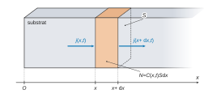
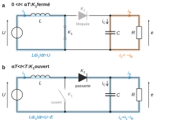
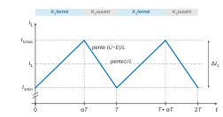
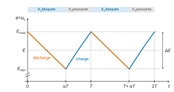
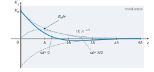

# CCINP PSI — Physique-chimie 2026 · Corrigé brut

*Corrigé rédigé par IA, non officiel. Signalez toute erreur.*

Épreuve de 4 heures, calculatrices interdites. « Semi-conducteurs et convertisseurs de puissance », quatre parties indépendantes, 36 questions.

## Partie I — Dopage des semi-conducteurs

### Q1

Loi de Fick : $\vec\jmath=-D\,\overrightarrow{\mathrm{grad}}\,C$, soit à une dimension
$$\boxed{j(x,t)=-D\,\frac{\partial C}{\partial x}(x,t)}$$
Le signe $-$ traduit le transport des zones concentrées vers les zones diluées.

Unités :

- $C$, nombre d'atomes par unité de volume, en $\mathrm{m^{-3}}$ ;
- $j$, nombre d'atomes traversant l'unité de surface par unité de temps, en $\mathrm{m^{-2}\cdot s^{-1}}$ ;
- par homogénéité, $[D]=[j][x]/[C]$, donc $\boxed{D\ \text{en}\ \mathrm{m^2\cdot s^{-1}}}$.

### Q2

Système : la tranche fixe de substrat comprise entre $x$ et $x+\mathrm dx$, de section droite $S$ perpendiculaire à $(Ox)$. Elle contient $N(t)=C(x,t)\,S\,\mathrm dx$ atomes de phosphore. La diffusion n'ayant lieu que selon $(Ox)$, aucun flux ne traverse les faces latérales.

Entre $t$ et $t+\mathrm dt$, il entre $j(x,t)S\,\mathrm dt$ atomes par la face d'abscisse $x$. Il en sort $j(x+\mathrm dx,t)S\,\mathrm dt$ par la face d'abscisse $x+\mathrm dx$. Sans création ni disparition d'atomes, la variation du nombre d'atomes de la tranche vaut :
$$\begin{aligned}
N(t+\mathrm dt)-N(t)&=\frac{\partial C}{\partial t}S\,\mathrm dx\,\mathrm dt\\
&=\big[j(x,t)-j(x+\mathrm dx,t)\big]S\,\mathrm dt\\
&=-\frac{\partial j}{\partial x}S\,\mathrm dx\,\mathrm dt
\end{aligned}$$
d'où
$$\boxed{\frac{\partial C}{\partial t}+\frac{\partial j}{\partial x}=0}$$

### Q3

Le substrat est homogène, donc $D$ est uniforme. En reportant la loi de Fick dans la relation de Q2 :
$$\boxed{\frac{\partial C}{\partial t}=D\,\frac{\partial^2 C}{\partial x^2}}$$
C'est l'équation de diffusion.

### Q4

Les deux membres de l'équation ont pour ordres de grandeur $C/\tau_c$ et $DC/L_c^2$. En les égalant, avec des coefficients adimensionnés de l'ordre de l'unité :
$$\boxed{L_c\sim\sqrt{D\,\tau_c}}$$
soit $\tau_c\sim L_c^2/D$. La longueur de diffusion croît comme la racine carrée de la durée : pour doubler la profondeur, il faut quadrupler la durée.

### Q5

Le substrat occupe le demi-espace $x>0$ (figure 1). Considérons un cylindre de substrat de section unité, d'axe $(Ox)$, appuyé sur le plan $x=0$. Il contient $\sigma$ atomes à $t=0$.

Par conservation, il en contient encore $\sigma$ pour tout $t>0$, tous ayant diffusé dans le substrat :
$$\int_0^{+\infty}C(x,t)\,\mathrm dx=\sigma .$$
Avec $u=x/(2\sqrt{Dt})$, on a $\mathrm dx=2\sqrt{Dt}\,\mathrm du$, d'où :
$$\begin{aligned}
\int_0^{+\infty}\frac{\alpha}{\sqrt t}e^{-x^2/(4Dt)}\,\mathrm dx&=\frac{\alpha}{\sqrt t}\,2\sqrt{Dt}\int_0^{+\infty}e^{-u^2}\,\mathrm du\\
&=\frac{\alpha}{\sqrt t}\,2\sqrt{Dt}\,\frac{\sqrt\pi}{2}\\
&=\alpha\sqrt{\pi D}
\end{aligned}$$
Le résultat ne dépend pas de $t$, ce qui confirme la cohérence de la solution admise. Donc
$$\boxed{\alpha=\frac{\sigma}{\sqrt{\pi D}}}$$
($\alpha$ en $\mathrm{m^{-3}\cdot s^{1/2}}$, de sorte que $\alpha/\sqrt t$ est bien une concentration.)

### Q6

$C(0,t)=\alpha/\sqrt t$, donc la définition de $p$ s'écrit :
$$\begin{aligned}
C(p,t)=\frac1e\,C(0,t)&\iff\exp\!\Big(-\frac{p^2}{4Dt}\Big)=e^{-1}\\
&\iff p^2=4Dt
\end{aligned}$$
et, avec $p>0$,
$$\boxed{p=2\sqrt{Dt}}$$
C'est cohérent avec Q4 : on retrouve $L_c\sim\sqrt{D\tau_c}$, avec un coefficient 2 de l'ordre de l'unité.

### Q7

$C(0,t)=\alpha/\sqrt t$ décroît avec $t$. Les ordonnées à l'origine valent environ 270 (c), 190 (b) et 120 (a) atomes·µm⁻³, d'où :
$$\boxed{\begin{aligned}
&\mathbf c : t=1\ \mathrm h\\
&\mathbf b : t=2\ \mathrm h\\
&\mathbf a : t=5\ \mathrm h
\end{aligned}}$$
Contrôle : $270/\sqrt2\simeq191$ et $270/\sqrt5\simeq121$. De plus, $p=2\sqrt{Dt}$ croît avec $t$ : le profil a, le plus étalé, correspond bien à la durée la plus longue.

### Q8

Courbe c : $t=1\ \mathrm h=3\,600$ s et $C(0,t)\simeq270$ atomes·µm⁻³ (l'énoncé écrit « µ·m⁻³ », coquille pour atomes·µm⁻³).

Avec $e\approx2{,}7$, on remarque que $270\simeq100\,e$ : la profondeur $p$ est l'abscisse où la courbe c passe par $C=100$ atomes·µm⁻³. La lecture donne $p\simeq5{,}4\ \mu$m. D'après Q6, $D=p^2/(4t)$ :
$$\begin{aligned}
D&=\frac{(5{,}4\cdot10^{-6})^2}{4\times3\,600}\\
&\simeq\frac{29\cdot10^{-12}}{1{,}44\cdot10^{4}}
\end{aligned}$$
$$\boxed{D\simeq2\cdot10^{-15}\ \mathrm{m^2\cdot s^{-1}}}$$
Contrôle : avec $4Dt\simeq29\ \mu$m², $C(10\ \mu\mathrm m)\simeq270\,e^{-3{,}4}\simeq9$ atomes·µm⁻³, conforme à la figure. Cet ordre de grandeur est typique de la diffusion dans un solide.

## Partie II — Forme stable du silicium dans la nature

### Q9

Pour $Z=14$ : $\mathrm{Si} : 1s^2\,2s^2\,2p^6\,3s^2\,3p^2$. Le nombre quantique principal maximal est $n=3$, et la couche de valence $3s^23p^2$ compte 4 électrons, dans le bloc $p$.
$$\boxed{\text{Si : 3}^{\text{e}}\ \text{période, 14}^{\text{e}}\ \text{colonne (famille du carbone)}}$$

### Q10

Loi de Hess, les corps simples dans leur état standard de référence ayant une enthalpie standard de formation nulle :
$$\begin{aligned}
\Delta_rH_1^\circ&=\Delta_fH^\circ(\mathrm{SiO_{2(s)}})-\Delta_fH^\circ(\mathrm{Si_{(s)}})-\Delta_fH^\circ(\mathrm{O_{2(g)}})\\
&=-877{,}4-0-0
\end{aligned}$$
$$\boxed{\Delta_rH_1^\circ=-877{,}4\ \mathrm{kJ\cdot mol^{-1}}}$$
$\Delta_rH_1^\circ<0$ : la réaction est **exothermique**.

### Q11

$$\begin{aligned}
\Delta_rS_1^\circ&=S^\circ(\mathrm{SiO_2})-S^\circ(\mathrm{Si})-S^\circ(\mathrm{O_2})\\
&=41{,}8-18{,}8-205{,}0
\end{aligned}$$
$$\boxed{\Delta_rS_1^\circ=-182{,}0\ \mathrm{J\cdot K^{-1}\cdot mol^{-1}}}$$
Ce signe était **prévisible** : la réaction consomme une mole de gaz sans en produire ($\Delta n_{\text{gaz}}=-1$), et l'entropie molaire d'un gaz est très supérieure à celle d'un solide. Le désordre diminue.

### Q12

Les données étant fournies à 298 K, on calcule directement à cette température :
$$\begin{aligned}
\Delta_rG_1^\circ(298)&=\Delta_rH_1^\circ-T\Delta_rS_1^\circ\\
&=-877\,400+298\times182\\
&=-877\,400+54\,236\\
&\simeq-823\ \mathrm{kJ\cdot mol^{-1}}
\end{aligned}$$
Avec $RT\simeq8{,}31\times298\simeq2{,}48\ \mathrm{kJ\cdot mol^{-1}}$ :
$$\begin{aligned}
\ln K^\circ&=-\frac{\Delta_rG_1^\circ}{RT}\\
&\simeq\frac{823}{2{,}48}\\
&\simeq3{,}3\cdot10^2
\end{aligned}$$
soit $K^\circ\sim10^{144}$.

Calculer $K^\circ$ ne suffit pas : il faut le comparer au quotient de réaction. Les solides sont purs (activité 1) et, à l'air sous $P_{\mathrm{atm}}=10^5$ Pa, $P_{\mathrm{O_2}}=0{,}2\,P^\circ$, donc
$$Q_r=\frac{P^\circ}{P_{\mathrm{O_2}}}=5\ll K^\circ .$$
L'enthalpie libre de réaction $\Delta_rG_1=RT\ln(Q_r/K^\circ)$ est très négative : la réaction évolue dans le sens direct. Comme $Q_r$ ne dépend que de $P_{\mathrm{O_2}}$, qui reste fixée par l'air (dioxygène en excès), l'équilibre ne peut pas être atteint : il y a **rupture d'équilibre**, la réaction s'arrête par disparition totale du silicium.
$$\boxed{\text{La réaction (1) est quantitative : le silicium est naturellement présent sous forme de silice } \mathrm{SiO_2}.}$$
Pour obtenir $\mathrm{Si_{(s)}}$, il faut réaliser la **réduction** de la silice ($\mathrm{Si}^{+\mathrm{IV}}\to\mathrm{Si}^{0}$). Elle est très défavorable thermodynamiquement ($\Delta_rG^\circ\simeq+823$ kJ/mol pour la réaction inverse) et doit être forcée par un apport d'énergie électrique.

L'opération d'électrométallurgie est donc une **réduction forcée par l'énergie électrique** : **électrolyse** de la silice en bain de sels fondus (réduction à la cathode $\mathrm{SiO_2+4\,e^-\to Si+2\,O^{2-}}$), ou, comme dans l'industrie, **réduction carbothermique au four à arc électrique** ($\mathrm{SiO_2+2\,C\to Si+2\,CO}$ à haute température).

## Partie III — Circuit RLC et hacheurs parallèles

### III.1 — Circuit RLC

### Q13

Soit $i$ le courant dans la bobine, orienté de l'entrée vers la sortie. Loi des mailles :
$$U_e=L\,\frac{\mathrm di}{\mathrm dt}+U_s .$$
Loi des nœuds en sortie, $C$ et $R$ étant sous la tension $U_s$ :
$$i=C\,\frac{\mathrm dU_s}{\mathrm dt}+\frac{U_s}{R} .$$
En éliminant $i$, puis en divisant par $LC$ :
$$\begin{aligned}
U_e&=LC\,\frac{\mathrm d^2U_s}{\mathrm dt^2}+\frac LR\,\frac{\mathrm dU_s}{\mathrm dt}+U_s\\
\frac1{LC}U_e&=\frac{\mathrm d^2U_s}{\mathrm dt^2}+\frac1{RC}\frac{\mathrm dU_s}{\mathrm dt}+\frac1{LC}U_s
\end{aligned}$$
Par identification avec la forme canonique ($\omega_0^2=1/(LC)$ et $\omega_0/Q=1/(RC)$) :
$$\boxed{\begin{aligned}
\omega_0&=\frac1{\sqrt{LC}}\\
Q&=RC\,\omega_0=R\sqrt{\frac CL}
\end{aligned}}$$
$Q$ est sans dimension ($\sqrt{L/C}$ est une résistance), et $Q\to\infty$ quand $R\to\infty$ (circuit $LC$ non amorti), ce qui est cohérent.

### Q14

Le polynôme caractéristique $r^2+\frac{\omega_0}Qr+\omega_0^2$ a pour discriminant $\omega_0^2(1/Q^2-4)$. La frontière entre les régimes est donc $Q=1/2$.

- $Q=3>1/2$ : régime pseudo-périodique, avec dépassement et oscillations. Seule la réponse b oscille. Contrôle : premier dépassement relatif $\exp(-\pi/\sqrt{4Q^2-1})=e^{-\pi/\sqrt{35}}\simeq0{,}59$, d'où un pic à 1,6 V, comme sur la figure 4b.
- $Q=1/2$ : régime critique, réponse monotone $1-(1+\omega_0t)e^{-\omega_0t}$, la plus rapide sans dépassement.
- $Q=0{,}2<1/2$ : régime apériodique, racines réelles $r_{1,2}=-\omega_0\big(\tfrac1{2Q}\mp\sqrt{\tfrac1{4Q^2}-1}\big)$. La racine lente $r_1\simeq-0{,}21\,\omega_0$ impose un établissement environ cinq fois plus lent qu'en régime critique.

À $\omega_0$ commune, la réponse monotone la plus rapide (a, établie vers 10 ms) est le régime critique, et la plus lente (c, établie vers 40 ms) le régime apériodique :
$$\boxed{\begin{aligned}
&\mathbf a\leftrightarrow Q=0{,}5\\
&\mathbf b\leftrightarrow Q=3\\
&\mathbf c\leftrightarrow Q=0{,}2
\end{aligned}}$$
Contrôle : la pseudo-période de b vaut 10 ms, donc $\omega_0\simeq\frac{2\pi}{10^{-2}}\big/\sqrt{1-\frac1{36}}\simeq6{,}4\cdot10^2$ rad/s.

Le régime critique atteint alors 99 % en $t\simeq6{,}6/\omega_0\simeq10$ ms. Le régime $Q=0{,}2$ s'établit en $5/|r_1|\simeq38$ ms.

### Q15

Lectures sur la figure 5 :

- période commune $T=10$ ms (maxima de $U_e$ à 2,5 ; 12,5 ; 22,5 ms) ;
- maxima de $U_s$ à 5 ; 15 ; 25 ms, donc un retard $\Delta t=2{,}5\ \mathrm{ms}=T/4$ : les deux signaux sont **en quadrature** ;
- amplitudes 1 V en entrée et 2 V en sortie.

D'où $\omega=2\pi/T\simeq6{,}3\cdot10^2$ rad/s et un déphasage $\varphi=-2\pi\,\Delta t/T=-\pi/2$.

Fonction de transfert (Q13), avec $x=\omega/\omega_0$ :
$$\underline H=\frac{1}{1-x^2+j\,x/Q} .$$
Comme $x/Q>0$, $\arg\underline H=-\pi/2$ si et seulement si $1-x^2=0$, c'est-à-dire $\omega=\omega_0$. Alors $\underline H(j\omega_0)=-jQ$, donc $|\underline H|=Q=U_{s,\max}/U_{e,\max}$ :
$$\boxed{\begin{aligned}
\omega_0&\simeq6{,}3\cdot10^2\ \mathrm{rad\cdot s^{-1}}\quad(f_0=100\ \mathrm{Hz})\\
Q&=2
\end{aligned}}$$
Ces valeurs sont cohérentes avec l'ordre de grandeur de $\omega_0$ lu en Q14.

### III.2 — Conception d'un hacheur simple

### Q16

Règles d'interconnexion : on ne relie jamais directement deux sources de tension (ni ne court-circuite une source de tension), et on n'ouvre jamais une source de courant. L'entrée est une source de tension ($U$) et la sortie, imposée par le condensateur, se comporte aussi en source de tension. Sans bobine, la fermeture de $K_1$ court-circuiterait la batterie.

La bobine, en série avec la batterie :

- **transforme la source de tension d'entrée en source de courant** : $i_1$ est continu, et l'ensemble $(U,L)$ peut être relié à la sortie de type tension. Elle stocke de l'énergie magnétique quand $K_1$ est fermé et la restitue à la charge à l'ouverture, ce qui permet $E>U$ ;
- **lisse le courant d'entrée** : $|\mathrm di_1/\mathrm dt|$ est bornée par des tensions divisées par $L$, et une inductance assez grande garantit $\Delta I_1\le10\,\%\,I_1$.

### Q17

Le condensateur, en parallèle sur $R$, impose la continuité de $e(t)$ : il **constitue la source de tension de sortie**. Pendant $[0,\alpha T]$, où la diode est bloquée, il **alimente seul la charge**. Sur l'ensemble de la période, il **filtre** le courant haché délivré par la diode : c'est lui qui permet de respecter $\Delta E\le\Delta E_{\max}$ (avec $\tau=RC\gg T$).

### Q18

Sur $[0,\alpha T]$, $K_1$ est fermé : l'anode de la diode $K_2$ est au potentiel de la masse et sa cathode à $e\simeq E>0$, donc la diode est bloquée. La bobine est soumise à $U$ :
$$\boxed{L\frac{\mathrm di_1}{\mathrm dt}=U\quad\text{sur }[0,\alpha T]}$$
Sur $[\alpha T,T]$, $K_1$ est ouvert. Le courant $i_1$, continu, ne peut s'annuler brutalement et passe par la diode, qui conduit. La loi des mailles donne $U=L\,\mathrm di_1/\mathrm dt+E$ :
$$\boxed{L\frac{\mathrm di_1}{\mathrm dt}=U-E<0\quad\text{sur }[\alpha T,T]}$$

### Q19

En régime périodique établi, $i_1(T)=i_1(0)$, donc la tension moyenne aux bornes de la bobine est nulle :
$$\alpha T\,U+(1-\alpha)T\,(U-E)=0$$
d'où
$$\boxed{E=\frac{U}{1-\alpha}}$$
On a bien $E>U$ : c'est un hacheur élévateur. Numériquement, $\alpha=1-U/E=1-12/30$ :
$$\boxed{\alpha=0{,}6}$$

### Q20

$i_1$ est affine par morceaux :

- il croît de $I_{1\min}$ à $I_{1\max}$ avec la pente $U/L$ pendant $\alpha T$ ;
- il décroît de $I_{1\max}$ à $I_{1\min}$ avec la pente $(U-E)/L$ pendant $(1-\alpha)T$.

C'est un **signal triangulaire** continu, périodique de période $T$, non symétrique (montée sur $0{,}6\,T$, descente sur $0{,}4\,T$), centré sur sa valeur moyenne $I_1$, d'ondulation $\Delta I_1=U\alpha T/L$.

Avec $L=L_{\min}$ (Q22) et $I_1=12{,}5$ A (Q21) : $I_{1\max}\simeq13{,}1$ A et $I_{1\min}\simeq11{,}9$ A.

### Q21

En régime périodique établi, l'énergie stockée dans $L$ et $C$ reprend sa valeur au bout d'une période : leur puissance moyenne est nulle. Les interrupteurs idéaux ne dissipent rien.

La puissance moyenne fournie par la batterie, $\langle U i_1\rangle=UI_1$ ($U$ constante), est donc reçue par la charge : $\langle e\,i_R\rangle\simeq EI_R$ (avec $e\simeq E$). Ainsi $UI_1=EI_R$ et, avec Q19,
$$\boxed{I_1=\frac{I_R}{1-\alpha}}$$
soit $I_1=5/0{,}4=12{,}5$ A.

### Q22

Sur la phase de croissance, $\Delta I_1=U\alpha T/L$. La contrainte $\Delta I_1\le0{,}1\,I_1=0{,}1\,I_R/(1-\alpha)$ donne
$$L\ge\frac{10\,\alpha(1-\alpha)\,U\,T}{I_R}$$
d'où
$$\boxed{L_{\min}=\frac{10\,\alpha(1-\alpha)\,UT}{I_R}}$$
Application numérique :
$$\begin{aligned}
L_{\min}&=\frac{10\times0{,}6\times0{,}4\times12\times50\cdot10^{-6}}{5}\\
&=\frac{1{,}44\cdot10^{-3}}{5}
\end{aligned}$$
$$\boxed{L_{\min}\simeq2{,}9\cdot10^{-4}\ \mathrm H=0{,}29\ \mathrm{mH}}$$

### Q23

Sur $[0,\alpha T]$, la diode est bloquée (Q18) : $C$ et $R$ forment un circuit isolé, avec $e=u_c$. La loi des nœuds donne $C\,\dfrac{\mathrm du_c}{\mathrm dt}+\dfrac{u_c}{R}=0$, soit, avec $\tau=RC$ :
$$\boxed{\tau\frac{\mathrm du_c}{\mathrm dt}+u_c=0}$$
La solution $u_c(t)=u_c(0)\,e^{-t/\tau}$ décroît sur $[0,\alpha T]$.

Sur $[\alpha T,T]$, la diode conduit et $i_C=i_1-i_R$. Comme $i_1\ge I_{1\min}\simeq11{,}9\ \mathrm A>I_R=5$ A, le condensateur se charge et $u_c$ croît.

Le maximum de $u_c$ sur une période est donc atteint en $T\equiv0$, d'où $u_c(0)=E_{\max}$ et
$$\boxed{u_c(t)=E_{\max}\,e^{-t/\tau}\quad\text{sur }[0,\alpha T]}$$

### Q24

$e$ décroît de $E_{\max}$ à $E_{\min}=E_{\max}e^{-\alpha T/\tau}$, donc
$$\Delta E=E_{\max}\big(1-e^{-\alpha T/\tau}\big) .$$

Approximations :

1. $\tau\gg T$, donc $\alpha T/\tau\ll1$ et, par un développement limité à l'ordre 1, $1-e^{-\alpha T/\tau}\simeq\alpha T/\tau$ ;
2. $\Delta E\ll E$ (100 mV pour 30 V), donc $E_{\max}\simeq E$.

D'où $\Delta E\simeq E\alpha T/(RC)$, et la contrainte $\Delta E\le\Delta E_{\max}$ donne
$$\boxed{C_{\min}=\frac{E\,\alpha\,T}{R\,\Delta E_{\max}}}$$
Ordre de grandeur, avec $R=E/I_R=6\ \Omega$ :
$$C_{\min}=\frac{30\times0{,}6\times50\cdot10^{-6}}{6\times0{,}1}=1{,}5\cdot10^{-3}\ \mathrm F .$$
Alors $\tau=RC_{\min}=9$ ms $\gg T=50\ \mu$s, ce qui valide l'approximation 1.

## Partie IV — Blindage électromagnétique

### IV.1 — Modélisation

(Pas de question dans cette sous-partie.)

### IV.2 — Expressions des champs dans le conducteur

### Q25

Le conducteur est électriquement neutre ($\rho=0$) et assimilable au vide sur le plan diélectrique et magnétique. Les équations de Maxwell s'écrivent :
$$\begin{aligned}
\operatorname{div}\vec E&=0\\
\operatorname{div}\vec B&=0\\
\overrightarrow{\mathrm{rot}}\,\vec E&=-\frac{\partial\vec B}{\partial t}\\
\overrightarrow{\mathrm{rot}}\,\vec B&=\mu_0\vec\jmath+\mu_0\varepsilon_0\frac{\partial\vec E}{\partial t}
\end{aligned}$$
et la loi d'Ohm locale
$$\boxed{\vec\jmath=\gamma\,\vec E}$$

### Q26

En régime sinusoïdal, le rapport des deux termes de Maxwell-Ampère vaut :
$$\frac{\big\|\varepsilon_0\,\partial\vec E/\partial t\big\|}{\|\gamma\vec E\|}=\frac{\varepsilon_0\omega}{\gamma} .$$
Pour le cuivre, $\gamma=1/(17\cdot10^{-9})\simeq6\cdot10^7\ \mathrm{S\cdot m^{-1}}$. Pour $f\le10$ GHz :
$$\frac{\varepsilon_0\omega}{\gamma}\le\frac{2\pi\times8{,}85\cdot10^{-12}\times10^{10}}{6\cdot10^{7}}\sim10^{-8}\ll1 .$$
Même pour le métal le moins conducteur du tableau (zinc, $\gamma\simeq1{,}6\cdot10^7\ \mathrm{S\cdot m^{-1}}$), le rapport reste de l'ordre de $3\cdot10^{-8}$. Le courant de déplacement est négligeable :
$$\boxed{\overrightarrow{\mathrm{rot}}\,\vec B=\mu_0\vec\jmath=\mu_0\gamma\vec E}$$

### Q27

On prend le rotationnel de Maxwell-Faraday, en permutant les dérivées spatiales et temporelles :
$$\begin{aligned}
\overrightarrow{\mathrm{rot}}\big(\overrightarrow{\mathrm{rot}}\,\vec E\big)&=-\frac{\partial}{\partial t}\overrightarrow{\mathrm{rot}}\,\vec B\\
&=-\mu_0\gamma\frac{\partial\vec E}{\partial t}
\end{aligned}$$
D'après la formule fournie et $\operatorname{div}\vec E=0$ (neutralité), le membre de gauche vaut $-\Delta\vec E$ :
$$\boxed{\Delta\vec E-\mu_0\gamma\frac{\partial\vec E}{\partial t}=\vec 0}$$
soit $\boxed{\alpha=\mu_0\gamma}$.

### Q28

Par homogénéité, $[\alpha]=[\Delta\vec E]/[\partial_t\vec E]=\mathrm{s\cdot m^{-2}}$ (et $\mu_0\gamma$ en $\mathrm{H\cdot S\cdot m^{-2}}=\mathrm{s\cdot m^{-2}}$) :
$$\boxed{\alpha\ \text{en}\ \mathrm{s\cdot m^{-2}}}$$
Premier ordre en temps, second ordre en espace : c'est une **équation de diffusion** (phénomène irréversible), de coefficient de diffusion $1/(\mu_0\gamma)$, et non une équation de d'Alembert (second ordre en temps). On la rencontre en **diffusion thermique** (loi de Fourier) et en **diffusion de particules** (loi de Fick, partie I).

### Q29

Pour $\underline{\vec E}=E_0e^{j(\omega t-\underline kz)}\vec e_x$, on a $\Delta\to-\underline k^2$ et $\partial_t\to j\omega$, d'où
$$\boxed{\underline k^2=-j\,\mu_0\gamma\,\omega}$$
Avec $\mu_0\gamma\omega=2/\delta^2$ et $-2j=(1-j)^2$, on obtient $\underline k=\pm(1-j)/\delta$. On retient $\underline k=(1-j)/\delta$, pour laquelle $e^{-j\underline kz}=e^{-z/\delta}e^{-jz/\delta}$ décroît dans le conducteur ($z>0$) ; l'autre racine divergerait.

La partie réelle du vecteur d'onde,
$$\mathrm{Re}(\underline k)=\frac1\delta=\sqrt{\frac{\mu_0\gamma\omega}{2}},$$
n'est pas proportionnelle à $\omega$ (elle varie comme $\sqrt\omega$). La vitesse de phase $v_\varphi=\omega/\mathrm{Re}(\underline k)=\sqrt{2\omega/(\mu_0\gamma)}$ dépend donc de $\omega$ : **le conducteur ohmique est un milieu dispersif** (et absorbant, puisque $\underline k$ a une partie imaginaire).

### Q30

Avec $-j\underline kz=-z/\delta-jz/\delta$ :
$$\boxed{\underline{\vec E}=E_0\,e^{-z/\delta}\,e^{j(\omega t-z/\delta)}\,\vec e_x}$$
et, par la loi d'Ohm locale :
$$\boxed{\underline{\vec\jmath}=\gamma E_0\,e^{-z/\delta}\,e^{j(\omega t-z/\delta)}\,\vec e_x}$$
En réel : $\vec E=E_0e^{-z/\delta}\cos(\omega t-z/\delta)\,\vec e_x$, et $\vec\jmath$ est en phase avec $\vec E$.

### Q31

$\delta=\sqrt{2/(\mu_0\gamma\omega)}$ est l'**épaisseur de peau**, une longueur exprimée **en mètres** (on vérifie : $\mu_0\gamma\omega$ est en $\mathrm{m^{-2}}$ d'après Q28).

Pour $z\gg\delta$, le facteur $e^{-z/\delta}$ rend $\vec E$ et $\vec B$ (et $\vec\jmath$) **pratiquement nuls**.

Les champs sont confinés dans une couche superficielle d'épaisseur de quelques $\delta$ (effet de peau). À $z=5\delta$, l'amplitude est déjà divisée par $e^5\simeq150$.

Remarque : Maxwell-Faraday donne
$$\underline B_y=\frac{\underline k\,\underline E_x}{\omega}=\frac{\sqrt2E_0}{\delta\omega}e^{-z/\delta}e^{j(\omega t-z/\delta-\pi/4)} .$$
Le module coïncide avec l'expression admise, mais le déphasage est $-\pi/4$ et non $+\pi/4$ comme l'écrit l'énoncé. Ce signe n'a pas d'effet sur les valeurs moyennes de Q34 (qui font intervenir $\cos(\pi/4)$, fonction paire). On garde l'expression de l'énoncé.

### IV.3 — Considérations physiques sur l'écrantage

### Q32

$\delta=1/\sqrt{\pi\mu_0\gamma f}$ décroît quand $f$ croît. À épaisseur de dépôt donnée, l'atténuation est d'autant plus forte que la fréquence est élevée : **l'écrantage est plus efficace en haute fréquence**.

À $f=1$ MHz, pour le cuivre ($\gamma\simeq6\cdot10^7\ \mathrm{S\cdot m^{-1}}$, $\omega\simeq6{,}3\cdot10^6$ rad/s) :
$$\mu_0\gamma\omega\simeq1{,}26\cdot10^{-6}\times6\cdot10^7\times6{,}3\cdot10^6\simeq4{,}7\cdot10^8\ \mathrm{m^{-2}}$$
d'où
$$\delta=\sqrt{\frac{2}{4{,}7\cdot10^8}}\simeq6{,}5\cdot10^{-5}\ \mathrm m .$$
Une épaisseur de $3\delta$ à $5\delta$ atténue l'amplitude d'un facteur 20 à 150 :
$$\boxed{e_{\text{dépôt}}\sim0{,}2\ \text{à}\ 0{,}3\ \mathrm{mm}}$$
Les autres métaux du tableau donnent le même ordre de grandeur ($\delta$ de 64 µm pour l'argent à 124 µm pour le zinc).

### Q33

Le champ électrique met en mouvement les porteurs libres : il crée des courants induits $\vec\jmath=\gamma\vec E$ qui dissipent l'énergie de l'onde par **effet Joule** (puissance volumique $\vec\jmath\cdot\vec E=\gamma E^2>0$). Cette dissipation explique l'atténuation de l'onde dans le conducteur.

### Q34

Champs réels, avec $\theta=\omega t-z/\delta$ :
$$\begin{aligned}
\vec E&=E_0e^{-z/\delta}\cos\theta\,\vec e_x\\
\vec B&=\frac{\sqrt2E_0}{\delta\omega}e^{-z/\delta}\cos\!\Big(\theta+\frac\pi4\Big)\vec e_y
\end{aligned}$$
Vecteur de Poynting :
$$\vec\Pi=\frac{\vec E\wedge\vec B}{\mu_0}=\frac{\sqrt2E_0^2}{\mu_0\delta\omega}e^{-2z/\delta}\cos\theta\cos\!\Big(\theta+\frac\pi4\Big)\vec e_z .$$
D'après la formule de linéarisation, $\big\langle\cos\theta\cos(\theta+\frac\pi4)\big\rangle=\frac12\cos\frac\pi4=\frac{\sqrt2}4$, donc
$$\langle\vec\Pi\rangle=\frac{E_0^2}{2\mu_0\delta\omega}e^{-2z/\delta}\,\vec e_z .$$
Puissance moyenne entrant à travers $S$ en $z=0^+$, avec $1/\delta=\sqrt{\mu_0\gamma\omega/2}$ :
$$\begin{aligned}
\mathcal P_{\text{ent}}&=\frac{E_0^2S}{2\mu_0\delta\omega}\\
&=\frac{E_0^2S}{2}\sqrt{\frac{\gamma}{2\mu_0\omega}}
\end{aligned}$$
$$\boxed{\mathcal P_{\text{ent}}=\frac{\sqrt2}{4}E_0^2S\sqrt{\frac{\gamma}{\mu_0\omega}}}$$

### Q35

Puissance volumique dissipée : $\vec\jmath\cdot\vec E=\gamma E^2=\gamma E_0^2e^{-2z/\delta}\cos^2\theta$, de moyenne $\frac{\gamma E_0^2}{2}e^{-2z/\delta}$. Sur le volume $S\,\mathrm dz$ :
$$\boxed{\mathrm d\mathcal P_J=\frac{\gamma E_0^2S}{2}\,e^{-2z/\delta}\,\mathrm dz}$$

### Q36

$$\begin{aligned}
\mathcal P_J&=\int_0^{+\infty}\frac{\gamma E_0^2S}{2}e^{-2z/\delta}\,\mathrm dz\\
&=\frac{\gamma E_0^2S\delta}{4}\\
&=\frac{\gamma E_0^2S}{4}\sqrt{\frac{2}{\mu_0\gamma\omega}}
\end{aligned}$$
$$\boxed{\mathcal P_J=\frac{\sqrt2}{4}E_0^2S\sqrt{\frac{\gamma}{\mu_0\omega}}}$$
**Conclusion** : $\mathcal P_J=\mathcal P_{\text{ent}}$. Toute la puissance qui pénètre dans le conducteur y est dissipée par effet Joule, sans rien transmettre en profondeur. Cela confirme la réponse de Q33 : l'atténuation est due à l'effet Joule.
