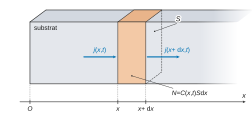
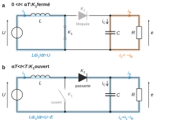
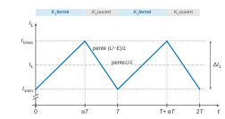
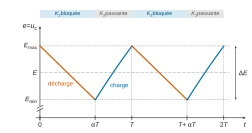
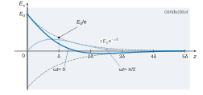

# CCINP PSI — Physique-chimie 2026 · Corrigé guidé

*Corrigé rédigé par IA, non officiel. Signalez toute erreur.*

## Présentation du sujet

L'épreuve (PSI2PC, 4 heures, **calculatrices interdites**) s'intitule « Semi-conducteurs et convertisseurs de puissance ». Elle suit un composant d'électronique de puissance depuis sa fabrication jusqu'à son environnement électromagnétique. Elle compte 36 questions réparties en quatre parties **indépendantes**, avec une page de données en fin de sujet.

- **Partie I — Dopage des semi-conducteurs (Q1 à Q8).** Diffusion de phosphore dans un substrat de silicium : loi de Fick, bilan de particules, équation de diffusion, analyse dimensionnelle, normalisation d'une solution gaussienne, puis exploitation numérique d'une figure pour mesurer le coefficient de diffusion.
- **Partie II — Forme stable du silicium (Q9 à Q12).** Thermochimie courte : position dans la classification, $\Delta_rH^\circ$, $\Delta_rS^\circ$, $\Delta_rG^\circ$ et caractère quantitatif de l'oxydation du silicium, puis principe de son élaboration.
- **Partie III — Circuit RLC et hacheurs parallèles (Q13 à Q24).** III.1 : filtre $RLC$ du second ordre lu sur des courbes (réponses indicielles, régime sinusoïdal forcé). III.2 : dimensionnement d'un hacheur parallèle (élévateur) : rôle des composants, équations par phase, rapport cyclique, bilan de puissance, inductance et capacité minimales.
- **Partie IV — Blindage électromagnétique (Q25 à Q36).** Effet de peau dans un conducteur ohmique : équations de Maxwell, approximation des régimes quasi stationnaires, équation de diffusion du champ, relation de dispersion, épaisseur de peau, puis bilan de puissance de Poynting qui se referme sur l'effet Joule.

**Notions mobilisées** : diffusion de particules, bilans locaux, analyse dimensionnelle ; configuration électronique, loi de Hess, enthalpie libre et constante d'équilibre ; second ordre (formes canoniques, régimes transitoires, fonction de transfert) ; électronique de puissance (règles d'interconnexion des sources, valeurs moyennes) ; équations de Maxwell dans un conducteur, ondes et dispersion, vecteur de Poynting, puissance Joule.

**Difficulté.** Elle est modérée et régulière. Le rapport 2026 juge le sujet « de longueur raisonnable » et mieux réussi que les années précédentes ; la partie IV y est « la mieux réussie du sujet ». Les données sont calibrées pour un calcul à la main : $e\approx2{,}7$, $182\times298=54\,236$.

**Questions discriminantes d'après le rapport 2026** :

- lectures graphiques et justifications : Q8 (exploitation du graphique), Q14 (comparaison de $Q$ à $1/2$), Q15 (quadrature et lien entre $\omega$ et $\omega_0$) ;
- raisonnements à finir : Q12 (comparer $Q_r$ et $K^\circ$, pas seulement calculer $K^\circ$), Q16 et Q17 (doubles réponses attendues) ;
- fins de partie peu abordées : Q22, Q24, Q35 et Q36 ;
- ordres de grandeur et unités : Q1, Q26, Q28, Q31, Q32.

**À ne pas laisser passer** : Q1 à Q3, Q6, Q7, Q9 à Q11, Q13, Q18, Q19, Q21, Q23 (indépendante, bien réussie quand elle est vue), Q25, Q27, Q28, Q30, Q31, Q33.

**Gestion du temps** : environ 40 min pour la partie I, 20 min pour la partie II, 1 h 30 pour la partie III et 1 h pour la partie IV, plus une relecture. La partie II est la plus rentable à faire tôt. Dans la partie IV, chaque question s'appuie sur la précédente, mais les résultats essentiels sont donnés ($\delta$, expression de $\vec B$).

> [!JURY]
> Le rapport 2026 rappelle qu'« il est nécessaire d'argumenter les réponses », même quand la question semble immédiate, et qu'« une application numérique d'une grandeur dimensionnée doit comporter une unité du système international ou une unité usuelle simple ».

## Partie I — Dopage des semi-conducteurs

On établit l'équation de diffusion à partir d'un bilan, on en tire une loi d'échelle, puis on exploite une solution admise : normalisation, profondeur de diffusion et mesure de $D$ sur un graphe.

### Question 1
> [!INDICATION]
> Loi phénoménologique : le flux de particules est proportionnel au gradient de concentration. Penser au sens du transport.

> [!INDICATION]
> Pour les unités, définir $C$ et $j$ par ce qu'ils comptent, puis déduire celle de $D$ par homogénéité.

#### Solution
Loi de Fick : $\vec\jmath=-D\,\overrightarrow{\mathrm{grad}}\,C$, soit ici
$$\boxed{j(x,t)=-D\,\frac{\partial C}{\partial x}(x,t)}$$
Le signe $-$ traduit le transport des zones concentrées vers les zones diluées.

Unités :

- $C$ est un nombre d'atomes par unité de volume, en $\mathrm{m^{-3}}$ ;
- $j$ est un nombre d'atomes traversant l'unité de surface par unité de temps, en $\mathrm{m^{-2}\cdot s^{-1}}$ ;
- donc $[D]=[j][x]/[C]$ : $\boxed{D\ \text{en}\ \mathrm{m^2\cdot s^{-1}}}$.

> [!PIEGE]
> La question demande les unités « des grandeurs qui interviennent » : il faut celles de $C$, de $j$ **et** de $D$. Ne pas reprendre l'unité d'un autre vecteur courant du programme : le flux thermique est en $\mathrm{W\cdot m^{-2}}$, la densité de courant électrique en $\mathrm{A\cdot m^{-2}}$, le courant de particules en $\mathrm{m^{-2}\cdot s^{-1}}$.

> [!JURY]
> Rapport 2026 : « La loi de Fick est généralement bien connue mais les unités sont souvent fausses. » Le jury relève des confusions avec les unités des autres vecteurs courants, alors que le même vecteur est ensuite bien utilisé pour compter des particules.

### Question 2
> [!INDICATION]
> Choisir un système fermé fixe de volume infinitésimal, adapté à la géométrie unidimensionnelle.

> [!INDICATION]
> Compter les atomes entrant et sortant par les deux faces pendant $\mathrm dt$ ; il n'y a pas de terme de source.

#### Solution
Système : la tranche fixe de substrat comprise entre $x$ et $x+\mathrm dx$, de section $S$. Elle contient $N(t)=C(x,t)S\,\mathrm dx$ atomes. Aucun flux ne traverse les faces latérales, puisque la diffusion n'a lieu que selon $(Ox)$.

Pendant $\mathrm dt$, il entre $j(x,t)S\,\mathrm dt$ atomes et il en sort $j(x+\mathrm dx,t)S\,\mathrm dt$. Sans création ni disparition :
$$\begin{aligned}
N(t+\mathrm dt)-N(t)&=\frac{\partial C}{\partial t}S\,\mathrm dx\,\mathrm dt\\
&=\big[j(x,t)-j(x+\mathrm dx,t)\big]S\,\mathrm dt\\
&=-\frac{\partial j}{\partial x}S\,\mathrm dx\,\mathrm dt
\end{aligned}$$
d'où
$$\boxed{\frac{\partial C}{\partial t}+\frac{\partial j}{\partial x}=0}$$

> [!METHODE]
> Un bilan bien rédigé contient toujours : le système (géométrie et frontière), la grandeur comptée, les flux entrants et sortants pendant $\mathrm dt$, et les termes de création. Le développement $j(x+\mathrm dx)-j(x)=\frac{\partial j}{\partial x}\mathrm dx$ termine le calcul.

> [!PIEGE]
> Garder une seule grandeur comptée du début à la fin : ici des **atomes**, avec $C$ en $\mathrm{m^{-3}}$ et $j$ en $\mathrm{m^{-2}\cdot s^{-1}}$. Mélanger nombres de particules, moles et concentrations, ou écrire $\vec\jmath$ là où le bilan porte sur la composante $j$, rend le bilan inhomogène.

> [!JURY]
> Le rapport 2026 signale « des confusions entre scalaires et vecteurs » et des démonstrations trop rapides, « ce qui laisse penser que le résultat est simplement appris et pas entièrement compris ». Chaque étape du bilan doit apparaître.

### Question 3
> [!INDICATION]
> Combiner les deux relations précédentes ; dire pourquoi $D$ sort de la dérivée spatiale.

#### Solution
$D$ est uniforme (substrat homogène). En reportant $j=-D\,\partial_xC$ dans Q2 :
$$\boxed{\frac{\partial C}{\partial t}=D\,\frac{\partial^2C}{\partial x^2}}$$
C'est l'équation de diffusion, de même forme que l'équation de la chaleur.

### Question 4
> [!INDICATION]
> Remplacer chaque dérivée par un rapport d'ordres de grandeur : une dérivée temporelle « divise par $\tau_c$ », une dérivée seconde spatiale « divise par $L_c^2$ ».

#### Solution
$\partial_tC\sim C/\tau_c$ et $D\,\partial_x^2C\sim DC/L_c^2$. En les égalant :
$$\boxed{L_c\sim\sqrt{D\,\tau_c}}$$
soit $\tau_c\sim L_c^2/D$. La diffusion est lente aux grandes échelles : doubler la profondeur exige de quadrupler la durée.

> [!METHODE]
> Ce raisonnement vaut pour toute équation de diffusion (thermique, particules, champ électromagnétique en partie IV) : $L\sim\sqrt{D\tau}$.

> [!PIEGE]
> Rapport 2026 : « Quelques candidats ne font pas intervenir D mais une vitesse de diffusion non mentionnée dans l'énoncé. » La diffusion n'a pas de vitesse caractéristique : la seule constante du problème est $D$.

### Question 5
> [!INDICATION]
> Quelle grandeur est conservée ? Exprimer le nombre total d'atomes, par unité d'aire du plan $x=0$, à un instant $t>0$.

> [!INDICATION]
> Regarder la figure 1 et la donnée mathématique fournie pour choisir les bornes d'intégration ; poser un changement de variable qui fait apparaître $e^{-u^2}$.

#### Solution
Le substrat occupe $x>0$. Dans un cylindre de section unité appuyé sur le plan $x=0$, le nombre d'atomes vaut $\sigma$ à $t=0$. Il reste égal à $\sigma$ (conservation), tous les atomes étant dans le substrat :
$$\int_0^{+\infty}C(x,t)\,\mathrm dx=\sigma .$$
Avec $u=x/(2\sqrt{Dt})$ :
$$\begin{aligned}
\int_0^{+\infty}\frac{\alpha}{\sqrt t}e^{-x^2/(4Dt)}\mathrm dx&=\frac{\alpha}{\sqrt t}\,2\sqrt{Dt}\,\frac{\sqrt\pi}2\\
&=\alpha\sqrt{\pi D}
\end{aligned}$$
d'où
$$\boxed{\alpha=\frac{\sigma}{\sqrt{\pi D}}}$$
Le résultat est indépendant de $t$, comme il se doit.

> [!PIEGE]
> Le réflexe « gaussienne, donc intégrale sur $\mathbb R$ » donne $\sigma/(2\sqrt{\pi D})$, faux d'un facteur 2 : le substrat n'existe que pour $x>0$, et c'est d'ailleurs $\int_0^{+\infty}$ que fournit l'énoncé.

> [!JURY]
> Rapport 2026 : « Les candidats ont eu du mal à traduire mathématiquement la conservation du nombre de particules sur l'ensemble du substrat à chaque instant. » C'est l'égalité intégrale ci-dessus, écrite pour tout $t>0$, qui est attendue.

### Question 6
> [!INDICATION]
> Écrire la condition de définition de $p$ : le préfacteur $\alpha/\sqrt t$ se simplifie.

#### Solution
$$\begin{aligned}
C(p,t)=\frac1e\,C(0,t)&\iff\exp\!\Big(-\frac{p^2}{4Dt}\Big)=e^{-1}\\
&\iff p^2=4Dt
\end{aligned}$$
d'où
$$\boxed{p=2\sqrt{Dt}}$$
C'est cohérent avec Q4 : même loi en $\sqrt{Dt}$, avec un coefficient 2 de l'ordre de l'unité.

> [!PIEGE]
> Simplifier jusqu'au bout : le rapport 2026 relève des expressions finales qui contiennent encore « un terme en ln(e) non réduit ». Et la question a deux temps : la phrase de comparaison avec Q4 fait partie de la réponse.

### Question 7
> [!INDICATION]
> Comment varie $C(0,t)$ avec $t$ ? Lire les ordonnées à l'origine des trois courbes.

> [!INDICATION]
> Contrôler quantitativement avec la loi en $1/\sqrt t$, ou qualitativement avec l'étalement $p(t)$.

#### Solution
$C(0,t)=\alpha/\sqrt t$ décroît avec $t$. Les ordonnées à l'origine sont environ 270 (c), 190 (b) et 120 (a) atomes·µm⁻³, d'où
$$\boxed{\begin{aligned}
&\mathbf c : 1\ \mathrm h\\
&\mathbf b : 2\ \mathrm h\\
&\mathbf a : 5\ \mathrm h
\end{aligned}}$$
Contrôle : $270/\sqrt2\simeq191$ et $270/\sqrt5\simeq121$. Le profil a, le plus étalé, correspond bien à $p$ le plus grand.

> [!PIEGE]
> Le maximum ne se déplace pas comme celui d'une onde : il reste en $x=0$ et s'affaisse, tandis que le profil s'élargit.

> [!JURY]
> Rapport 2026 : « Question simple qui nécessitait une justification, même courte sous la forme d'une phrase par exemple. » L'attribution seule ne suffit pas : il faut citer la décroissance de $C(0,t)$ ou l'étalement.

### Question 8
> [!INDICATION]
> Utiliser la définition de $p$ : sur la courbe c, chercher l'abscisse où la concentration est divisée par $e$. Comparer $270$ à $100\,e$ avec $e\approx2{,}7$.

> [!INDICATION]
> Inverser la relation de Q6 en faisant attention aux unités (micromètres, heures).

#### Solution
Courbe c : $t=1\ \mathrm h=3\,600$ s, $C(0)\simeq270$ atomes·µm⁻³ (l'énoncé écrit « µ·m⁻³ », coquille pour atomes·µm⁻³).

Comme $270\simeq100\,e$, on cherche l'abscisse où $C=100$ : la courbe c passe par cette valeur pour $p\simeq5{,}4\ \mu$m. D'après Q6, $D=p^2/(4t)$ :
$$\begin{aligned}
D&=\frac{(5{,}4\cdot10^{-6})^2}{4\times3\,600}\\
&\simeq\frac{29\cdot10^{-12}}{1{,}44\cdot10^{4}}
\end{aligned}$$
$$\boxed{D\simeq2\cdot10^{-15}\ \mathrm{m^2\cdot s^{-1}}}$$
Contrôle : avec $4Dt\simeq29\ \mu$m², $C(10\ \mu\mathrm m)\simeq270\,e^{-3{,}4}\simeq9$, conforme à la figure. Une lecture entre 5 et 6 µm est acceptable si elle est expliquée.

> [!PIEGE]
> Deux conversions à ne pas oublier : $(\mu\mathrm m)^2=10^{-12}\ \mathrm m^2$ et $1\ \mathrm h=3\,600$ s. Et c'est $p^2/(4t)$, pas $p^2/t$.

> [!METHODE]
> Sans calculatrice, séparer mantisses et puissances de dix : $29/1{,}44\simeq20$, d'où $20\cdot10^{-16}=2\cdot10^{-15}$.

> [!JURY]
> Question discriminante. Rapport 2026 : « L'exploitation du graphique a posé problème. » Prendre deux points au hasard menait à des calculs compliqués ; une lecture attentive de l'énoncé montrait que la concentration à l'origine valait environ $100\,e$, ce qui ramenait à Q6.

## Partie II — Forme stable du silicium dans la nature

Thermochimie élémentaire : on montre que l'oxydation du silicium à l'air est totale, d'où la nécessité d'une réduction forcée pour obtenir le silicium pur.

### Question 9
> [!INDICATION]
> Écrire la configuration électronique de l'état fondamental à partir de $Z=14$ (remplissage $1s$, $2s$, $2p$, $3s$, $3p$ vu au lycée), ou placer directement le silicium parmi les éléments des trois premières périodes.

#### Solution
$\mathrm{Si} : 1s^2\,2s^2\,2p^6\,3s^2\,3p^2$. Le nombre quantique principal maximal est $n=3$ et le bloc est $p$, avec 4 électrons de valence :
$$\boxed{\text{3}^{\text{e}}\ \text{période, 14}^{\text{e}}\ \text{colonne (famille du carbone)}}$$

> [!PIEGE]
> En numérotation de 1 à 18, « colonne 4 » est celle du titane. Dire « colonne 14 ».

### Question 10
> [!INDICATION]
> Loi de Hess avec les enthalpies standard de formation ; que valent celles des corps simples dans leur état de référence ?

#### Solution
$$\begin{aligned}
\Delta_rH_1^\circ&=\Delta_fH^\circ(\mathrm{SiO_2})-\Delta_fH^\circ(\mathrm{Si})-\Delta_fH^\circ(\mathrm{O_2})\\
&=-877{,}4-0-0
\end{aligned}$$
$$\boxed{\Delta_rH_1^\circ=-877{,}4\ \mathrm{kJ\cdot mol^{-1}}}$$
$\Delta_rH_1^\circ<0$ : la réaction est **exothermique**.

### Question 11
> [!INDICATION]
> Même combinaison avec les entropies molaires standard (non nulles pour les corps simples). Pour le signe, regarder les états physiques.

#### Solution
$$\begin{aligned}
\Delta_rS_1^\circ&=S^\circ(\mathrm{SiO_2})-S^\circ(\mathrm{Si})-S^\circ(\mathrm{O_2})\\
&=41{,}8-18{,}8-205{,}0
\end{aligned}$$
$$\boxed{\Delta_rS_1^\circ=-182{,}0\ \mathrm{J\cdot K^{-1}\cdot mol^{-1}}}$$
Le signe était prévisible : la réaction consomme une mole de gaz et n'en produit pas ($\Delta n_{\text{gaz}}=-1$), or l'entropie molaire d'un gaz est bien plus grande que celle d'un solide.

> [!METHODE]
> Le signe de $\Delta_rS^\circ$ se prévoit par la variation de la quantité de matière **gazeuse**, pas par le nombre total de moles.

> [!JURY]
> Rapport 2026 : « La justification du signe de l'entropie standard de réaction est parfois manquante ou fausse. » La phrase sur $\Delta n_{\text{gaz}}$ est donc notée.

### Question 12
> [!INDICATION]
> Calculer $\Delta_rG_1^\circ(298)=\Delta_rH_1^\circ-298\,\Delta_rS_1^\circ$ avec les données à 298 K ; la donnée $182\times298$ est faite pour cela. En déduire l'ordre de grandeur de $K^\circ$.

> [!INDICATION]
> Pour conclure sur l'avancement, comparer $K^\circ$ au quotient de réaction dans l'air (20 % de O$_2$). Que se passe-t-il quand un réactif solide s'épuise avant que l'équilibre soit atteint ? Pour la seconde demande : quel est le nombre d'oxydation du silicium dans la silice ?

#### Solution
$$\begin{aligned}
\Delta_rG_1^\circ&=\Delta_rH_1^\circ-T\Delta_rS_1^\circ\\
&=-877\,400+54\,236\\
&\simeq-823\ \mathrm{kJ\cdot mol^{-1}}
\end{aligned}$$
Avec $RT\simeq2{,}48\ \mathrm{kJ\cdot mol^{-1}}$ : $\ln K^\circ\simeq823/2{,}48\simeq3{,}3\cdot10^2$, soit $K^\circ\sim10^{144}$.

Solides purs (activité 1) et $P_{\mathrm{O_2}}=0{,}2\,P^\circ$ :
$$Q_r=\frac{1}{0{,}2}=5\ll K^\circ .$$
Donc $\Delta_rG_1=RT\ln(Q_r/K^\circ)<0$ : la réaction évolue dans le sens direct. $Q_r$ reste fixé par l'air, l'équilibre ne peut être atteint : il y a **rupture d'équilibre** par disparition du silicium.
$$\boxed{\text{réaction quantitative : le silicium existe dans la nature sous forme de silice}}$$
Pour obtenir $\mathrm{Si_{(s)}}$, il faut **réduire** la silice ($\mathrm{Si}^{+\mathrm{IV}}\to\mathrm{Si}^0$). Cette transformation est très défavorable ($+823$ kJ/mol pour la réaction inverse) et doit être forcée par l'énergie électrique.

L'opération d'électrométallurgie est donc une **réduction forcée** : **électrolyse** de la silice en sels fondus (réduction cathodique), ou, industriellement, **réduction carbothermique au four à arc électrique** ($\mathrm{SiO_2+2\,C\to Si+2\,CO}$).

> [!METHODE]
> Classement usuel : $K^\circ>10^4$ quantitative, $K^\circ<10^{-4}$ négligeable, partielle entre les deux. Ce classement ne dispense pas de la comparaison entre $Q_r$ et $K^\circ$ (ou du signe de $\Delta_rG$), qui seule conclut sur le sens d'évolution.

> [!PIEGE]
> $\Delta_rS^\circ<0$, donc $-T\Delta_rS^\circ>0$ : ce terme **réduit** la valeur absolue de $\Delta_rG^\circ$. Ajouter $54$ kJ, pas les retrancher.

> [!JURY]
> Question discriminante. Rapport 2026 : « Les candidats se sont souvent arrêtés au calcul de la constante d'équilibre pour cette question. » Pour avoir tous les points, « il fallait comparer le quotient de réaction et la constante d'équilibre ou déterminer le signe de l'enthalpie libre de réaction de façon à mettre en évidence la rupture d'équilibre ».

## Partie III — Circuit RLC et hacheurs parallèles

**III.1 — Circuit RLC.** On établit l'équation du filtre, puis on identifie $Q$ et $\omega_0$ à partir de courbes expérimentales.

### Question 13
> [!INDICATION]
> Deux lois suffisent : une loi des mailles qui fait intervenir la bobine, une loi des nœuds au nœud de sortie, commun à $C$ et $R$.

> [!INDICATION]
> Éliminer le courant de la bobine, diviser par $LC$ et identifier terme à terme.

#### Solution
Avec $i$ le courant dans la bobine :
$$U_e=L\,\frac{\mathrm di}{\mathrm dt}+U_s$$
et
$$i=C\,\frac{\mathrm dU_s}{\mathrm dt}+\frac{U_s}R .$$
En éliminant $i$ :
$$\frac{\mathrm d^2U_s}{\mathrm dt^2}+\frac1{RC}\frac{\mathrm dU_s}{\mathrm dt}+\frac1{LC}U_s=\frac1{LC}U_e$$
Par identification ($\omega_0^2=1/(LC)$ et $\omega_0/Q=1/(RC)$) :
$$\boxed{\begin{aligned}
\omega_0&=\frac1{\sqrt{LC}}\\
Q&=RC\omega_0=R\sqrt{\frac CL}
\end{aligned}}$$

> [!PIEGE]
> Ici $R$ est en **parallèle** sur la sortie : $Q=R\sqrt{C/L}$, et non la formule du $RLC$ série $\frac1R\sqrt{L/C}$. Test rapide : $R\to\infty$ supprime l'amortissement, donc $Q\to\infty$.

> [!JURY]
> Le rapport 2026 juge l'équation différentielle bien établie, toute méthode étant recevable, mais l'identification de $\omega_0$ et surtout de $Q$ a parfois posé des difficultés. Écrire explicitement les deux égalités d'identification.

### Question 14
> [!INDICATION]
> La nature du régime (pseudo-périodique, critique, apériodique) dépend de la position de $Q$ par rapport à une valeur seuil, tirée du discriminant du polynôme caractéristique.

> [!INDICATION]
> Pour départager les deux courbes sans dépassement, utiliser la rapidité à $\omega_0$ fixée. On peut contrôler avec la valeur du premier dépassement.

#### Solution
Discriminant du polynôme caractéristique : $\omega_0^2(1/Q^2-4)$. La frontière est $Q=1/2$.

- $Q=3$ : régime pseudo-périodique, seule la réponse b oscille. Premier dépassement relatif $e^{-\pi/\sqrt{4Q^2-1}}=e^{-\pi/\sqrt{35}}\simeq0{,}59$, d'où un pic à 1,6 V, comme sur la figure 4b.
- $Q=1/2$ : régime critique, le plus rapide sans dépassement.
- $Q=0{,}2$ : régime apériodique, gouverné par la racine lente $r_1\simeq-0{,}21\,\omega_0$, donc lent.

À $\omega_0$ commune, a (établie vers 10 ms) est le régime critique, c (vers 40 ms) le régime apériodique :
$$\boxed{\begin{aligned}
&\mathbf a\leftrightarrow0{,}5\\
&\mathbf b\leftrightarrow3\\
&\mathbf c\leftrightarrow0{,}2
\end{aligned}}$$
Contrôle : la pseudo-période de b vaut 10 ms, donc $\omega_0\simeq6{,}4\cdot10^2$ rad/s. Le régime critique est établi à 99 % en $6{,}6/\omega_0\simeq10$ ms.

Le régime $Q=0{,}2$ s'établit en 5 constantes de temps lentes, soit environ 38 ms : c'est conforme aux figures 4a et 4c.

> [!PIEGE]
> Le seuil des régimes transitoires est $Q=1/2$, pas $1/\sqrt2$ : cette dernière valeur concerne la résonance en amplitude du régime sinusoïdal forcé. Le rapport 2026 le rappelle : « Attention, il n'y a pas de résonance pour une réponse indicielle. »

> [!PIEGE]
> Un amortissement plus fort ne rend pas le système plus rapide : en dessous du régime critique, plus $Q$ est petit, plus la réponse est lente.

> [!JURY]
> Rapport 2026 : « Cette question très classique n'a pas toujours été bien traitée. » La comparaison erronée de $Q$ à $1/\sqrt2$ y est attribuée à un « manque de construction de la réponse » : partir du discriminant évite l'erreur.

### Question 15
> [!INDICATION]
> Trois informations se lisent sur la figure 5 : la période, le décalage temporel entre les deux signaux et le rapport des amplitudes.

> [!INDICATION]
> Que vaut l'argument de la fonction de transfert d'un passe-bas du second ordre à $\omega=\omega_0$ ? Et son module ?

#### Solution
Lectures : $T=10$ ms ; maxima de $U_s$ en retard de $2{,}5\ \mathrm{ms}=T/4$ sur ceux de $U_e$ ; amplitudes 1 V et 2 V. Les signaux sont en quadrature : $\omega=2\pi/T\simeq6{,}3\cdot10^2$ rad/s et le déphasage vaut $-\pi/2$.

Fonction de transfert, avec $x=\omega/\omega_0$ :
$$\underline H=\frac{1}{1-x^2+jx/Q} .$$
La partie imaginaire du dénominateur étant positive, $\arg\underline H=-\pi/2\iff x=1$. Donc $\omega=\omega_0$, et $|\underline H(j\omega_0)|=Q=2/1$ :
$$\boxed{\begin{aligned}
\omega_0&\simeq6{,}3\cdot10^2\ \mathrm{rad\cdot s^{-1}}\quad(f_0=100\ \mathrm{Hz})\\
Q&=2
\end{aligned}}$$

> [!METHODE]
> Pour un passe-bas du second ordre, le critère de **phase** ($-\pi/2$) donne $\omega_0$ exactement. Le maximum d'amplitude, lui, est atteint à $\omega_r=\omega_0\sqrt{1-1/(2Q^2)}\neq\omega_0$.

> [!PIEGE]
> Un décalage d'un quart de période correspond à $\pm\pi/2$, pas à $\pm\pi/4$ : le rapport 2026 signale que beaucoup d'erreurs viennent de cette confusion pour des signaux en quadrature.

> [!JURY]
> Rapport 2026 : « Il fallait remarquer dans cette question ouverte que les deux courbes étaient en quadrature de phase », puis justifier par la fonction de transfert que $\omega=\omega_0$. Beaucoup de copies ont constaté le déphasage sans faire ce lien.

**III.2 — Conception d'un hacheur simple.** Hacheur parallèle (élévateur) : on justifie les composants, on écrit les équations par phase, puis on dimensionne $L$ et $C$ à partir des deux contraintes d'ondulation.

### Question 16
> [!INDICATION]
> Quelle est la nature (tension ou courant) de la source d'entrée, et celle de la sortie imposée par le condensateur ? Que se passerait-il à la fermeture de $K_1$ sans bobine ?

> [!INDICATION]
> Penser aussi à la contrainte $\Delta I_1\le10\,\%\,I_1$ et au stockage d'énergie.

#### Solution
On ne relie jamais directement deux sources de tension (ni ne court-circuite une source de tension), et on n'ouvre jamais une source de courant. L'entrée est une source de tension et la sortie, fixée par $C$, aussi : sans bobine, fermer $K_1$ court-circuiterait la batterie.

La bobine :

- **transforme la source de tension en source de courant** ($i_1$ continu), ce qui rend la connexion à la sortie licite. Elle stocke de l'énergie quand $K_1$ est fermé et la restitue à l'ouverture, ce qui permet $E>U$ ;
- **lisse le courant d'entrée** : $|\mathrm di_1/\mathrm dt|$ est limitée par $L$, et une inductance assez grande assure $\Delta I_1\le10\,\%\,I_1$.

> [!PIEGE]
> Une bobine n'empêche pas le courant de varier : elle interdit ses **discontinuités** et limite sa vitesse de variation.

> [!JURY]
> Rapport 2026 : « Cette question contient une double interrogation. » Une réponse complète justifie le rôle de la bobine par les règles d'interconnexion entre une source et une charge toutes deux de type tension, **puis** sa nécessité pour respecter la contrainte d'ondulation du courant.

### Question 17
> [!INDICATION]
> Que se passe-t-il pour la charge $R$ pendant la phase où la diode est bloquée ? Relire la seconde contrainte du cahier des charges.

#### Solution
Le condensateur impose la continuité de $e(t)$ : il **est la source de tension de sortie**. Pendant $[0,\alpha T]$ (diode bloquée), il **alimente seul la charge**.

Il **filtre** le courant haché délivré par la diode : c'est lui qui permet de respecter la contrainte $\Delta E\le\Delta E_{\max}$ sur l'ondulation de la tension de sortie, la condition $\tau=RC\gg T$ traduisant ce rôle.

> [!JURY]
> Rapport 2026 : « Tout comme dans la question précédente, on trouve des argumentations hors sujet. Il fallait faire le lien entre la présence de la capacité et la contrainte sur l'ondulation maximale de la tension de sortie. »

### Question 18
> [!INDICATION]
> Sur chaque intervalle, déterminer d'abord l'état de la diode à partir de celui de $K_1$, puis écrire une loi des mailles passant par la bobine.

> [!INDICATION]
> À l'ouverture de $K_1$, la continuité du courant dans la bobine impose un chemin au courant.

#### Solution
Sur $[0,\alpha T]$, $K_1$ fermé : l'anode de $K_2$ est au potentiel de la masse et sa cathode à $E>0$, donc la diode est bloquée. La bobine est soumise à $U$ :
$$\boxed{L\frac{\mathrm di_1}{\mathrm dt}=U}$$
Sur $[\alpha T,T]$, $K_1$ ouvert : $i_1$, continu, passe par la diode, qui conduit. La loi des mailles donne :
$$\boxed{L\frac{\mathrm di_1}{\mathrm dt}=U-E<0}$$

> [!METHODE]
> Justifier l'état des interrupteurs avant d'écrire les équations, puis s'en tenir à ce qui est demandé : l'énoncé fixe $e(t)=E$ pour cette étude, ce qui réduit chaque phase à une équation du premier ordre à second membre constant.

> [!JURY]
> Rapport 2026 : « Beaucoup de candidats se sont perdus dans cette question, cherchant des relations plus compliquées que celles demandées. » Une lecture attentive de l'énoncé (hypothèse $e=E$) suffisait.

### Question 19
> [!INDICATION]
> En régime périodique établi, que vaut la valeur moyenne de la tension aux bornes d'une bobine ?

#### Solution
$i_1(T)=i_1(0)$, donc $\langle u_L\rangle=0$ :
$$\alpha U+(1-\alpha)(U-E)=0$$
d'où
$$\boxed{E=\frac U{1-\alpha}}$$
Numériquement, $\alpha=1-12/30$ :
$$\boxed{\alpha=0{,}6}$$
$E>U$ : c'est bien un hacheur élévateur.

> [!PIEGE]
> La formule du hacheur série $E=\alpha U$ donnerait $\alpha=2{,}5$, impossible pour un rapport cyclique. Le rapport 2026 relève que trop de candidats l'affirment « par mimétisme avec l'étude du hacheur série » : redémontrer la relation plutôt que la réciter.

### Question 20
> [!INDICATION]
> Les pentes sont constantes sur chaque intervalle (Q18) : quelle forme de courbe en résulte ?

#### Solution
$i_1$ est **triangulaire** et continu, autour de sa valeur moyenne $I_1$ :

- il croît de $I_{1\min}$ à $I_{1\max}$ avec la pente $U/L$ pendant $\alpha T=0{,}6\,T$ ;
- il décroît avec la pente $(U-E)/L$ pendant $0{,}4\,T$.

Ondulation : $\Delta I_1=U\alpha T/L$.

Sur le tracé, indiquer les deux pentes, l'instant $\alpha T$, la période $T$ et la valeur moyenne $I_1$. Avec $L=L_{\min}$ (Q22) : $I_{1\max}\simeq13{,}1$ A et $I_{1\min}\simeq11{,}9$ A.

> [!PIEGE]
> Pas d'exponentielle ici : la bobine est idéale et la tension à ses bornes est constante par morceaux. Le triangle n'est pas symétrique, car $\alpha\neq1/2$.

### Question 21
> [!INDICATION]
> Quels éléments du montage consomment de la puissance en moyenne ? Écrire la conservation de la puissance moyenne entre la batterie et la charge.

#### Solution
En régime périodique, $L$ et $C$ ont une puissance moyenne nulle et les interrupteurs idéaux ne dissipent rien. Donc la puissance moyenne fournie, $\langle Ui_1\rangle=UI_1$ ($U$ constante), est égale à la puissance reçue $\langle e\,i_R\rangle\simeq EI_R$ :
$$\boxed{I_1=\frac EU\,I_R=\frac{I_R}{1-\alpha}}$$
soit $I_1=12{,}5$ A.

> [!METHODE]
> Pour un convertisseur idéal, le produit tension × courant moyen se conserve : il élève la tension et abaisse le courant dans le même rapport, comme un transformateur.

> [!PIEGE]
> Le rapport 2026 note des confusions entre les intensités instantanées $i_1$, $i_R$ et leurs valeurs moyennes $I_1$, $I_R$. Le bilan porte sur des **puissances moyennes** ; $\langle Ui_1\rangle=UI_1$ seulement parce que $U$ est constante.

### Question 22
> [!INDICATION]
> Exprimer l'ondulation sur la phase de croissance, puis l'injecter dans la contrainte des 10 %, qui porte sur $I_1$ et non sur $I_R$.

#### Solution
$\Delta I_1=U\alpha T/L\le0{,}1\,I_1=0{,}1\,I_R/(1-\alpha)$, d'où
$$\boxed{L_{\min}=\frac{10\,\alpha(1-\alpha)\,UT}{I_R}}$$
Application numérique :
$$L_{\min}=\frac{10\times0{,}6\times0{,}4\times12\times50\cdot10^{-6}}5$$
$$\boxed{L_{\min}\simeq0{,}29\ \mathrm{mH}}$$
Contrôle : avec $L_{\min}$, $\Delta I_1=12\times30\cdot10^{-6}/2{,}88\cdot10^{-4}=1{,}25$ A, soit 10 % de 12,5 A.

> [!PIEGE]
> $L$ est au dénominateur : une faible ondulation exige une **grande** inductance, et l'on obtient une borne inférieure.

> [!JURY]
> Rapport 2026 : « Question rarement abordée, et réussie essentiellement par les candidats ayant bien traité les questions précédentes. » Elle ne demande pourtant que Q18 à Q21 mis bout à bout.

### Question 23
> [!INDICATION]
> Quand $K_1$ est fermé, la diode est bloquée : à quel circuit élémentaire se réduit la sortie ?

> [!INDICATION]
> Pour la condition initiale, comparer le sens de variation de $u_c$ sur les deux phases de la période.

#### Solution
Diode bloquée : $C$ se décharge dans $R$, avec $e=u_c$. La loi des nœuds donne $C\,u_c'+u_c/R=0$, soit, avec $\tau=RC$ :
$$\boxed{\tau\frac{\mathrm du_c}{\mathrm dt}+u_c=0}$$
Donc $u_c$ décroît sur $[0,\alpha T]$. Sur $[\alpha T,T]$, $i_C=i_1-i_R>0$ car $i_1\ge I_{1\min}\simeq11{,}9\ \mathrm A>I_R=5$ A : $u_c$ y croît.

Le maximum sur la période est donc atteint en $T\equiv0$, d'où $u_c(0)=E_{\max}$ :
$$\boxed{u_c(t)=E_{\max}\,e^{-t/\tau}\quad\text{sur }[0,\alpha T]}$$

> [!PIEGE]
> Partir de $E_{\min}$ « par réflexe » est faux : sur cet intervalle, le condensateur se décharge, donc part de son maximum.

> [!JURY]
> Le rapport 2026 note que beaucoup de candidats ont vu que cette question était indépendante et l'ont bien traitée : un circuit $RC$ en décharge, à ne pas laisser passer même si Q22 a résisté.

### Question 24
> [!INDICATION]
> Écrire $\Delta E=E_{\max}-u_c(\alpha T)$ à partir de Q23.

> [!INDICATION]
> Deux approximations s'imposent : l'une découle de $\tau\gg T$ (développement limité de l'exponentielle), l'autre de $\Delta E\ll E$.

#### Solution
D'après Q23 :
$$\Delta E=E_{\max}\big(1-e^{-\alpha T/\tau}\big) .$$
Comme $\alpha T/\tau\ll1$, un développement limité à l'ordre 1 donne $\Delta E\simeq E_{\max}\,\alpha T/\tau$. Comme $\Delta E\ll E$, $E_{\max}\simeq E$. La contrainte $E\alpha T/(RC)\le\Delta E_{\max}$ donne
$$\boxed{C_{\min}=\frac{E\,\alpha\,T}{R\,\Delta E_{\max}}}$$
Ordre de grandeur : $R=E/I_R=6\ \Omega$, $C_{\min}=1{,}5$ mF, et $\tau=9$ ms $\gg T=50\ \mu$s, ce qui valide les approximations.

> [!METHODE]
> Contrôle par la charge : pendant $\alpha T$, le condensateur fournit seul un courant presque constant $I_R$, donc $C\,\Delta E\simeq I_R\,\alpha T$. Avec $I_R=E/R$, on retrouve la même expression.

> [!JURY]
> Question rarement abordée selon le rapport 2026, qui précise : « Un développement limité simplifiait ici les calculs. »

## Partie IV — Blindage électromagnétique

On établit l'équation de diffusion du champ dans un conducteur, on en déduit l'effet de peau, puis on vérifie par un bilan de Poynting que l'énergie entrante est entièrement dissipée par effet Joule.

**IV.1 — Modélisation** (aucune question) et **IV.2 — Expressions des champs dans le conducteur.**

### Question 25
> [!INDICATION]
> Écrire les quatre équations en tenant compte des données : conducteur neutre, propriétés du vide ($\varepsilon_0$, $\mu_0$).

#### Solution
Le conducteur est neutre ($\rho=0$) :
$$\begin{aligned}
\operatorname{div}\vec E&=0\\
\operatorname{div}\vec B&=0\\
\overrightarrow{\mathrm{rot}}\,\vec E&=-\frac{\partial\vec B}{\partial t}\\
\overrightarrow{\mathrm{rot}}\,\vec B&=\mu_0\vec\jmath+\mu_0\varepsilon_0\frac{\partial\vec E}{\partial t}
\end{aligned}$$
et la loi d'Ohm locale :
$$\boxed{\vec\jmath=\gamma\vec E}$$

> [!PIEGE]
> Recopier Maxwell-Gauss avec $\rho/\varepsilon_0$ sans l'annuler. Rapport 2026 : « La principale erreur est l'oubli que le conducteur est électriquement neutre », erreur qui se répercute en Q27, où $\operatorname{div}\vec E=0$ est indispensable.

### Question 26
> [!INDICATION]
> Comparer les modules des deux termes du second membre de Maxwell-Ampère en régime sinusoïdal.

> [!INDICATION]
> Majorer le rapport avec la fréquence maximale annoncée et une conductivité tirée du tableau des résistivités.

#### Solution
Le rapport des deux termes vaut
$$\frac{\|\varepsilon_0\partial_t\vec E\|}{\|\gamma\vec E\|}=\frac{\varepsilon_0\omega}{\gamma} .$$
Pour le cuivre, $\gamma\simeq6\cdot10^7\ \mathrm{S\cdot m^{-1}}$, et à 10 GHz :
$$\frac{\varepsilon_0\omega}\gamma\le\frac{2\pi\times8{,}85\cdot10^{-12}\times10^{10}}{6\cdot10^7}\sim10^{-8}\ll1$$
Même pour le zinc, le moins conducteur du tableau, le rapport reste de l'ordre de $3\cdot10^{-8}$. Le courant de déplacement est négligeable :
$$\boxed{\overrightarrow{\mathrm{rot}}\,\vec B=\mu_0\gamma\vec E}$$

> [!JURY]
> Rapport 2026 : « Une bonne réponse justifie par un calcul d'ordre de grandeur que le courant de déplacement est négligeable devant le courant de conduction », puis simplifie Maxwell-Ampère. Le jury ajoute : « Le calcul des ordres de grandeurs comparés est mal maîtrisé par les candidats. » L'énoncé borne justement la fréquence à 10 GHz et fournit les résistivités pour cela.

### Question 27
> [!INDICATION]
> Prendre le rotationnel de Maxwell-Faraday et utiliser la formule d'analyse vectorielle fournie.

#### Solution
D'une part, avec la formule fournie et $\operatorname{div}\vec E=0$ :
$$\begin{aligned}
\overrightarrow{\mathrm{rot}}\big(\overrightarrow{\mathrm{rot}}\,\vec E\big)&=\overrightarrow{\mathrm{grad}}(\operatorname{div}\vec E)-\Delta\vec E\\
&=-\Delta\vec E
\end{aligned}$$
D'autre part, avec Maxwell-Faraday et Q26 :
$$\begin{aligned}
\overrightarrow{\mathrm{rot}}\big(\overrightarrow{\mathrm{rot}}\,\vec E\big)&=-\frac{\partial}{\partial t}\overrightarrow{\mathrm{rot}}\,\vec B\\
&=-\mu_0\gamma\frac{\partial\vec E}{\partial t}
\end{aligned}$$
d'où
$$\boxed{\Delta\vec E-\mu_0\gamma\frac{\partial\vec E}{\partial t}=\vec0}$$
et $\boxed{\alpha=\mu_0\gamma}$.

### Question 28
> [!INDICATION]
> L'unité se lit par homogénéité sur l'équation elle-même. Pour la nature de l'équation, regarder les ordres de dérivation en temps et en espace.

#### Solution
$[\alpha]=[\Delta E]/[\partial_tE]$ :
$$\boxed{\alpha\ \text{en}\ \mathrm{s\cdot m^{-2}}}$$
Premier ordre en temps, second ordre en espace : c'est une **équation de diffusion**, d'un phénomène irréversible. On la rencontre en **diffusion thermique** (Fourier) et en **diffusion de particules** (Fick, partie I).

> [!PIEGE]
> Ne pas répondre « équation de propagation » ou « de d'Alembert » : celle-ci est du second ordre en temps. Une unité de $\alpha$ en $\mathrm{s^2\cdot m^{-2}}$ (inverse d'une vitesse au carré) trahit cette confusion.

> [!JURY]
> Le rapport 2026 relève beaucoup d'erreurs d'homogénéité sur l'unité de $\alpha$ et ajoute : « Il s'en suit des confusions entre équation de d'Alembert et équation de diffusion. »

### Question 29
> [!INDICATION]
> Injecter la forme complexe : le laplacien devient une multiplication par $-\underline k^2$, la dérivée temporelle par $j\omega$.

> [!INDICATION]
> Pour discuter de la dispersion, examiner comment la partie réelle de $\underline k$ dépend de $\omega$.

#### Solution
$$\boxed{\underline k^2=-j\mu_0\gamma\omega}$$
Avec $\mu_0\gamma\omega=2/\delta^2$ et $-2j=(1-j)^2$ : $\underline k=\pm(1-j)/\delta$. On retient $\underline k=(1-j)/\delta$, pour laquelle le champ décroît quand $z$ augmente.

La partie réelle du vecteur d'onde,
$$\mathrm{Re}(\underline k)=\frac1\delta=\sqrt{\frac{\mu_0\gamma\omega}{2}},$$
varie comme $\sqrt\omega$ : elle n'est pas proportionnelle à $\omega$. La vitesse de phase $v_\varphi=\omega/\mathrm{Re}(\underline k)=\sqrt{2\omega/(\mu_0\gamma)}$ dépend donc de $\omega$ : **le milieu est dispersif** (et absorbant).

> [!PIEGE]
> « Dispersif car $\underline k$ est complexe » confond dispersion (vitesse de phase dépendant de $\omega$) et absorption (partie imaginaire de $\underline k$). Les deux sont présentes ici, mais pour des raisons différentes.

> [!JURY]
> Rapport 2026 : « Le lien entre la dispersion et la non-proportionnalité entre la partie réelle du vecteur d'onde et la pulsation est trop souvent absent. » Le jury note aussi que la relation de dispersion, souvent trouvée, a été mal résolue.

### Question 30
> [!INDICATION]
> Reporter $\underline k$ dans l'exponentielle et séparer partie réelle et partie imaginaire de l'exposant.

#### Solution
$-j\underline kz=-z/\delta-jz/\delta$, donc
$$\boxed{\underline{\vec E}=E_0e^{-z/\delta}e^{j(\omega t-z/\delta)}\vec e_x}$$
et, par la loi d'Ohm locale,
$$\boxed{\underline{\vec\jmath}=\gamma E_0e^{-z/\delta}e^{j(\omega t-z/\delta)}\vec e_x}$$
$\vec\jmath$ est en phase avec $\vec E$, et leur amplitude décroît sur la longueur $\delta$.

### Question 31
> [!INDICATION]
> Quel nom porte la longueur d'atténuation d'un champ dans un conducteur ? Évaluer $e^{-z/\delta}$ pour quelques valeurs de $z/\delta$.

#### Solution
$\delta$ est l'**épaisseur de peau**, en **mètres**. Pour $z\gg\delta$, $\vec E$ et $\vec B$ (et $\vec\jmath$) sont **pratiquement nuls**.

À $5\delta$, l'amplitude est divisée par $e^5\simeq150$. Le champ est confiné dans une couche superficielle : c'est l'effet de peau.

> [!METHODE]
> Pour contrôler une expression admise, appliquer Maxwell-Faraday : $\underline B_y=\underline k\,\underline E_x/\omega$. On retrouve le module $\sqrt2E_0/(\delta\omega)$, mais la phase obtenue est $-\pi/4$ et non $+\pi/4$ comme l'écrit l'énoncé. Ce signe n'a pas d'effet sur les moyennes de Q34, où intervient seulement $\cos(\pi/4)$.

> [!PIEGE]
> Rapport 2026 : « Encore des problèmes d'unités ici. » Vérifier que $\mu_0\gamma\omega$ est en $\mathrm{m^{-2}}$ (Q28), donc que $\delta$ est bien une longueur.

**IV.3 — Considérations physiques sur l'écrantage.**

### Question 32
> [!INDICATION]
> Comment $\delta$ varie-t-il avec la fréquence ? À épaisseur fixée, que devient l'atténuation ?

> [!INDICATION]
> Pour l'application numérique, prendre la conductivité d'un métal du tableau, calculer $\delta$, puis choisir une épaisseur de quelques $\delta$.

#### Solution
$\delta=1/\sqrt{\pi\mu_0\gamma f}$ décroît quand $f$ croît : **l'écrantage est plus efficace en haute fréquence**.

À 1 MHz, pour le cuivre :
$$\mu_0\gamma\omega\simeq1{,}26\cdot10^{-6}\times6\cdot10^7\times6{,}3\cdot10^6\simeq4{,}7\cdot10^8\ \mathrm{m^{-2}}$$
donc
$$\delta=\sqrt{\frac{2}{4{,}7\cdot10^8}}\simeq6{,}5\cdot10^{-5}\ \mathrm m .$$
Une épaisseur de $3\delta$ à $5\delta$ divise l'amplitude par 20 à 150 :
$$\boxed{e_{\text{dépôt}}\sim0{,}2\ \text{à}\ 0{,}3\ \mathrm{mm}}$$

> [!METHODE]
> Sans calculatrice : $4\pi\cdot10^{-7}\times2\pi\cdot10^6=8\pi^2\cdot10^{-1}\simeq7{,}9$, puis $\delta=\sqrt{2\rho/7{,}9}$ avec $\rho=17\cdot10^{-9}$, soit $\sqrt{43\cdot10^{-10}}\simeq6{,}6\cdot10^{-5}$ m.

> [!PIEGE]
> On demande l'épaisseur du **dépôt**, pas seulement $\delta$ : une couche d'épaisseur $\delta$ ne divise l'amplitude que par $e$.

> [!JURY]
> Rapport 2026 : « Les applications numériques d'ordre de grandeurs sont souvent fausses. » Le jury déplore aussi « trop de réponses dissociées des questions précédentes qui sont faites au hasard » : l'épaisseur se déduit de $\delta$, calculé avec une conductivité du tableau.

### Question 33
> [!INDICATION]
> Que produit le champ électrique sur les porteurs de charge d'un conducteur ohmique, et sous quelle forme l'énergie est-elle perdue ?

#### Solution
Le champ crée des courants $\vec\jmath=\gamma\vec E$, qui dissipent l'énergie de l'onde par **effet Joule** (puissance volumique $\gamma E^2>0$). C'est cette dissipation qui atténue l'onde.

### Question 34
> [!INDICATION]
> La puissance entrante est le flux du vecteur de Poynting. Revenir aux champs réels avant de faire le produit.

> [!INDICATION]
> Utiliser la formule de linéarisation fournie pour la moyenne temporelle, puis éliminer $\delta$.

#### Solution
Avec $\theta=\omega t-z/\delta$, les champs réels sont :
$$\begin{aligned}
\vec E&=E_0e^{-z/\delta}\cos\theta\,\vec e_x\\
\vec B&=\frac{\sqrt2E_0}{\delta\omega}e^{-z/\delta}\cos\!\Big(\theta+\frac\pi4\Big)\vec e_y
\end{aligned}$$
Le vecteur de Poynting vaut :
$$\begin{aligned}
\vec\Pi&=\frac{\vec E\wedge\vec B}{\mu_0}\\
&=\frac{\sqrt2E_0^2}{\mu_0\delta\omega}e^{-2z/\delta}\cos\theta\cos\!\Big(\theta+\frac\pi4\Big)\vec e_z
\end{aligned}$$
La linéarisation donne $\big\langle\cos\theta\cos(\theta+\frac\pi4)\big\rangle=\frac12\cos\frac\pi4=\frac{\sqrt2}4$, d'où :
$$\langle\vec\Pi\rangle=\frac{E_0^2}{2\mu_0\delta\omega}e^{-2z/\delta}\vec e_z$$
Puissance entrant en $z=0^+$ à travers $S$, avec $1/\delta=\sqrt{\mu_0\gamma\omega/2}$ :
$$\mathcal P_{\text{ent}}=\frac{E_0^2S}{2\mu_0\delta\omega}$$
$$\boxed{\mathcal P_{\text{ent}}=\frac{\sqrt2}4E_0^2S\sqrt{\frac{\gamma}{\mu_0\omega}}}$$

> [!PIEGE]
> On ne multiplie pas deux grandeurs complexes pour obtenir une puissance : on revient au réel, ou on utilise $\frac1{2\mu_0}\mathrm{Re}(\underline{\vec E}\wedge\underline{\vec B}^*)$. Ne pas oublier le $\cos(\pi/4)$ dû au déphasage.

> [!JURY]
> Le rapport 2026 constate que les candidats ont bien pensé à moyenner le vecteur de Poynting, mais que le calcul n'a pas toujours abouti : poser $\theta$, linéariser avec la formule fournie, puis seulement éliminer $\delta$.

### Question 35
> [!INDICATION]
> Puissance volumique cédée par le champ aux porteurs : $\vec\jmath\cdot\vec E$. Prendre sa moyenne temporelle.

#### Solution
La moyenne de la puissance volumique vaut $\langle\gamma E^2\rangle=\frac{\gamma E_0^2}2e^{-2z/\delta}$. Sur le volume $S\,\mathrm dz$ :
$$\boxed{\mathrm d\mathcal P_J=\frac{\gamma E_0^2S}2e^{-2z/\delta}\,\mathrm dz}$$
La puissance, quadratique en champ, décroît sur $\delta/2$.

### Question 36
> [!INDICATION]
> Intégrer sur toute la profondeur, puis comparer au résultat de Q34.

#### Solution
$$\begin{aligned}
\mathcal P_J&=\int_0^{+\infty}\frac{\gamma E_0^2S}2e^{-2z/\delta}\mathrm dz\\
&=\frac{\gamma E_0^2S\delta}4
\end{aligned}$$
$$\boxed{\mathcal P_J=\frac{\sqrt2}4E_0^2S\sqrt{\frac\gamma{\mu_0\omega}}}$$
**Conclusion** : $\mathcal P_J=\mathcal P_{\text{ent}}$. Toute la puissance qui entre dans le conducteur y est dissipée par effet Joule. Cela valide la réponse de Q33 et explique le principe du blindage.

> [!METHODE]
> Un bilan qui se referme est une autovérification : si les deux expressions diffèrent, chercher l'erreur dans le facteur $\cos(\pi/4)$ ou dans le facteur 2 de l'exponentielle.

> [!JURY]
> Pour Q35 et Q36, le rapport 2026 indique : « Les mises en équation sont souvent partielles et les calculs ont rarement abouti. » Écrire la puissance volumique, sa moyenne, puis l'intégrale : chaque étape rapporte des points.

## Bilan

**Méthodes à retenir**

- Bilan local sur une tranche, puis loi phénoménologique : on obtient l'équation de diffusion, et $L\sim\sqrt{D\tau}$ par analyse dimensionnelle (partie I, réutilisée en partie IV).
- Normaliser une solution par la conservation de la quantité de matière, en choisissant le bon domaine d'intégration.
- Thermochimie : loi de Hess, signe de $\Delta_rS^\circ$ par $\Delta n_{\text{gaz}}$, puis $\Delta_rG^\circ$, $K^\circ$ et comparaison de $Q_r$ à $K^\circ$ (rupture d'équilibre quand un solide s'épuise).
- Second ordre : identifier $\omega_0$ et $Q$ ; reconnaître le régime sur une réponse indicielle (seuil $Q=1/2$) ; utiliser le critère de phase $-\pi/2$ pour trouver $\omega_0$.
- Électronique de puissance : règles d'interconnexion des sources, $\langle u_L\rangle=0$ et $\langle i_C\rangle=0$ en régime périodique, conservation de la puissance moyenne, ondulations dimensionnées à partir des pentes.
- Électromagnétisme dans un conducteur : approximation des régimes quasi stationnaires justifiée par $\varepsilon_0\omega/\gamma$, équation de diffusion, $\underline k=(1-j)/\delta$, bilan de Poynting et puissance Joule.

**Ce que le rapport 2026 retient** : des points perdus « par manque de rigueur, de réflexion et de précision », surtout sur les unités (Q1, Q28, Q31), les ordres de grandeur (Q26, Q32) et les questions à double demande (Q12, Q16, Q17). Les questions les plus discriminantes sont Q8, Q12, Q14, Q15, puis les fins de partie Q22, Q24, Q35 et Q36, rarement abouties.

**Prérequis à revoir** : loi de Fick et unités des vecteurs courants, formule du rotationnel du rotationnel, valeurs moyennes de produits de sinusoïdes, état des interrupteurs dans un hacheur, critère quantitatif/négligeable.

**Questions classiques transposables** : profondeur de diffusion $2\sqrt{Dt}$ (dopage, trempe, diffusion thermique) ; identification de $Q$ et $\omega_0$ sur un oscillogramme ; relation $E=U/(1-\alpha)$ et dimensionnement de $L$ et $C$ d'un hacheur élévateur ; épaisseur de peau et blindage ; bilan « flux de Poynting entrant égal à la puissance Joule ».
