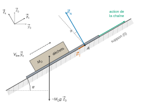
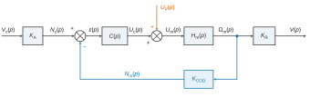
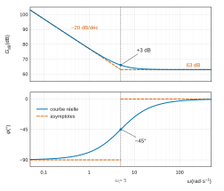
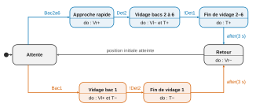

# CCINP PSI — Sciences industrielles de l'ingénieur 2026 · Corrigé brut

*Corrigé rédigé par IA, non officiel. Signalez toute erreur.*

Épreuve PSI7SI (mutualisée avec e3a-Polytech), 4 heures, calculatrices interdites. Sujet : « Barges Interceptor, nettoyer les rivières pour protéger les océans ». Le Document Réponse (DR) n'étant pas disponible, les valeurs qui ne peuvent être lues que sur ses tracés (Q22, Q25, Q26, Q35) ne sont pas inventées : la méthode et le critère de décision sont donnés complètement.

## Partie I — Présentation de l'ONG « The Ocean Cleanup »

### Q1

Le paragraphe cite la pollution chimique et visuelle des côtes et des plages, et la mortalité dans toute la chaîne alimentaire marine. Deux secteurs économiques des États côtiers sont donc touchés :

- **la pêche et l'aquaculture** : ressource halieutique diminuée, produits de la mer contaminés, donc moins de volume débarqué et moins de valeur marchande ;
- **le tourisme littoral** : plages souillées et pollution visuelle font baisser la fréquentation (hôtellerie, restauration, plaisance).

Ces pertes de chiffre d'affaires, comme le nettoyage des plages et des ports, sont des **coûts directs** de la pollution. Les **coûts indirects** sont supportés par la société en dehors de ces secteurs :

- dépenses de santé liées aux micro et nanoplastiques (risques de cancers et perturbateurs endocriniens cités par le texte), arrêts de travail et perte de productivité associés ;
- recettes fiscales perdues par l'État et les collectivités du fait du recul de l'activité ;
- dépréciation du littoral (immobilier, attractivité) et perte de biodiversité.

L'étude citée chiffre l'impact global à environ 19 milliards de dollars pour 87 pays en 2018.

## Partie II — Implantation des « Interceptor »

### II.1 — Sélection des rivières

### Q2

Les images d'entraînement sont étiquetées par des volontaires (boîtes entourant les déchets plastiques) : la sortie attendue est connue pour chaque entrée. C'est un **apprentissage supervisé** (tâche de classification plastique / non plastique). La première phase, où les paramètres du réseau sont ajustés sur ces données, est la **phase d'apprentissage** (ou d'entraînement).

Sur la figure 4, l'extrapolation en pointillés prolonge la courbe mesurée (59 % à 10 000 objets) de façon presque horizontale. À 20 000 objets on lit :

$$\boxed{\text{rappel maximal espéré}\approx 63\ \%}$$

Doubler l'échantillon ne fait gagner que 3 à 4 points : la courbe sature.

### Q3

Le modèle entraîné, figé, est appliqué à des données qu'il n'a jamais vues : c'est la **phase d'inférence** (phase de test). Les prédictions correctes sont sur la diagonale : 90 plastiques reconnus et 46 non plastiques reconnus, sur $90+38+26+46=200$ images.

$$\begin{aligned}
\text{justesse}&=\frac{90+46}{200}\\
&=\frac{136}{200}
\end{aligned}$$

$$\boxed{\text{justesse}=68\ \%}$$

C'est la valeur de référence de la rivière A tracée sur la figure 5.

### Q4

Sans données de la nouvelle rivière (abscisse 0), le modèle entraîné sur la rivière A n'atteint que 55 % (D), environ 45 % (B et C) et 20 % (E), bien en dessous des 68 % de référence : il ne se généralise pas à d'autres rivières (éclairage, turbidité, nature des déchets végétaux différents).

L'ajout de quelques données locales améliore fortement la justesse : avec 50 images, E passe de 20 à 42 % et D de 55 à 60 % ; avec 200 images, D atteint 70 %, au-dessus de la référence. Au-delà, le gain sature : B et C plafonnent vers 54–57 % entre 200 et 1800 images.

**Conclusion : utiliser des données issues des 5 rivières est indispensable**, car un modèle appris sur une seule rivière ne se transpose pas. Un complément de quelques dizaines à quelques centaines d'images étiquetées par site suffit à récupérer l'essentiel de la performance. Au-delà, ajouter des données n'apporte presque plus rien, et la justesse reste inférieure à la référence pour certaines rivières.

### II.2 — Sélection de l'emplacement sur la rivière

Cette sous-partie ne comporte pas de question.

## Partie III — Extraction de déchets de la rivière

### III.1 — Dimensionnement de la motorisation du convoyeur

Description de la figure 9 : le brin porteur relie le rouleau immergé au rouleau moteur, incliné de $\alpha=30^\circ$ sur l'horizontale $\vec y_0$, avec une dénivelée $h=2$ m entre les axes. Les vecteurs de la base du convoyeur s'écrivent :

$$\begin{aligned}
\vec y_c&=\cos\alpha\,\vec y_0+\sin\alpha\,\vec z_0\\
\vec z_c&=-\sin\alpha\,\vec y_0+\cos\alpha\,\vec z_0
\end{aligned}$$

### Q5

Longueur du brin porteur : $L_c=h/\sin\alpha=4$ m. La masse maximale $M_D$ étant répartie uniformément sur ce brin, la masse linéique vaut $\lambda=M_D/L_c$.

Pendant $\mathrm dt$, la masse évacuée en haut du convoyeur est $\lambda V\,\mathrm dt$, d'où le débit :

$$Q=\lambda V=\frac{M_D\,V\sin\alpha}{h}$$

L'exigence 2.1 impose $Q\ge Q_d$ à charge maximale :

$$\boxed{V_{lim}=\frac{Q_d\,h}{M_D\sin\alpha}}$$

AN : $V_{lim}=\dfrac{24\times2}{100\times0{,}5}=0{,}96\ \mathrm{m\cdot s^{-1}}$.

La valeur $V_{lim}=1\ \mathrm{m\cdot s^{-1}}$ retenue par la suite respecte cette exigence.

### Q6

Roulement sans glissement de la chaîne sur le rouleau moteur, en un point $I$ du brin porteur situé en $+R_m\vec z_c$ de l'axe $(O,\vec x_0)$ du rouleau. Avec $\vec\Omega(\text{rouleau}/0)=\omega_r\vec x_0$ :

$$\vec V(I)=\omega_r\vec x_0\wedge R_m\vec z_c=-R_m\,\omega_r\,\vec y_c$$

La chaîne monte selon $+\vec y_c$, donc $V=-R_m\,\omega_r$. Le réducteur donne $\omega_r=k\,\omega_m$ :

$$V=-k\,R_m\,\omega_m$$

$$\boxed{\omega_m=-\frac{V_{lim}}{k\,R_m}}$$

AN : $\omega_m=\dfrac{1}{0{,}1\times0{,}1}=100\ \mathrm{rad\cdot s^{-1}}$ (soit environ 950 tr/min).

Le signe est cohérent : $k<0$ et $\omega_r<0$, donc $\omega_m>0$. Par la suite on note $K_R=-kR_m=|k|R_m=10^{-2}$ m, d'où $V=K_R\,\omega_m$.

### Q7

Les déchets sont en translation par rapport au support (0), à la vitesse $V\vec y_c$ :

$$\begin{aligned}
E_c(D/0)&=\tfrac12 M_D V^2\\
&=\tfrac12 M_D(kR_m)^2\,\omega_m^2\\
&=\tfrac12 J_D\,\omega_m^2
\end{aligned}$$

$$\boxed{J_D=M_D\,(k\,R_m)^2}$$

$J_D=100\times(10^{-2})^2=1\cdot10^{-2}\ \mathrm{kg\cdot m^2}$, valeur annoncée par l'énoncé.

### Q8

Le couple moteur $C_m$ agit sur le rotor qui tourne à $\omega_m$ autour du même axe, par rapport au bâti :

$$\boxed{P_{mot}=C_m(t)\,\omega_m(t)}$$

### Q9

La puissance de la pesanteur sur un ensemble de masse $m$ vaut $P=-mg\,\vec z_0\cdot\vec V(G/0)$.

- **Moteur, réducteur, rouleaux** : solides en rotation autour d'axes fixes par rapport à (0), équilibrés (de révolution) : leur centre d'inertie est sur l'axe, donc fixe, et la puissance de leur poids est nulle.
- **Chaîne et tapis** : leur masse n'est pas négligeable, mais c'est une boucle fermée qui défile sur elle-même. À chaque instant, la répartition de masse dans (0) est la même (chaque élément est remplacé par un élément identique), donc le centre d'inertie de l'ensemble est fixe et la puissance est nulle. De manière équivalente, un élément $\mathrm dm$ qui monte à $V$ sur le brin porteur est compensé par un élément identique qui descend à $V$ sur le brin de retour : les puissances $\mp\,\mathrm dm\,gV\sin\alpha$ s'annulent.

**La puissance de la pesanteur sur le système à vide est nulle.**

### Q10

Les déchets montent tous à $V_{lim}\vec y_c$ et ne redescendent pas. Avec $\vec z_0\cdot\vec y_c=\sin\alpha$ :

$$P_{pes}(D)=(-M_Dg\,\vec z_0)\cdot(V_{lim}\vec y_c)$$

$$\boxed{P_{pes}(D)=-M_D\,g\,V_{lim}\sin\alpha}$$

AN : $P_{pes}(D)=-100\times10\times1\times0{,}5=-500$ W. Le signe négatif est attendu : la pesanteur s'oppose à la montée des déchets, sa puissance est résistante.

### Q11

**Tracé.** Le tapis glisse sur le support à $V_{lim}\vec y_c$. D'après les lois de Coulomb en glissement, $\vec F_T$ est contenue dans le plan tangent et opposée à la vitesse de glissement du tapis par rapport au support. Elle est donc dirigée selon $-\vec y_c$ (vers le bas de la pente), avec $\|\vec F_T\|=f\,\|\vec F_N\|$.

Sur le DR, on trace au point $A$ une flèche parallèle au support, vers le bas de la pente, de longueur égale à $0{,}2$ fois celle de $\vec F_N$. La résultante est inclinée de $\varphi=\arctan f\approx11^\circ$ par rapport à la normale, du côté opposé au mouvement.

**Action normale.** On isole le morceau de tapis et les déchets qu'il porte (masse du tapis négligée). Actions extérieures :

- poids $-M_Dg\,\vec z_0$ ;
- action du support $F_N\vec z_c+\vec F_T$, avec $\vec F_T$ selon $\vec y_c$ ;
- action de la chaîne, selon $\vec y_c$.

Le mouvement est une translation rectiligne uniforme dans le référentiel galiléen lié à (0) : la somme des forces est nulle. En projection sur $\vec z_c$, avec $\vec z_0\cdot\vec z_c=\cos\alpha$ :

$$F_N-M_Dg\cos\alpha=0$$

$$\boxed{\vec F_N=M_D\,g\cos\alpha\;\vec z_c}$$

AN : $F_N=500\sqrt3\approx8{,}7\cdot10^2\ \mathrm N$.

**Puissance du frottement.** $\vec F_N\perp\vec V$ ne travaille pas ; $\vec F_T=-fF_N\vec y_c$ :

$$\boxed{P_{frot}=-f\,M_D\,g\,V_{lim}\cos\alpha}$$

AN : $P_{frot}=-100\sqrt3\approx-1{,}7\cdot10^2\ \mathrm W$.

### Q12

$$P_r=P_{pes}(D)+P_{frot}$$

$$P_r=-M_DgV_{lim}(\sin\alpha+f\cos\alpha)$$

Avec $V_{lim}=|k|R_m\,\omega_m$, on obtient $P_r=C_{Req}\,\omega_m$ avec :

$$\boxed{C_{Req}=-M_D\,g\,|k|\,R_m\,(\sin\alpha+f\cos\alpha)}$$

AN :

$$\begin{aligned}
C_{Req}&=-100\times10\times0{,}1\times0{,}1\times(0{,}5+0{,}1\sqrt3)\\
&=-10\times0{,}673\\
&\approx-6{,}7\ \mathrm{N\cdot m}
\end{aligned}$$

C'est la valeur de l'énoncé. Le signe négatif traduit un couple résistant.

### Q13

**Ensemble isolé** : $\Sigma=\{$moteur, réducteur, rouleaux, chaîne, tapis, déchets$\}$, en mouvement par rapport à (0), galiléen.

**Théorème** : théorème de l'énergie cinétique, appliqué à $\Sigma$ dans son mouvement par rapport à (0) :

$$\frac{\mathrm dE_c(\Sigma/0)}{\mathrm dt}=P_{ext\to\Sigma}+P_{int}$$

**Hypothèses** : liaisons internes parfaites (paliers, engrenages, contact chaîne/rouleaux), donc $P_{int}=0$ ; le seul frottement (tapis/support) est compté dans $C_{Req}$ ; masse de déchets constante égale à $M_D$ ; rapports de transmission constants.

L'énergie cinétique vaut $E_c(\Sigma/0)=\tfrac12(J_e+J_D)\,\omega_m^2$. La puissance extérieure vaut $P_{ext}=C_m\omega_m+C_{Req}\omega_m$ (Q8, Q9, Q12). On simplifie par $\omega_m\neq0$ :

$$\boxed{(J_e+J_D)\,\frac{\mathrm d\omega_m(t)}{\mathrm dt}=C_m(t)+C_{Req}(t)}$$

### Q14

**Démarrage** (le plus défavorable : convoyeur chargé). Accélération uniforme de 0 à $100\ \mathrm{rad\cdot s^{-1}}$ en 5 s, soit $\dot\omega_m=20\ \mathrm{rad\cdot s^{-2}}$. Le couple nécessaire vaut :

$$\begin{aligned}
C_m&=(J_e+J_D)\,\dot\omega_m-C_{Req}\\
&=5\cdot10^{-2}\times20+6{,}7\\
&=7{,}7\ \mathrm{N\cdot m}
\end{aligned}$$

On a $7{,}7\ \mathrm{N\cdot m}<15\ \mathrm{N\cdot m}$ (couple de démarrage du moteur).

**Vitesse constante** : $C_m=-C_{Req}=6{,}7\ \mathrm{N\cdot m}$, inférieur au couple nominal de $10\ \mathrm{N\cdot m}$.

**Le moteur retenu convient pour les deux phases** (marges d'environ 50 % au démarrage et 33 % en régime nominal).

### III.2 — Régulation de la vitesse du convoyeur

### Q15

Chaîne directe :

- convertisseur $K_A$, de $V_c$ vers $N_c$ ;
- comparateur, $\varepsilon=N_c-N_m$ ;
- correcteur $C(p)$, qui délivre $U_c$ ;
- sommateur, $U_m=U_c+U_P$ ;
- moteur $H_m(p)$, qui délivre $\Omega_m$ ;
- réducteur et poulie/chaîne $K_R=|k|R_m$, qui délivrent $V$.

Chaîne de retour : codeur $K_{COD}$ monté sur l'arbre moteur, de $\Omega_m$ vers $N_m$.

### Q16

L'écart s'écrit $\varepsilon=K_Av_c-K_{COD}\,\omega_m$, avec $\omega_m=v/K_R$ :

$$\varepsilon=K_Av_c-\frac{K_{COD}}{K_R}\,v$$

Cet écart est proportionnel à $v_c-v$ si et seulement si :

$$\boxed{K_A=\frac{K_{COD}}{K_R}}$$

alors $\varepsilon=K_A\,(v_c-v)$.

Avec $K_R=10^{-2}\ \mathrm{m\cdot rad^{-1}}$ et $K_{COD}$ (Q17) : $K_A\approx4{,}1\cdot10^3$ incréments par mètre.

### Q17

Une période du signal correspond à une paire de pôles N/S (figure 12) : 128 pôles par piste donnent 64 périodes par tour. Les deux pistes en quadrature fournissent 4 fronts distincts par période (montant et descendant sur $a$ et $b$). En exploitant tous ces changements, on multiplie par 4 :

$$4\times64=256\ \text{incréments par tour}$$

Un tour valant $2\pi$ rad :

$$\boxed{K_{COD}=\frac{256}{2\pi}\approx40{,}7\ \text{incréments}\cdot\mathrm{rad^{-1}}}$$

(La quadrature donne aussi le sens de rotation.)

Remarque : l'énoncé parle de 128 pôles par piste, alors que le rapport du jury évoque 128 paires de pôles. Avec cette seconde lecture, le codeur donne $4\times128=512$ incréments par tour, soit $K_{COD}=512/(2\pi)\approx81{,}5$ incréments par radian, et $K_A\approx8{,}1\cdot10^3$ incréments par mètre en Q16. On suit ici le texte de l'énoncé.

### Q18

**Choix du modèle, justifié sur le DR.** Chaque réponse à l'échelon de 48 V :

- part de 0 avec une tangente à l'origine de pente non nulle (ce qui exclut un second ordre, dont la tangente à l'origine est de pente nulle) ;
- tend vers un palier sans dépassement ni oscillation.

Ce sont les propriétés de la réponse indicielle d'un **premier ordre**, $H_m(p)=\dfrac{K_m}{1+\tau_m p}$.

- On trace l'asymptote horizontale de la courbe sans perturbation : $n_{m\infty}=K_{COD}K_m\times48$, d'où $K_m$.
- La tangente à l'origine coupe l'asymptote en $t=\tau_m$ (contrôle : 63 % du palier à $t=\tau_m$, 95 % à $3\tau_m$).
- Pour une perturbation $C_{R0}$, le palier se décale de $\Delta n_{m\infty}=K_{COD}K_mK_{pert}C_{R0}$, d'où $K_{pert}$ à partir de l'**écart** entre deux paliers.

**Ordres de grandeur.** Ils sont cohérents avec le modèle simplifié de la figure 13, qui donne entre $U_m$ et $V$ la fonction $K_{BO}/(1+\tau_{BO}p)$ avec $K_{BO}=K_mK_R$ :

$$\boxed{H_m(p)\approx\frac{3{,}5\ \mathrm{rad\cdot s^{-1}\cdot V^{-1}}}{1+1\ \mathrm s\cdot p}}$$

$$\boxed{K_{pert}\approx2{,}5\ \mathrm{V\cdot N^{-1}\cdot m^{-1}}}$$

Sous 48 V et sans perturbation, le palier vaut environ $40{,}7\times3{,}5\times48\approx7\cdot10^3$ incréments/s, soit $\omega_m\approx1{,}7\cdot10^2\ \mathrm{rad\cdot s^{-1}}$. (Les relevés eux-mêmes sont à faire sur le DR, non disponible ici.)

### Q19

Avec $C'(p)=K_P$ et $C_{Req}=0$, la FTBO s'écrit :

$$\mathrm{FTBO}(p)=\frac{K_PK_{BO}}{1+\tau_{BO}p}$$

Elle est de classe 0 et de gain $K_PK_{BO}$. La boucle fermée est du premier ordre, de pôle $-(1+K_PK_{BO})/\tau_{BO}<0$, donc stable, et le théorème de la valeur finale s'applique :

$$\begin{aligned}
\varepsilon'_\infty&=\lim_{p\to0}p\,\frac{V_{C0}/p}{1+\mathrm{FTBO}(p)}\\
&=\frac{V_{C0}}{1+K_PK_{BO}}
\end{aligned}$$

L'exigence $\varepsilon'_\infty\le0{,}01\ \mathrm{m\cdot s^{-1}}$ avec $V_{C0}=1\ \mathrm{m\cdot s^{-1}}$ équivaut à $K_PK_{BO}\ge99$ :

$$\boxed{K_P\ge\frac{99}{K_{BO}}\approx2{,}8\cdot10^3\ \mathrm{V\cdot m^{-1}\cdot s}}$$

### Q20

$$\begin{aligned}
\mathrm{FTBF}(p)&=\frac{K_PK_{BO}}{1+K_PK_{BO}+\tau_{BO}p}\\
&=\frac{K_{BF}}{1+\tau_{BF}p}
\end{aligned}$$

avec la constante de temps en boucle fermée :

$$\tau_{BF}=\frac{\tau_{BO}}{1+K_PK_{BO}}$$

Pour un premier ordre, $t_{5\%}=3\tau_{BF}$ :

$$\boxed{t_{5\%}=\frac{3\,\tau_{BO}}{1+K_P\,K_{BO}}}$$

AN pour $K_P=2{,}8\cdot10^3$ ($1+K_PK_{BO}=100$) : $t_{5\%}=0{,}03$ s $<5$ s. **L'exigence de rapidité est vérifiée** (dans ce modèle linéaire, sans saturation de la commande).

### Q21

Consigne nulle (superposition), $C_{Req}(p)=C_{R0}/p$. La perturbation $U_p=K_{pert}C_{Req}$ s'ajoute à $U_c$ :

$$V(p)=\frac{K_{pert}K_{BO}}{1+K_PK_{BO}+\tau_{BO}p}\,C_{Req}(p)$$

L'écart dû à la perturbation est $\varepsilon'(p)=-V(p)$. Valeur finale (boucle stable) :

$$\boxed{\varepsilon'_{pert,\infty}=-\frac{K_{pert}\,K_{BO}}{1+K_P\,K_{BO}}\,C_{R0}}$$

Pour un couple résistant ($C_{R0}<0$), l'écart est positif : la vitesse diminue. Par exemple, avec $K_P=2{,}8\cdot10^3$ et $C_{R0}=-6{,}7$ N·m : $\varepsilon'\approx5{,}9\cdot10^{-3}\ \mathrm{m\cdot s^{-1}}$, qui s'ajoute à l'erreur de 0,01 m/s due à la consigne. Le correcteur proportionnel ne tient alors plus l'exigence 1.1.1.1.

### Q22

Le modèle du premier ordre a une phase dans $]-90^\circ,0^\circ]$ : il ne permet pas d'étudier la stabilité, d'où le modèle plus élaboré du DR.

**Mesures sur le Bode du DR ($K_P=1000\ \mathrm{V\cdot m^{-1}\cdot s}$)** :

- **marge de phase** : on trace l'horizontale 0 dB et on relève la pulsation $\omega_{c0}$ où le gain la coupe ; on la reporte sur la phase et $M_\varphi=180^\circ+\varphi(\omega_{c0})$ ;
- **marge de gain** : on trace l'horizontale $-180^\circ$. La courbe de phase ne la coupe pas (elle reste au-dessus de $-180^\circ$) : il n'existe pas de pulsation $\omega_{-180}$, et la **marge de gain est infinie**.

**$K_P$ limite pour $M_\varphi\ge45^\circ$** : la phase ne dépend pas de $K_P$, qui ne fait que translater la courbe de gain de $20\log(K_P/1000)$.

On relève la pulsation $\omega_{45}$ où $\varphi=-135^\circ$, puis le gain $G_{dB}(\omega_{45})$ pour $K_P=1000$. Il faut que ce point devienne la coupure à 0 dB :

$$\boxed{K_{P,lim}=1000\times10^{-G_{dB}(\omega_{45})/20}\ \mathrm{V\cdot m^{-1}\cdot s}}$$

L'exigence de stabilité impose $K_P\le K_{P,lim}$. Le rapport du jury indique qu'il faut remonter la courbe de gain de 10 dB, c'est-à-dire $G_{dB}(\omega_{45})\approx-10$ dB. Le gain correspondant multiplie la valeur initiale $K_P=1000$ :

$$\begin{aligned}
K_{P,lim}&=1000\times10^{10/20}\\
&=1000\sqrt{10}\\
&\approx3{,}2\cdot10^3\ \mathrm{V\cdot m^{-1}\cdot s}
\end{aligned}$$

(Les valeurs précises se lisent sur le DR, non disponible ici.)

Ce $K_{P,lim}$ dépasse à peine les $2{,}8\cdot10^3$ exigés par la précision sans perturbation (Q19). Avec la perturbation (Q21), l'erreur totale vaut :

$$\varepsilon'_{tot,\infty}=\frac{V_{C0}-K_{pert}K_{BO}C_{R0}}{1+K_PK_{BO}}$$

Pour $V_{C0}=1$ m/s et le couple résistant nominal $C_{R0}=-6{,}7$ N·m, elle reste sous 0,01 m/s seulement si $K_P\ge4{,}5\cdot10^3$, au-delà de $K_{P,lim}$. Le correcteur proportionnel ne peut donc pas satisfaire à la fois la stabilité et la précision, comme l'annonce l'énoncé.

### Q23

$C'(p)=K_P\dfrac{1+T_ip}{T_ip}$ contient une intégration, placée **en amont** du point d'injection de la perturbation : la FTBO devient de classe 1.

- Consigne en échelon : $\varepsilon'_\infty=\lim_{p\to0}\dfrac{V_{C0}}{1+\mathrm{FTBO}(p)}=0$.
- Perturbation en échelon : $\varepsilon'_{pert,\infty}=\lim_{p\to0}-\dfrac{K_{pert}K_{BO}C_{R0}}{1+\tau_{BO}p+C'(p)K_{BO}}=0$, car $|C'(p)|\to\infty$ en 0.

**Le PI permet de valider l'exigence de précision 1.1.1.1** (erreur statique nulle pour la consigne et la perturbation), sans imposer un gain $K_P$ élevé : on peut donc garder un $K_P$ compatible avec la marge de phase. Il n'améliore ni la stabilité ni la rapidité : sa phase, négative, remonte de $-90^\circ$ à $0^\circ$ : il introduit un déphasage négatif. Si $1/T_i$ est nettement inférieure à la pulsation de coupure, le retard qu'il ajoute à la coupure reste faible.

### Q24

$K_P=1420$, $T_i=0{,}2$ s, pulsation de cassure $\omega_i=1/T_i=5\ \mathrm{rad\cdot s^{-1}}$ ; $20\log1420\approx63$ dB.

$$|C'(j\omega)|=K_P\frac{\sqrt{1+(T_i\omega)^2}}{T_i\omega}$$

$$\arg C'(j\omega)=-90^\circ+\arctan(T_i\omega)$$

| | $\omega\ll5$ | $\omega=5\ \mathrm{rad/s}$ | $\omega\gg5$ |
|---|---|---|---|
| Asymptote de gain | pente $-20$ dB/décade, passant par 63 dB en $\omega=5$ (83 dB en 0,5) | 63 dB (cassure) | horizontale à 63 dB |
| Gain réel | sur l'asymptote | 66 dB ($+3$ dB) | sur l'asymptote |
| Asymptote de phase | $-90^\circ$ | saut | $0^\circ$ |
| Phase réelle | $-84^\circ$ en 0,5 rad/s | $-45^\circ$ | $-6^\circ$ en 50 rad/s |

Les courbes réelles se raccordent aux asymptotes à environ une décade de part et d'autre de $\omega_i$.

### Q25

Conditions : consigne en échelon de $0{,}5\ \mathrm{m\cdot s^{-1}}$, perturbation en échelon de $-4$ N·m, PI réglé ($K_P=1420$, $T_i=0{,}2$ s). Pour chaque critère, on mesure la valeur sur la courbe, on la compare au seuil, puis on conclut :

- **Précision (1.1.1.1)** : asymptote horizontale de $v(t)$ comparée à 0,5 m/s. L'écart final doit être inférieur à 0,01 m/s ; il est théoriquement nul (Q23), y compris après l'application de la perturbation.
- **Rapidité (1.1.1.3)** : bande à $\pm5\ \%$ de la valeur finale (0,475 et 0,525 m/s), puis instant de **dernière entrée** dans la bande, à comparer à 5 s.
- **Stabilité (1.1.1.2)** : sur le Bode de la FTBO corrigée, horizontale 0 dB, report de $\omega_{c0}$ sur la phase, $M_\varphi=180^\circ+\varphi(\omega_{c0})$, à comparer à 45°.

Chaque exigence est conclue séparément, avec la valeur mesurée. Les valeurs numériques sont à relever sur le DR, non disponible ici. À titre d'ordre de grandeur, le modèle simplifié de la figure 13 avec une saturation à 48 V (hypothèse de Q26) donne un temps de réponse à 5 % d'environ 1 s, très inférieur à 5 s, et une erreur finale nulle.

### Q26

**Grandeur saturée : la tension de commande $u_c(t)$** délivrée au moteur, limitée par la tension d'alimentation du variateur. En effet, à $t=0^+$, l'action intégrale est nulle et l'écart vaut 0,5 m/s :

$$u_c(0^+)=K_P\,\varepsilon'(0^+)$$

AN : $u_c(0^+)=1420\times0{,}5\approx7\cdot10^2$ V, valeur inaccessible à un variateur alimenté sous quelques dizaines de volts.

**Valeur de saturation** : celle du palier lu sur la courbe de $u_c$ du DR. La valeur la plus probable est 48 V, tension d'alimentation utilisée pour l'essai de Q18.

**Intervalle** : il commence à $t=0$ (échelon de consigne) et finit quand la commande calculée par le PI repasse sous la valeur de saturation (sortie du palier sur la courbe du DR). Avec le modèle de la figure 13, une saturation à 48 V et sans dispositif anti-emballement, l'intégrale de l'écart accumulée pendant la saturation retarde la sortie :

- environ $[0\,;\,0{,}6\ \mathrm s]$ sans perturbation ;
- environ $[0\,;\,0{,}8\ \mathrm s]$ si la perturbation est appliquée dès $t=0$.

Pendant la saturation, la vitesse suit la réponse en boucle ouverte sous tension constante, et la sortie de saturation s'accompagne d'un dépassement.

$$\boxed{\text{grandeur saturée : }u_c(t)\ ;\ \text{valeur probable : }48\ \mathrm V\ ;\ \text{intervalle }[0\,;\,t_s]\text{ avec }t_s\text{ de l'ordre de la demi-seconde}}$$

## Partie IV — Remplissage des barges

### IV.1 — Gestion de l'assiette de la barge

### Q27

Seuls les deux flotteurs, de largeur $a$ et de longueur $L$, sont immergés (figure 16 : $a+2{,}5+a=\ell$). Pour un enfoncement $h_{lm}$, le volume immergé vaut $V_{im}=2aLh_{lm}$ (facteur 2 : deux flotteurs). À l'équilibre vertical, poussée d'Archimède et poids s'équilibrent :

$$\rho_eV_{im}g=m_Bg$$

$$\boxed{h_{lm}=\frac{m_B}{2\,\rho_e\,a\,L}}$$

AN : $h_{lm}=\dfrac{10\,000}{2\times1000\times1{,}25\times15}\approx0{,}27\ \mathrm m$.

On a bien $h_{lm}<h=1$ m : la barge flotte sur ses flotteurs.

### Q28

Origine en $G_B$ (milieu de la barge). Le conteneur 6 plein ajoute $m_c$ en $y=b$ :

$$\boxed{\Delta y_G=\frac{m_c\,b}{m_B+m_c}}$$

AN : $\Delta y_G=\dfrac{800\times6}{10\,800}\approx0{,}44\ \mathrm m$.

### Q29

La barge est soumise à deux glisseurs : son poids, passant par $G$, et la poussée d'Archimède, passant par $C_{P_A}$. Le principe fondamental de la statique impose d'abord des résultantes opposées. Le théorème du moment statique en $G$ donne ensuite $\overrightarrow{GC_{P_A}}\wedge\vec z_0=\vec0$ : les deux glisseurs ont même support, donc les deux points sont sur une même verticale.

$$\boxed{y_{C_{P_A}}=y_G}$$

Soit $\Delta y_{C_{P_A}}=\Delta y_G\approx0{,}44$ m.

### Q30

D'après la figure 18, les enfoncements aux deux extrémités valent $h_{lm}-z$ et $h_{lm}+z$, séparées de $L$. La dénivelée du fond vaut donc $2z$, et $\tan\beta=2z/L$.

L'angle étant petit ($0{,}01$ rad), $\tan\beta\simeq\beta$ :

$$\boxed{\beta\simeq\frac{2z}{L}}$$

$$z=\frac{\beta L}{2}=\frac{0{,}01\times15}{2}$$

$$\boxed{z=7{,}5\cdot10^{-2}\ \mathrm m}$$

### Q31

Le centre de poussée est le centre géométrique du volume immergé, de largeur constante $2a$ : c'est le centroïde du trapèze de la figure 18. On repère l'abscisse $y\in[-L/2,L/2]$ depuis le milieu de la barge ; la hauteur immergée vaut $d(y)=h_{lm}+\dfrac{2z}{L}y$.

$$\begin{aligned}
\Delta y_{C_{P_A}}&=\frac{\int_{-L/2}^{L/2}y\,d(y)\,\mathrm dy}{\int_{-L/2}^{L/2}d(y)\,\mathrm dy}\\
&=\frac{\frac{2z}{L}\cdot\frac{L^3}{12}}{h_{lm}L}
\end{aligned}$$

$$\boxed{\Delta y_{C_{P_A}}=\frac{z\,L}{6\,h_{lm}}}$$

Contrôle par décomposition : le trapèze est un rectangle de hauteur $h_{lm}-z$, centré en $y=0$, plus un triangle de hauteur $2z$ côté enfoncé, d'aire $zL$ et de centre de gravité à $L/3$ de son grand côté, soit en $y=L/6$. Le barycentre des deux aires redonne :

$$\Delta y_{C_{P_A}}=\frac{zL\cdot L/6}{h_{lm}L}$$

Le dénominateur $h_{lm}L$ est inchangé : le volume immergé est conservé. AN pour $z=0{,}075$ m et $h_{lm}\approx0{,}27$ m : $\Delta y_{C_{P_A}}\approx0{,}7$ m (0,65 m avec l'enfoncement de la barge chargée d'un conteneur, 0,29 m).

### Q32

D'après Q28 et Q29, l'équilibre avec le seul conteneur 6 rempli exige $\Delta y_{C_{P_A}}=0{,}44$ m. La figure 19 est une droite passant par l'origine, de pente environ $0{,}1\ \mathrm m/1{,}55^\circ\approx6{,}5\cdot10^{-2}\ \mathrm m$ par degré.

- À l'assiette maximale admise ($0{,}5^\circ$), le centre de poussée ne se décale que d'environ 3 cm.
- Le décalage exigé (0,44 m) correspond à $\beta\approx0{,}44/0{,}065\approx7^\circ$, quatorze fois la tolérance.

**Un remplissage déséquilibré met l'assiette hors tolérance : il faut un système qui régule la répartition des déchets entre les conteneurs.**

Remarque (erreur d'énoncé probable) : le modèle de Q30–Q31 donne $\Delta y_{C_{P_A}}=\beta L^2/(12h_{lm})$, soit environ 1,2 m par degré, environ 19 fois plus que la figure 19. Cette pente est celle qu'on obtient en remplaçant $h_{lm}$ par la largeur $\ell=5$ m. Avec le modèle de Q31, l'équilibre serait atteint pour $\beta\approx0{,}4^\circ$ : un seul conteneur d'extrémité consomme déjà environ 80 % de la tolérance, et deux conteneurs pleins du même côté la dépassent. La conclusion reste donc la même : la régulation est nécessaire.

### IV.2 — Commande du convoyeur intermédiaire

### Q33

**Vitesse du tapis.** Courroie sans glissement entre la poulie motrice ($D_m$) et la poulie réceptrice ($D_R$), puis tapis sans glissement sur le tambour ($D_T$), solidaire de la poulie réceptrice. Le rapport de réduction des poulies vaut $D_m/D_R=1/4$ :

$$\begin{aligned}
v_{tapis}&=\omega_{mT}\,\frac{D_m}{D_R}\,\frac{D_T}{2}\\
&=50\times\frac{40}{160}\times0{,}1\\
&=1{,}25\ \mathrm{m\cdot s^{-1}}
\end{aligned}$$

**Vitesse lente.** Pendant le vidage, la navette se déplace à $v_\ell$ entre le détecteur 2 et le détecteur 1, soit une course de 1 m au-dessus du conteneur. Le tapis défile en sens inverse et déverse, par son extrémité, les déchets répartis uniformément sur ses 2,5 m.

L'abscisse de chute dépend de façon affine de la position initiale du déchet sur le tapis : le dépôt est uniforme si les 2,5 m de tapis sont vidés pendant que la navette parcourt 1 m. Donc $\dfrac{2{,}5}{v_{tapis}}=\dfrac{1}{v_\ell}$ :

$$\boxed{v_\ell=v_{tapis}\times\frac{1\ \mathrm m}{2{,}5\ \mathrm m}=0{,}5\ \mathrm{m\cdot s^{-1}}}$$

(Les 3 s de rotation du tapis après l'arrêt évacuent les derniers déchets.)

### Q34

Convention : le sens $+$ est celui de la mise en position. Le tapis tourne en sens inverse du mouvement de la navette pendant le vidage (T+ quand la navette est en Vl−, T− quand elle est en Vl+).

| État | Activités | Transition sortante (événement) | État suivant |
|---|---|---|---|
| Attente (navette en position initiale) | aucune | Bac2a6 | Approche rapide |
| Attente | aucune | Bac1 | Vidage bac 1 |
| Approche rapide | Vr+ | Det2 | Vidage bacs 2 à 6 |
| Vidage bacs 2 à 6 | Vl− et T+ | !Det1 | Fin de vidage 2–6 |
| Fin de vidage 2–6 | T+ (navette arrêtée) | after(3 s) | Retour |
| Vidage bac 1 | Vl+ et T− | !Det2 | Fin de vidage 1 |
| Fin de vidage 1 | T− (navette arrêtée) | after(3 s) | Retour |
| Retour | Vr− | position initiale atteinte | Attente |

Les activités (Vr±, Vl±, T±) sont des activités « do » dans les états ; les événements (Bac1, Bac2a6, Det1, Det2, !Det1, !Det2) portent les transitions. La temporisation de 3 s s'écrit avec l'événement temporel « after(3 s) », déclenché 3 s après l'entrée dans l'état.

## Partie V — Autonomie du système

### V.1 — Détermination de l'énergie totale consommée par le système

### Q35

$$E=\int_0^{24\ \mathrm h}P(t)\,\mathrm dt$$

C'est l'aire sous la courbe du DR. On découpe la courbe lissée en plateaux (rectangles $P_i\,\Delta t_i$) et en transitions (trapèzes $\tfrac12(P_i+P_{i+1})\Delta t_i$), qui constituent les tracés justificatifs.

On somme avec $P$ en kW et $\Delta t$ en h pour obtenir des kWh (1 kWh $=3{,}6\cdot10^6$ J), et on contrôle avec une puissance moyenne $\overline P$ telle que $E=24\,\overline P$. La valeur numérique se lit sur la courbe du DR, non disponible ici.

### V.2 — Autonomie et temps de recharge

### Q36

Énergie utilisable des batteries (décharge maximale de 80 %, transfert sans perte) :

$$E_{disp}=0{,}8\times20=16\ \mathrm{kWh}$$

L'autonomie de 24 h sans recharge est assurée si et seulement si l'énergie consommée ne dépasse pas cette valeur :

$$\boxed{E\le16\ \mathrm{kWh}}$$

ce qui équivaut à une puissance moyenne $\overline P\le16/24\approx0{,}67$ kW.

La conclusion se tire en comparant l'énergie $E$ lue en Q35 à 16 kWh. À titre d'ordre de grandeur, le convoyeur seul demande 0,67 kW mécaniques à pleine charge (Q14 : $6{,}7\times100$ W), avant les pertes du moteur et du variateur. Une journée de chargement extrême risque donc de dépasser 16 kWh, auquel cas une recharge solaire en cours de journée est indispensable. Seule la lecture du DR permet de trancher.

### Q37

Puissance reçue par les batteries : $P_b=0{,}8\times\tau_s\times5{,}6$ kW, et l'énergie à restituer est celle prélevée, 16 kWh.

- Ensoleillement optimal ($\tau_s=0{,}6$) : $P_b=2{,}69$ kW, $t_{min}=16/2{,}69\approx6$ h.
- Journée normale ($\tau_s=0{,}3$) : $P_b=1{,}34$ kW, $t_{norm}\approx12$ h.

$$\boxed{t_{min}\approx6\ \mathrm h}$$

$$\boxed{t_{norm}\approx12\ \mathrm h}$$

(Pour recharger 20 kWh : 7,4 h et 14,9 h.)

**Conclusion** : par beau temps, la recharge tient dans une journée d'ensoleillement. Par temps normal, 12 h dépassent la durée d'ensoleillement utile d'une journée, alors même que le système consomme pendant la charge. L'autonomie n'est donc assurée que si les journées extrêmes et peu ensoleillées ne s'enchaînent pas : le dimensionnement est juste, sans marge.

## Partie VI — Conclusion

### Q38

**Nombre de systèmes** à efficacité égale : $N=\dfrac{2\cdot10^6\ \mathrm{t/an}}{10^3\ \mathrm{t/an}}=2\,000$ Interceptor (environ deux par rivière).

$$\boxed{C_{impl}=2\,000\times5\ \text{M€}=10\ \text{milliards d'euros (investissement)}}$$

Avec un seul Interceptor par rivière, on obtiendrait 5 milliards d'euros, mais une capacité de 1 million de tonnes par an seulement, la moitié du flux. L'ordre de grandeur est le même : 5 à 10 milliards d'euros.

$$\boxed{C_{recy}=2\cdot10^6\ \mathrm t\times200\ \text{€/t}=400\ \text{millions d'euros par an}}$$

**Conclusion** : l'investissement (10 G€, une fois) représente environ la moitié d'une année de dommages estimés en partie I (environ 19 milliards de dollars par an pour 87 pays), et le recyclage annuel environ 2 % de ces dommages. Le passage de 15 à 2000 systèmes est un défi industriel considérable, mais les sommes en jeu sont faibles devant le coût de l'inaction : la prévention coûte moins cher que la pollution. Le vrai frein est financier et politique : les pays émetteurs sont souvent ceux qui n'ont pas les moyens d'investir. Ce chiffrage ne traite ni les 20 % issus des autres rivières, ni le stock déjà présent en mer.
