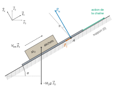
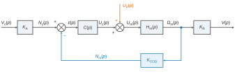
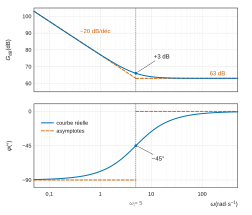
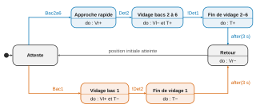

# CCINP PSI — Sciences industrielles de l'ingénieur 2026 · Corrigé guidé

*Corrigé rédigé par IA, non officiel. Signalez toute erreur.*

## Présentation du sujet

L'épreuve (PSI7SI, mutualisée avec e3a-Polytech, 4 heures, **calculatrices interdites**) s'intitule « Barges Interceptor, nettoyer les rivières pour protéger les océans ». Elle suit une barge de collecte de déchets plastiques de bout en bout : où l'installer, comment extraire les déchets, comment remplir les conteneurs sans faire basculer la barge, et comment l'alimenter en énergie. Elle compte **38 questions** en six parties. Un Document Réponse (DR) de 12 pages porte les tracés à exploiter ou à compléter (Q11, Q18, Q22, Q24 à Q26, Q34, Q35). Il n'est pas disponible ici : pour ces questions, le corrigé donne la méthode complète et le critère de décision, sans inventer de valeur.

- **Partie I — Présentation (Q1).** Lecture d'un texte : secteurs touchés et coûts indirects de la pollution plastique.
- **Partie II — Implantation (Q2 à Q4).** Intelligence artificielle : apprentissage supervisé, phases d'apprentissage et d'inférence, lecture d'une courbe de rappel, justesse à partir d'une matrice de confusion, analyse de la généralisation à d'autres rivières.
- **Partie III — Extraction (Q5 à Q26).** III.1 : dimensionnement du moteur d'un convoyeur incliné (débit, cinématique, inertie équivalente, puissances, frottement de Coulomb, théorème de l'énergie cinétique, validation du moteur). III.2 : asservissement de vitesse (schéma-bloc, adaptation du gain, codeur incrémental, identification, précision et rapidité avec un correcteur proportionnel, perturbation, marges sur Bode, correcteur PI, saturation).
- **Partie IV — Remplissage (Q27 à Q34).** IV.1 : hydrostatique de la barge (enfoncement, centre de gravité, centre de poussée, assiette). IV.2 : vitesse de la navette et diagramme d'états de son cycle.
- **Partie V — Autonomie (Q35 à Q37).** Énergie consommée sur 24 h, capacité utile des batteries, temps de recharge solaire.
- **Partie VI — Conclusion (Q38).** Estimation du coût d'un déploiement massif.

**Notions mobilisées** : exigences SysML ; vocabulaire de l'apprentissage automatique (programme d'informatique et de SII) ; cinématique des transmissions, énergie cinétique et inertie équivalente, puissance des actions mécaniques, lois de Coulomb, théorème de l'énergie cinétique ; schémas-blocs, théorème de la valeur finale, premier ordre, diagrammes de Bode, marges, correcteurs P et PI, saturation ; statique (deux glisseurs), centre de masse et poussée d'Archimède ; diagramme d'états ; bilans d'énergie.

**Difficulté.** Elle est modérée, et le sujet est long mais très guidé. Les valeurs de contrôle sont données ($J_D$, $C_{Req}$, les paramètres de la figure 13, le réglage du PI), ce qui permet de reprendre après une erreur. Les vraies difficultés sont les signes (Q6, Q10 à Q12), la géométrie du convoyeur et de la barge (Q5, Q27, Q31), le comptage du codeur (Q17) et la rigueur des tracés sur le DR. Sans calculatrice, les données sont choisies pour des calculs simples (4 m de brin, 100 rad/s, $10^{-2}$ kg·m²).

**Ce qu'en dit le rapport 2026.** Le jury note que très peu de questions demandaient des calculs longs, mais que beaucoup de copies perdent des points sur des questions de cours. Les questions les plus discriminantes, d'après le rapport, sont :

- Q15 (schéma-bloc) : plus de la moitié des candidats échouent, le plus souvent en plaçant mal le codeur ;
- Q17 (gain du codeur) : réussie par « quelques dizaines de candidats » seulement ;
- Q14, Q18, Q31 et Q33, jugées très mal traitées ; Q29, rarement conclue ;
- Q36 et Q37, peu abordées en fin de sujet.

Le rapport rappelle aussi que la présentation et la rédaction comptent pour 1 point sur 20, et qu'« une conclusion par rapport au cahier des charges doit être quantifiée ».

**À ne pas laisser passer** : Q2, Q3, Q6 à Q8, Q10, Q12 à Q21, Q23, Q24, Q27 à Q30, Q33, Q36 à Q38.

**Gestion du temps** : 25 min pour les parties I et II, 1 h 15 pour III.1, 1 h 15 pour III.2, 40 min pour la partie IV, 20 min pour les parties V et VI, plus une relecture. Les parties IV, V et VI sont indépendantes de la partie III et peuvent être traitées tôt si l'on bloque sur l'asservissement.

## Partie I — Présentation de l'ONG « The Ocean Cleanup »

Une seule question de lecture, qui pose l'enjeu économique repris en conclusion (Q38).

### Question 1
> [!INDICATION]
> Relire les conséquences citées dans le paragraphe, puis chercher quelles activités économiques des côtes en dépendent.

> [!INDICATION]
> Un coût indirect n'est pas une perte subie par le secteur touché ni une dépense de dépollution : c'est un coût reporté sur le reste de la société, par exemple sur la santé.

#### Solution
Le paragraphe cite la pollution chimique et visuelle des côtes et des plages, ainsi que la mortalité dans toute la chaîne alimentaire marine. Deux secteurs des États côtiers en dépendent :

- **la pêche et l'aquaculture** : ressource qui diminue et produits contaminés, donc moins de volume débarqué et moins de valeur marchande ;
- **le tourisme littoral** : plages souillées, baisse de fréquentation de l'hôtellerie, de la restauration et de la plaisance.

Ces pertes de chiffre d'affaires et le nettoyage des plages sont des **coûts directs**. Exemples de **coûts indirects** pour la société :

- dépenses de santé liées aux micro et nanoplastiques (le texte cite les risques de cancers et les perturbateurs endocriniens), arrêts de travail et perte de productivité ;
- recettes fiscales perdues du fait du recul de l'activité ;
- dépréciation du littoral et perte de biodiversité.

L'étude citée chiffre l'impact global à environ 19 milliards de dollars pour 87 pays en 2018.

> [!PIEGE]
> La question dit « à la lecture du paragraphe » : citer des secteurs qui n'y apparaissent pas (transport maritime, énergie) ne répond pas à la consigne.

> [!JURY]
> Le rapport 2026 juge la question élémentaire, mais relève : « Trop de candidats confondent coûts directs et indirects. » La baisse de recettes de la pêche est un coût direct ; les dépenses de santé publique sont un coût indirect.

## Partie II — Implantation des « Interceptor »

On qualifie une méthode de détection par IA : vocabulaire du programme (supervisé, apprentissage, inférence), lecture de courbes et indicateur de performance.

### II.1 — Sélection des rivières

### Question 2
> [!INDICATION]
> Les images ont été étiquetées par des volontaires : que sait-on alors pour chaque exemple d'entraînement ?

> [!INDICATION]
> Pour la valeur, lire la courbe en pointillés (extrapolation) à l'abscisse 20, pas le dernier point mesuré.

#### Solution
Chaque image d'entraînement est fournie avec la réponse attendue (boîtes entourant les plastiques) : c'est un **apprentissage supervisé**, pour une tâche de classification (plastique / non plastique). La première phase, où les paramètres du réseau sont ajustés sur ces exemples étiquetés, est la **phase d'apprentissage** (ou d'entraînement).

Sur la figure 4, les mesures passent de 49 % (2 000 objets) à 59 % (10 000 objets) ; l'extrapolation se prolonge presque horizontalement. À 20 000 objets :

$$\boxed{\text{rappel maximal espéré}\approx63\ \%}$$

Doubler l'échantillon ne fait gagner que 3 à 4 points : la courbe sature.

> [!PIEGE]
> « Réseau de neurones » ou « apprentissage profond » ne sont pas des types d'apprentissage au sens demandé : c'est l'étiquetage qui impose « supervisé ».

### Question 3
> [!INDICATION]
> Que fait-on d'un modèle une fois entraîné, face à des données jamais vues ?

> [!INDICATION]
> Les prédictions correctes sont celles où la classe prédite coïncide avec la classe réelle : regarder la diagonale.

#### Solution
Le modèle figé est appliqué à des images qui n'ont pas servi à l'apprentissage : c'est la **phase d'inférence** (ou de test). Prédictions correctes : 90 plastiques reconnus (vrais positifs) et 46 non plastiques reconnus (vrais négatifs), sur $90+38+26+46=200$ :

$$\begin{aligned}
\text{justesse}&=\frac{90+46}{200}\\
&=\frac{136}{200}
\end{aligned}$$

$$\boxed{\text{justesse}=68\ \%}$$

On retrouve la valeur de référence de la rivière A de la figure 5.

> [!METHODE]
> Toujours vérifier que la somme des quatre cases redonne l'effectif total. La justesse prend en compte les deux classes, alors que le rappel, $\mathrm{VP}/(\mathrm{VP}+\mathrm{FN})=90/116\approx78\ \%$, ne regarde que les plastiques réels.

### Question 4
> [!INDICATION]
> Comparer chaque courbe à la référence de 68 % : d'abord sans donnée de la nouvelle rivière, puis avec un peu de données locales.

> [!INDICATION]
> L'axe des abscisses n'est pas linéaire, et certaines courbes s'arrêtent avant 1800 : lire les points, sans parler de pente.

#### Solution
Sans données de la rivière testée (abscisse 0), la justesse vaut 55 % (D), environ 45 % (B et C) et 20 % (E), bien en dessous des 68 % de la rivière A : **un modèle appris sur une seule rivière ne se généralise pas** (conditions de prise de vue, turbidité, déchets végétaux différents).

Avec 50 images locales, E passe de 20 à 42 % et D de 55 à 60 % ; avec 200 images, D atteint 70 %, au-dessus de la référence. Au-delà, le gain sature : B et C plafonnent vers 54–57 % jusqu'à 1800 images.

**Conclusion : il faut utiliser les données des 5 rivières.** Un complément de quelques dizaines à quelques centaines d'images étiquetées par site récupère l'essentiel de la performance. Au-delà, ajouter des données n'apporte presque plus rien, et certaines rivières restent sous la référence.

> [!PIEGE]
> « Conclure » impose de trancher : une simple description des courbes ne suffit pas.

> [!JURY]
> Le rapport 2026 parle d'une « Question d'analyse où il est nécessaire de faire un petit effort de rédaction ! » : des phrases complètes, appuyées sur des valeurs lues, puis une conclusion.

### II.2 — Sélection de l'emplacement sur la rivière

Cette sous-partie est descriptive (modélisation de l'écoulement) et ne comporte pas de question.

## Partie III — Extraction de déchets de la rivière

III.1 dimensionne le moteur du convoyeur par une approche énergétique ; III.2 règle l'asservissement de sa vitesse. Le sujet donne les valeurs de contrôle $J_D$ et $C_{Req}$ : servez-vous-en pour vérifier vos signes et vos facteurs.

### III.1 — Dimensionnement de la motorisation du convoyeur

Description de la figure 9 : brin porteur incliné de $\alpha=30^\circ$ sur l'horizontale $\vec y_0$, dénivelée $h=2$ m entre les axes des rouleaux, rouleau moteur en haut de rayon $R_m=0{,}1$ m. Base du convoyeur :

$$\begin{aligned}
\vec y_c&=\cos\alpha\,\vec y_0+\sin\alpha\,\vec z_0\\
\vec z_c&=-\sin\alpha\,\vec y_0+\cos\alpha\,\vec z_0
\end{aligned}$$

### Question 5
> [!INDICATION]
> L'exigence 2.1 porte sur un débit massique. Une analyse dimensionnelle montre qu'il faut une masse par unité de longueur multipliée par une vitesse.

> [!INDICATION]
> $M_D$ est la masse présente sur le convoyeur. Sur quelle longueur est-elle répartie ? Utiliser $h$ et $\alpha$.

#### Solution
Longueur du brin porteur : $L_c=h/\sin\alpha=4$ m. Avec $M_D$ répartie uniformément, la masse linéique vaut $\lambda=M_D/L_c$.

Pendant $\mathrm dt$, la masse qui quitte le haut du convoyeur est $\lambda V\,\mathrm dt$, donc :

$$Q=\lambda V=\frac{M_D\,V\sin\alpha}{h}$$

L'exigence $Q\ge Q_d$ à charge maximale donne :

$$\boxed{V_{lim}=\frac{Q_d\,h}{M_D\sin\alpha}}$$

AN : $V_{lim}=\dfrac{24\times2}{100\times0{,}5}=0{,}96\ \mathrm{m\cdot s^{-1}}$.

La valeur $V_{lim}=1\ \mathrm{m\cdot s^{-1}}$ retenue ensuite respecte l'exigence.

> [!PIEGE]
> Prendre $h$ comme longueur du brin : le convoyeur est incliné, sa longueur vaut deux fois la hauteur. Le rapport 2026 note que beaucoup de candidats calculent sans établir de lien explicite entre le flux de déchets et la vitesse du tapis : c'est la relation $Q=\lambda V$ qu'il faut écrire.

### Question 6
> [!INDICATION]
> Remonter la chaîne : vitesse de la chaîne, puis vitesse du rouleau moteur par roulement sans glissement, puis vitesse de l'arbre moteur par le rapport du réducteur.

> [!INDICATION]
> $k$ est négatif : calculer la vitesse du point de contact par un produit vectoriel, avec l'orientation de $\vec x_0$ de la figure 9.

#### Solution
Roulement sans glissement au point $I$ du brin porteur, situé en $+R_m\vec z_c$ de l'axe du rouleau moteur, avec $\vec\Omega(\text{rouleau}/0)=\omega_r\vec x_0$ :

$$\vec V(I)=\omega_r\vec x_0\wedge R_m\vec z_c=-R_m\,\omega_r\,\vec y_c$$

La chaîne monte selon $+\vec y_c$, donc $V=-R_m\omega_r$. Avec $\omega_r=k\,\omega_m$ :

$$V=-k\,R_m\,\omega_m$$

$$\boxed{\omega_m=-\frac{V_{lim}}{k\,R_m}}$$

AN : $\omega_m=\dfrac{1}{0{,}1\times0{,}1}=100\ \mathrm{rad\cdot s^{-1}}$ (environ 950 tr/min).

On note ensuite $K_R=-kR_m=10^{-2}$ m, d'où $V=K_R\,\omega_m$.

> [!PIEGE]
> $k=\omega_r/\omega_m$ : le moteur tourne dix fois plus vite que le rouleau. Diviser par $|k|$, ne pas multiplier, et ne pas oublier le réducteur.

> [!JURY]
> Le rapport 2026 relève des « problèmes de lecture d'énoncé avec l'oubli du réducteur » et un problème de signe : ici $V=-R_m\,\omega_r$. Le produit vectoriel au point de contact règle le signe sans hésitation.

### Question 7
> [!INDICATION]
> Quel est le mouvement des déchets par rapport au support ? L'énergie cinétique en découle directement.

> [!INDICATION]
> Remplacer $V$ par son expression en $\omega_m$ trouvée en Q6, puis identifier.

#### Solution
Les déchets sont en translation à $V\vec y_c$ par rapport à (0) :

$$\begin{aligned}
E_c(D/0)&=\tfrac12M_DV^2\\
&=\tfrac12M_D(kR_m)^2\omega_m^2\\
&=\tfrac12J_D\,\omega_m^2
\end{aligned}$$

$$\boxed{J_D=M_D\,(k\,R_m)^2}$$

$J_D=100\times(10^{-2})^2=1\cdot10^{-2}\ \mathrm{kg\cdot m^2}$ : c'est la valeur de l'énoncé.

> [!METHODE]
> Inertie équivalente ramenée sur un arbre : on égale les énergies cinétiques. Le rapport de transmission intervient **au carré**.

### Question 8
> [!INDICATION]
> Puissance d'un couple appliqué à un solide en rotation autour d'un axe fixe.

#### Solution
Le couple $C_m$ agit sur le rotor, qui tourne à $\omega_m$ autour du même axe par rapport au bâti :

$$\boxed{P_{mot}=C_m(t)\,\omega_m(t)}$$

### Question 9
> [!INDICATION]
> La puissance du poids d'un ensemble ne dépend que de la vitesse de son centre de gravité.

> [!INDICATION]
> Pour la chaîne, qui n'est pas un solide, regarder comment la répartition de masse de la boucle évolue dans le temps.

#### Solution
$P_{pes}=-mg\,\vec z_0\cdot\vec V(G/0)$.

- **Moteur, réducteur, rouleaux** : solides de révolution en rotation autour d'axes fixes. Le centre d'inertie de chacun est sur son axe, donc fixe, et la puissance est nulle.
- **Chaîne et tapis** : leur masse n'est pas négligeable, mais la boucle fermée défile sur elle-même, et sa répartition de masse dans (0) est la même à chaque instant. Son centre d'inertie est fixe, donc la puissance est nulle. Autrement dit, tout élément qui monte sur le brin porteur est compensé par un élément identique qui descend sur le brin de retour.

**La puissance de la pesanteur sur le système à vide est nulle.**

> [!PIEGE]
> Dire « la chaîne tourne, donc son centre de gravité est fixe » est faux : la chaîne n'est pas un solide en rotation. C'est l'invariance de la répartition de masse qui justifie le résultat.

> [!JURY]
> Le rapport 2026 précise que dire que l'ensemble des poulies et du motoréducteur est en rotation ne suffit pas, et rappelle : « La masse du tapis métallique n'est pas négligeable ! » On ne peut donc pas l'écarter : il faut l'argument de la boucle fermée.

### Question 10
> [!INDICATION]
> Contrairement à la chaîne, les déchets montent et ne redescendent pas : l'argument de compensation ne s'applique plus.

> [!INDICATION]
> Projeter $\vec y_c$ sur $\vec z_0$, à l'aide de la figure de calcul.

#### Solution
Avec $\vec z_0\cdot\vec y_c=\sin\alpha$ :

$$P_{pes}(D)=(-M_Dg\,\vec z_0)\cdot(V_{lim}\vec y_c)$$

$$\boxed{P_{pes}(D)=-M_D\,g\,V_{lim}\sin\alpha}$$

AN : $-100\times10\times1\times0{,}5=-500$ W. La puissance est négative : la pesanteur s'oppose à la montée.

> [!METHODE]
> Test des cas limites : pour un convoyeur horizontal ($\alpha=0$), la pesanteur ne coûte rien. $\sin\alpha$ passe ce test, $\cos\alpha$ non.

> [!JURY]
> Le rapport 2026 signale de nombreuses inversions de $\sin$ et $\cos$ dans le produit scalaire $\vec z_0\cdot\vec y_c$, et invite à contrôler le signe : « la puissance des déchets n'est pas motrice ! »

### Question 11
> [!INDICATION]
> Lois de Coulomb en glissement : direction de l'action tangentielle par rapport à la vitesse de glissement, et rapport des normes.

> [!INDICATION]
> Isoler le morceau de tapis chargé, en mouvement rectiligne uniforme, et choisir la direction de projection qui élimine les inconnues (l'action de la chaîne et $\vec F_T$).

> [!INDICATION]
> Pour la puissance, seule la composante parallèle à la vitesse travaille.

#### Solution
**Tracé.** Le tapis glisse à $V_{lim}\vec y_c$ sur le support. $\vec F_T$ est dans le plan tangent et s'oppose à ce glissement : elle est dirigée selon $-\vec y_c$ (vers le bas de la pente), avec $\|\vec F_T\|=f\,\|\vec F_N\|$.

Sur le DR, on trace en $A$ une flèche parallèle au support, vers le bas de la pente, longue de $0{,}2$ fois $\vec F_N$. La résultante fait $\varphi=\arctan f\approx11^\circ$ avec la normale.

**Action normale.** On isole le tapis (masse négligée) et les déchets. Actions extérieures :

- poids $-M_Dg\,\vec z_0$ ;
- action du support $F_N\vec z_c+\vec F_T$ ;
- action de la chaîne, selon $\vec y_c$.

En translation rectiligne uniforme dans un référentiel galiléen, la somme des forces est nulle. En projection sur $\vec z_c$ ($\vec z_0\cdot\vec z_c=\cos\alpha$) :

$$\boxed{\vec F_N=M_D\,g\cos\alpha\;\vec z_c}$$

AN : $F_N=500\sqrt3\approx8{,}7\cdot10^2\ \mathrm N$.

**Puissance du frottement.**

$$\boxed{P_{frot}=-f\,M_D\,g\,V_{lim}\cos\alpha}$$

AN : $P_{frot}=-100\sqrt3\approx-1{,}7\cdot10^2\ \mathrm W$.

> [!PIEGE]
> Trois erreurs classiques : projeter le poids avec $\sin\alpha$ sur la normale, orienter $\vec F_T$ dans le sens du mouvement, et tracer $\vec F_T$ sans respecter l'échelle (une flèche aussi longue que $\vec F_N$ correspondrait à $f=1$).

> [!JURY]
> Le rapport 2026 relève « des actions tangentielles dans le mauvais sens, avec des normes fausses voire pas dans le plan tangent ! » : sens opposé au glissement, norme $f\,F_N$, direction parallèle au support.

### Question 12
> [!INDICATION]
> Additionner les deux puissances résistantes, puis exprimer $V_{lim}$ en fonction de $\omega_m$.

> [!INDICATION]
> L'énoncé donne la valeur de $C_{Req}$ : comparer signe et ordre de grandeur.

#### Solution
$$P_r=-M_DgV_{lim}(\sin\alpha+f\cos\alpha)$$

Avec $V_{lim}=|k|R_m\omega_m$, on identifie $P_r=C_{Req}\,\omega_m$ :

$$\boxed{C_{Req}=-M_D\,g\,|k|\,R_m\,(\sin\alpha+f\cos\alpha)}$$

AN : $C_{Req}=-10\times(0{,}5+0{,}173)\approx-6{,}7\ \mathrm{N\cdot m}$, la valeur de l'énoncé. Le signe négatif confirme que le couple est résistant. Le frottement compte pour environ un quart du couple résistant.

> [!PIEGE]
> Oublier $|k|$ revient à ramener le couple sur l'arbre du rouleau et non sur l'arbre moteur, soit un facteur 10 qui change la conclusion de Q14.

### Question 13
> [!INDICATION]
> Système à un seul paramètre de mouvement, et on veut une équation scalaire sans efforts de liaison : quel théorème choisir ?

> [!INDICATION]
> Énoncer l'ensemble isolé, le référentiel et l'hypothèse sur les liaisons, qui justifie que les puissances intérieures sont nulles.

#### Solution
**Ensemble isolé** : $\Sigma=\{$moteur, réducteur, rouleaux, chaîne, tapis, déchets$\}$, par rapport à (0), galiléen.

**Théorème de l'énergie cinétique** appliqué à $\Sigma$ :

$$\frac{\mathrm dE_c(\Sigma/0)}{\mathrm dt}=P_{ext\to\Sigma}+P_{int}$$

**Hypothèses** : liaisons internes parfaites ($P_{int}=0$), le frottement tapis/support étant déjà compté dans $C_{Req}$ ; masse de déchets constante ; rapports de transmission constants.

Avec $E_c=\tfrac12(J_e+J_D)\omega_m^2$ et $P_{ext}=(C_m+C_{Req})\,\omega_m$, on simplifie par $\omega_m\neq0$ :

$$\boxed{(J_e+J_D)\,\frac{\mathrm d\omega_m(t)}{\mathrm dt}=C_m(t)+C_{Req}(t)}$$

> [!JURY]
> Le rapport 2026 est explicite : « il fallait énoncer correctement l'ensemble isolé, donner le nom du théorème puis l'appliquer ». L'équation seule ne suffit pas.

### Question 14
> [!INDICATION]
> Deux régimes, deux couples de référence : au démarrage, l'accélération est imposée ; en régime établi, elle est nulle.

> [!INDICATION]
> Dimensionner au cas le plus défavorable : convoyeur chargé.

#### Solution
**Démarrage** : $\dot\omega_m=100/5=20\ \mathrm{rad\cdot s^{-2}}$.

$$\begin{aligned}
C_m&=(J_e+J_D)\dot\omega_m-C_{Req}\\
&=0{,}05\times20+6{,}7\\
&=7{,}7\ \mathrm{N\cdot m}
\end{aligned}$$

Ce couple est inférieur aux 15 N·m du couple de démarrage.

**Régime établi** : $C_m=-C_{Req}=6{,}7\ \mathrm{N\cdot m}$, inférieur aux 10 N·m du couple nominal.

**Le moteur convient pour les deux phases.** Le terme d'inertie (1 N·m) pèse peu : c'est la pente et le frottement qui dimensionnent le moteur.

> [!PIEGE]
> Avec $C_{Req}$ de signe faux, on trouverait un couple négatif et une conclusion absurde. Il faut aussi comparer chaque couple à sa référence : 15 N·m au démarrage, 10 N·m en régime établi.

> [!JURY]
> Question « souvent très mal traitée » selon le rapport 2026. Le jury attend le couple de démarrage tiré de la loi de mouvement et le couple en régime permanent, puis la conclusion : si les couples nécessaires sont inférieurs à ce que fournit le moteur, il est correctement choisi.

### III.2 — Régulation de la vitesse du convoyeur

Les exigences 1.1.1.x fixent précision (0,01 m/s), stabilité (45°) et rapidité (5 s). On construit la boucle, on montre les limites du correcteur proportionnel, puis on justifie et on vérifie le PI.

### Question 15
> [!INDICATION]
> Suivre le texte phrase par phrase : chaque grandeur citée est un signal, et chaque élément physique est un bloc.

> [!INDICATION]
> Où le codeur est-il monté, et en quelle unité la comparaison se fait-elle ? Où la perturbation s'ajoute-t-elle ?

#### Solution

Chaîne directe :

- convertisseur $K_A$, de $V_c$ vers $N_c$ ;
- comparateur, $\varepsilon=N_c-N_m$ ;
- correcteur $C(p)$, qui délivre $U_c$ ;
- sommateur, $U_m=U_c+U_P$ ;
- moteur $H_m(p)$, qui délivre $\Omega_m$ ;
- réducteur et poulie/chaîne $K_R$, qui délivrent $V$.

Retour : codeur $K_{COD}$ monté sur l'arbre moteur, de $\Omega_m$ vers $N_m$.

> [!PIEGE]
> Le retour se prend sur $\Omega_m$ (codeur sur l'arbre moteur), pas sur $V$. La perturbation entre en aval du correcteur : c'est ce qui décide de son rejet en Q21 et Q23.

> [!JURY]
> Question discriminante : d'après le rapport 2026, plus de la moitié des candidats échouent, surtout sur la position du codeur, alors qu'« il est pourtant dit qu'il est monté sur l'arbre du moteur ». La structure est celle du cours.

### Question 16
> [!INDICATION]
> Écrire l'écart tel que le schéma le construit, puis remplacer $\omega_m$ en fonction de $v$.

#### Solution
L'écart s'écrit $\varepsilon=K_Av_c-K_{COD}\,\omega_m$, avec $\omega_m=v/K_R$ :

$$\varepsilon=K_Av_c-\frac{K_{COD}}{K_R}\,v$$

L'écart est proportionnel à $v_c-v$ si et seulement si :

$$\boxed{K_A=\frac{K_{COD}}{K_R}}$$

On a alors $\varepsilon=K_A(v_c-v)$. AN : $K_A\approx40{,}7/10^{-2}\approx4{,}1\cdot10^3$ incréments par mètre.

> [!METHODE]
> Adaptation de la consigne : le convertisseur d'entrée doit reproduire la chaîne de mesure ramenée à la grandeur de sortie. Vérifier l'homogénéité (incréments par mètre des deux côtés).

> [!PIEGE]
> Le rapport 2026 constate des résultats faux même avec un schéma correct : partir de l'écart écrit sur le schéma, et non d'un raisonnement « à l'œil ».

### Question 17
> [!INDICATION]
> Sur la figure 12, à quoi correspond une période du signal $a$ ? Combien de périodes par tour cela donne-t-il ?

> [!INDICATION]
> Deux signaux en quadrature : combien de fronts distincts par période ? Penser ensuite à la conversion tour → radian.

#### Solution
Une période correspond à une paire de pôles N/S : 128 pôles par piste donnent 64 périodes par tour. Les deux pistes en quadrature donnent 4 fronts par période, d'où un facteur 4 :

$$4\times64=256\ \text{incréments par tour}$$

$$\boxed{K_{COD}=\frac{256}{2\pi}\approx40{,}7\ \text{incréments}\cdot\mathrm{rad^{-1}}}$$

La quadrature sert aussi à détecter le sens de rotation : $b$ est en avance ou en retard sur $a$ selon le sens.

Remarque : le rapport 2026 parle de « 128 paires de pôles », alors que l'énoncé dit « 128 pôles par piste ». Avec la lecture du rapport, on trouverait 512 incréments par tour, soit $K_{COD}\approx81{,}5$ incréments par radian. On suit ici le texte de l'énoncé ; dans les deux cas, le facteur 4 et l'unité sont exigés.

> [!PIEGE]
> Deux facteurs se cachent ici : pôles → paires, puis $\times4$ pour la quadrature. Oublier le $2\pi$ donne un gain en incréments par tour, incompatible avec un $\Omega_m$ en rad/s.

> [!JURY]
> La question la plus discriminante du sujet : « Question correctement réussie par quelques dizaines de candidats. » Le rapport 2026 ajoute : « Pratiquement aucun candidat ne multiplie par 4. Pratiquement aucun candidat ne donne une unité ! »

### Question 18
> [!INDICATION]
> Reconnaître la forme de la réponse indicielle et **justifier** : pente à l'origine, palier, dépassement.

> [!INDICATION]
> Gain sur le palier (en divisant par $K_{COD}$ et par 48 V), constante de temps par la tangente à l'origine ou à 63 %. $K_{pert}$ se tire de l'écart entre les paliers de deux courbes.

> [!INDICATION]
> Contrôle : la figure 13 est le résultat de cette identification, et $K_{BO}$ y regroupe le gain du moteur et $K_R$.

#### Solution
**Choix du modèle.** Chaque réponse part de 0 avec une tangente à l'origine de pente non nulle, ce qui exclut un second ordre (pente nulle à l'origine). Elle tend vers un palier sans dépassement ni oscillation. Ce sont les propriétés d'un **premier ordre** : $H_m(p)=\dfrac{K_m}{1+\tau_mp}$.

- Palier sans perturbation : $n_{m\infty}=K_{COD}K_m\times48$, d'où $K_m$.
- Tangente à l'origine jusqu'au palier : $\tau_m$ (63 % du palier à $t=\tau_m$).
- Perturbation $C_{R0}$ : $\Delta n_{m\infty}=K_{COD}K_mK_{pert}C_{R0}$, d'où $K_{pert}$.

Ordres de grandeur, cohérents avec la figure 13 ($K_{BO}=K_mK_R$) :

$$\boxed{H_m(p)\approx\frac{3{,}5\ \mathrm{rad\cdot s^{-1}\cdot V^{-1}}}{1+1\ \mathrm s\cdot p}}$$

$$\boxed{K_{pert}\approx2{,}5\ \mathrm{V\cdot N^{-1}\cdot m^{-1}}}$$

Le palier attendu sous 48 V vaut environ $7\cdot10^3$ incréments/s. Les relevés eux-mêmes sont à faire sur le DR, non disponible ici.

> [!JURY]
> Le rapport 2026 prévient que « on reconnait un système du premier ordre » n'est pas une justification : il faut citer les propriétés observées (pente à l'origine non nulle, pas de dépassement) et laisser les tracés (asymptote, tangente, écart entre paliers) sur le DR.

### Question 19
> [!INDICATION]
> Classe de la FTBO, stabilité de la boucle fermée, puis théorème de la valeur finale sur l'écart.

#### Solution
La FTBO s'écrit :

$$\mathrm{FTBO}=\frac{K_PK_{BO}}{1+\tau_{BO}p}$$

Elle est de classe 0. La boucle fermée a pour pôle $-(1+K_PK_{BO})/\tau_{BO}<0$, elle est stable :

$$\varepsilon'_\infty=\frac{V_{C0}}{1+K_PK_{BO}}$$

L'exigence $\varepsilon'_\infty\le0{,}01$ m/s équivaut à $K_PK_{BO}\ge99$ :

$$\boxed{K_P\ge\frac{99}{K_{BO}}\approx2{,}8\cdot10^3\ \mathrm{V\cdot m^{-1}\cdot s}}$$

> [!METHODE]
> Avant d'appliquer le théorème de la valeur finale, toujours justifier la stabilité en une phrase.

> [!JURY]
> Pour le rapport 2026, c'est une question de cours dont « le résultat de cours est souvent mal connu » : une FTBO de classe 0 et de gain $K$ laisse une erreur statique $V_{C0}/(1+K)$ en réponse à un échelon.

### Question 20
> [!INDICATION]
> Mettre la FTBF sous forme canonique du premier ordre et utiliser le temps de réponse à 5 % d'un premier ordre.

#### Solution
$$\mathrm{FTBF}=\frac{K_PK_{BO}}{1+K_PK_{BO}+\tau_{BO}p}$$

La constante de temps en boucle fermée vaut :

$$\tau_{BF}=\frac{\tau_{BO}}{1+K_PK_{BO}}$$

$$\boxed{t_{5\%}=\frac{3\,\tau_{BO}}{1+K_P\,K_{BO}}}$$

AN ($1+K_PK_{BO}=100$) : $t_{5\%}=0{,}03$ s $<5$ s. **Exigence de rapidité vérifiée**, dans ce modèle linéaire.

> [!PIEGE]
> Appliquer $3\tau$ à la FTBO (on trouverait 3 s, indépendant de $K_P$). Par ailleurs, 30 ms est irréaliste : avec un tel gain, la commande serait énorme et saturerait (voir Q26).

> [!JURY]
> Le rapport 2026 rappelle que « le temps de réponse à 5% pour un ordre 1 est 3τ et non 5τ », et qu'il faut d'abord calculer la bonne constante de temps, celle de la FTBF.

### Question 21
> [!INDICATION]
> Superposition : consigne nulle, seule la perturbation agit. L'écart est alors l'opposé de la sortie.

> [!INDICATION]
> « Ajoutée » : on cherche la part de l'erreur statique due à la perturbation seule, qui s'ajoute à celle de Q19.

#### Solution
$$V(p)=\frac{K_{pert}K_{BO}}{1+K_PK_{BO}+\tau_{BO}p}\,\frac{C_{R0}}{p}$$

L'écart vaut $\varepsilon'=-V$, et la boucle est stable :

$$\boxed{\varepsilon'_{pert,\infty}=-\frac{K_{pert}\,K_{BO}}{1+K_P\,K_{BO}}\,C_{R0}}$$

Pour un couple résistant ($C_{R0}<0$), l'écart est positif. Par exemple, avec $K_P=2{,}8\cdot10^3$ et $C_{R0}=-6{,}7$ N·m : $5{,}9\cdot10^{-3}$ m/s, qui s'ajoute à l'erreur de consigne. Le correcteur P ne tient plus l'exigence.

> [!METHODE]
> Augmenter $K_P$ réduit l'effet d'une perturbation en échelon sans l'annuler : seule une intégration placée en amont du point d'injection l'annule.

> [!PIEGE]
> Le rapport 2026 note : « Le sens du mot « ajoutée » semble obscur pour beaucoup. » Comparer la consigne $V_c$ à la sortie due au seul couple résistant n'a pas de sens.

### Question 22
> [!INDICATION]
> Marge de phase : on part de la coupure à 0 dB sur le gain et on lit la phase. Marge de gain : on part de $-180^\circ$ sur la phase et on lit le gain, si la phase atteint cette valeur.

> [!INDICATION]
> Un gain pur ne change pas la phase : $K_P$ translate seulement la courbe de gain. Chercher où la phase vaut $-135^\circ$, puis de combien de décibels il faut translater le gain.

#### Solution
Le modèle du premier ordre a une phase toujours supérieure à $-90^\circ$, d'où le modèle plus élaboré du DR.

- **$M_\varphi$** : horizontale 0 dB, pulsation $\omega_{c0}$, report sur la phase, $M_\varphi=180^\circ+\varphi(\omega_{c0})$.
- **$M_G$** : on trace l'horizontale $-180^\circ$. La phase ne la coupe pas : **la marge de gain est infinie**.
- **$K_P$ limite** : relever $\omega_{45}$ telle que $\varphi=-135^\circ$, lire $G_{dB}(\omega_{45})$ pour $K_P=1000$ ; alors

$$\boxed{K_{P,lim}=1000\times10^{-G_{dB}(\omega_{45})/20}}$$

L'exigence de stabilité impose $K_P\le K_{P,lim}$. D'après le rapport 2026, il faut remonter la courbe de 10 dB, ce qui multiplie le gain initial par $10^{10/20}$ :

$$\begin{aligned}
K_{P,lim}&=1000\times10^{0{,}5}\\
&\approx3{,}2\cdot10^3\ \mathrm{V\cdot m^{-1}\cdot s}
\end{aligned}$$

Les valeurs précises se lisent sur le DR, non disponible ici.

Ce $K_{P,lim}$ dépasse à peine les $2{,}8\cdot10^3$ exigés par la précision (Q19), et il ne suffit plus dès qu'on ajoute la perturbation. Avec $V_{C0}=1$ m/s et $C_{R0}=-6{,}7$ N·m, l'erreur totale reste sous 0,01 m/s seulement pour $K_P\ge4{,}5\cdot10^3$. C'est pourquoi le correcteur P ne valide pas tout le cahier des charges.

> [!PIEGE]
> Après avoir lu qu'il faut remonter le gain de 10 dB, deux erreurs relevées par le rapport 2026 : oublier la valeur initiale de $K_P$ (répondre 3,16), ou additionner (répondre 1003). Le bon résultat est le **produit** $1000\times10^{10/20}$.

> [!JURY]
> Le rapport 2026 : « Pour la marge de gain, la phase ne coupe pas -180°, il est attendu une marge de gain infinie. » Les horizontales 0 dB, $-135^\circ$, $-180^\circ$ et les verticales de report doivent figurer sur le DR.

### Question 23
> [!INDICATION]
> Qu'ajoute le PI à la FTBO en basse fréquence ? Où se trouve-t-il par rapport au point d'injection de la perturbation ?

#### Solution
Le PI introduit une intégration **en amont** de la perturbation, donc une FTBO de classe 1 :

- consigne en échelon : $\varepsilon'_\infty=0$ ;
- perturbation en échelon : $\varepsilon'_{pert,\infty}=\lim_{p\to0}-\dfrac{K_{pert}K_{BO}C_{R0}}{1+\tau_{BO}p+C'(p)K_{BO}}=0$.

**Le PI valide l'exigence de précision 1.1.1.1** sans imposer de grand $K_P$, ce qui permet de conserver la marge de phase. Sa phase, négative, va de $-90^\circ$ à $0^\circ$ : il introduit un déphasage négatif, dont l'effet à la coupure reste faible si $1/T_i$ est nettement en dessous de la pulsation de coupure.

> [!PIEGE]
> Le PI n'améliore pas la rapidité, et il n'apporte pas de phase positive : il dégrade un peu la marge si $1/T_i$ est trop proche de la coupure. Il améliore un seul critère, la précision.

> [!JURY]
> Pour le rapport 2026, c'est une question de cours incontournable : « Enormément de candidats écrivent que ça améliore le mauvais critère ou que ça améliore tous les critères ! »

### Question 24
> [!INDICATION]
> Mettre $C'(j\omega)$ sous forme d'intégrateur multiplié par un terme du premier ordre au numérateur, et repérer la pulsation de cassure.

> [!INDICATION]
> Pour la courbe réelle, retenir les écarts au point de cassure (en dB et en degrés).

#### Solution
$\omega_i=1/T_i=5\ \mathrm{rad\cdot s^{-1}}$, $20\log1420\approx63$ dB (car $20\log1{,}42\approx3$).

$$|C'(j\omega)|=K_P\frac{\sqrt{1+(T_i\omega)^2}}{T_i\omega}$$

$$\arg C'(j\omega)=-90^\circ+\arctan(T_i\omega)$$

| | $\omega\ll5$ | $\omega=5\ \mathrm{rad/s}$ | $\omega\gg5$ |
|---|---|---|---|
| Asymptote de gain | pente $-20$ dB/décade, 63 dB en $\omega=5$ (83 dB en 0,5) | 63 dB | horizontale à 63 dB |
| Gain réel | sur l'asymptote | 66 dB ($+3$ dB) | sur l'asymptote |
| Asymptote de phase | $-90^\circ$ | saut | $0^\circ$ |
| Phase réelle | $-84^\circ$ en 0,5 rad/s | $-45^\circ$ | $-6^\circ$ en 50 rad/s |

Les courbes réelles rejoignent les asymptotes à environ une décade de part et d'autre de $\omega_i$.

> [!PIEGE]
> Placer la cassure en $T_i$ au lieu de $1/T_i$, ou faire partir la phase de $0^\circ$ (ce qui revient à oublier l'intégrateur). Le rapport 2026 cite aussi le placement du gain initial : le palier haute fréquence est à $20\log K_P\approx63$ dB.

### Question 25
> [!INDICATION]
> Trois critères, trois tracés : asymptote finale, bande à ±5 %, marge de phase sur le Bode corrigé.

> [!INDICATION]
> Le temps de réponse est l'instant de dernière entrée dans la bande, pas le premier passage.

#### Solution
Conditions : échelon de consigne de 0,5 m/s, perturbation de $-4$ N·m, PI réglé.

- **Précision** : l'asymptote de $v(t)$ doit être à moins de 0,01 m/s de 0,5 m/s. L'écart est théoriquement nul (Q23), même après la perturbation.
- **Rapidité** : bande de 0,475 à 0,525 m/s, instant de dernière entrée dans la bande, à comparer à 5 s.
- **Stabilité** : sur le Bode de la FTBO corrigée, $M_\varphi=180^\circ+\varphi(\omega_{c0})$, à comparer à 45°.

On conclut exigence par exigence, valeur mesurée à l'appui. Les valeurs se relèvent sur le DR, non disponible ici. Ordre de grandeur donné par le modèle de la figure 13 avec une saturation à 48 V : temps de réponse à 5 % d'environ 1 s et erreur finale nulle.

> [!METHODE]
> Pour une vérification de cahier des charges, présenter un mini-tableau exigence / valeur mesurée / seuil / conclusion.

> [!JURY]
> Le rapport 2026 : « chaque critère doit être mesuré précisément sur les courbes puis comparé à l'exigence puis validé ou non. « t5% < 5 s ok » ne suffit pas ! »

### Question 26
> [!INDICATION]
> Calculer la commande que demande le correcteur à l'instant initial, et la comparer à ce qu'un variateur peut délivrer.

> [!INDICATION]
> Sur les courbes, la saturation se voit à un palier de la commande. L'action intégrale qui continue de s'accumuler pendant le palier en retarde la fin.

#### Solution
**Grandeur saturée : la tension de commande $u_c(t)$.** À $t=0^+$, l'action intégrale est nulle :

$$u_c(0^+)=K_P\,\varepsilon'(0^+)$$

AN : $1420\times0{,}5\approx7\cdot10^2$ V, hors de portée d'un variateur.

**Valeur de saturation** : celle du palier de $u_c$ sur le DR. La plus probable est 48 V, tension d'alimentation de l'essai de Q18.

**Intervalle** : de $t=0$ jusqu'à la sortie du palier. Avec le modèle de la figure 13, une saturation à 48 V et sans anti-emballement, l'intégrale accumulée retarde la sortie jusqu'à environ 0,6 s (sans perturbation) ou 0,8 s (perturbation dès $t=0$).

$$\boxed{u_c\ \text{saturée, valeur probable }48\ \mathrm V,\ \text{sur }[0\,;\,t_s]\text{ avec }t_s\text{ de l'ordre de la demi-seconde}}$$

> [!PIEGE]
> La vitesse n'est pas la grandeur saturée : elle est limitée par la saturation de la commande. Négliger l'intégrale pendant la saturation sous-estime nettement sa durée.

## Partie IV — Remplissage des barges

IV.1 est de l'hydrostatique : enfoncement, déplacement du centre de gravité, puis assiette nécessaire pour que le centre de poussée suive. IV.2 traite la cinématique et le séquencement de la navette.

### IV.1 — Gestion de l'assiette de la barge

### Question 27
> [!INDICATION]
> Équilibre vertical : poids et poussée d'Archimède. Quel est exactement le volume immergé ?

> [!INDICATION]
> Sur la figure 16, quelle partie de la largeur plonge dans l'eau ? Combien y en a-t-il ?

#### Solution
Seuls les deux flotteurs ($a+2{,}5+a=\ell$) sont immergés : $V_{im}=2aLh_{lm}$. Équilibre :

$$\rho_eV_{im}g=m_Bg$$

$$\boxed{h_{lm}=\frac{m_B}{2\,\rho_e\,a\,L}}$$

AN : $h_{lm}=\dfrac{10^4}{37\,500}\approx0{,}27$ m, inférieur à $h=1$ m.

> [!PIEGE]
> Prendre toute la largeur $\ell$ comme surface portante donnerait 0,13 m, soit deux fois trop peu. Le rapport 2026 cite précisément ces deux erreurs : « Le facteur 2 pour la largeur de la barge 2 a est souvent oublié », ou le volume est calculé sans tenir compte des flotteurs.

### Question 28
> [!INDICATION]
> Barycentre de deux masses : la barge en $G_B$ et le conteneur plein en $G_{c6}$.

#### Solution
$$\boxed{\Delta y_G=\frac{m_c\,b}{m_B+m_c}}$$

AN : $\Delta y_G=\dfrac{4800}{10\,800}\approx0{,}44$ m.

> [!PIEGE]
> Diviser par $m_B$ seul (0,48 m) : la masse totale vaut $m_B+m_c$.

### Question 29
> [!INDICATION]
> Un solide en équilibre sous deux glisseurs : que dit le principe fondamental de la statique ?

#### Solution
Poids (en $G$) et poussée (en $C_{P_A}$) ont des résultantes opposées. Le moment en $G$ donne $\overrightarrow{GC_{P_A}}\wedge\vec z_0=\vec0$ : les deux glisseurs ont même support vertical.

$$\boxed{y_{C_{P_A}}=y_G}$$

Soit $\Delta y_{C_{P_A}}=\Delta y_G\approx0{,}44$ m.

> [!JURY]
> Le rapport 2026 regrette que très peu de candidats concluent, « alors qu'il s'agit simplement d'un solide soumis à deux glisseurs » : même norme, sens opposés, même support.

### Question 30
> [!INDICATION]
> Lire sur la figure 18 les enfoncements aux deux extrémités et en déduire la pente du fond.

#### Solution
La dénivelée du fond sur la longueur $L$ vaut $(h_{lm}+z)-(h_{lm}-z)=2z$. Donc $\tan\beta=2z/L$ et, pour un petit angle :

$$\boxed{\beta\simeq\frac{2z}{L}}$$

$$z=\frac{0{,}01\times15}{2}=7{,}5\ \mathrm{cm}$$

> [!PIEGE]
> $z$ est la demi-variation d'enfoncement autour de $h_{lm}$ : $\beta=z/L$ est faux. Et, comme le rappelle le rapport 2026, « 0,01 rad peut être considéré comme un petit angle » : $\tan\beta\simeq\beta$ sans hésiter.

### Question 31
> [!INDICATION]
> Le centre de poussée est le centre géométrique du volume immergé ; à largeur constante, c'est le centroïde d'un trapèze.

> [!INDICATION]
> Deux voies : décomposer le trapèze en un rectangle et un triangle, ou écrire l'intégrale en centrant les abscisses au milieu de la barge.

#### Solution
Avec $d(y)=h_{lm}+\dfrac{2z}{L}y$ pour $y\in[-L/2,L/2]$ :

$$\begin{aligned}
\Delta y_{C_{P_A}}&=\frac{\int y\,d(y)\,\mathrm dy}{\int d(y)\,\mathrm dy}\\
&=\frac{\frac{2z}{L}\cdot\frac{L^3}{12}}{h_{lm}L}
\end{aligned}$$

$$\boxed{\Delta y_{C_{P_A}}=\frac{z\,L}{6\,h_{lm}}}$$

Contrôle par décomposition : un rectangle de hauteur $h_{lm}-z$ centré en $y=0$, plus un triangle d'aire $zL$ dont le centre de gravité est au tiers de la longueur depuis son grand côté, soit en $y=L/6$. Le barycentre des deux aires donne le même résultat.

L'aire $h_{lm}L$ est inchangée, ce qui traduit la conservation du volume immergé. AN ($z=0{,}075$ m) : environ 0,7 m.

> [!METHODE]
> Le centroïde d'un trapèze de bases $h_1$, $h_2$ et de longueur $L$ est décalé du milieu de $\dfrac{L}{6}\cdot\dfrac{h_2-h_1}{h_1+h_2}$.

> [!JURY]
> Question « très mal traitée » d'après le rapport 2026 : peu de candidats savent placer le centre de gravité d'un triangle et le combiner avec celui d'un rectangle, et « Peu de candidats pensent à écrire une formulation intégrale pour répondre à cette question. »

### Question 32
> [!INDICATION]
> Enchaîner Q28, Q29 et la figure 19 : quel décalage du centre de poussée faut-il, et quel angle cela demande-t-il ?

> [!INDICATION]
> Lire aussi la figure dans l'autre sens : quel décalage la tolérance de 0,5° autorise-t-elle ?

#### Solution
L'équilibre exige $\Delta y_{C_{P_A}}=0{,}44$ m. La figure 19 est une droite d'environ $6{,}5\cdot10^{-2}$ m par degré :

- à $0{,}5^\circ$, le décalage possible n'est que d'environ 3 cm ;
- 0,44 m demanderait $\beta\approx7^\circ$, soit quatorze fois la tolérance.

**Un remplissage déséquilibré sort l'assiette de la tolérance : une régulation de la répartition est nécessaire.**

Remarque : le modèle de Q31 donne environ 1,2 m par degré, environ 19 fois la pente de la figure 19, qui correspond à la formule avec $\ell$ à la place de $h_{lm}$. Avec ce modèle, $\beta\approx0{,}4^\circ$ pour un conteneur : 80 % de la tolérance, dépassée dès deux conteneurs pleins du même côté. La conclusion est la même.

> [!METHODE]
> Quand un résultat de l'énoncé semble incohérent, on le signale, on indique la voie suivie et on conclut : c'est ce que demande le N.B. de la première page.

> [!JURY]
> Le rapport 2026 refuse la réponse vague « il faut réguler sinon la barge va basculer » : « Il était demandé de justifier avec les courbes et valeurs fournies. » Il faut chiffrer l'angle nécessaire et le comparer aux 0,5° admis.

### IV.2 — Commande du convoyeur intermédiaire

### Question 33
> [!INDICATION]
> Commencer par la vitesse linéaire du tapis : transmission par courroie, puis tambour.

> [!INDICATION]
> Les 2,5 m de déchets doivent être déversés pendant que la navette parcourt la course entre les deux détecteurs.

#### Solution
Le rapport de réduction des poulies vaut $D_m/D_R=1/4$ :

$$\begin{aligned}
v_{tapis}&=\omega_{mT}\frac{D_m}{D_R}\frac{D_T}{2}\\
&=50\times\frac14\times0{,}1\\
&=1{,}25\ \mathrm{m\cdot s^{-1}}
\end{aligned}$$

Pendant le vidage, la navette parcourt 1 m (entre le détecteur 2 et le détecteur 1) en sens inverse du tapis. Le dépôt est uniforme si les 2,5 m de tapis se vident pendant ce trajet : $2{,}5/v_{tapis}=1/v_\ell$.

$$\boxed{v_\ell=v_{tapis}\times\frac{1}{2{,}5}=0{,}5\ \mathrm{m\cdot s^{-1}}}$$

> [!PIEGE]
> Inverser le rapport des poulies conduit à 20 m/s, valeur absurde ; l'oublier donne 5 m/s. Le rapport 2026 cite l'« oubli des rapports de réduction de poulies notamment ». Le critère porte ensuite sur un rapport de longueurs, pas sur une égalité de vitesses.

### Question 34
> [!INDICATION]
> Relire le texte et lister séparément les états durables (avec leurs activités) et les événements qui font passer de l'un à l'autre.

> [!INDICATION]
> Deux branches : bacs 2 à 6 (approche rapide, puis vidage en sens inverse) et bac 1 (approche lente avec vidage). Ne pas oublier les 3 s de fin de vidage, avec un événement temporel.

#### Solution
Sens $+$ : mise en position. Pendant le vidage, le tapis tourne en sens inverse de la navette.

| État | Activités | Événement de sortie | État suivant |
|---|---|---|---|
| Attente | aucune | Bac2a6 / Bac1 | Approche rapide / Vidage bac 1 |
| Approche rapide | Vr+ | Det2 | Vidage bacs 2 à 6 |
| Vidage bacs 2 à 6 | Vl− et T+ | !Det1 | Fin de vidage 2–6 |
| Fin de vidage 2–6 | T+ | after(3 s) | Retour |
| Vidage bac 1 | Vl+ et T− | !Det2 | Fin de vidage 1 |
| Fin de vidage 1 | T− | after(3 s) | Retour |
| Retour | Vr− | position initiale atteinte | Attente |

L'événement de fin de retour ne fait pas partie des notations fournies : on le nomme explicitement, faute du gabarit du DR.

> [!PIEGE]
> Les activités se placent dans les états et les événements sur les transitions. Bien distinguer front montant (Det2, qui déclenche le vidage) et front descendant (!Det1, qui l'arrête).

> [!JURY]
> D'après le rapport 2026, la question réussit à ceux qui lisent bien l'énoncé, mais « Le mot clé « after(3s) » ne semble pas connu. » C'est l'événement temporel SysML, déclenché 3 s après l'entrée dans l'état.

## Partie V — Autonomie du système

Bilan d'énergie : ce que consomme le système en 24 h, ce que les batteries peuvent fournir, et le temps nécessaire pour les recharger.

### V.1 — Détermination de l'énergie totale consommée par le système

### Question 35
> [!INDICATION]
> L'énergie est l'intégrale de la puissance : graphiquement, une aire.

> [!INDICATION]
> Découper la courbe en rectangles et trapèzes, en travaillant en kW et en heures.

#### Solution
$$E=\int_0^{24\ \mathrm h}P(t)\,\mathrm dt$$

On découpe la courbe du DR en plateaux (rectangles $P_i\Delta t_i$) et transitions (trapèzes), puis on somme en kWh. On contrôle avec une puissance moyenne $\overline P$ telle que $E=24\,\overline P$. La valeur se lit sur le DR, non disponible ici.

> [!PIEGE]
> Multiplier la puissance maximale par 24 h surestime largement l'énergie. Côté unités, le rapport 2026 relève « beaucoup de mélange de J avec les Wh, les kWh » : rester en kWh, sachant que 1 kWh vaut $3{,}6\cdot10^6$ J.

### V.2 — Calcul de l'autonomie et du temps de recharge

### Question 36
> [!INDICATION]
> Quelle énergie les batteries peuvent-elles réellement fournir, compte tenu de la décharge maximale ?

#### Solution
$$E_{disp}=0{,}8\times20=16\ \mathrm{kWh}$$

L'autonomie de 24 h est assurée si et seulement si :

$$\boxed{E\le16\ \mathrm{kWh}}$$

soit une puissance moyenne $\overline P\le0{,}67$ kW.

On conclut en comparant l'énergie $E$ de Q35 à 16 kWh. Indice : le convoyeur seul demande 0,67 kW mécaniques à pleine charge, donc une journée de chargement extrême risque de dépasser ce seuil. Seule la lecture du DR permet de trancher.

> [!PIEGE]
> Utiliser les 20 kWh nominaux, ou comparer des kWh à des kW.

### Question 37
> [!INDICATION]
> Deux coefficients se multiplient sur la puissance crête : ensoleillement, puis rendement de charge.

#### Solution
$P_b=0{,}8\times\tau_s\times5{,}6$ kW, avec 16 kWh à restituer :

- optimal ($\tau_s=0{,}6$) : $P_b=2{,}69$ kW, $t_{min}\approx6$ h ;
- normal ($\tau_s=0{,}3$) : $P_b=1{,}34$ kW, $t_{norm}\approx12$ h.

$$\boxed{t_{min}\approx6\ \mathrm h}$$

$$\boxed{t_{norm}\approx12\ \mathrm h}$$

(Pour recharger 20 kWh : 7,4 h et 14,9 h.) **Conclusion** : une belle journée suffit, mais en conditions normales, 12 h dépassent la durée d'ensoleillement utile, alors que le système consomme pendant la charge. Le dimensionnement est juste, sans marge pour des journées extrêmes et couvertes qui s'enchaîneraient.

> [!METHODE]
> Sans calculatrice, remarquer que la puissance est divisée par deux : le temps double.

## Partie VI — Conclusion

### Question 38
> [!INDICATION]
> « Efficacité similaire » : combien de systèmes faut-il pour intercepter la pollution annuelle des 1000 rivières ?

> [!INDICATION]
> Distinguer un investissement (en euros) d'un coût de fonctionnement (en euros par an), puis comparer au coût de l'inaction de la partie I.

#### Solution
$N=2\cdot10^6/10^3=2000$ Interceptor (environ deux par rivière).

$$\boxed{C_{impl}=2000\times5\ \text{M€}=10\ \text{milliards d'euros}}$$

$$\boxed{C_{recy}=2\cdot10^6\times200\ \text{€}=400\ \text{millions d'euros par an}}$$

Avec un seul Interceptor par rivière, on trouverait 5 milliards d'euros, pour une capacité moitié moindre : l'ordre de grandeur, 5 à 10 milliards, est le même.

**Conclusion** : l'investissement correspond à environ la moitié d'une seule année de dommages (environ 19 milliards de dollars par an pour 87 pays), et le recyclage à environ 2 % par an. Passer de 15 à 2000 systèmes est un défi industriel, mais les sommes en jeu sont faibles devant le coût de l'inaction. Le frein est surtout financier et politique, et ce chiffrage ne traite ni les autres rivières ni le stock déjà en mer.

> [!PIEGE]
> Conclure que 5 ou 10 milliards d'euros sont une somme « colossale » et la solution irréaliste : c'est la réponse de presque tous les candidats selon le rapport 2026. Il faut comparer au coût de la pollution, que le sujet rappelle et qui est supérieur à celui de la prévention.

> [!JURY]
> Le rapport 2026 accepte 5 ou 10 milliards d'euros pour le coût, et ajoute : « Les candidats ont le droit d'avoir un peu de culture économique et de connaitre des ordres de grandeurs… » Une comparaison chiffrée aux dommages de la partie I est attendue.

## Bilan

**Méthodes à retenir**

- **Inertie et couple équivalents** : on égale les énergies cinétiques (rapport de transmission au carré) et les puissances (rapport à la puissance 1), puis on applique le théorème de l'énergie cinétique à un système à un seul paramètre de mouvement.
- **Puissance du poids** : seule la vitesse du centre de gravité compte. Un système en boucle qui défile sur lui-même a une puissance de poids nulle, mais pas le flux de matière qui le traverse.
- **Frottement de Coulomb** : direction opposée au glissement, norme $f\,N$. On isole de façon à éliminer les inconnues par une projection bien choisie.
- **Asservissement** : adapter la consigne ($K_A=K_{COD}/K_R$), justifier la stabilité avant le théorème de la valeur finale, distinguer erreur de consigne et erreur de perturbation, et regarder la position de l'intégrateur par rapport au point d'injection.
- **Bode** : un gain pur translate le gain sans toucher la phase. On cherche la pulsation où la phase vaut $-180^\circ+M_\varphi$ pour régler $K_P$, et on multiplie le gain initial par $10^{\Delta G/20}$.
- **Hydrostatique** : poids et poussée sur une même verticale, centre de poussée au centroïde du volume immergé, conservation du volume immergé en assiette.

**Questions discriminantes selon le rapport 2026** : Q15 (position du codeur), Q17 (facteur 4 et unité du gain du codeur), Q18 (justification du modèle du premier ordre), Q14, Q31 et Q33. Ce sont des questions de cours ou de lecture attentive de l'énoncé : les réussir fait la différence.

**Exigences de rédaction rappelées par le jury** : expressions littérales homogènes, séparées de l'application numérique ; résultats avec unité ; conclusions chiffrées par rapport au cahier des charges ; phrases complètes pour les questions d'analyse.

**Prérequis à revoir** : codeurs incrémentaux (pôles, périodes, quadrature), identification d'un premier ordre, diagrammes d'états SysML (états, activités, événements, temporisations « after »), vocabulaire de l'apprentissage supervisé et matrice de confusion.

**Questions classiques transposables** : débit d'un convoyeur à partir d'une charge linéique (Q5), inertie équivalente d'une charge en translation (Q7), validation d'un moteur au démarrage et en régime établi (Q14), réglage de $K_P$ sur une marge de phase (Q22), intérêt d'un PI vis-à-vis d'une perturbation (Q23), saturation de la commande (Q26), stabilité en assiette d'un flotteur (Q27 à Q32), bilan batterie / panneaux solaires (Q36, Q37).
