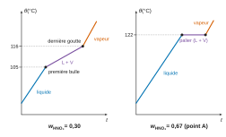
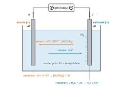
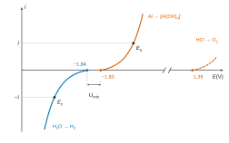
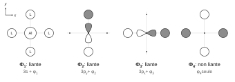
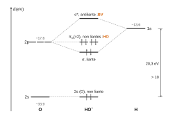
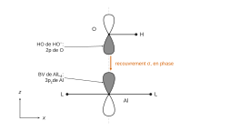

# CCINP TPC — Chimie 2026 · Corrigé brut

*Corrigé rédigé par IA, non officiel. Signalez toute erreur.*

Épreuve de 4 heures, calculatrices interdites. Deux problèmes indépendants : « Les MOFs (Metal-Organic Frameworks) » (Q1 à Q27) et « Synthèse de 1,3-oxazines » (Q28 à Q49).

# Problème 1 — Les MOFs (Metal-Organic Frameworks)

## Partie I — L'aluminium métallique

### I.1 — Atomistique

### Q1

Il s'agit du **prix Nobel de chimie 2025**. Il porte le nom d'Alfred Nobel, chimiste et industriel suédois, inventeur de la **dynamite** (nitroglycérine absorbée sur de la terre de diatomées, ce qui la rend manipulable).

### Q2

$Z(\mathrm{Al})=13$ (3e période, colonne 13). Règle de Klechkowski :

$$\boxed{\mathrm{Al}:\ 1s^2\,2s^2\,2p^6\,3s^2\,3p^1}$$

soit trois électrons de valence ($3s^2\,3p^1$).

### I.2 — Préparation du nitrate d'aluminium nonahydrate à partir de déchets d'aluminium

### Q3

Nombres d'oxydation : 0 pour Al(s), +III pour Al$^{3+}$, Al(OH)$_3$ et [Al(OH)$_4$]$^-$. Le domaine du bas, présent à tout pH, est celui du n.o. le plus faible : **D = Al(s)**.

Les trois espèces au n.o. +III se rangent de gauche à droite par basicité croissante. Al$^{3+}$ est l'acide, Al(OH)$_3$ son hydroxyde, et l'aluminate est obtenu par addition d'un HO$^-$ supplémentaire :

$$\begin{aligned}
\mathrm{Al^{3+}}+3\,\mathrm{HO^-}&=\mathrm{Al(OH)_3}\\
\mathrm{Al(OH)_3}+\mathrm{HO^-}&=[\mathrm{Al(OH)_4}]^-
\end{aligned}$$

Les frontières verticales à pH 4 et pH 10 sont des frontières acido-basiques ou de précipitation :

$$\boxed{\begin{aligned}
A&=\mathrm{Al^{3+}(aq)}\ (\mathrm{pH}<4)\\
B&=\mathrm{Al(OH)_3(s)}\ (4<\mathrm{pH}<10)\\
C&=[\mathrm{Al(OH)_4}]^-(\mathrm{aq})\ (\mathrm{pH}>10)\\
D&=\mathrm{Al(s)}
\end{aligned}}$$

Contrôle : la frontière A/D est horizontale, car la demi-équation Al³⁺ + 3 e⁻ = Al ne fait pas intervenir H⁺.

Les frontières B/D et C/D décroissent, comme sur la figure 1 :

- B/D : pente $-0{,}06$ V par unité de pH (3 H⁺ pour 3 e⁻) ;
- C/D : pente $-0{,}08$ V par unité de pH (4 H⁺ pour 3 e⁻).

### Q4

Couple Al$^{3+}$/Al : Al$^{3+}$ + 3e$^-$ = Al(s), et la loi de Nernst donne

$$E=E^\circ+\frac{0{,}06}{3}\log\left[\mathrm{Al^{3+}}\right]$$

Sur la frontière A/D, $[\mathrm{Al^{3+}}]=c_T=1{,}00\cdot10^{-2}$ mol/L, et la figure 1 donne $E_{\mathrm{front}}\approx-1{,}70$ V. Ainsi

$$\begin{aligned}
E^\circ&=E_{\mathrm{front}}-0{,}02\log c_T\\
&=-1{,}70+0{,}04
\end{aligned}$$

$$\boxed{E^\circ(\mathrm{Al^{3+}/Al})\approx-1{,}66\ \mathrm V}$$

### Q5

L'acide chlorhydrique est un acide fort : en solution, H$^+$ (H$_3$O$^+$) est l'oxydant et Cl$^-$ est spectateur.

$$\boxed{2\,\mathrm{Al(s)}+6\,\mathrm{H^+(aq)}\longrightarrow2\,\mathrm{Al^{3+}(aq)}+3\,\mathrm{H_2(g)}}$$

Cette équation échange 6 électrons, donc

$$\begin{aligned}
\log K^\circ&=\frac{6\,\big(E^\circ(\mathrm{H^+/H_2})-E^\circ(\mathrm{Al^{3+}/Al})\big)}{0{,}06}\\
&=\frac{6\times1{,}66}{0{,}06}\\
&=166
\end{aligned}$$

$$\boxed{K^\circ=10^{166}}$$

**La réaction est totale**, ce qui explique le dégagement de dihydrogène et la forte exothermicité. L'acide est en léger excès :

$$\begin{aligned}
n(\mathrm{H^+})&=6\times0{,}100\\
&=0{,}60\ \mathrm{mol}\\
n(\mathrm{Al})&=5{,}0/27\\
&\approx0{,}185\ \mathrm{mol}
\end{aligned}$$

L'aluminium consomme $3\,n(\mathrm{Al})\approx0{,}56$ mol de H⁺. Il est donc entièrement oxydé, et le milieu reste très acide, dans le domaine de Al$^{3+}$.

### Q6

Les deux courbes se rejoignent en $w=0$ (eau, 100 °C), en $w=1$ (HNO$_3$, 83 °C) et au point A (maximum, 122 °C) : il s'agit d'un azéotrope à maximum de température.

- **(a)** (courbe inférieure de chaque fuseau) : **courbe d'ébullition** ; **(b)** (courbe supérieure) : **courbe de rosée**.
- **Domaine I** (sous la courbe d'ébullition) : une seule phase, **liquide**, de composition égale à la composition globale.
- **Domaine II** ($0<w<0{,}67$) : **liquide + vapeur**. La composition du liquide se lit sur la courbe d'ébullition, celle de la vapeur sur la courbe de rosée à la même température ; la vapeur est plus riche en eau que le liquide.
- **Domaine III** ($0{,}67<w<1$) : **liquide + vapeur**, avec les mêmes règles de lecture ; la vapeur est plus riche en HNO$_3$ que le liquide.
- **Domaine IV** (au-dessus de la courbe de rosée) : une seule phase, **vapeur**, de composition égale à la composition globale.

### Q7

Les courbes représentent la température en fonction du temps, à puissance de chauffe constante.

**Pour $w=0{,}30$.** Le liquide chauffe d'abord seul (pente forte). La première bulle apparaît vers **105 °C** (courbe d'ébullition) : la pente diminue, car une partie de la puissance sert à la vaporisation. Le système reste biphasé et la température continue de monter, car le liquide s'enrichit en HNO$_3$ et sa température d'ébullition augmente. La dernière goutte disparaît vers **116 °C** (courbe de rosée) : la pente augmente de nouveau (vapeur seule, de capacité thermique plus faible que celle du liquide).

**Pour $w=0{,}67$ (point A).** Le liquide chauffe jusqu'à **122 °C**, puis la température reste constante sur un **palier** pendant toute la vaporisation, comme pour un corps pur. Elle remonte ensuite (vapeur seule).



### Q8

Le point A est un **azéotrope** (à maximum de température, dit azéotrope négatif). Lors de sa vaporisation, la vapeur a **la même composition que le liquide** ($w=0{,}67$) : le mélange bout à **température constante** (122 °C sous 1 bar) sans changer de composition, comme un corps pur, alors qu'il contient deux constituants.

Variance pour le système biphasé :

$$\begin{aligned}
v&=c+2-\varphi\\
&=2+2-2\\
&=2
\end{aligned}$$

Les paramètres intensifs sont $T$, $P$, $w_L$ et $w_V$, reliés par deux conditions d'équilibre. Deux contraintes supplémentaires s'imposent ici : $P$ est fixée, et la composition est celle de l'azéotrope, donc $w_L=w_V$. D'où

$$\boxed{v'=2-1-1=0}$$

Le système est invariant : à pression fixée, la température ne peut pas varier tant que les deux phases coexistent, d'où le **palier** de la courbe d'analyse thermique (Q7).

### Q9

À 105 °C, le point $w=0{,}20$ est dans le domaine II (à $w=0{,}20$, la courbe d'ébullition passe vers 103 °C et la courbe de rosée vers 112 °C). Lecture de l'horizontale à 105 °C : liquide $w_L\approx0{,}30$ (courbe d'ébullition), vapeur $w_V\approx0{,}08$ (courbe de rosée).

Conservation de la masse totale et de la masse de HNO$_3$ (théorème des moments) :

$$\begin{aligned}
m_L&=m\,\frac{w-w_V}{w_L-w_V}\\
&=1{,}0\times\frac{0{,}20-0{,}08}{0{,}30-0{,}08}\\
&=\frac{6}{11}\ \mathrm{kg}
\end{aligned}$$

$$\begin{aligned}
m_V&=m\,\frac{w_L-w}{w_L-w_V}\\
&=\frac{5}{11}\ \mathrm{kg}
\end{aligned}$$

$$\boxed{\begin{aligned}
m_{\mathrm{liquide}}&\approx0{,}55\ \mathrm{kg}\ (w=0{,}30)\\
m_{\mathrm{vapeur}}&\approx0{,}45\ \mathrm{kg}\ (w=0{,}08)
\end{aligned}}$$

### Q10

Le mélange $w=0{,}40$ est du côté eau de l'azéotrope. Une distillation fractionnée sépare le mélange en ses deux « extrémités » du fuseau II : le constituant le plus volatil de ce côté passe en tête, et l'azéotrope, de température d'ébullition maximale, reste dans le bouilleur.

$$\boxed{\begin{aligned}
&\text{distillat : eau pure }(w_{\mathrm{HNO_3}}=0)\\
&\text{résidu : azéotrope }(w_{\mathrm{HNO_3}}=0{,}67)
\end{aligned}}$$

Conservation de HNO$_3$ : $m\,w=m_{\mathrm{rés}}\,w_A$, d'où

$$m_{\mathrm{rés}}=\frac{1{,}0\times0{,}40}{0{,}67}\approx\boxed{0{,}60\ \mathrm{kg}\ \text{de solution acide (azéotrope)}}$$

On recueille aussi environ $0{,}40$ kg d'eau dans le distillat.

### I.3 — Obtention de sels d'aluminium par électrolyse

### Q11



- **Anode** (oxydation), reliée au pôle **+** du générateur ; **cathode** (réduction), reliée au pôle **−**. Les deux électrodes sont en aluminium.
- **Porteurs de charge** : dans les fils et les électrodes, les électrons vont de l'anode vers le pôle + du générateur, puis du pôle − vers la cathode. Dans la solution, les cations (Na$^+$) migrent vers la cathode et les anions (HO$^-$, BDC$^{2-}$, [Al(OH)$_4$]$^-$) vers l'anode.
- **Rôle de la soude** : elle fournit les ions HO⁻ consommés à l'anode (Al + 4 HO⁻ → [Al(OH)₄]⁻ + 3 e⁻) et formés à la cathode. Elle maintient Al(III) sous forme d'aluminate soluble, ce qui évite la passivation par Al(OH)$_3$. Elle rend enfin la solution conductrice (Na$^+$, HO$^-$).
- **Solubilité de l'acide téréphtalique** : à pH 14, très supérieur à p$K_{a2}=4{,}5$, l'acide est entièrement sous forme de dianion BDC$^{2-}$, ionique et très soluble. La soude **augmente donc fortement la solubilité** de l'acide téréphtalique, alors que la forme neutre BDCH$_2$ est très peu soluble ($s=1{,}02\cdot10^{-4}$ mol/L).

### Q12

Seuls Al et l'eau sont électroactifs ; en milieu basique (pH 14), on écrit les équations avec HO$^-$.

**Anode** (oxydations possibles) :

$$\mathrm{Al(s)}+4\,\mathrm{HO^-}\longrightarrow[\mathrm{Al(OH)_4}]^-+3\,e^-\qquad\qquad4\,\mathrm{HO^-}\longrightarrow\mathrm{O_2(g)}+2\,\mathrm{H_2O}+4\,e^-$$

**Cathode** (réductions possibles) :

$$2\,\mathrm{H_2O}+2\,e^-\longrightarrow\mathrm{H_2(g)}+2\,\mathrm{HO^-}\qquad\qquad[\mathrm{Al(OH)_4}]^-+3\,e^-\longrightarrow\mathrm{Al(s)}+4\,\mathrm{HO^-}$$

La seconde réduction ne peut intervenir que lorsque de l'aluminate s'est formé.

### Q13

À pH = 14, toutes les activités autres que celle de H$^+$ valent 1.

Couple $[\mathrm{Al(OH)_4}]^-/\mathrm{Al}$ : $[\mathrm{Al(OH)_4}]^-+4\,\mathrm H^++3\,e^-=\mathrm{Al}+4\,\mathrm{H_2O}$.

$$\begin{aligned}
E_1&=-1{,}18-\frac{4\times0{,}06}{3}\,\mathrm{pH}\\
&=-1{,}18-1{,}12\\
&=-2{,}30\ \mathrm V
\end{aligned}$$

Couple $\mathrm{H^+/H_2}$ : $2\,\mathrm H^++2\,e^-=\mathrm{H_2}$.

$$\begin{aligned}
E_2&=0-0{,}06\,\mathrm{pH}\\
&=-0{,}84\ \mathrm V
\end{aligned}$$

Couple $\mathrm{O_2/H_2O}$ : $\mathrm{O_2}+4\,\mathrm H^++4\,e^-=2\,\mathrm{H_2O}$.

$$\begin{aligned}
E_3&=1{,}23-0{,}84\\
&=0{,}39\ \mathrm V
\end{aligned}$$

Potentiels à partir desquels chaque réaction se produit, compte tenu des surpotentiels sur Al à pH 14 :

| Réaction | Seuil |
|---|---|
| oxydation Al → [Al(OH)$_4$]$^-$ | $-2{,}30+0{,}5=-1{,}80$ V |
| oxydation HO$^-$ → O$_2$ | $0{,}39+1{,}0=1{,}39$ V |
| réduction H$_2$O → H$_2$ | $-0{,}84-1{,}0=-1{,}84$ V |
| réduction [Al(OH)$_4$]$^-$ → Al | $\leq-2{,}30$ V |

À l'anode, la première oxydation rencontrée quand le potentiel croît est celle de plus bas seuil, $-1{,}80$ V contre $1{,}39$ V. À la cathode, la première réduction rencontrée quand le potentiel décroît est celle de plus haut seuil, $-1{,}84$ V contre $-2{,}30$ V au plus.

$$\boxed{\text{Anode : }\mathrm{Al}+4\,\mathrm{HO^-}\to[\mathrm{Al(OH)_4}]^-+3\,e^-\qquad\text{Cathode : }2\,\mathrm{H_2O}+2\,e^-\to\mathrm{H_2}+2\,\mathrm{HO^-}}$$

### Q14



La branche cathodique de réduction de l'eau ($i<0$) démarre à $-1{,}84$ V. La branche anodique d'oxydation de Al ($i>0$) démarre à $-1{,}80$ V. L'oxydation de l'eau en O₂ ne démarrerait qu'à $1{,}39$ V.

Pour faire passer un courant $I$, il faut $i_a=-i_c=I$, donc $E_a>-1{,}80$ V et $E_c<-1{,}84$ V. La tension minimale est l'écart entre les deux seuils :

$$\begin{aligned}
U_{\min}&=E_{\mathrm{seuil},a}-E_{\mathrm{seuil},c}\\
&=-1{,}80-(-1{,}84)\\
&=\boxed{0{,}04\ \mathrm V}
\end{aligned}$$

Équation de l'électrolyse (2 × anode + 3 × cathode, puis division par 2) :

$$\boxed{\mathrm{Al(s)}+\mathrm{HO^-(aq)}+3\,\mathrm{H_2O}(\ell)\longrightarrow[\mathrm{Al(OH)_4}]^-(\mathrm{aq})+\tfrac32\,\mathrm{H_2(g)}}$$

Remarque : sans les surpotentiels, cette réaction serait spontanée ($E_2>E_1$), puisque l'aluminium est attaqué par la soude. Seules les surtensions imposent une tension, faible, à appliquer.

### Q15

On applique $1{,}0$ V alors que $U_{\min}=0{,}04$ V. L'écart de $0{,}96$ V provient :

- de la **chute ohmique** $R\,I$ dans l'électrolyte (résistance de la solution entre les électrodes) et dans les contacts ;
- de l'**augmentation des surtensions** avec le courant : les surpotentiels donnés sont ceux qui correspondent à un courant quasi nul ; pour débiter 50 mA, il faut s'écarter davantage des seuils (surtensions d'activation, voire de diffusion).

**L'énergie électrique fournie est donc en grande partie dissipée** (effet Joule, irréversibilités aux électrodes).

### Q16

Charge transférée :

$$\begin{aligned}
Q&=I\,t\\
&=0{,}050\times3600\\
&=180\ \mathrm C
\end{aligned}$$

À raison de 3 électrons par atome d'aluminium oxydé :

$$\begin{aligned}
m_{\mathrm{th}}&=\frac{I\,t}{3F}\,M(\mathrm{Al})\\
&=\frac{180}{3\times10^5}\times27\\
&=6{,}0\cdot10^{-4}\times27\ \mathrm g\\
&\approx16\ \mathrm{mg}
\end{aligned}$$

$$\begin{aligned}
\eta_F&=\frac{m_{\mathrm{réelle}}}{m_{\mathrm{th}}}\\
&=\frac{14}{16{,}2}\\
&\approx\boxed{0{,}86}
\end{aligned}$$

En arrondissant $m_{\mathrm{th}}$ à 16 mg, on trouve $\eta_F\approx\tfrac78\approx0{,}88$.

**Conclusion** : environ 85 à 90 % de la charge sert à oxyder l'aluminium. Le reste alimente d'autres processus : formation d'une couche d'oxyde ou d'hydroxyde à la surface, réactions parasites, courants de fuite. Le procédé reste efficace.

## Partie II — L'acide téréphtalique

### II.1 — Présentation de l'acide téréphtalique et du PET

### Q17

Le PET est un polyester : le groupe fonctionnel créé par la polycondensation est l'**ester** ($-\mathrm{CO-O}-$).

Formules (décrites) :

- **acide téréphtalique BDCH$_2$** : cycle benzénique para-disubstitué (positions 1 et 4) par deux groupes $-\mathrm{COOH}$, soit HOOC–C$_6$H$_4$–COOH (acide benzène-1,4-dicarboxylique) ;
- **autre monomère** : l'**éthane-1,2-diol** (éthylène glycol), HO–CH$_2$–CH$_2$–OH, en topologique un segment à deux sommets portant chacun un OH.

### II.2 — Obtention de l'acide téréphtalique par hydrolyse du PET

### Q18

Domaines de prédominance de l'acide téréphtalique :

```text
        BDCH2         BDCH-         BDC2-
  |-----------------|------|-------------------->  pH
                   3,5    4,5
```

La solution titrée contient deux acides :

- l'acide fort en excès, H₂SO₄, diacide fort qui libère 2 H₃O⁺ par molécule ;
- l'acide téréphtalique BDCH₂, libéré par l'acide sulfurique à partir du sel C₈H₄O₄Na₂.

Interprétation des courbes :

- **$0<V<V_{e1}=16$ mL** : dosage de H₃O⁺. Le pH reste bas (1,8 à 3), donc BDCH₂ prédomine (pH < 3,5) et ne réagit pas. La conductivité corrigée **diminue fortement** : H₃O⁺ (35 mS·m²/mol) est remplacé par Na⁺ (5).
$$\mathrm{H_3O^+}+\mathrm{HO^-}\longrightarrow2\,\mathrm{H_2O}\qquad K=10^{14}$$
- **$V_{e1}<V<V_{e2}=29$ mL** : dosage de BDCH₂. Le pH traverse les domaines de BDCH⁻ puis de BDC²⁻ (zone tampon vers 3,5 à 4,5). Comme $\Delta\mathrm pK_a=1<4$, les deux acidités sont dosées **simultanément** et donnent un seul saut de pH, à $V_{e2}$. La conductivité **augmente lentement** : il se forme BDC²⁻ (7) et on apporte Na⁺ (5), à partir d'une espèce neutre.
$$\mathrm{BDCH_2}+2\,\mathrm{HO^-}\longrightarrow\mathrm{BDC^{2-}}+2\,\mathrm{H_2O}\qquad\left(\text{étapes de constantes }10^{10{,}5}\text{ et }10^{9{,}5}\right)$$
- **$V>V_{e2}$** : excès de soude, le pH monte vers 12 et la conductivité **augmente fortement** (HO$^-$, 20, et Na$^+$ apportés).

Le passage de $V_{e1}$ ne produit pas de saut de pH net, car l'acide faible prend le relais vers pH 3–3,5 ; on le repère par le minimum (cassure) de la courbe conductimétrique. Le saut de pH, ample, se situe en $V_{e2}$.

### Q19

D'après Q18, la soude versée entre les deux équivalences dose les deux acidités de BDCH₂ :

$$\begin{aligned}
n(\mathrm{BDCH_2})&=\frac{C_b\,(V_{e2}-V_{e1})}{2}\\
&=\frac{2{,}0\cdot10^{-2}\times13\cdot10^{-3}}{2}\\
&=1{,}3\cdot10^{-4}\ \mathrm{mol}
\end{aligned}$$

Chaque motif de PET libère une molécule d'acide téréphtalique :

$$n_{\max}=\frac{m(\mathrm{PET})}{M(\text{motif})}=\frac{40\cdot10^{-3}}{192}\ \mathrm{mol}$$

$$\begin{aligned}
\rho&=\frac{n(\mathrm{BDCH_2})}{n_{\max}}\\
&=\frac{1{,}3\cdot10^{-4}\times192}{40\cdot10^{-3}}\\
&=1{,}3\times4{,}8\times10^{-1}\\
&\approx\boxed{0{,}62\ \text{soit }62\ \%}
\end{aligned}$$

## Partie III — Formation du MIL-53(Al) en mode continu

### Q20

En régime permanent, avec un débit volumique conservé et $X=0{,}80$ :

$$\begin{aligned}
[\mathrm{Al^{3+}}]_s&=c_0\,(1-X)\\
&=1{,}0\times0{,}20\\
&=\boxed{0{,}20\ \mathrm{mol\cdot L^{-1}}}
\end{aligned}$$

### Q21

Bilan de matière sur Al$^{3+}$ dans le RPAC en régime permanent (composition uniforme, égale à celle de sortie), avec $v=k\,[\mathrm{Al^{3+}}]_s$ :

$$Q\,c_0=Q\,c_s+k\,c_s\,\mathcal V$$

d'où

$$\begin{aligned}
\tau&=\frac{\mathcal V}{Q}\\
&=\frac{c_0-c_s}{k\,c_s}\\
&=\frac{X}{k\,(1-X)}
\end{aligned}$$

Application numérique :

$$\begin{aligned}
\tau&=\frac{0{,}80}{5{,}0\times0{,}20}\\
&=\boxed{0{,}80\ \mathrm{min}=48\ \mathrm s}
\end{aligned}$$

$$\begin{aligned}
\mathcal V&=Q\,\tau\\
&=300\times0{,}80\\
&=\boxed{240\ \mathrm L}
\end{aligned}$$

### Q22

Premier principe pour un système ouvert en régime permanent, adiabatique, sans travail utile, en négligeant les variations d'énergie cinétique et potentielle : le flux d'enthalpie entrant est égal au flux sortant. On calcule ce flux sortant en faisant réagir à $T_e$ puis en échauffant le mélange de $T_e$ à $T_s$ :

$$0=\underbrace{Q\,c_0\,X}_{\text{mol/min réagies}}\,\Delta_rH^\circ+\underbrace{\rho\,Q}_{\text{kg/min}}\,C_{moy}\,(T_s-T_e)$$

$$\begin{aligned}
\Delta T&=\frac{-\Delta_rH^\circ\,c_0\,X}{\rho\,C_{moy}}\\
&=\frac{65\cdot10^3\times1{,}0\times0{,}80}{1\times5\cdot10^3}
\end{aligned}$$

$$\boxed{\Delta T\approx+10\ \mathrm K}$$

La réaction est exothermique et la solution s'échauffe d'une dizaine de degrés. Cet échauffement reste **modéré**, compatible avec la gamme de 20 à 80 °C annoncée, et le procédé ne présente pas de risque d'emballement. On a supposé $\Delta_rH^\circ$ indépendante de $T$ et attribué à tout le flux la capacité thermique massique moyenne donnée.

## Partie IV — Étude de la liaison aluminium-oxygène dans le MIL-53(Al)

### IV.1 — Étude du diagramme énergétique des OM du complexe d'aluminium plan-carré

### Q23

Orbitales de valence de Al : 3s et $3p_x$, $3p_y$, $3p_z$ (pas d'orbitale d).

Orbitales du fragment L₄ (L sur ±x et ±y) :

- $\varphi_1$ : les 4 L en phase ;
- $\varphi_2$ et $\varphi_3$ : les deux L d'un même axe en opposition de phase, l'un selon $y$ et l'autre selon $x$ ;
- $\varphi_4$ : L de l'axe $x$ d'un signe, L de l'axe $y$ du signe opposé.

Recouvrements non nuls : 3s avec $\varphi_1$, $3p_y$ avec $\varphi_2$, $3p_x$ avec $\varphi_3$.

Les orbitales $3p_z$ et $\varphi_4$ n'ont pas de partenaire.



Représentation conventionnelle des 4 OM les plus basses (schéma ci-dessus, plan $xy$ vu de dessus, Al au centre) :

- **$\Phi_1$** : orbitale 3s de Al (sphère) en phase avec les quatre orbitales des L, toutes de même signe. **Liante.**
- **$\Phi_2$** (et **$\Phi_3$**, dégénérée) : orbitale 3p$_y$ de Al (resp. 3p$_x$), dont chaque lobe est en phase avec l'orbitale de L placée en face, sur le même axe ; les L de l'autre axe ne participent pas. **Liantes.**
- **$\Phi_4$** : uniquement les orbitales des L, de même signe sur l'axe $x$ et de signe opposé sur l'axe $y$ ($\varphi_4$, symétrie « $d_{x^2-y^2}$ »), aucune contribution de Al, au niveau d'énergie du fragment. **Non liante.**

$$\boxed{\Phi_1,\ \Phi_2,\ \Phi_3\ \text{liantes};\qquad\Phi_4\ \text{non liante}}$$

(Au-dessus : $\Phi_5$, 3p$_z$ pure de Al, non liante ; $\Phi_6$, $\Phi_7$ et $\Phi_8$ antiliantes.)

### Q24

Les 8 électrons de valence occupent $\Phi_1$, $\Phi_2$, $\Phi_3$ et $\Phi_4$ (2 électrons chacune).

$$\boxed{\begin{aligned}
\mathrm{HO}&=\Phi_4\ (\text{non liante, localisée sur les ligands})\\
\mathrm{BV}&=\Phi_5\ (3p_z\text{ de Al, non liante, vacante})
\end{aligned}}$$

La BV est perpendiculaire au plan du complexe, avec un lobe de chaque côté du plan.

### IV.2 — Interactions des OF du complexe d'aluminium AlL$_4$ avec le ligand hydroxo HO$^-$

### Q25

Axe O–H noté $z'$. Écarts d'énergie :

- $|E_{2s}(\mathrm O)-E_{1s}(\mathrm H)|=20{,}3$ eV, supérieur à 10 eV : interaction négligée ;
- $|E_{2p}(\mathrm O)-E_{1s}(\mathrm H)|=4{,}0$ eV, inférieur à 10 eV : interaction retenue.

Cette seconde interaction ne concerne que la 2p$_{z'}$, dirigée selon l'axe : le recouvrement de 1s(H) avec 2p$_{x'}$ et 2p$_{y'}$ est nul par symétrie.



Récapitulatif (énergies croissantes) :

| OM | Origine | Caractère | Occupation |
|---|---|---|---|
| $2s$ (O) | OA 2s de O seule ($-33{,}9$ eV) | non liante | 2 |
| $\sigma$ | 2p$_{z'}$(O) + 1s(H) en phase, plus développée sur O, sous $-17{,}6$ eV | liante | 2 |
| $\pi_{nl}$ (×2) | 2p$_{x'}$, 2p$_{y'}$ de O ($-17{,}6$ eV) | non liantes | 4 |
| $\sigma^*$ | 2p$_{z'}$(O) − 1s(H), plus développée sur H, au-dessus de $-13{,}6$ eV | antiliante | 0 |

HO$^-$ compte $6+1+1=8$ électrons de valence.

$$\boxed{\mathrm{HO}:\ \text{les deux OA }2p_{x'},\,2p_{y'}\text{ de O (non liantes, dégénérées)};\qquad\mathrm{BV}:\ \sigma^*_{\mathrm{OH}}}$$

Représentation conventionnelle : chaque HO est une orbitale p de l'oxygène à deux lobes de signes opposés, perpendiculaire à l'axe O–H, sans contribution de H. La BV est formée d'un gros lobe sur H et d'un lobe plus petit sur O, de signe opposé, du côté de H, avec un nœud entre les deux atomes.

### Q26

Le ligand HO⁻ est nucléophile et le complexe est électrophile. L'interaction déterminante associe la **HO de HO⁻** (doublet non liant 2p de O, occupé) et la **BV de [AlL₄]** ($\Phi_5$ = 3p$_z$ de Al, vacante).

L'interaction inverse, entre la HO $\Phi_4$ du complexe et la BV $\sigma^*$ de HO⁻, est sans effet. En effet, $\Phi_4$ est dans le plan $xy$ et présente des signes alternés : une orbitale qui arrive selon $Oz$ a avec elle un recouvrement nul par symétrie.



HO$^-$ arrive selon $Oz$ ; une orbitale non liante 2p de O pointe vers Al (dans ce modèle à 2p pure, l'axe O–H est donc perpendiculaire à $Oz$). Son lobe recouvre de façon axiale, en phase, le lobe supérieur de la 3p$_z$ de Al (recouvrement $\sigma$) : il en résulte une liaison de coordination Al–O, le doublet de O étant cédé à Al.

### Q27

Après la formation d'une première liaison Al–O, l'oxygène de HO$^-$ porte encore un **deuxième doublet non liant**, de même énergie (HO dégénérée, Q25), qui peut être donné à la BV vacante (3p$_z$) d'un **second** complexe [AlL$_4$]. Symétriquement, la BV 3p$_z$ de chaque Al possède deux lobes, de part et d'autre du plan $xy$ : chaque aluminium accepte un HO$^-$ au-dessus et un au-dessous (les deux OH en position *trans*, figure 5), ce qui complète l'octaèdre.

**HO$^-$ joue donc le rôle de ligand pontant ($\mu_2$-OH) entre deux complexes**, ce qui conduit aux chaînes …Al–OH–Al–OH… d'octaèdres reliés par leurs sommets du MIL-53(Al).

# Problème 2 — Synthèse de 1,3-oxazines

## Partie I — Formation d'un succinimide à partir de l'acide (+)-tartrique

### I.1 — Étude stéréochimique de l'acide (+)-tartrique

### Q28

Les deux carbones stéréogènes sont C2 et C3 de HOOC–CH(OH)–CH(OH)–COOH. Priorités CIP sur chacun : OH (O) > COOH (C lié à O,O,O) > CH(OH)COOH (C lié à O,C,H) > H.

Sur la figure 8, C2 (sommet bas du zigzag) porte OH en coin plein vers le bas, et son H est donc en arrière. Le parcours OH (bas) → COOH (haut gauche) → C3 (haut droite) tourne dans le sens horaire, d'où **C2 : R**. C3 (sommet haut) porte OH en coin plein vers le haut, son H est en arrière. Le parcours OH (haut) → COOH (bas droite) → C2 (bas gauche) tourne dans le sens horaire, d'où **C3 : R**.

$$\boxed{(2R,3R)\text{ : acide }(2R,3R)\text{-2,3-dihydroxybutanedioïque}}$$

### Q29

Deux centres stéréogènes portant les mêmes substituants donnent **3 stéréoisomères de configuration** :

- **(2R,3R)** : l'acide (+)-tartrique, chiral (axe $C_2$) ;
- **(2S,3S)** : son énantiomère, la même chaîne en zigzag avec les deux OH en **pointillés** ;
- **(2R,3S)**, identique à (2S,3R) : la forme **méso**, achirale, avec un OH en coin plein et l'autre en pointillés sur le zigzag, et un centre de symétrie dans la conformation anti.

La forme (S,S) est l'énantiomère de la forme (R,R) ; la forme méso est diastéréoisomère des deux.

### Q30

La mention (+) correspond à l'adjectif **dextrogyre** : la substance fait tourner le plan de polarisation d'une lumière polarisée rectilignement **dans le sens horaire** (vers la droite) pour un observateur qui reçoit la lumière (pouvoir rotatoire $[\alpha]>0$).

$$\boxed{(2S,3S)\text{ : }(-)\text{, lévogyre (pouvoir rotatoire opposé)};\qquad\text{méso : aucune mention, achiral, optiquement inactif}}$$

### I.2 — Transformation de l'acide (+)-tartrique

### Q31

Il s'agit d'une **estérification de Fischer** : acide tartrique dans l'**éthanol en large excès**, avec un catalyseur acide (H$_2$SO$_4$ concentré ou APTS), chauffé à reflux. La réaction est lente (d'où le catalyseur et le chauffage) et équilibrée ($K\approx1$, d'où l'excès d'alcool).

**Dean-Stark** : on élimine l'eau au fur et à mesure qu'elle se forme, ce qui déplace l'équilibre vers l'ester (quotient de réaction maintenu inférieur à $K$). Il faut pour cela un solvant **non miscible à l'eau et moins dense qu'elle**, qui forme avec l'eau un **hétéroazéotrope** de température d'ébullition inférieure à celle des autres constituants (toluène ou cyclohexane, avec l'éthanol en excès). Les vapeurs condensées décantent dans le tube gradué : l'eau tombe au fond et y reste piégée, le solvant reflue dans le ballon. On suit l'avancement grâce au volume d'eau recueilli.

### Q32

Les fonctions créées dans **1** sont deux **éthers-oxydes** (éthers benzyliques, R–O–CH$_2$Ph).

**NaH** est une base forte (p$K_a$(H$_2$/H$^-$) = 35 ≫ p$K_a$(ROH/RO$^-$) ≈ 16–18). Il déprotone quantitativement et irréversiblement les deux fonctions alcool (départ de H$_2$ gazeux) pour former les **alcoolates**, nucléophiles bien plus forts que les alcools. L'ion hydrure est peu nucléophile, et NaH ne s'additionne pas sur les esters.

### Q33

Le DMF est un solvant **polaire** ($\mu=3{,}85$ D) et **dissociant** ($\varepsilon_r=38$) : il dissout les espèces ioniques (alcoolate de sodium, NaBr) en dissociant les paires d'ions, ainsi que les réactifs organiques (tartrate, BnBr). Il est **aprotique** : il n'a pas de H acide. Il ne réagit donc pas avec NaH et ne détruit pas l'alcoolate. Il solvate bien les cations (doublets de l'oxygène) mais mal les anions, faute de liaison hydrogène : l'alcoolate, peu solvaté, reste très nucléophile, ce qui accélère la SN2 sur BnBr.

### Q34

Mécanisme (écrit pour une fonction, identique pour l'autre) :

1. Acide-base : $\mathrm{R{-}O{-}H}+\mathrm{H^-}(\mathrm{Na^+})\longrightarrow\mathrm{R{-}O^-}(\mathrm{Na^+})+\mathrm{H_2}\uparrow$. Une flèche part du doublet de H$^-$ vers le H de OH, une autre de la liaison O–H vers O.
2. SN2 : $\mathrm{R{-}O^-}+\mathrm{Br{-}CH_2Ph}\longrightarrow\mathrm{R{-}O{-}CH_2Ph}+\mathrm{Br^-}$. Une flèche part d'un doublet de O$^-$ vers le carbone benzylique (attaque à l'opposé de Br), une autre de la liaison C–Br vers Br, en une seule étape.

Aucune liaison des carbones stéréogènes C2 et C3 n'est rompue (seule la liaison O–H est remplacée par O–Bn). **1** conserve la configuration (2R,3R) : il est chiral (axe $C_2$, ni plan ni centre de symétrie) et son énantiomère n'est pas formé. **Le composé 1 est optiquement actif.**

### Q35

$\mathbf 1$ = EtO₂C–CH(OBn)–CH(OBn)–CO₂Et (C₂₂H₂₆O₆, 26 H). Grâce à l'axe $C_2$, les deux moitiés sont équivalentes.

| $\delta$ (ppm) | Int. | Mult. | Attribution et justification |
|---|---|---|---|
| 1,16 | 6 H | triplet, $J=7{,}2$ Hz | 2 CH$_3$ des esters éthyliques ; couplés aux 2 H du CH$_2$ voisin (règle des $n+1$) |
| 4,12 | 4 H | quadruplet, $J=7{,}2$ Hz | 2 O–CH$_2$–CH$_3$ ; couplés aux 3 H du CH$_3$, même $J$ que le triplet ; déblindés par l'oxygène de l'ester |
| 4,37 | 2 H | singulet | 2 CH(OBn) ; équivalents par symétrie $C_2$, donc pas de couplage observable entre eux, et pas d'autre H voisin ; déblindés par O et par le C=O |
| 4,60 | 4 H | singulet | 2 O–CH$_2$–Ph ; pas de H porté par les atomes voisins (O et C aromatique) ; déblindés par O et le cycle |
| 7,30 | 10 H | multiplet | 10 H aromatiques des deux phényles |

### I.3 — Formation du succinimide 4

### Q36

Le traitement de **1** par LiOH est une **saponification** (hydrolyse basique) des deux esters ; l'acidification qui suit donne le diacide. Formule de **2**, C$_{18}$H$_{18}$O$_6$ ($M=330$ g/mol, cohérent avec 4,27 g pour 13 mmol) :

**2** = acide (2R,3R)-2,3-bis(benzyloxy)butanedioïque, HOOC–CH(OBn)–CH(OBn)–COOH. En représentation topologique spatiale, c'est la chaîne en zigzag de la figure 9 (composé **1**) dans laquelle les deux OEt sont remplacés par OH, avec les **mêmes** liaisons en coin : OBn en coin plein sur les deux centres, configuration (2R,3R) conservée.

### Q37

**Mélange éthanol/eau** : l'eau dissout LiOH et fournit les ions HO$^-$ ; l'éthanol dissout le diester **1**, très peu soluble dans l'eau (deux benzyles, deux éthyles). Le mélange est un solvant commun : la réaction a lieu **en phase homogène**, donc plus vite. L'éthanol est aussi l'alcool libéré, ce qui n'introduit pas de transestérification parasite.

**Élimination de l'éthanol avant acidification** :

- en milieu acide concentré, l'éthanol pourrait ré-estérifier partiellement les acides carboxyliques (estérification de Fischer catalysée par H$^+$) ;
- surtout, l'éthanol est miscible à l'eau et à l'éthanoate d'éthyle. Laissé dans le mélange, il augmenterait la solubilité de **2** dans la phase aqueuse et gênerait la décantation, ce qui rendrait l'extraction moins efficace.

### Q38

**Acidification** : après saponification, **2** est sous forme de dicarboxylate de lithium, ionique et soluble dans l'eau, non extractible. À pH = 2, inférieur aux p$K_a$ (3 à 5) d'au moins une unité, les deux fonctions sont sous forme acide carboxylique neutre, beaucoup plus soluble dans l'éthanoate d'éthyle que dans l'eau : **2** devient extractible.

**4 × 100 mL plutôt que 1 × 400 mL** : soit $K=\dfrac{[\mathbf 2]_{org}}{[\mathbf 2]_{aq}}$ le coefficient de partage, $V_{aq}$ le volume de phase aqueuse et $n_0$ la quantité de **2**. Après une extraction par un volume $v$, il reste dans l'eau $n_0\,\dfrac{V_{aq}}{V_{aq}+Kv}$ ; après $p$ extractions successives :

$$n_{\mathrm{restant}}=n_0\left(\frac{V_{aq}}{V_{aq}+K\,v}\right)^{p}$$

Pour un volume total $pv=400$ mL fixé, la fraction restante

$$\left(1+\frac{K\cdot400}{p\,V_{aq}}\right)^{-p}$$

décroît quand $p$ augmente. Par exemple, avec $K\,v/V_{aq}=1$ pour $v=100$ mL, il reste $(1/2)^4=6{,}3\ \%$ de **2** après quatre extractions, contre $1/5=20\ \%$ en une seule. **Plusieurs extractions successives sont plus efficaces** à volume de solvant égal.

### Q39

Le lavage par une **solution saturée de NaCl** (saumure) :

- élimine les traces d'acide (HCl) et de sels (LiCl) entraînées dans la phase organique ;
- extrait une partie de l'**eau dissoute** dans l'éthanoate d'éthyle, qui en dissout quelques pourcents (pré-séchage, avant MgSO$_4$) ;
- rend la phase aqueuse très ionique, où le composé organique est très peu soluble (**relargage**), ce qui limite les pertes de **2** ; elle facilite aussi la décantation (densité élevée, rupture des émulsions).

Un lavage à **l'eau pure** redissoudrait une partie du diacide **2**, assez polaire avec ses deux groupes COOH, et ferait baisser le rendement. Il apporterait aussi davantage d'eau dans la phase organique.

## Partie II — Formation de 1,3-oxazines

### II.1 — Tentative de transformation du succinimide 4 en composé 7

### Q40

Pour activer la nucléophilie de **4**, il faut déprotoner la liaison N–H de l'imide (acide, car l'anion est stabilisé par deux C=O, voir Q41) sans attaquer les carbonyles.

- H$_2$SO$_4$, APTS : acides, ils protonent au lieu de déprotoner, **exclus**.
- Pyridine (p$K_a$ de l'ion pyridinium ≈ 5) : base trop faible, **exclue**.
- NaOH : déprotonation partielle et équilibrée, et HO$^-$ est un nucléophile qui peut hydrolyser l'imide (ouverture du cycle) ; l'eau formée gênerait l'alkylation : **déconseillé**.
- CH$_3$MgBr : base très forte, mais aussi nucléophile, qui s'additionne sur les C=O de l'imide : **exclu**.
- **NaH** : base très forte (p$K_a$ 35), peu nucléophile, déprotonation totale et irréversible (départ de H$_2$), en solvant aprotique.

$$\boxed{\mathrm{R1}=\mathrm{NaH}}$$

### Q41

**4bis** est l'anion imidure obtenu par perte du H porté par N : le cycle à cinq chaînons de **4**, avec N$^-$ entre les deux C=O et les deux OBn inchangés (trans, coin et pointillés comme dans **4**), associé au contre-ion Na$^+$.

Formes mésomères limites :

$$\begin{aligned}
&\mathrm{O{=}C{-}\overset{\ominus}{N}{-}C{=}O}\\
\longleftrightarrow\ &\mathrm{{}^{\ominus}O{-}C{=}N{-}C{=}O}\\
\longleftrightarrow\ &\mathrm{O{=}C{-}N{=}C{-}O^{\ominus}}
\end{aligned}$$

La charge négative est **délocalisée sur trois atomes**, dont deux oxygènes très électronégatifs ($\chi=3{,}44$). Cette délocalisation sur deux carbonyles (contre un seul pour un amide) explique la relative stabilité de **4bis**, donc l'acidité notable de l'imide.

### Q42

Pour introduire le groupe allyle sur N par SN2 : $\boxed{\mathrm{R2}=\text{bromure d'allyle }\mathrm{CH_2{=}CH{-}CH_2Br}}$ (3-bromoprop-1-ène). L'azote nucléophile attaque le carbone primaire allylique, très réactif en SN2, et Br$^-$ part.

### Q43

**6** est un hydroxylactame : il contient un OH porté par le carbone lié à N (hémiaminal), un C=O d'amide et un C=C terminal.

- **3 340 cm$^{-1}$, bande large** : élongation **O–H** de l'hémiaminal, élargie par les liaisons hydrogène (O–H associé).
- **1 675 cm$^{-1}$, bande intense** : élongation **C=O** du lactame (amide). Sa valeur, en bas de la plage 1 675–1 750 cm$^{-1}$, s'explique par la conjugaison du doublet de N avec C=O, qui affaiblit la double liaison.

La bande C=C de l'allyle, peu intense, n'est pas citée par l'énoncé.

### Q44

**Étape 1, NaBH$_4$/MeOH, 0 °C, puis hydrolyse.** H$^-$ (de BH$_4^-$) s'additionne sur l'un des deux C=O, équivalents, de **8** : la flèche part de la liaison B–H vers C, une autre de la liaison $\pi$ C=O vers O. On obtient un alcoolate tétraédrique, que l'hydrolyse (ou MeOH) protone en **hydroxylactame** (5-hydroxy-1-allylpyrrolidin-2-one). Le carbonyle restant, celui d'un amide, est beaucoup moins électrophile, et la réduction s'arrête là.

**Étape 2, APTS/EtOH, 0 °C, puis hydrolyse.**

1. Protonation du groupe OH par APTS : R–OH$_2^+$.
2. Départ de H$_2$O, assisté par le doublet de N : formation d'un **ion N-acyliminium** C=N$^+$, stabilisé par mésomérie avec le doublet de l'azote.
3. Addition nucléophile de l'éthanol sur le carbone électrophile C=N$^+$ : éther protoné.
4. Déprotonation (par l'eau du traitement ou par TsO$^-$), qui donne **9** (5-éthoxy-1-allylpyrrolidin-2-one, un N,O-acétal) et régénère le catalyseur acide.

### II.2 — Formation du précurseur de l'oxa-Michael

### Q45

Dans la silylation R–OH + TBSCl → R–OTBS + HCl, l'imidazole joue deux rôles :

- **base** : il capte HCl (p$K_a$ ImH$^+$/Im = 6,9) sous forme de chlorure d'imidazolium. Le milieu reste peu acide, et l'éther silylé et le N,O-acétal ne sont pas dégradés ;
- **catalyseur nucléophile** : il attaque le silicium de TBSCl et forme un ion *N*-silylimidazolium, plus électrophile que TBSCl ; l'alcool l'attaque ensuite, et l'imidazole est régénéré.

**Site actif** : l'azote **de type pyridine** (N3, =N–, sans H). Son doublet non liant n'intervient dans aucune forme mésomère du cycle : il est localisé, donc disponible, basique et nucléophile. Le doublet de N1 (N–H), au contraire, est délocalisé sur le cycle par mésomérie avec les doubles liaisons C=C et C=N (forme limite $\mathrm{N1^+{=}C}$, charge négative sur N3 ou sur un carbone) : l'engager dans une liaison ferait perdre cette stabilisation, et il n'est pas disponible. L'ion imidazolium formé est de plus stabilisé par délocalisation de la charge sur les deux azotes.

### Q46

**Intérêt du 9-BBN** :

- il ne possède **qu'une seule liaison B–H** : chaque molécule réagit avec un seul alcène, ce qui donne un seul trialkylborane bien défini, sans mélange de mono-, di- et trialkylboranes ;
- il est **très encombré** : le bore se fixe quasi exclusivement sur le carbone terminal, le moins substitué, ce qui donne une régiosélectivité anti-Markovnikov bien meilleure qu'avec BH$_3$ ;
- il est **plus sélectif** : il réduit moins les autres fonctions (C=O du lactame), alors que BH$_3$ réduit les amides. C'est aussi un solide stable, facile à manipuler, contrairement au complexe BH$_3$·THF.

**Composé 11** : hydroboration puis oxydation (H₂O₂, NaOH) de l'alcène terminal, qui donne l'alcool primaire. **11** est la pyrrolidin-2-one de **10**, avec la même stéréochimie (BnO en coin plein en C3, BnO en pointillés en C4, OTBS en pointillés en C5). La chaîne N–CH₂–CH=CH₂ y est devenue **N–CH₂–CH₂–CH₂–OH** (3-hydroxypropyle).

### Q47

Il faut passer de N–(CH$_2$)$_3$–OH à N–CH$_2$CH$_2$–CH=CH–CO–CH$_3$ (*E*), en allongeant la chaîne par une condensation aldolique avec l'acétone :

1. **Oxydation ménagée** de l'alcool primaire en **aldéhyde** N–CH$_2$CH$_2$–CHO par **CrO$_3$/pyridine** (le réactif des données qui s'arrête à l'aldéhyde ; H$_2$CrO$_4$ conduirait à l'acide carboxylique).
2. **Aldolisation croisée** avec la **propanone**. On forme l'énolate de l'acétone de façon quantitative par le LDA (p$K_a$ de la diisopropylamine 36 ≫ 22), dans le THF à −78 °C, puis on ajoute l'aldéhyde : l'énolate s'additionne sur le C=O de l'aldéhyde, plus électrophile, et donne, après hydrolyse, la β-hydroxycétone N–CH$_2$CH$_2$–CH(OH)–CH$_2$–CO–CH$_3$. Variante : acétone en large excès, avec NaOH dilué.
3. **Crotonisation** : déshydratation de l'aldol en milieu basique et à chaud (mécanisme E1cb, via l'énolate). Elle donne l'énone conjuguée *E*, thermodynamiquement favorisée, c'est-à-dire **12**. On évite une catalyse acide, qui risquerait d'ioniser le N,O-acétal silylé en ion N-acyliminium.

### II.3 — Réaction de formation de 1,3-oxazine selon une oxa-Michael

### Q48

**Produit** : la **2-(3-oxobutyl)cyclopentane-1,3-dione**. En topologique, c'est un cycle à 5 chaînons portant deux C=O en positions 1 et 3 ; le carbone 2, situé entre les deux C=O, porte la chaîne –CH$_2$–CH$_2$–C(=O)–CH$_3$.

**Conditions** : la dione est un acide relativement fort (p$K_a$ 8,9), et une **base modérée en quantité catalytique** suffit : triéthylamine, ou HO$^-$ ou EtO$^-$ catalytiques. On travaille dans un **solvant protique** (eau, méthanol, éthanol), qui assure les transferts de proton et régénère la base, à température ambiante. Une base forte en quantité stœchiométrique serait inutile, voire nuisible : elle favoriserait l'aldolisation ou la polymérisation de la buténone et une double addition. L'énolate stabilisé conduit à l'addition 1,4 sous contrôle thermodynamique.

**Mécanisme** :

1. B$^-$ arrache un H du CH$_2$ situé entre les deux C=O : on obtient un énolate dont la charge est délocalisée sur C2 et les deux O.
2. Addition 1,4 : le doublet de C2 attaque le carbone $\beta$ de la buténone (CH$_2$=), la liaison $\pi$ C=C bascule vers C$\alpha$=C, et le $\pi$ C=O vers O$^-$. On obtient l'énolate de la cétone.
3. Protonation de cet énolate sur le carbone $\alpha$, par le solvant ou par BH, ce qui régénère B$^-$ et donne le produit.

### Q49

L'oxa-Michael crée un **nouveau centre stéréogène**, le carbone du cycle oxazine lié à O qui porte CH$_2$COCH$_3$. Les autres centres (deux C–OBn et le carbone de jonction N–CH–O) sont inchangés. Le stéréoisomère susceptible de se former est l'**épimère de 13 en ce carbone** :

**même formule que 13** (figure 14) : C–OBn en coin plein et C–OBn en pointillés sur la pyrrolidinone, H de jonction en coin plein, mais **CH$_2$COCH$_3$ en coin plein** au lieu de pointillés. Le groupe acétonyle est alors du même côté que l'hydrogène de jonction.

Ce composé est un **diastéréoisomère** de 13 (une seule configuration sur quatre est inversée) et non son énantiomère. Les diastéréoisomères ont des propriétés physiques différentes (polarité, $R_f$, solubilité, températures de changement d'état). **On peut donc les séparer physiquement**, par chromatographie sur colonne, recristallisation ou distillation.
