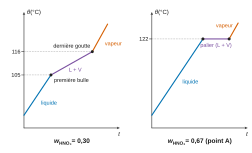
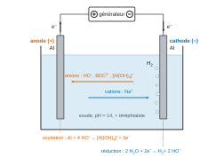
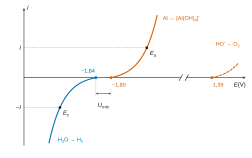
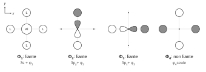
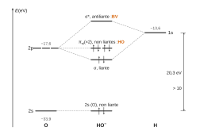
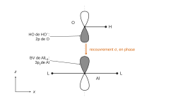

# CCINP TPC — Chimie 2026 · Corrigé guidé

*Corrigé rédigé par IA, non officiel. Signalez toute erreur.*

## Présentation du sujet

L'épreuve (TPC3C, 4 heures, **calculatrices interdites**) comporte **deux problèmes indépendants** et 49 questions, avec des données à la fin de chaque problème (pages 9 et 15–16). Les aides numériques ($6/11$, $7/8$, $4{,}8\times1{,}3$, $5{,}0\times3{,}6$) signalent les applications numériques attendues : y penser avant de poser un calcul.

**Problème 1 — Les MOFs (Q1 à Q27).** Le fil conducteur est la préparation du MIL-53(Al), un solide poreux formé de chaînes d'octaèdres d'aluminium reliés par des ions téréphtalate.

- **Partie I — L'aluminium métallique (Q1 à Q16).** Culture et atomistique (Q1–Q2) ; diagramme E-pH de l'aluminium et attaque de Al par HCl (Q3–Q5) ; diagramme binaire liquide-vapeur eau/acide nitrique avec azéotrope (Q6–Q10) ; électrolyse sur électrodes d'aluminium en milieu basique : équations, potentiels, courbes courant-potentiel, rendement faradique (Q11–Q16).
- **Partie II — L'acide téréphtalique (Q17 à Q19).** Polyester PET, hydrolyse et titrage pH-métrique et conductimétrique d'un mélange acide fort et diacide faible.
- **Partie III — Réacteur continu (Q20 à Q22).** RPAC en régime permanent, ordre 1, bilan thermique adiabatique.
- **Partie IV — Orbitales moléculaires (Q23 à Q27).** Complexe plan carré [AlL$_4$] à partir d'un diagramme fourni, OM de HO$^-$, interaction frontalière et pontage.

**Problème 2 — Synthèse de 1,3-oxazines (Q28 à Q49).**

- **Partie I — Du tartrate au succinimide (Q28 à Q39).** Stéréochimie de l'acide tartrique (Q28–Q30), estérification et Dean-Stark, synthèse de Williamson, solvant DMF, RMN (Q31–Q35), saponification et traitement d'une extraction (Q36–Q39).
- **Partie II — Formation de 1,3-oxazines (Q40 à Q49).** Activation et alkylation d'un imide, réduction partielle et ion N-acyliminium (Q40–Q44), protection silylée, hydroboration, oxydation et aldolisation (Q45–Q47), addition de Michael et oxa-Michael, stéréochimie du produit (Q48–Q49).

**Notions mobilisées** : configuration électronique ; diagrammes E-pH, loi de Nernst, constante d'équilibre redox ; diagrammes binaires isobares, variance, théorème des moments, distillation ; électrolyse, courbes courant-potentiel, surpotentiels, loi de Faraday ; titrages et conductimétrie ; RPAC et bilans enthalpiques ; méthode des fragments en OM ; stéréochimie (CIP, méso, pouvoir rotatoire) ; estérification, SN2, saponification, extraction liquide-liquide ; acidité des imides, mésomérie ; réductions par NaBH$_4$, ion iminium ; silylation, hydroboration, oxydations, aldolisation-crotonisation, addition de Michael ; spectroscopies IR et RMN.

**Difficulté.** Elle est moyenne, mais le sujet est long. Beaucoup de questions relèvent du cours (Q1–Q5, Q17, Q20–Q21, Q28–Q33, Q36, Q38–Q40, Q42). Les vraies difficultés sont les lectures graphiques (Q4, Q7, Q9), la gestion rigoureuse des potentiels et surpotentiels (Q13–Q14), l'interprétation conjointe des deux courbes de titrage (Q18) et la rédaction des mécanismes et des choix de réactifs (Q44, Q47, Q48).

**À ne pas laisser passer** : Q1–Q5, Q8, Q10, Q12, Q16, Q17, Q19–Q22, Q24, Q28–Q32, Q35, Q36, Q38, Q40, Q42, Q43.

**Gestion du temps** : environ 2 h pour chaque problème. Dans le problème 1, les parties III et IV ne dépendent pas des parties I et II : en cas de blocage sur l'électrolyse, passer au RPAC (trois questions rapides). Dans le problème 2, la partie II.3 (Q48–Q49) est en grande partie indépendante de ce qui précède.

# Problème 1 — Les MOFs (Metal-Organic Frameworks)

## Partie I — L'aluminium métallique

On part de l'atome, puis on utilise le diagramme E-pH pour comprendre l'attaque acide des déchets d'aluminium. Le diagramme binaire eau/HNO$_3$ sert ensuite à analyser la distillation qui élimine l'acide nitrique. Une voie électrochimique termine la partie : courbes courant-potentiel et loi de Faraday.

### Question 1
> [!INDICATION]
> Le prix décerné à ces trois chercheurs est le plus célèbre des prix scientifiques ; il porte le nom d'un industriel du XIXe siècle qui a fait fortune dans les explosifs.

#### Solution

Il s'agit du **prix Nobel de chimie 2025**. Il porte le nom d'Alfred Nobel, chimiste et industriel suédois, inventeur de la **dynamite** (nitroglycérine absorbée sur de la terre de diatomées, ce qui la rend manipulable).

### Question 2
> [!INDICATION]
> Déduire $Z$ de la période et de la colonne, puis appliquer la règle de Klechkowski.

#### Solution

L'aluminium est dans la 3e période et la colonne 13, donc $Z=13$ :

$$\boxed{\mathrm{Al}:\ 1s^2\,2s^2\,2p^6\,3s^2\,3p^1}$$

Il possède trois électrons de valence ($3s^2\,3p^1$), d'où l'ion Al$^{3+}$.

### Question 3
> [!INDICATION]
> Classer d'abord les espèces par nombre d'oxydation : verticalement, le diagramme sépare les degrés d'oxydation.

> [!INDICATION]
> À n.o. égal, se déplacer vers la droite revient à « ajouter des HO$^-$ » : ranger les trois espèces de l'aluminium(III) dans cet ordre.

#### Solution

Nombres d'oxydation : 0 pour Al(s), +III pour Al$^{3+}$, Al(OH)$_3$ et [Al(OH)$_4$]$^-$. Le domaine du bas, présent à tout pH, est celui du n.o. le plus faible : **D = Al(s)**.

À n.o. +III, de gauche à droite, on passe du cation Al$^{3+}$ à l'hydroxyde, puis à l'aluminate :

$$\begin{aligned}
\mathrm{Al^{3+}}+3\,\mathrm{HO^-}&=\mathrm{Al(OH)_3}\\
\mathrm{Al(OH)_3}+\mathrm{HO^-}&=[\mathrm{Al(OH)_4}]^-
\end{aligned}$$

Les frontières verticales à pH 4 et pH 10 sont des frontières de précipitation et de dissolution.

$$\boxed{\begin{aligned}
A&=\mathrm{Al^{3+}(aq)}\\
B&=\mathrm{Al(OH)_3(s)}\\
C&=[\mathrm{Al(OH)_4}]^-(\mathrm{aq})\\
D&=\mathrm{Al(s)}
\end{aligned}}$$

Contrôle par les pentes :

- A/D est horizontale, car Al³⁺ + 3 e⁻ = Al ne fait pas intervenir H⁺ ;
- B/D a une pente de $-0{,}06$ V par unité de pH (3 H⁺ pour 3 e⁻) ;
- C/D a une pente de $-0{,}08$ V par unité de pH (4 H⁺ pour 3 e⁻), comme on le lit sur la figure 1 : de $-2{,}08$ V à pH 10 à $-2{,}40$ V à pH 14.

> [!METHODE]
> Attribuer un diagramme E-pH : n.o. croissant de bas en haut, basicité croissante de gauche à droite à n.o. fixé. Vérifier ensuite les pentes, qui valent $-0{,}06\,m/n$ pour $m$ H$^+$ et $n$ électrons.

### Question 4
> [!INDICATION]
> Sur le segment horizontal, une seule espèce dissoute intervient ; écrire la loi de Nernst et la convention de tracé.

> [!INDICATION]
> Attention au nombre d'électrons échangés : le terme de concentration n'est pas $0{,}06\log c_T$.

#### Solution

Couple Al$^{3+}$/Al : Al$^{3+}$ + 3 e$^-$ = Al(s), d'où

$$E=E^\circ+\frac{0{,}06}{3}\log[\mathrm{Al^{3+}}]$$

Sur la frontière A/D, $[\mathrm{Al^{3+}}]=c_T=10^{-2}$ mol/L, et on lit $E_{\mathrm{front}}\approx-1{,}70$ V :

$$\begin{aligned}
E^\circ&=E_{\mathrm{front}}-0{,}02\log c_T\\
&=-1{,}70+0{,}04
\end{aligned}$$

$$\boxed{E^\circ(\mathrm{Al^{3+}/Al})\approx-1{,}66\ \mathrm V}$$

> [!PIEGE]
> Prendre directement $E^\circ=-1{,}70$ V en oubliant la convention de tracé. L'écart de 0,04 V est petit, mais c'est lui que la question évalue.

### Question 5
> [!INDICATION]
> Quel oxydant de la solution d'acide chlorhydrique peut oxyder l'aluminium ? Observer le gaz qui se dégage.

> [!INDICATION]
> $\log K^\circ=n\,\Delta E^\circ/0{,}06$, avec $n$ le nombre d'électrons de l'équation telle qu'elle est écrite.

#### Solution

L'oxydant est H$^+$ (Cl$^-$ est spectateur) :

$$\boxed{2\,\mathrm{Al(s)}+6\,\mathrm{H^+(aq)}\longrightarrow2\,\mathrm{Al^{3+}(aq)}+3\,\mathrm{H_2(g)}}$$

Avec $n=6$ électrons :

$$\begin{aligned}
\log K^\circ&=\frac{6\,(0-(-1{,}66))}{0{,}06}\\
&=166
\end{aligned}$$

$$\boxed{K^\circ=10^{166}}$$

**La réaction est totale.** Elle explique le dégagement gazeux (H$_2$) et l'exothermicité. Bilan de matière :

$$\begin{aligned}
n(\mathrm{H^+})&=0{,}60\ \mathrm{mol}\\
n(\mathrm{Al})&=5{,}0/27\approx0{,}185\ \mathrm{mol}
\end{aligned}$$

L'aluminium consomme $0{,}56$ mol de H$^+$. L'acide est en léger excès, l'aluminium est entièrement oxydé et le pH reste dans le domaine de Al$^{3+}$.

> [!JURY]
> Le verbe conclure appelle une phrase qui relie la valeur de $K^\circ$ à la transformation réelle : réaction totale, réactif limitant, observations du protocole.

### Question 6
> [!INDICATION]
> Repérer les points où les deux courbes se rejoignent : corps purs et point A. Dans chaque fuseau, quelle courbe correspond à l'apparition de la première bulle ?

> [!INDICATION]
> Dans un domaine biphasé, la composition des phases ne se lit pas au point figuratif mais sur les courbes, à la même température.

#### Solution

Les courbes se rejoignent en $w=0$ (eau, 100 °C), en $w=1$ (HNO$_3$, 83 °C) et en A (122 °C) : il s'agit d'un azéotrope à maximum de température.

- **(a)**, la courbe inférieure de chaque fuseau, est la **courbe d'ébullition** ; **(b)**, la courbe supérieure, est la **courbe de rosée**.
- **I** : **liquide** seul, de composition égale à la composition globale.
- **II** ($w<0{,}67$) : **liquide + vapeur**. Le liquide a la composition lue sur la courbe d'ébullition, la vapeur celle lue sur la courbe de rosée ; la vapeur est plus riche en eau.
- **III** ($w>0{,}67$) : **liquide + vapeur**, avec les mêmes règles de lecture ; la vapeur est plus riche en HNO$_3$.
- **IV** : **vapeur** seule, de composition égale à la composition globale.

> [!PIEGE]
> Annoncer « liquide + vapeur » sans dire où lire les compositions. La question demande « nature **et** composition ».

### Question 7
> [!INDICATION]
> Une rupture de pente apparaît chaque fois que le nombre de phases change. Repérer, à $w=0{,}30$, les températures d'entrée et de sortie du fuseau.

> [!INDICATION]
> Pour le point A, penser à la question suivante : la température peut-elle varier pendant la vaporisation ?

#### Solution

**$w=0{,}30$.** Le liquide chauffe seul (pente forte) jusqu'à **105 °C** (courbe d'ébullition, première bulle). La pente diminue alors : une partie de la puissance sert à vaporiser, mais la température continue de croître, car le liquide s'enrichit en HNO$_3$ et sa température d'ébullition augmente. La dernière goutte disparaît vers **116 °C** (courbe de rosée) : nouvelle rupture de pente, la pente redevient forte (vapeur seule).

**$w=0{,}67$.** La température croît jusqu'à **122 °C**, puis reste constante (**palier**) pendant toute la vaporisation, et remonte ensuite.

> [!PIEGE]
> Dessiner un palier pour $w=0{,}30$. Un mélange de composition quelconque bout sur un intervalle de température : seuls un corps pur et un azéotrope donnent un palier.

### Question 8
> [!INDICATION]
> Que dire de la composition de la vapeur formée à partir d'un liquide de composition A ?

> [!INDICATION]
> Compter les paramètres intensifs ($T$, $P$, compositions des deux phases), retrancher les relations d'équilibre, puis les contraintes imposées : pression fixée et égalité des compositions.

#### Solution

Le point A est un **azéotrope** (à maximum de température, dit négatif). La vapeur formée a **la même composition que le liquide** : le mélange bout à température constante (122 °C sous 1 bar) sans changer de composition, comme un corps pur.

Variance du système biphasé :

$$\begin{aligned}
v&=c+2-\varphi\\
&=2
\end{aligned}$$

Avec $P$ fixée et la contrainte $w_L=w_V$ propre à l'azéotrope :

$$\boxed{v'=2-1-1=0}$$

Le système est invariant : la température reste constante tant que les deux phases coexistent, d'où le **palier**. Pour une autre composition, $v'=1$ : la température varie pendant l'ébullition.

> [!PIEGE]
> Un azéotrope à maximum de température est dit **négatif** : on ne le qualifie pas d'azéotrope « positif ».

### Question 9
> [!INDICATION]
> Placer le point ($w=0{,}20$ ; 105 °C) et vérifier qu'il est dans un fuseau. Tracer l'horizontale et lire les deux compositions aux extrémités.

> [!INDICATION]
> Écrire la conservation de la masse totale et celle de la masse de HNO$_3$ ; l'aide numérique du sujet indique les fractions attendues.

#### Solution

À 105 °C, $w=0{,}20$ est dans le domaine II : à cette composition, la courbe d'ébullition passe vers 103 °C et la courbe de rosée vers 112 °C. L'horizontale à 105 °C coupe la courbe d'ébullition en $w_L\approx0{,}30$ et la courbe de rosée en $w_V\approx0{,}08$.

$$\begin{aligned}
m_L+m_V&=m\\
m_L\,w_L+m_V\,w_V&=m\,w
\end{aligned}$$

$$\begin{aligned}
m_L&=m\,\frac{w-w_V}{w_L-w_V}\\
&=1{,}0\times\frac{0{,}12}{0{,}22}\\
&=\frac{6}{11}\ \mathrm{kg}
\end{aligned}$$

$$m_V=\frac{5}{11}\ \mathrm{kg}$$

$$\boxed{\begin{aligned}
m_{\mathrm{liquide}}&\approx0{,}55\ \mathrm{kg}\ (w=0{,}30)\\
m_{\mathrm{vapeur}}&\approx0{,}45\ \mathrm{kg}\ (w=0{,}08)
\end{aligned}}$$

> [!METHODE]
> Théorème des moments : la masse d'une phase est proportionnelle à la longueur du segment qui sépare le point figuratif de l'**autre** phase. On ne l'applique qu'avec des fractions **massiques** quand on cherche des **masses**.

### Question 10
> [!INDICATION]
> Une distillation fractionnée conduit le distillat et le résidu vers les deux bornes du fuseau qui contient le mélange initial.

> [!INDICATION]
> Laquelle de ces deux bornes a la température d'ébullition la plus élevée ? C'est elle qui reste dans le bouilleur.

#### Solution

Le mélange $w=0{,}40$ est dans le fuseau II, borné par l'eau pure (100 °C) et l'azéotrope (122 °C). La vapeur, plus riche en eau, s'élève dans la colonne : en tête, on recueille le constituant de plus basse température d'ébullition ; dans le bouilleur, il reste l'azéotrope.

$$\boxed{\begin{aligned}
&\text{distillat : eau pure }(w=0)\\
&\text{résidu : azéotrope }(w=0{,}67)
\end{aligned}}$$

Conservation de HNO$_3$ :

$$\begin{aligned}
m_{\mathrm{rés}}&=\frac{m\,w}{w_A}\\
&=\frac{0{,}40}{0{,}67}\\
&\approx\boxed{0{,}60\ \mathrm{kg}}
\end{aligned}$$

On recueille aussi environ 0,40 kg d'eau.

> [!PIEGE]
> Annoncer « eau et HNO$_3$ pur » : on ne franchit pas un azéotrope par distillation. Ici le résidu est l'azéotrope, et non le distillat, parce que celui-ci est à **maximum** de température.

### Question 11
> [!INDICATION]
> L'anode est le siège de l'oxydation. À quel pôle du générateur est-elle reliée en électrolyse ?

> [!INDICATION]
> Pour la soude, penser à trois rôles : réactif, conducteur, et effet sur un acide de p$K_a$ connu.

#### Solution

Les deux lames d'aluminium plongent dans la soude (pH 14) qui contient l'ion téréphtalate : l'**anode** est reliée au pôle **+**, la **cathode** au pôle **−**.

- **Porteurs de charge** : dans le circuit extérieur, les électrons vont de l'anode vers le pôle +, puis du pôle − vers la cathode. Dans la solution, les cations (Na$^+$) migrent vers la cathode et les anions (HO$^-$, BDC$^{2-}$, aluminate) vers l'anode.
- **Soude** : elle fournit les HO⁻ consommés à l'anode (Al + 4 HO⁻ → [Al(OH)₄]⁻ + 3 e⁻) et régénérés à la cathode. Elle maintient l'aluminium(III) sous forme d'aluminate soluble (pH > 10), ce qui évite la passivation par Al(OH)$_3$. Elle rend la solution conductrice.
- **Solubilité de l'acide téréphtalique** : à pH 14 ≫ p$K_{a2}=4{,}5$, l'acide est entièrement sous forme BDC$^{2-}$, ionique et très soluble. La soude **augmente fortement sa solubilité**, celle de BDCH$_2$ n'étant que de $1{,}02\cdot10^{-4}$ mol/L.

> [!PIEGE]
> En électrolyse, l'anode est reliée au pôle +. Dans une pile, c'est l'inverse : l'anode est le pôle −. Aucun électron ne circule dans la solution.

### Question 12
> [!INDICATION]
> Lister, pour chaque électrode, tous les couples où Al ou l'eau peuvent être oxydés (anode) ou réduits (cathode).

> [!INDICATION]
> Le milieu est basique : équilibrer avec HO$^-$ et H$_2$O.

#### Solution

**Anode** :

$$\mathrm{Al(s)}+4\,\mathrm{HO^-}\longrightarrow[\mathrm{Al(OH)_4}]^-+3\,e^-\qquad\qquad4\,\mathrm{HO^-}\longrightarrow\mathrm{O_2(g)}+2\,\mathrm{H_2O}+4\,e^-$$

**Cathode** :

$$2\,\mathrm{H_2O}+2\,e^-\longrightarrow\mathrm{H_2(g)}+2\,\mathrm{HO^-}\qquad\qquad[\mathrm{Al(OH)_4}]^-+3\,e^-\longrightarrow\mathrm{Al(s)}+4\,\mathrm{HO^-}$$

La seconde réduction n'est possible qu'une fois l'aluminate formé.

### Question 13
> [!INDICATION]
> Calculer les trois potentiels de Nernst à pH 14 (activités unitaires sauf H$^+$), en écrivant chaque demi-équation avec H$^+$.

> [!INDICATION]
> Ajouter ensuite les surpotentiels pour obtenir les potentiels de démarrage. À l'anode, quelle oxydation démarre la première quand le potentiel croît ? À la cathode, quelle réduction démarre la première quand il décroît ?

#### Solution

Couple de l'aluminate : $[\mathrm{Al(OH)_4}]^-+4\mathrm H^++3e^-=\mathrm{Al}+4\mathrm{H_2O}$.

$$\begin{aligned}
E_1&=-1{,}18-0{,}08\times14\\
&=-2{,}30\ \mathrm V
\end{aligned}$$

Couple de l'eau réduite : $2\mathrm H^++2e^-=\mathrm{H_2}$.

$$\begin{aligned}
E_2&=-0{,}06\times14\\
&=-0{,}84\ \mathrm V
\end{aligned}$$

Couple de l'eau oxydée : $\mathrm{O_2}+4\mathrm H^++4e^-=2\mathrm{H_2O}$.

$$\begin{aligned}
E_3&=1{,}23-0{,}84\\
&=0{,}39\ \mathrm V
\end{aligned}$$

| Réaction | Potentiel de démarrage |
|---|---|
| oxydation de Al | $-2{,}30+0{,}5=-1{,}80$ V |
| oxydation de l'eau en O$_2$ | $0{,}39+1{,}0=1{,}39$ V |
| réduction de l'eau en H$_2$ | $-0{,}84-1{,}0=-1{,}84$ V |
| réduction de l'aluminate | $\leq-2{,}30$ V |

À l'anode, l'oxydation de Al démarre bien avant celle de l'eau ; à la cathode, la réduction de l'eau démarre avant celle de l'aluminate.

$$\boxed{\text{Anode : }\mathrm{Al}+4\mathrm{HO^-}\to[\mathrm{Al(OH)_4}]^-+3e^-\qquad\text{Cathode : }2\mathrm{H_2O}+2e^-\to\mathrm{H_2}+2\mathrm{HO^-}}$$

> [!PIEGE]
> Le coefficient de pH est $0{,}06\,m/n$ : $4\times0{,}06/3=0{,}08$ V pour le couple de l'aluminate, et non 0,06 V. Une erreur sur ce point inverse les conclusions des questions suivantes.

### Question 14
> [!INDICATION]
> Tracer sur un même axe la branche anodique retenue et la branche cathodique retenue, avec leurs potentiels de démarrage.

> [!INDICATION]
> Un courant $I$ circule quand l'anode débite $+I$ et la cathode $-I$ : quel écart minimal de potentiel cela impose-t-il ?

#### Solution

La branche cathodique (réduction de l'eau, $i<0$) part de $-1{,}84$ V. La branche anodique (oxydation de Al, $i>0$) part de $-1{,}80$ V. L'oxydation de l'eau ne partirait qu'à $1{,}39$ V.

Pour qu'un courant passe, il faut $E_a>-1{,}80$ V et $E_c<-1{,}84$ V :

$$\begin{aligned}
U_{\min}&=-1{,}80-(-1{,}84)\\
&=\boxed{0{,}04\ \mathrm V}
\end{aligned}$$

Équation de l'électrolyse (2 × anode + 3 × cathode, puis division par 2) :

$$\boxed{\mathrm{Al(s)}+\mathrm{HO^-}+3\,\mathrm{H_2O}\longrightarrow[\mathrm{Al(OH)_4}]^-+\tfrac32\,\mathrm{H_2(g)}}$$

> [!METHODE]
> La tension seuil d'électrolyse est l'écart entre les potentiels de démarrage anodique et cathodique, lus sur les courbes $i(E)$. Elle vaut $\Delta E_{\mathrm{Nernst}}+\eta_a-\eta_c$. Ici elle est petite, car la réaction globale est thermodynamiquement favorable : l'aluminium se dissout spontanément dans la soude.

### Question 15
> [!INDICATION]
> La relation $U=E_a-E_c$ n'est complète que si l'on tient compte de la solution, traversée par un courant.

> [!INDICATION]
> Les surpotentiels donnés sont-ils ceux qui correspondent à 50 mA ?

#### Solution

L'écart de $0{,}96$ V provient :

- de la **chute ohmique** $RI$ dans l'électrolyte entre les électrodes et dans les connexions ;
- de l'**augmentation des surtensions** avec l'intensité. Les surpotentiels de l'énoncé sont donnés à courant (quasi) nul ; pour débiter 50 mA, l'anode doit être portée au-delà de $-1{,}80$ V et la cathode en deçà de $-1{,}84$ V (surtensions d'activation, voire de diffusion).

Cette énergie supplémentaire est dissipée (effet Joule, irréversibilités aux électrodes).

> [!PIEGE]
> Invoquer uniquement la résistance de la solution : à courant non nul, les branches $i(E)$ ont une pente finie, et les surtensions croissent avec $|i|$.

### Question 16
> [!INDICATION]
> Loi de Faraday : charge, puis quantité d'électrons, puis quantité d'aluminium (combien d'électrons par atome ?), puis masse.

> [!INDICATION]
> Repérer dans l'aide numérique le produit qui donne la charge, puis le rapport qui donne le rendement.

#### Solution

$$\begin{aligned}
Q&=I\,t\\
&=0{,}050\times3600\\
&=180\ \mathrm C
\end{aligned}$$

d'où

$$\begin{aligned}
m_{\mathrm{th}}&=\frac{Q}{3F}\,M(\mathrm{Al})\\
&=\frac{180}{3\times10^5}\times27\\
&=6{,}0\cdot10^{-4}\times27\ \mathrm g\\
&\approx16\ \mathrm{mg}
\end{aligned}$$

$$\begin{aligned}
\eta_F&=\frac{14}{16{,}2}\\
&\approx\boxed{0{,}86}
\end{aligned}$$

Avec $m_{\mathrm{th}}\approx16$ mg, on trouve $\eta_F\approx\tfrac78\approx0{,}88$.

**Conclusion** : environ 85 à 90 % de la charge sert à dissoudre l'aluminium, et le procédé est efficace. Le reste de la charge sert à des processus parasites : formation d'un film d'oxyde ou d'hydroxyde en surface, réactions secondaires, courants de fuite.

> [!METHODE]
> Rendement faradique = quantité effectivement transformée divisée par la quantité prévue par la loi de Faraday, $n=It/(zF)$. Un rendement inférieur à 1 signale qu'une partie du courant sert à d'autres réactions.

## Partie II — L'acide téréphtalique

On identifie les monomères du PET, puis on dose l'acide téréphtalique libéré par l'hydrolyse basique. Le cœur de la partie est la lecture conjointe d'une courbe pH-métrique et d'une courbe conductimétrique.

### Question 17
> [!INDICATION]
> Quel groupe se répète dans la chaîne de la figure 3 ? Quelle réaction le forme à partir d'un acide carboxylique ?

> [!INDICATION]
> Couper chaque liaison C(=O)–O du motif, puis compléter chaque fragment par OH ou par H.

#### Solution

La fonction formée est l'**ester**. Le PET est un polyester obtenu par polycondensation (polyestérification).

- **BDCH$_2$** : acide benzène-1,4-dicarboxylique, un cycle benzénique portant deux groupes COOH en positions **para** : HOOC–C$_6$H$_4$–COOH.
- **Autre monomère** : l'**éthane-1,2-diol** HO–CH$_2$–CH$_2$–OH (éthylène glycol). En topologique, c'est un segment de deux sommets, chacun portant un OH.

### Question 18
> [!INDICATION]
> Faire l'inventaire des acides présents dans la solution titrée et tracer le diagramme de prédominance de l'acide téréphtalique.

> [!INDICATION]
> Deux acidités dont les p$K_a$ diffèrent de moins de 4 unités donnent-elles deux sauts distincts ? Associer chaque segment de la droite conductimétrique aux ions qui apparaissent et disparaissent.

#### Solution

Prédominance : **BDCH₂** pour pH < 3,5, **BDCH⁻** entre 3,5 et 4,5, **BDC²⁻** pour pH > 4,5. La solution contient l'excès d'acide sulfurique, diacide fort (H₃O⁺), et BDCH₂, libéré de son sel par cet acide.

- **$0<V<V_{e1}=16$ mL** : $\mathrm{H_3O^+}+\mathrm{HO^-}\to2\,\mathrm{H_2O}$. Le pH reste inférieur à environ 3, BDCH₂ prédomine et n'est pas dosé. La conductivité **chute** : H₃O⁺ (35 mS·m²/mol) est remplacé par Na⁺ (5).
- **$V_{e1}<V<V_{e2}=29$ mL** : $\mathrm{BDCH_2}+2\,\mathrm{HO^-}\to\mathrm{BDC^{2-}}+2\,\mathrm{H_2O}$. Comme $\Delta\mathrm pK_a=1$, les deux acidités sont dosées **ensemble**. Le pH traverse les domaines de BDCH⁻ et de BDC²⁻ (zone tampon). La conductivité **croît lentement** : il apparaît BDC²⁻ (7) et Na⁺ (5) à partir d'une espèce neutre.
- **$V>V_{e2}$** : excès de HO$^-$. Le pH tend vers 12 et la conductivité **croît fortement** (HO$^-$ : 20).

Le pH ne présente pas de saut net en $V_{e1}$, car l'acide faible tamponne dès pH 3 : cette équivalence se repère par la cassure (minimum) de la conductimétrie. Le grand saut de pH est en $V_{e2}$.

> [!METHODE]
> En titrage de mélange, on utilise la conductimétrie pour les équivalences que le pH ne marque pas. Chaque segment se justifie par le bilan des ions (disparition, apparition, ions spectateurs apportés), pondéré par leurs conductivités molaires.

> [!PIEGE]
> Le sujet impose de traiter H$_2$SO$_4$ comme un diacide **fort** : on ne justifie pas l'ordre des dosages par un p$K_a$ de HSO$_4^-$.

### Question 19
> [!INDICATION]
> Quel volume de soude correspond à l'acide téréphtalique seul ? Combien de HO$^-$ consomme une molécule ?

> [!INDICATION]
> Rendement : quantité obtenue rapportée à la quantité maximale de motifs de PET hydrolysés. Utiliser l'aide numérique $4{,}8\times1{,}3$.

#### Solution

$$\begin{aligned}
n(\mathrm{BDCH_2})&=\frac{C_b\,(V_{e2}-V_{e1})}{2}\\
&=\frac{2{,}0\cdot10^{-2}\times13\cdot10^{-3}}{2}\\
&=1{,}3\cdot10^{-4}\ \mathrm{mol}
\end{aligned}$$

$$n_{\max}=\frac{40\cdot10^{-3}}{192}\ \mathrm{mol}$$

$$\begin{aligned}
\rho&=\frac{1{,}3\cdot10^{-4}\times192}{40\cdot10^{-3}}\\
&=1{,}3\times4{,}8\times10^{-1}\\
&\approx\boxed{0{,}62=62\ \%}
\end{aligned}$$

> [!PIEGE]
> Oublier le facteur 2 (diacide) double le rendement, qui dépasserait alors 100 %, ce qui doit alerter.

## Partie III — Formation du MIL-53(Al) en mode continu

Trois questions courtes sur le RPAC : bilan de matière en régime permanent, temps de passage, bilan thermique adiabatique.

### Question 20
> [!INDICATION]
> Définition du taux de conversion appliquée au réactif limitant, avec un débit volumique conservé.

#### Solution

$$\begin{aligned}
[\mathrm{Al^{3+}}]_s&=c_0\,(1-X)\\
&=1{,}0\times0{,}20\\
&=\boxed{0{,}20\ \mathrm{mol\cdot L^{-1}}}
\end{aligned}$$

### Question 21
> [!INDICATION]
> Bilan de matière sur Al$^{3+}$ en régime permanent : entrée = sortie + disparition par réaction dans tout le volume.

> [!INDICATION]
> Dans un RPAC, à quelle concentration la vitesse est-elle évaluée ?

#### Solution

Le réacteur est uniforme, à la composition de sortie, et $v=k\,c_s$ :

$$Q\,c_0=Q\,c_s+k\,c_s\,\mathcal V$$

d'où

$$\begin{aligned}
\tau&=\frac{\mathcal V}{Q}\\
&=\frac{c_0-c_s}{k\,c_s}\\
&=\frac{X}{k(1-X)}
\end{aligned}$$

$$\begin{aligned}
\tau&=\frac{0{,}80}{5{,}0\times0{,}20}\\
&=\boxed{0{,}80\ \mathrm{min}=48\ \mathrm s}
\end{aligned}$$

$$\mathcal V=Q\tau=\boxed{240\ \mathrm L}$$

> [!PIEGE]
> Utiliser la loi intégrée du réacteur fermé, $\tau=\ln(1/(1-X))/k$, qui donnerait 0,32 min. Elle vaut pour un réacteur fermé ou piston, pas pour un RPAC.

### Question 22
> [!INDICATION]
> Premier principe en système ouvert, en régime permanent, adiabatique : le flux d'enthalpie est conservé entre l'entrée et la sortie.

> [!INDICATION]
> Décomposer en deux étapes fictives : réaction à $T_e$ (débit molaire réagi $Qc_0X$), puis échauffement du débit massique $\rho Q$ de $T_e$ à $T_s$.

#### Solution

$$0=Q\,c_0\,X\,\Delta_rH^\circ+\rho\,Q\,C_{moy}\,(T_s-T_e)$$

d'où

$$\Delta T=\frac{-\Delta_rH^\circ\,c_0\,X}{\rho\,C_{moy}}$$

$$\begin{aligned}
\Delta T&=\frac{65\cdot10^3\times1{,}0\times0{,}80}{1\times5\cdot10^3}\\
&\approx\boxed{+10\ \mathrm K}
\end{aligned}$$

La réaction exothermique échauffe le milieu d'une dizaine de degrés : c'est **modéré**, compatible avec la gamme de 20 à 80 °C, sans risque d'emballement. Le débit $Q$ se simplifie : $\Delta T$ ne dépend que de la concentration d'entrée et de la conversion. On a supposé $\Delta_rH^\circ$ indépendante de $T$.

> [!METHODE]
> Élévation adiabatique de température : $\Delta T_{ad}=-\Delta_rH\,c_0X/(\rho c_p)$. C'est la grandeur à calculer en premier pour juger de la sécurité thermique d'un réacteur.

## Partie IV — Étude de la liaison aluminium-oxygène dans le MIL-53(Al)

Le diagramme des OM du complexe plan carré est fourni : il faut l'interpréter par la méthode des fragments. On construit ensuite les OM de HO$^-$ et l'on raisonne sur les orbitales frontalières pour expliquer le pont Al–OH–Al.

### Question 23
> [!INDICATION]
> Pour chaque OM du fragment L$_4$, chercher l'orbitale de valence de Al (3s, 3p$_x$, 3p$_y$, 3p$_z$) qui a la même symétrie, c'est-à-dire un recouvrement non nul.

> [!INDICATION]
> Une OM de fragment qui ne trouve aucun partenaire reste à son énergie : regarder sur la figure 6 quelles OM ne sont reliées qu'à un seul côté.

#### Solution

Recouvrements non nuls :

- 3s avec $\varphi_1$ (les 4 L en phase) ;
- 3p$_y$ avec $\varphi_2$ et 3p$_x$ avec $\varphi_3$ (L en opposition de phase sur un même axe).

$\varphi_4$ (signes $+,-,+,-$ d'un axe à l'autre) n'a pas de partenaire, faute d'orbitale d sur Al ; 3p$_z$ non plus.

Représentation conventionnelle (schéma ci-dessus, plan $xy$ vu de dessus) :

- **$\Phi_1$** : 3s de Al en phase avec les 4 orbitales des L, toutes de même signe. **Liante.**
- **$\Phi_2$, $\Phi_3$** (dégénérées) : 3p$_y$ (resp. 3p$_x$) de Al, chaque lobe en phase avec l'orbitale du L situé en face, sur le même axe. **Liantes.**
- **$\Phi_4$** : orbitales des L seules, de même signe sur l'axe $x$, de signe opposé sur l'axe $y$, sans contribution de Al. **Non liante.**

$$\boxed{\Phi_1,\Phi_2,\Phi_3\ \text{liantes};\quad\Phi_4\ \text{non liante}}$$

Au-dessus : $\Phi_5$ = 3p$_z$, non liante.

Viennent ensuite $\Phi_6$ et $\Phi_7$, antiliantes (p$_x$, p$_y$), puis $\Phi_8$, antiliante (s).

> [!PIEGE]
> Raisonner comme pour un complexe de métal de transition et associer $\varphi_4$ à une orbitale $d_{x^2-y^2}$ : l'aluminium n'a pas d'orbitale d de valence.

### Question 24
> [!INDICATION]
> Remplir les OM par énergie croissante avec 8 électrons.

#### Solution

$\Phi_1$, $\Phi_2$, $\Phi_3$ et $\Phi_4$ sont doublement occupées.

$$\boxed{\begin{aligned}
\mathrm{HO}&=\Phi_4\ (\text{non liante, sur les ligands})\\
\mathrm{BV}&=\Phi_5\ (3p_z\text{ de Al, vacante})
\end{aligned}}$$

La BV est perpendiculaire au plan du complexe et présente un lobe de chaque côté : c'est elle qui accueillera les ligands axiaux.

### Question 25
> [!INDICATION]
> Calculer les écarts d'énergie entre 1s(H) et chacune des OA de valence de O, et appliquer le critère des 10 eV.

> [!INDICATION]
> Parmi les trois orbitales 2p, laquelle a un recouvrement non nul avec 1s(H) ? Compter ensuite les électrons de valence de l'ion, sans oublier la charge.

#### Solution

Axe O–H noté $z'$.

- $|{-33{,}9}+13{,}6|=20{,}3$ eV, supérieur à 10 eV : 2s(O) n'interagit pas.
- $|{-17{,}6}+13{,}6|=4{,}0$ eV, inférieur à 10 eV : 1s(H) interagit avec la seule 2p$_{z'}$, car son recouvrement avec 2p$_{x'}$ et 2p$_{y'}$ est nul.

| OM (énergie croissante) | Nature | Électrons |
|---|---|---|
| 2s(O) | non liante | 2 |
| $\sigma$ = 2p$_{z'}$ + 1s, plus développée sur O | liante | 2 |
| 2p$_{x'}$, 2p$_{y'}$ de O | non liantes, dégénérées | 4 |
| $\sigma^*$ = 2p$_{z'}$ − 1s, plus développée sur H | antiliante | 0 |

8 électrons de valence ($6+1+1$).

$$\boxed{\mathrm{HO}:\ 2p_{x'},\,2p_{y'}\text{ de O (non liantes)};\qquad\mathrm{BV}:\ \sigma^*_{\mathrm{OH}}}$$

Représentation : chaque HO est une orbitale p pure de O, à deux lobes de signes opposés, perpendiculaire à l'axe O–H. La BV $\sigma^*$ comporte un gros lobe sur H et un lobe plus petit, de signe opposé, sur O, du côté de H, avec un nœud entre les deux atomes.

> [!METHODE]
> Dans une OM liante, l'OA la plus basse en énergie (la plus électronégative) a le plus gros coefficient ; dans l'antiliante, c'est l'inverse.

### Question 26
> [!INDICATION]
> Lequel des deux partenaires est le nucléophile ? Associer sa HO à la BV de l'autre.

> [!INDICATION]
> Vérifier le recouvrement : une orbitale qui arrive selon $Oz$ peut-elle interagir avec $\Phi_4$, contenue dans le plan $xy$ ?

#### Solution

L'interaction est **HO(HO⁻) – BV([AlL₄])** : un doublet non liant 2p de O donne dans la 3p$_z$ vacante de Al ($\Phi_5$).

L'interaction inverse, HO du complexe ($\Phi_4$) avec $\sigma^*$ de HO⁻, a un recouvrement nul par symétrie : $\Phi_4$ présente des signes alternés dans le plan $xy$.

HO$^-$ arrive selon $Oz$ ; un lobe de la 2p non liante de O pointe vers Al (dans ce modèle, l'axe O–H est donc perpendiculaire à $Oz$) et recouvre axialement, en phase, le lobe supérieur de la 3p$_z$ de Al (recouvrement $\sigma$). Cette interaction à deux électrons forme la liaison de coordination Al–O.

### Question 27
> [!INDICATION]
> Combien de doublets non liants, de même énergie, porte l'oxygène de HO$^-$ ? Combien en faut-il pour une liaison de coordination ?

> [!INDICATION]
> Regarder aussi la BV du complexe : combien de lobes, de quel côté du plan ?

#### Solution

L'oxygène de HO$^-$ possède **deux** HO dégénérées (deux doublets 2p non liants). Après une première liaison Al–O, il garde un doublet disponible, qu'il peut donner à la 3p$_z$ vacante d'un **second** complexe. Inversement, la 3p$_z$ de chaque Al a deux lobes, au-dessus et au-dessous du plan : chaque Al accepte deux HO$^-$ en *trans* (figure 5) et complète son octaèdre.

**HO$^-$ est donc un ligand pontant ($\mu_2$-OH)**, ce qui explique les chaînes …Al–OH–Al–OH… d'octaèdres reliés par leurs sommets du MIL-53(Al).

# Problème 2 — Synthèse de 1,3-oxazines

## Partie I — Formation d'un succinimide à partir de l'acide (+)-tartrique

On fixe la stéréochimie de l'acide tartrique, qui sera conservée jusqu'au bout. On protège ensuite les deux alcools (Williamson), puis on libère les acides carboxyliques (saponification), avec une analyse détaillée du traitement.

### Question 28
> [!INDICATION]
> Classer les quatre substituants de chaque centre par les règles CIP ; la difficulté est de départager COOH et CH(OH)COOH.

> [!INDICATION]
> Le H implicite est-il vers l'avant ou vers l'arrière quand le OH est en coin plein ?

#### Solution

Priorités sur C2 comme sur C3 : OH > COOH (O,O,O) > CH(OH)COOH (O,C,H) > H.

Sur la figure 8, sur chaque centre, OH est en coin plein et H est donc en arrière. Sur C2 (sommet bas), le parcours OH (bas) → COOH (haut gauche) → C3 (haut droite) tourne dans le sens horaire : **R**. Sur C3 (sommet haut), le parcours OH (haut) → COOH (bas droite) → C2 (bas gauche) tourne aussi dans le sens horaire : **R**.

$$\boxed{\text{acide }(2R,3R)\text{-2,3-dihydroxybutanedioïque}}$$

> [!PIEGE]
> Lire le sens de rotation avec H vers l'observateur sans inverser le résultat. Ici, H est en arrière, et la lecture est directe.

### Question 29
> [!INDICATION]
> Deux centres stéréogènes donnent au plus quatre combinaisons. Les deux moitiés de la molécule étant identiques, deux d'entre elles décrivent-elles la même molécule ?

#### Solution

Il existe **3 stéréoisomères de configuration** (représentés sur la même chaîne en zigzag que la figure 8) :

- **(2R,3R)** : l'acide (+)-tartrique, les deux OH en coin plein, chiral ;
- **(2S,3S)** : son énantiomère, les deux OH en pointillés ;
- **(2R,3S)**, identique à (2S,3R) : la forme **méso**, avec un OH en coin plein et l'autre en pointillés. Elle est achirale (centre de symétrie dans la conformation anti, plan de symétrie dans la conformation éclipsée).

Les formes (R,R) et (S,S) sont énantiomères ; la forme méso est diastéréoisomère de chacune.

> [!PIEGE]
> Compter quatre stéréoisomères : (R,S) et (S,R) sont la même molécule, superposable à son image.

### Question 30
> [!INDICATION]
> La mention (+) concerne une mesure au polarimètre : dans quel sens tourne le plan de polarisation ?

#### Solution

(+) correspond à **dextrogyre** : la substance fait tourner le plan de polarisation de la lumière polarisée rectilignement **vers la droite** (sens horaire pour un observateur qui reçoit la lumière), $[\alpha]>0$.

$$\boxed{(2S,3S)\text{ : }(-)\text{, lévogyre};\qquad\text{méso : achiral, optiquement inactif, sans mention}}$$

> [!PIEGE]
> Croire que R signifie dextrogyre : le signe de $[\alpha]$ se mesure, il ne se déduit pas des descripteurs CIP.

### Question 31
> [!INDICATION]
> Quelle réaction donne un ester à partir d'un acide et d'un alcool ? Elle est lente et équilibrée : comment agir sur chacun de ces deux défauts ?

> [!INDICATION]
> Pour que le Dean-Stark sépare l'eau, que faut-il au solvant vis-à-vis de l'eau (miscibilité, densité, azéotrope) ?

#### Solution

On réalise une **estérification de Fischer** : acide tartrique dans l'**éthanol en large excès**, catalyseur acide (H$_2$SO$_4$ ou APTS), chauffage à reflux. Le catalyseur et la température accélèrent une réaction lente ; l'excès d'alcool déplace un équilibre de constante $K\approx1$.

**Dean-Stark** : il élimine l'eau formée et déplace l'équilibre vers l'ester. Il faut un solvant **non miscible à l'eau, moins dense qu'elle**, qui forme avec l'eau un **hétéroazéotrope** de température d'ébullition inférieure à celle des autres espèces (toluène, cyclohexane). L'eau condensée décante au fond du tube et y reste piégée, tandis que le solvant reflue dans le ballon.

> [!PIEGE]
> Proposer un Dean-Stark dans l'éthanol pur : l'éthanol est miscible à l'eau, et rien ne décanterait.

### Question 32
> [!INDICATION]
> Comparer le groupe porté par les carbones 2 et 3 avant et après la réaction.

> [!INDICATION]
> Comparer les p$K_a$ des couples H$_2$/H$^-$ et ROH/RO$^-$ donnés.

#### Solution

On crée deux fonctions **éther-oxyde** (éthers benzyliques). **NaH** est une base forte (p$K_a$ 35 ≫ 16–18) : il déprotone totalement et irréversiblement (départ de H$_2$) les deux alcools en **alcoolates**, bien plus nucléophiles que les alcools.

### Question 33
> [!INDICATION]
> Utiliser les deux données physiques du DMF, puis regarder s'il porte un hydrogène acide.

#### Solution

Le DMF est **polaire** ($\mu=3{,}85$ D) et **dissociant** ($\varepsilon_r=38$) : il dissout et dissocie les espèces ioniques (alcoolate de sodium, NaBr) ainsi que les réactifs organiques. Il est **aprotique** : il ne réagit pas avec NaH et ne protone pas l'alcoolate. Il solvate bien les cations (doublets de O) et mal les anions (pas de liaison hydrogène) : l'alcoolate, peu solvaté, est très nucléophile, ce qui favorise la SN2 sur BnBr.

> [!METHODE]
> Solvants des SN2 avec un nucléophile anionique : polaires aprotiques (DMF, DMSO, acétone). Ils dissolvent le sel tout en laissant l'anion réactif.

### Question 34
> [!INDICATION]
> Deux actes élémentaires par fonction alcool : une réaction acide-base, puis une substitution nucléophile.

> [!INDICATION]
> Une liaison d'un carbone stéréogène est-elle rompue ? En déduire la configuration de **1** et son éventuelle symétrie.

#### Solution

Pour chaque fonction alcool :

1. **Acide-base** : $\mathrm{RO{-}H}+\mathrm{H^-}\to\mathrm{RO^-}+\mathrm{H_2}\uparrow$. Une flèche part du doublet de H$^-$ vers le H de OH, une autre de la liaison O–H vers O.
2. **SN2** : $\mathrm{RO^-}+\mathrm{PhCH_2{-}Br}\to\mathrm{RO{-}CH_2Ph}+\mathrm{Br^-}$, en une étape. Une flèche part du doublet de O$^-$ vers le carbone benzylique, à l'opposé de Br, une autre de la liaison C–Br vers Br.

Aucune liaison de C2 ni de C3 n'est rompue : **1** est (2R,3R), chiral (axe $C_2$, sans plan ni centre de symétrie) et formé seul, sans son énantiomère. **Il est optiquement actif.**

> [!PIEGE]
> Confondre « deux centres identiques » et « méso » : la forme (R,R) n'est pas superposable à son image, contrairement à la forme (R,S).

### Question 35
> [!INDICATION]
> Repérer d'abord le motif éthyle (triplet et quadruplet de même $J$). Exploiter ensuite la symétrie $C_2$ pour expliquer les intégrations doublées.

> [!INDICATION]
> Pourquoi deux H portés par des carbones voisins peuvent-ils apparaître en singulet ?

#### Solution

| $\delta$ (ppm) | Int. | Mult. | Attribution |
|---|---|---|---|
| 1,16 | 6 H | t, $J=7{,}2$ Hz | 2 CH$_3$ (OCH$_2$CH$_3$), couplés aux 2 H du CH$_2$ voisin |
| 4,12 | 4 H | q, $J=7{,}2$ Hz | 2 OCH$_2$CH$_3$, couplés aux 3 H du CH$_3$ (même $J$), déblindés par O de l'ester |
| 4,37 | 2 H | s | 2 CH(OBn), équivalents par l'axe $C_2$ : leur couplage mutuel n'est pas observable, et ils n'ont pas d'autre voisin ; déblindés par O et C=O |
| 4,60 | 4 H | s | 2 OCH$_2$Ph, sans H sur les atomes voisins (O, C aromatique) |
| 7,30 | 10 H | m | 10 H aromatiques |

Le total de 26 H correspond à C$_{22}$H$_{26}$O$_6$.

> [!METHODE]
> Des noyaux équivalents ne se couplent pas de façon observable. Une symétrie de la molécule ($C_2$, plan) explique à la fois des intégrations doublées et des singulets inattendus.

### Question 36
> [!INDICATION]
> Comparer les formules brutes de **1** et de **2** : quels groupes ont disparu ?

#### Solution

Il s'agit d'une **saponification** des deux esters ; l'acidification qui suit donne le diacide. La formule C₂₂H₂₆O₆ − 2 C₂H₄ donne C₁₈H₁₈O₆ ($M=330$ g/mol ; 4,27 g correspondent bien à 13 mmol).

**2** = acide (2R,3R)-2,3-bis(benzyloxy)butanedioïque, HOOC–CH(OBn)–CH(OBn)–COOH. Sa représentation topologique spatiale est celle de **1** (figure 9), dans laquelle les deux OEt sont remplacés par OH, avec les mêmes coins pleins pour les OBn : configuration conservée.

### Question 37
> [!INDICATION]
> Qui doit être dissous : un sel minéral et un diester très lipophile. Un seul solvant y suffit-il ?

> [!INDICATION]
> Que deviendrait l'éthanol lors de l'acidification, puis lors de l'extraction à l'éthanoate d'éthyle ?

#### Solution

**Éthanol/eau** : l'eau dissout LiOH et fournit HO$^-$, l'éthanol dissout le diester **1**. La réaction se fait **en phase homogène**, donc plus vite. L'éthanol est aussi l'alcool libéré, ce qui exclut toute transestérification parasite.

**Élimination de l'éthanol avant acidification** :

- en milieu acide, l'éthanol pourrait ré-estérifier en partie le diacide (Fischer) ;
- surtout, l'éthanol est miscible à l'eau et à l'éthanoate d'éthyle : il gênerait la décantation et retiendrait **2** dans la phase aqueuse, ce qui ferait baisser l'efficacité de l'extraction.

### Question 38
> [!INDICATION]
> Sous quelle forme se trouve **2** en milieu basique, et laquelle est soluble dans un solvant organique ? Comparer pH = 2 aux p$K_a$.

> [!INDICATION]
> Écrire la quantité restant en phase aqueuse après une extraction par un volume $v$, avec le coefficient de partage $K$, puis après $p$ extractions.

#### Solution

**Acidification** : le dicarboxylate de lithium, ionique, reste dans l'eau. À pH = 2, inférieur aux p$K_a$ (3–5) d'au moins une unité, **2** est sous forme de diacide neutre, extractible par l'éthanoate d'éthyle.

**Extractions multiples** : il reste dans l'eau, après $p$ extractions de volume $v$,

$$n_{\mathrm{restant}}=n_0\left(\frac{V_{aq}}{V_{aq}+K\,v}\right)^p$$

À volume total $pv=400$ mL fixé, cette quantité diminue quand $p$ augmente. Par exemple, si $Kv/V_{aq}=1$ pour $v=100$ mL : $(1/2)^4\approx6\ \%$ restant après 4 extractions, contre $1/5=20\ \%$ après une seule. **Fractionner est plus efficace.**

> [!METHODE]
> Le gain des extractions multiples se démontre en trois lignes avec la loi de partage. C'est une justification quantitative à donner à chaque fois.

### Question 39
> [!INDICATION]
> Penser à ce qui reste dans la phase organique après extraction (eau, sels, acide) et à la solubilité de **2** dans une phase aqueuse très salée.

#### Solution

La **saumure** élimine l'acide et les sels résiduels (HCl, LiCl). Elle retire une partie de l'**eau dissoute** dans l'éthanoate d'éthyle (pré-séchage avant MgSO$_4$). Elle limite le passage de **2** dans l'eau par **relargage**, la phase aqueuse très ionique dissolvant peu le composé organique. Elle facilite enfin la décantation.

**L'eau pure** redissoudrait une partie du diacide **2**, assez polaire avec ses deux COOH, ce qui ferait perdre du produit. Elle laisserait aussi davantage d'eau dans la phase organique.

## Partie II — Formation de 1,3-oxazines

La partie commence par un échec instructif (Q40–Q44) : activation de l'imide, réduction partielle, ion N-acyliminium. Elle construit ensuite la chaîne énone (Q45–Q47) qui permettra de fermer le cycle oxazine par oxa-Michael (Q48–Q49).

### Question 40
> [!INDICATION]
> Activer la nucléophilie de N revient à le déprotoner. Écarter d'abord les acides, puis les bases trop faibles.

> [!INDICATION]
> Parmi les bases fortes restantes, laquelle ne risque pas de s'additionner sur les C=O de l'imide ?

#### Solution

- H$_2$SO$_4$, APTS : acides, **exclus**.
- Pyridine (p$K_a$ du pyridinium ≈ 5) : trop faible pour déprotoner l'imide, **exclue**.
- NaOH : déprotonation équilibrée ; HO$^-$ est aussi nucléophile et peut ouvrir l'imide par hydrolyse ; l'eau formée gêne l'alkylation. **Déconseillé.**
- CH$_3$MgBr : base forte, mais nucléophile qui s'additionne sur les C=O. **Exclu.**
- **NaH** : base très forte, non nucléophile, déprotonation totale et irréversible (départ de H$_2$) en milieu aprotique.

$$\boxed{\mathrm{R1}=\mathrm{NaH}}$$

> [!METHODE]
> Pour déprotoner sans attaquer un électrophile voisin, choisir une base forte peu nucléophile : NaH, LDA, ou un alcoolate encombré.

### Question 41
> [!INDICATION]
> Partir du doublet négatif de N et le faire basculer vers chacun des deux carbonyles.

#### Solution

**4bis** est le cycle de **4** avec N$^-$ (contre-ion Na$^+$) à la place de N–H, les deux OBn étant inchangés. Formes mésomères limites :

$$\begin{aligned}
&\mathrm{O{=}C{-}\overset{\ominus}{N}{-}C{=}O}\\
\longleftrightarrow\ &\mathrm{{}^{\ominus}O{-}C{=}N{-}C{=}O}\\
\longleftrightarrow\ &\mathrm{O{=}C{-}N{=}C{-}O^{\ominus}}
\end{aligned}$$

La charge est délocalisée sur N et sur **deux** oxygènes électronégatifs ($\chi=3{,}44$), d'où la relative stabilité de l'anion et l'acidité marquée de l'imide, bien supérieure à celle d'un amide simple.

### Question 42
> [!INDICATION]
> Comparer **5** et **4** : quel groupe a été ajouté sur N ? Quel électrophile simple l'apporte par SN2 ?

#### Solution

$$\boxed{\mathrm{R2}=\text{bromure d'allyle }\mathrm{CH_2{=}CH{-}CH_2Br}}$$

L'azote de **4bis** réalise une SN2 sur le carbone allylique primaire, et Br$^-$ part.

### Question 43
> [!INDICATION]
> Quelles fonctions **6** contient-il ? Associer chaque bande à une liaison du tableau IR.

> [!INDICATION]
> La bande C=O est-elle en haut ou en bas de sa plage ? Relier sa position à la nature du carbonyle.

#### Solution

- **3 340 cm$^{-1}$, large** : élongation O–H de l'hémiaminal (OH porté par le carbone lié à N), élargie par les liaisons hydrogène.
- **1 675 cm$^{-1}$, intense** : élongation C=O du lactame. Elle se situe en bas de la plage, car la conjugaison avec le doublet de N affaiblit la liaison C=O.

> [!PIEGE]
> Attribuer 1 675 cm$^{-1}$ à la liaison C=C : la bande C=C est faible et se situe plus bas (1 580–1 620 cm$^{-1}$ d'après les données) ; la bande « intense » est celle du carbonyle.

### Question 44
> [!INDICATION]
> Première étape : quel réactif apporte un nucléophile, et sur quel site s'additionne-t-il ? Comparer à **6**.

> [!INDICATION]
> Deuxième étape, en milieu acide : faire partir OH sous forme d'eau. Quel cation se forme, et quel atome voisin le stabilise ?

> [!INDICATION]
> Le nucléophile final est le solvant.

#### Solution

**NaBH$_4$/MeOH puis hydrolyse** : addition de H$^-$ sur l'un des deux C=O, équivalents, de **8** (flèche de la liaison B–H vers C, puis de la liaison $\pi$ C=O vers O). L'alcoolate obtenu est protoné en **hydroxylactame** (5-hydroxy-1-allylpyrrolidin-2-one). Le C=O restant, celui d'un amide, est peu électrophile.

**APTS/EtOH puis hydrolyse** :

1. protonation de OH, qui devient $-\mathrm{OH_2^+}$ ;
2. départ de H$_2$O, assisté par le doublet de N : **ion N-acyliminium** ;
3. addition de EtOH sur le carbone de C=N$^+$ ;
4. déprotonation, qui donne **9** (5-éthoxy-1-allylpyrrolidin-2-one, un N,O-acétal) et régénère H$^+$.

> [!METHODE]
> Un hémiaminal s'ionise en milieu acide en ion iminium, que piège un nucléophile. C'est le même schéma que l'acétalisation, l'azote remplaçant l'oxygène comme donneur.

### Question 45
> [!INDICATION]
> La silylation libère HCl. Que devient-il en présence d'imidazole ?

> [!INDICATION]
> L'imidazole a deux azotes : lequel a un doublet non liant qui n'est pas engagé dans la délocalisation électronique du cycle ?

#### Solution

L'imidazole est d'abord une **base** : il capte HCl (p$K_a$ 6,9) sous forme de chlorure d'imidazolium et protège ainsi les groupes sensibles aux acides. C'est aussi un **catalyseur nucléophile** : il attaque le silicium de TBSCl et forme un ion *N*-silylimidazolium, plus électrophile, que l'alcool attaque ensuite.

**Site actif** : l'azote de **type pyridine** (=N–, sans H), dont le doublet non liant n'intervient dans aucune forme mésomère du cycle : il est localisé, donc disponible. Le doublet de l'azote N–H est délocalisé sur le cycle par mésomérie avec les doubles liaisons C=C et C=N et n'est pas disponible. L'ion imidazolium est en outre stabilisé par délocalisation de la charge sur les deux azotes.

> [!PIEGE]
> Désigner l'azote N–H comme site basique : protoner ce doublet supprimerait sa délocalisation sur le cycle, donc la stabilisation par mésomérie.

### Question 46
> [!INDICATION]
> Comparer le nombre de liaisons B–H et l'encombrement de BH$_3$ et du 9-BBN.

> [!INDICATION]
> L'hydroboration-oxydation d'un alcène terminal donne un alcool : primaire ou secondaire ?

#### Solution

**Intérêt du 9-BBN** :

- il n'a **qu'une liaison B–H** : une seule addition par molécule de borane, ce qui donne un produit unique ;
- il est **très encombré** : le bore se fixe quasi exclusivement sur le carbone terminal (régiosélectivité anti-Markovnikov presque totale) ;
- il est **plus chimiosélectif** que BH$_3$, qui réduit aussi les amides ; c'est de plus un solide stable et facile à manipuler.

**11** : la même pyrrolidin-2-one que **10** (BnO en coin plein en C3, BnO en pointillés en C4, OTBS en pointillés en C5), dont la chaîne N-allyle devient **N–CH$_2$–CH$_2$–CH$_2$–OH**.

### Question 47
> [!INDICATION]
> Comparer les chaînes de **11** et de **12** : combien de carbones ont été ajoutés, et par quel réactif à trois carbones ?

> [!INDICATION]
> Une condensation aldolique demande un électrophile carbonylé : de quelle fonction faut-il disposer en bout de chaîne, et quel oxydant des données permet de l'obtenir sans aller trop loin ?

> [!INDICATION]
> Pour un aldol croisé propre, comment former l'énolate d'un seul partenaire ? Regarder les p$K_a$ des données.

#### Solution

1. **Oxydation ménagée** de l'alcool primaire en **aldéhyde** N–CH$_2$CH$_2$–CHO par **CrO$_3$/pyridine** (H$_2$CrO$_4$ irait jusqu'à l'acide).
2. **Aldolisation croisée** avec la **propanone** : énolate de l'acétone formé quantitativement par le LDA (p$K_a$ 36 ≫ 22) dans le THF à −78 °C, puis ajout de l'aldéhyde, et hydrolyse. On obtient N–CH$_2$CH$_2$–CH(OH)–CH$_2$–CO–CH$_3$. Variante : acétone en large excès avec NaOH dilué.
3. **Crotonisation** en milieu basique et à chaud (E1cb) : on obtient l'énone conjuguée *E*, **12**.

> [!PIEGE]
> Faire la déshydratation en milieu acide : l'APTS ionise le N,O-acétal en ion N-acyliminium (Q44) et menace le groupe OTBS. On reste en conditions basiques.

### Question 48
> [!INDICATION]
> Quel hydrogène de la cyclopentane-1,3-dione est acide (p$K_a$ 8,9) ? Sur quel carbone de la buténone le nucléophile s'additionne-t-il dans une addition de Michael ?

> [!INDICATION]
> Une base forte est-elle nécessaire, compte tenu de ce p$K_a$ ? Quel solvant facilite les transferts de proton ?

#### Solution

**Produit** : la **2-(3-oxobutyl)cyclopentane-1,3-dione**, un cycle à 5 chaînons avec deux C=O en 1 et 3, dont le carbone 2 porte la chaîne –CH$_2$CH$_2$C(=O)CH$_3$.

**Conditions** : une base modérée en **quantité catalytique** (Et$_3$N, ou HO$^-$ ou EtO$^-$ catalytiques) dans un **solvant protique** (eau, méthanol, éthanol), à température ambiante. La dione, assez acide, n'exige pas de base forte ; une base forte stœchiométrique favoriserait la polymérisation ou l'aldolisation de la buténone et une double addition. L'énolate stabilisé conduit à l'addition 1,4 (contrôle thermodynamique).

**Mécanisme** :

1. déprotonation du CH$_2$ situé entre les deux C=O : énolate délocalisé sur C2 et les deux O ;
2. addition 1,4 : le doublet de C2 attaque le carbone $\beta$ (=CH$_2$) de la buténone, la liaison $\pi$ C=C bascule en C=C$\alpha$, puis le $\pi$ C=O vers O$^-$ ; on obtient l'énolate de la cétone ;
3. protonation sur le carbone $\alpha$ par le solvant ou par BH, ce qui régénère la base et donne le produit.

> [!METHODE]
> Un nucléophile carboné stabilisé (énolate de 1,3-dicarbonylé) s'additionne en 1,4 sur une énone. Une base catalytique suffit, car le produit, moins acide, est protoné par le milieu.

### Question 49
> [!INDICATION]
> Quels centres stéréogènes de **13** existaient déjà dans **12**, et lequel est créé par l'addition de l'alcoolate sur l'énone ?

> [!INDICATION]
> Le stéréoisomère formé ne diffère de **13** que par ce nouveau centre : est-ce un énantiomère ou un diastéréoisomère ?

#### Solution

L'oxa-Michael crée un seul **nouveau centre stéréogène**, le carbone du cycle oxazine lié à O qui porte CH$_2$COCH$_3$. Les deux C–OBn et le carbone de jonction N–CH–O gardent leur configuration (liaisons non rompues). Le stéréoisomère susceptible de se former est l'**épimère de 13 en ce carbone** : même représentation que **13** sur la figure 14 (BnO en coin plein et en pointillés, H de jonction en coin plein), mais avec **CH$_2$COCH$_3$ en coin plein** au lieu de pointillés, c'est-à-dire du même côté que l'hydrogène de jonction.

C'est un **diastéréoisomère** de **13** (une configuration inversée sur quatre), et non un énantiomère. Les diastéréoisomères ont des propriétés physiques différentes ($R_f$, solubilité, températures de changement d'état) : **on peut les séparer physiquement**, par chromatographie sur colonne ou par recristallisation.

> [!PIEGE]
> Dessiner l'image de **13** dans un miroir : on obtiendrait un énantiomère, ce qui exigerait d'inverser **tous** les centres, y compris ceux hérités de l'acide tartrique, qui ne sont pas touchés ici.

## Bilan

**Méthodes à retenir**

- Diagramme E-pH : n.o. en ordonnée, basicité en abscisse, pentes en $-0{,}06\,m/n$, convention de tracé dans la loi de Nernst (Q3–Q4) ; $\log K=n\Delta E^\circ/0{,}06$ (Q5).
- Diagramme binaire isobare : nommer les courbes, lire les compositions sur les courbes, théorème des moments en fractions massiques, variance et palier de l'azéotrope, limite de la distillation (Q6–Q10).
- Électrolyse : couples écrits en milieu basique, potentiels de démarrage = Nernst + surpotentiels, tension seuil, part de la chute ohmique et des surtensions, rendement faradique (Q11–Q16).
- Titrage d'un mélange acide fort + diacide faible à p$K_a$ proches : une seule équivalence pour le diacide, rôle de la conductimétrie (Q18–Q19).
- RPAC : $\tau=X/(k(1-X))$ à l'ordre 1, élévation adiabatique $\Delta T=-\Delta_rH\,c_0X/(\rho c)$ (Q21–Q22).
- OM par fragments : symétrie, OM non liantes, orbitales frontalières, interaction HO du nucléophile – BV de l'électrophile, recouvrement nul par symétrie (Q23–Q27).
- Chimie organique : CIP et forme méso, Fischer et Dean-Stark, Williamson dans un solvant polaire aprotique, saponification et traitement, choix d'une base non nucléophile, ion N-acyliminium, silylation catalysée par l'imidazole, hydroboration sélective, oxydation ménagée, aldolisation-crotonisation, addition de Michael, diastéréoisomères séparables (Q28–Q49).

**Prérequis à revoir** : loi de Nernst avec H$^+$ et HO$^-$ ; règle des phases ; courbes courant-potentiel ; conductivités molaires et allure des droites de titrage ; bilans en réacteur ouvert ; règles de construction des diagrammes d'OM ; règles CIP ; lecture des spectres IR et RMN ; tableau des p$K_a$ de la chimie organique.

**Questions classiques transposables** : attribution d'un diagramme E-pH ; analyse thermique et azéotrope ; tension de seuil et rendement faradique d'une électrolyse ; titrage d'un polyacide suivi par deux méthodes ; RPAC d'ordre 1 ; pontage d'un ligand expliqué par les OM ; stéréoisomères de l'acide tartrique ; justification d'un Dean-Stark, du DMF ou d'extractions multiples ; mécanisme d'une addition de Michael.
