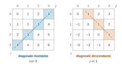
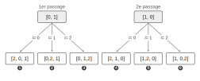
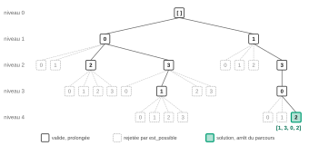
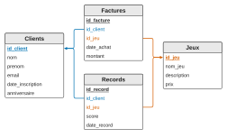

# CCINP TPC — Informatique 2026 · Corrigé brut

*Corrigé rédigé par IA, non officiel. Signalez toute erreur.*

Épreuve TPC5IN, 3 heures, calculatrice interdite. Code en Python (Partie I) et en SQL (Partie II). Les questions Q2, Q5, Q12, Q16, Q22 et Q23 se rédigent dans les cadres du Document Réponse (DR) ; les squelettes du DR sont reproduits et complétés ci-dessous.

Notations : la case de la ligne $i$ et de la colonne $j$ est notée $(i, j)$. Lignes et colonnes sont numérotées à partir de $0$, les lignes de haut en bas et les colonnes de gauche à droite.

## Partie I — Des algorithmes pour résoudre le problème des n reines

### I.1 — Introduction

#### Q1

Dans la configuration perdante de la figure 4, les reines occupent les cases $(0,0),\ (1,2),\ (2,3),\ (3,1)$.

Il y a une reine par ligne et les colonnes $0, 2, 3, 1$ sont distinctes.

Mais les reines $(1,2)$ et $(2,3)$ ont le même écart de lignes et de colonnes :

$$\begin{aligned}
2 - 1 &= 1 \quad \text{(lignes)} \\
3 - 2 &= 1 \quad \text{(colonnes)}
\end{aligned}$$

Elles sont donc sur la même diagonale descendante (et adjacentes) : la reine de la ligne 1 contrôle la case de la reine de la ligne 2. **La configuration perdante place deux reines sur une même diagonale descendante : elle ne respecte pas la consigne.**

#### Q2

On lit chaque ligne de haut en bas et on note la colonne de sa reine :

$$\boxed{\begin{aligned}
&\text{gagnante : } L = [2, 0, 3, 1] \\
&\text{perdante : } L = [0, 2, 3, 1]
\end{aligned}}$$

Contrôle : pour la perdante, les $L[i] - i$ valent $0, 1, 1, -2$ ; la valeur $1$ répétée retrouve le conflit de Q1.

### I.2 — Mise en place d'un affichage

#### Q3

```python
def ligne(n):
    """Renvoie une liste de n zéros."""
    return [0] * n
```

`ligne(5)` renvoie `[0, 0, 0, 0, 0]` (et `ligne(0)` renvoie `[]`).

#### Q4

Chaque appel à `ligne(n)` crée une liste neuve, donc les $n$ sous-listes sont distinctes en mémoire. L'écriture `[[0] * n] * n` est exclue : elle répète $n$ fois **la même** liste, et modifier `G[0][0]` modifierait toutes les lignes.

```python
def grille(n):
    """Renvoie n listes distinctes contenant chacune n zéros."""
    G = []
    for i in range(n):
        G.append(ligne(n))   # nouvelle liste à chaque tour
    return G
```

#### Q5

Squelette du DR complété : on écrit directement le $1$ à sa place, sans parcourir toutes les cases.

```python
def remplir(L):
    # On récupère la taille de L
    n = len(L)
    # On crée la liste de listes G
    G = grille(n)
    # On remplit G à l'aide de L
    for i in range(n):
        G[i][L[i]] = 1      # la reine de la ligne i est en colonne L[i]
    return G
```

La boucle de remplissage fait `len(L)` tours de coût constant : elle est en $O(\texttt{len(L)})$, contre $O(n^2)$ pour une double boucle testant `L[i] == j`.

(La création de la grille par `grille(n)` reste en $O(n^2)$, puisqu'il y a $n^2$ cases à créer.) `remplir([1, 3, 0, 2])` renvoie bien `[[0, 1, 0, 0], [0, 0, 0, 1], [1, 0, 0, 0], [0, 0, 1, 0]]`.

#### Q6

```python
def affiche(G):
    """Affiche la grille G ligne par ligne ; ne renvoie rien."""
    for rangee in G:
        print(rangee)
```

La variable de boucle n'est pas appelée `ligne`, pour ne pas masquer la fonction de Q3. Sur `remplir([1, 3, 0, 2])`, on obtient les quatre lignes `[0, 1, 0, 0]`, `[0, 0, 0, 1]`, `[1, 0, 0, 0]`, `[0, 0, 1, 0]`.

### I.3 — Tester si une configuration est valide

#### Q7

La reine de la ligne $i$ est en case $(i, L[i])$ ; le codage met d'office une seule reine par ligne.

- **(a)** Les $L[i]$ sont les colonnes occupées : **(a) traduit qu'il y a au plus une reine par colonne.**
- **(b) et (c)** Sur une diagonale montante, quand on descend d'une ligne on recule d'une colonne : $i + j$ y est constant. Sur une diagonale descendante, quand on descend d'une ligne on avance d'une colonne : $j - i$ y est constant. Donc **(b) traduit qu'il y a au plus une reine par diagonale montante, et (c) au plus une reine par diagonale descendante.** Par exemple, $(0,3)$ et $(1,2)$ sont sur une même montante et $0 + 3 = 1 + 2$.




Avec (d) (exactement $n$ reines), ces conditions expriment que deux reines ne se contrôlent jamais.

#### Q8

```python
def tous_distincts(L):
    """True si les éléments de L sont deux à deux distincts, False sinon."""
    presents = dict()
    for x in L:
        if x in presents:       # x déjà rencontré : doublon
            return False
        presents[x] = True
    return True                 # parcours complet sans doublon
```

Invariant : au début de chaque tour, les clés de `presents` sont exactement les éléments déjà parcourus, et ceux-ci sont deux à deux distincts. Le `return True` final est donc correct. Chaque tour coûte $O(1)$ (test d'appartenance et insertion dans un dictionnaire, annexe 2) : la fonction est en $O(n)$ pour $n = \texttt{len(L)}$.

#### Q9

Le code de l'étudiant comporte trois erreurs :

- ligne 3 : `range(i, n)` autorise $j = i$, et le test `L[i] == L[i]` est toujours vrai ; il faut `range(i+1, n)` ;
- ligne 5 : deux éléments égaux signifient « pas tous distincts », il faut `return False` ;
- ligne 6 : sans doublon, il faut `return True`.

En l'état, la fonction renvoie `True` pour toute liste non vide et `False` pour la liste vide.

```python
def tous_distincts2(L):
    n = len(L)
    for i in range(n):
        for j in range(i+1, n):
            if L[i] == L[j]:
                return False
    return True
```

**Complexités dans le pire des cas** (liste sans doublon, donc sans sortie anticipée) :

- `tous_distincts` : $n$ tours, chacun formé d'un test `x in presents` et d'une insertion, en $O(1)$ d'après l'annexe 2, soit $O(n)$ ;
- `tous_distincts2` : le nombre de comparaisons est $\displaystyle\sum_{i=0}^{n-1}(n-1-i) = \frac{n(n-1)}{2}$, chacune en $O(1)$, soit $O(n^2)$.

$$\boxed{\begin{aligned}
&\texttt{tous\_distincts} : O(n) \\
&\texttt{tous\_distincts2} : O(n^2)
\end{aligned}}$$

#### Q10

```python
def est_possible(L):
    """True si L vérifie les conditions (a), (b) et (c)."""
    sommes = []
    differences = []
    for i in range(len(L)):
        sommes.append(L[i] + i)
        differences.append(L[i] - i)
    return (tous_distincts(L) and tous_distincts(sommes)
            and tous_distincts(differences))
```

Le coût est en $O(n)$. La fonction accepte des listes de longueur quelconque (elle servira en I.7 sur des configurations partielles).

`est_possible([2, 4, 1, 7, 0, 6, 3, 5])` renvoie `True` ; pour `[3, 4, 1, 7, 0, 6, 2, 5]`, les sommes $3, 5, 3, 10, 4, 11, 8, 12$ contiennent deux fois $3$ : la fonction renvoie `False`.

#### Q11

```python
def est_solution(L, n):
    """True si L vérifie (a), (b), (c) et (d)."""
    return len(L) == n and est_possible(L)
```

`est_solution([2, 0, 3, 1], 4)` renvoie `True`, `est_solution([0, 2, 3, 1], 4)` renvoie `False`.

### I.4 — Une première approche par recherche aléatoire

#### Q12

Les trois cadres du DR, avec l'appel imposé :

```python
# Méthode 1
import random as rd
rd.sample(L, len(L))

# Méthode 2
from random import sample
sample(L, len(L))

# Méthode 3
import random
random.sample(L, len(L))
```

La suite du sujet utilise la méthode 2 : `sample` s'appelle sans préfixe.

#### Q13

```python
from random import sample

def recherche_aleatoire(n, N):
    """Au plus N tirages de permutations de [0, ..., n-1] ;
    renvoie la première solution trouvée, ou [] en cas d'échec."""
    L = [i for i in range(n)]
    for essai in range(N):
        P = sample(L, len(L))       # permutation aléatoire de L
        if est_solution(P, n):
            return P                # arrêt dès qu'une solution est trouvée
    return []
```

Chaque permutation vérifie d'office (a) et (d) ; seules les diagonales sont réellement testées. Coût dans le pire des cas : $O(nN)$.

### I.5 — Déterminer toutes les permutations de L = [0, 1, …, n-1]

#### Q14

```python
def insertion(x, L, i):
    """Nouvelle liste : L avec x inséré à l'indice i (0 <= i <= len(L))."""
    M = []
    for k in range(i):              # termes d'indices 0 à i-1
        M.append(L[k])
    M.append(x)                     # x à la position i
    for k in range(i, len(L)):      # termes d'indices i à len(L)-1
        M.append(L[k])
    return M
```

`L` n'est pas modifiée. `insertion(5, [2, 3, 6, 4], 1)` donne `[2, 5, 3, 6, 4]` et `insertion(5, [2, 3, 6, 4], 4)` donne `[2, 3, 6, 4, 5]`.

#### Q15

À l'issue du premier passage dans la boucle externe (`l1 = [0, 1]`), $2$ a été inséré aux positions $0, 1, 2$ :

$$\boxed{P = [[2, 0, 1], [0, 2, 1], [0, 1, 2]]}$$

Après l'exécution complète (second passage avec `l1 = [1, 0]`) :

$$\boxed{P = [[2, 0, 1], [0, 2, 1], [0, 1, 2], [2, 1, 0], [1, 2, 0], [1, 0, 2]]}$$

**Ce code part des deux permutations de $\{0, 1\}$ et insère la nouvelle valeur $v = 2$ à chacune des $v + 1 = 3$ positions possibles.**

**Il produit ainsi toutes les permutations de $\{0, 1, 2\}$, chacune une seule fois.** Elles sont au nombre de

$$\begin{aligned}
2 \times 3 &= 6 \\
&= 3!
\end{aligned}$$

Une permutation de $\{0, 1, 2\}$ est en effet déterminée par la position où figure $2$, et par la permutation de $\{0, 1\}$ qui reste quand on le retire.




#### Q16

Squelette du DR complété : à chaque tour, `L` contient les permutations de $\{0, \dots, v-1\}$ et on construit dans `P` celles de $\{0, \dots, v\}$, comme en Q15.

```python
def permutations(n) :
    L = [[0]]
    for v in range(1, n) :
        P = []
        for l1 in L :
            for i in range(v+1) :
                P.append(insertion(v, l1, i))
        L = P
    return L
```

Invariant : au début du tour d'indice $v$, `L` contient exactement une fois chaque permutation de $\{0, \dots, v-1\}$. C'est vrai pour $v = 1$ avec `[[0]]`.

Soit $\sigma$ une permutation de $\{0, \dots, v\}$. Notons $i$ la position de $v$ dans $\sigma$.

Retirer cette valeur donne une liste $s$, qui est une permutation de $\{0, \dots, v-1\}$.

Alors $\sigma$ s'écrit `insertion(v, s, i)`, et ce couple `(s, i)` est le seul qui convienne. Donc `P` contient chaque permutation de $\{0, \dots, v\}$ exactement une fois.

À la fin, `L` contient les $n!$ permutations de $\{0, \dots, n-1\}$. On ne construit pas la nouvelle génération dans la liste en cours de parcours : d'où la liste auxiliaire `P`.

`permutations(3)` renvoie `[[2, 1, 0], [1, 2, 0], [1, 0, 2], [2, 0, 1], [0, 2, 1], [0, 1, 2]]`.

#### Q17

```python
def configurations(n):
    """Liste de toutes les solutions du problème des n reines."""
    C = []
    for p in permutations(n):
        if est_solution(p, n):
            C.append(p)
    return C
```

Toute solution est une permutation de $\{0, \dots, n-1\}$, d'après (a) et (d) : le filtrage n'en perd aucune.

On retrouve `len(configurations(5)) == 10` et `len(configurations(8)) == 92`. Coût : $n!$ tests en $O(n)$, soit $O(n \cdot n!)$.

### I.6 — Classer les configurations similaires

#### Q18

Lecture de la figure 6, à partir de $L = [2, 4, 1, 3, 0]$ :

$$\boxed{\begin{aligned}
L1 &= [0, 3, 1, 4, 2] \\
L2 &= [0, 2, 4, 1, 3]
\end{aligned}}$$

La symétrie horizontale (d'axe horizontal) échange les lignes $i$ et $n - 1 - i$ sans changer les colonnes. La reine $(i, L[i])$ va donc en $(n-1-i, L[i])$, d'où

$$\boxed{L1[i] = L[n-1-i] \text{ pour tout } i}$$

**La liste de la symétrie horizontale est la liste $L$ lue à l'envers.** Contrôle : $[2, 4, 1, 3, 0]$ renversée donne $[0, 3, 1, 4, 2]$. De même, la règle de Q20 appliquée à $L$ redonne $L2$.

#### Q19

```python
def symetrie(L):
    """Configuration obtenue par symétrie d'axe horizontal."""
    n = len(L)
    M = []
    for i in range(n):
        M.append(L[n-1-i])      # indices n-1, n-2, ..., 0
    return M
```

`symetrie([1, 0, 2])` renvoie `[2, 0, 1]`. Coût $O(n)$ ; aucun indice négatif ni outil interdit.

#### Q20

La reine $(i, L[i])$ arrive en ligne $L[i]$, colonne $n - 1 - i$. La liste image $M$ vérifie donc

$$M[L[i]] = n - 1 - i.$$

Les lignes d'arrivée ne sont pas produites dans l'ordre, donc on crée d'abord une liste de taille $n$ et on remplit chaque case à sa place.

```python
def rotation(L):
    """Configuration obtenue par rotation d'un quart de tour vers la droite."""
    n = len(L)
    M = ligne(n)                # liste de n zéros
    for i in range(n):
        M[L[i]] = n - 1 - i
    return M
```

Comme $L$ est une permutation de $\{0, \dots, n-1\}$, chaque case de $M$ est écrite exactement une fois.

`rotation([2, 5, 3, 1, 7, 4, 6, 0])` renvoie `[0, 4, 7, 5, 2, 6, 1, 3]`. Par exemple, $L[7] = 0$ donne

$$\begin{aligned}
M[0] &= 8 - 1 - 7 \\
&= 0.
\end{aligned}$$

#### Q21

**Ligne 1.** `C = configurations(n)` calcule (fonction de Q17) la liste de toutes les solutions du problème des $n$ reines, que la fonction va classer.

**Type.** `partition(n)` renvoie une **liste**.

**Structure.** C'est une liste de listes de listes d'entiers :

- chaque élément `elt` de `P` est une **classe** : une liste non vide de configurations deux à deux similaires ;
- chaque configuration est une liste de $n$ entiers de $\{0, \dots, n-1\}$ ;
- `elt[0]`, la première configuration rencontrée de la classe, en est le représentant ;
- les classes sont disjointes et leur réunion est l'ensemble des solutions : `P` est une partition de `C`.

**Fonctionnement.** La fonction parcourt les solutions une à une. Pour chaque solution `c`, elle compare `c` au représentant `elt[0]` de chaque classe déjà formée. Si `c` est similaire à l'un d'eux, `c` est ajoutée à cette classe et `test` passe à `True`. Si, après examen de toutes les classes, `test` vaut encore `False`, `c` n'est similaire à aucune et fonde une nouvelle classe `[c]`. La similarité étant une relation d'équivalence, comparer au seul représentant suffit, et `c` ne peut être similaire qu'à un seul représentant. Par exemple, pour $n = 5$ on obtient deux classes, de 8 et de 2 configurations.

### I.7 — Des graphes pour aller plus vite et plus loin

#### Q22

Squelette du DR complété. Un sommet du graphe est une configuration partielle `L` (reines des lignes $0$ à `len(L) - 1`) ; ses fils sont les `L + [i]`.

```python
def explore(L, n):
    if not est_possible(L):
        return -1                  # grille invalide : on revient en arrière
    if len(L) == n:                 # si fin de recherche victorieuse
        return L
    for i in range(n):
        res = explore(L + [i], n)
        if res != -1:              # si une solution a été trouvée
            return res
    return -1                       # aucun fils ne mène à une solution

def resout_graphe(n):
    rep = explore([], n)
    return rep
```

Le test de validité vient avant le test de longueur : une liste de longueur $n$ n'est renvoyée que si elle vérifie (a), (b), (c), donc elle vérifie aussi (d) et c'est une solution. Une configuration invalide n'est jamais prolongée (aucune solution ne peut prolonger une configuration où deux reines se contrôlent) : c'est l'élagage qui évite de visiter tout le graphe. Le `return res` arrête le parcours dès la première solution ; le dernier `return -1` signale l'échec à l'appelant, qui essaie la colonne suivante. La fonction termine car $n - \texttt{len(L)}$ décroît strictement à chaque appel récursif. On obtient `resout_graphe(4) == [1, 3, 0, 2]` et `resout_graphe(8) == [0, 4, 7, 5, 2, 6, 1, 3]`.




#### Q23

Squelette du DR complété : chaque appel renvoie le **nombre** de solutions qui prolongent `L`, et le parcours ne s'arrête plus à la première.

```python
def explore2(L, n):
    if not est_possible(L):
        return 0                           # aucune solution ne prolonge L
    if len(L) == n:
        return 1                           # L est une solution
    nb_sol = 0
    for i in range(n):
        nb_sol = nb_sol + explore2(L + [i], n)
    return nb_sol

def compte(n):
    rep = explore2([], n)
    return rep
```

Les solutions qui prolongent une configuration partielle valide `L` (de longueur $< n$) se répartissent, sans recouvrement, selon la colonne `i` de la reine de la ligne `len(L)` : leur nombre est la somme des nombres de solutions prolongeant les `L + [i]`. Par récurrence sur $n - \texttt{len(L)}$, `explore2(L, n)` renvoie donc le nombre de solutions prolongeant `L`. On retrouve `compte(4) == 2`, `compte(5) == 10`, `compte(6) == 4` et `compte(8) == 92`.

## Partie II — Base de données d'un serveur de jeu en ligne

#### Q24

L'attribut `anniversaire` est au format `'JJ-MM'` : le 3 juillet s'écrit `'03-07'`.

```sql
SELECT nom, prenom, email
FROM Clients
WHERE anniversaire = '03-07';
```

#### Q25



Le nom et le prénom sont dans `Clients`, les dates d'achat dans `Factures` : jointure sur `id_client`.

```sql
SELECT Clients.nom, Clients.prenom, Factures.date_achat
FROM Clients
JOIN Factures ON Clients.id_client = Factures.id_client
WHERE Clients.email = 'myriam.sarr@ccinp.edu';
```

Une ligne est renvoyée par achat de ce client.

#### Q26

On regroupe les factures par client (sur la clé primaire, pour ne pas fusionner deux homonymes) et on somme les montants.

```sql
SELECT Clients.nom, Clients.email, SUM(Factures.montant) AS total
FROM Clients
JOIN Factures ON Clients.id_client = Factures.id_client
GROUP BY Clients.id_client, Clients.nom, Clients.email;
```

Avec cette jointure interne, un client qui n'a fait aucun achat n'apparaît pas dans le résultat (son total serait nul). On peut ajouter `ORDER BY total DESC` pour classer les meilleurs clients en tête.

#### Q27

```sql
SELECT Jeux.nom_jeu, MAX(Records.score) AS meilleur_score
FROM Jeux
JOIN Records ON Jeux.id_jeu = Records.id_jeu
GROUP BY Jeux.id_jeu, Jeux.nom_jeu;
```

On obtient une ligne par jeu ayant au moins un record, avec son meilleur score. Un `ORDER BY score DESC LIMIT 1` ne conviendrait pas : il donnerait le meilleur score tous jeux confondus.

**FIN**
