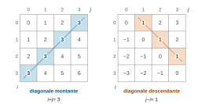
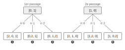
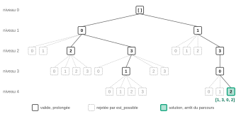
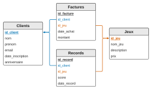

# CCINP TPC — Informatique 2026 · Corrigé guidé

*Corrigé rédigé par IA, non officiel. Signalez toute erreur.*

## Présentation du sujet

**Thème.** « Autour de jeux ». Épreuve TPC5IN, **3 heures, calculatrice interdite**, Python et SQL. Les réponses se rédigent sur un Document Réponse (DR) de 11 pages. Pour six questions (Q2, Q5, Q12, Q16, Q22, Q23), le DR fournit un cadre structuré ou un code à trous qu'il faut compléter tel quel. Ce sujet TPC est différent de ceux de PC et de PSI.

**Deux parties indépendantes, 27 questions.**

- **Partie I (Q1–Q23) — Le problème des $n$ reines.** On cherche à placer $n$ reines sur une grille $n \times n$ sans que deux d'entre elles partagent une ligne, une colonne ou une diagonale. Une configuration est codée par une liste `L`, où `L[i]` est la colonne de la reine de la ligne `i`. Le sujet progresse en sept sous-parties :
  - I.1 (Q1–Q2) lecture de figures et codage ;
  - I.2 (Q3–Q6) fonctions de base sur les listes et affichage d'une grille ;
  - I.3 (Q7–Q11) test de validité : interprétation des conditions, détection de doublons par dictionnaire, correction d'un code fautif, complexités ;
  - I.4 (Q12–Q13) importation de `sample` et recherche aléatoire ;
  - I.5 (Q14–Q17) génération de toutes les permutations par insertions successives, puis filtrage ;
  - I.6 (Q18–Q21) symétrie et rotation d'une configuration, lecture d'une fonction de classement ;
  - I.7 (Q22–Q23) parcours en profondeur récursif avec retour sur trace (backtracking), pour trouver une solution puis pour les compter.
- **Partie II (Q24–Q27) — Base de données d'un site de jeux.** Quatre requêtes SQL sur quatre tables (`Clients`, `Jeux`, `Factures`, `Records`) : sélection simple, jointure, agrégats `SUM` et `MAX` avec `GROUP BY`.

**Notions du programme mobilisées.** Listes (création, `append`, accès par indice, copie, caractère mutable), dictionnaires utilisés comme ensembles, importation de modules, complexité dans le pire des cas, invariant de boucle, récursivité et terminaison, parcours en profondeur d'un graphe implicite, SQL (projection, sélection, jointure interne, agrégation).

**Difficulté et longueur.** Sujet de difficulté modérée et très guidé, avec beaucoup de questions courtes. Les points se perdent sur des détails : un sens de lecture inversé (Q2), des listes non distinctes (Q4), une erreur oubliée dans le code fautif (Q9), un échange entre sommes et différences (Q7, Q10), l'ordre exact demandé (Q15), le sens de la symétrie « horizontale » (Q18), la confusion entre lignes de départ et d'arrivée (Q20).

**Questions à ne pas laisser passer.** Q1–Q4, Q6, Q8, Q11, Q12, Q14, Q17, Q19, et toute la partie II (Q24–Q27), courte et indépendante.

**Gestion du temps.** Compter environ 20 min pour I.1–I.2, 35 min pour I.3, 15 min pour I.4, 35 min pour I.5, 30 min pour I.6, 25 min pour I.7 et 20 min pour la partie II. L'énoncé autorise à utiliser les fonctions des questions précédentes même non écrites : une question bloquante ne doit pas arrêter la suite.

Notation : la case de la ligne $i$ et de la colonne $j$ est notée $(i, j)$. Lignes et colonnes sont numérotées à partir de $0$, les lignes de haut en bas, les colonnes de gauche à droite.

## Partie I — Des algorithmes pour résoudre le problème des n reines

On construit pas à pas les outils (affichage, test de validité), puis trois méthodes de résolution de coût très différent : tirage aléatoire, énumération exhaustive des permutations, parcours de graphe avec élagage.

### Question 1

> [!INDICATION]
> Relever les quatre cases occupées. Lignes et colonnes se vérifient d'un coup d'œil : où chercher le conflit ?

> [!INDICATION]
> Deux cases sont sur une même diagonale quand l'écart de lignes égale l'écart de colonnes, en valeur absolue.

#### Solution

Dans la configuration perdante, les reines occupent $(0,0),\ (1,2),\ (2,3),\ (3,1)$.

Il y a une reine par ligne, et les colonnes $0, 2, 3, 1$ sont distinctes.

En revanche, les reines $(1,2)$ et $(2,3)$ ont le même écart de lignes et de colonnes :

$$\begin{aligned}
2 - 1 &= 1 \quad \text{(lignes)} \\
3 - 2 &= 1 \quad \text{(colonnes)}
\end{aligned}$$

Elles sont donc sur la même **diagonale descendante**, et même adjacentes. **La reine de la ligne 1 contrôle celle de la ligne 2 : la configuration ne respecte pas la consigne.**

> [!JURY]
> Une justification doit être précise : nommer les deux reines en conflit et dire sur quelle diagonale elles se trouvent. Un seul conflit suffit à conclure.

### Question 2

> [!INDICATION]
> Contrôler son sens de lecture sur l'exemple de la figure 5, codé `[2, 4, 1, 3, 0]` : `L[i]` est la colonne de la reine de la ligne `i`.

#### Solution

$$\boxed{\begin{aligned}
&\text{gagnante : } L = [2, 0, 3, 1] \\
&\text{perdante : } L = [0, 2, 3, 1]
\end{aligned}}$$

Contrôle : pour la perdante, les $L[i] - i$ valent $0, 1, 1, -2$. La valeur $1$ répétée retrouve le conflit de Q1.

> [!PIEGE]
> Inverser lignes et colonnes, ou numéroter à partir de $1$ : `[3, 1, 4, 2]` trahit un décalage d'indice.

## Partie I.2 — Mise en place d'un affichage

Trois fonctions courtes. Le point technique est le caractère mutable des listes : une grille doit être faite de listes distinctes.

### Question 3

> [!INDICATION]
> Le programme permet de créer une liste par répétition d'une liste à un élément, ou par ajouts successifs.

#### Solution

```python
def ligne(n):
    """Renvoie une liste de n zéros."""
    return [0] * n
```

Variante par ajouts successifs : partir de `L = []` et faire `n` fois `L.append(0)`. `ligne(5)` renvoie `[0, 0, 0, 0, 0]`.

> [!PIEGE]
> `[0 * n]` vaut `[0]` : la répétition porte sur la liste, pas sur son contenu.

### Question 4

> [!INDICATION]
> Pourquoi l'énoncé insiste-t-il sur « listes distinctes » ? Que se passe-t-il si plusieurs cases de `G` désignent le même objet liste ?

> [!INDICATION]
> Il faut créer une nouvelle liste à chaque tour de boucle.

#### Solution

```python
def grille(n):
    """Renvoie n listes distinctes contenant chacune n zéros."""
    G = []
    for i in range(n):
        G.append(ligne(n))   # nouvelle liste à chaque appel
    return G
```

Chaque appel à `ligne(n)` crée une liste neuve : les $n$ sous-listes sont distinctes en mémoire. `grille(3)` renvoie `[[0, 0, 0], [0, 0, 0], [0, 0, 0]]`.

> [!PIEGE]
> `[[0] * n] * n` s'affiche pareil mais répète $n$ fois **la même** liste : `G[0][0] = 1` mettrait un $1$ en tête de toutes les lignes. La question Q5 écrit justement dans `G[i][j]`.

> [!METHODE]
> Pour une liste de listes, créer chaque sous-liste dans une boucle (ou par compréhension `[ligne(n) for i in range(n)]`), jamais par répétition `*` d'une liste.

### Question 5

> [!INDICATION]
> Le DR impose le squelette : taille, création de la grille, boucle sur `i`, renvoi. Que faut-il écrire dans la boucle ?

> [!INDICATION]
> Pour être linéaire, ne pas parcourir toutes les colonnes : on connaît directement la colonne de la reine de la ligne `i`.

#### Solution

```python
def remplir(L):
    # On récupère la taille de L
    n = len(L)
    # On crée la liste de listes G
    G = grille(n)
    # On remplit G à l'aide de L
    for i in range(n):
        G[i][L[i]] = 1      # reine de la ligne i en colonne L[i]
    return G
```

La boucle fait `len(L)` tours de coût constant : le remplissage est en $O(\texttt{len(L)})$, au lieu de $O(n^2)$ pour une double boucle testant `L[i] == j`.

La création de la grille reste en $O(n^2)$, puisqu'il faut bien créer $n^2$ cases.

`remplir([1, 3, 0, 2])` renvoie `[[0, 1, 0, 0], [0, 0, 0, 1], [1, 0, 0, 0], [0, 0, 1, 0]]`.

> [!METHODE]
> Pour annoncer une complexité, dire précisément ce que l'on compte : ici, le remplissage est linéaire, mais pas la création de la grille.

### Question 6

> [!INDICATION]
> « Ne renvoie rien mais affiche » : une boucle de `print`, sans `return`.

#### Solution

```python
def affiche(G):
    """Affiche la grille G ligne par ligne ; ne renvoie rien."""
    for rangee in G:
        print(rangee)
```

Sur `remplir([1, 3, 0, 2])`, on obtient les lignes `[0, 1, 0, 0]`, `[0, 0, 0, 1]`, `[1, 0, 0, 0]`, `[0, 0, 1, 0]`, comme dans l'énoncé.

> [!PIEGE]
> Appeler la variable de boucle `ligne` masquerait la fonction `ligne` de Q3 dans le corps de la fonction. C'est sans conséquence ici, mais c'est une mauvaise habitude.

## Partie I.3 — Tester si une configuration est valide

On traduit les contraintes géométriques en tests d'unicité, puis on programme ces tests efficacement grâce à un dictionnaire.

### Question 7

> [!INDICATION]
> Quelle contrainte le codage par liste rend-il automatique ?

> [!INDICATION]
> Sur une diagonale, quand on descend d'une ligne, de combien varie la colonne ? En déduire une quantité constante le long de chaque famille de diagonales.

#### Solution

La reine de la ligne $i$ occupe la case $(i, L[i])$ : le codage impose d'office une seule reine par ligne.

- **(a)** Les $L[i]$ sont les colonnes occupées. **(a) traduit qu'il y a au plus une reine par colonne.**
- **(b) et (c)** Sur une diagonale montante, descendre d'une ligne fait reculer d'une colonne : $i + j$ y est constant. Sur une diagonale descendante, descendre d'une ligne fait avancer d'une colonne : $j - i$ y est constant. **(b) traduit qu'il y a au plus une reine par diagonale montante, (c) au plus une par diagonale descendante.**

Exemple : $(0,3)$ et $(1,2)$ sont sur une même diagonale montante, et $0 + 3 = 1 + 2$.




> [!PIEGE]
> Échanger (b) et (c). Avec des lignes numérotées de haut en bas, c'est la **somme** qui est constante sur une diagonale montante. Le vérifier sur deux cases de la figure 1.

> [!JURY]
> Une explication doit relier chaque condition arithmétique à la contrainte qu'elle traduit sur la grille. Paraphraser la condition sans la traduire ne répond pas à la question.

### Question 8

> [!INDICATION]
> L'algorithme est imposé : seule compte la présence de la clé, la valeur associée n'a pas d'importance.

> [!INDICATION]
> On quitte la fonction dès qu'on trouve un doublon : `return` dans la boucle.

#### Solution

```python
def tous_distincts(L):
    """True si les éléments de L sont deux à deux distincts, False sinon."""
    presents = dict()
    for x in L:
        if x in presents:       # x déjà rencontré : doublon
            return False
        presents[x] = True
    return True                 # parcours complet sans doublon
```

**Invariant :** au début de chaque tour, les clés de `presents` sont exactement les éléments déjà parcourus, et ceux-ci sont deux à deux distincts. Si `x` est déjà une clé, il y a un doublon. Sinon, l'ajout de `x` rétablit l'invariant. En fin de boucle, la liste ne contient donc pas de doublon. Chaque tour coûte $O(1)$ (annexe 2), soit $O(n)$ au total.

> [!PIEGE]
> Utiliser une liste `presents` : le test `x in presents` coûte alors $O(\texttt{len})$ et la fonction devient quadratique.

### Question 9

> [!INDICATION]
> Dérouler le code de l'étudiant sur une petite liste sans doublon, par exemple `[1, 2]`. Que renvoie-t-il ?

> [!INDICATION]
> Il y a une erreur dans les bornes de la boucle interne et deux erreurs dans les valeurs renvoyées.

> [!INDICATION]
> Pour la complexité, se placer dans le cas où aucun `return` anticipé n'a lieu, et compter les comparaisons.

#### Solution

Erreurs :

- ligne 3 : `range(i, n)` autorise $j = i$, et `L[i] == L[i]` est toujours vrai ; il faut `range(i+1, n)` ;
- ligne 5 : deux éléments égaux signifient « pas tous distincts » : `return False` ;
- ligne 6 : aucune égalité trouvée : `return True`.

Tel quel, le code renvoie `True` pour toute liste non vide et `False` pour la liste vide.

```python
def tous_distincts2(L):
    n = len(L)
    for i in range(n):
        for j in range(i+1, n):
            if L[i] == L[j]:
                return False
    return True
```

**Pire des cas** : une liste sans doublon (aucune sortie anticipée).

- `tous_distincts` : $n$ tours, chacun formé d'un test d'appartenance et d'une insertion dans un dictionnaire, en $O(1)$ d'après l'annexe 2, soit $O(n)$.
- `tous_distincts2` : $\displaystyle\sum_{i=0}^{n-1}(n-1-i) = \frac{n(n-1)}{2}$ comparaisons en $O(1)$, soit $O(n^2)$.

$$\boxed{\begin{aligned}
&\texttt{tous\_distincts} : O(n) \\
&\texttt{tous\_distincts2} : O(n^2)
\end{aligned}}$$

> [!PIEGE]
> Corriger seulement l'inversion des booléens : avec `range(i, n)`, la fonction renverrait `False` pour toute liste non vide. L'énoncé annonce « plusieurs erreurs ».

> [!METHODE]
> Une complexité « dans le pire des cas » commence par dire quel est ce pire cas. Ici, c'est l'absence de doublon.

### Question 10

> [!INDICATION]
> Les trois conditions sont trois tests d'unicité : sur quelles listes ?

> [!INDICATION]
> Construire en un seul parcours la liste des sommes et celle des différences.

#### Solution

```python
def est_possible(L):
    """True si L vérifie les conditions (a), (b) et (c)."""
    sommes = []
    differences = []
    for i in range(len(L)):
        sommes.append(L[i] + i)
        differences.append(L[i] - i)
    return (tous_distincts(L) and tous_distincts(sommes)
            and tous_distincts(differences))
```

Coût $O(n)$. La fonction ne suppose rien sur la longueur de `L` : elle servira en I.7 pour des configurations partielles.

Sur `[3, 4, 1, 7, 0, 6, 2, 5]`, les sommes $3, 5, 3, 10, 4, 11, 8, 12$ contiennent deux fois $3$. Les reines $(0,3)$ et $(2,1)$ sont donc sur une même diagonale montante, et la fonction renvoie `False`. Le premier exemple renvoie `True`.

> [!PIEGE]
> Prendre la valeur absolue `abs(L[i] - i)` : on confondrait des diagonales descendantes différentes, et des configurations valides seraient rejetées.

### Question 11

> [!INDICATION]
> Il ne reste qu'à ajouter la condition (d) à la question précédente.

#### Solution

```python
def est_solution(L, n):
    """True si L vérifie (a), (b), (c) et (d)."""
    return len(L) == n and est_possible(L)
```

`est_solution([2, 0, 3, 1], 4)` renvoie `True` et `est_solution([0, 2, 3, 1], 4)` renvoie `False`.

> [!METHODE]
> Séparer validité partielle (`est_possible`, aucune paire de reines en prise) et validité complète (`est_solution`, en plus $n$ reines posées). La sous-partie I.7 repose sur cette distinction.

## Partie I.4 — Une première approche par recherche aléatoire

Importation d'une fonction de bibliothèque, puis un algorithme de type « tirer jusqu'à trouver ».

### Question 12

> [!INDICATION]
> Le DR donne l'appel attendu dans chaque cadre : il faut écrire l'importation compatible avec cet appel.

> [!INDICATION]
> Le programme connaît trois formes : `import module`, `import module as alias`, `from module import f`.

#### Solution

```python
# Méthode 1
import random as rd
rd.sample(L, len(L))

# Méthode 2
from random import sample
sample(L, len(L))

# Méthode 3
import random
random.sample(L, len(L))
```

La suite utilise la méthode 2, d'où l'appel sans préfixe `sample(L, len(L))`.

> [!PIEGE]
> Mélanger les formes : avec `import random`, l'appel `sample(...)` lève une `NameError`, et avec `from random import sample`, `random.sample(...)` aussi.

### Question 13

> [!INDICATION]
> Une boucle d'au plus `N` tours, avec sortie anticipée dès qu'un tirage convient.

> [!INDICATION]
> Que doit-on renvoyer en cas d'échec ? Lire l'énoncé, ce n'est pas la même convention qu'en I.7.

#### Solution

```python
from random import sample

def recherche_aleatoire(n, N):
    """Au plus N tirages de permutations de [0, ..., n-1] ;
    renvoie la première solution trouvée, ou [] en cas d'échec."""
    L = [i for i in range(n)]
    for essai in range(N):
        P = sample(L, len(L))       # permutation aléatoire de L
        if est_solution(P, n):
            return P                # arrêt dès qu'une solution est trouvée
    return []
```

Une permutation vérifie d'office (a) et (d) : seules les diagonales sont vraiment testées. Coût dans le pire des cas : $O(nN)$. Les tirages sont indépendants, donc une même permutation peut sortir plusieurs fois : un échec ne prouve pas l'absence de solution.

## Partie I.5 — Déterminer toutes les permutations de L = [0, 1, …, n-1]

On construit les permutations de $\{0, \dots, v\}$ à partir de celles de $\{0, \dots, v-1\}$ en insérant $v$ à toutes les positions.

### Question 14

> [!INDICATION]
> Construire une nouvelle liste par `append` successifs, en suivant les trois étapes de l'énoncé.

> [!INDICATION]
> Tester le cas limite `i = len(L)`, le second exemple de l'énoncé.

#### Solution

```python
def insertion(x, L, i):
    """Nouvelle liste : L avec x inséré à l'indice i (0 <= i <= len(L))."""
    M = []
    for k in range(i):              # termes d'indices 0 à i-1
        M.append(L[k])
    M.append(x)                     # x à la position i
    for k in range(i, len(L)):      # termes d'indices i à len(L)-1
        M.append(L[k])
    return M
```

`L` n'est pas modifiée. On obtient `[2, 5, 3, 6, 4]` et `[2, 3, 6, 4, 5]` sur les exemples. Pour `i = len(L)`, la seconde boucle ne fait aucun tour et `x` est placé en fin de liste.

> [!PIEGE]
> `L.insert(i, x)` est interdit, et modifierait de plus `L` en place. Or, en Q16, chaque liste source sert pour plusieurs insertions.

### Question 15

> [!INDICATION]
> Dérouler les deux boucles à la main en respectant l'ordre des `append`.

> [!INDICATION]
> Pour « ce que fait le code », dire comment les listes sont construites et pourquoi on obtient exactement les bonnes listes.

#### Solution

Après le premier passage (`l1 = [0, 1]`), $2$ a été inséré aux positions $0, 1, 2$ :

$$\boxed{P = [[2, 0, 1], [0, 2, 1], [0, 1, 2]]}$$

Après le second passage (`l1 = [1, 0]`) :

$$\boxed{P = [[2, 0, 1], [0, 2, 1], [0, 1, 2], [2, 1, 0], [1, 2, 0], [1, 0, 2]]}$$

**Le code part des deux permutations de $\{0, 1\}$ et insère la valeur $v = 2$ à chacune des $3$ positions possibles. Il obtient ainsi toutes les permutations de $\{0, 1, 2\}$, chacune une seule fois.** Elles sont au nombre de

$$\begin{aligned}
2 \times 3 &= 6 \\
&= 3!
\end{aligned}$$

En effet, une permutation de $\{0, 1, 2\}$ est déterminée par la position où figure $2$, et par ce qui reste quand on le retire.




> [!PIEGE]
> Donner les six permutations dans l'ordre lexicographique : l'énoncé demande l'ordre des `append`.

### Question 16

> [!INDICATION]
> Itérer le mécanisme de Q15 : à chaque tour de la boucle sur `v`, `L` contient les permutations de $\{0, \dots, v-1\}$.

> [!INDICATION]
> La nouvelle génération se construit dans `P`, séparément de `L`, qu'on est en train de parcourir.

#### Solution

```python
def permutations(n) :
    L = [[0]]
    for v in range(1, n) :
        P = []
        for l1 in L :
            for i in range(v+1) :
                P.append(insertion(v, l1, i))
        L = P
    return L
```

**Invariant :** au début du tour d'indice $v$, `L` contient exactement une fois chaque permutation de $\{0, \dots, v-1\}$. C'est vrai pour $v = 1$ (`[[0]]`).

Toute permutation $\sigma$ de $\{0, \dots, v\}$ s'écrit de façon unique `insertion(v, s, i)`.

Ici, $i$ est la position de $v$ dans $\sigma$.

La liste `s` est obtenue en retirant $v$ : c'est une permutation de $\{0, \dots, v-1\}$, donc elle est présente dans `L`.

Ainsi `P` contient chaque permutation de $\{0, \dots, v\}$ exactement une fois, et `L = P` rétablit l'invariant.

À la fin, `L` contient les $n!$ permutations de $\{0, \dots, n-1\}$.

`permutations(3)` renvoie `[[2, 1, 0], [1, 2, 0], [1, 0, 2], [2, 0, 1], [0, 2, 1], [0, 1, 2]]`, ordre accepté par l'énoncé.

> [!PIEGE]
> Faire `L.append(...)` pendant le parcours `for l1 in L` : la liste grandit pendant qu'on la parcourt, et la boucle ne termine plus.

> [!METHODE]
> Le compte $v! \times (v+1) = (v+1)!$ ne suffit pas à prouver la correction. Il faut une bijection : chaque permutation est obtenue, et une seule fois.

### Question 17

> [!INDICATION]
> « En déduire » : réutiliser `permutations` et `est_solution`.

> [!INDICATION]
> Pourquoi ne perd-on aucune solution en se limitant aux permutations ?

#### Solution

```python
def configurations(n):
    """Liste de toutes les solutions du problème des n reines."""
    C = []
    for p in permutations(n):
        if est_solution(p, n):
            C.append(p)
    return C
```

Toute solution est une permutation de $\{0, \dots, n-1\}$ (conditions (a) et (d)) : le filtrage n'en perd aucune. On retrouve 10 solutions pour $n = 5$ et 92 pour $n = 8$.

Le coût est de $n!$ tests en $O(n)$, soit $O(n \cdot n!)$, et les $n!$ listes sont gardées en mémoire : la méthode devient impraticable au-delà de $n = 10$ environ, comme l'annonce l'énoncé.

## Partie I.6 — Classer les configurations similaires

Transformations géométriques de la grille traduites sur la liste `L`, puis lecture d'un algorithme de classement.

### Question 18

> [!INDICATION]
> Lire les grilles transformées de la figure 6 ligne par ligne, comme en Q2.

> [!INDICATION]
> Une symétrie d'axe horizontal échange le haut et le bas. Que deviennent la ligne et la colonne d'une reine ?

#### Solution

À partir de $L = [2, 4, 1, 3, 0]$, la figure 6 donne :

$$\boxed{\begin{aligned}
L1 &= [0, 3, 1, 4, 2] \\
L2 &= [0, 2, 4, 1, 3]
\end{aligned}}$$

La symétrie d'axe horizontal échange les lignes $i$ et $n - 1 - i$ et conserve les colonnes. La reine $(i, L[i])$ va donc en $(n-1-i, L[i])$, et l'on a

$$\boxed{L1[i] = L[n-1-i] \text{ pour tout } i}$$

**La liste de la symétrie horizontale est la liste $L$ lue à l'envers.** Contrôle sur l'exemple de Q19 : `[1, 0, 2]` donne `[2, 0, 1]`.

> [!PIEGE]
> Confondre avec la symétrie d'axe vertical, $L1[i] = n - 1 - L[i]$, qui donnerait `[1, 2, 0]` pour `[1, 0, 2]`. La figure et l'exemple de Q19 tranchent.

### Question 19

> [!INDICATION]
> Programmer la formule de Q18 avec `range(n)` et `append`, sans outil de renversement tout fait.

#### Solution

```python
def symetrie(L):
    """Configuration obtenue par symétrie d'axe horizontal."""
    n = len(L)
    M = []
    for i in range(n):
        M.append(L[n-1-i])      # indices n-1, n-2, ..., 0
    return M
```

`symetrie([1, 0, 2])` renvoie `[2, 0, 1]`, en $O(n)$.

> [!PIEGE]
> `L[n-i]` sort de la liste au premier tour ($i = 0$). Les indices utilisés doivent rester dans $\{0, \dots, n-1\}$.

### Question 20

> [!INDICATION]
> La reine de la ligne `i` arrive en ligne `L[i]`. Quelle case de la liste image faut-il donc écrire ?

> [!INDICATION]
> Les lignes d'arrivée ne sont pas obtenues dans l'ordre croissant : créer d'abord une liste de bonne taille.

#### Solution

La reine $(i, L[i])$ arrive en $(L[i], n - 1 - i)$ : la liste image vérifie $M[L[i]] = n - 1 - i$.

```python
def rotation(L):
    """Configuration obtenue par rotation d'un quart de tour vers la droite."""
    n = len(L)
    M = ligne(n)                # liste de n zéros
    for i in range(n):
        M[L[i]] = n - 1 - i
    return M
```

`L` étant une permutation de $\{0, \dots, n-1\}$, chaque case de `M` est écrite exactement une fois.

`rotation([2, 5, 3, 1, 7, 4, 6, 0])` renvoie `[0, 4, 7, 5, 2, 6, 1, 3]`. Par exemple :

- $L[7] = 0$ donne $M[0] = 8 - 1 - 7$, soit $M[0] = 0$ ;
- $L[3] = 1$ donne $M[1] = 8 - 1 - 3$, soit $M[1] = 4$.

> [!PIEGE]
> Écrire `M[i] = n - 1 - L[i]` : c'est la symétrie d'axe vertical, pas une rotation. Sur l'exemple, on aurait $M[0] = 5$ au lieu de $0$.

> [!METHODE]
> Quand une transformation donne l'image de chaque élément à une position calculée, on initialise la liste résultat à la bonne taille puis on affecte par indice, au lieu de faire des `append`.

### Question 21

> [!INDICATION]
> Trois demandes distinctes : le rôle de la ligne 1, le type et la structure du résultat, le fonctionnement. Répondre à chacune.

> [!INDICATION]
> Descendre tous les niveaux d'imbrication : que contient `P`, que contient chaque `elt`, que contient `elt[0]` ?

> [!INDICATION]
> Quand la ligne 9 est-elle exécutée : à chaque comparaison ou après le parcours de toutes les classes ?

#### Solution

**Ligne 1.** `C = configurations(n)` calcule (Q17) la liste de toutes les solutions pour une grille $n \times n$.

**Type.** `partition(n)` renvoie une **liste**.

**Structure.** C'est une liste de listes de listes d'entiers :

- chaque élément `elt` de `P` est une **classe**, c'est-à-dire une liste non vide de configurations deux à deux similaires ;
- chaque configuration est une liste de $n$ entiers de $\{0, \dots, n-1\}$ ;
- `elt[0]`, la première configuration rencontrée de la classe, en est le représentant ;
- les classes sont disjointes et leur réunion est l'ensemble des solutions : `P` est une partition de `C`.

**Fonctionnement.** La fonction parcourt les solutions une à une. Chaque solution `c` est comparée au représentant de chaque classe existante. Si elle est similaire à l'un d'eux, elle rejoint cette classe et `test` passe à `True`. Si, après examen de toutes les classes, `test` vaut encore `False`, `c` n'est similaire à aucune et fonde une nouvelle classe `[c]`. La similarité est une relation d'équivalence : comparer au seul représentant suffit, et `c` ne peut être similaire qu'au représentant d'une seule classe. Pour $n = 5$, on obtient deux classes, de 8 et 2 configurations.

> [!JURY]
> Une description complète d'une structure imbriquée donne chaque niveau d'imbrication et le sens de chacun. Le seul type extérieur ne suffit pas.

## Partie I.7 — Des graphes pour aller plus vite et plus loin

Le graphe des configurations partielles est parcouru en profondeur, récursivement. Une configuration invalide n'est jamais prolongée : c'est l'élagage. Le DR fournit les deux fonctions à trous.

### Question 22

> [!INDICATION]
> Un sommet est une configuration partielle `L` (reines des lignes `0` à `len(L) - 1`), ses fils sont les `L + [i]`. Les trous correspondent aux trois situations listées par l'énoncé.

> [!INDICATION]
> Que renvoyer quand la grille est invalide ? Quand la liste est complète ? Quand aucun fils n'a abouti ?

> [!INDICATION]
> Pourquoi le test de validité est-il placé avant le test de longueur ?

#### Solution

```python
def explore(L, n):
    if not est_possible(L):
        return -1                  # grille invalide : on revient en arrière
    if len(L) == n:                # si fin de recherche victorieuse
        return L
    for i in range(n):
        res = explore(L + [i], n)
        if res != -1:              # si une solution a été trouvée
            return res
    return -1                      # aucun fils ne mène à une solution

def resout_graphe(n):
    rep = explore([], n)
    return rep
```

Trous : `return -1`, `len(L) == n`, `return -1`.

- **Correction.** La liste n'est renvoyée à la deuxième ligne que si elle a passé le test de validité et qu'elle est de longueur $n$ : elle vérifie (a), (b), (c) et (d), c'est une solution. Une configuration invalide ne peut être prolongée en solution : l'abandonner (`return -1`) ne perd rien. Le `return res` fait remonter la première solution trouvée et arrête le parcours. Le dernier `return -1` signale l'échec à l'appelant, qui essaie alors la colonne suivante : c'est le retour sur trace.
- **Terminaison.** $n - \texttt{len(L)}$ est un entier naturel qui diminue de $1$ à chaque appel récursif, et chaque appel ne fait qu'une boucle finie.

On obtient `resout_graphe(4) == [1, 3, 0, 2]` et `resout_graphe(8) == [0, 4, 7, 5, 2, 6, 1, 3]`.




> [!PIEGE]
> Écrire `return explore(L + [i], n)` dans la boucle : le premier échec remonterait comme résultat et la recherche s'arrêterait à la première impasse.

> [!METHODE]
> Schéma du retour sur trace : cas d'échec (élagage), cas de succès, puis essai de chaque choix avec propagation immédiate d'un succès, et échec si aucun choix n'aboutit.

### Question 23

> [!INDICATION]
> Même squelette, mais chaque appel renvoie maintenant un nombre : combien de solutions prolongent `L` ?

> [!INDICATION]
> Que vaut ce nombre pour une configuration invalide ? Pour une solution complète ? Pour un sommet intermédiaire, en fonction de ses fils ?

#### Solution

```python
def explore2(L, n):
    if not est_possible(L):
        return 0                    # aucune solution ne prolonge L
    if len(L) == n:
        return 1                    # L est une solution
    nb_sol = 0
    for i in range(n):
        nb_sol = nb_sol + explore2(L + [i], n)
    return nb_sol

def compte(n):
    rep = explore2([], n)
    return rep
```

Trous : `0`, `len(L) == n`, `explore2(L + [i], n)`, `nb_sol`.

Les solutions qui prolongent une configuration partielle valide `L`, de longueur $< n$, se répartissent sans recouvrement selon la colonne `i` de la reine suivante. Leur nombre est donc la somme des nombres de solutions prolongeant les `L + [i]`. Par récurrence sur $n - \texttt{len(L)}$, `explore2(L, n)` renvoie bien ce nombre. On retrouve `compte(5) == 10` et `compte(8) == 92`, ainsi que `compte(4) == 2` et `compte(6) == 4`.

> [!PIEGE]
> Garder un `return` anticipé dans la boucle, ou oublier d'ajouter l'appel récursif à `nb_sol` : on ne compterait qu'une solution, ou aucune.

> [!METHODE]
> Pour passer de « trouver une solution » à « compter les solutions », remplacer « renvoyer dès qu'on réussit » par « additionner les résultats des fils ». Le succès vaut $1$, l'échec vaut $0$. Les valeurs de référence de l'énoncé (10 et 92) servent de test.

## Partie II — Base de données d'un serveur de jeu en ligne

Quatre requêtes de difficulté croissante : une sélection sur une table, une jointure, puis deux agrégations avec regroupement.

### Question 24

> [!INDICATION]
> Une seule table suffit. Quel est le format de l'attribut `anniversaire` ?

#### Solution

L'attribut `anniversaire` est au format `'JJ-MM'`, donc le 3 juillet s'écrit `'03-07'`.

```sql
SELECT nom, prenom, email
FROM Clients
WHERE anniversaire = '03-07';
```

> [!PIEGE]
> `'07-03'` sélectionne le 7 mars, `'03-07-2026'` ne sélectionne rien.

### Question 25

> [!INDICATION]
> Les informations demandées sont dans deux tables : par quel attribut les relier ?

#### Solution



```sql
SELECT Clients.nom, Clients.prenom, Factures.date_achat
FROM Clients
JOIN Factures ON Clients.id_client = Factures.id_client
WHERE Clients.email = 'myriam.sarr@ccinp.edu';
```

On obtient une ligne par achat de ce client.

> [!PIEGE]
> Faire la jointure sur le nom plutôt que sur l'identifiant, ou ne pas préfixer `id_client`, qui existe dans les deux tables.

### Question 26

> [!INDICATION]
> « Pour chaque client » appelle un regroupement, « montant total » une fonction d'agrégation.

> [!INDICATION]
> Sur quel attribut regrouper pour ne pas fusionner deux clients homonymes ?

#### Solution

```sql
SELECT Clients.nom, Clients.email, SUM(Factures.montant) AS total
FROM Clients
JOIN Factures ON Clients.id_client = Factures.id_client
GROUP BY Clients.id_client, Clients.nom, Clients.email;
```

Le regroupement se fait sur la clé primaire `id_client`. Les autres attributs projetés et non agrégés figurent aussi dans le `GROUP BY`. Avec cette jointure interne, un client sans achat n'apparaît pas (son total serait nul). On peut ajouter `ORDER BY total DESC` pour classer les meilleurs clients en tête.

> [!METHODE]
> Pour une agrégation : jointure, puis `GROUP BY` sur l'identifiant de ce qu'on compte, puis fonction d'agrégation dans le `SELECT`.

### Question 27

> [!INDICATION]
> Même démarche que Q26 sur la paire de tables `Jeux` et `Records`, avec une autre fonction d'agrégation.

#### Solution

```sql
SELECT Jeux.nom_jeu, MAX(Records.score) AS meilleur_score
FROM Jeux
JOIN Records ON Jeux.id_jeu = Records.id_jeu
GROUP BY Jeux.id_jeu, Jeux.nom_jeu;
```

On obtient une ligne par jeu ayant au moins un record, avec son meilleur score.

> [!PIEGE]
> `ORDER BY score DESC LIMIT 1` donne le meilleur score tous jeux confondus, pas celui de chaque jeu. Ajouter `Records.id_client` dans le `SELECT` sans le regrouper est refusé par la norme SQL : selon le logiciel, la requête échoue ou renvoie une valeur dont rien ne garantit qu'elle soit celle du maximum.

## Bilan

**Méthodes à retenir.**

- Choisir une représentation qui rend des contraintes automatiques : avec `L[i]` = colonne, il n'y a jamais deux reines sur une même ligne.
- Diagonales d'une grille : $i + j$ est constant sur une diagonale montante, $j - i$ sur une descendante.
- Tester l'absence de doublons en $O(n)$ avec un dictionnaire, contre $O(n^2)$ par double boucle.
- Construire les permutations par insertions successives, et prouver la construction par une bijection.
- Retour sur trace : élaguer dès qu'une configuration partielle est invalide, propager le premier succès ; pour compter, additionner les résultats des fils.
- SQL : jointure sur les clés, `GROUP BY` sur l'identifiant, puis `SUM`, `MAX`, etc.

**Prérequis à revoir.** Caractère mutable des listes et piège de `[[0] * n] * n` ; trois formes d'`import` ; complexité dans le pire des cas avec la somme $\sum (n-1-i)$ ; récursivité (cas de base, terminaison) ; formats de chaînes dans une base de données.

**Questions classiques transposables.** Corriger un code fautif et comparer deux complexités (Q9) ; affecter par indice quand l'ordre d'arrivée n'est pas celui du parcours (Q20) ; lire et décrire une structure de données imbriquée (Q21) ; passer d'une recherche à un dénombrement dans un parcours récursif (Q22 → Q23), schéma qu'on retrouve pour le sudoku, le cavalier ou la somme de sous-ensembles.
