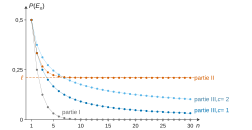
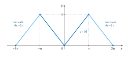

# CCINP TPC — Mathématiques 2026 · Corrigé brut

*Corrigé rédigé par IA, non officiel. Signalez toute erreur.*

Épreuve TPC1M, 4 heures, calculatrices interdites. Trois exercices indépendants.

---

## Exercice 1

Convention : $E_0=\Omega$ (zéro tirage, aucune boule blanche), donc $u_0=P(E_0)=1$.

### Préliminaires

#### Q1.a)

Soit $n\in\mathbb N^*$. Les événements $(X=1),\dots,(X=n)$ sont deux à deux incompatibles, car $X$ ne prend qu'une valeur en chaque issue.

Pour $1\le k\le n$, si $X=k$, le $k$-ième tirage a donné la boule blanche. Les $n$ premiers tirages n'ont donc pas tous donné des noires : $(X=k)\cap E_n=\varnothing$.

Soit $\omega\in\Omega$. Si $X(\omega)\in\{1,\dots,n\}$, $\omega$ est dans l'un des $(X=k)$.

Sinon, $X(\omega)=0$ (jamais de blanche) ou $X(\omega)>n$ (première blanche après le rang $n$). Dans les deux cas, les $n$ premiers tirages ont eu lieu et n'ont donné que des noires, donc $\omega\in E_n$. La réunion est $\Omega$.

**La famille $\big((X=1),\dots,(X=n),E_n\big)$ est un système complet d'événements.**

#### Q1.b)

Par additivité de $P$ sur cette famille finie d'événements deux à deux incompatibles de réunion $\Omega$ :
$$\begin{aligned}
1&=P(\Omega)\\
&=\sum_{k=1}^{n}P(X=k)+P(E_n),
\end{aligned}$$
d'où, en isolant la somme :

**$\displaystyle\sum_{k=1}^{n}P(X=k)=1-P(E_n)$.**

#### Q1.c)

$X$ est à valeurs dans $\mathbb N$ et $\sum_{k=0}^{+\infty}P(X=k)=1$. Donc la série $\sum_{k\ge1}P(X=k)$ converge et $\sum_{k=1}^{+\infty}P(X=k)=1-P(X=0)$.

En faisant tendre $n$ vers $+\infty$ dans Q1.b, le membre de gauche converge vers $1-P(X=0)$. Donc $P(E_n)$ converge et
$$\boxed{\lim_{n\to+\infty}P(E_n)=P(X=0)}.$$
En particulier, **$P(X=0)=0$ si et seulement si $\lim_{n\to+\infty}P(E_n)=0$.**

### Partie I — Étude d'un premier protocole

#### Q2

La boule noire tirée est remise : tant que l'expérience continue, l'urne contient une blanche et une noire. Donc, pour tout $k\ge1$, $P_{E_{k-1}}(N_k)=P_{E_{k-1}}(B_k)=\frac12$ (les conditionnements sont par des événements de probabilité non nulle, comme le montre le calcul de proche en proche).

Pour $k\in\mathbb N^*$, $(X=k)=N_1\cap\dots\cap N_{k-1}\cap B_k$, et la formule des probabilités composées donne
$$\begin{aligned}
P(X=k)&=P(N_1)\,P_{N_1}(N_2)\cdots P_{E_{k-2}}(N_{k-1})\,P_{E_{k-1}}(B_k)\\
&=\left(\tfrac12\right)^{k-1}\cdot\tfrac12\\
&=\left(\tfrac12\right)^k .
\end{aligned}$$
Comme $\sum_{k\ge1}\left(\frac12\right)^k=1$, on a $P(X=0)=0$. Ainsi $P(X=k)=p(1-p)^{k-1}$ pour $k\ge1$, avec $p=\frac12$ :
$$\boxed{X\hookrightarrow\mathcal G\!\left(\tfrac12\right)}.$$

#### Q3

$P(E_n)=P(N_1\cap\dots\cap N_n)=\left(\frac12\right)^n\to0$, donc par Q1.c (ou directement par la somme de Q2) :
$$\boxed{P(X=0)=0}.$$
On obtient presque sûrement la boule blanche.

#### Q4

Si $Y\hookrightarrow\mathcal G(p)$, $p\in\,]0,1[$ : $E(Y)=\dfrac1p$ et $V(Y)=\dfrac{1-p}{p^2}$. Avec $p=\frac12$ :
$$\boxed{\begin{aligned}
E(X)&=2\\
V(X)&=2
\end{aligned}}$$

### Partie II — Étude d'un deuxième protocole

#### Q5.a)

Notons $m_k$ le nombre de noires juste avant le $k$-ième tirage, sachant que ce tirage a lieu, c'est-à-dire sachant $E_{k-1}$.

On a $m_1=1$. Si le $k$-ième tirage donne une noire, elle est remise puis le nombre de noires est doublé : $m_{k+1}=2m_k$. Donc $m_k=2^{k-1}$, et la blanche est toujours seule :

**juste avant le $k$-ième tirage, l'urne contient $1$ boule blanche et $2^{k-1}$ boules noires.**

#### Q5.b)

$E_n=N_1\cap N_2\cap\dots\cap N_n$. D'après Q5.a, $P_{E_{k-1}}(N_k)=\dfrac{2^{k-1}}{1+2^{k-1}}>0$, donc tous les $P(E_k)$ sont strictement positifs et la formule des probabilités composées donne
$$\begin{aligned}
u_n=P(E_n)&=\prod_{k=1}^{n}\frac{2^{k-1}}{1+2^{k-1}}\\
&=\boxed{\prod_{i=0}^{n-1}\frac{2^i}{1+2^i}}.
\end{aligned}$$

#### Q6.a)

Tous les facteurs sont strictement positifs, donc $u_n>0$, et
$$\frac{u_{n+1}}{u_n}=\frac{2^n}{1+2^n}\in\,]0,1[ .$$
**La suite $(u_n)$ est strictement décroissante.**

#### Q6.b)

Pour tout $n\ge1$, $0<u_n\le u_1=\frac12$ : $(u_n)$ est bornée. Décroissante et minorée par $0$, elle converge (théorème de la limite monotone) vers un réel $\ell$, et par passage à la limite dans les inégalités larges :
$$\boxed{0\le\ell\le\tfrac12}.$$

#### Q6.c) i)

$$\boxed{\ln(1+x)\underset{x\to0}{\sim}x}.$$

#### Q6.c) ii)

Comme $u_n>0$,
$$\begin{aligned}
v_n&=-\ln u_n\\
&=\sum_{i=0}^{n-1}\ln\frac{1+2^i}{2^i}\\
&=\boxed{\sum_{i=0}^{n-1}\ln\left(1+2^{-i}\right)} ,
\end{aligned}$$
somme partielle d'ordre $n$ de la série $\sum_{i\ge0}w_i$, où $w_i=\ln(1+2^{-i})$.

On a $w_i>0$ et, comme $2^{-i}\to0$, Q6.c.i donne $w_i\sim2^{-i}$. La série géométrique $\sum 2^{-i}$ (raison $\frac12$) converge.

Par comparaison de séries à termes positifs, $\sum w_i$ converge. **La suite $(v_n)$ converge** vers $v=\sum_{i=0}^{+\infty}\ln(1+2^{-i})\in\mathbb R_+$.

#### Q6.c) iii)

$u_n=\mathrm e^{-v_n}$ et $v_n\to v\in\mathbb R$ ; par continuité de l'exponentielle, $\ell=\mathrm e^{-v}$, donc
$$\boxed{\ell=\mathrm e^{-v}>0,\quad \ell\neq0}.$$

#### Q7

D'après la forme renforcée de Q1.c, $P(X=0)=\lim P(E_n)=\lim u_n=\ell$, donc
$$\boxed{P(X=0)=\ell\neq0}.$$
Interprétation : avec ce protocole, l'événement « ne jamais tirer la boule blanche » a une probabilité strictement positive ; l'expérience peut ne jamais s'arrêter. Les boules noires se multiplient si vite que la probabilité de tirer la blanche au $k$-ième tirage, $\frac{1}{1+2^{k-1}}$, décroît géométriquement. (Numériquement $\ell\approx0{,}21$, valeur non exigible sans calculatrice.)

### Partie III — Étude d'un troisième protocole

#### Q8

Chaque échec ajoute $c$ noires (la noire tirée étant remise). Composition de l'urne :

- avant le 1er tirage : $1$ blanche, $1$ noire ;
- avant le 2e (sachant $N_1$) : $1$ blanche, $1+c$ noires ;
- avant le 3e (sachant $N_1\cap N_2$) : $1$ blanche, $1+2c$ noires.

Comme $(X=3)=N_1\cap N_2\cap B_3$,
$$\begin{aligned}
P(X=3)&=\frac12\cdot\frac{1+c}{2+c}\cdot\frac{1}{2+2c}\\
&=\frac{1+c}{2(2+c)\cdot2(1+c)}\\
&=\boxed{\frac{1}{4(2+c)}}.
\end{aligned}$$

#### Q9

Par récurrence comme en Q5.a, juste avant le $k$-ième tirage (sachant $E_{k-1}$), l'urne contient $1$ blanche et $1+(k-1)c$ noires.

C'est vrai pour $k=1$, et un échec au $k$-ième tirage porte ce nombre à $1+(k-1)c+c=1+kc$. Donc $P_{E_{k-1}}(N_k)=\dfrac{1+(k-1)c}{2+(k-1)c}>0$.

La formule des probabilités composées appliquée à $E_n=N_1\cap\dots\cap N_n$ donne, pour $n\in\mathbb N^*$,
$$\begin{aligned}
P(E_n)&=\prod_{k=1}^{n}\frac{1+(k-1)c}{2+(k-1)c}\\
&=\boxed{\prod_{k=0}^{n-1}\frac{1+kc}{2+kc}}.
\end{aligned}$$

#### Q10.a)

Pour $c=1$, le produit est télescopique :
$$\begin{aligned}
P(E_n)&=\prod_{k=0}^{n-1}\frac{k+1}{k+2}\\
&=\frac{\prod_{j=1}^{n}j}{\prod_{j=2}^{n+1}j}\\
&=\frac{n!}{(n+1)!}\\
&=\boxed{\frac{1}{n+1}}.
\end{aligned}$$

#### Q10.b)

$P(E_n)=\frac1{n+1}\to0$, donc par Q1.c : $\boxed{P(X=0)=0}$.

#### Q10.c)

Soit $n\in\mathbb N^*$. On a $(X=n)=E_{n-1}\cap B_n$ et $P(E_{n-1})=\frac1n>0$ (formule valable aussi pour $n-1=0$ avec $E_0=\Omega$).

Sachant $E_{n-1}$, l'urne contient $1$ blanche et $n$ noires (Q9 avec $c=1$), donc $P_{E_{n-1}}(B_n)=\frac1{n+1}$ et
$$\begin{aligned}
P(X=n)&=P(E_{n-1})\,P_{E_{n-1}}(B_n)\\
&=\frac1n\cdot\frac{1}{n+1},
\end{aligned}$$
$$\boxed{P(X=n)=\frac{1}{n(n+1)}}.$$
(Contrôle : $\sum_{n=1}^{N}\frac1{n(n+1)}=1-\frac1{N+1}\to1$, cohérent avec $P(X=0)=0$.)

#### Q10.d)

$X$ admet une espérance si et seulement si $\sum_{n\ge1}nP(X=n)$ converge (termes positifs ; le terme de la valeur $0$ est nul). Or $nP(X=n)=\frac1{n+1}\sim\frac1n$, terme général d'une série divergente (Riemann, $\alpha=1$). Par comparaison de séries à termes positifs :

**$X$ n'admet pas d'espérance.**

#### Q11.a)

Pour $c=2$ :
$$\begin{aligned}
P(E_n)&=\prod_{k=0}^{n-1}\frac{2k+1}{2k+2}\\
&=\frac{1\cdot3\cdots(2n-1)}{2\cdot4\cdots(2n)} .
\end{aligned}$$
Or $\prod_{k=1}^{n}(2k)=2^n n!$ et $\prod_{k=1}^{n}(2k-1)\times\prod_{k=1}^{n}(2k)=(2n)!$, donc $\prod_{k=1}^{n}(2k-1)=\frac{(2n)!}{2^n n!}$. Par quotient :
$$\boxed{P(E_n)=\frac{(2n)!}{2^{2n}(n!)^2}}.$$

#### Q11.b)

De $n!\sim Kn^{n+\frac12}\mathrm e^{-n}$ (avec $K>0$ puisque $n!>0$), on tire, par suite extraite puis par produit :
$$\begin{aligned}
(2n)!&\sim K(2n)^{2n+\frac12}\mathrm e^{-2n}\\
&=K\,2^{2n+\frac12}n^{2n+\frac12}\mathrm e^{-2n},\\
(n!)^2&\sim K^2n^{2n+1}\mathrm e^{-2n}.
\end{aligned}$$
Par quotient d'équivalents :
$$\begin{aligned}
P(E_n)&\sim\frac{K\,2^{2n+\frac12}\,n^{2n+\frac12}\,\mathrm e^{-2n}}{2^{2n}K^2n^{2n+1}\mathrm e^{-2n}}\\
&=\frac{\sqrt2}{K\sqrt n},
\end{aligned}$$
soit
$$\boxed{P(E_n)\underset{n\to+\infty}{\sim}\frac{\sqrt2}{K\sqrt n}}$$
et donc $\boxed{\lim_{n\to+\infty}P(E_n)=0}$ (un équivalent conserve la limite).

#### Q11.c)

Par Q1.c : $\boxed{P(X=0)=0}$ pour $c=2$.

#### Q12.a)

$P(E_n)>0$ (Q9), donc
$$\begin{aligned}
S_n&=-\ln P(E_n)\\
&=\sum_{k=0}^{n-1}\ln\frac{2+kc}{1+kc}.
\end{aligned}$$
Or $\frac{2+kc}{1+kc}=1+\frac{1}{1+kc}$, d'où
$$\boxed{S_n=\sum_{k=0}^{n-1}\ln\left(1+\frac{1}{1+kc}\right)}.$$

#### Q12.b)

Posons $t_k=\ln\left(1+\frac{1}{1+kc}\right)>0$. Comme $\frac1{1+kc}\to0$, Q6.c.i donne $t_k\sim\frac{1}{1+kc}\sim\frac{1}{c}\cdot\frac1k$.

La série harmonique diverge, donc par comparaison de séries à termes positifs $\sum t_k$ diverge ; ses sommes partielles, croissantes et non majorées, tendent vers $+\infty$ :
$$\boxed{S_n\xrightarrow[n\to+\infty]{}+\infty}.$$
Alors $P(E_n)=\mathrm e^{-S_n}\to0$ et, par Q1.c,
$$\boxed{\forall c\in\mathbb N^*,\ P(X=0)=0}.$$
**C'est cohérent avec Q10 ($c=1$) et Q11 ($c=2$)**, qui donnaient déjà $P(X=0)=0$. Une croissance arithmétique du nombre de noires ne suffit pas à empêcher la sortie de la blanche, au contraire de la croissance géométrique de la partie II.

---

## Exercice 2

### Partie I — Décomposition en série de Fourier, calcul de sommes de séries numériques

#### Q13

Le graphe est celui de $|x|$ sur $[-\pi,\pi]$, translaté de $\pm2\pi$ par périodicité : un signal triangulaire continu.

Son minimum $0$ est atteint en $-2\pi$, $0$ et $2\pi$ ; son maximum $\pi$ en $\pm\pi$.

Parité : pour $x\in\mathbb R$, soit $k\in\mathbb Z$ tel que $y=x-2k\pi\in\,]-\pi,\pi]$ ; alors $-y\in[-\pi,\pi]$ et
$$\begin{aligned}
f(-x)&=f(-y)\\
&=|-y|=|y|\\
&=f(y)=f(x).
\end{aligned}$$
**$f$ est paire.**

Elle n'est pas impaire : sinon $f(x)=-f(-x)=-f(x)$ donnerait $f\equiv0$, or $f(\pi)=\pi\neq0$. **$f$ n'est pas impaire.**

#### Q14.a)

Soit $n\in\mathbb N^*$. La fonction $x\mapsto|x|\cos(nx)$ est paire et continue, donc par intégration par parties sur le segment $[0,\pi]$ :
$$\begin{aligned}
\int_{-\pi}^{\pi}|x|\cos(nx)\,\mathrm dx&=2\int_0^\pi x\cos(nx)\,\mathrm dx\\
&=2\left[\frac{x\sin(nx)}{n}\right]_0^\pi-\frac2n\int_0^\pi\sin(nx)\,\mathrm dx\\
&=\frac{2}{n^2}\big[\cos(nx)\big]_0^\pi ,
\end{aligned}$$
$$\boxed{\int_{-\pi}^{\pi}|x|\cos(nx)\,\mathrm dx=\frac{2\big((-1)^n-1\big)}{n^2}}.$$

#### Q14.b)

$f$ est continue et $2\pi$-périodique. Comme $f$ est paire, $x\mapsto f(x)\sin(nx)$ est impaire et $b_n(f)=\frac1\pi\int_{-\pi}^{\pi}f(x)\sin(nx)\,\mathrm dx=0$ pour tout $n\ge1$.

Pour $n\ge1$, d'après Q14.a :
$$a_n(f)=\frac1\pi\int_{-\pi}^{\pi}|x|\cos(nx)\,\mathrm dx=\frac{2\big((-1)^n-1\big)}{\pi n^2},$$
donc
$$\begin{aligned}
a_{2p}&=0\quad(p\ge1),\\
a_{2p+1}&=-\frac{4}{\pi(2p+1)^2}\quad(p\ge0).
\end{aligned}$$
Terme constant : au programme de TPC, $a_0(f)$ est la valeur moyenne de $f$ sur une période,

$$a_0=\frac1{2\pi}\int_{-\pi}^{\pi}|x|\,\mathrm dx=\frac{\pi}{2},$$

et la somme partielle s'écrit

$$S_n(f)(x)=a_0+\sum_{k=1}^n\big(a_k\cos kx+b_k\sin kx\big).$$

Avec l'autre convention (coefficient $a_0=\frac1\pi\int f$ et terme constant $\frac{a_0}2$), on trouverait le même terme constant $\frac\pi2$.

La série de Fourier de $f$ est donc, avec $b_n=0$,
$$\boxed{\frac{\pi}{2}-\frac{4}{\pi}\sum_{p\ge0}\frac{\cos\big((2p+1)x\big)}{(2p+1)^2}}.$$

#### Q15

$f$ est $2\pi$-périodique et continue sur $\mathbb R$ : $|x|$ est continue sur $[-\pi,\pi]$ et $f(-\pi)=f(\pi)=\pi$, ce qui assure le raccord.

Elle est de classe $\mathcal C^1$ par morceaux : sur $[-\pi,0]$ et $[0,\pi]$ ses restrictions sont affines.

Par le théorème de Dirichlet, la série de Fourier de $f$ converge en tout point $x$ vers $\frac12\big(f(x^+)+f(x^-)\big)$, qui vaut $f(x)$ par continuité :
$$\boxed{\forall x\in\mathbb R,\ f(x)=\frac{\pi}{2}-\frac{4}{\pi}\sum_{p=0}^{+\infty}\frac{\cos\big((2p+1)x\big)}{(2p+1)^2}}.$$
En particulier $|x|=\frac\pi2-\frac4\pi\sum_{p\ge0}\frac{\cos((2p+1)x)}{(2p+1)^2}$ pour $x\in[-\pi,\pi]$.

#### Q16.a)

En $x=0$, $f(0)=0$ et $\cos 0=1$ : $0=\frac\pi2-\frac4\pi S$, donc
$$\boxed{S=\frac{\pi^2}{8}}.$$

#### Q16.b)

Les séries $R$, $S$, $T$ convergent (comparaison à $\frac1{n^2}$, absolument pour $T$). Pour $N\ge1$, en séparant indices pairs et impairs :
$$\begin{aligned}
\sum_{n=1}^{2N}\frac1{n^2}&=\sum_{p=1}^{N}\frac{1}{4p^2}\\
&\quad+\sum_{p=0}^{N-1}\frac{1}{(2p+1)^2}.
\end{aligned}$$
En faisant $N\to+\infty$ (les sommes partielles d'ordre $2N$ tendent vers $R$) :
$$\begin{aligned}
R&=\frac R4+S,\\
R&=\frac43S,
\end{aligned}$$
$$\boxed{R=\frac{\pi^2}{6}}.$$

#### Q16.c)

De même, $(-1)^{n-1}$ vaut $+1$ pour $n$ impair et $-1$ pour $n$ pair :
$$\begin{aligned}
\sum_{n=1}^{2N}\frac{(-1)^{n-1}}{n^2}&=\sum_{p=0}^{N-1}\frac1{(2p+1)^2}-\frac14\sum_{p=1}^{N}\frac1{p^2}\\
&\xrightarrow[N\to+\infty]{}S-\frac R4 .
\end{aligned}$$
Donc
$$\begin{aligned}
T&=S-\frac R4\\
&=\frac{\pi^2}{8}-\frac{\pi^2}{24},
\end{aligned}$$
ou encore, puisque $S=\frac34R$, $T=\frac R2$ :
$$\boxed{T=\frac{\pi^2}{12}}.$$

### Partie II — Application au calcul d'intégrales

#### Q17.a)

Soient $x\ge0$ et $k\in\mathbb N^*$. Pour $A>x$, comme $k>0$,
$$\begin{aligned}
\int_x^A\mathrm e^{-kt}\,\mathrm dt&=\frac{\mathrm e^{-kx}-\mathrm e^{-kA}}{k}\\
&\xrightarrow[A\to+\infty]{}\frac{\mathrm e^{-kx}}{k}.
\end{aligned}$$
Donc l'intégrale converge et
$$\boxed{\int_x^{+\infty}\mathrm e^{-kt}\,\mathrm dt=\frac{\mathrm e^{-kx}}{k}}.$$

#### Q17.b)

$t\mapsto\ln(1+\mathrm e^{-t})$ est continue et positive sur $[0,+\infty[$.

Posons $\varphi(u)=u-\ln(1+u)$ : $\varphi'(u)=\frac{u}{1+u}\ge0$ et $\varphi(0)=0$, donc $\ln(1+u)\le u$ pour $u\ge0$. D'où
$$0\le\ln(1+\mathrm e^{-t})\le\mathrm e^{-t}.$$
Comme $\int_0^{+\infty}\mathrm e^{-t}\,\mathrm dt$ converge (Q17.a), le théorème de comparaison pour les fonctions positives donne : **$\int_0^{+\infty}\ln(1+\mathrm e^{-t})\,\mathrm dt$ converge.**

#### Q18.a)

Avec $q=-\mathrm e^{-t}\in[-1,0[$, $q\neq1$ :
$$\begin{aligned}
\sum_{k=1}^{n}(-1)^k\mathrm e^{-kt}&=\sum_{k=1}^n q^k\\
&=q\,\frac{1-q^n}{1-q}\\
&=\frac{-\mathrm e^{-t}\big(1-(-1)^n\mathrm e^{-nt}\big)}{1+\mathrm e^{-t}}\\
&=\frac{-\mathrm e^{-t}}{1+\mathrm e^{-t}}+(-1)^n\frac{\mathrm e^{-(n+1)t}}{1+\mathrm e^{-t}},
\end{aligned}$$
et comme $(-1)^n=-(-1)^{n+1}$ :
$$\boxed{\sum_{k=1}^{n}(-1)^k\mathrm e^{-kt}=\frac{-\mathrm e^{-t}}{1+\mathrm e^{-t}}-(-1)^{n+1}\frac{\mathrm e^{-(n+1)t}}{1+\mathrm e^{-t}}}.$$

#### Q18.b)

Soit $x\ge0$. Toutes les fonctions de Q18.a sont continues sur $[x,+\infty[$, et $\int_x^{+\infty}\mathrm e^{-kt}\,\mathrm dt$ converge (Q17.a). Les majorations
$$\begin{aligned}
0\le\frac{\mathrm e^{-t}}{1+\mathrm e^{-t}}&\le\mathrm e^{-t},\\
0\le\frac{\mathrm e^{-(n+1)t}}{1+\mathrm e^{-t}}&\le\mathrm e^{-(n+1)t}
\end{aligned}$$
assurent la convergence des deux autres intégrales. Par linéarité, en intégrant Q18.a sur $[x,+\infty[$ :
$$\sum_{k=1}^{n}(-1)^k\frac{\mathrm e^{-kx}}{k}=-\int_x^{+\infty}\frac{\mathrm e^{-t}}{1+\mathrm e^{-t}}\,\mathrm dt-(-1)^{n+1}\int_x^{+\infty}\frac{\mathrm e^{-(n+1)t}}{1+\mathrm e^{-t}}\,\mathrm dt .$$
Le membre de gauche vaut $-h_n(x)$.

Une primitive de $\frac{\mathrm e^{-t}}{1+\mathrm e^{-t}}$ est $-\ln(1+\mathrm e^{-t})$, qui tend vers $0$ en $+\infty$. Donc $\int_x^{+\infty}\frac{\mathrm e^{-t}}{1+\mathrm e^{-t}}\,\mathrm dt=\ln(1+\mathrm e^{-x})$. En multipliant par $-1$ :
$$\boxed{\forall x\in\mathbb R_+,\ h_n(x)=\ln\left(1+\mathrm e^{-x}\right)+(-1)^{n+1}\int_x^{+\infty}\frac{\mathrm e^{-(n+1)t}}{1+\mathrm e^{-t}}\,\mathrm dt}.$$

#### Q18.c)

L'intégrande étant positif, et comme $1+\mathrm e^{-t}\ge1$,
$$\begin{aligned}
\left|\ln(1+\mathrm e^{-x})-h_n(x)\right|&=\int_x^{+\infty}\frac{\mathrm e^{-(n+1)t}}{1+\mathrm e^{-t}}\,\mathrm dt\\
&\le\int_x^{+\infty}\mathrm e^{-(n+1)t}\,\mathrm dt\\
&=\frac{\mathrm e^{-(n+1)x}}{n+1}.
\end{aligned}$$
Comme $x\ge0$, $\mathrm e^{-(n+1)x}\le\mathrm e^{-nx}$, et $\frac1{n+1}\le\frac1n$ :
$$\boxed{\forall x\in\mathbb R_+,\ \left|\ln(1+\mathrm e^{-x})-h_n(x)\right|\le\frac{\mathrm e^{-nx}}{n}}.$$

#### Q18.d)

Par linéarité et Q17.a (avec $x=0$), $\int_0^{+\infty}h_n$ converge et
$$\begin{aligned}
\int_0^{+\infty}h_n(x)\,\mathrm dx&=\sum_{k=1}^{n}\frac{(-1)^{k-1}}{k}\cdot\frac1k\\
&=\sum_{k=1}^{n}\frac{(-1)^{k-1}}{k^2}.
\end{aligned}$$
La fonction $\psi_n=\ln(1+\mathrm e^{-x})-h_n$ est continue et $|\psi_n(x)|\le\frac{\mathrm e^{-nx}}{n}$, d'intégrale convergente sur $[0,+\infty[$. Donc $\int_0^{+\infty}\psi_n$ converge absolument et, avec Q17.b et la linéarité,
$$\begin{aligned}
\left|\int_0^{+\infty}\ln(1+\mathrm e^{-x})\,\mathrm dx-\sum_{k=1}^{n}\frac{(-1)^{k-1}}{k^2}\right|&=\left|\int_0^{+\infty}\psi_n\right|\\
&\le\int_0^{+\infty}\frac{\mathrm e^{-nx}}{n}\,\mathrm dx\\
&=\frac1n\cdot\frac1n ,
\end{aligned}$$
$$\boxed{\left|\int_0^{+\infty}\ln(1+\mathrm e^{-x})\,\mathrm dx-\sum_{k=1}^{n}\frac{(-1)^{k-1}}{k^2}\right|\le\frac1{n^2}}.$$

#### Q18.e)

Quand $n\to+\infty$, $\frac1{n^2}\to0$, donc $\sum_{k=1}^{n}\frac{(-1)^{k-1}}{k^2}\to\int_0^{+\infty}\ln(1+\mathrm e^{-x})\,\mathrm dx$. Or cette somme partielle tend vers $T=\frac{\pi^2}{12}$ (Q16.c). Par unicité de la limite :
$$\boxed{\int_0^{+\infty}\ln\left(1+\mathrm e^{-x}\right)\mathrm dx=\frac{\pi^2}{12}}.$$

#### Q19

Convergence : $G(x)=\frac{x\mathrm e^{-x}}{1+\mathrm e^{-x}}$ est continue et positive. De plus $0\le G(x)\le x\mathrm e^{-x}$ et $x\mathrm e^{-x}=o(\mathrm e^{-x/2})$. Comme $\int_0^{+\infty}\mathrm e^{-x/2}\,\mathrm dx$ converge, $\int_0^{+\infty}G$ converge.

Intégration par parties sur $[0,A]$, $A>0$, avec $u(x)=x$ et $v(x)=-\ln(1+\mathrm e^{-x})$, de classe $\mathcal C^1$, $v'(x)=\frac{\mathrm e^{-x}}{1+\mathrm e^{-x}}$ :
$$\begin{aligned}
\int_0^A\frac{x\mathrm e^{-x}}{1+\mathrm e^{-x}}\,\mathrm dx&=\Big[-x\ln(1+\mathrm e^{-x})\Big]_0^A+\int_0^A\ln(1+\mathrm e^{-x})\,\mathrm dx\\
&=-A\ln(1+\mathrm e^{-A})+\int_0^A\ln(1+\mathrm e^{-x})\,\mathrm dx .
\end{aligned}$$
Or $0\le A\ln(1+\mathrm e^{-A})\le A\mathrm e^{-A}\to0$, et le dernier terme tend vers $\frac{\pi^2}{12}$ (Q18.e). En faisant $A\to+\infty$ :
$$\boxed{\int_0^{+\infty}\frac{x\mathrm e^{-x}}{1+\mathrm e^{-x}}\,\mathrm dx=\frac{\pi^2}{12}}.$$

---

## Exercice 3

### Partie I — Étude d'un cas particulier

#### Q20.a)

$(x_1,x_2,x_3)\in\ker f$ si et seulement si
$$\begin{cases}-x_1+3x_2+x_3=0\\ x_1-x_2=0\\ -4x_1+6x_2+x_3=0\end{cases}$$
La deuxième équation donne $x_2=x_1$, la première $x_3=-2x_1$. La troisième, qui s'écrit alors $2x_1+x_3=0$, est vérifiée.

Donc $\ker f=\mathrm{Vect}\big((1,1,-2)\big)$ et, ce vecteur étant non nul :
$$\boxed{\big((1,1,-2)\big)\text{ est une base de }\ker f,\quad\dim\ker f=1}.$$

#### Q20.b)

Par la formule du rang, $\operatorname{rg}f=2$. Or
$$A\begin{pmatrix}2\\1\\0\end{pmatrix}=\begin{pmatrix}1\\1\\-2\end{pmatrix}.$$
Le vecteur non nul $(1,1,-2)$ est donc dans $\ker f\cap\operatorname{Im}f$. **$\ker f$ et $\operatorname{Im}f$ ne sont pas supplémentaires dans $E$** (on a même $\ker f\subset\operatorname{Im}f$).

#### Q21

$$\chi_A(X)=\det(XI_3-A)=\begin{vmatrix}X+1&-3&-1\\-1&X+1&0\\4&-6&X-1\end{vmatrix}.$$
En développant selon la deuxième ligne :
$$\begin{aligned}
\chi_A(X)&=\begin{vmatrix}-3&-1\\-6&X-1\end{vmatrix}+(X+1)\begin{vmatrix}X+1&-1\\4&X-1\end{vmatrix}\\
&=-3(X+1)+(X+1)(X^2+3)\\
&=X^2(X+1).
\end{aligned}$$
$$\boxed{\mathrm{Sp}(A)=\{0,-1\}},\quad 0\text{ double},\ -1\text{ simple}.$$
Le sous-espace propre associé à $0$ est $\ker f$, de dimension $1<2$ : **$A$ n'est pas diagonalisable.**

#### Q22.a)

$\dim E=3$, donc $(e'_1,e'_2,e'_3)$ est une base si et seulement si son déterminant dans $\mathcal B_0$ est non nul :
$$\begin{aligned}
\begin{vmatrix}1&2&a\\1&1&0\\-2&0&b\end{vmatrix}&=a\begin{vmatrix}1&1\\-2&0\end{vmatrix}+b\begin{vmatrix}1&2\\1&1\end{vmatrix}\\
&=2a-b .
\end{aligned}$$
$$\boxed{(e'_1,e'_2,e'_3)\text{ base de }E\iff b\neq2a}.$$

#### Q22.b)

$\mathrm{Mat}_{\mathcal B'}(f)=T$ équivaut à :
$$\begin{aligned}
f(e'_1)&=0,\\
f(e'_2)&=e'_1,\\
f(e'_3)&=e'_1-e'_3.
\end{aligned}$$
Les deux premières égalités sont vraies (Q20.a et Q20.b). Pour la troisième, on calcule
$$A\begin{pmatrix}a\\0\\b\end{pmatrix}=\begin{pmatrix}-a+b\\a\\-4a+b\end{pmatrix},$$
et $e'_1-e'_3$ a pour coordonnées $(1-a,1,-2-b)$. La condition équivaut donc à
$$\begin{cases}b=1\\a=1\\-4a+2b=-2\end{cases}$$
système compatible de solution $a=b=1$, et $2a-b=1\neq0$ :

**$a=1$ et $b=1$, soit $e'_3=(1,0,1)$.**

#### Q22.c)

$$\boxed{T^2=\begin{pmatrix}0&0&-1\\0&0&0\\0&0&1\end{pmatrix}}$$
$$\boxed{T^3=\begin{pmatrix}0&0&1\\0&0&0\\0&0&-1\end{pmatrix}=-T^2}$$
Par récurrence :
$$\begin{aligned}
T^{p+1}&=T^pT\\
&=(-1)^pT^3\\
&=(-1)^{p+1}T^2 .
\end{aligned}$$
D'où
$$\boxed{\begin{aligned}
T^0&=I_3,\\
T^1&=T,\\
T^p&=(-1)^pT^2=\begin{pmatrix}0&0&(-1)^{p+1}\\0&0&0\\0&0&(-1)^p\end{pmatrix}\quad(p\ge2).
\end{aligned}}$$

#### Q23

$\mathrm{Mat}_{\mathcal B'}(f^2)=T^2$. Pour $u$ de coordonnées $(\alpha,\beta,\gamma)$ dans $\mathcal B'$, $f^2(u)$ a pour coordonnées $(-\gamma,0,\gamma)$. Donc :

- $\ker f^2=\mathrm{Vect}(e'_1,e'_2)$, de dimension $2$ ;
- $\operatorname{Im}f^2=\mathrm{Vect}(w)$ avec $w=-e'_1+e'_3$, de dimension $1$.

Si $z=\lambda w\in\ker f^2$, sa troisième coordonnée $\lambda$ est nulle : $\ker f^2\cap\operatorname{Im}f^2=\{0_E\}$.

Comme $2+1=3=\dim E$ :
$$\boxed{E=\ker(f^2)\oplus\operatorname{Im}(f^2)}.$$
Dans la base canonique : $\ker f^2=\mathrm{Vect}\big((1,1,-2),(2,1,0)\big)$ et $\operatorname{Im}f^2=\mathrm{Vect}\big((0,-1,3)\big)$.

### Partie II — Suites des noyaux et des images des itérés de $f$

#### Q24

$f$ bijectif est injectif et surjectif : $\boxed{\ker f=\{0_E\},\ \operatorname{Im}f=E}$. Alors $\ker f\cap\operatorname{Im}f=\{0_E\}$ et $\ker f+\operatorname{Im}f=E$ : **$p=1$ convient** ($1\le1\le n$).

#### Q25.a)

Si $f^k(u)=0_E$, alors $f^{k+1}(u)=f\big(f^k(u)\big)=f(0_E)=0_E$ : $\boxed{u\in\ker(f^{k+1})}$.

#### Q25.b)

Si $v=f^{k+1}(w)$, alors $v=f^k\big(f(w)\big)$ : $\boxed{v\in\operatorname{Im}(f^k)}$.

#### Q26.a)

Formule du rang : $\dim\ker f+\operatorname{rg}f=n=\dim\ker f^2+\operatorname{rg}f^2$.

Si $\ker f=\ker f^2$, alors $\operatorname{rg}f=\operatorname{rg}f^2$ ; avec $\operatorname{Im}f^2\subset\operatorname{Im}f$ (Q25.b), deux sous-espaces emboîtés de même dimension finie sont égaux : $\operatorname{Im}f=\operatorname{Im}f^2$.

Si $\operatorname{Im}f=\operatorname{Im}f^2$, alors $\dim\ker f=\dim\ker f^2$ et, avec $\ker f\subset\ker f^2$ (Q25.a), $\ker f=\ker f^2$.

**Conclusion : $\ker f=\ker f^2\iff\operatorname{Im}f=\operatorname{Im}f^2$.**

#### Q26.b) i)

Supposons $E=\ker f\oplus\operatorname{Im}f$ et soit $u\in\ker f^2$. Par définition de la somme $E=\ker f+\operatorname{Im}f$, il existe $(u_0,u_1)\in\ker f\times\operatorname{Im}f$ tel que $u=u_0+u_1$.

Alors $f(u)=f(u_0)+f(u_1)=f(u_1)$. D'une part $f(u)=f(u_1)\in\operatorname{Im}f$.

D'autre part $f\big(f(u)\big)=f^2(u)=0_E$, donc $f(u)\in\ker f$.

Ainsi $f(u)\in\ker f\cap\operatorname{Im}f=\{0_E\}$ : $f(u)=0_E$, **$u\in\ker f$**. Donc $\ker f^2\subset\ker f$ et, avec Q25.a,
$$\boxed{\ker f=\ker f^2}.$$

#### Q26.b) ii)

Supposons $\ker f=\ker f^2$. Soit $y\in\ker f\cap\operatorname{Im}f$ : $y=f(x)$ et $f(y)=f^2(x)=0_E$, donc $x\in\ker f^2=\ker f$ et $y=f(x)=0_E$.
$$\boxed{\ker f\cap\operatorname{Im}f=\{0_E\}}.$$
La somme $\ker f+\operatorname{Im}f$ est donc directe, de dimension $\dim\ker f+\operatorname{rg}f=n$ (formule du rang) : elle est égale à $E$. **$\ker f=\ker f^2\Rightarrow E=\ker f\oplus\operatorname{Im}f$.**

#### Q26.b) iii)

Les implications de i) et ii) donnent :

**$E=\ker f\oplus\operatorname{Im}f\iff\ker f=\ker f^2$.**

(Avec Q26.a, ces deux propriétés équivalent aussi à $\operatorname{Im}f=\operatorname{Im}f^2$.)

#### Q27

D'après Q25.a, $\ker f^k\subset\ker f^{k+1}$, donc $a_k\le a_{k+1}$ : $(a_k)$ est croissante.

Comme $\ker f^k$ est un sous-espace de $E$, $a_k\le n$. Croissante et majorée, **la suite $(a_k)_{k\in\mathbb N}$ converge** (théorème de la limite monotone).

#### Q28

Soit $q\ge p$. En itérant Q25.a, $\ker f^p\subset\ker f^{p+1}\subset\dots\subset\ker f^q$. De plus $a_q=a_p$ : les deux sous-espaces sont emboîtés et de même dimension finie, donc égaux. Pour tout $q\in\mathbb N^*$ tel que $q\ge p$ :
$$\boxed{\ker(f^q)=\ker(f^p)}.$$

#### Q29

Posons $g=f^p$, endomorphisme de $E$. Les questions Q25 et Q26 n'utilisent que la linéarité et la formule du rang : elles valent pour tout endomorphisme de $E$, donc pour $g$.

Comme $2p\ge p$, Q28 donne $\ker g^2=\ker f^{2p}=\ker f^p=\ker g$. Par Q26.b appliquée à $g$ :
$$\boxed{E=\ker(f^p)\oplus\operatorname{Im}(f^p)}.$$

Complément ($1\le p\le n$). Choisissons pour $p$ le plus petit entier $\ge1$ tel que $a_q=a_p$ pour tout $q\ge p$.

Si $\ker f^k=\ker f^{k+1}$, alors $\ker f^{k+1}=\ker f^{k+2}$. En effet, pour $x\in\ker f^{k+2}$, $f(x)\in\ker f^{k+1}=\ker f^k$, donc $x\in\ker f^{k+1}$. La suite des noyaux est alors constante à partir de $k$.

Par minimalité de $p$, on a donc $a_0<a_1<\dots<a_p$ (si $p\ge2$ ; le cas $p=1$ est immédiat). D'où $p\le a_p\le n$, puisque $a_0=0$.

Ainsi $1\le p\le n$ et l'objectif de la partie II est atteint (le cas bijectif étant réglé en Q24).

**FIN**
