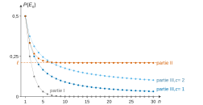
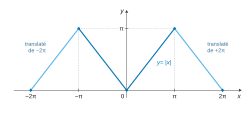

# CCINP TPC — Mathématiques 2026 · Corrigé guidé

*Corrigé rédigé par IA, non officiel. Signalez toute erreur.*

## Présentation du sujet

Épreuve TPC1M, 4 heures, **sans calculatrice**, trois exercices indépendants, 29 questions numérotées (beaucoup découpées en sous-questions). L'énoncé insiste sur la clarté de la rédaction et demande d'encadrer les résultats.

- **Exercice 1 — Probabilités (Q1 à Q12).** Une urne contient une blanche et une noire ; on tire jusqu'à la première blanche. Trois protocoles font évoluer le nombre de noires après chaque échec : rien ne change (partie I), le nombre de noires double (partie II), on ajoute $c$ noires (partie III). La question commune est : la probabilité de ne **jamais** tirer la blanche est-elle nulle ? Le préliminaire (Q1) ramène cette probabilité à la limite de $P(E_n)$. On calcule ensuite $P(E_n)$ comme un produit (probabilités composées), puis on passe au logarithme pour obtenir une série : c'est la nature de cette série qui tranche. Notions : système complet d'événements, probabilités composées, loi géométrique, suites monotones, séries à termes positifs et équivalents, produits télescopiques, factorielles.
- **Exercice 2 — Séries de Fourier et intégrales généralisées (Q13 à Q19).**
  - Partie I : série de Fourier de la fonction $2\pi$-périodique égale à $|x|$ sur $[-\pi,\pi]$, puis calcul de $\sum\frac1{(2n+1)^2}$, $\sum\frac1{n^2}$ et $\sum\frac{(-1)^{n-1}}{n^2}$.
  - Partie II : on calcule $\int_0^{+\infty}\ln(1+\mathrm e^{-x})\,\mathrm dx$ en développant en somme géométrique **finie** avec un reste contrôlé, sans aucun théorème d'interversion. On en déduit $\int_0^{+\infty}\frac{x\mathrm e^{-x}}{1+\mathrm e^{-x}}\,\mathrm dx$ par intégration par parties.
  - Notions : coefficients de Fourier, parité, théorème de Dirichlet, intégrales généralisées, comparaison, intégration par parties.
- **Exercice 3 — Algèbre linéaire (Q20 à Q29).**
  - Partie I : un endomorphisme de $\mathbb R^3$ non diagonalisable, réduit à une forme triangulaire $T$ par changement de base. Pour lui, $E=\ker f^2\oplus\operatorname{Im}f^2$, alors que $\ker f$ et $\operatorname{Im}f$ ne sont pas supplémentaires.
  - Partie II : preuve générale que les noyaux itérés se stabilisent, et qu'au rang de stabilisation $p$, $E=\ker f^p\oplus\operatorname{Im}f^p$.
  - Notions : noyau, image, formule du rang, polynôme caractéristique, critère de diagonalisabilité, matrice dans une base, somme directe.

**Difficulté.** Le sujet est classique et progressif, sans piège calculatoire majeur. Les points délicats sont des points de rigueur : passage à la limite en Q1.c, comparaison de séries (Q6.c, Q12.b), manipulation d'équivalents (Q11.b), convergence de chaque intégrale avant d'utiliser la linéarité (Q18), et dans l'exercice 3 la double inclusion de Q26.b.

**Questions à ne pas laisser passer.** Q1, Q2–Q4, Q5, Q8, Q10, Q13, Q14, Q16, Q17, Q20–Q22, Q24, Q25, Q27 : elles sont rapides et demandent surtout une rédaction propre.

**Gestion du temps.** Environ 1 h 30 pour l'exercice 1 (le plus long), 1 h 15 pour l'exercice 2, 1 h 15 pour l'exercice 3. Comme les exercices sont indépendants, on peut commencer par celui où l'on se sent le plus sûr, mais il vaut mieux finir une partie entamée, car les questions s'y enchaînent.

Convention utilisée dans tout l'exercice 1 : $E_0=\Omega$ et $u_0=P(E_0)=1$.

## Exercice 1, Préliminaires

On établit le seul outil qui sert dans les trois parties : $P(X=0)=\lim P(E_n)$.

### Question 1

> [!INDICATION]
> a) Revenir à la définition d'un système complet : incompatibilité deux à deux et réunion égale à $\Omega$. Pour la réunion, distinguer selon la valeur de $X(\omega)$.

> [!INDICATION]
> a) Ne pas oublier les issues où la première blanche sort **après** le rang $n$. b) Additivité sur une famille finie. c) Faire tendre $n$ vers l'infini dans b) et utiliser la somme rappelée par l'énoncé.

#### Solution

**a)** Soit $n\in\mathbb N^*$. Les événements $(X=1),\dots,(X=n)$ sont deux à deux incompatibles, car $X$ prend une seule valeur en chaque issue.

Pour $1\le k\le n$, si $X=k$, le $k$-ième tirage a donné la blanche. Les $n$ premiers tirages ne sont donc pas tous noirs : $(X=k)\cap E_n=\varnothing$.

Soit $\omega\in\Omega$. Si $X(\omega)\in\{1,\dots,n\}$, $\omega$ appartient à l'un des $(X=k)$.

Sinon, $X(\omega)=0$ (jamais de blanche) ou $X(\omega)>n$ (première blanche après le rang $n$). Dans les deux cas, les $n$ premiers tirages ont eu lieu et n'ont donné que des noires, donc $\omega\in E_n$.

**La famille $\big((X=1),\dots,(X=n),E_n\big)$ est un système complet d'événements.**

**b)** Par additivité sur cette famille finie :
$$\begin{aligned}
1&=P(\Omega)\\
&=\sum_{k=1}^{n}P(X=k)+P(E_n),
\end{aligned}$$
d'où, en isolant la somme :

**$\displaystyle\sum_{k=1}^{n}P(X=k)=1-P(E_n)$.**

**c)** $X$ est à valeurs dans $\mathbb N$ et $\sum_{k=0}^{+\infty}P(X=k)=1$, donc $\sum_{k=1}^{+\infty}P(X=k)=1-P(X=0)$.

Le membre de gauche de b) converge vers $1-P(X=0)$ quand $n\to+\infty$. Donc $P(E_n)$ converge et
$$\boxed{\lim_{n\to+\infty}P(E_n)=P(X=0)},$$
ce qui donne en particulier $P(X=0)=0\iff\lim P(E_n)=0$.

> [!METHODE]
> On obtient plus que l'équivalence demandée : la limite de $P(E_n)$ existe toujours et vaut $P(X=0)$. (La continuité décroissante, appliquée à la suite décroissante $(E_n)$ d'intersection $(X=0)$, donnerait le même résultat, mais elle n'est pas au programme de TPC : on s'en tient au système complet.) Garder cette forme renforcée : elle sert en Q7 pour obtenir la **valeur** de $P(X=0)$, pas seulement sa non-nullité.

> [!PIEGE]
> Opposer seulement « une blanche sort » et « aucune blanche ne sort » : la réunion ne serait pas $\Omega$, il manquerait les issues où la blanche sort après le rang $n$. C'est $E_n$ qui les contient.

## Exercice 1, Partie I — Étude d'un premier protocole

La composition de l'urne ne change jamais : on retrouve la loi géométrique.

### Question 2

> [!INDICATION]
> Que contient l'urne avant chaque tirage, si l'expérience n'est pas encore terminée ?

> [!INDICATION]
> Écrire $(X=k)$ comme une intersection d'événements $N_i$ et $B_k$, puis appliquer la formule des probabilités composées.

#### Solution

Une noire tirée est remise : tant que l'expérience continue, l'urne contient une blanche et une noire. Donc $P_{E_{k-1}}(N_k)=P_{E_{k-1}}(B_k)=\frac12$ pour tout $k\ge1$, et les conditionnements portent sur des événements de probabilité non nulle.

Pour $k\ge1$, $(X=k)=N_1\cap\dots\cap N_{k-1}\cap B_k$, d'où
$$\begin{aligned}
P(X=k)&=P(N_1)\,P_{N_1}(N_2)\cdots P_{E_{k-1}}(B_k)\\
&=\left(\tfrac12\right)^{k-1}\cdot\tfrac12\\
&=\left(\tfrac12\right)^k .
\end{aligned}$$
Comme $\sum_{k\ge1}\left(\frac12\right)^k=1$, $P(X=0)=0$. Et $P(X=k)=p(1-p)^{k-1}$ pour $k\ge1$, avec $p=\frac12$ :
$$\boxed{X\hookrightarrow\mathcal G\!\left(\tfrac12\right)}.$$

> [!PIEGE]
> Écrire « rang du premier succès, donc loi géométrique » sans justifier que la probabilité de succès est la même à chaque tirage. C'est précisément ce que les protocoles II et III vont détruire.

### Question 3

> [!INDICATION]
> Deux voies : la somme des $P(X=k)$ de Q2, ou le préliminaire avec $P(E_n)$.

#### Solution

$P(E_n)=\left(\frac12\right)^n\to0$, donc par Q1.c
$$\boxed{P(X=0)=0}.$$
La blanche sort presque sûrement : l'événement $(X=0)$ n'est pas forcément vide, mais il est de probabilité nulle.

### Question 4

> [!INDICATION]
> Formules du cours, à appliquer avec le paramètre trouvé en Q2.

#### Solution

Pour $Y\hookrightarrow\mathcal G(p)$ : $E(Y)=\dfrac1p$, $V(Y)=\dfrac{1-p}{p^2}$. Avec $p=\frac12$ :
$$\boxed{\begin{aligned}
E(X)&=2\\
V(X)&=2
\end{aligned}}$$

## Exercice 1, Partie II — Étude d'un deuxième protocole

Le nombre de noires double à chaque échec. $P(E_n)$ est un produit qui converge vers une limite **non nulle** : l'expérience peut ne jamais s'arrêter.

### Question 5

> [!INDICATION]
> a) Suivre le nombre de noires d'un tirage au suivant : l'ordre « on remet, puis on double » compte.

> [!INDICATION]
> b) $E_n$ s'écrit avec les seuls $N_i$. La probabilité conditionnelle de $N_k$ sachant $E_{k-1}$ se lit sur la composition de a).

#### Solution

**a)** Soit $m_k$ le nombre de noires juste avant le $k$-ième tirage, sachant que ce tirage a lieu. On a $m_1=1$.

Si le $k$-ième tirage donne une noire, elle est remise puis le nombre de noires est doublé : $m_{k+1}=2m_k$. Donc $m_k=2^{k-1}$.

**Juste avant le $k$-ième tirage, l'urne contient $1$ blanche et $2^{k-1}$ noires.**

**b)** $E_n=N_1\cap\dots\cap N_n$, et $P_{E_{k-1}}(N_k)=\dfrac{2^{k-1}}{1+2^{k-1}}>0$. La formule des probabilités composées donne
$$\begin{aligned}
u_n&=\prod_{k=1}^{n}\frac{2^{k-1}}{1+2^{k-1}}\\
&=\boxed{\prod_{i=0}^{n-1}\frac{2^i}{1+2^i}}.
\end{aligned}$$

> [!PIEGE]
> Écrire $P(E_n)=\prod P(N_k)$ comme si les tirages étaient indépendants : ils ne le sont pas, puisque la composition dépend des résultats précédents. Ce sont des probabilités **conditionnelles** emboîtées.

### Question 6

> [!INDICATION]
> a) Le quotient de deux termes consécutifs se lit sur le produit. b) Décroissante et minorée. c) Le logarithme transforme le produit en somme.

> [!INDICATION]
> c.ii) Mettre le facteur $\frac{2^i}{1+2^i}$ sous la forme $\frac{1}{1+\text{(petit)}}$, puis comparer à une série géométrique. c.iii) Repasser de $v_n$ à $u_n$ par l'exponentielle.

#### Solution

**a)** Les facteurs sont strictement positifs, donc $u_n>0$ et $\dfrac{u_{n+1}}{u_n}=\dfrac{2^n}{1+2^n}\in\,]0,1[$. **La suite $(u_n)$ est strictement décroissante.**

**b)** Pour tout $n\ge1$, $0<u_n\le u_1=\frac12$. Décroissante et minorée par $0$, $(u_n)$ converge vers un réel $\ell$ (limite monotone), et le passage à la limite dans des inégalités larges donne
$$\boxed{0\le\ell\le\tfrac12}.$$

**c) i)** $\boxed{\ln(1+x)\underset{x\to0}{\sim}x}$.

**c) ii)** Comme $u_n>0$ :
$$\begin{aligned}
v_n&=-\ln u_n\\
&=\sum_{i=0}^{n-1}\ln\frac{1+2^i}{2^i}\\
&=\boxed{\sum_{i=0}^{n-1}\ln\left(1+2^{-i}\right)},
\end{aligned}$$
somme partielle de la série $\sum_{i\ge0}w_i$ avec $w_i=\ln(1+2^{-i})$.

Les $w_i$ sont strictement positifs et, comme $2^{-i}\to0$, $w_i\sim2^{-i}$ par c.i.

La série géométrique $\sum2^{-i}$ converge, donc par comparaison de séries à termes positifs, $\sum w_i$ converge : **$(v_n)$ converge** vers $v=\sum_{i=0}^{+\infty}\ln(1+2^{-i})$.

**c) iii)** $u_n=\mathrm e^{-v_n}\to\mathrm e^{-v}$ par continuité de l'exponentielle, donc
$$\boxed{\ell=\mathrm e^{-v}>0}.$$

> [!PIEGE]
> En b), écrire $\ell>0$ : le passage à la limite transforme $u_n>0$ en $\ell\ge0$ seulement. La stricte positivité est justement l'objet de c.iii.

> [!METHODE]
> Pour étudier la limite d'un produit $\prod(1-\varepsilon_i)$ ou $\prod\frac{1}{1+\varepsilon_i}$ à facteurs positifs, passer au logarithme et étudier la série $\sum\ln(1+\varepsilon_i)$, de même nature que $\sum\varepsilon_i$ quand $\varepsilon_i\to0^+$. Série convergente : limite strictement positive. Série divergente : limite nulle.

### Question 7

> [!INDICATION]
> Utiliser le préliminaire sous sa forme renforcée, pas seulement l'équivalence.

#### Solution

Par Q1.c, $P(X=0)=\lim P(E_n)=\lim u_n=\ell$, donc
$$\boxed{P(X=0)=\ell\neq0}.$$
Interprétation : la probabilité de ne jamais tirer la blanche est strictement positive, l'expérience peut ne jamais s'arrêter. Le nombre de noires croît si vite que la probabilité de tirer la blanche au $k$-ième tirage, $\frac1{1+2^{k-1}}$, décroît géométriquement. (Numériquement $\ell\approx0{,}21$, ce qui n'est pas exigible sans calculatrice.)

## Exercice 1, Partie III — Étude d'un troisième protocole

On ajoute $c$ noires à chaque échec : croissance arithmétique. Cette fois $P(E_n)\to0$ pour tout $c$, ce que l'on vérifie d'abord pour $c=1$ et $c=2$ par des calculs explicites, puis en général par une série divergente.

### Question 8

> [!INDICATION]
> Décrire la composition de l'urne avant chacun des trois premiers tirages, sachant que les précédents ont donné des noires.

#### Solution

Composition de l'urne :

- avant le 1er tirage : $1$ blanche, $1$ noire ;
- avant le 2e (sachant $N_1$) : $1$ blanche, $1+c$ noires ;
- avant le 3e (sachant $N_1\cap N_2$) : $1$ blanche, $1+2c$ noires.

Comme $(X=3)=N_1\cap N_2\cap B_3$ :
$$\begin{aligned}
P(X=3)&=\frac12\cdot\frac{1+c}{2+c}\cdot\frac{1}{2+2c}\\
&=\frac{1+c}{4(2+c)(1+c)}\\
&=\boxed{\frac{1}{4(2+c)}}.
\end{aligned}$$

### Question 9

> [!INDICATION]
> Même schéma qu'en Q5 : composition de l'urne par récurrence, puis probabilités composées.

> [!INDICATION]
> Avant le $k$-ième tirage il y a eu $k-1$ échecs. Attention au décalage d'indice pour obtenir un produit de $k=0$ à $n-1$.

#### Solution

Juste avant le $k$-ième tirage (sachant $E_{k-1}$), l'urne contient $1$ blanche et $1+(k-1)c$ noires : c'est vrai pour $k=1$, et un échec porte ce nombre à $1+kc$.

Donc $P_{E_{k-1}}(N_k)=\frac{1+(k-1)c}{2+(k-1)c}>0$ et
$$\begin{aligned}
P(E_n)&=\prod_{k=1}^{n}\frac{1+(k-1)c}{2+(k-1)c}\\
&=\boxed{\prod_{k=0}^{n-1}\frac{1+kc}{2+kc}}.
\end{aligned}$$

> [!METHODE]
> Contrôle immédiat : $n=1$ redonne $\frac12=P(N_1)$, et $P(E_2)\cdot\frac{1}{2+2c}$ redonne la valeur de Q8.

### Question 10

> [!INDICATION]
> a) Avec $c=1$, écrire les premiers facteurs : le produit se simplifie de proche en proche. b) Préliminaire.

> [!INDICATION]
> c) Utiliser $(X=n)=E_{n-1}\cap B_n$, a) pour $P(E_{n-1})$, la composition de l'urne pour la probabilité conditionnelle, et la convention $E_0=\Omega$. d) Critère d'existence de l'espérance : convergence (absolue) de la série $\sum nP(X=n)$.

#### Solution

**a)** Pour $c=1$ :
$$\begin{aligned}
P(E_n)&=\prod_{k=0}^{n-1}\frac{k+1}{k+2}\\
&=\frac{n!}{(n+1)!}\\
&=\boxed{\frac{1}{n+1}}.
\end{aligned}$$

**b)** $P(E_n)\to0$, donc par Q1.c : $\boxed{P(X=0)=0}$.

**c)** Pour $n\ge1$, $P(E_{n-1})=\frac1n>0$ (y compris pour $n=1$ avec $E_0=\Omega$).

Sachant $E_{n-1}$, l'urne contient $1$ blanche et $n$ noires, donc $P_{E_{n-1}}(B_n)=\frac1{n+1}$ et
$$\begin{aligned}
P(X=n)&=P(E_{n-1})\,P_{E_{n-1}}(B_n)\\
&=\frac1n\cdot\frac1{n+1},
\end{aligned}$$
$$\boxed{P(X=n)=\frac{1}{n(n+1)}}.$$
On peut contrôler : $\sum_{n=1}^N\frac{1}{n(n+1)}=1-\frac1{N+1}\to1$.

**d)** $nP(X=n)=\frac1{n+1}\sim\frac1n$, terme général d'une série divergente. Les termes sont positifs, donc $\sum nP(X=n)$ diverge : **$X$ n'admet pas d'espérance.**

> [!PIEGE]
> Répondre « $E(X)=+\infty$ » : une variable aléatoire discrète n'admet une espérance que si la série $\sum x_kP(X=x_k)$ converge absolument. Ici la blanche sort presque sûrement, mais le temps d'attente n'a pas d'espérance.

### Question 11

> [!INDICATION]
> a) Le produit fait apparaître les impairs au numérateur et les pairs au dénominateur. Compléter le numérateur par les pairs pour obtenir une factorielle.

> [!INDICATION]
> b) Remplacer $(2n)!$ et $n!$ par l'équivalent admis, puis simplifier. Le produit et le quotient d'équivalents sont licites, pas la somme. Développer $(2n)^{2n+\frac12}$.

#### Solution

**a)** Pour $c=2$ :
$$\begin{aligned}
P(E_n)&=\prod_{k=0}^{n-1}\frac{2k+1}{2k+2}\\
&=\frac{1\cdot3\cdots(2n-1)}{2\cdot4\cdots(2n)} .
\end{aligned}$$
Or $2\cdot4\cdots(2n)=2^nn!$ et $\big(1\cdot3\cdots(2n-1)\big)\cdot\big(2\cdot4\cdots(2n)\big)=(2n)!$, donc $1\cdot3\cdots(2n-1)=\frac{(2n)!}{2^nn!}$ et
$$\boxed{P(E_n)=\frac{(2n)!}{2^{2n}(n!)^2}}.$$

**b)** L'équivalent admis, appliqué à la suite extraite $(2n)!$, puis au carré $(n!)^2$, donne :
$$\begin{aligned}
(2n)!&\sim K(2n)^{2n+\frac12}\mathrm e^{-2n}\\
&=K\,2^{2n+\frac12}n^{2n+\frac12}\mathrm e^{-2n},\\
(n!)^2&\sim K^2n^{2n+1}\mathrm e^{-2n}.
\end{aligned}$$
Par quotient ($K>0$ car $n!>0$) :
$$\begin{aligned}
P(E_n)&\sim\frac{K\,2^{2n+\frac12}\,n^{2n+\frac12}}{2^{2n}\,K^2\,n^{2n+1}}\\
&=\frac{\sqrt2}{K\sqrt n},
\end{aligned}$$
$$\boxed{P(E_n)\underset{n\to+\infty}{\sim}\frac{\sqrt2}{K\sqrt n}}$$
$$\boxed{\lim_{n\to+\infty}P(E_n)=0}$$

**c)** Par Q1.c : $\boxed{P(X=0)=0}$.

> [!PIEGE]
> Confondre $(2n)^{2n+\frac12}$ avec $2n^{2n+\frac12}$ : c'est le facteur $2^{2n}$ issu du développement qui compense le $2^{2n}$ du dénominateur.

> [!METHODE]
> Avec la valeur $K=\sqrt{2\pi}$ (formule de Stirling, non demandée ici), on trouve $P(E_n)\sim\frac{1}{\sqrt{\pi n}}$. Le résultat $\binom{2n}{n}\sim\frac{4^n}{\sqrt{\pi n}}$ est un classique à reconnaître.

### Question 12

> [!INDICATION]
> a) Logarithme du produit de Q9, puis écrire $\frac{2+kc}{1+kc}$ sous la forme $1+(\dots)$.

> [!INDICATION]
> b) Même méthode qu'en Q6.c.ii, mais la série de comparaison est cette fois une série de Riemann d'exposant $1$. Une série divergente à termes positifs a des sommes partielles qui tendent vers $+\infty$.

#### Solution

**a)** $P(E_n)>0$, donc
$$\begin{aligned}
S_n&=\sum_{k=0}^{n-1}\ln\frac{2+kc}{1+kc}\\
&=\boxed{\sum_{k=0}^{n-1}\ln\left(1+\frac1{1+kc}\right)}.
\end{aligned}$$

**b)** $t_k=\ln\left(1+\frac1{1+kc}\right)>0$ et, comme $\frac1{1+kc}\to0$, $t_k\sim\frac1{1+kc}\sim\frac1c\cdot\frac1k$.

La série harmonique diverge, donc $\sum t_k$ diverge (séries à termes positifs) ; ses sommes partielles sont croissantes et non majorées :
$$\boxed{S_n\to+\infty}.$$
Donc $P(E_n)=\mathrm e^{-S_n}\to0$ et, par Q1.c,
$$\boxed{\forall c\in\mathbb N^*,\ P(X=0)=0}.$$
**C'est cohérent avec Q10.b et Q11.c**, qui traitaient les cas $c=1$ et $c=2$.

> [!METHODE]
> Le contraste entre les parties II et III illustre la méthode de Q6 : $\ln(1+2^{-i})\sim2^{-i}$ est sommable, donc $\ell>0$, alors que $\ln\left(1+\frac{1}{1+kc}\right)\sim\frac1{ck}$ ne l'est pas, donc la limite est nulle. Ajouter un nombre fixe de noires, même grand, ne suffit pas : il faut une croissance géométrique pour que l'expérience puisse ne jamais s'arrêter.

## Exercice 2, Partie I — Décomposition en série de Fourier, calcul de sommes de séries numériques

On calcule la série de Fourier du signal triangulaire et on l'évalue en $0$ pour obtenir trois sommes classiques.

### Question 13

> [!INDICATION]
> Tracer $|x|$ sur $[-\pi,\pi]$, puis translater de $\pm2\pi$. Pour la parité, se ramener à $[-\pi,\pi]$ par périodicité.

#### Solution

Le graphe est celui de $|x|$ sur $[-\pi,\pi]$, translaté de $\pm2\pi$ par périodicité : un signal triangulaire continu.

Son minimum $0$ est atteint en $-2\pi$, $0$ et $2\pi$ ; son maximum $\pi$ en $\pm\pi$.

Parité : pour $x\in\mathbb R$, soit $y=x-2k\pi\in\,]-\pi,\pi]$ ; alors
$$\begin{aligned}
f(-x)&=f(-y)\\
&=|y|=f(y)\\
&=f(x).
\end{aligned}$$
**$f$ est paire.**

Si elle était aussi impaire, on aurait $f=-f$, donc $f\equiv0$, ce qui est faux puisque $f(\pi)=\pi$. **$f$ n'est pas impaire.**

> [!PIEGE]
> Justifier la parité seulement par $|-x|=|x|$ : cette formule ne vaut que sur $[-\pi,\pi]$, il faut passer par la périodicité pour conclure sur $\mathbb R$.

### Question 14

> [!INDICATION]
> a) L'intégrande est pair : se ramener à $[0,\pi]$, puis faire une intégration par parties.

> [!INDICATION]
> b) Les $b_n$ s'annulent par parité. Les $a_n$ s'obtiennent avec a). Le terme constant est la valeur moyenne de $f$. Distinguer $n$ pair et $n$ impair.

#### Solution

**a)** Pour $n\ge1$, par parité puis intégration par parties sur le segment $[0,\pi]$ :
$$\begin{aligned}
\int_{-\pi}^{\pi}|x|\cos(nx)\,\mathrm dx&=2\int_0^\pi x\cos(nx)\,\mathrm dx\\
&=2\left[\frac{x\sin(nx)}{n}\right]_0^\pi-\frac2n\int_0^\pi\sin(nx)\,\mathrm dx\\
&=\frac2{n^2}\big(\cos(n\pi)-1\big),
\end{aligned}$$
$$\boxed{\int_{-\pi}^{\pi}|x|\cos(nx)\,\mathrm dx=\frac{2\big((-1)^n-1\big)}{n^2}}.$$

**b)** $f$ est paire, donc $f(x)\sin(nx)$ est impaire et $b_n=0$ pour $n\ge1$. Pour $n\ge1$ :
$$a_n=\frac1\pi\int_{-\pi}^{\pi}|x|\cos(nx)\,\mathrm dx=\frac{2\big((-1)^n-1\big)}{\pi n^2},$$
donc
$$\begin{aligned}
a_{2p}&=0,\\
a_{2p+1}&=-\frac{4}{\pi(2p+1)^2}.
\end{aligned}$$
Terme constant : au programme de TPC, $a_0$ est la valeur moyenne de $f$ sur une période,

$$a_0=\frac{1}{2\pi}\int_{-\pi}^{\pi}|x|\,\mathrm dx=\frac\pi2,$$

et

$$S_n(f)(x)=a_0+\sum_{k=1}^n\big(a_k\cos kx+b_k\sin kx\big).$$

Avec l'autre convention (coefficient $a_0=\frac1\pi\int f$ et terme constant $\frac{a_0}2$), on trouve $a_0=\pi$ et le même terme constant $\frac\pi2$.

La série de Fourier est
$$\boxed{\frac\pi2-\frac4\pi\sum_{p\ge0}\frac{\cos\big((2p+1)x\big)}{(2p+1)^2}}.$$

> [!PIEGE]
> Mélanger la convention du programme ($a_0$ valeur moyenne) et l'autre (terme constant $\frac{a_0}2$) donne un terme constant égal à $\pi$ au lieu de $\frac\pi2$. En Q16, on obtiendrait alors $S=\frac{\pi^2}{4}$, valeur absurde puisque $S<R<2$. Indiquer clairement la convention utilisée.

### Question 15

> [!INDICATION]
> Vérifier les hypothèses du théorème de Dirichlet. Que vaut la régularisée en un point où $f$ est continue ?

#### Solution

$f$ est $2\pi$-périodique et continue sur $\mathbb R$ : $|x|$ est continue sur $[-\pi,\pi]$ et $f(-\pi)=f(\pi)$, ce qui assure le raccord.

Elle est $\mathcal C^1$ par morceaux (affine sur $[-\pi,0]$ et sur $[0,\pi]$).

Par le théorème de Dirichlet, sa série de Fourier converge en tout $x$ vers $\frac12\big(f(x^+)+f(x^-)\big)$, qui vaut $f(x)$ :
$$\boxed{\forall x\in\mathbb R,\ f(x)=\frac\pi2-\frac4\pi\sum_{p=0}^{+\infty}\frac{\cos\big((2p+1)x\big)}{(2p+1)^2}}.$$

> [!METHODE]
> Pour une fonction continue et $\mathcal C^1$ par morceaux, la série de Fourier converge vers $f$ partout. Le point à écrire est la continuité au raccord $\pm\pi$ : sans elle, on obtiendrait la demi-somme des limites à gauche et à droite.

### Question 16

> [!INDICATION]
> a) Évaluer l'égalité de Q15 en $x=0$.

> [!INDICATION]
> b) et c) Séparer termes pairs et impairs dans les sommes partielles d'ordre $2N$ : les termes pairs de $R$ redonnent $R$ multiplié par une constante.

#### Solution

**a)** En $x=0$ : $0=\frac\pi2-\frac4\pi S$, donc
$$\boxed{S=\frac{\pi^2}{8}}.$$

**b)** Pour $N\ge1$ :
$$\begin{aligned}
\sum_{n=1}^{2N}\frac1{n^2}&=\frac14\sum_{p=1}^{N}\frac1{p^2}\\
&\quad+\sum_{p=0}^{N-1}\frac1{(2p+1)^2}.
\end{aligned}$$
Quand $N\to+\infty$ :
$$\begin{aligned}
R&=\frac R4+S,\\
R&=\frac43S,
\end{aligned}$$
$$\boxed{R=\frac{\pi^2}{6}}.$$

**c)** De même,
$$\begin{aligned}
\sum_{n=1}^{2N}\frac{(-1)^{n-1}}{n^2}&=\sum_{p=0}^{N-1}\frac1{(2p+1)^2}-\frac14\sum_{p=1}^{N}\frac1{p^2}\\
&\xrightarrow[N\to+\infty]{}S-\frac R4 .
\end{aligned}$$
Donc
$$\begin{aligned}
T&=S-\frac R4\\
&=\frac R2,
\end{aligned}$$
$$\boxed{T=\frac{\pi^2}{12}}.$$

> [!METHODE]
> Séparer pairs et impairs **sur les sommes partielles**, puis passer à la limite : on n'a besoin d'aucun théorème de sommation par paquets. Contrôles de vraisemblance : $S\approx1{,}23$, $R\approx1{,}64$ et $T\approx0{,}82$, compris entre $1-\frac14$ et $1$.

## Exercice 2, Partie II — Application au calcul d'intégrales

On remplace un développement en série par une somme géométrique **finie** plus un reste intégral explicite, ce qui permet de calculer $\int_0^{+\infty}\ln(1+\mathrm e^{-x})\,\mathrm dx$ sans aucun théorème d'interversion.

### Question 17

> [!INDICATION]
> a) Intégrer sur $[x,A]$, puis faire tendre $A$ vers $+\infty$.

> [!INDICATION]
> b) Fonction positive : chercher une majoration par une fonction dont l'intégrale converge. Une inégalité classique sur $\ln(1+u)$ suffit.

#### Solution

**a)** Pour $A>x$, comme $k>0$ :
$$\begin{aligned}
\int_x^A\mathrm e^{-kt}\,\mathrm dt&=\frac{\mathrm e^{-kx}-\mathrm e^{-kA}}{k}\\
&\xrightarrow[A\to+\infty]{}\frac{\mathrm e^{-kx}}{k},
\end{aligned}$$
$$\boxed{\int_x^{+\infty}\mathrm e^{-kt}\,\mathrm dt=\frac{\mathrm e^{-kx}}{k}}.$$

**b)** $t\mapsto\ln(1+\mathrm e^{-t})$ est continue et positive sur $[0,+\infty[$.

La fonction $\varphi(u)=u-\ln(1+u)$ vérifie $\varphi(0)=0$ et $\varphi'(u)=\frac{u}{1+u}\ge0$. Donc $\ln(1+u)\le u$ sur $\mathbb R_+$, et
$$0\le\ln(1+\mathrm e^{-t})\le\mathrm e^{-t}.$$
Par comparaison avec $\int_0^{+\infty}\mathrm e^{-t}\,\mathrm dt$ (convergente) : **$\int_0^{+\infty}\ln(1+\mathrm e^{-t})\,\mathrm dt$ converge.**

> [!PIEGE]
> Oublier la positivité : les théorèmes de comparaison ne valent que pour des fonctions positives (ou en valeur absolue). L'équivalent $\ln(1+\mathrm e^{-t})\sim\mathrm e^{-t}$ quand $t\to+\infty$ suffirait aussi pour la convergence, mais il ne donne aucune majoration valable sur tout $\mathbb R_+$. L'inégalité $\ln(1+u)\le u$ est donc préférable, d'autant qu'elle resservira en Q19.

### Question 18

> [!INDICATION]
> a) Somme géométrique de raison $-\mathrm e^{-t}$. b) Intégrer a) sur $[x,+\infty[$, après avoir vérifié que chaque intégrale converge. Reconnaître une dérivée logarithmique.

> [!INDICATION]
> c) Le reste est l'intégrale de b) : majorer le dénominateur par en dessous. d) Intégrer l'inégalité de c) sur $[0,+\infty[$ ; l'intégrale de $h_n$ se calcule avec Q17.a. e) Faire tendre $n$ vers l'infini et utiliser la partie I.

#### Solution

**a)** Avec $q=-\mathrm e^{-t}\neq1$ :
$$\begin{aligned}
\sum_{k=1}^n(-1)^k\mathrm e^{-kt}&=q\frac{1-q^n}{1-q}\\
&=\frac{-\mathrm e^{-t}+(-1)^n\mathrm e^{-(n+1)t}}{1+\mathrm e^{-t}},
\end{aligned}$$
$$\boxed{\sum_{k=1}^{n}(-1)^k\mathrm e^{-kt}=\frac{-\mathrm e^{-t}}{1+\mathrm e^{-t}}-(-1)^{n+1}\frac{\mathrm e^{-(n+1)t}}{1+\mathrm e^{-t}}}.$$

**b)** Soit $x\ge0$. Les intégrales $\int_x^{+\infty}\mathrm e^{-kt}\,\mathrm dt$ convergent (Q17.a), et les majorations
$$\begin{aligned}
0\le\frac{\mathrm e^{-t}}{1+\mathrm e^{-t}}&\le\mathrm e^{-t},\\
0\le\frac{\mathrm e^{-(n+1)t}}{1+\mathrm e^{-t}}&\le\mathrm e^{-(n+1)t}
\end{aligned}$$
donnent la convergence des deux autres. Par linéarité :
$$\begin{aligned}
-h_n(x)&=\sum_{k=1}^n(-1)^k\frac{\mathrm e^{-kx}}{k}\\
&=-\int_x^{+\infty}\frac{\mathrm e^{-t}}{1+\mathrm e^{-t}}\,\mathrm dt-(-1)^{n+1}\int_x^{+\infty}\frac{\mathrm e^{-(n+1)t}}{1+\mathrm e^{-t}}\,\mathrm dt .
\end{aligned}$$
Comme $-\ln(1+\mathrm e^{-t})$ est une primitive de $\frac{\mathrm e^{-t}}{1+\mathrm e^{-t}}$ qui tend vers $0$ en $+\infty$, la première intégrale vaut $\ln(1+\mathrm e^{-x})$ :
$$\boxed{h_n(x)=\ln(1+\mathrm e^{-x})+(-1)^{n+1}\int_x^{+\infty}\frac{\mathrm e^{-(n+1)t}}{1+\mathrm e^{-t}}\,\mathrm dt}.$$

**c)** L'intégrande est positif et $1+\mathrm e^{-t}\ge1$ :
$$\begin{aligned}
\left|\ln(1+\mathrm e^{-x})-h_n(x)\right|&=\int_x^{+\infty}\frac{\mathrm e^{-(n+1)t}}{1+\mathrm e^{-t}}\,\mathrm dt\\
&\le\frac{\mathrm e^{-(n+1)x}}{n+1}\\
&\le\frac{\mathrm e^{-nx}}{n},
\end{aligned}$$
la dernière inégalité parce que $x\ge0$ et $n+1>n$ :
$$\boxed{\left|\ln(1+\mathrm e^{-x})-h_n(x)\right|\le\frac{\mathrm e^{-nx}}{n}}.$$

**d)** Par linéarité et Q17.a avec $x=0$ :
$$\begin{aligned}
\int_0^{+\infty}h_n&=\sum_{k=1}^n\frac{(-1)^{k-1}}{k}\cdot\frac1k\\
&=\sum_{k=1}^n\frac{(-1)^{k-1}}{k^2}.
\end{aligned}$$
La différence $\psi_n=\ln(1+\mathrm e^{-x})-h_n$ est continue, majorée en valeur absolue par $\frac{\mathrm e^{-nx}}{n}$. Son intégrale converge donc absolument, et
$$\begin{aligned}
\left|\int_0^{+\infty}\ln(1+\mathrm e^{-x})\,\mathrm dx-\sum_{k=1}^n\frac{(-1)^{k-1}}{k^2}\right|&\le\int_0^{+\infty}\frac{\mathrm e^{-nx}}{n}\,\mathrm dx\\
&=\boxed{\frac1{n^2}}.
\end{aligned}$$

**e)** Quand $n\to+\infty$, la somme partielle tend à la fois vers $\int_0^{+\infty}\ln(1+\mathrm e^{-x})\,\mathrm dx$ (d) et vers $T$ (Q16.c) :
$$\boxed{\int_0^{+\infty}\ln(1+\mathrm e^{-x})\,\mathrm dx=\frac{\pi^2}{12}}.$$

> [!METHODE]
> Développer en série puis « intégrer terme à terme » demanderait un théorème d'interversion. Ici on garde une somme **finie** et un reste intégral qu'on majore explicitement : la linéarité suffit, puis un encadrement donne la limite. C'est une technique à retenir dès qu'une série géométrique apparaît sous une intégrale.

> [!PIEGE]
> En b), utiliser la linéarité de l'intégrale généralisée sans avoir vérifié la convergence de **chacune** des intégrales. En d), oublier que $\int_0^{+\infty}\frac{\mathrm e^{-nx}}{n}\,\mathrm dx$ vaut $\frac1{n^2}$, et non $\frac1n$.

### Question 19

> [!INDICATION]
> Reconnaître $\frac{\mathrm e^{-x}}{1+\mathrm e^{-x}}$ comme une dérivée. Faire l'intégration par parties sur un segment $[0,A]$, puis faire tendre $A$ vers $+\infty$.

> [!INDICATION]
> Le terme tout intégré se traite avec l'inégalité de Q17.b et les croissances comparées.

#### Solution

$G(x)=\frac{x\mathrm e^{-x}}{1+\mathrm e^{-x}}$ est continue et positive. De plus $G(x)\le x\mathrm e^{-x}$ et $x\mathrm e^{-x}=o(\mathrm e^{-x/2})$, donc $\int_0^{+\infty}G$ converge.

Sur $[0,A]$, avec $u(x)=x$ et $v(x)=-\ln(1+\mathrm e^{-x})$, de classe $\mathcal C^1$, $v'(x)=\frac{\mathrm e^{-x}}{1+\mathrm e^{-x}}$ :
$$\int_0^A\frac{x\mathrm e^{-x}}{1+\mathrm e^{-x}}\,\mathrm dx=-A\ln(1+\mathrm e^{-A})+\int_0^A\ln(1+\mathrm e^{-x})\,\mathrm dx .$$
Or $0\le A\ln(1+\mathrm e^{-A})\le A\mathrm e^{-A}\to0$ et le dernier terme tend vers $\frac{\pi^2}{12}$ (Q18.e) :
$$\boxed{\int_0^{+\infty}\frac{x\mathrm e^{-x}}{1+\mathrm e^{-x}}\,\mathrm dx=\frac{\pi^2}{12}}.$$

> [!METHODE]
> Sur un intervalle non borné, l'intégration par parties la plus sûre est celle faite sur un segment, suivie d'un passage à la limite. Il faut alors traiter séparément la limite du terme tout intégré et celle de l'intégrale restante.

## Exercice 3, Partie I — Étude d'un cas particulier

Un exemple $3\times3$ où $\ker f$ et $\operatorname{Im}f$ ne sont pas supplémentaires, mais où $\ker f^2$ et $\operatorname{Im}f^2$ le sont : la partie II explique pourquoi.

### Question 20

> [!INDICATION]
> a) Résoudre $AX=0$. b) Les dimensions s'additionnent toujours à $3$ (formule du rang) : regarder l'intersection.

> [!INDICATION]
> b) Chercher si le vecteur du noyau est l'image d'un vecteur simple, par exemple une combinaison des colonnes de $A$.

#### Solution

**a)** Le système
$$\begin{cases}-x_1+3x_2+x_3=0\\ x_1-x_2=0\\ -4x_1+6x_2+x_3=0\end{cases}$$
donne $x_2=x_1$ et $x_3=-2x_1$, la troisième équation étant alors vérifiée. Donc
$$\boxed{\ker f=\mathrm{Vect}\big((1,1,-2)\big)}$$
et $\dim\ker f=1$.

**b)** On a
$$A\begin{pmatrix}2\\1\\0\end{pmatrix}=\begin{pmatrix}1\\1\\-2\end{pmatrix}.$$
Le vecteur non nul $(1,1,-2)$ est donc dans $\ker f\cap\operatorname{Im}f$. **$\ker f$ et $\operatorname{Im}f$ ne sont pas supplémentaires dans $E$.**

> [!PIEGE]
> Conclure à la supplémentarité parce que $\dim\ker f+\dim\operatorname{Im}f=3$ : c'est toujours vrai (formule du rang) et ne prouve rien. Seule l'intersection décide.

### Question 21

> [!INDICATION]
> Calculer $\det(XI_3-A)$ en développant selon une ligne qui contient un zéro. Comparer ensuite multiplicité et dimension du sous-espace propre.

#### Solution

En développant selon la deuxième ligne :
$$\begin{aligned}
\chi_A(X)&=\begin{vmatrix}X+1&-3&-1\\-1&X+1&0\\4&-6&X-1\end{vmatrix}\\
&=-3(X+1)+(X+1)(X^2+3)\\
&=X^2(X+1).
\end{aligned}$$
$$\boxed{\mathrm{Sp}(A)=\{0,-1\}}\ (0\text{ double}).$$
Le sous-espace propre $E_0=\ker f$ est de dimension $1<2$ : **$A$ n'est pas diagonalisable.**

> [!METHODE]
> Contrôles rapides du polynôme caractéristique d'une matrice $3\times3$ :
> - le coefficient de $X^2$ vaut $-\operatorname{tr}A$ (ici $\operatorname{tr}A=-1$) ;
> - le terme constant vaut $-\det A$ (ici $0$, cohérent avec $\ker f\neq\{0\}$).

### Question 22

> [!INDICATION]
> a) Trois vecteurs en dimension $3$ : base si et seulement si le déterminant est non nul. b) Lire les colonnes de $T$ : elles donnent $f(e'_j)$ dans la base $\mathcal B'$.

> [!INDICATION]
> b) Deux des trois conditions sont déjà acquises par Q20 ; la troisième est un système de trois équations à deux inconnues, dont il faut vérifier la compatibilité. Revenir ensuite à a). c) Calculer $T^2$, $T^3$ et comparer.

#### Solution

**a)** On calcule
$$\begin{vmatrix}1&2&a\\1&1&0\\-2&0&b\end{vmatrix}=2a-b,$$
donc
$$\boxed{(e'_1,e'_2,e'_3)\text{ base}\iff b\neq2a}.$$

**b)** Il faut $f(e'_1)=0$ (vrai, Q20.a), $f(e'_2)=e'_1$ (vrai, Q20.b) et $f(e'_3)=e'_1-e'_3$, soit
$$\begin{pmatrix}-a+b\\a\\-4a+b\end{pmatrix}=\begin{pmatrix}1-a\\1\\-2-b\end{pmatrix}\iff\begin{cases}b=1\\a=1\\-4a+2b=-2\end{cases}$$
Ce système est compatible, de solution $a=b=1$ ; et $2a-b=1\neq0$.

**$a=1$ et $b=1$, soit $e'_3=(1,0,1)$.**

**c)** On trouve
$$\boxed{T^2=\begin{pmatrix}0&0&-1\\0&0&0\\0&0&1\end{pmatrix}}$$
$$\boxed{T^3=-T^2}$$
Par récurrence :
$$\begin{aligned}
T^{p+1}&=T^pT\\
&=(-1)^pT^3\\
&=(-1)^{p+1}T^2,
\end{aligned}$$
d'où
$$\boxed{\begin{aligned}
T^0&=I_3,\\
T^1&=T,\\
T^p&=(-1)^pT^2=\begin{pmatrix}0&0&(-1)^{p+1}\\0&0&0\\0&0&(-1)^p\end{pmatrix}\quad(p\ge2).
\end{aligned}}$$

> [!PIEGE]
> Lire $T$ par lignes au lieu de colonnes. Oublier de vérifier que la troisième équation est compatible et que $(a,b)$ trouvé donne bien une base. En c), oublier les cas $p=0$ et $p=1$, qui ne rentrent pas dans la formule générale.

### Question 23

> [!INDICATION]
> Travailler dans $\mathcal B'$ : la matrice de $f^2$ y est $T^2$, et noyau et image se lisent sur les coordonnées.

#### Solution

Si $u$ a pour coordonnées $(\alpha,\beta,\gamma)$ dans $\mathcal B'$, $f^2(u)$ a pour coordonnées $(-\gamma,0,\gamma)$. Donc :

- $\ker f^2=\mathrm{Vect}(e'_1,e'_2)$, de dimension $2$ ;
- $\operatorname{Im}f^2=\mathrm{Vect}(-e'_1+e'_3)$, de dimension $1$.

Un vecteur $\lambda(-e'_1+e'_3)$ de $\ker f^2$ a une troisième coordonnée $\lambda$ nulle : l'intersection est $\{0_E\}$.

Comme $2+1=3$ :
$$\boxed{E=\ker(f^2)\oplus\operatorname{Im}(f^2)}.$$
Dans la base canonique : $\ker f^2=\mathrm{Vect}\big((1,1,-2),(2,1,0)\big)$, $\operatorname{Im}f^2=\mathrm{Vect}\big((0,-1,3)\big)$.

> [!METHODE]
> Le changement de base de Q22 sert précisément à cela : dans la base adaptée, noyaux et images des puissances se lisent sans calcul. Ici $\ker f\subsetneq\ker f^2=\ker f^3$ : la suite des noyaux se stabilise au rang $2$, ce qui annonce la partie II.

## Exercice 3, Partie II — Suites des noyaux et des images des itérés de $f$

Preuve générale : les noyaux itérés croissent puis se stabilisent ; au rang de stabilisation $p$, $E=\ker f^p\oplus\operatorname{Im}f^p$. Le seul outil est la formule du rang, utilisée pour transformer une inclusion en égalité.

### Question 24

> [!INDICATION]
> Bijectif signifie injectif et surjectif.

#### Solution

$\boxed{\ker f=\{0_E\},\ \operatorname{Im}f=E}$. Alors $E=\{0_E\}\oplus E=\ker f\oplus\operatorname{Im}f$ : **$p=1$ convient.**

### Question 25

> [!INDICATION]
> Utiliser l'une ou l'autre des écritures $f^{k+1}=f\circ f^k=f^k\circ f$, selon qu'on traite le noyau ou l'image.

#### Solution

**a)** Si $f^k(u)=0_E$, alors $f^{k+1}(u)=f\big(f^k(u)\big)=f(0_E)=0_E$ : $\boxed{u\in\ker(f^{k+1})}$.

**b)** Si $v=f^{k+1}(w)$, alors $v=f^k\big(f(w)\big)$ : $\boxed{v\in\operatorname{Im}(f^k)}$.

### Question 26

> [!INDICATION]
> a) Formule du rang pour $f$ et $f^2$, et inclusions de Q25 : deux sous-espaces emboîtés de même dimension finie sont égaux.

> [!INDICATION]
> b.i) Calculer $f(u)$ avec la décomposition $u=u_0+u_1$ et montrer que $f(u)$ est à la fois dans le noyau et dans l'image. b.ii) Pour un $y=f(x)$ de l'intersection, regarder $f^2(x)$ ; conclure par la formule du rang.

#### Solution

**a)** Formule du rang : $\dim\ker f+\operatorname{rg}f=n=\dim\ker f^2+\operatorname{rg}f^2$.

Si $\ker f=\ker f^2$, alors $\operatorname{rg}f=\operatorname{rg}f^2$ et, comme $\operatorname{Im}f^2\subset\operatorname{Im}f$, $\operatorname{Im}f=\operatorname{Im}f^2$.

Réciproquement, si $\operatorname{Im}f=\operatorname{Im}f^2$, alors $\dim\ker f=\dim\ker f^2$ et, comme $\ker f\subset\ker f^2$, $\ker f=\ker f^2$.

**Conclusion : $\ker f=\ker f^2\iff\operatorname{Im}f=\operatorname{Im}f^2$.**

**b) i)** Supposons $E=\ker f\oplus\operatorname{Im}f$ et soit $u\in\ker f^2$. Comme $E=\ker f+\operatorname{Im}f$, il existe $(u_0,u_1)\in\ker f\times\operatorname{Im}f$ avec $u=u_0+u_1$.

Alors $f(u)=f(u_1)\in\operatorname{Im}f$, et $f\big(f(u)\big)=f^2(u)=0_E$, donc $f(u)\in\ker f$.

Ainsi $f(u)\in\ker f\cap\operatorname{Im}f=\{0_E\}$, donc **$u\in\ker f$**. Avec Q25.a :
$$\boxed{\ker f=\ker f^2}.$$

**b) ii)** Supposons $\ker f=\ker f^2$. Si $y=f(x)\in\ker f$, alors $f^2(x)=0_E$, donc $x\in\ker f^2=\ker f$ et $y=0_E$ :
$$\boxed{\ker f\cap\operatorname{Im}f=\{0_E\}}.$$
La somme est directe et de dimension $\dim\ker f+\operatorname{rg}f=n$ : **$E=\ker f\oplus\operatorname{Im}f$.**

**b) iii)** Les implications i) et ii) donnent :

**$E=\ker f\oplus\operatorname{Im}f\iff\ker f=\ker f^2$.**

> [!METHODE]
> Pour montrer $E=F\oplus G$ en dimension finie, il suffit de deux des trois propriétés suivantes : $F\cap G=\{0\}$, $F+G=E$, $\dim F+\dim G=\dim E$. Avec $F=\ker f$ et $G=\operatorname{Im}f$, la formule du rang fournit la troisième gratuitement : il ne reste que l'intersection.

> [!PIEGE]
> En b.i), affirmer directement que $u_1\in\ker f$ sans passer par $f(u)\in\ker f\cap\operatorname{Im}f$. Ne pas oublier non plus l'inclusion réciproque $\ker f\subset\ker f^2$ : on demande une égalité.

### Question 27

> [!INDICATION]
> Croissance : Q25.a. Majoration : tous ces noyaux sont des sous-espaces de $E$.

#### Solution

$\ker f^k\subset\ker f^{k+1}$ donne $a_k\le a_{k+1}$, et $a_k\le\dim E=n$. Croissante et majorée, **la suite $(a_k)$ converge.**

> [!METHODE]
> Une suite d'entiers croissante et majorée est stationnaire : c'est plus fort que la convergence, et c'est ce que l'énoncé utilise ensuite.

### Question 28

> [!INDICATION]
> Inclusion par Q25.a itérée, égalité des dimensions par stationnarité.

#### Solution

Pour $q\ge p$, $\ker f^p\subset\ker f^{p+1}\subset\dots\subset\ker f^q$, et $a_q=a_p$. Deux sous-espaces emboîtés de même dimension finie sont égaux. Pour tout $q\ge p$ :
$$\boxed{\ker(f^q)=\ker(f^p)}.$$

### Question 29

> [!INDICATION]
> Appliquer Q26.b à un autre endomorphisme que $f$. Lequel, et pourquoi son hypothèse est-elle satisfaite ?

> [!INDICATION]
> Poser $g=f^p$ : que vaut $g^2$ ? Utiliser Q28 avec un $q$ bien choisi.

#### Solution

Soit $g=f^p\in\mathcal L(E)$. La preuve de Q26 n'utilise que la linéarité et la formule du rang : elle vaut pour tout endomorphisme de $E$, donc pour $g$. Comme $2p\ge p$, Q28 donne $\ker g^2=\ker f^{2p}=\ker f^p=\ker g$. Par Q26.b appliquée à $g$ :
$$\boxed{E=\ker(f^p)\oplus\operatorname{Im}(f^p)}.$$

Pour atteindre l'objectif annoncé $1\le p\le n$, prenons pour $p$ le plus petit entier $\ge1$ à partir duquel $(a_k)$ est constante.

Si $\ker f^k=\ker f^{k+1}$, alors $\ker f^{k+1}=\ker f^{k+2}$. En effet, pour $x\in\ker f^{k+2}$, $f(x)\in\ker f^{k+1}=\ker f^k$, donc $x\in\ker f^{k+1}$. La suite des noyaux est alors constante à partir du rang $k$.

Par minimalité de $p$, si $p\ge2$, on a donc $0=a_0<a_1<\dots<a_p\le n$, d'où $p\le n$ ; le cas $p=1$ est immédiat.

Avec Q24 pour le cas bijectif, le résultat vaut pour tout endomorphisme de $E$.

> [!METHODE]
> Réutiliser un résultat démontré pour « $f$ » en l'appliquant à $f^p$, $f^2$, $f-\lambda\,\mathrm{id}$… est un geste très fréquent en algèbre linéaire. Il faut dire en une phrase que la preuve ne dépendait d'aucune propriété particulière de $f$.

> [!PIEGE]
> Appliquer Q26.b sans vérifier son hypothèse pour $g$. C'est l'égalité $\ker f^{2p}=\ker f^p$, tirée de Q28, qui la fournit. Sur l'exemple de la partie I, $p=2$ et on retrouve Q23.

## Bilan

- **Méthodes à retenir.**
  - Probabilités : écrire un événement « rang du premier succès » ou « que des échecs » comme une intersection, puis appliquer la formule des probabilités composées avec des conditionnements emboîtés. Relier $P(X=0)$ à $\lim P(E_n)$ par un système complet et un passage à la limite.
  - Produits infinis : passer au logarithme pour obtenir une série, puis utiliser $\ln(1+x)\sim x$ et la comparaison de séries à termes positifs. Série convergente : limite strictement positive. Série divergente : limite nulle.
  - Séries de Fourier : parité (les $b_n$ s'annulent), intégration par parties pour les $a_n$, théorème de Dirichlet et continuité, évaluation en un point bien choisi, séparation pairs/impairs sur les sommes partielles.
  - Intégrales généralisées : remplacer une série par une somme finie et un reste majoré, vérifier la convergence de chaque intégrale avant la linéarité, faire l'intégration par parties sur un segment puis passer à la limite.
  - Algèbre linéaire : la formule du rang transforme une inclusion en égalité ; pour une somme directe $\ker\oplus\operatorname{Im}$, il ne reste que l'intersection à étudier.
- **Prérequis à revoir.** Loi géométrique (espérance, variance), critère d'existence de l'espérance, équivalents (produit, quotient, suites extraites), séries de Riemann et géométriques, coefficients de Fourier et théorème de Dirichlet, critère de diagonalisabilité, matrice d'un endomorphisme dans une base.
- **Questions classiques transposables.** Urnes de Pólya et variantes (ajout de boules après chaque tirage) ; calcul de $\sum\frac1{n^2}$ par une série de Fourier (aussi possible avec $x^2$) ; $\int_0^{+\infty}\frac{x}{\mathrm e^x+1}\,\mathrm dx=\frac{\pi^2}{12}$ ; lemme des noyaux et images itérés (décomposition de Fitting) et la borne $p\le n$, qui servent dans l'étude des endomorphismes nilpotents.
